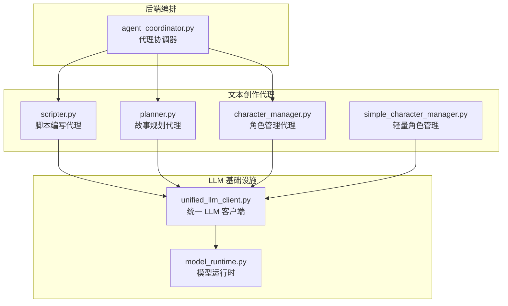
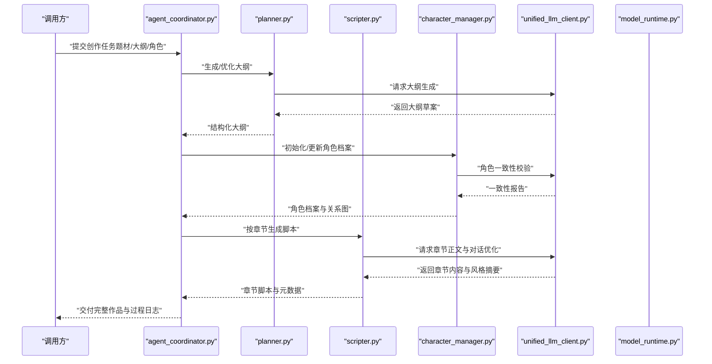
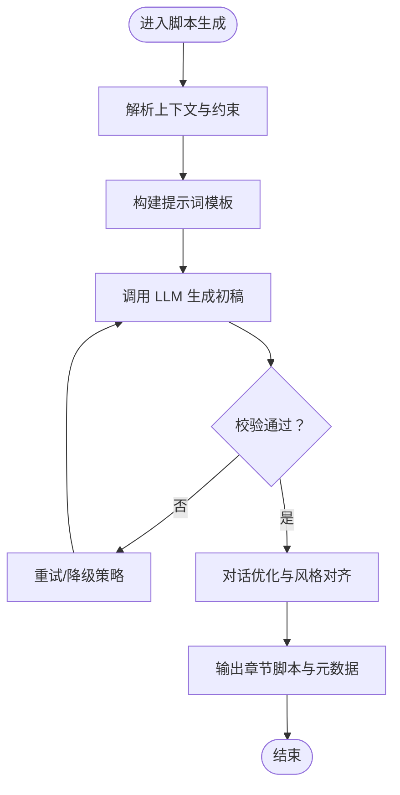
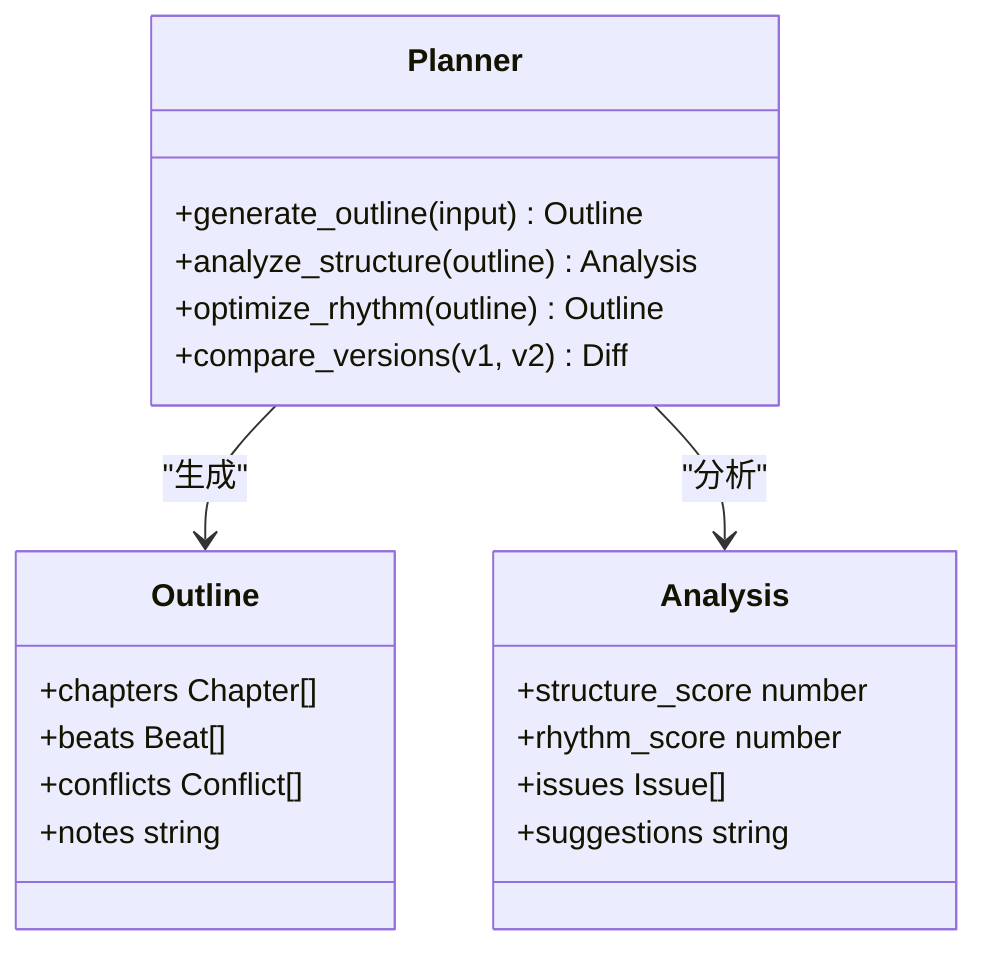
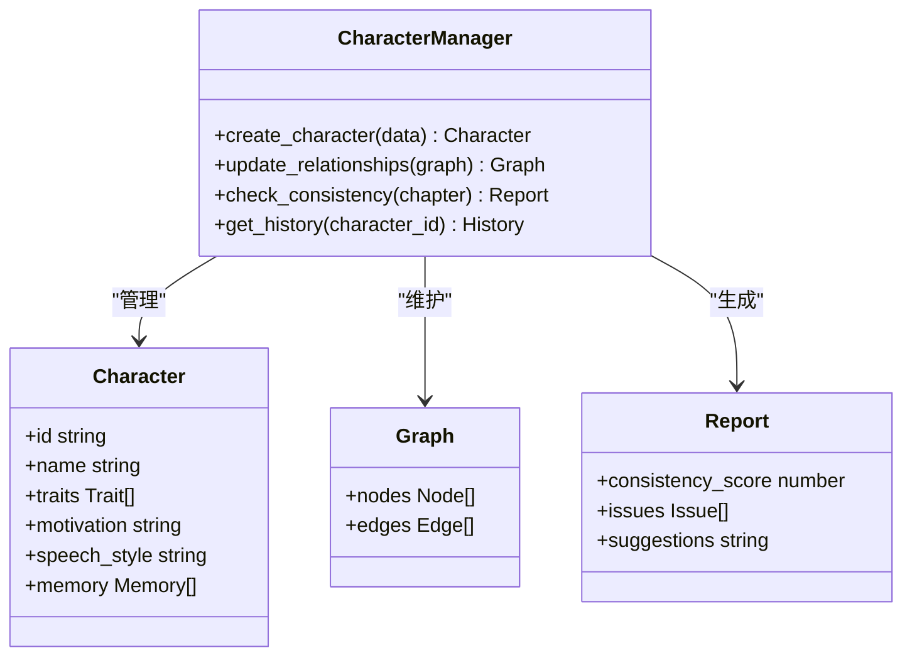
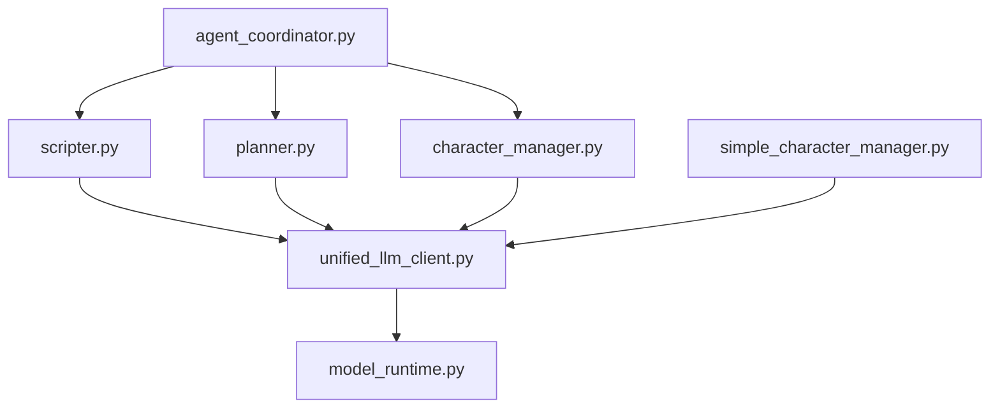

# 文本创作代理

<cite>
**本文引用的文件**   
- [agents/scripter.py](file://agents/scripter.py)
- [agents/planner.py](file://agents/planner.py)
- [agents/character_manager.py](file://agents/character_manager.py)
- [agents/simple_character_manager.py](file://agents/simple_character_manager.py)
- [core/unified_llm_client.py](file://core/unified_llm_client.py)
- [core/model_runtime.py](file://core/model_runtime.py)
- [backend/app/services/agents/agent_coordinator.py](file://backend/app/services/agents/agent_coordinator.py)
- [schemas/story_request.json](file://schemas/story_request.json)
</cite>

## 目录
1. [简介](#简介)
2. [项目结构](#项目结构)
3. [核心组件](#核心组件)
4. [架构总览](#架构总览)
5. [详细组件分析](#详细组件分析)
6. [依赖关系分析](#依赖关系分析)
7. [性能考量](#性能考量)
8. [故障排查指南](#故障排查指南)
9. [结论](#结论)
10. [附录](#附录)

## 简介
本技术文档聚焦于“文本创作代理模块”，围绕三大代理展开：脚本编写代理（scripter.py）、故事规划代理（planner.py）与角色管理代理（character_manager.py）。文档从系统架构、组件职责、数据流、接口设计、参数配置、输入输出格式到错误处理策略进行系统化说明，并提供调用示例、协作模式与性能调优建议，帮助读者快速理解并高效使用这些代理完成小说创作。

## 项目结构
文本创作代理位于 agents 目录下，核心文件包括 scripter.py、planner.py、character_manager.py 及其简化实现 simple_character_manager.py。它们通过统一的 LLM 客户端与模型运行时进行交互，并在后端服务中由协调器统一编排。

图表来源
- [agents/scripter.py](file://agents/scripter.py)
- [agents/planner.py](file://agents/planner.py)
- [agents/character_manager.py](file://agents/character_manager.py)
- [agents/simple_character_manager.py](file://agents/simple_character_manager.py)
- [core/unified_llm_client.py](file://core/unified_llm_client.py)
- [core/model_runtime.py](file://core/model_runtime.py)
- [backend/app/services/agents/agent_coordinator.py](file://backend/app/services/agents/agent_coordinator.py)

章节来源
- [agents/scripter.py](file://agents/scripter.py)
- [agents/planner.py](file://agents/planner.py)
- [agents/character_manager.py](file://agents/character_manager.py)
- [agents/simple_character_manager.py](file://agents/simple_character_manager.py)
- [core/unified_llm_client.py](file://core/unified_llm_client.py)
- [core/model_runtime.py](file://core/model_runtime.py)
- [backend/app/services/agents/agent_coordinator.py](file://backend/app/services/agents/agent_coordinator.py)

## 核心组件
- 脚本编写代理（scripter.py）
  - 功能：基于大纲生成具体章节脚本，优化对话表达，保证风格一致性与情节连贯性。
  - 输入：章节上下文、人物设定、场景信息、写作约束（如字数、语气、视角）。
  - 输出：章节正文、对话片段、关键事件标记、风格提示词摘要。
  - 错误处理：对 LLM 返回异常、内容安全校验失败、长度超限等进行重试或降级。

- 故事规划代理（planner.py）
  - 功能：构建故事大纲、设计情节推进、分析结构与节奏，支持多版本对比与迭代。
  - 输入：题材、主题、目标受众、篇幅、关键线索与伏笔要求。
  - 输出：章节大纲、情节节拍表、冲突与转折清单、结构分析报告。
  - 错误处理：对大纲不可用、逻辑矛盾、重复情节等给出修正建议与回退方案。

- 角色管理代理（character_manager.py）
  - 功能：创建与维护角色档案、管理角色关系网络、确保跨章节一致性（性格、动机、语言风格）。
  - 输入：角色初始设定、关系图谱、行为约束、记忆要点。
  - 输出：角色档案、关系图、一致性检查报告、变更历史。
  - 错误处理：对冲突设定、关系循环、不一致描述进行告警与修复建议。

章节来源
- [agents/scripter.py](file://agents/scripter.py)
- [agents/planner.py](file://agents/planner.py)
- [agents/character_manager.py](file://agents/character_manager.py)

## 架构总览
文本创作代理采用分层解耦架构：上层为业务代理（scripter、planner、character_manager），中层为统一 LLM 客户端与模型运行时，底层由后端协调器负责任务编排与状态管理。

图表来源
- [backend/app/services/agents/agent_coordinator.py](file://backend/app/services/agents/agent_coordinator.py)
- [agents/planner.py](file://agents/planner.py)
- [agents/scripter.py](file://agents/scripter.py)
- [agents/character_manager.py](file://agents/character_manager.py)
- [core/unified_llm_client.py](file://core/unified_llm_client.py)
- [core/model_runtime.py](file://core/model_runtime.py)

## 详细组件分析

### 脚本编写代理（scripter.py）
- 职责
  - 将大纲转化为可执行的章节脚本，包含叙事推进、场景描写与对话优化。
  - 维护风格一致性（叙述语气、视角、词汇偏好）与情节连贯性（时间线、因果链）。
- 接口设计
  - 输入参数：章节上下文（前文摘要、当前场景、人物状态）、写作约束（字数、视角、语气）、风格参考（样例段落）。
  - 输出格式：章节正文、对话片段、关键事件标记、风格提示词摘要、质量评分与建议。
- 处理流程
  - 解析输入上下文与约束，构造提示词模板。
  - 调用 LLM 生成初稿，进行对话优化与风格对齐。
  - 输出结构化结果并附带元数据（引用、标签、置信度）。
- 错误处理
  - 对 LLM 超时、空响应、内容安全拦截进行重试与降级。
  - 对超长输出进行分段截断与拼接，保证完整性。
  - 对风格偏离进行二次校正，必要时回退到上一版本。

图表来源
- [agents/scripter.py](file://agents/scripter.py)
- [core/unified_llm_client.py](file://core/unified_llm_client.py)

章节来源
- [agents/scripter.py](file://agents/scripter.py)

### 故事规划代理（planner.py）
- 职责
  - 构建故事大纲、设计情节节拍、分析结构与节奏，支持多版本对比与迭代优化。
- 接口设计
  - 输入参数：题材、主题、目标受众、篇幅、关键线索与伏笔要求、风格偏好。
  - 输出格式：章节大纲、情节节拍表、冲突与转折清单、结构分析报告、版本差异对比。
- 处理流程
  - 根据输入生成初始大纲，进行结构分析与节奏评估。
  - 识别潜在逻辑矛盾与重复情节，提出修正建议。
  - 输出结构化大纲与分析报告，支持后续脚本生成。
- 错误处理
  - 对大纲不可用、逻辑矛盾、重复情节进行自动修正或人工干预提示。
  - 对 LLM 返回不完整内容进行补全与校验。

图表来源
- [agents/planner.py](file://agents/planner.py)

章节来源
- [agents/planner.py](file://agents/planner.py)

### 角色管理代理（character_manager.py）
- 职责
  - 创建与维护角色档案、管理角色关系网络、确保跨章节一致性（性格、动机、语言风格）。
- 接口设计
  - 输入参数：角色初始设定、关系图谱、行为约束、记忆要点、一致性规则。
  - 输出格式：角色档案、关系图、一致性检查报告、变更历史。
- 处理流程
  - 初始化角色档案，建立关系图谱。
  - 在每次生成后执行一致性检查，记录变更历史。
  - 对冲突设定与不一致描述进行告警与修复建议。
- 错误处理
  - 对关系循环、冲突设定、不一致描述进行自动修复或人工干预提示。
  - 对角色档案损坏进行恢复与备份。

图表来源
- [agents/character_manager.py](file://agents/character_manager.py)

章节来源
- [agents/character_manager.py](file://agents/character_manager.py)

### 轻量角色管理（simple_character_manager.py）
- 职责
  - 提供简化的角色管理功能，适用于小规模项目或快速原型。
- 特点
  - 减少复杂度，保留核心功能（创建、更新、一致性检查）。
  - 适合资源受限环境或测试场景。

章节来源
- [agents/simple_character_manager.py](file://agents/simple_character_manager.py)

## 依赖关系分析
文本创作代理依赖统一 LLM 客户端与模型运行时进行模型调用，后端协调器负责任务编排与状态管理。

图表来源
- [agents/scripter.py](file://agents/scripter.py)
- [agents/planner.py](file://agents/planner.py)
- [agents/character_manager.py](file://agents/character_manager.py)
- [agents/simple_character_manager.py](file://agents/simple_character_manager.py)
- [core/unified_llm_client.py](file://core/unified_llm_client.py)
- [core/model_runtime.py](file://core/model_runtime.py)
- [backend/app/services/agents/agent_coordinator.py](file://backend/app/services/agents/agent_coordinator.py)

章节来源
- [agents/scripter.py](file://agents/scripter.py)
- [agents/planner.py](file://agents/planner.py)
- [agents/character_manager.py](file://agents/character_manager.py)
- [agents/simple_character_manager.py](file://agents/simple_character_manager.py)
- [core/unified_llm_client.py](file://core/unified_llm_client.py)
- [core/model_runtime.py](file://core/model_runtime.py)
- [backend/app/services/agents/agent_coordinator.py](file://backend/app/services/agents/agent_coordinator.py)

## 性能考量
- 缓存策略
  - 对重复的提示词与 LLM 响应进行缓存，减少重复计算。
  - 角色档案与关系图增量更新，避免全量重建。
- 并发与批处理
  - 对多个章节的脚本生成进行并行处理，提升吞吐。
  - 对角色一致性检查进行批量处理，降低开销。
- 模型选择与路由
  - 根据任务复杂度选择合适的模型，平衡质量与成本。
  - 对简单任务使用轻量模型，复杂任务使用高性能模型。
- 内存与存储
  - 对长文本进行分块处理，避免内存溢出。
  - 对中间结果进行持久化，支持断点续传。

## 故障排查指南
- 常见问题
  - LLM 调用失败：检查网络连接、API 密钥、配额限制。
  - 内容安全拦截：调整提示词，避免敏感内容。
  - 输出过长：启用分段生成与拼接机制。
  - 角色不一致：检查角色档案与关系图，进行一致性修复。
- 调试方法
  - 启用详细日志，记录提示词与响应。
  - 使用模拟 LLM 进行单元测试，验证接口契约。
  - 对关键路径进行性能剖析，定位瓶颈。

章节来源
- [core/unified_llm_client.py](file://core/unified_llm_client.py)
- [core/model_runtime.py](file://core/model_runtime.py)

## 结论
文本创作代理模块通过脚本编写、故事规划与角色管理三大代理协同工作，形成完整的小说创作流水线。其架构清晰、接口明确、错误处理完善，支持高性能与可扩展性。通过合理的性能调优与故障排查策略，可有效提升创作效率与质量。

## 附录
- 调用示例
  - 使用协调器发起创作任务，传入题材、大纲与角色设定。
  - 规划代理生成大纲，角色代理维护角色档案，脚本代理生成章节。
  - 获取最终作品与过程日志，进行质量评估与迭代优化。
- 输入输出格式
  - 参考 schemas/story_request.json 定义的任务请求格式。
  - 各代理的输出遵循结构化数据规范，便于后续处理与分析。

章节来源
- [schemas/story_request.json](file://schemas/story_request.json)