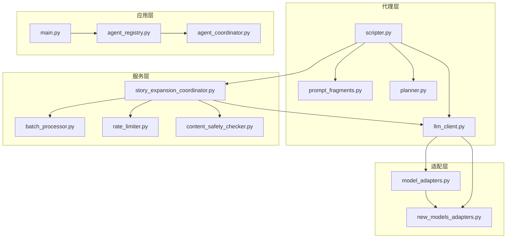
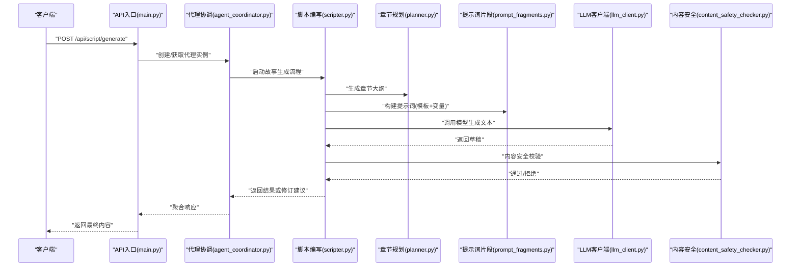
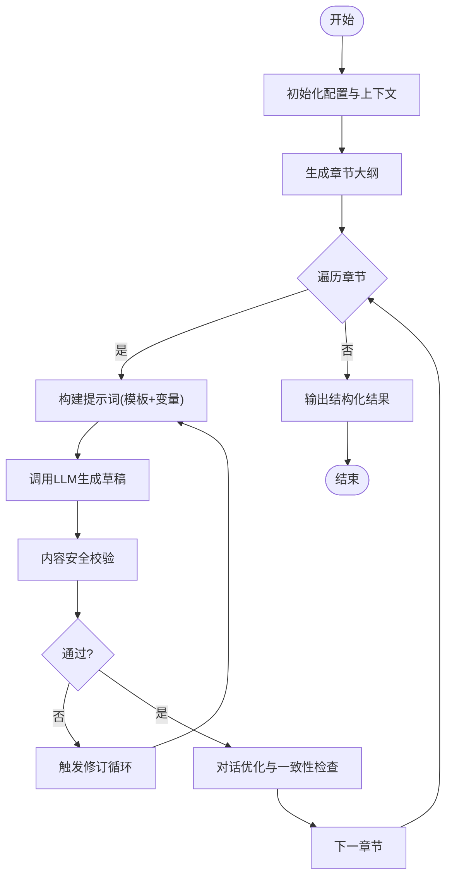
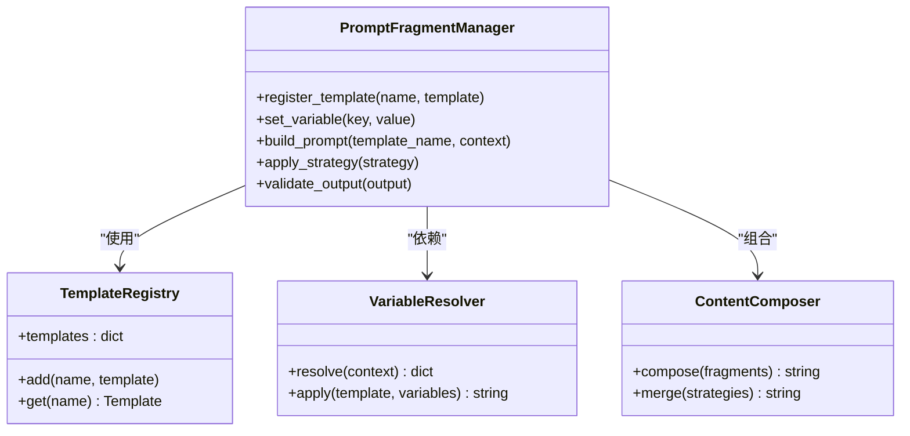
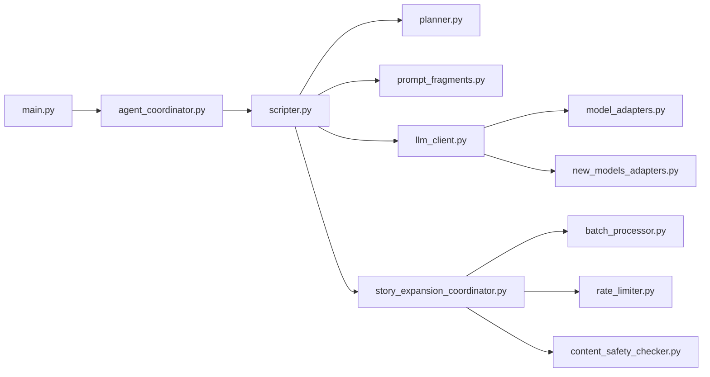

# 脚本编写代理

<cite>
**本文引用的文件**   
- [scripter.py](file://agents/scripter.py)
- [prompt_fragments.py](file://agents/prompt_fragments.py)
- [llm_client.py](file://agents/llm_client.py)
- [planner.py](file://agents/planner.py)
- [story_expansion_coordinator.py](file://backend/app/services/story_expansion_coordinator.py)
- [story_expansion_duration_estimator.py](file://backend/app/services/story_expansion_duration_estimator.py)
- [batch_processor.py](file://backend/app/services/batch_processor.py)
- [rate_limiter.py](file://adapters/rate_limiter.py)
- [content_safety_checker.py](file://adapters/content_safety_checker.py)
- [model_adapters.py](file://adapters/model_adapters.py)
- [new_models_adapters.py](file://adapters/new_models_adapters.py)
- [agent_registry.py](file://backend/app/services/agent_registry.py)
- [agent_coordinator.py](file://agent_coordinator.py)
- [main.py](file://backend/app/main.py)
- [config.py](file://core/config.py)
- [validators.py](file://core/validators.py)
- [schemas/common.py](file://schemas/common.py)
- [schemas/story_request.json](file://schemas/story_request.json)
</cite>

## 目录
1. [简介](#简介)
2. [项目结构](#项目结构)
3. [核心组件](#核心组件)
4. [架构总览](#架构总览)
5. [详细组件分析](#详细组件分析)
6. [依赖关系分析](#依赖关系分析)
7. [性能考虑](#性能考虑)
8. [故障排查指南](#故障排查指南)
9. [结论](#结论)
10. [附录](#附录)

## 简介
本技术文档面向“脚本编写代理”，聚焦于故事生成、章节规划与对话优化的核心能力，系统阐述文本创作流程、提示词构建机制与输出格式规范。同时详细说明提示词片段管理（模板系统、变量替换、内容组合策略），并给出接口设计、参数配置、输入验证与错误处理说明。最后提供批量生成、内容优化与质量控制的实践示例，以及性能调优建议与常见问题解决方案。

## 项目结构
脚本编写代理位于 agents 目录下，关键文件包括：
- scripter.py：脚本编写的核心编排器，负责故事生成、章节规划、对话优化等主流程。
- prompt_fragments.py：提示词片段管理与模板系统，支持变量替换与内容组合。
- llm_client.py：大模型客户端封装，统一调用不同提供商的 LLM。
- planner.py：章节规划与任务拆解逻辑。
- story_expansion_coordinator.py：故事扩展协调器，串联多阶段生成与质量控制。
- batch_processor.py：批处理工具，用于批量生成与并发控制。
- rate_limiter.py：速率限制器，保护下游服务。
- content_safety_checker.py：内容安全校验。
- model_adapters.py / new_models_adapters.py：模型适配器注册与选择。
- agent_registry.py / agent_coordinator.py：代理注册与协调。
- main.py：后端应用入口，暴露 API 路由。
- config.py / validators.py：配置加载与输入校验。
- schemas/common.py / schemas/story_request.json：通用数据模型与请求契约。

图表来源
- [scripter.py](file://agents/scripter.py)
- [prompt_fragments.py](file://agents/prompt_fragments.py)
- [planner.py](file://agents/planner.py)
- [llm_client.py](file://agents/llm_client.py)
- [story_expansion_coordinator.py](file://backend/app/services/story_expansion_coordinator.py)
- [batch_processor.py](file://backend/app/services/batch_processor.py)
- [rate_limiter.py](file://adapters/rate_limiter.py)
- [content_safety_checker.py](file://adapters/content_safety_checker.py)
- [model_adapters.py](file://adapters/model_adapters.py)
- [new_models_adapters.py](file://adapters/new_models_adapters.py)
- [agent_registry.py](file://backend/app/services/agent_registry.py)
- [agent_coordinator.py](file://agent_coordinator.py)
- [main.py](file://backend/app/main.py)

章节来源
- [scripter.py](file://agents/scripter.py)
- [prompt_fragments.py](file://agents/prompt_fragments.py)
- [planner.py](file://agents/planner.py)
- [llm_client.py](file://agents/llm_client.py)
- [story_expansion_coordinator.py](file://backend/app/services/story_expansion_coordinator.py)
- [batch_processor.py](file://backend/app/services/batch_processor.py)
- [rate_limiter.py](file://adapters/rate_limiter.py)
- [content_safety_checker.py](file://adapters/content_safety_checker.py)
- [model_adapters.py](file://adapters/model_adapters.py)
- [new_models_adapters.py](file://adapters/new_models_adapters.py)
- [agent_registry.py](file://backend/app/services/agent_registry.py)
- [agent_coordinator.py](file://agent_coordinator.py)
- [main.py](file://backend/app/main.py)

## 核心组件
- 故事生成与章节规划：由 scripter.py 驱动，结合 planner.py 进行章节结构与情节推进设计，并通过 story_expansion_coordinator.py 协调多阶段生成。
- 提示词构建与片段管理：prompt_fragments.py 提供模板系统与变量替换，将上下文、角色设定、风格约束等组合为高质量提示词。
- 大模型调用：llm_client.py 统一封装不同模型的调用方式，通过 model_adapters.py / new_models_adapters.py 动态选择具体实现。
- 批处理与并发：batch_processor.py 提供批量任务调度与并发控制，配合 rate_limiter.py 进行速率限制。
- 内容安全与质量：content_safety_checker.py 对生成内容进行安全检查；story_expansion_coordinator.py 集成质量门控与回退策略。
- 接口与配置：main.py 暴露 API；config.py 加载配置；validators.py 校验输入；schemas/common.py 与 schemas/story_request.json 定义数据结构。

章节来源
- [scripter.py](file://agents/scripter.py)
- [prompt_fragments.py](file://agents/prompt_fragments.py)
- [planner.py](file://agents/planner.py)
- [llm_client.py](file://agents/llm_client.py)
- [story_expansion_coordinator.py](file://backend/app/services/story_expansion_coordinator.py)
- [batch_processor.py](file://backend/app/services/batch_processor.py)
- [rate_limiter.py](file://adapters/rate_limiter.py)
- [content_safety_checker.py](file://adapters/content_safety_checker.py)
- [model_adapters.py](file://adapters/model_adapters.py)
- [new_models_adapters.py](file://adapters/new_models_adapters.py)
- [agent_registry.py](file://backend/app/services/agent_registry.py)
- [agent_coordinator.py](file://agent_coordinator.py)
- [main.py](file://backend/app/main.py)
- [config.py](file://core/config.py)
- [validators.py](file://core/validators.py)
- [schemas/common.py](file://schemas/common.py)
- [schemas/story_request.json](file://schemas/story_request.json)

## 架构总览
脚本编写代理采用分层架构：应用层通过 main.py 暴露 API，协调层使用 agent_registry.py 与 agent_coordinator.py 管理代理生命周期，业务层由 scripter.py 编排故事生成与章节规划，提示词层由 prompt_fragments.py 管理模板与变量替换，基础设施层通过 llm_client.py 与模型适配器调用 LLM，同时集成批处理、速率限制与安全校验。

图表来源
- [main.py](file://backend/app/main.py)
- [agent_coordinator.py](file://agent_coordinator.py)
- [scripter.py](file://agents/scripter.py)
- [planner.py](file://agents/planner.py)
- [prompt_fragments.py](file://agents/prompt_fragments.py)
- [llm_client.py](file://agents/llm_client.py)
- [content_safety_checker.py](file://adapters/content_safety_checker.py)

## 详细组件分析

### 脚本编写器（scripter.py）
- 职责：编排故事生成、章节规划与对话优化；维护上下文状态；协调提示词构建与 LLM 调用；执行质量门控与回退。
- 关键流程：
  - 初始化：加载配置、注册提示词片段、准备模型客户端。
  - 故事生成：根据输入请求构建全局上下文，调用 planner.py 生成章节大纲。
  - 章节细化：逐章生成场景、人物对话与叙述，使用 prompt_fragments.py 组装提示词。
  - 对话优化：基于角色设定与上下文进行对话润色与一致性检查。
  - 质量控制：调用 content_safety_checker.py 进行安全校验，必要时触发修订循环。
- 输出格式：结构化 JSON，包含章节列表、每章场景、对话、元数据（风格、长度、质量评分）。

图表来源
- [scripter.py](file://agents/scripter.py)
- [planner.py](file://agents/planner.py)
- [prompt_fragments.py](file://agents/prompt_fragments.py)
- [llm_client.py](file://agents/llm_client.py)
- [content_safety_checker.py](file://adapters/content_safety_checker.py)

章节来源
- [scripter.py](file://agents/scripter.py)
- [planner.py](file://agents/planner.py)
- [prompt_fragments.py](file://agents/prompt_fragments.py)
- [llm_client.py](file://agents/llm_client.py)
- [content_safety_checker.py](file://adapters/content_safety_checker.py)

### 提示词片段管理（prompt_fragments.py）
- 职责：管理提示词模板、变量替换与内容组合策略；支持多模板切换与优先级。
- 模板系统：
  - 模板分类：角色设定、世界观、风格约束、章节指令、对话优化等。
  - 变量占位符：使用键值映射进行替换，支持嵌套与条件分支。
  - 组合策略：按优先级拼接模板片段，去重与冲突解决。
- 内容组合：
  - 上下文注入：自动插入前文摘要、角色状态、场景设定。
  - 动态调整：根据章节类型与风格要求调整提示词权重。
- 扩展性：支持插件式模板注册与自定义片段。

图表来源
- [prompt_fragments.py](file://agents/prompt_fragments.py)

章节来源
- [prompt_fragments.py](file://agents/prompt_fragments.py)

### 章节规划（planner.py）
- 职责：根据故事大纲生成章节结构，分配情节节点与节奏控制。
- 算法要点：
  - 情节分解：将主题拆分为可执行的章节任务。
  - 节奏控制：平衡高潮与铺垫，确保叙事连贯。
  - 资源估算：预估每章长度与复杂度，辅助批处理调度。

章节来源
- [planner.py](file://agents/planner.py)

### 大模型客户端（llm_client.py）
- 职责：统一封装 LLM 调用，支持多提供商与模型选择。
- 功能：
  - 模型注册：通过 model_adapters.py / new_models_adapters.py 动态加载。
  - 调用封装：标准化请求与响应格式，处理重试与超时。
  - 流式输出：支持增量返回以提升交互体验。

章节来源
- [llm_client.py](file://agents/llm_client.py)
- [model_adapters.py](file://adapters/model_adapters.py)
- [new_models_adapters.py](file://adapters/new_models_adapters.py)

### 故事扩展协调器（story_expansion_coordinator.py）
- 职责：协调多阶段生成流程，集成质量门控与回退策略。
- 流程：
  - 阶段划分：大纲生成、章节细化、对话优化、质量审查。
  - 质量控制：调用 content_safety_checker.py 与自定义评分器。
  - 回退机制：失败时切换模型或降级策略。

章节来源
- [story_expansion_coordinator.py](file://backend/app/services/story_expansion_coordinator.py)
- [content_safety_checker.py](file://adapters/content_safety_checker.py)

### 批处理器（batch_processor.py）
- 职责：批量任务调度与并发控制，提升吞吐量。
- 特性：
  - 任务队列：支持优先级与重试。
  - 并发控制：限制并行度避免过载。
  - 进度跟踪：实时反馈任务状态。

章节来源
- [batch_processor.py](file://backend/app/services/batch_processor.py)

### 速率限制器（rate_limiter.py）
- 职责：保护下游服务免受突发流量冲击。
- 策略：令牌桶或滑动窗口限流，支持分级配额。

章节来源
- [rate_limiter.py](file://adapters/rate_limiter.py)

## 依赖关系分析
脚本编写代理依赖多个模块，形成清晰的层次结构：
- 应用层：main.py 暴露 API，agent_coordinator.py 管理代理生命周期。
- 业务层：scripter.py 编排核心流程，planner.py 负责章节规划。
- 提示词层：prompt_fragments.py 管理模板与变量。
- 基础设施层：llm_client.py 调用模型，model_adapters.py 提供适配器。
- 服务质量：batch_processor.py 批处理，rate_limiter.py 限流，content_safety_checker.py 安全校验。

图表来源
- [main.py](file://backend/app/main.py)
- [agent_coordinator.py](file://agent_coordinator.py)
- [scripter.py](file://agents/scripter.py)
- [planner.py](file://agents/planner.py)
- [prompt_fragments.py](file://agents/prompt_fragments.py)
- [llm_client.py](file://agents/llm_client.py)
- [model_adapters.py](file://adapters/model_adapters.py)
- [new_models_adapters.py](file://adapters/new_models_adapters.py)
- [story_expansion_coordinator.py](file://backend/app/services/story_expansion_coordinator.py)
- [batch_processor.py](file://backend/app/services/batch_processor.py)
- [rate_limiter.py](file://adapters/rate_limiter.py)
- [content_safety_checker.py](file://adapters/content_safety_checker.py)

章节来源
- [main.py](file://backend/app/main.py)
- [agent_coordinator.py](file://agent_coordinator.py)
- [scripter.py](file://agents/scripter.py)
- [planner.py](file://agents/planner.py)
- [prompt_fragments.py](file://agents/prompt_fragments.py)
- [llm_client.py](file://agents/llm_client.py)
- [model_adapters.py](file://adapters/model_adapters.py)
- [new_models_adapters.py](file://adapters/new_models_adapters.py)
- [story_expansion_coordinator.py](file://backend/app/services/story_expansion_coordinator.py)
- [batch_processor.py](file://backend/app/services/batch_processor.py)
- [rate_limiter.py](file://adapters/rate_limiter.py)
- [content_safety_checker.py](file://adapters/content_safety_checker.py)

## 性能考虑
- 并发与批处理：使用 batch_processor.py 提高吞吐量，合理设置并行度以避免资源竞争。
- 速率限制：通过 rate_limiter.py 控制请求频率，防止下游服务过载。
- 缓存与复用：缓存常用提示词片段与模型响应，减少重复计算。
- 模型选择：根据任务复杂度动态选择模型，平衡质量与成本。
- 流式输出：启用 llm_client.py 的流式模式，降低首字延迟。
- 内存管理：及时释放中间结果，避免内存泄漏。

## 故障排查指南
- 常见错误：
  - 提示词构建失败：检查 prompt_fragments.py 中的变量映射与模板语法。
  - LLM 调用超时：调整 llm_client.py 的超时与重试策略。
  - 内容安全拦截：查看 content_safety_checker.py 的规则配置。
  - 批处理阻塞：检查 batch_processor.py 的任务队列与并发限制。
- 调试建议：
  - 启用详细日志，记录每个阶段的输入输出。
  - 使用单元测试验证提示词片段与模型适配器。
  - 模拟异常场景，测试回退与恢复机制。

章节来源
- [prompt_fragments.py](file://agents/prompt_fragments.py)
- [llm_client.py](file://agents/llm_client.py)
- [content_safety_checker.py](file://adapters/content_safety_checker.py)
- [batch_processor.py](file://backend/app/services/batch_processor.py)

## 结论
脚本编写代理通过模块化设计与分层架构，实现了高效、可扩展的故事生成与章节规划能力。提示词片段管理系统提供了灵活的模板与变量替换机制，结合批处理、速率限制与安全校验，确保了系统的稳定性与质量。通过合理的性能调优与故障排查策略，可在大规模生产中稳定运行。

## 附录
- 接口设计：
  - POST /api/script/generate：提交故事生成请求，返回结构化结果。
  - 请求体：参考 schemas/story_request.json。
  - 响应体：参考 schemas/common.py。
- 配置选项：
  - 模型选择：在 config.py 中配置默认模型与备用模型。
  - 提示词模板：在 prompt_fragments.py 中注册与管理模板。
  - 批处理参数：在 batch_processor.py 中设置并发度与队列大小。
- 输入验证：
  - 使用 validators.py 校验请求字段与数据类型。
  - 强制必填字段与格式约束，提前拦截非法输入。
- 错误处理：
  - 统一异常捕获与错误码映射。
  - 提供详细的错误信息与修复建议。

章节来源
- [main.py](file://backend/app/main.py)
- [schemas/story_request.json](file://schemas/story_request.json)
- [schemas/common.py](file://schemas/common.py)
- [config.py](file://core/config.py)
- [prompt_fragments.py](file://agents/prompt_fragments.py)
- [batch_processor.py](file://backend/app/services/batch_processor.py)
- [validators.py](file://core/validators.py)