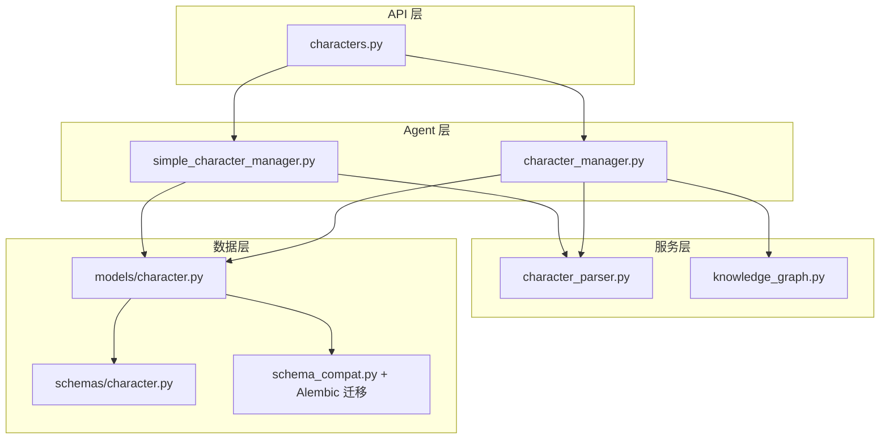
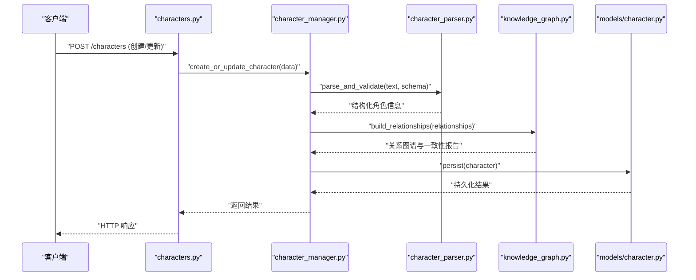
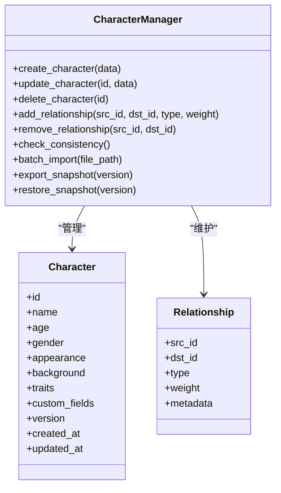
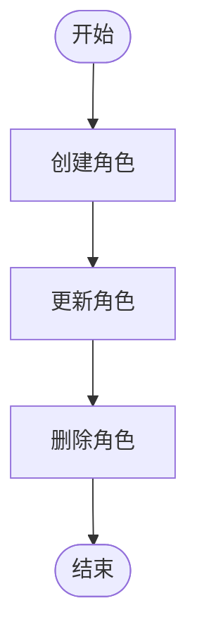
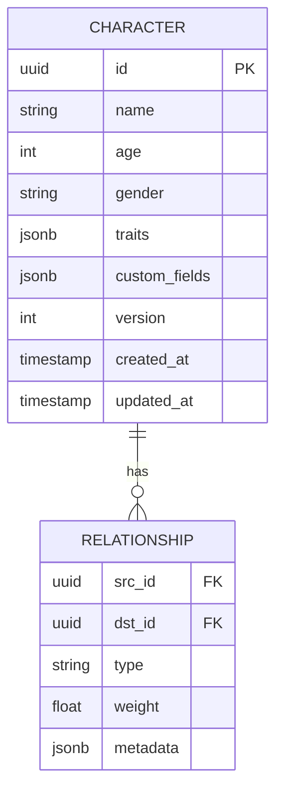
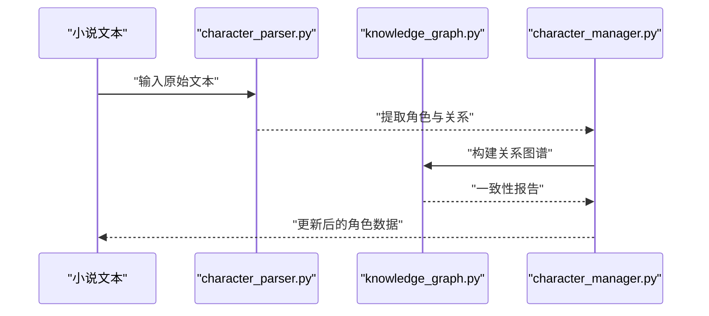
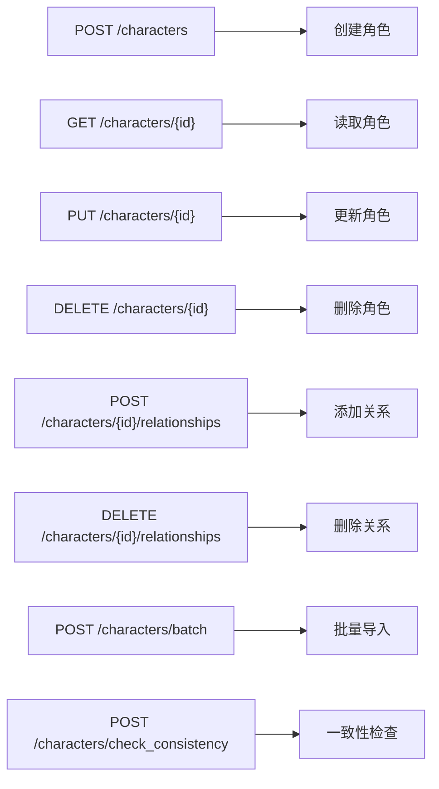
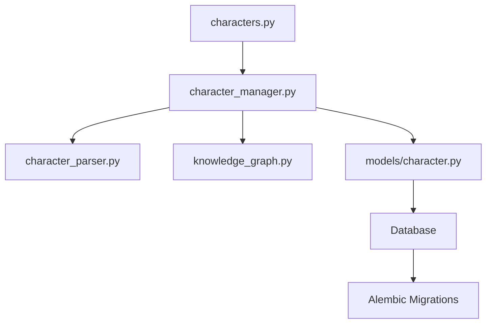

# 角色管理系统

<cite>
**本文引用的文件**   
- [agents/character_manager.py](file://agents/character_manager.py)
- [agents/simple_character_manager.py](file://agents/simple_character_manager.py)
- [backend/app/models/character.py](file://backend/app/models/character.py)
- [backend/app/schemas/character.py](file://backend/app/schemas/character.py)
- [backend/app/api/v1/characters.py](file://backend/app/api/v1/characters.py)
- [backend/app/services/character_parser.py](file://backend/app/services/character_parser.py)
- [backend/app/services/knowledge_graph.py](file://backend/app/services/knowledge_graph.py)
- [backend/app/db/schema_compat.py](file://backend/app/db/schema_compat.py)
- [alembic/versions/add_character_genre_fields_json.py](file://alembic/versions/add_character_genre_fields_json.py)
- [alembic/versions/add_character_role_position.py](file://alembic/versions/add_character_role_position.py)
- [alembic/versions/backfill_character_story_stance_from_text_evidence.py](file://alembic/versions/backfill_character_story_stance_from_text证据.py)
- [alembic/versions/normalize_character_story_fields.py](file://alembic/versions/normalize_character_story_fields.py)
</cite>

## 目录
1. [简介](#简介)
2. [项目结构](#项目结构)
3. [核心组件](#核心组件)
4. [架构总览](#架构总览)
5. [详细组件分析](#详细组件分析)
6. [依赖关系分析](#依赖关系分析)
7. [性能考虑](#性能考虑)
8. [故障排查指南](#故障排查指南)
9. [结论](#结论)
10. [附录](#附录)

## 简介
本技术文档围绕“角色管理系统”展开，重点解析 agents/character_manager.py 与 agents/simple_character_manager.py 的实现差异与适用场景。内容涵盖：
- 角色创建、属性定义、性格特征建模
- 人际关系图谱构建与一致性维护
- 数据存储结构、版本控制与同步机制
- 批量导入、属性编辑、关系维护与一致性检查
- 数据迁移、备份恢复与性能优化最佳实践

目标读者包括后端工程师、AI 应用开发者以及需要管理小说角色的内容创作者。

## 项目结构
角色管理相关代码主要分布在以下位置：
- 业务逻辑层（Agent）：agents/character_manager.py、agents/simple_character_manager.py
- 数据模型与 Schema：backend/app/models/character.py、backend/app/schemas/character.py
- API 接口：backend/app/api/v1/characters.py
- 文本解析与知识抽取：backend/app/services/character_parser.py、backend/app/services/knowledge_graph.py
- 数据库兼容与迁移：backend/app/db/schema_compat.py、alembic/versions/*

图表来源
- [agents/character_manager.py](file://agents/character_manager.py)
- [agents/simple_character_manager.py](file://agents/simple_character_manager.py)
- [backend/app/api/v1/characters.py](file://backend/app/api/v1/characters.py)
- [backend/app/services/character_parser.py](file://backend/app/services/character_parser.py)
- [backend/app/services/knowledge_graph.py](file://backend/app/services/knowledge_graph.py)
- [backend/app/models/character.py](file://backend/app/models/character.py)
- [backend/app/schemas/character.py](file://backend/app/schemas/character.py)
- [backend/app/db/schema_compat.py](file://backend/app/db/schema_compat.py)

章节来源
- [agents/character_manager.py](file://agents/character_manager.py)
- [agents/simple_character_manager.py](file://agents/simple_character_manager.py)
- [backend/app/api/v1/characters.py](file://backend/app/api/v1/characters.py)
- [backend/app/models/character.py](file://backend/app/models/character.py)
- [backend/app/schemas/character.py](file://backend/app/schemas/character.py)
- [backend/app/services/character_parser.py](file://backend/app/services/character_parser.py)
- [backend/app/services/knowledge_graph.py](file://backend/app/services/knowledge_graph.py)
- [backend/app/db/schema_compat.py](file://backend/app/db/schema_compat.py)

## 核心组件
- character_manager.py：面向复杂场景的角色管理器，提供完整的角色生命周期管理、关系图谱构建、一致性校验与扩展能力。
- simple_character_manager.py：轻量级实现，聚焦基础 CRUD、最小化依赖与快速集成，适合小型项目或原型验证。
- models/character.py：持久化模型定义，包含角色字段、关系映射与约束。
- schemas/character.py：请求/响应数据结构定义，用于 API 输入输出校验。
- services/character_parser.py：从文本中抽取角色信息（名称、属性、关系等），支持批量导入。
- services/knowledge_graph.py：构建与维护角色关系图谱，支持一致性检查与冲突消解。
- db/schema_compat.py：数据库字段兼容性处理，保障不同版本间的平滑升级。
- alembic 迁移脚本：对角色表结构演进进行版本化管理，如新增类型字段、角色定位、故事立场回填等。

章节来源
- [agents/character_manager.py](file://agents/character_manager.py)
- [agents/simple_character_manager.py](file://agents/simple_character_manager.py)
- [backend/app/models/character.py](file://backend/app/models/character.py)
- [backend/app/schemas/character.py](file://backend/app/schemas/character.py)
- [backend/app/services/character_parser.py](file://backend/app/services/character_parser.py)
- [backend/app/services/knowledge_graph.py](file://backend/app/services/knowledge_graph.py)
- [backend/app/db/schema_compat.py](file://backend/app/db/schema_compat.py)
- [alembic/versions/add_character_genre_fields_json.py](file://alembic/versions/add_character_genre_fields_json.py)
- [alembic/versions/add_character_role_position.py](file://alembic/versions/add_character_role_position.py)
- [alembic/versions/backfill_character_story_stance_from_text_evidence.py](file://alembic/versions/backfill_character_story_stance_from_text_evidence.py)
- [alembic/versions/normalize_character_story_fields.py](file://alembic/versions/normalize_character_story_fields.py)

## 架构总览
角色管理系统采用分层架构：
- Agent 层：封装角色管理的业务逻辑，对外暴露统一接口。
- API 层：提供 HTTP 接口，接收并校验请求，调用 Agent 层完成操作。
- 服务层：负责文本解析、知识抽取与关系图谱构建。
- 数据层：通过 ORM 模型与数据库交互，使用 Alembic 管理版本演进。

图表来源
- [backend/app/api/v1/characters.py](file://backend/app/api/v1/characters.py)
- [agents/character_manager.py](file://agents/character_manager.py)
- [backend/app/services/character_parser.py](file://backend/app/services/character_parser.py)
- [backend/app/services/knowledge_graph.py](file://backend/app/services/knowledge_graph.py)
- [backend/app/models/character.py](file://backend/app/models/character.py)

## 详细组件分析

### character_manager.py：完整角色管理器
- 角色创建：支持从文本或结构化数据创建角色，自动填充默认属性。
- 属性定义：内置基础属性（姓名、年龄、性别、外貌、背景等）与可扩展的自定义字段。
- 性格特征建模：通过维度标签（如外向/内向、理性/感性）与权重表示，支持动态调整。
- 关系管理：建立父子、朋友、敌对、师徒等关系，支持多对多与层级结构。
- 一致性维护：检测矛盾关系（如同时为父子与兄弟）、属性冲突（如年龄不一致），并提供修复建议。
- 批量导入：支持 CSV/JSON 批量导入，自动去重与合并策略。
- 版本控制：每次变更生成快照，支持回滚与对比。
- 同步机制：与知识库、文本抽取服务保持增量同步。

图表来源
- [agents/character_manager.py](file://agents/character_manager.py)
- [backend/app/models/character.py](file://backend/app/models/character.py)

章节来源
- [agents/character_manager.py](file://agents/character_manager.py)
- [backend/app/models/character.py](file://backend/app/models/character.py)

### simple_character_manager.py：轻量级实现
- 简化特性：仅保留核心 CRUD 操作，无复杂关系与一致性检查。
- 存储结构：基于简单 JSON/SQLite，适合本地开发或小规模项目。
- 使用场景：原型验证、快速测试、资源受限环境。
- 扩展性：可通过继承或组合方式逐步增强功能。

章节来源
- [agents/simple_character_manager.py](file://agents/simple_character_manager.py)

### 数据存储结构与版本控制
- 模型设计：角色表包含基础字段、JSON 扩展字段、时间戳与版本号。
- 版本控制：每次更新递增版本号，支持快照保存与恢复。
- 同步机制：与外部服务（如文本解析、知识图谱）保持增量同步，避免全量覆盖。

图表来源
- [backend/app/models/character.py](file://backend/app/models/character.py)
- [backend/app/schemas/character.py](file://backend/app/schemas/character.py)

章节来源
- [backend/app/models/character.py](file://backend/app/models/character.py)
- [backend/app/schemas/character.py](file://backend/app/schemas/character.py)

### 文本解析与知识抽取
- 角色抽取：从小说文本中识别角色名称、属性、关系。
- 关系构建：基于上下文推断人物关系（如对话、事件）。
- 一致性检查：发现矛盾信息并标记待确认。

图表来源
- [backend/app/services/character_parser.py](file://backend/app/services/character_parser.py)
- [backend/app/services/knowledge_graph.py](file://backend/app/services/knowledge_graph.py)
- [agents/character_manager.py](file://agents/character_manager.py)

章节来源
- [backend/app/services/character_parser.py](file://backend/app/services/character_parser.py)
- [backend/app/services/knowledge_graph.py](file://backend/app/services/knowledge_graph.py)

### API 接口设计
- 角色 CRUD：创建、读取、更新、删除。
- 关系管理：添加、删除、查询关系。
- 批量操作：导入、导出、批量更新。
- 一致性检查：触发检查并返回报告。

章节来源
- [backend/app/api/v1/characters.py](file://backend/app/api/v1/characters.py)

## 依赖关系分析
- 模块耦合：character_manager.py 依赖 character_parser.py 与 knowledge_graph.py，形成松耦合的服务调用。
- 数据流：API 层接收请求，调用 Agent 层，再与服务层交互，最终写入数据层。
- 外部依赖：数据库（PostgreSQL/SQLite）、Alembic 迁移工具、可选的 LLM 服务用于文本解析。

图表来源
- [backend/app/api/v1/characters.py](file://backend/app/api/v1/characters.py)
- [agents/character_manager.py](file://agents/character_manager.py)
- [backend/app/services/character_parser.py](file://backend/app/services/character_parser.py)
- [backend/app/services/knowledge_graph.py](file://backend/app/services/knowledge_graph.py)
- [backend/app/models/character.py](file://backend/app/models/character.py)
- [backend/app/db/schema_compat.py](file://backend/app/db/schema_compat.py)

章节来源
- [backend/app/api/v1/characters.py](file://backend/app/api/v1/characters.py)
- [agents/character_manager.py](file://agents/character_manager.py)
- [backend/app/services/character_parser.py](file://backend/app/services/character_parser.py)
- [backend/app/services/knowledge_graph.py](file://backend/app/services/knowledge_graph.py)
- [backend/app/models/character.py](file://backend/app/models/character.py)
- [backend/app/db/schema_compat.py](file://backend/app/db/schema_compat.py)

## 性能考虑
- 批量操作：使用事务与并行处理提升导入效率。
- 缓存策略：对频繁查询的角色属性进行缓存。
- 索引优化：对常用查询字段（如 name、genre）建立索引。
- 异步任务：将耗时操作（如文本解析、关系构建）放入消息队列。
- 内存管理：避免一次性加载大量数据，采用分页与流式处理。

## 故障排查指南
- 数据不一致：运行一致性检查，查看冲突报告并手动修复。
- 导入失败：检查文件格式与必填字段，查看错误日志定位问题。
- 关系错误：验证关系类型与权重，确保无循环依赖。
- 性能瓶颈：监控数据库查询慢日志，优化索引与查询语句。
- 版本冲突：回滚到稳定版本，重新执行迁移脚本。

章节来源
- [backend/app/db/schema_compat.py](file://backend/app/db/schema_compat.py)
- [alembic/versions/add_character_genre_fields_json.py](file://alembic/versions/add_character_genre_fields_json.py)
- [alembic/versions/add_character_role_position.py](file://alembic/versions/add_character_role_position.py)
- [alembic/versions/backfill_character_story_stance_from_text_evidence.py](file://alembic/versions/backfill_character_story_stance_from_text_evidence.py)
- [alembic/versions/normalize_character_story_fields.py](file://alembic/versions/normalize_character_story_fields.py)

## 结论
角色管理系统提供了从轻量级到企业级的完整解决方案。character_manager.py 适用于复杂场景，支持丰富的角色建模与关系管理；simple_character_manager.py 则满足快速原型与小型项目需求。通过模块化设计与清晰的职责划分，系统具备良好的扩展性与可维护性。

## 附录
- 最佳实践：
  - 定期备份角色数据，使用版本控制跟踪变更。
  - 在批量导入前进行数据清洗与验证。
  - 使用一致性检查工具定期扫描数据质量。
  - 根据业务需求定制角色属性与关系类型。
- 示例用法：
  - 创建角色：通过 API 或 SDK 调用 create_character。
  - 批量导入：准备 CSV/JSON 文件，调用 batch_import。
  - 关系维护：使用 add_relationship 与 remove_relationship。
  - 一致性检查：触发 check_consistency 并处理报告。