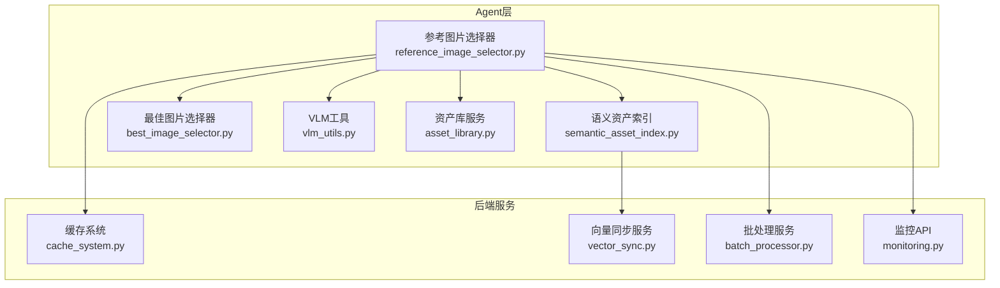
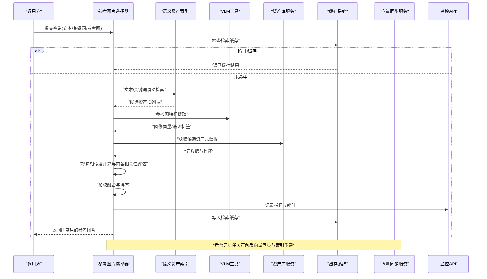
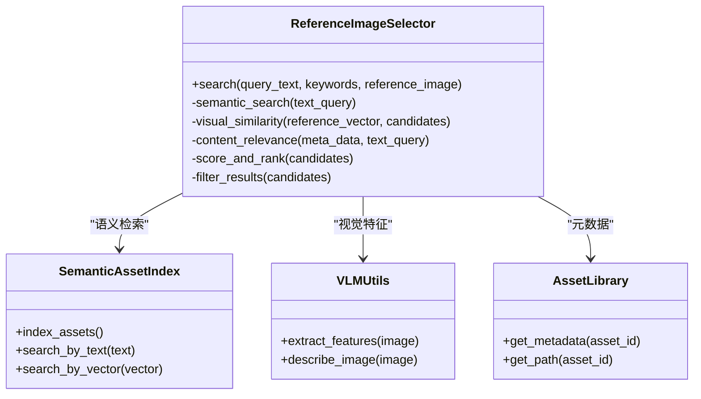
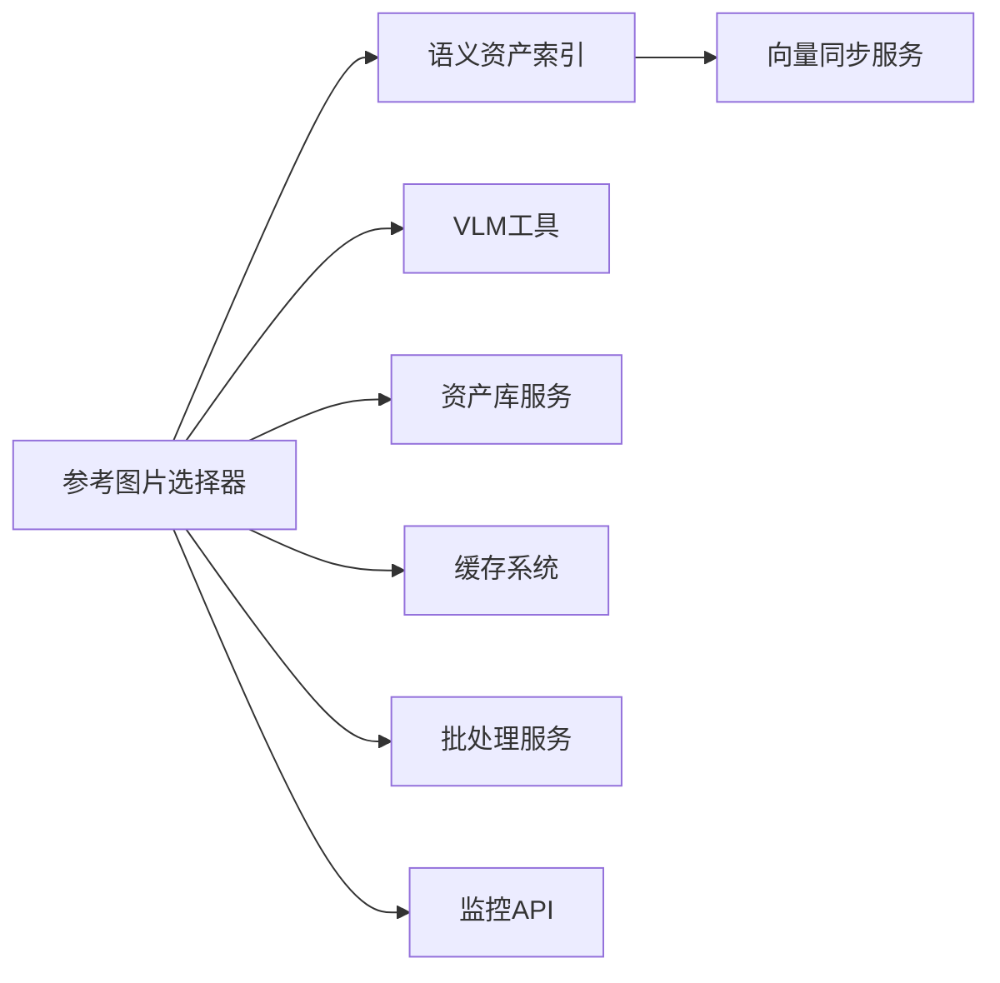

# 参考图片选择器

<cite>
**本文引用的文件**   
- [reference_image_selector.py](file://agents/reference_image_selector.py)
- [semantic_asset_index.py](file://agents/semantic_asset_index.py)
- [best_image_selector.py](file://agents/best_image_selector.py)
- [vlm_utils.py](file://agents/vlm_utils.py)
- [asset_library.py](file://agents/asset_library.py)
- [cache_system.py](file://backend/app/services/cache_system.py)
- [vector_sync.py](file://backend/app/services/vector_sync.py)
- [batch_processor.py](file://backend/app/services/batch_processor.py)
- [monitoring.py](file://backend/app/api/v1/monitoring.py)
</cite>

## 目录
1. [简介](#简介)
2. [项目结构](#项目结构)
3. [核心组件](#核心组件)
4. [架构总览](#架构总览)
5. [详细组件分析](#详细组件分析)
6. [依赖关系分析](#依赖关系分析)
7. [性能考量](#性能考量)
8. [故障排查指南](#故障排查指南)
9. [结论](#结论)
10. [附录](#附录)

## 简介
本技术文档围绕“参考图片选择器”展开，聚焦 agents/reference_image_selector.py 中的智能素材匹配算法与检索系统。内容涵盖语义搜索、视觉相似性计算、内容相关性评估、资产索引机制、向量数据库集成与检索优化策略，以及多模态混合搜索（文本描述、关键词与视觉特征）。同时提供使用示例、权重配置与排序规则说明，并给出批量处理、缓存策略与性能监控的实现方案，最后总结素材管理最佳实践与扩展开发指南。

## 项目结构
参考图片选择器位于 agents 模块中，与语义资产索引、图像质量筛选、VLM 工具、资产库服务及后端的缓存、向量化同步、批处理与监控等能力协同工作。整体结构如下：

图表来源
- [reference_image_selector.py](file://agents/reference_image_selector.py)
- [semantic_asset_index.py](file://agents/semantic_asset_index.py)
- [best_image_selector.py](file://agents/best_image_selector.py)
- [vlm_utils.py](file://agents/vlm_utils.py)
- [asset_library.py](file://agents/asset_library.py)
- [cache_system.py](file://backend/app/services/cache_system.py)
- [vector_sync.py](file://backend/app/services/vector_sync.py)
- [batch_processor.py](file://backend/app/services/batch_processor.py)
- [monitoring.py](file://backend/app/api/v1/monitoring.py)

章节来源
- [reference_image_selector.py](file://agents/reference_image_selector.py)
- [semantic_asset_index.py](file://agents/semantic_asset_index.py)
- [best_image_selector.py](file://agents/best_image_selector.py)
- [vlm_utils.py](file://agents/vlm_utils.py)
- [asset_library.py](file://agents/asset_library.py)
- [cache_system.py](file://backend/app/services/cache_system.py)
- [vector_sync.py](file://backend/app/services/vector_sync.py)
- [batch_processor.py](file://backend/app/services/batch_processor.py)
- [monitoring.py](file://backend/app/api/v1/monitoring.py)

## 核心组件
- 参考图片选择器：负责接收查询（文本描述、关键词、参考图），执行多模态检索与打分，输出候选集与排序结果。
- 语义资产索引：维护资产的元数据与向量表示，支持文本与图像的联合索引与检索。
- 最佳图片选择器：在候选集中基于质量、一致性、多样性等指标进行二次筛选与排序。
- VLM工具：调用视觉语言模型对图像进行语义理解与特征提取。
- 资产库服务：统一访问本地或云存储的素材资源，提供元数据与文件路径解析。
- 缓存系统：为向量检索、VLM推理与中间结果提供缓存，降低延迟与成本。
- 向量同步服务：将资产元数据与向量嵌入同步到向量数据库，保证检索一致性。
- 批处理服务：支持批量索引构建、批量检索与批量更新。
- 监控API：暴露关键指标与状态，便于观测与告警。

章节来源
- [reference_image_selector.py](file://agents/reference_image_selector.py)
- [semantic_asset_index.py](file://agents/semantic_asset_index.py)
- [best_image_selector.py](file://agents/best_image_selector.py)
- [vlm_utils.py](file://agents/vlm_utils.py)
- [asset_library.py](file://agents/asset_library.py)
- [cache_system.py](file://backend/app/services/cache_system.py)
- [vector_sync.py](file://backend/app/services/vector_sync.py)
- [batch_processor.py](file://backend/app/services/batch_processor.py)
- [monitoring.py](file://backend/app/api/v1/monitoring.py)

## 架构总览
参考图片选择器的检索流程由多阶段组成：输入解析、语义检索、视觉相似度计算、内容相关性评估、加权融合与排序、结果过滤与返回。

图表来源
- [reference_image_selector.py](file://agents/reference_image_selector.py)
- [semantic_asset_index.py](file://agents/semantic_asset_index.py)
- [vlm_utils.py](file://agents/vlm_utils.py)
- [asset_library.py](file://agents/asset_library.py)
- [cache_system.py](file://backend/app/services/cache_system.py)
- [vector_sync.py](file://backend/app/services/vector_sync.py)
- [monitoring.py](file://backend/app/api/v1/monitoring.py)

## 详细组件分析

### 参考图片选择器（reference_image_selector.py）
职责与流程
- 输入解析：支持文本描述、关键词、参考图三种输入形式，并可组合使用。
- 多模态检索：先通过语义索引进行粗召回，再结合视觉相似度进行精排。
- 评分与排序：对语义相关度、视觉相似度、内容相关性进行加权融合，按综合得分排序。
- 结果过滤：依据质量阈值、去重策略、多样性约束进行过滤。
- 缓存与监控：命中缓存直接返回；否则记录关键指标并写入缓存。

关键实现要点
- 语义搜索：利用文本与关键词生成查询向量，在索引中进行近似最近邻检索。
- 视觉相似性：对参考图提取向量，与候选资产向量计算余弦相似度。
- 内容相关性：基于元数据字段（如标签、类别、场景）与文本描述的匹配度评估。
- 权重配置：允许动态调整语义、视觉、内容权重的比例，以适配不同场景。
- 排序规则：综合得分 = w1*语义分 + w2*视觉分 + w3*内容分，辅以质量与多样性惩罚项。

章节来源
- [reference_image_selector.py](file://agents/reference_image_selector.py)

#### 类与方法关系（概念映射）

图表来源
- [reference_image_selector.py](file://agents/reference_image_selector.py)
- [semantic_asset_index.py](file://agents/semantic_asset_index.py)
- [vlm_utils.py](file://agents/vlm_utils.py)
- [asset_library.py](file://agents/asset_library.py)

### 语义资产索引（semantic_asset_index.py）
职责与特性
- 维护资产元数据与向量嵌入的联合索引。
- 支持文本与向量双通道检索，提升召回率与准确率。
- 提供增量更新与全量重建接口，保障索引一致性。

索引机制
- 文本索引：对标题、描述、标签进行分词与向量化。
- 向量索引：存储图像与文本的统一向量空间，支持近似最近邻检索。
- 元数据索引：对类别、场景、风格等结构化字段建立快速过滤条件。

章节来源
- [semantic_asset_index.py](file://agents/semantic_asset_index.py)

### 最佳图片选择器（best_image_selector.py）
职责与策略
- 在参考图片选择器输出的候选集中，进一步基于质量、一致性、多样性进行二次筛选。
- 质量评估：分辨率、清晰度、噪声水平等指标。
- 一致性评估：与主题、角色、场景的一致性度量。
- 多样性评估：避免候选过于相似，提升覆盖度。

章节来源
- [best_image_selector.py](file://agents/best_image_selector.py)

### VLM工具（vlm_utils.py）
职责与能力
- 图像特征提取：将图像转换为高维向量，用于视觉相似度计算。
- 图像描述生成：调用视觉语言模型生成自然语言描述，辅助语义匹配。
- 标签识别：自动识别图像中的关键实体与场景标签。

章节来源
- [vlm_utils.py](file://agents/vlm_utils.py)

### 资产库服务（asset_library.py）
职责与功能
- 统一管理本地与云端素材的访问接口。
- 提供元数据读取、路径解析、版本管理等能力。
- 与索引与缓存系统协作，确保数据一致性与高性能。

章节来源
- [asset_library.py](file://agents/asset_library.py)

### 缓存系统（cache_system.py）
职责与策略
- 缓存键设计：基于查询指纹（文本哈希+参考图哈希）生成唯一键。
- 过期策略：TTL与LRU结合，平衡命中率与内存占用。
- 多级缓存：内存缓存优先，回退至分布式缓存或持久化缓存。

章节来源
- [cache_system.py](file://backend/app/services/cache_system.py)

### 向量同步服务（vector_sync.py）
职责与流程
- 增量同步：监听资产变更事件，更新向量索引。
- 全量重建：定期重建索引，修复不一致问题。
- 幂等性：确保重复操作不会产生副作用。

章节来源
- [vector_sync.py](file://backend/app/services/vector_sync.py)

### 批处理服务（batch_processor.py）
职责与能力
- 批量索引构建：支持大规模资产一次性向量化与索引。
- 批量检索：并发执行多个查询，提升吞吐。
- 错误隔离：单个任务失败不影响整体批次。

章节来源
- [batch_processor.py](file://backend/app/services/batch_processor.py)

### 监控API（monitoring.py）
职责与指标
- 暴露检索耗时、命中率、错误率等关键指标。
- 提供健康检查与状态查询接口。
- 支持日志聚合与告警触发。

章节来源
- [monitoring.py](file://backend/app/api/v1/monitoring.py)

## 依赖关系分析
组件间依赖清晰，耦合度低，内聚性强。参考图片选择器作为编排者，依赖语义索引、VLM工具、资产库服务完成核心逻辑；缓存、向量同步、批处理与监控作为横切能力支撑。

图表来源
- [reference_image_selector.py](file://agents/reference_image_selector.py)
- [semantic_asset_index.py](file://agents/semantic_asset_index.py)
- [vlm_utils.py](file://agents/vlm_utils.py)
- [asset_library.py](file://agents/asset_library.py)
- [cache_system.py](file://backend/app/services/cache_system.py)
- [vector_sync.py](file://backend/app/services/vector_sync.py)
- [batch_processor.py](file://backend/app/services/batch_processor.py)
- [monitoring.py](file://backend/app/api/v1/monitoring.py)

章节来源
- [reference_image_selector.py](file://agents/reference_image_selector.py)
- [semantic_asset_index.py](file://agents/semantic_asset_index.py)
- [vlm_utils.py](file://agents/vlm_utils.py)
- [asset_library.py](file://agents/asset_library.py)
- [cache_system.py](file://backend/app/services/cache_system.py)
- [vector_sync.py](file://backend/app/services/vector_sync.py)
- [batch_processor.py](file://backend/app/services/batch_processor.py)
- [monitoring.py](file://backend/app/api/v1/monitoring.py)

## 性能考量
- 检索优化：采用两级检索（语义粗召回+视觉精排），减少计算开销。
- 缓存策略：多级缓存与合理TTL提升命中率，降低重复计算。
- 批处理：并发执行批量任务，提高吞吐与资源利用率。
- 向量同步：增量更新避免全量重建，缩短同步时间。
- 监控与告警：实时观测关键指标，及时发现瓶颈与异常。

[本节为通用指导，不直接分析具体文件]

## 故障排查指南
常见问题与定位方法
- 检索结果为空：检查语义索引是否完整，向量同步是否成功。
- 命中率低：优化缓存键设计与TTL策略，检查查询指纹生成逻辑。
- 延迟过高：监控各阶段耗时，定位瓶颈组件（VLM、索引、缓存）。
- 数据不一致：核对资产库元数据与索引向量是否同步。

章节来源
- [cache_system.py](file://backend/app/services/cache_system.py)
- [vector_sync.py](file://backend/app/services/vector_sync.py)
- [monitoring.py](file://backend/app/api/v1/monitoring.py)

## 结论
参考图片选择器通过多模态混合搜索与多级优化策略，实现了高效、准确的素材检索与排序。结合语义索引、视觉相似度与内容相关性评估，能够灵活适配不同业务场景。配合缓存、批处理与监控能力，系统在性能与稳定性方面具备良好表现。建议持续优化权重配置与排序规则，完善监控与告警机制，以提升用户体验与系统可靠性。

[本节为总结性内容，不直接分析具体文件]

## 附录
使用示例与最佳实践
- 构建高效检索系统：合理设置权重参数，启用缓存与批处理，定期重建索引。
- 搜索权重配置：根据场景调整语义、视觉、内容权重，平衡召回与精准。
- 结果排序规则：综合得分排序，辅以质量与多样性惩罚，提升结果可用性。
- 素材管理最佳实践：规范元数据标注，保持索引与数据同步，定期清理无效资产。
- 扩展开发指南：新增模态输入时，扩展VLM工具与索引机制，保持接口一致性。

[本节为通用指导，不直接分析具体文件]