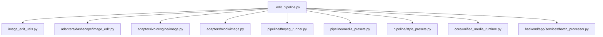
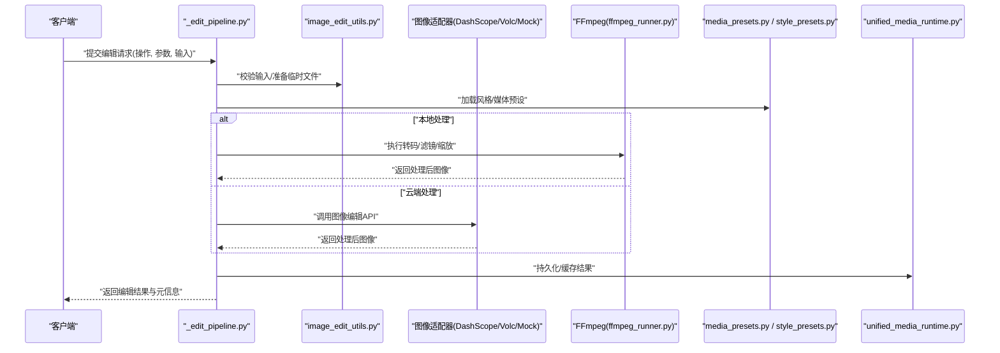
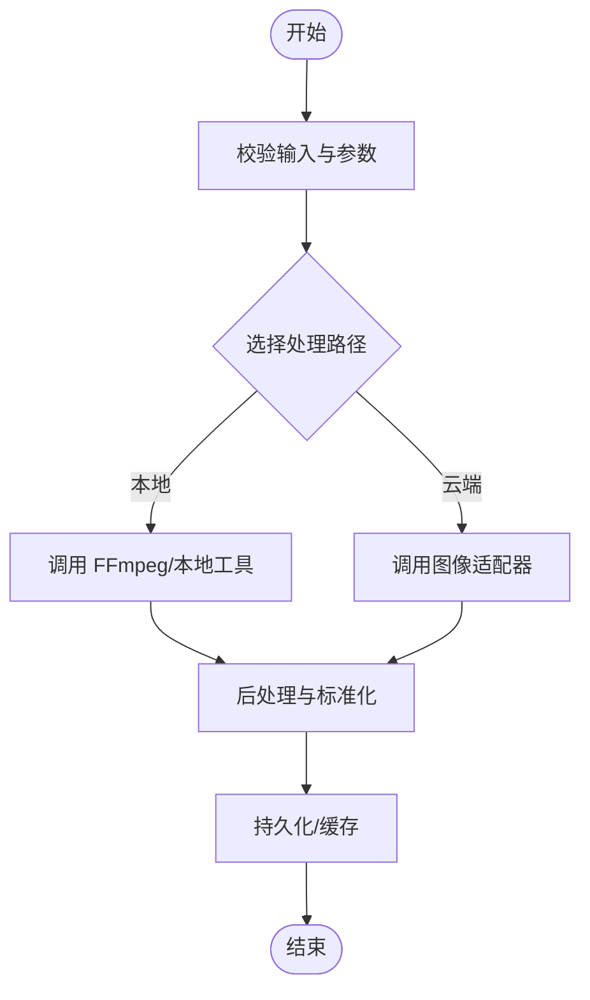
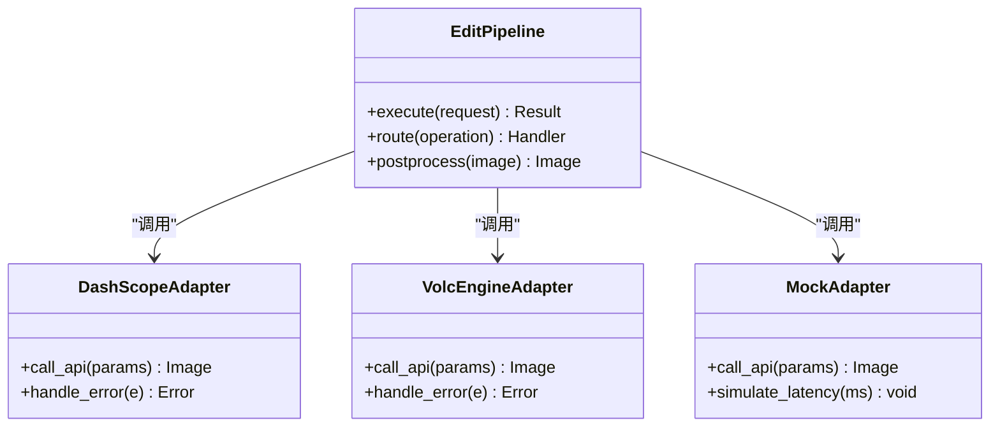
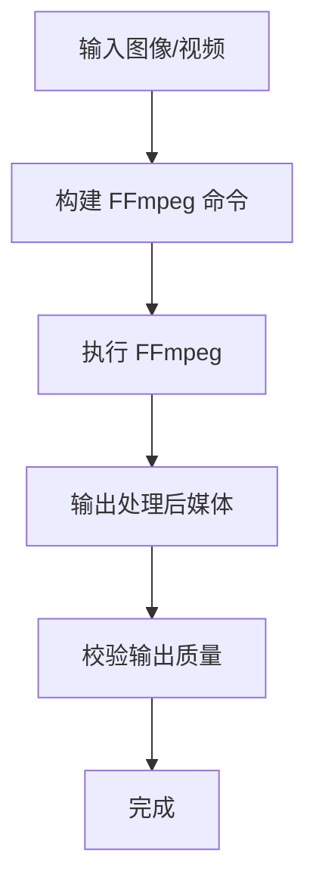
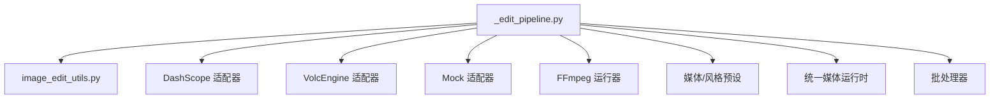

# 图像编辑流水线

<cite>
**本文引用的文件**   
- [agents/painter_pkg/_edit_pipeline.py](file://agents/painter_pkg/_edit_pipeline.py)
- [agents/image_edit_utils.py](file://agents/image_edit_utils.py)
- [adapters/dashscope/image_edit.py](file://adapters/dashscope/image_edit.py)
- [adapters/volcengine/image.py](file://adapters/volcengine/image.py)
- [adapters/mock/image.py](file://adapters/mock/image.py)
- [pipeline/ffmpeg_runner.py](file://pipeline/ffmpeg_runner.py)
- [pipeline/media_presets.py](file://pipeline/media_presets.py)
- [pipeline/style_presets.py](file://pipeline/style_presets.py)
- [core/unified_media_runtime.py](file://core/unified_media_runtime.py)
- [backend/app/services/batch_processor.py](file://backend/app/services/batch_processor.py)
</cite>

## 目录
1. [简介](#简介)
2. [项目结构](#项目结构)
3. [核心组件](#核心组件)
4. [架构总览](#架构总览)
5. [详细组件分析](#详细组件分析)
6. [依赖关系分析](#依赖关系分析)
7. [性能考量](#性能考量)
8. [故障排查指南](#故障排查指南)
9. [结论](#结论)
10. [附录](#附录)

## 简介
本技术文档聚焦于图像编辑流水线，围绕 _edit_pipeline.py 的图像编辑能力展开，涵盖图像修改、风格转换、尺寸调整与画质优化等关键功能。文档将系统阐述支持的编辑操作类型、处理算法与参数配置，说明与 FFmpeg、Pillow 等图像处理工具的集成方式，并提供批量处理、质量评估、版本管理与回滚机制的实践建议，以及性能优化与内存管理的最佳实践。

## 项目结构
图像编辑流水线位于 agents/painter_pkg 下的 _edit_pipeline.py，配合 image_edit_utils.py 提供通用工具函数；与多模型适配器（如 DashScope、VolcEngine、Mock）对接以调用外部图像编辑服务；通过 pipeline/ffmpeg_runner.py 和 media_presets.py 完成视频/图像转码与媒体预设；style_presets.py 管理风格模板；core/unified_media_runtime.py 统一媒体运行时；backend/app/services/batch_processor.py 提供批处理能力。

**图表来源** 
- [agents/painter_pkg/_edit_pipeline.py](file://agents/painter_pkg/_edit_pipeline.py)
- [agents/image_edit_utils.py](file://agents/image_edit_utils.py)
- [adapters/dashscope/image_edit.py](file://adapters/dashscope/image_edit.py)
- [adapters/volcengine/image.py](file://adapters/volcengine/image.py)
- [adapters/mock/image.py](file://adapters/mock/image.py)
- [pipeline/ffmpeg_runner.py](file://pipeline/ffmpeg_runner.py)
- [pipeline/media_presets.py](file://pipeline/media_presets.py)
- [pipeline/style_presets.py](file://pipeline/style_presets.py)
- [core/unified_media_runtime.py](file://core/unified_media_runtime.py)
- [backend/app/services/batch_processor.py](file://backend/app/services/batch_processor.py)

**章节来源**
- [agents/painter_pkg/_edit_pipeline.py](file://agents/painter_pkg/_edit_pipeline.py)
- [agents/image_edit_utils.py](file://agents/image_edit_utils.py)
- [pipeline/ffmpeg_runner.py](file://pipeline/ffmpeg_runner.py)
- [pipeline/media_presets.py](file://pipeline/media_presets.py)
- [pipeline/style_presets.py](file://pipeline/style_presets.py)
- [core/unified_media_runtime.py](file://core/unified_media_runtime.py)
- [backend/app/services/batch_processor.py](file://backend/app/services/batch_processor.py)

## 核心组件
- 编辑管线入口：_edit_pipeline.py 负责编排图像编辑流程，包括输入校验、操作选择、参数装配、调用适配器、后处理与结果输出。
- 工具库：image_edit_utils.py 提供图像格式转换、尺寸计算、元数据读取、路径与临时文件管理等通用方法。
- 适配器层：
  - DashScope 图像编辑适配器：封装云端图像编辑 API 调用。
  - VolcEngine 图像适配器：封装另一家云服务的图像编辑能力。
  - Mock 适配器：用于开发与测试阶段的模拟实现。
- 媒体运行与转码：
  - ffmpeg_runner.py：基于 FFmpeg 执行转码、裁剪、缩放、滤镜等操作。
  - media_presets.py：集中定义分辨率、编码、质量等媒体预设。
- 风格模板：style_presets.py：维护风格化参数集合，便于快速切换风格。
- 统一媒体运行时：unified_media_runtime.py：抽象媒体读写、缓存、并发控制等底层能力。
- 批处理：batch_processor.py：提供任务队列、并发限制、重试与失败隔离等批处理能力。

**章节来源**
- [agents/painter_pkg/_edit_pipeline.py](file://agents/painter_pkg/_edit_pipeline.py)
- [agents/image_edit_utils.py](file://agents/image_edit_utils.py)
- [adapters/dashscope/image_edit.py](file://adapters/dashscope/image_edit.py)
- [adapters/volcengine/image.py](file://adapters/volcengine/image.py)
- [adapters/mock/image.py](file://adapters/mock/image.py)
- [pipeline/ffmpeg_runner.py](file://pipeline/ffmpeg_runner.py)
- [pipeline/media_presets.py](file://pipeline/media_presets.py)
- [pipeline/style_presets.py](file://pipeline/style_presets.py)
- [core/unified_media_runtime.py](file://core/unified_media_runtime.py)
- [backend/app/services/batch_processor.py](file://backend/app/services/batch_processor.py)

## 架构总览
编辑流水线采用“编排器 + 适配器 + 工具库”的分层架构。编排器根据用户请求解析操作类型与参数，选择合适的适配器或本地工具链执行，最终输出标准化结果。FFmpeg 作为强大的后端引擎，承担转码、滤镜、合成等重负载任务；Pillow 在 Python 侧进行轻量级图像处理与格式转换；统一媒体运行时屏蔽存储与缓存细节，提升可移植性与稳定性。

**图表来源** 
- [agents/painter_pkg/_edit_pipeline.py](file://agents/painter_pkg/_edit_pipeline.py)
- [agents/image_edit_utils.py](file://agents/image_edit_utils.py)
- [adapters/dashscope/image_edit.py](file://adapters/dashscope/image_edit.py)
- [adapters/volcengine/image.py](file://adapters/volcengine/image.py)
- [adapters/mock/image.py](file://adapters/mock/image.py)
- [pipeline/ffmpeg_runner.py](file://pipeline/ffmpeg_runner.py)
- [pipeline/media_presets.py](file://pipeline/media_presets.py)
- [pipeline/style_presets.py](file://pipeline/style_presets.py)
- [core/unified_media_runtime.py](file://core/unified_media_runtime.py)

## 详细组件分析

### 编辑管线入口 (_edit_pipeline.py)
- 职责：接收编辑请求，解析操作类型（修改、风格转换、尺寸调整、画质优化），装配参数，调度适配器或本地工具链，执行后处理并返回结果。
- 关键点：
  - 输入校验与参数规范化：确保必填字段、取值范围、单位一致性。
  - 操作路由：根据操作类型选择合适处理路径（本地 FFmpeg 或云端适配器）。
  - 结果标准化：统一输出格式、元数据、错误码与日志追踪。
  - 批处理集成：支持批量任务提交、进度回调与失败重试。

**图表来源** 
- [agents/painter_pkg/_edit_pipeline.py](file://agents/painter_pkg/_edit_pipeline.py)
- [pipeline/ffmpeg_runner.py](file://pipeline/ffmpeg_runner.py)
- [adapters/dashscope/image_edit.py](file://adapters/dashscope/image_edit.py)
- [adapters/volcengine/image.py](file://adapters/volcengine/image.py)
- [adapters/mock/image.py](file://adapters/mock/image.py)

**章节来源**
- [agents/painter_pkg/_edit_pipeline.py](file://agents/painter_pkg/_edit_pipeline.py)

### 工具库 (image_edit_utils.py)
- 职责：提供图像格式转换、尺寸计算、元数据读取、路径与临时文件管理等通用方法。
- 关键点：
  - 格式转换：支持常见图像格式互转与色彩空间处理。
  - 尺寸计算：按宽高比、目标分辨率、缩放策略计算最优尺寸。
  - 元数据处理：读取 EXIF、ICC 配置文件，保证颜色一致性。
  - 临时文件管理：自动清理中间产物，避免磁盘泄漏。

**章节来源**
- [agents/image_edit_utils.py](file://agents/image_edit_utils.py)

### 适配器层 (DashScope / VolcEngine / Mock)
- DashScope 图像编辑适配器：封装云端图像编辑 API，支持风格迁移、内容修改、智能增强等。
- VolcEngine 图像适配器：提供类似的云端图像编辑能力，适配不同厂商接口差异。
- Mock 适配器：用于开发调试，返回固定样本或随机扰动，便于端到端验证。

**图表来源** 
- [adapters/dashscope/image_edit.py](file://adapters/dashscope/image_edit.py)
- [adapters/volcengine/image.py](file://adapters/volcengine/image.py)
- [adapters/mock/image.py](file://adapters/mock/image.py)
- [agents/painter_pkg/_edit_pipeline.py](file://agents/painter_pkg/_edit_pipeline.py)

**章节来源**
- [adapters/dashscope/image_edit.py](file://adapters/dashscope/image_edit.py)
- [adapters/volcengine/image.py](file://adapters/volcengine/image.py)
- [adapters/mock/image.py](file://adapters/mock/image.py)

### 媒体运行与转码 (ffmpeg_runner.py / media_presets.py)
- FFmpeg 运行器：封装 FFmpeg 命令构建与执行，支持转码、裁剪、缩放、滤镜、水印、字幕等。
- 媒体预设：集中管理分辨率、编码参数、质量等级、帧率、码率等，确保输出一致性。

**图表来源** 
- [pipeline/ffmpeg_runner.py](file://pipeline/ffmpeg_runner.py)
- [pipeline/media_presets.py](file://pipeline/media_presets.py)

**章节来源**
- [pipeline/ffmpeg_runner.py](file://pipeline/ffmpeg_runner.py)
- [pipeline/media_presets.py](file://pipeline/media_presets.py)

### 风格模板 (style_presets.py)
- 职责：维护风格化参数集合，如色调、对比度、饱和度、锐化强度、纹理叠加等，便于快速切换风格。
- 使用方式：在编辑管线中加载对应风格模板，注入到 FFmpeg 滤镜链或云端适配器参数中。

**章节来源**
- [pipeline/style_presets.py](file://pipeline/style_presets.py)

### 统一媒体运行时 (unified_media_runtime.py)
- 职责：抽象媒体读写、缓存、并发控制、错误恢复等底层能力，为上层编辑管线提供稳定支撑。
- 关键点：
  - 缓存策略：LRU/TTL 缓存减少重复计算。
  - 并发控制：限制并行任务数，避免资源争用。
  - 错误恢复：自动重试、降级与熔断。

**章节来源**
- [core/unified_media_runtime.py](file://core/unified_media_runtime.py)

### 批处理 (batch_processor.py)
- 职责：提供批量任务提交、并发限制、重试与失败隔离等能力，适用于大规模图像编辑场景。
- 关键点：
  - 任务队列：支持优先级与超时控制。
  - 进度回调：实时反馈任务状态。
  - 失败隔离：单个任务失败不影响整体批次。

**章节来源**
- [backend/app/services/batch_processor.py](file://backend/app/services/batch_processor.py)

## 依赖关系分析
编辑管线依赖多个模块协同工作，形成清晰的层次结构与松耦合关系。适配器层屏蔽不同厂商 API 差异；FFmpeg 作为后端引擎承担重负载；工具库提供通用能力；统一媒体运行时抽象底层存储与缓存；批处理器提供高吞吐能力。

**图表来源** 
- [agents/painter_pkg/_edit_pipeline.py](file://agents/painter_pkg/_edit_pipeline.py)
- [agents/image_edit_utils.py](file://agents/image_edit_utils.py)
- [adapters/dashscope/image_edit.py](file://adapters/dashscope/image_edit.py)
- [adapters/volcengine/image.py](file://adapters/volcengine/image.py)
- [adapters/mock/image.py](file://adapters/mock/image.py)
- [pipeline/ffmpeg_runner.py](file://pipeline/ffmpeg_runner.py)
- [pipeline/media_presets.py](file://pipeline/media_presets.py)
- [pipeline/style_presets.py](file://pipeline/style_presets.py)
- [core/unified_media_runtime.py](file://core/unified_media_runtime.py)
- [backend/app/services/batch_processor.py](file://backend/app/services/batch_processor.py)

**章节来源**
- [agents/painter_pkg/_edit_pipeline.py](file://agents/painter_pkg/_edit_pipeline.py)
- [agents/image_edit_utils.py](file://agents/image_edit_utils.py)
- [adapters/dashscope/image_edit.py](file://adapters/dashscope/image_edit.py)
- [adapters/volcengine/image.py](file://adapters/volcengine/image.py)
- [adapters/mock/image.py](file://adapters/mock/image.py)
- [pipeline/ffmpeg_runner.py](file://pipeline/ffmpeg_runner.py)
- [pipeline/media_presets.py](file://pipeline/media_presets.py)
- [pipeline/style_presets.py](file://pipeline/style_presets.py)
- [core/unified_media_runtime.py](file://core/unified_media_runtime.py)
- [backend/app/services/batch_processor.py](file://backend/app/services/batch_processor.py)

## 性能考量
- 内存管理：
  - 使用流式处理与分块读取，避免一次性加载大图像到内存。
  - 及时释放临时文件与中间对象，防止内存泄漏。
- 并发控制：
  - 限制并行任务数，避免 CPU/GPU/IO 瓶颈。
  - 使用连接池与线程池优化资源复用。
- 缓存策略：
  - 对相同输入与参数的结果进行缓存，减少重复计算。
  - 合理设置 TTL 与 LRU 容量，平衡命中率与内存占用。
- FFmpeg 优化：
  - 选择合适的编码器与参数，平衡质量与速度。
  - 利用硬件加速（如 NVENC、QSV）提升转码效率。
- 批处理优化：
  - 任务分片与负载均衡，避免单点过载。
  - 失败重试与退避策略，提高鲁棒性。

[本节为通用指导，不直接分析具体文件]

## 故障排查指南
- 常见问题：
  - 输入格式不支持：检查图像格式与色彩空间，必要时进行转换。
  - 参数非法：校验取值范围与单位，确保符合预设规范。
  - 适配器调用失败：检查网络、鉴权、配额与限流策略。
  - FFmpeg 执行异常：查看命令构建是否正确，依赖是否安装完整。
- 诊断手段：
  - 启用详细日志与追踪 ID，定位问题链路。
  - 使用 Mock 适配器隔离问题，逐步缩小范围。
  - 输出中间产物与元数据，辅助分析处理效果。

**章节来源**
- [agents/painter_pkg/_edit_pipeline.py](file://agents/painter_pkg/_edit_pipeline.py)
- [adapters/dashscope/image_edit.py](file://adapters/dashscope/image_edit.py)
- [adapters/volcengine/image.py](file://adapters/volcengine/image.py)
- [adapters/mock/image.py](file://adapters/mock/image.py)
- [pipeline/ffmpeg_runner.py](file://pipeline/ffmpeg_runner.py)

## 结论
图像编辑流水线通过分层架构与模块化设计，实现了灵活的编辑操作、高效的媒体处理与稳定的扩展能力。借助 FFmpeg 与 Pillow 的强大生态，结合云端适配器与批处理机制，能够满足从单图编辑到大规模批处理的多样化需求。通过合理的性能优化与内存管理策略，可在保证画质的同时提升处理效率与系统稳定性。

[本节为总结性内容，不直接分析具体文件]

## 附录
- 支持的编辑操作类型：
  - 图像修改：裁剪、旋转、翻转、去噪、锐化、调色等。
  - 风格转换：色调映射、纹理叠加、艺术滤镜等。
  - 尺寸调整：等比缩放、自适应填充、分辨率转换等。
  - 画质优化：压缩、去模糊、超分辨率、色彩校正等。
- 处理算法与参数配置：
  - 本地算法：基于 FFmpeg 滤镜链与 Pillow 图像处理库。
  - 云端算法：通过适配器调用第三方图像编辑 API。
  - 参数配置：集中在预设文件中，便于统一管理。
- 集成方式：
  - FFmpeg：通过命令行接口执行转码、滤镜、合成等操作。
  - Pillow：用于轻量级图像格式转换与基础处理。
  - 适配器：封装不同厂商 API，统一调用接口。
- 代码示例路径：
  - 编辑管线入口：[agents/painter_pkg/_edit_pipeline.py](file://agents/painter_pkg/_edit_pipeline.py)
  - 工具函数：[agents/image_edit_utils.py](file://agents/image_edit_utils.py)
  - 适配器实现：[adapters/dashscope/image_edit.py](file://adapters/dashscope/image_edit.py)、[adapters/volcengine/image.py](file://adapters/volcengine/image.py)、[adapters/mock/image.py](file://adapters/mock/image.py)
  - FFmpeg 运行器：[pipeline/ffmpeg_runner.py](file://pipeline/ffmpeg_runner.py)
  - 媒体/风格预设：[pipeline/media_presets.py](file://pipeline/media_presets.py)、[pipeline/style_presets.py](file://pipeline/style_presets.py)
  - 统一媒体运行时：[core/unified_media_runtime.py](file://core/unified_media_runtime.py)
  - 批处理服务：[backend/app/services/batch_processor.py](file://backend/app/services/batch_processor.py)
- 编辑质量评估、版本管理与回滚机制：
  - 质量评估：可通过元数据校验、视觉指标与人工审核相结合。
  - 版本管理：对每次编辑结果生成唯一标识，记录参数与时间戳。
  - 回滚机制：保留原始输入与中间产物，支持一键回滚至历史版本。
- 性能优化与内存管理最佳实践：
  - 使用流式处理与分块读取，避免内存峰值过高。
  - 合理设置并发与缓存策略，提升吞吐量与命中率。
  - 定期清理临时文件与过期缓存，保持系统健康。

[本节为补充信息，不直接分析具体文件]