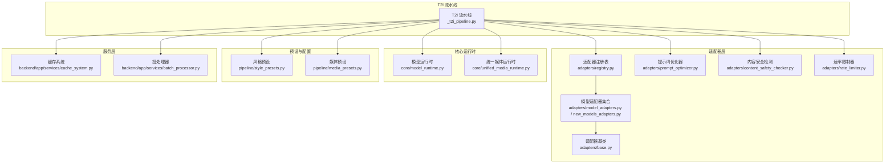
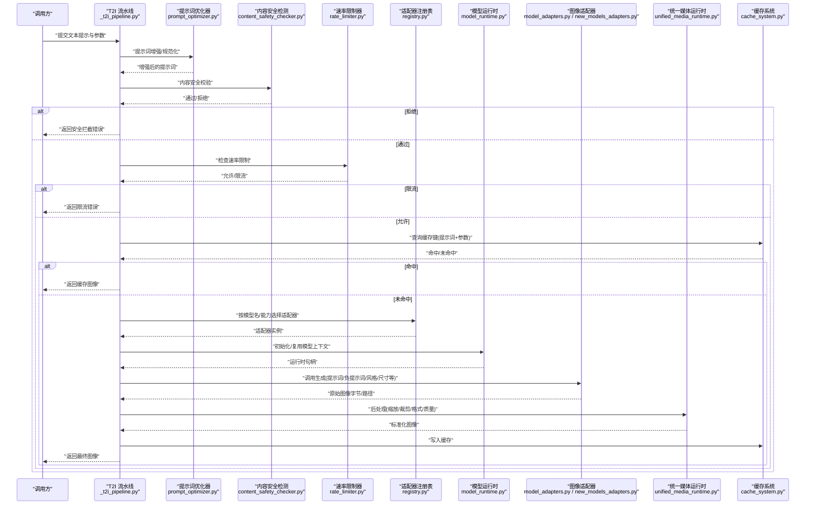
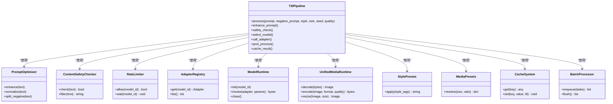

# 文本到图像流水线

<cite>
**本文引用的文件**   
- [painter/_t2i_pipeline.py](file://agents/painter_pkg/_t2i_pipeline.py)
- [adapters/base.py](file://adapters/base.py)
- [adapters/model_adapters.py](file://adapters/model_adapters.py)
- [adapters/new_models_adapters.py](file://adapters/new_models_adapters.py)
- [core/model_runtime.py](file://core/model_runtime.py)
- [core/unified_media_runtime.py](file://core/unified_media_runtime.py)
- [pipeline/style_presets.py](file://pipeline/style_presets.py)
- [pipeline/media_presets.py](file://pipeline/media_presets.py)
- [adapters/registry.py](file://adapters/registry.py)
- [adapters/prompt_optimizer.py](file://adapters/prompt_optimizer.py)
- [adapters/content_safety_checker.py](file://adapters/content_safety_checker.py)
- [adapters/rate_limiter.py](file://adapters/rate_limiter.py)
- [backend/app/services/cache_system.py](file://backend/app/services/cache_system.py)
- [backend/app/services/batch_processor.py](file://backend/app/services/batch_processor.py)
</cite>

## 目录
1. [简介](#简介)
2. [项目结构](#项目结构)
3. [核心组件](#核心组件)
4. [架构总览](#架构总览)
5. [详细组件分析](#详细组件分析)
6. [依赖关系分析](#依赖关系分析)
7. [性能考量](#性能考量)
8. [故障排查指南](#故障排查指南)
9. [结论](#结论)
10. [附录](#附录)

## 简介
本技术文档围绕文本到图像（Text-to-Image, T2I）转换流水线展开，重点解析 agents/painter_pkg/_t2i_pipeline.py 中的 T2I 流程设计。内容涵盖提示词解析与增强、模型选择策略、图像生成调用、后处理与质量保障、输入输出格式、数据流转过程、风格迁移机制、批量处理、缓存策略与错误恢复等。读者可据此快速理解系统如何从自然语言描述生成高质量图像，并掌握关键参数配置与效果调优方法。

## 项目结构
T2I 流水线位于 painter 子包中，通过统一的适配器层对接多种 AI 图像生成模型，并由核心运行时进行资源调度与媒体处理。整体结构如下：
- 流水线编排：_t2i_pipeline.py
- 适配器抽象与实现：adapters/base.py、adapters/model_adapters.py、adapters/new_models_adapters.py
- 模型运行时与统一媒体运行时：core/model_runtime.py、core/unified_media_runtime.py
- 风格与媒体预设：pipeline/style_presets.py、pipeline/media_presets.py
- 注册表与工具：adapters/registry.py、adapters/prompt_optimizer.py、adapters/content_safety_checker.py、adapters/rate_limiter.py
- 服务层能力：缓存与批处理（后端服务）

图表来源
- [agents/painter_pkg/_t2i_pipeline.py](file://agents/painter_pkg/_t2i_pipeline.py)
- [adapters/base.py](file://adapters/base.py)
- [adapters/model_adapters.py](file://adapters/model_adapters.py)
- [adapters/new_models_adapters.py](file://adapters/new_models_adapters.py)
- [core/model_runtime.py](file://core/model_runtime.py)
- [core/unified_media_runtime.py](file://core/unified_media_runtime.py)
- [pipeline/style_presets.py](file://pipeline/style_presets.py)
- [pipeline/media_presets.py](file://pipeline/media_presets.py)
- [adapters/registry.py](file://adapters/registry.py)
- [adapters/prompt_optimizer.py](file://adapters/prompt_optimizer.py)
- [adapters/content_safety_checker.py](file://adapters/content_safety_checker.py)
- [adapters/rate_limiter.py](file://adapters/rate_limiter.py)
- [backend/app/services/cache_system.py](file://backend/app/services/cache_system.py)
- [backend/app/services/batch_processor.py](file://backend/app/services/batch_processor.py)

章节来源
- [agents/painter_pkg/_t2i_pipeline.py](file://agents/painter_pkg/_t2i_pipeline.py)
- [adapters/base.py](file://adapters/base.py)
- [adapters/model_adapters.py](file://adapters/model_adapters.py)
- [adapters/new_models_adapters.py](file://adapters/new_models_adapters.py)
- [core/model_runtime.py](file://core/model_runtime.py)
- [core/unified_media_runtime.py](file://core/unified_media_runtime.py)
- [pipeline/style_presets.py](file://pipeline/style_presets.py)
- [pipeline/media_presets.py](file://pipeline/media_presets.py)
- [adapters/registry.py](file://adapters/registry.py)
- [adapters/prompt_optimizer.py](file://adapters/prompt_optimizer.py)
- [adapters/content_safety_checker.py](file://adapters/content_safety_checker.py)
- [adapters/rate_limiter.py](file://adapters/rate_limiter.py)
- [backend/app/services/cache_system.py](file://backend/app/services/cache_system.py)
- [backend/app/services/batch_processor.py](file://backend/app/services/batch_processor.py)

## 核心组件
- T2I 流水线（_t2i_pipeline.py）
  - 负责端到端编排：提示词预处理与增强、负提示词处理、风格注入、模型选择、调用生成、结果校验与后处理、缓存命中与回退、错误恢复与重试。
- 适配器层（adapters/*）
  - 提供统一的图像生成接口，屏蔽不同厂商/模型的差异；包含提示词优化、内容安全检测、速率限制与注册表管理。
- 运行时（core/*）
  - 模型运行时负责实例化与生命周期管理；统一媒体运行时负责图像编解码、尺寸归一化、格式转换与存储。
- 预设（pipeline/*）
  - 风格预设与媒体预设用于标准化输入输出与视觉一致性。
- 服务层（backend/app/services/*）
  - 缓存系统与批处理器为高吞吐场景提供支撑。

章节来源
- [agents/painter_pkg/_t2i_pipeline.py](file://agents/painter_pkg/_t2i_pipeline.py)
- [adapters/base.py](file://adapters/base.py)
- [adapters/model_adapters.py](file://adapters/model_adapters.py)
- [adapters/new_models_adapters.py](file://adapters/new_models_adapters.py)
- [core/model_runtime.py](file://core/model_runtime.py)
- [core/unified_media_runtime.py](file://core/unified_media_runtime.py)
- [pipeline/style_presets.py](file://pipeline/style_presets.py)
- [pipeline/media_presets.py](file://pipeline/media_presets.py)
- [backend/app/services/cache_system.py](file://backend/app/services/cache_system.py)
- [backend/app/services/batch_processor.py](file://backend/app/services/batch_processor.py)

## 架构总览
下图展示 T2I 流水线的端到端调用序列，包括提示词增强、安全检测、速率限制、模型选择与调用、后处理与缓存落盘等关键环节。

图表来源
- [agents/painter_pkg/_t2i_pipeline.py](file://agents/painter_pkg/_t2i_pipeline.py)
- [adapters/prompt_optimizer.py](file://adapters/prompt_optimizer.py)
- [adapters/content_safety_checker.py](file://adapters/content_safety_checker.py)
- [adapters/rate_limiter.py](file://adapters/rate_limiter.py)
- [adapters/registry.py](file://adapters/registry.py)
- [core/model_runtime.py](file://core/model_runtime.py)
- [adapters/model_adapters.py](file://adapters/model_adapters.py)
- [adapters/new_models_adapters.py](file://adapters/new_models_adapters.py)
- [core/unified_media_runtime.py](file://core/unified_media_runtime.py)
- [backend/app/services/cache_system.py](file://backend/app/services/cache_system.py)

## 详细组件分析

### T2I 流水线（_t2i_pipeline.py）
- 功能职责
  - 接收用户提示词与生成参数，执行提示词增强、安全检测、速率控制、缓存命中、模型选择与调用、后处理与结果返回。
  - 支持负提示词与风格注入，确保生成内容与预期一致。
- 关键流程
  - 提示词解析与增强：将自然语言转换为结构化提示，补充细节、风格与构图信息。
  - 负提示词处理：过滤不期望元素，提升画面纯净度。
  - 模型选择：根据任务类型、分辨率、风格与可用性动态选择适配器。
  - 生成调用：通过模型运行时与具体适配器完成推理。
  - 后处理：尺寸归一化、格式转换、质量压缩、元数据写入。
  - 缓存与批处理：对相同输入参数命中缓存；批量请求合并与去重。
  - 错误恢复：超时、限流、网络异常等场景的自动重试与降级。
- 输入输出
  - 输入：文本提示、可选负提示词、风格标签、分辨率、数量、种子、质量阈值等。
  - 输出：图像字节或路径、元数据（尺寸、哈希、模型名、耗时）、状态码。

章节来源
- [agents/painter_pkg/_t2i_pipeline.py](file://agents/painter_pkg/_t2i_pipeline.py)

### 适配器抽象与实现（adapters/base.py, model_adapters.py, new_models_adapters.py）
- 适配器基类定义统一接口：generate(prompt, negative_prompt, style, size, seed, quality, ...)
- 多模型适配：封装不同厂商 API 的差异，如参数映射、鉴权、分页、流式响应等。
- 新模型适配：支持最新模型的能力扩展与特性开关。
- 错误映射：将底层异常统一转换为上层可识别的错误类型。

章节来源
- [adapters/base.py](file://adapters/base.py)
- [adapters/model_adapters.py](file://adapters/model_adapters.py)
- [adapters/new_models_adapters.py](file://adapters/new_models_adapters.py)

### 模型运行时与统一媒体运行时（core/model_runtime.py, core/unified_media_runtime.py）
- 模型运行时：负责模型实例的生命周期、上下文管理、并发控制与资源回收。
- 统一媒体运行时：负责图像读取、编码、解码、缩放、裁剪、格式转换、质量调整与持久化。

章节来源
- [core/model_runtime.py](file://core/model_runtime.py)
- [core/unified_media_runtime.py](file://core/unified_media_runtime.py)

### 风格与媒体预设（pipeline/style_presets.py, pipeline/media_presets.py）
- 风格预设：提供常用艺术风格、摄影风格、渲染风格的模板与权重组合。
- 媒体预设：标准化分辨率、宽高比、色彩空间、压缩质量等输出规范。

章节来源
- [pipeline/style_presets.py](file://pipeline/style_presets.py)
- [pipeline/media_presets.py](file://pipeline/media_presets.py)

### 提示词优化器（adapters/prompt_optimizer.py）
- 作用：对原始提示词进行语义补全、去噪、结构化重组，提升生成稳定性与可控性。
- 能力：关键词提取、同义替换、风格融合、负面词分离、长度限制与优先级排序。

章节来源
- [adapters/prompt_optimizer.py](file://adapters/prompt_optimizer.py)

### 内容安全检测（adapters/content_safety_checker.py）
- 作用：在生成前对提示词进行合规性检查，避免违规内容进入生成链路。
- 策略：关键词黑名单、语义分类、敏感实体识别与人工审核标记。

章节来源
- [adapters/content_safety_checker.py](file://adapters/content_safety_checker.py)

### 速率限制器（adapters/rate_limiter.py）
- 作用：保护下游模型服务不被突发流量打爆，保证系统稳定性。
- 策略：令牌桶/滑动窗口、按模型维度限流、队列排队与退避重试。

章节来源
- [adapters/rate_limiter.py](file://adapters/rate_limiter.py)

### 适配器注册表（adapters/registry.py）
- 作用：集中管理可用适配器，支持按名称、能力、版本进行路由与发现。
- 能力：动态加载、健康检查、负载均衡与故障切换。

章节来源
- [adapters/registry.py](file://adapters/registry.py)

### 缓存系统与批处理器（backend/app/services/cache_system.py, backend/app/services/batch_processor.py）
- 缓存系统：基于提示词哈希与参数指纹进行缓存，支持 TTL、失效策略与分布式共享。
- 批处理器：合并重复请求、批量下发、结果聚合与失败重试。

章节来源
- [backend/app/services/cache_system.py](file://backend/app/services/cache_system.py)
- [backend/app/services/batch_processor.py](file://backend/app/services/batch_processor.py)

## 依赖关系分析
T2I 流水线依赖适配器层、运行时、预设与服务层，形成清晰的解耦结构。适配器通过注册表被选择，运行时负责资源管理，媒体运行时负责数据处理，服务层提供横向能力。

图表来源
- [agents/painter_pkg/_t2i_pipeline.py](file://agents/painter_pkg/_t2i_pipeline.py)
- [adapters/prompt_optimizer.py](file://adapters/prompt_optimizer.py)
- [adapters/content_safety_checker.py](file://adapters/content_safety_checker.py)
- [adapters/rate_limiter.py](file://adapters/rate_limiter.py)
- [adapters/registry.py](file://adapters/registry.py)
- [core/model_runtime.py](file://core/model_runtime.py)
- [core/unified_media_runtime.py](file://core/unified_media_runtime.py)
- [pipeline/style_presets.py](file://pipeline/style_presets.py)
- [pipeline/media_presets.py](file://pipeline/media_presets.py)
- [backend/app/services/cache_system.py](file://backend/app/services/cache_system.py)
- [backend/app/services/batch_processor.py](file://backend/app/services/batch_processor.py)

## 性能考量
- 缓存命中优先：对相同提示词与参数的请求直接返回缓存结果，显著降低延迟与成本。
- 批处理合并：将多个相似请求合并为一次调用，减少模型调用次数与网络开销。
- 异步与并发：合理设置并发度，避免阻塞与资源争用；结合速率限制器平滑流量。
- 媒体处理优化：使用高效的编解码库与内存池，减少 I/O 与 CPU 占用。
- 模型选择策略：根据任务复杂度与可用性选择轻量模型或降级路径，提高整体吞吐。

[本节为通用指导，无需引用具体文件]

## 故障排查指南
- 提示词问题
  - 现象：生成内容与预期不符或频繁失败。
  - 排查：检查提示词增强是否生效、负提示词是否正确分离、风格标签是否冲突。
  - 参考：提示词优化器与安全检测模块。
- 安全拦截
  - 现象：请求被拒绝。
  - 排查：查看内容安全检测结果，确认是否触发黑名单或语义分类规则。
- 速率限制
  - 现象：请求被限流或排队。
  - 排查：检查速率限制器配置与下游模型配额，适当降低并发或等待退避。
- 模型选择失败
  - 现象：无法找到合适适配器或调用失败。
  - 排查：检查注册表健康状态、模型能力匹配与运行时初始化日志。
- 媒体处理异常
  - 现象：输出图像损坏或格式不正确。
  - 排查：检查统一媒体运行时的编解码参数、尺寸与质量设置。
- 缓存失效
  - 现象：缓存未命中导致重复计算。
  - 排查：检查缓存键生成逻辑、TTL 设置与分布式一致性。

章节来源
- [adapters/prompt_optimizer.py](file://adapters/prompt_optimizer.py)
- [adapters/content_safety_checker.py](file://adapters/content_safety_checker.py)
- [adapters/rate_limiter.py](file://adapters/rate_limiter.py)
- [adapters/registry.py](file://adapters/registry.py)
- [core/model_runtime.py](file://core/model_runtime.py)
- [core/unified_media_runtime.py](file://core/unified_media_runtime.py)
- [backend/app/services/cache_system.py](file://backend/app/services/cache_system.py)

## 结论
T2I 流水线通过模块化设计与清晰的分层架构，实现了从提示词到图像的高质量转换。借助提示词增强、安全检测、速率限制、模型选择与媒体后处理，系统在稳定性、可控性与性能方面具备良好表现。配合缓存与批处理策略，可在高并发场景下保持高效与低成本。建议在生产环境中持续监控关键指标，并根据业务需求微调参数与策略。

[本节为总结性内容，无需引用具体文件]

## 附录

### 支持的 AI 模型类型
- 文本到图像模型：主流扩散模型与云端 API 提供商的图像生成服务。
- 图像编辑模型：支持局部修改、风格迁移与超分等能力。
- 多模态模型：具备图文理解与生成的混合能力。

章节来源
- [adapters/model_adapters.py](file://adapters/model_adapters.py)
- [adapters/new_models_adapters.py](file://adapters/new_models_adapters.py)

### 输入输出格式
- 输入
  - 文本提示：自然语言描述，支持结构化字段（主体、环境、风格、光照等）。
  - 负提示词：不希望出现的元素或特征。
  - 风格标签：来自风格预设的标识符或权重。
  - 分辨率与比例：来自媒体预设的尺寸与宽高比。
  - 其他参数：种子、数量、质量阈值、采样步数等。
- 输出
  - 图像：字节流或文件路径，包含元数据（尺寸、哈希、模型名、耗时）。
  - 状态：成功/失败及错误码，便于上层处理。

章节来源
- [pipeline/style_presets.py](file://pipeline/style_presets.py)
- [pipeline/media_presets.py](file://pipeline/media_presets.py)
- [core/unified_media_runtime.py](file://core/unified_media_runtime.py)

### 数据流转过程
- 提示词增强 → 安全检测 → 速率限制 → 缓存命中 → 模型选择 → 生成调用 → 后处理 → 缓存落盘 → 返回结果。

章节来源
- [agents/painter_pkg/_t2i_pipeline.py](file://agents/painter_pkg/_t2i_pipeline.py)

### 提示词增强技术与负提示词处理
- 增强技术：语义补全、关键词提取、同义替换、风格融合、长度限制与优先级排序。
- 负提示词：分离与强化，确保生成画面不包含不期望元素。

章节来源
- [adapters/prompt_optimizer.py](file://adapters/prompt_optimizer.py)

### 风格迁移机制
- 通过风格预设注入风格标签与权重，影响生成过程的注意力分布与纹理特征。
- 可与媒体预设结合，确保输出符合目标风格与规格。

章节来源
- [pipeline/style_presets.py](file://pipeline/style_presets.py)
- [pipeline/media_presets.py](file://pipeline/media_presets.py)

### 使用示例与参数调优
- 基本用法
  - 输入自然语言提示与基础参数（分辨率、数量、种子），由流水线自动增强与选择模型。
- 高质量生成
  - 增加采样步数、调整质量阈值、引入风格标签与负提示词，细化主体与环境描述。
- 批量处理
  - 使用批处理器合并重复请求，设置合理的并发度与超时时间。
- 缓存策略
  - 启用缓存并设置合适的 TTL，利用提示词哈希与参数指纹命中结果。
- 错误恢复
  - 配置重试次数与退避策略，结合速率限制器避免雪崩。

章节来源
- [agents/painter_pkg/_t2i_pipeline.py](file://agents/painter_pkg/_t2i_pipeline.py)
- [backend/app/services/batch_processor.py](file://backend/app/services/batch_processor.py)
- [backend/app/services/cache_system.py](file://backend/app/services/cache_system.py)
- [adapters/rate_limiter.py](file://adapters/rate_limiter.py)