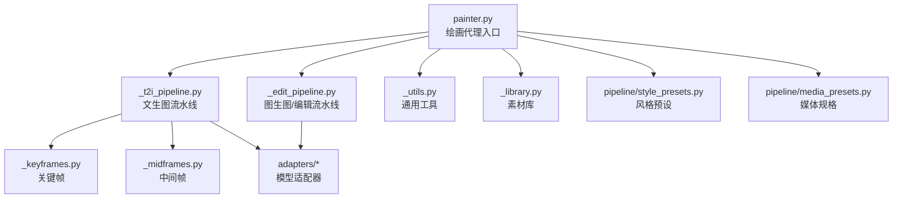
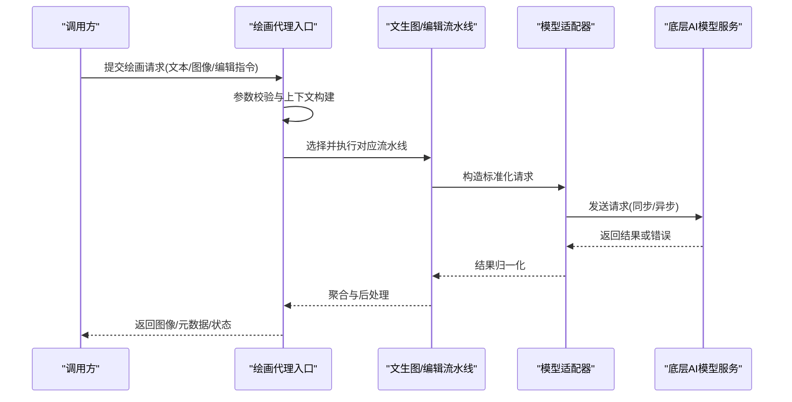
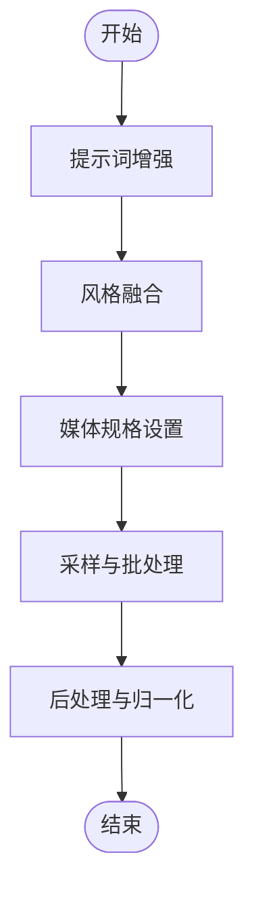
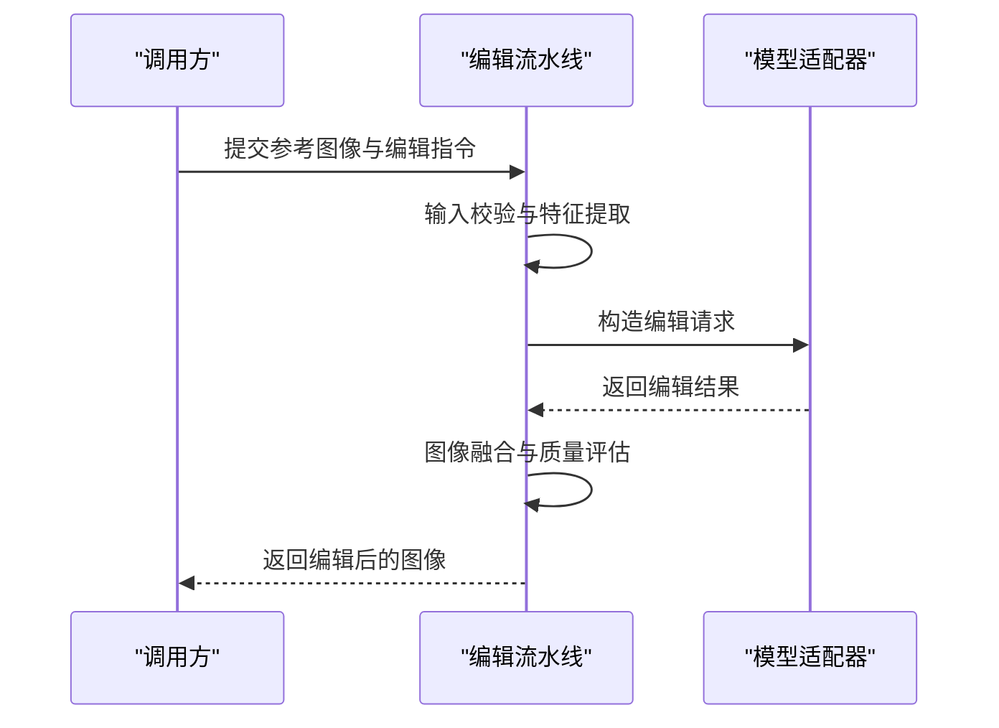
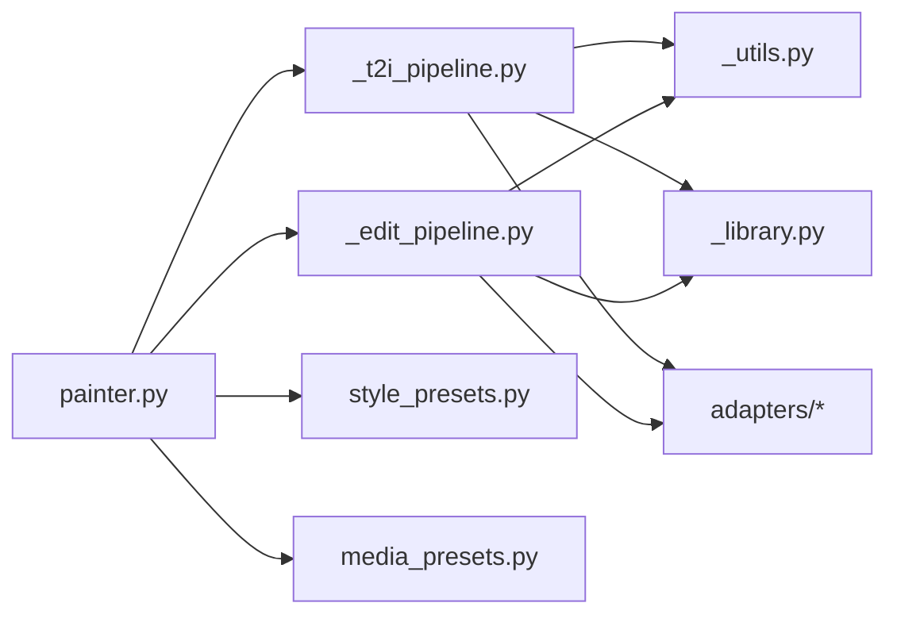

# 绘画代理核心

<cite>
**本文引用的文件**   
- [painter.py](file://agents/painter.py)
- [_t2i_pipeline.py](file://agents/painter_pkg/_t2i_pipeline.py)
- [_edit_pipeline.py](file://agents/painter_pkg/_edit_pipeline.py)
- [_utils.py](file://agents/painter_pkg/_utils.py)
- [_library.py](file://agents/painter_pkg/_library.py)
- [_keyframes.py](file://agents/painter_pkg/_keyframes.py)
- [_midframes.py](file://agents/painter_pkg/_midframes.py)
- [model_adapters.py](file://adapters/model_adapters.py)
- [new_models_adapters.py](file://adapters/new_models_adapters.py)
- [image_sync.py](file://adapters/dashscope/image_sync.py)
- [image_async.py](file://adapters/dashscope/image_async.py)
- [image_edit.py](file://adapters/dashscope/image_edit.py)
- [content_safety_checker.py](file://adapters/content_safety_checker.py)
- [rate_limiter.py](file://adapters/rate_limiter.py)
- [style_presets.py](file://pipeline/style_presets.py)
- [media_presets.py](file://pipeline/media_presets.py)
- [test_painter_model_id_runtime.py](file://tests/test_painter_model_id_runtime.py)
</cite>

## 目录
1. [简介](#简介)
2. [项目结构](#项目结构)
3. [核心组件](#核心组件)
4. [架构总览](#架构总览)
5. [详细组件分析](#详细组件分析)
6. [依赖关系分析](#依赖关系分析)
7. [性能考量](#性能考量)
8. [故障排查指南](#故障排查指南)
9. [结论](#结论)
10. [附录：调用示例与参数说明](#附录调用示例与参数说明)

## 简介
本技术文档聚焦于“绘画代理核心模块”，围绕 agents/painter.py 及其子包 painter_pkg 的架构设计、初始化流程与核心方法进行系统化解析。重点覆盖以下能力：
- 文生图（text-to-image）
- 图生图（image-to-image）
- 图像编辑（image editing）

同时，文档将深入解释提示词处理机制、风格控制参数、批量生成策略，以及与底层AI模型的集成方式和错误处理机制，并提供性能优化建议与最佳实践。

## 项目结构
绘画代理核心由入口模块与多个子模块组成，职责清晰、分层明确：
- 入口与编排层：painter.py 负责对外暴露统一接口、参数校验、调度与结果聚合。
- 管道层：_t2i_pipeline.py 实现文生图流水线；_edit_pipeline.py 实现图生图与图像编辑流水线。
- 工具与资源层：_utils.py 提供通用工具函数；_library.py 管理素材库；_keyframes.py 与 _midframes.py 支持关键帧与中间帧生成。
- 模型适配层：adapters/* 提供不同厂商/协议的图像生成与编辑能力抽象与实现。
- 策略与配置层：pipeline/style_presets.py、pipeline/media_presets.py 提供风格预设与媒体规格。

图表来源
- [painter.py](file://agents/painter.py)
- [_t2i_pipeline.py](file://agents/painter_pkg/_t2i_pipeline.py)
- [_edit_pipeline.py](file://agents/painter_pkg/_edit_pipeline.py)
- [_utils.py](file://agents/painter_pkg/_utils.py)
- [_library.py](file://agents/painter_pkg/_library.py)
- [_keyframes.py](file://agents/painter_pkg/_keyframes.py)
- [_midframes.py](file://agents/painter_pkg/_midframes.py)
- [style_presets.py](file://pipeline/style_presets.py)
- [media_presets.py](file://pipeline/media_presets.py)

章节来源
- [painter.py](file://agents/painter.py)
- [_t2i_pipeline.py](file://agents/painter_pkg/_t2i_pipeline.py)
- [_edit_pipeline.py](file://agents/painter_pkg/_edit_pipeline.py)
- [_utils.py](file://agents/painter_pkg/_utils.py)
- [_library.py](file://agents/painter_pkg/_library.py)
- [_keyframes.py](file://agents/painter_pkg/_keyframes.py)
- [_midframes.py](file://agents/painter_pkg/_midframes.py)
- [style_presets.py](file://pipeline/style_presets.py)
- [media_presets.py](file://pipeline/media_presets.py)

## 核心组件
- 绘画代理入口（painter.py）
  - 负责对外暴露统一的绘画能力接口，包括文本到图像、图像到图像、图像编辑等。
  - 完成输入参数校验、上下文构建、提示词增强、风格与媒体规格注入、并发与重试控制、结果归一化与输出。
- 文生图流水线（_t2i_pipeline.py）
  - 将自然语言描述转换为高质量图像，包含提示词预处理、风格融合、分辨率与比例设置、采样参数、批处理与失败回退。
- 图生图与编辑流水线（_edit_pipeline.py）
  - 基于参考图像进行风格迁移、内容编辑、局部重绘、尺寸调整等，支持多模态输入与约束条件。
- 工具与资源（_utils.py, _library.py）
  - 提供图像格式转换、元数据提取、缓存键生成、素材检索与管理等基础能力。
- 关键帧与中间帧（_keyframes.py, _midframes.py）
  - 用于视频或动画场景中的关键帧生成与插值，保证时间连贯性与视觉一致性。

章节来源
- [painter.py](file://agents/painter.py)
- [_t2i_pipeline.py](file://agents/painter_pkg/_t2i_pipeline.py)
- [_edit_pipeline.py](file://agents/painter_pkg/_edit_pipeline.py)
- [_utils.py](file://agents/painter_pkg/_utils.py)
- [_library.py](file://agents/painter_pkg/_library.py)
- [_keyframes.py](file://agents/painter_pkg/_keyframes.py)
- [_midframes.py](file://agents/painter_pkg/_midframes.py)

## 架构总览
整体架构采用“入口编排 + 管道处理 + 适配器抽象”的分层模式：
- 入口层：统一API与参数治理，屏蔽下游差异。
- 管道层：按任务类型组织处理流程，确保可测试性与可扩展性。
- 适配器层：对接不同厂商/协议的图像生成服务，提供一致的调用契约。
- 策略层：风格与媒体规格通过预设集中管理，便于调参与复用。

图表来源
- [painter.py](file://agents/painter.py)
- [_t2i_pipeline.py](file://agents/painter_pkg/_t2i_pipeline.py)
- [_edit_pipeline.py](file://agents/painter_pkg/_edit_pipeline.py)
- [image_sync.py](file://adapters/dashscope/image_sync.py)
- [image_async.py](file://adapters/dashscope/image_async.py)
- [image_edit.py](file://adapters/dashscope/image_edit.py)

## 详细组件分析

### 绘画代理入口（painter.py）
- 职责
  - 统一对外接口：封装 text_to_image、image_to_image、image_edit 等方法。
  - 参数治理：校验必填字段、默认值填充、类型转换与范围限制。
  - 上下文构建：合并项目级配置、用户偏好、风格与媒体规格。
  - 调度与容错：根据模型能力选择合适适配器，处理超时、限流与重试。
  - 结果归一化：统一输出格式，附加元数据与追踪信息。
- 初始化流程
  - 加载配置与风格预设。
  - 初始化适配器注册表与速率限制器。
  - 准备缓存与素材库索引。
- 核心方法
  - 文本到图像：接收提示词、风格、分辨率、数量等参数，调用文生图流水线。
  - 图像到图像：接收参考图像与编辑指令，调用编辑流水线。
  - 图像编辑：支持局部重绘、风格迁移、尺寸调整等操作。

章节来源
- [painter.py](file://agents/painter.py)

### 文生图流水线（_t2i_pipeline.py）
- 处理步骤
  - 提示词增强：语义补全、负面提示词过滤、关键词权重调整。
  - 风格融合：从 style_presets 中选取风格模板，与提示词组合。
  - 媒体规格：依据 media_presets 设置分辨率、宽高比、质量等级。
  - 采样与批处理：并行生成多张图像，支持失败回退与去重。
  - 结果后处理：格式转换、压缩、元数据写入。
- 复杂度与优化
  - 时间复杂度受并发度、模型响应时间与后处理开销影响。
  - 空间复杂度受图像尺寸与批大小影响。
  - 优化点：缓存热点提示词、预取风格模板、动态批大小调整。

图表来源
- [_t2i_pipeline.py](file://agents/painter_pkg/_t2i_pipeline.py)
- [style_presets.py](file://pipeline/style_presets.py)
- [media_presets.py](file://pipeline/media_presets.py)

章节来源
- [_t2i_pipeline.py](file://agents/painter_pkg/_t2i_pipeline.py)
- [style_presets.py](file://pipeline/style_presets.py)
- [media_presets.py](file://pipeline/media_presets.py)

### 图生图与编辑流水线（_edit_pipeline.py）
- 处理步骤
  - 输入校验：检查参考图像有效性、编辑指令合法性。
  - 特征提取：提取参考图像的关键特征（如主体、背景、风格）。
  - 编辑策略：根据指令选择重绘区域、强度、风格迁移程度。
  - 生成与合成：调用适配器生成新图像，与原图进行融合。
  - 质量评估：可选的质量检查与自动修正。
- 适用场景
  - 风格迁移、局部修改、尺寸调整、内容替换等。

图表来源
- [_edit_pipeline.py](file://agents/painter_pkg/_edit_pipeline.py)
- [image_edit.py](file://adapters/dashscope/image_edit.py)

章节来源
- [_edit_pipeline.py](file://agents/painter_pkg/_edit_pipeline.py)
- [image_edit.py](file://adapters/dashscope/image_edit.py)

### 工具与资源（_utils.py, _library.py）
- _utils.py
  - 提供图像格式转换、尺寸缩放、元数据读写、缓存键生成等工具函数。
  - 支持常见图像编码解码与内存优化。
- _library.py
  - 管理本地或云端素材库，支持按标签、语义检索与版本管理。
  - 为流水线提供快速素材获取与缓存命中。

章节来源
- [_utils.py](file://agents/painter_pkg/_utils.py)
- [_library.py](file://agents/painter_pkg/_library.py)

### 关键帧与中间帧（_keyframes.py, _midframes.py）
- _keyframes.py
  - 负责关键帧生成，确保时间轴上的重要画面质量与一致性。
- _midframes.py
  - 基于关键帧生成中间帧，提升动画流畅度与连贯性。
- 应用场景
  - 短视频生成、角色动作过渡、场景切换平滑处理。

章节来源
- [_keyframes.py](file://agents/painter_pkg/_keyframes.py)
- [_midframes.py](file://agents/painter_pkg/_midframes.py)

## 依赖关系分析
- 内部依赖
  - painter.py 依赖各流水线与工具模块，形成清晰的单向依赖。
  - 流水线依赖适配器与策略模块，避免直接耦合底层服务。
- 外部依赖
  - adapters/* 封装不同厂商的图像生成与编辑能力。
  - pipeline/* 提供风格与媒体规格的统一管理。
- 潜在风险
  - 循环依赖需避免，当前结构已规避。
  - 适配器接口变更需保持向后兼容。

图表来源
- [painter.py](file://agents/painter.py)
- [_t2i_pipeline.py](file://agents/painter_pkg/_t2i_pipeline.py)
- [_edit_pipeline.py](file://agents/painter_pkg/_edit_pipeline.py)
- [_utils.py](file://agents/painter_pkg/_utils.py)
- [_library.py](file://agents/painter_pkg/_library.py)
- [style_presets.py](file://pipeline/style_presets.py)
- [media_presets.py](file://pipeline/media_presets.py)

章节来源
- [painter.py](file://agents/painter.py)
- [_t2i_pipeline.py](file://agents/painter_pkg/_t2i_pipeline.py)
- [_edit_pipeline.py](file://agents/painter_pkg/_edit_pipeline.py)
- [_utils.py](file://agents/painter_pkg/_utils.py)
- [_library.py](file://agents/painter_pkg/_library.py)
- [style_presets.py](file://pipeline/style_presets.py)
- [media_presets.py](file://pipeline/media_presets.py)

## 性能考量
- 并发与批处理
  - 合理设置并发度，避免超出模型服务QPS限制。
  - 动态批大小根据负载自适应调整。
- 缓存策略
  - 对热点提示词与风格模板进行缓存，减少重复计算。
  - 图像结果缓存结合哈希键，提高命中率。
- 内存与I/O
  - 使用流式处理大图像，避免一次性加载。
  - 压缩与格式优化降低存储与传输成本。
- 监控与降级
  - 记录关键指标（延迟、成功率、错误码）。
  - 在模型不可用时自动降级至备用适配器或缓存结果。

[本节为通用指导，不直接分析具体文件]

## 故障排查指南
- 常见问题
  - 参数校验失败：检查必填字段、类型与范围。
  - 模型服务超时：调整超时阈值，启用重试与熔断。
  - 限流错误：降低并发度或增加配额。
  - 图像质量不佳：调整提示词权重、风格强度与采样参数。
- 诊断工具
  - 启用详细日志，记录请求与响应。
  - 使用单元测试与集成测试验证适配器行为。
- 安全与合规
  - 内容安全检查拦截不当内容。
  - 遵循隐私与版权政策，避免敏感数据泄露。

章节来源
- [content_safety_checker.py](file://adapters/content_safety_checker.py)
- [rate_limiter.py](file://adapters/rate_limiter.py)

## 结论
绘画代理核心模块通过清晰的层次结构与模块化设计，实现了文生图、图生图与图像编辑的统一能力。借助适配器抽象与策略预设，系统具备良好的扩展性与可维护性。在实际使用中，应重点关注参数调优、并发控制与缓存策略，以获得稳定高效的生成体验。

[本节为总结性内容，不直接分析具体文件]

## 附录：调用示例与参数说明
- 文生图调用
  - 输入：提示词、风格、分辨率、数量、种子等。
  - 输出：图像列表与元数据。
  - 调优技巧：增加提示词细节、调整风格强度、优化分辨率与采样步数。
- 图生图调用
  - 输入：参考图像、编辑指令、强度参数。
  - 输出：编辑后的图像。
  - 调优技巧：精确指定编辑区域、控制强度以避免过度失真。
- 图像编辑调用
  - 输入：原图、编辑操作（重绘、替换、风格迁移）。
  - 输出：编辑结果。
  - 调优技巧：选择合适的编辑策略与参数组合。

章节来源
- [painter.py](file://agents/painter.py)
- [_t2i_pipeline.py](file://agents/painter_pkg/_t2i_pipeline.py)
- [_edit_pipeline.py](file://agents/painter_pkg/_edit_pipeline.py)
- [style_presets.py](file://pipeline/style_presets.py)
- [media_presets.py](file://pipeline/media_presets.py)