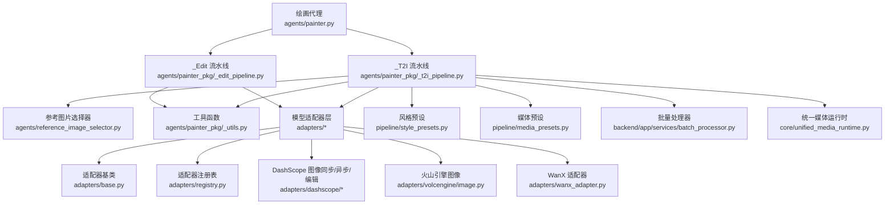
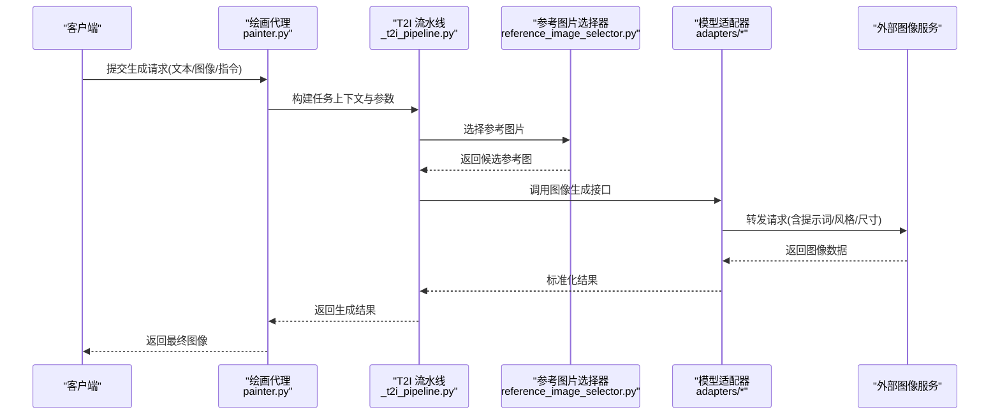
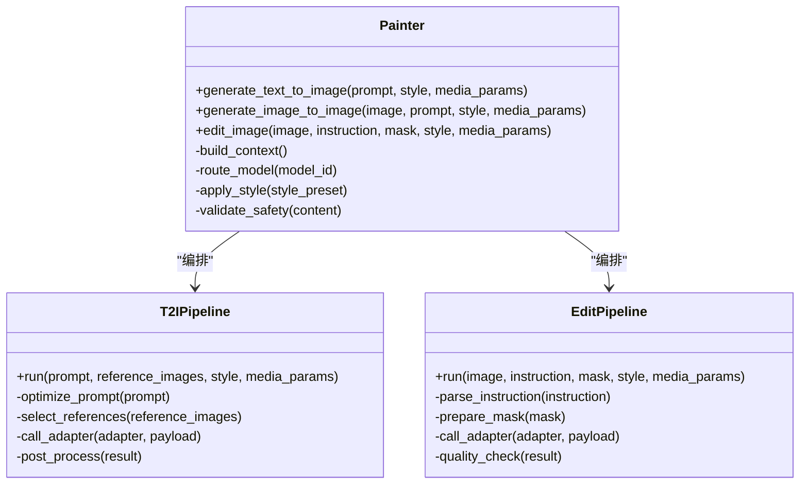
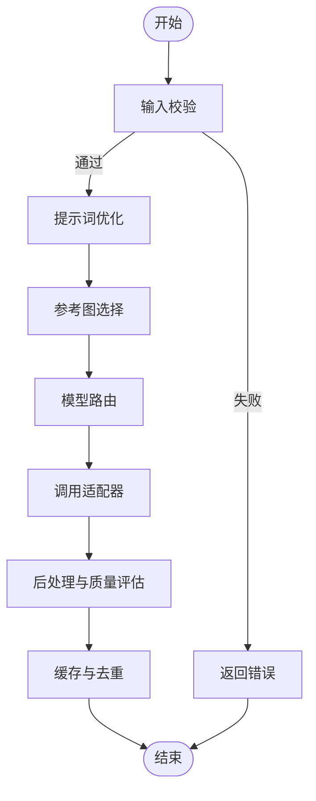
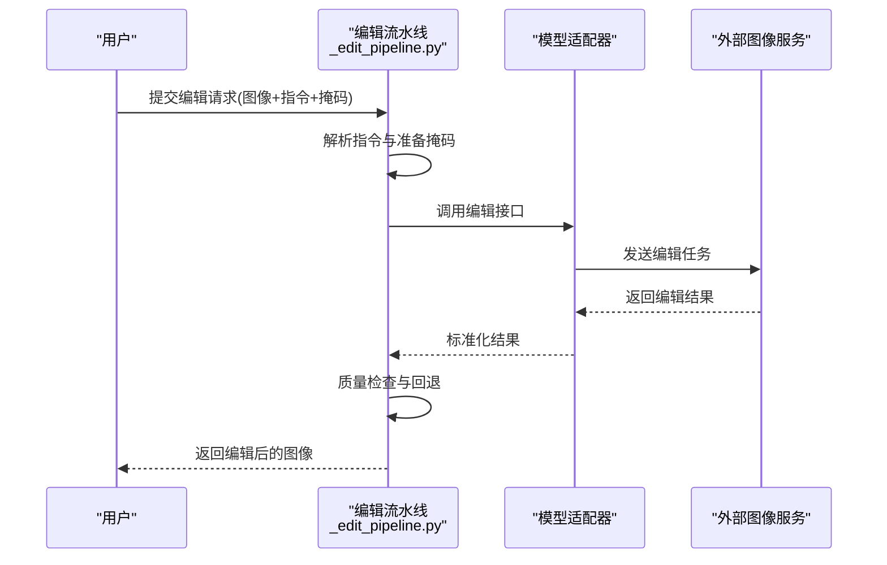
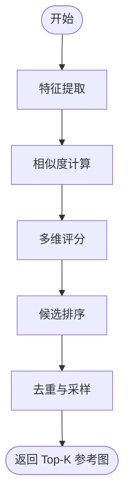
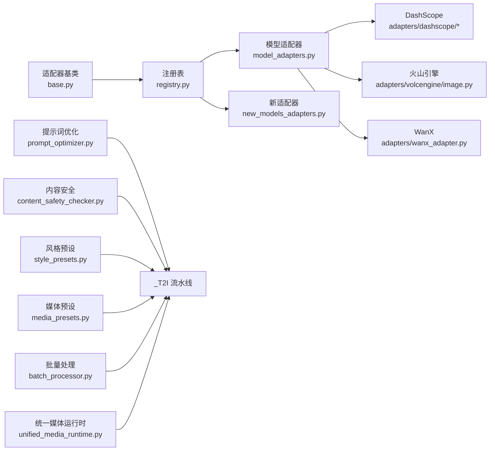

# 视觉生成代理

<cite>
**本文引用的文件**   
- [painter.py](file://agents/painter.py)
- [_t2i_pipeline.py](file://agents/painter_pkg/_t2i_pipeline.py)
- [_edit_pipeline.py](file://agents/painter_pkg/_edit_pipeline.py)
- [reference_image_selector.py](file://agents/reference_image_selector.py)
- [_utils.py](file://agents/painter_pkg/_utils.py)
- [_library.py](file://agents/painter_pkg/_library.py)
- [_keyframes.py](file://agents/painter_pkg/_keyframes.py)
- [_midframes.py](file://agents/painter_pkg/_midframes.py)
- [model_adapters.py](file://adapters/model_adapters.py)
- [new_models_adapters.py](file://adapters/new_models_adapters.py)
- [registry.py](file://adapters/registry.py)
- [base.py](file://adapters/base.py)
- [image_sync.py](file://adapters/dashscope/image_sync.py)
- [image_edit.py](file://adapters/dashscope/image_edit.py)
- [image_async.py](file://adapters/dashscope/image_async.py)
- [volcengine_image.py](file://adapters/volcengine/image.py)
- [wanx_adapter.py](file://adapters/wanx_adapter.py)
- [prompt_optimizer.py](file://adapters/prompt_optimizer.py)
- [content_safety_checker.py](file://adapters/content_safety_checker.py)
- [batch_processor.py](file://backend/app/services/batch_processor.py)
- [style_presets.py](file://pipeline/style_presets.py)
- [media_presets.py](file://pipeline/media_presets.py)
- [unified_media_runtime.py](file://core/unified_media_runtime.py)
</cite>

## 目录
1. [简介](#简介)
2. [项目结构](#项目结构)
3. [核心组件](#核心组件)
4. [架构总览](#架构总览)
5. [详细组件分析](#详细组件分析)
6. [依赖关系分析](#依赖关系分析)
7. [性能考量](#性能考量)
8. [故障排查指南](#故障排查指南)
9. [结论](#结论)
10. [附录](#附录)

## 简介
本技术文档面向“视觉生成代理”模块，聚焦以下能力与实现：
- 绘画代理（painter.py）：统一对外暴露文生图、图生图、图像编辑三大能力，并封装提示词工程、风格控制与批量处理。
- T2I 流水线（_t2i_pipeline.py）：文本到图像的端到端转换流程，包括提示词优化、参考素材选择、模型路由与结果后处理。
- 编辑流水线（_edit_pipeline.py）：基于参考图与指令的图像修改与优化，支持局部重绘、风格迁移、质量增强等。
- 参考图片选择器（reference_image_selector.py）：智能匹配与检索参考素材，提升生成一致性与风格可控性。
- 多模型集成：通过适配器层对接多种图像生成服务（如 DashScope、火山引擎、WanX 等），并提供统一的调用接口与错误处理。
- 提示词工程与风格控制：内置提示词优化器、风格预设与媒体参数预设，确保高质量输出与稳定风格。
- 使用示例与最佳实践：提供从单张生成到批量处理的完整工作流，以及性能调优建议。

## 项目结构
视觉生成代理位于 agents 与 agents/painter_pkg 下，配合 adapters 层的模型适配与 pipeline 层的通用工具，形成“编排-执行-适配-工具”的分层架构。

**图表来源** 
- [painter.py](file://agents/painter.py)
- [_t2i_pipeline.py](file://agents/painter_pkg/_t2i_pipeline.py)
- [_edit_pipeline.py](file://agents/painter_pkg/_edit_pipeline.py)
- [reference_image_selector.py](file://agents/reference_image_selector.py)
- [_utils.py](file://agents/painter_pkg/_utils.py)
- [model_adapters.py](file://adapters/model_adapters.py)
- [new_models_adapters.py](file://adapters/new_models_adapters.py)
- [registry.py](file://adapters/registry.py)
- [base.py](file://adapters/base.py)
- [image_sync.py](file://adapters/dashscope/image_sync.py)
- [image_edit.py](file://adapters/dashscope/image_edit.py)
- [image_async.py](file://adapters/dashscope/image_async.py)
- [volcengine_image.py](file://adapters/volcengine/image.py)
- [wanx_adapter.py](file://adapters/wanx_adapter.py)
- [prompt_optimizer.py](file://adapters/prompt_optimizer.py)
- [content_safety_checker.py](file://adapters/content_safety_checker.py)
- [batch_processor.py](file://backend/app/services/batch_processor.py)
- [style_presets.py](file://pipeline/style_presets.py)
- [media_presets.py](file://pipeline/media_presets.py)
- [unified_media_runtime.py](file://core/unified_media_runtime.py)

**章节来源**
- [painter.py](file://agents/painter.py)
- [_t2i_pipeline.py](file://agents/painter_pkg/_t2i_pipeline.py)
- [_edit_pipeline.py](file://agents/painter_pkg/_edit_pipeline.py)
- [reference_image_selector.py](file://agents/reference_image_selector.py)

## 核心组件
- 绘画代理（painter.py）
  - 职责：统一入口，协调 T2I 与 Edit 流水线；管理提示词模板、风格与媒体参数；提供批量生成与重试策略。
  - 关键能力：文生图、图生图、图像编辑、风格控制、批量任务调度、错误恢复。
- T2I 流水线（_t2i_pipeline.py）
  - 职责：将自然语言描述转换为图像；包含提示词优化、参考图选择、模型路由、参数装配、结果后处理。
  - 关键能力：语义解析、风格注入、尺寸与比例控制、安全审核、缓存与去重。
- 编辑流水线（_edit_pipeline.py）
  - 职责：在已有图像基础上进行指令驱动的修改；支持局部区域编辑、风格迁移、质量增强。
  - 关键能力：掩码与区域选择、指令理解、模型适配、质量评估与回退。
- 参考图片选择器（reference_image_selector.py）
  - 职责：根据文本或上下文智能匹配参考素材；支持相似度计算、风格标签匹配、多样性控制。
  - 关键能力：向量检索、规则过滤、候选排序、去重与采样。

**章节来源**
- [painter.py](file://agents/painter.py)
- [_t2i_pipeline.py](file://agents/painter_pkg/_t2i_pipeline.py)
- [_edit_pipeline.py](file://agents/painter_pkg/_edit_pipeline.py)
- [reference_image_selector.py](file://agents/reference_image_selector.py)

## 架构总览
整体采用“编排-执行-适配”三层结构：
- 编排层：painter.py 作为统一入口，负责业务编排与参数装配。
- 执行层：T2I 与 Edit 流水线分别处理不同任务类型，内部串联提示词优化、参考图选择、模型调用与后处理。
- 适配层：通过 adapters 抽象出统一的图像生成接口，屏蔽具体厂商差异，支持动态注册与扩展。

**图表来源** 
- [painter.py](file://agents/painter.py)
- [_t2i_pipeline.py](file://agents/painter_pkg/_t2i_pipeline.py)
- [reference_image_selector.py](file://agents/reference_image_selector.py)
- [base.py](file://adapters/base.py)
- [registry.py](file://adapters/registry.py)
- [image_sync.py](file://adapters/dashscope/image_sync.py)
- [image_edit.py](file://adapters/dashscope/image_edit.py)
- [image_async.py](file://adapters/dashscope/image_async.py)
- [volcengine_image.py](file://adapters/volcengine/image.py)
- [wanx_adapter.py](file://adapters/wanx_adapter.py)

## 详细组件分析

### 绘画代理（painter.py）
- 功能要点
  - 统一入口：对外暴露 generate_text_to_image、generate_image_to_image、edit_image 等方法。
  - 参数装配：整合提示词、风格预设、媒体参数（分辨率、比例、质量）、安全策略。
  - 批量处理：支持并发任务队列、失败重试、进度回调。
  - 错误处理：捕获网络异常、模型限流、内容安全拦截，提供降级与回退策略。
- 设计模式
  - 工厂模式：根据模型 ID 动态选择适配器。
  - 策略模式：提示词优化、风格注入、安全审核可插拔。
  - 观察者模式：批量任务进度与事件上报。

**图表来源** 
- [painter.py](file://agents/painter.py)
- [_t2i_pipeline.py](file://agents/painter_pkg/_t2i_pipeline.py)
- [_edit_pipeline.py](file://agents/painter_pkg/_edit_pipeline.py)

**章节来源**
- [painter.py](file://agents/painter.py)

### T2I 流水线（_t2i_pipeline.py）
- 处理流程
  - 输入校验：检查提示词长度、敏感词、风格合法性。
  - 提示词优化：结合领域词汇、风格关键词、构图描述进行增强。
  - 参考图选择：依据语义相似度与风格标签筛选候选图。
  - 模型路由：根据模型能力与配额选择最优适配器。
  - 调用与后处理：统一调用适配器，对结果进行格式标准化、质量评估、缓存写入。
- 复杂度与优化
  - 参考图选择采用向量检索+规则过滤，时间复杂度近似 O(n log n)。
  - 批量任务通过并发队列与限流控制，避免资源争用。

**图表来源** 
- [_t2i_pipeline.py](file://agents/painter_pkg/_t2i_pipeline.py)
- [reference_image_selector.py](file://agents/reference_image_selector.py)
- [prompt_optimizer.py](file://adapters/prompt_optimizer.py)
- [registry.py](file://adapters/registry.py)

**章节来源**
- [_t2i_pipeline.py](file://agents/painter_pkg/_t2i_pipeline.py)
- [reference_image_selector.py](file://agents/reference_image_selector.py)
- [prompt_optimizer.py](file://adapters/prompt_optimizer.py)

### 编辑流水线（_edit_pipeline.py）
- 处理流程
  - 指令解析：将自然语言指令转化为结构化编辑意图（区域、操作类型、强度）。
  - 掩码准备：根据指令生成或加载掩码，支持手绘、自动分割、语义区域。
  - 模型调用：选择支持编辑能力的适配器，传入原图、掩码与编辑参数。
  - 质量检查：对编辑结果进行一致性、伪影检测与回退策略。
- 关键算法
  - 指令理解：结合领域词典与上下文，提取编辑目标与约束。
  - 掩码融合：多源掩码加权融合，保证边缘平滑与语义准确。

**图表来源** 
- [_edit_pipeline.py](file://agents/painter_pkg/_edit_pipeline.py)
- [image_edit.py](file://adapters/dashscope/image_edit.py)

**章节来源**
- [_edit_pipeline.py](file://agents/painter_pkg/_edit_pipeline.py)

### 参考图片选择器（reference_image_selector.py）
- 算法要点
  - 特征提取：对候选图提取视觉特征（颜色直方图、纹理、深度特征）。
  - 相似度计算：结合文本嵌入与图像嵌入，计算语义与风格相似度。
  - 候选排序：多维度评分（相似度、多样性、质量分），Top-K 选择。
  - 去重与采样：避免重复风格与冗余内容，保证生成多样性。
- 性能优化
  - 索引构建：离线构建向量索引，加速在线检索。
  - 缓存策略：热点参考图缓存，减少重复计算。

**图表来源** 
- [reference_image_selector.py](file://agents/reference_image_selector.py)

**章节来源**
- [reference_image_selector.py](file://agents/reference_image_selector.py)

### 工具与辅助模块
- _utils.py：通用图像处理、格式转换、路径管理等工具函数。
- _library.py：资产库管理，支持本地与云端存储、元数据索引。
- _keyframes.py / _midframes.py：关键帧与中间帧生成，用于视频序列一致性控制。

**章节来源**
- [_utils.py](file://agents/painter_pkg/_utils.py)
- [_library.py](file://agents/painter_pkg/_library.py)
- [_keyframes.py](file://agents/painter_pkg/_keyframes.py)
- [_midframes.py](file://agents/painter_pkg/_midframes.py)

## 依赖关系分析
- 适配器层依赖
  - base.py：定义统一接口与抽象类。
  - registry.py：维护适配器注册表，支持动态加载与版本管理。
  - model_adapters.py / new_models_adapters.py：具体适配器实现与新旧兼容桥接。
- 外部服务集成
  - dashcope/image_sync.py、image_edit.py、image_async.py：DashScope 同步/异步/编辑接口。
  - volcengine/image.py：火山引擎图像生成接口。
  - wanx_adapter.py：WanX 适配器实现。
- 工具与配置
  - prompt_optimizer.py：提示词优化策略。
  - content_safety_checker.py：内容安全审核。
  - style_presets.py / media_presets.py：风格与媒体参数预设。
  - batch_processor.py：批量任务调度与监控。
  - unified_media_runtime.py：统一媒体运行时，处理编码、解码与格式转换。

**图表来源** 
- [base.py](file://adapters/base.py)
- [registry.py](file://adapters/registry.py)
- [model_adapters.py](file://adapters/model_adapters.py)
- [new_models_adapters.py](file://adapters/new_models_adapters.py)
- [image_sync.py](file://adapters/dashscope/image_sync.py)
- [image_edit.py](file://adapters/dashscope/image_edit.py)
- [image_async.py](file://adapters/dashscope/image_async.py)
- [volcengine_image.py](file://adapters/volcengine/image.py)
- [wanx_adapter.py](file://adapters/wanx_adapter.py)
- [prompt_optimizer.py](file://adapters/prompt_optimizer.py)
- [content_safety_checker.py](file://adapters/content_safety_checker.py)
- [style_presets.py](file://pipeline/style_presets.py)
- [media_presets.py](file://pipeline/media_presets.py)
- [batch_processor.py](file://backend/app/services/batch_processor.py)
- [unified_media_runtime.py](file://core/unified_media_runtime.py)

**章节来源**
- [base.py](file://adapters/base.py)
- [registry.py](file://adapters/registry.py)
- [model_adapters.py](file://adapters/model_adapters.py)
- [new_models_adapters.py](file://adapters/new_models_adapters.py)
- [image_sync.py](file://adapters/dashscope/image_sync.py)
- [image_edit.py](file://adapters/dashscope/image_edit.py)
- [image_async.py](file://adapters/dashscope/image_async.py)
- [volcengine_image.py](file://adapters/volcengine/image.py)
- [wanx_adapter.py](file://adapters/wanx_adapter.py)
- [prompt_optimizer.py](file://adapters/prompt_optimizer.py)
- [content_safety_checker.py](file://adapters/content_safety_checker.py)
- [style_presets.py](file://pipeline/style_presets.py)
- [media_presets.py](file://pipeline/media_presets.py)
- [batch_processor.py](file://backend/app/services/batch_processor.py)
- [unified_media_runtime.py](file://core/unified_media_runtime.py)

## 性能考量
- 并发与限流
  - 使用批量处理器控制并发度，避免超出模型服务 QPS 限制。
  - 实现指数退避与重试机制，提高鲁棒性。
- 缓存与去重
  - 对提示词与参考图组合进行哈希缓存，避免重复生成。
  - 利用统一媒体运行时缓存中间结果，减少 I/O 开销。
- 内存与带宽
  - 大图像分块处理，降低内存峰值。
  - 压缩传输与本地缓存，减少网络延迟。
- 模型选择
  - 根据任务复杂度与实时性要求选择合适模型，平衡质量与速度。

[本节为通用指导，不直接分析具体文件]

## 故障排查指南
- 常见问题
  - 提示词过长或包含敏感词：检查提示词优化与安全审核日志。
  - 参考图选择不佳：调整相似度阈值与风格权重。
  - 模型调用失败：检查适配器配置、网络连通性与配额。
  - 编辑结果不一致：验证掩码质量与指令解析准确性。
- 调试技巧
  - 启用详细日志，记录每个阶段的输入输出。
  - 使用模拟适配器进行单元测试，隔离外部依赖。
  - 逐步缩小问题范围，定位具体环节。

**章节来源**
- [content_safety_checker.py](file://adapters/content_safety_checker.py)
- [prompt_optimizer.py](file://adapters/prompt_optimizer.py)
- [registry.py](file://adapters/registry.py)

## 结论
视觉生成代理模块通过清晰的层次化设计与模块化实现，提供了强大的文生图、图生图与图像编辑能力。借助适配器层的多模型支持与提示词工程、风格控制、批量处理等特性，能够满足多样化与高性能的视觉生成需求。在实际应用中，建议结合业务场景选择合适的模型与参数，并通过缓存、并发控制与质量评估等手段优化性能与稳定性。

[本节为总结性内容，不直接分析具体文件]

## 附录
- 使用示例
  - 文生图：调用 painter.generate_text_to_image，传入提示词、风格与媒体参数。
  - 图生图：调用 painter.generate_image_to_image，提供原图与编辑指令。
  - 图像编辑：调用 painter.edit_image，指定区域掩码与操作类型。
  - 批量处理：使用 batch_processor 提交任务队列，监控进度与结果。
- 参数调优
  - 提示词：增加细节描述与风格关键词，避免模糊表达。
  - 风格控制：选择合适的风格预设，必要时自定义风格模板。
  - 媒体参数：根据输出用途调整分辨率、比例与质量。
- 最佳实践
  - 始终进行内容安全审核，避免违规输出。
  - 使用参考图提升一致性与风格可控性。
  - 对关键任务进行多次生成与人工筛选。

[本节为补充说明，不直接分析具体文件]