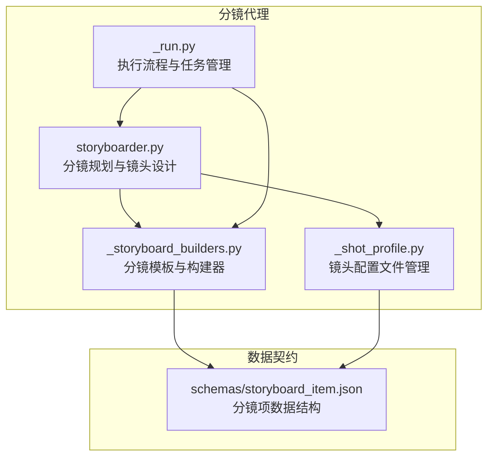
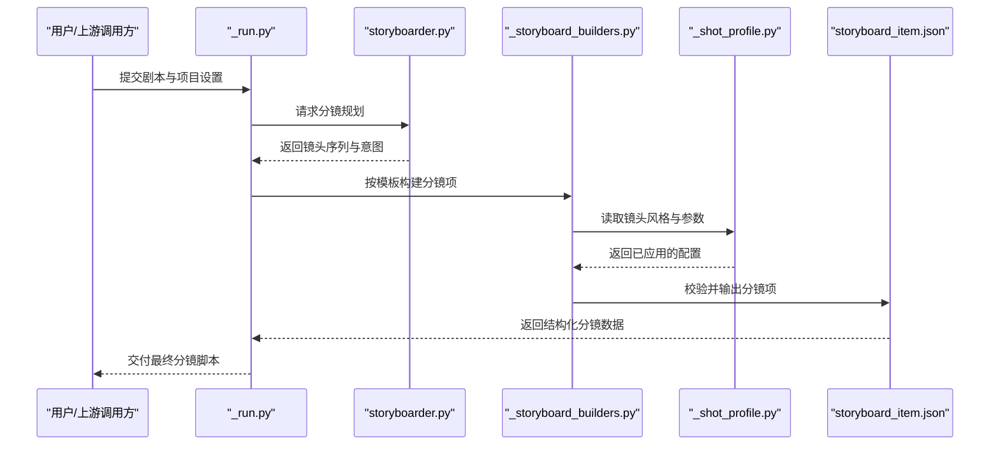
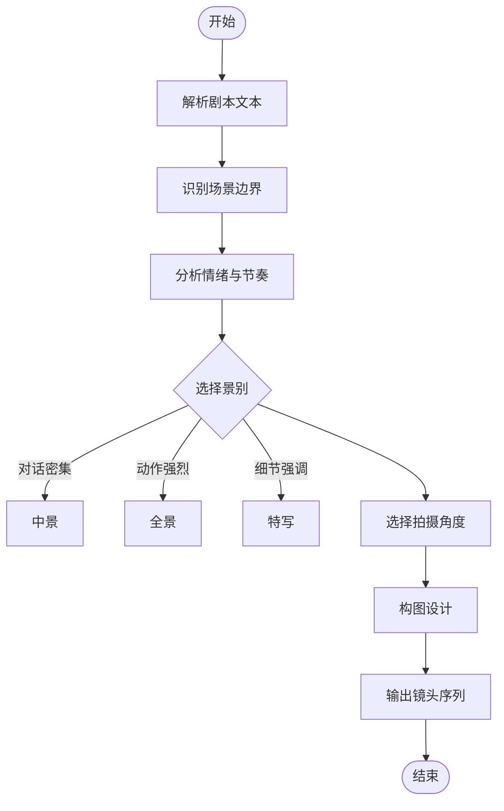
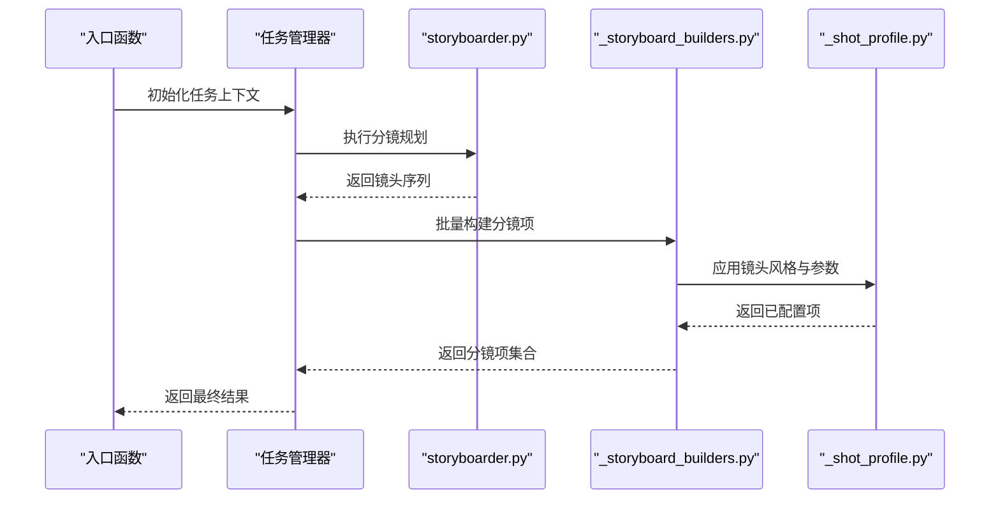
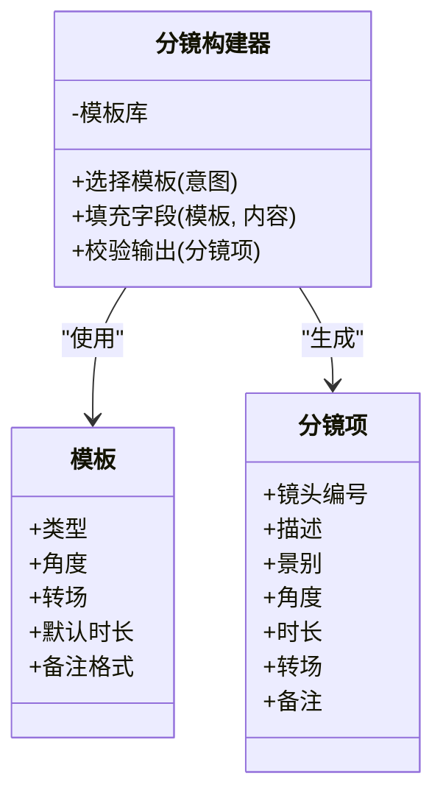
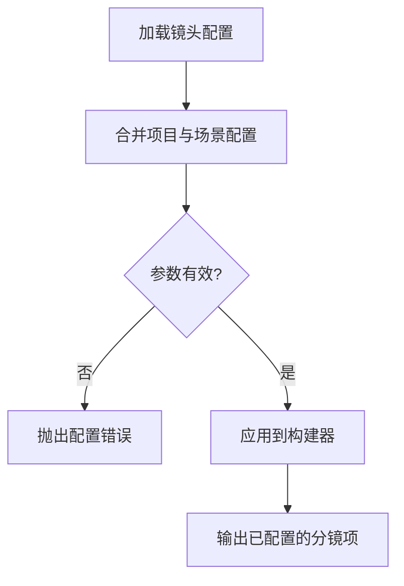
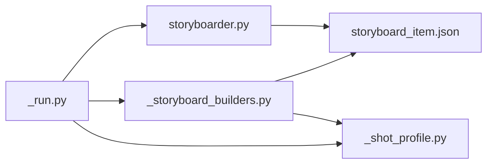

# 分镜制作代理

<cite>
**本文引用的文件**   
- [storyboarder.py](file://agents/storyboarder.py)
- [_run.py](file://agents/storyboarder_pkg/_run.py)
- [_storyboard_builders.py](file://agents/storyboarder_pkg/_storyboard_builders.py)
- [_shot_profile.py](file://agents/storyboarder_pkg/_shot_profile.py)
- [storyboard_item.json](file://schemas/storyboard_item.json)
</cite>

## 目录
1. [简介](#简介)
2. [项目结构](#项目结构)
3. [核心组件](#核心组件)
4. [架构总览](#架构总览)
5. [详细组件分析](#详细组件分析)
6. [依赖关系分析](#依赖关系分析)
7. [性能考虑](#性能考虑)
8. [故障排查指南](#故障排查指南)
9. [结论](#结论)
10. [附录](#附录)

## 简介
本技术文档面向“分镜制作代理”，聚焦以下目标：
- 深入解析 storyboarder.py 的分镜规划算法与镜头设计逻辑
- 梳理 _run.py 的执行流程与任务管理
- 解读 _storyboard_builders.py 的分镜模板与构建器机制
- 说明 _shot_profile.py 的镜头配置文件管理与参数体系
- 完整阐述分镜制作流程：剧本分析、场景识别、镜头规划、构图设计
- 列举支持的镜头类型（全景、中景、特写等）与拍摄角度
- 解释分镜模板系统如何定义与复用不同镜头风格
- 说明镜头配置文件的作用与关键参数设置
- 提供专业级分镜脚本创建示例，并给出镜头语言与艺术指导原则
- 总结分镜优化与团队协作的最佳实践

## 项目结构
围绕分镜制作代理的核心代码主要分布在 agents 与 schemas 两个层级：
- agents 层：实现分镜规划、执行编排、模板构建、镜头配置等能力
- schemas 层：定义分镜项的数据契约，确保输入输出一致性与可验证性

图表来源
- [storyboarder.py](file://agents/storyboarder.py)
- [_run.py](file://agents/storyboarder_pkg/_run.py)
- [_storyboard_builders.py](file://agents/storyboarder_pkg/_storyboard_builders.py)
- [_shot_profile.py](file://agents/storyboarder_pkg/_shot_profile.py)
- [storyboard_item.json](file://schemas/storyboard_item.json)

章节来源
- [storyboarder.py](file://agents/storyboarder.py)
- [_run.py](file://agents/storyboarder_pkg/_run.py)
- [_storyboard_builders.py](file://agents/storyboarder_pkg/_storyboard_builders.py)
- [_shot_profile.py](file://agents/storyboarder_pkg/_shot_profile.py)
- [storyboard_item.json](file://schemas/storyboard_item.json)

## 核心组件
- 分镜规划器（storyboarder.py）
  - 负责从剧本文本中提取场景、角色与动作，生成镜头序列与构图策略
  - 内置镜头类型库与角度规则，支持按叙事节奏调整景别与机位
- 执行编排器（_run.py）
  - 将分镜任务拆解为子任务，调度构建器与配置管理器，保证顺序与并发控制
- 分镜构建器（_storyboard_builders.py）
  - 基于模板生成具体分镜项，填充镜头描述、景别、角度、时长、转场等字段
- 镜头配置（_shot_profile.py）
  - 管理镜头风格、预设参数、约束条件，驱动构建器输出一致的视觉风格

章节来源
- [storyboarder.py](file://agents/storyboarder.py)
- [_run.py](file://agents/storyboarder_pkg/_run.py)
- [_storyboard_builders.py](file://agents/storyboarder_pkg/_storyboard_builders.py)
- [_shot_profile.py](file://agents/storyboarder_pkg/_shot_profile.py)

## 架构总览
分镜制作代理采用“规划—编排—构建—配置”的分层架构：
- 规划层：从文本到镜头意图的抽象映射
- 编排层：任务分解、依赖解析、执行调度
- 构建层：模板实例化与字段填充
- 配置层：风格与参数的集中管理

图表来源
- [_run.py](file://agents/storyboarder_pkg/_run.py)
- [storyboarder.py](file://agents/storyboarder.py)
- [_storyboard_builders.py](file://agents/storyboarder_pkg/_storyboard_builders.py)
- [_shot_profile.py](file://agents/storyboarder_pkg/_shot_profile.py)
- [storyboard_item.json](file://schemas/storyboard_item.json)

## 详细组件分析

### 分镜规划器（storyboarder.py）
- 职责
  - 解析剧本语义，识别场景边界、角色出场、情绪转折
  - 根据叙事节奏选择景别（全景、中景、特写等）与角度（俯拍、仰拍、平视等）
  - 生成镜头序列，包含镜头编号、描述、景别、角度、时长、转场方式
- 算法要点
  - 场景识别：基于段落结构与关键词定位场景切换点
  - 镜头分配：依据对话密度、动作强度、情感张力动态调整景别与角度
  - 构图策略：结合角色位置、环境元素、视线引导确定画面布局
- 输出
  - 结构化镜头列表，遵循分镜项契约

图表来源
- [storyboarder.py](file://agents/storyboarder.py)

章节来源
- [storyboarder.py](file://agents/storyboarder.py)

### 执行编排器（_run.py）
- 职责
  - 接收分镜任务，进行任务分解与依赖解析
  - 协调规划器、构建器与配置管理器，确保执行顺序与资源使用合理
  - 处理异常与重试，保障任务完成度
- 流程要点
  - 初始化阶段：加载项目设置与镜头配置
  - 规划阶段：调用规划器生成镜头序列
  - 构建阶段：按模板批量构建分镜项
  - 校验阶段：依据契约校验输出完整性
  - 输出阶段：持久化或回传结果

图表来源
- [_run.py](file://agents/storyboarder_pkg/_run.py)
- [storyboarder.py](file://agents/storyboarder.py)
- [_storyboard_builders.py](file://agents/storyboarder_pkg/_storyboard_builders.py)
- [_shot_profile.py](file://agents/storyboarder_pkg/_shot_profile.py)

章节来源
- [_run.py](file://agents/storyboarder_pkg/_run.py)

### 分镜构建器（_storyboard_builders.py）
- 职责
  - 维护分镜模板集，支持按风格、类型、场景类别选择模板
  - 将镜头意图转换为具体分镜项，填充字段如景别、角度、时长、转场、备注
- 模板机制
  - 模板分类：按镜头类型（全景、中景、特写）、角度（俯拍、仰拍、平视）、转场（切、淡入淡出、推拉）组织
  - 模板继承：基础模板+覆盖字段，便于复用与扩展
- 构建过程
  - 选择模板：根据镜头意图匹配最合适的模板
  - 字段填充：注入动态内容（角色名、环境描述、情绪词）
  - 校验输出：确保符合分镜项契约

图表来源
- [_storyboard_builders.py](file://agents/storyboarder_pkg/_storyboard_builders.py)
- [storyboard_item.json](file://schemas/storyboard_item.json)

章节来源
- [_storyboard_builders.py](file://agents/storyboarder_pkg/_storyboard_builders.py)

### 镜头配置（_shot_profile.py）
- 职责
  - 管理镜头风格与参数，包括景别偏好、角度分布、时长范围、转场策略
  - 提供配置合并与覆盖机制，支持项目级与场景级差异化设置
- 参数体系
  - 风格标识：用于区分不同镜头语言（如写实、戏剧、悬疑）
  - 约束条件：限制景别与角度的组合，避免不合理的镜头设计
  - 默认值：为未显式设置的字段提供合理默认
- 使用方式
  - 在构建阶段由构建器读取并应用
  - 支持运行时覆盖，满足临时调整需求

图表来源
- [_shot_profile.py](file://agents/storyboarder_pkg/_shot_profile.py)

章节来源
- [_shot_profile.py](file://agents/storyboarder_pkg/_shot_profile.py)

### 分镜项数据契约（storyboard_item.json）
- 作用
  - 定义分镜项的结构与字段约束，确保各组件间数据一致性
- 关键字段
  - 镜头编号、描述、景别、角度、时长、转场、备注
  - 可选字段：角色、环境、情绪、特殊效果
- 校验规则
  - 必填字段检查、枚举值校验、数值范围限制

章节来源
- [storyboard_item.json](file://schemas/storyboard_item.json)

## 依赖关系分析
- 内部依赖
  - _run.py 依赖 storyboarder.py、_storyboard_builders.py、_shot_profile.py
  - _storyboard_builders.py 依赖 _shot_profile.py 与 storyboard_item.json
  - storyboarder.py 输出遵循 storyboard_item.json 契约
- 外部依赖
  - 无直接外部库依赖，数据契约通过 JSON Schema 约束

图表来源
- [_run.py](file://agents/storyboarder_pkg/_run.py)
- [storyboarder.py](file://agents/storyboarder.py)
- [_storyboard_builders.py](file://agents/storyboarder_pkg/_storyboard_builders.py)
- [_shot_profile.py](file://agents/storyboarder_pkg/_shot_profile.py)
- [storyboard_item.json](file://schemas/storyboard_item.json)

章节来源
- [_run.py](file://agents/storyboarder_pkg/_run.py)
- [storyboarder.py](file://agents/storyboarder.py)
- [_storyboard_builders.py](file://agents/storyboarder_pkg/_storyboard_builders.py)
- [_shot_profile.py](file://agents/storyboarder_pkg/_shot_profile.py)
- [storyboard_item.json](file://schemas/storyboard_item.json)

## 性能考虑
- 任务并行化：在 _run.py 中对独立分镜项构建进行并发处理，提升吞吐
- 模板缓存：_storyboard_builders.py 缓存常用模板，减少重复计算
- 配置预加载：_shot_profile.py 在项目启动时加载配置，避免运行时开销
- 内存管理：大剧本分块处理，避免一次性加载全部文本

## 故障排查指南
- 常见问题
  - 分镜项缺失必填字段：检查 storyboard_item.json 校验规则
  - 镜头风格不生效：确认 _shot_profile.py 配置是否正确合并
  - 构建失败：查看 _storyboard_builders.py 模板匹配日志
- 调试建议
  - 启用详细日志，记录每个阶段的输入输出
  - 使用最小化剧本复现问题，逐步定位
  - 校验工具：对生成的分镜项进行 Schema 校验

## 结论
分镜制作代理通过清晰的架构与模块化设计，实现了从剧本到专业级分镜脚本的自动化生成。其核心优势在于：
- 灵活的镜头规划算法，适应不同叙事风格
- 强大的模板系统，支持风格复用与快速定制
- 严格的配置管理，确保输出一致性与可控性
- 高效的执行编排，支持大规模任务处理

## 附录

### 支持的镜头类型与拍摄角度
- 镜头类型
  - 全景：展现环境与人物关系
  - 中景：聚焦对话与互动
  - 特写：强调细节与情绪
  - 远景：营造氛围与空间感
- 拍摄角度
  - 平视：自然视角
  - 俯拍：强调弱势或全局
  - 仰拍：突出权威或力量
  - 倾斜：制造紧张或不稳定

### 分镜模板系统使用示例
- 定义模板
  - 在 _storyboard_builders.py 中新增模板类，指定类型、角度、转场与默认时长
  - 使用继承机制复用基础模板，覆盖特定字段
- 应用模板
  - 在 storyboarder.py 中根据剧情选择模板
  - 通过 _shot_profile.py 统一配置风格参数

### 镜头配置文件参数设置
- 风格标识：选择写实、戏剧、悬疑等风格
- 景别偏好：设置各类景别的出现概率
- 角度分布：限制或鼓励特定角度组合
- 时长范围：设定镜头时长的上下限
- 转场策略：定义转场类型与频率

### 专业级分镜脚本创建步骤
- 准备剧本：确保文本结构清晰，场景划分明确
- 选择风格：在 _shot_profile.py 中配置镜头风格
- 运行代理：通过 _run.py 执行分镜生成
- 审核调整：人工审核分镜项，必要时微调配置
- 导出交付：输出符合契约的分镜脚本

### 镜头语言与艺术指导原则
- 景别选择：依据叙事重点与情感强度决定
- 角度运用：通过视角变化传达角色心理与权力关系
- 构图设计：利用前景、背景与视线引导增强画面表现力
- 转场节奏：匹配剧情节奏，避免过度跳跃或拖沓

### 分镜优化与团队协作最佳实践
- 版本控制：对分镜脚本与配置进行版本管理
- 分工协作：规划、构建、配置职责分离，提高开发效率
- 质量门禁：引入自动校验与人工审核双重保障
- 持续迭代：根据反馈不断优化模板与配置