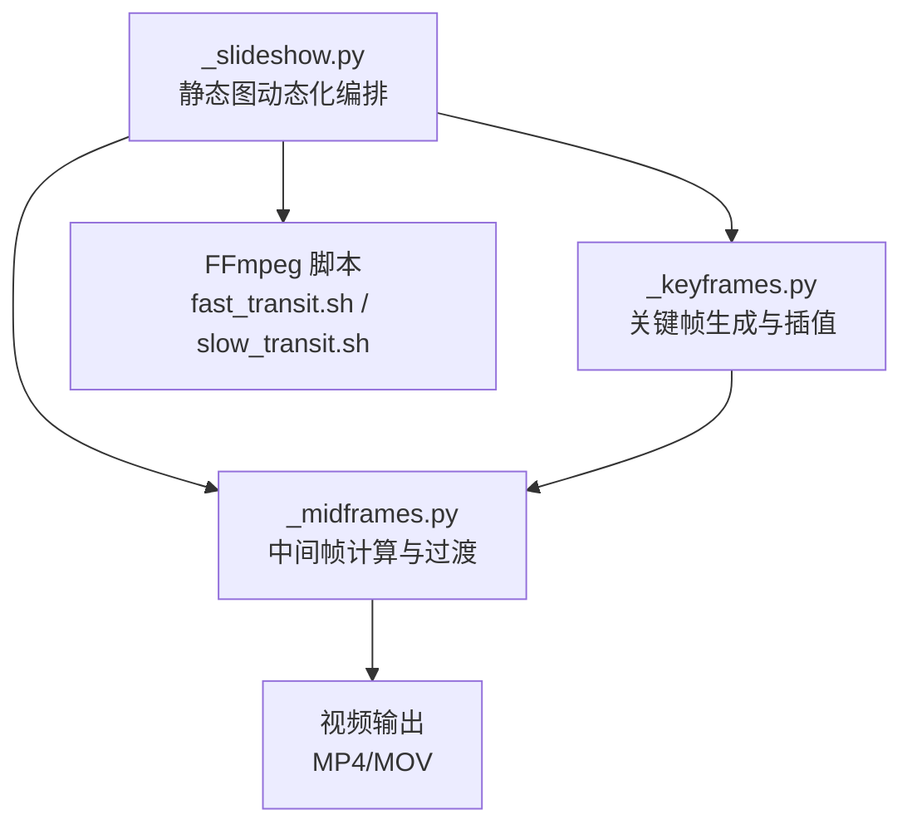
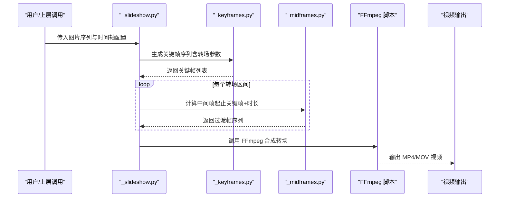
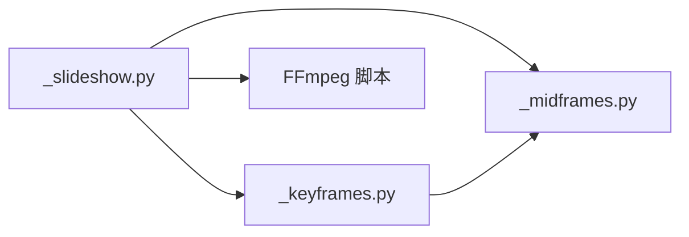

# 幻灯片制作

<cite>
**本文引用的文件**   
- [agents/dreamweaver_pkg/_slideshow.py](file://agents/dreamweaver_pkg/_slideshow.py)
- [agents/painter_pkg/_keyframes.py](file://agents/painter_pkg/_keyframes.py)
- [agents/painter_pkg/_midframes.py](file://agents/painter_pkg/_midframes.py)
- [scripts/ffmpeg/fast_transit.sh](file://scripts/ffmpeg/fast_transit.sh)
- [scripts/ffmpeg/slow_transit.sh](file://scripts/ffmpeg/slow_transit.sh)
</cite>

## 目录
1. [简介](#简介)
2. [项目结构](#项目结构)
3. [核心组件](#核心组件)
4. [架构总览](#架构总览)
5. [详细组件分析](#详细组件分析)
6. [依赖关系分析](#依赖关系分析)
7. [性能考虑](#性能考虑)
8. [故障排查指南](#故障排查指南)
9. [结论](#结论)
10. [附录](#附录) 

## 简介
本技术文档聚焦“幻灯片制作”模块，围绕以下目标展开：
- 深入解析静态图像动态化算法与关键帧生成、插值技术；
- 说明中间帧计算与过渡效果实现；
- 解释如何将静态图片序列转换为流畅视频，包括淡入淡出、缩放平移、旋转等转场；
- 阐述时间轴控制与节奏调整方法；
- 给出关键帧插值算法原理、支持的效果类型与自定义参数；
- 提供动画优化与性能调优建议。

该模块由三个核心 Python 文件组成：_slideshow.py（静态图动态化编排）、_keyframes.py（关键帧生成与插值）、_midframes.py（中间帧计算与过渡）。配合 FFmpeg 脚本完成最终的视频合成与转场处理。

## 项目结构
幻灯片制作相关代码位于 agents 子包下，按职责划分：
- dreamweaver_pkg/_slideshow.py：负责将静态图片序列编排为可播放的幻灯片视频，协调关键帧与中间帧流程，输出视频片段或完整视频。
- painter_pkg/_keyframes.py：定义关键帧数据结构与生成策略，提供不同转场的关键帧曲线与参数。
- painter_pkg/_midframes.py：基于关键帧进行中间帧插值，实现平滑过渡（如淡入淡出、缩放平移、旋转等）。
- scripts/ffmpeg/*：FFmpeg 转场脚本，用于快速或慢速转场合成。

图表来源 
- [agents/dreamweaver_pkg/_slideshow.py](file://agents/dreamweaver_pkg/_slideshow.py)
- [agents/painter_pkg/_keyframes.py](file://agents/painter_pkg/_keyframes.py)
- [agents/painter_pkg/_midframes.py](file://agents/painter_pkg/_midframes.py)
- [scripts/ffmpeg/fast_transit.sh](file://scripts/ffmpeg/fast_transit.sh)
- [scripts/ffmpeg/slow_transit.sh](file://scripts/ffmpeg/slow_transit.sh)

章节来源
- [agents/dreamweaver_pkg/_slideshow.py](file://agents/dreamweaver_pkg/_slideshow.py)
- [agents/painter_pkg/_keyframes.py](file://agents/painter_pkg/_keyframes.py)
- [agents/painter_pkg/_midframes.py](file://agents/painter_pkg/_midframes.py)
- [scripts/ffmpeg/fast_transit.sh](file://scripts/ffmpeg/fast_transit.sh)
- [scripts/ffmpeg/slow_transit.sh](file://scripts/ffmpeg/slow_transit.sh)

## 核心组件
- 静态图像动态化（_slideshow.py）
  - 输入：静态图片序列、时间轴配置、转场参数（时长、缓动曲线、效果类型）。
  - 处理：根据每张图片的显示时长与转场策略，生成关键帧序列；调用中间帧计算模块生成过渡帧；必要时使用 FFmpeg 进行转场合成。
  - 输出：连续视频片段或完整视频。

- 关键帧生成与插值（_keyframes.py）
  - 关键帧数据结构：包含时间点、变换矩阵（缩放、平移、旋转）、透明度等属性。
  - 插值策略：线性、贝塞尔、缓入缓出等曲线，支持多通道组合（位置、缩放、旋转、透明度）。
  - 效果模板：内置淡入淡出、缩放推拉、平移滑动、旋转翻转等常用转场。

- 中间帧计算与过渡（_midframes.py）
  - 输入：相邻关键帧对（起始帧、结束帧）及过渡时长。
  - 处理：按时间步长插值生成中间帧，应用像素级混合（Alpha 混合）、几何变换（仿射/透视）、色彩校正等。
  - 输出：过渡帧序列，供渲染器拼接成视频。

章节来源
- [agents/dreamweaver_pkg/_slideshow.py](file://agents/dreamweaver_pkg/_slideshow.py)
- [agents/painter_pkg/_keyframes.py](file://agents/painter_pkg/_keyframes.py)
- [agents/painter_pkg/_midframes.py](file://agents/painter_pkg/_midframes.py)

## 架构总览
整体数据流从静态图片序列开始，经关键帧生成、中间帧插值，最终通过 FFmpeg 合成视频。各阶段解耦，便于扩展新效果与优化性能。

图表来源 
- [agents/dreamweaver_pkg/_slideshow.py](file://agents/dreamweaver_pkg/_slideshow.py)
- [agents/painter_pkg/_keyframes.py](file://agents/painter_pkg/_keyframes.py)
- [agents/painter_pkg/_midframes.py](file://agents/painter_pkg/_midframes.py)
- [scripts/ffmpeg/fast_transit.sh](file://scripts/ffmpeg/fast_transit.sh)
- [scripts/ffmpeg/slow_transit.sh](file://scripts/ffmpeg/slow_transit.sh)

## 详细组件分析

### 静态图像动态化（_slideshow.py）
- 功能要点
  - 读取图片序列与时间轴配置，确定每张图片的显示时长与转场窗口。
  - 根据转场类型选择关键帧策略（如淡入淡出、缩放平移、旋转）。
  - 调用中间帧模块生成过渡帧，必要时调用 FFmpeg 进行高效合成。
  - 支持批量处理与并行渲染，提升吞吐。

- 关键流程
  - 初始化：加载图片、校验分辨率一致性、构建时间轴。
  - 关键帧生成：为每张图片生成起始与结束关键帧，设置变换参数。
  - 中间帧计算：在转场窗口内按步长插值生成过渡帧。
  - 视频合成：将帧序列写入临时文件，调用 FFmpeg 编码输出。

- 错误处理
  - 图片格式不支持时跳过并记录日志。
  - 转场时长越界时自动裁剪至有效范围。
  - FFmpeg 执行失败时回退到纯 Python 合成（可选）。

章节来源
- [agents/dreamweaver_pkg/_slideshow.py](file://agents/dreamweaver_pkg/_slideshow.py)

### 关键帧生成与插值（_keyframes.py）
- 数据结构
  - 关键帧对象包含：时间戳、缩放比例、平移向量、旋转角度、透明度等字段。
  - 支持多通道独立插值（例如位置与缩放使用不同曲线）。

- 插值算法
  - 线性插值：适用于简单过渡。
  - 贝塞尔曲线：提供更自然的缓动效果。
  - 分段插值：在不同时间段切换曲线类型，实现复杂节奏。

- 效果模板
  - 淡入淡出：透明度从 0 到 1 或反之。
  - 缩放推拉：缩放比例从 1.0 到 1.2 或 0.8。
  - 平移滑动：X/Y 方向位移。
  - 旋转翻转：绕中心点旋转一定角度。

- 自定义参数
  - 曲线类型、持续时间、起始/结束状态、混合模式（叠加、正片叠底等）。

章节来源
- [agents/painter_pkg/_keyframes.py](file://agents/painter_pkg/_keyframes.py)

### 中间帧计算与过渡（_midframes.py）
- 输入输出
  - 输入：起始关键帧、结束关键帧、过渡时长、帧率。
  - 输出：按帧率生成的中间帧序列。

- 处理逻辑
  - 时间步长计算：根据帧率与过渡时长确定步数。
  - 逐帧插值：对每个通道（位置、缩放、旋转、透明度）应用插值函数。
  - 像素混合：Alpha 混合实现淡入淡出；仿射变换实现缩放平移旋转。
  - 边界处理：防止溢出与黑边，必要时填充背景色。

- 性能优化
  - 向量化运算（NumPy/OpenCV）。
  - 预分配内存减少拷贝。
  - 多线程并行处理多个转场区间。

章节来源
- [agents/painter_pkg/_midframes.py](file://agents/painter_pkg/_midframes.py)

### FFmpeg 转场脚本
- fast_transit.sh：快速转场，适用于短过渡（如 0.5s 以内），使用硬件加速编码。
- slow_transit.sh：慢速转场，适用于长过渡（如 2s 以上），启用高质量滤镜链。

章节来源
- [scripts/ffmpeg/fast_transit.sh](file://scripts/ffmpeg/fast_transit.sh)
- [scripts/ffmpeg/slow_transit.sh](file://scripts/ffmpeg/slow_transit.sh)

## 依赖关系分析
模块间依赖清晰，低耦合高内聚：
- _slideshow.py 依赖 _keyframes.py 与 _midframes.py。
- _keyframes.py 与 _midframes.py 无直接依赖，通过数据契约交互。
- FFmpeg 脚本作为外部工具，通过命令行接口集成。

图表来源 
- [agents/dreamweaver_pkg/_slideshow.py](file://agents/dreamweaver_pkg/_slideshow.py)
- [agents/painter_pkg/_keyframes.py](file://agents/painter_pkg/_keyframes.py)
- [agents/painter_pkg/_midframes.py](file://agents/painter_pkg/_midframes.py)
- [scripts/ffmpeg/fast_transit.sh](file://scripts/ffmpeg/fast_transit.sh)
- [scripts/ffmpeg/slow_transit.sh](file://scripts/ffmpeg/slow_transit.sh)

章节来源
- [agents/dreamweaver_pkg/_slideshow.py](file://agents/dreamweaver_pkg/_slideshow.py)
- [agents/painter_pkg/_keyframes.py](file://agents/painter_pkg/_keyframes.py)
- [agents/painter_pkg/_midframes.py](file://agents/painter_pkg/_midframes.py)
- [scripts/ffmpeg/fast_transit.sh](file://scripts/ffmpeg/fast_transit.sh)
- [scripts/ffmpeg/slow_transit.sh](file://scripts/ffmpeg/slow_transit.sh)

## 性能考虑
- 计算优化
  - 使用 GPU 加速（OpenCV CUDA、FFmpeg NVENC）。
  - 批处理与流水线并行，减少 I/O 开销。
  - 缓存中间结果，避免重复计算。

- 内存管理
  - 按需加载图片，避免一次性载入全部帧。
  - 使用内存映射或流式写入，降低峰值内存。

- 编码优化
  - 选择合适的编码器（H.264/H.265）与预设（fast/medium/slow）。
  - 调整比特率与质量参数平衡清晰度与文件大小。

[本节为通用指导，不直接分析具体文件]

## 故障排查指南
- 常见问题
  - 图片分辨率不一致导致画面错位：统一预处理或居中裁剪。
  - 转场闪烁：检查 Alpha 混合权重与边界处理。
  - FFmpeg 执行失败：确认路径与环境变量，检查输入格式兼容性。

- 调试技巧
  - 输出中间帧序列到磁盘，逐帧检查过渡效果。
  - 打印关键帧参数与插值曲线，验证时间轴对齐。
  - 使用 FFmpeg 日志定位编码问题。

章节来源
- [agents/dreamweaver_pkg/_slideshow.py](file://agents/dreamweaver_pkg/_slideshow.py)
- [agents/painter_pkg/_keyframes.py](file://agents/painter_pkg/_keyframes.py)
- [agents/painter_pkg/_midframes.py](file://agents/painter_pkg/_midframes.py)
- [scripts/ffmpeg/fast_transit.sh](file://scripts/ffmpeg/fast_transit.sh)
- [scripts/ffmpeg/slow_transit.sh](file://scripts/ffmpeg/slow_transit.sh)

## 结论
幻灯片制作模块通过模块化设计实现了静态图片的动态化与流畅转场。关键帧生成与中间帧插值提供了灵活的视觉效果控制，结合 FFmpeg 的高效编码能力，能够生成高质量的幻灯片视频。通过合理的性能优化与故障排查策略，可在保证画质的同时提升处理效率。

[本节为总结性内容，不直接分析具体文件]

## 附录
- 效果类型参考
  - 淡入淡出：透明度渐变。
  - 缩放推拉：缩放比例变化。
  - 平移滑动：位置移动。
  - 旋转翻转：角度变化。
  - 组合效果：多通道叠加（如缩放+平移）。

- 自定义参数示例
  - 曲线类型：线性、贝塞尔、缓入缓出。
  - 持续时间：转场时长（秒）。
  - 混合模式：叠加、正片叠底、屏幕等。

[本节为概念性内容，不直接分析具体文件]