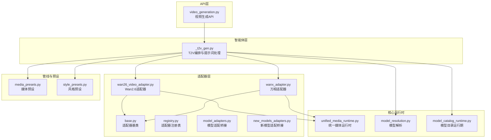
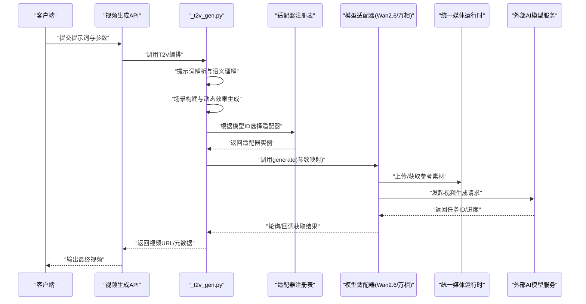
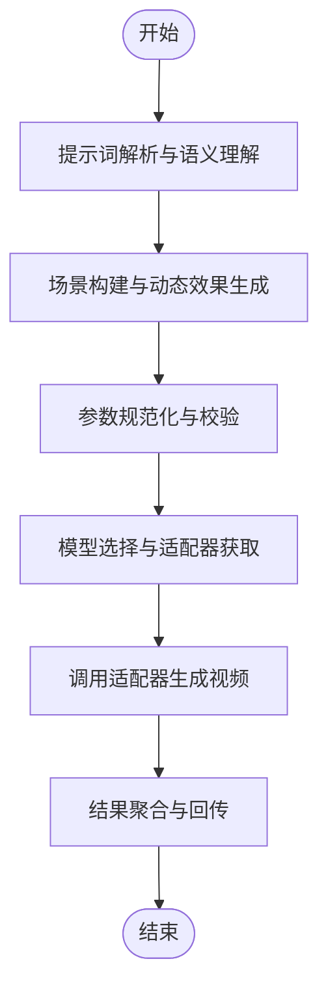
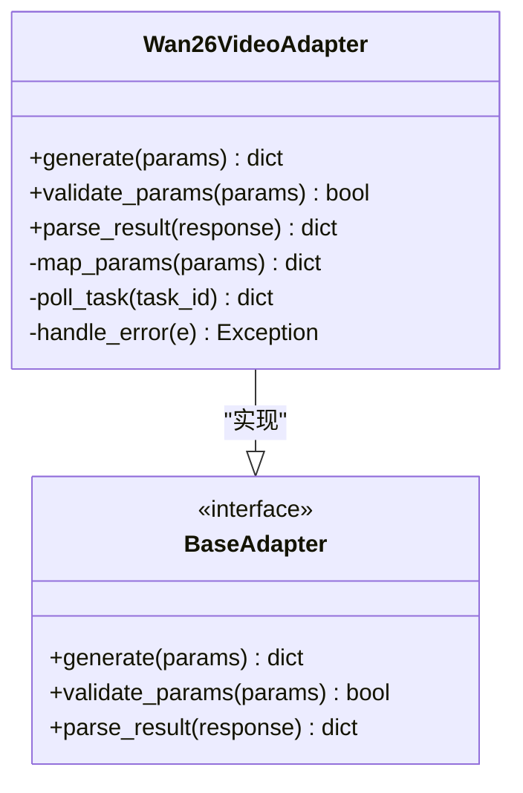
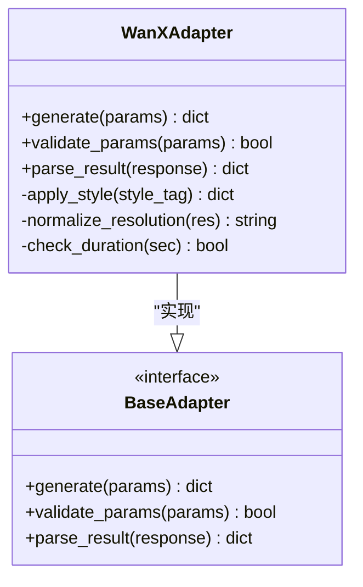
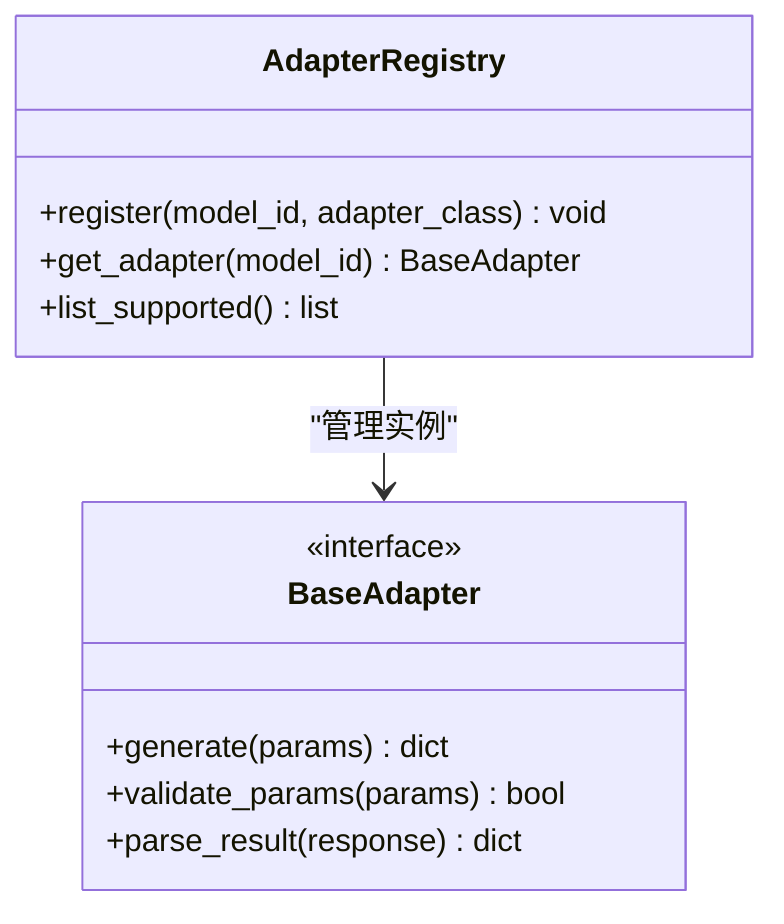
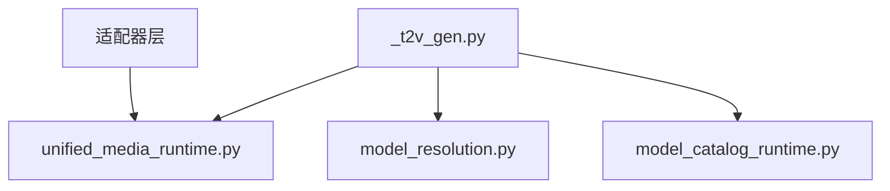
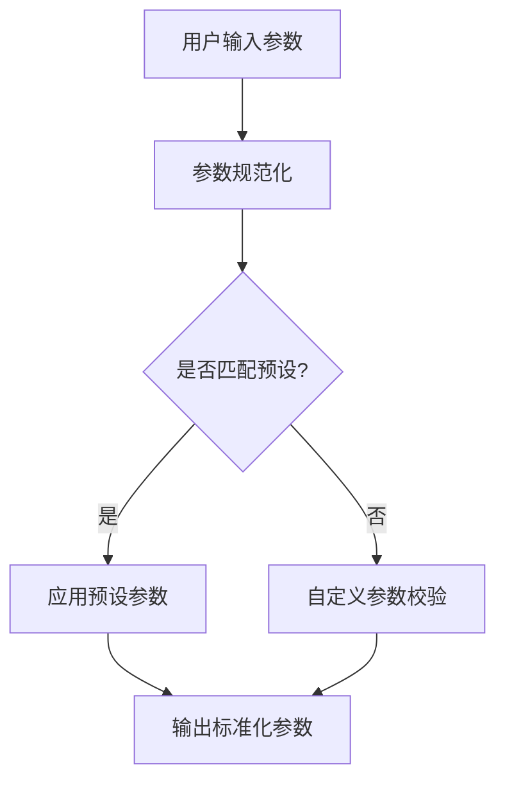
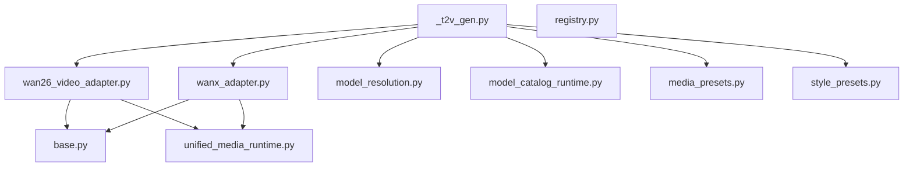

# 文生视频生成

<cite>
**本文引用的文件**   
- [agents/dreamweaver_pkg/_t2v_gen.py](file://agents/dreamweaver_pkg/_t2v_gen.py)
- [adapters/wan26_video_adapter.py](file://adapters/wan26_video_adapter.py)
- [adapters/wanx_adapter.py](file://adapters/wanx_adapter.py)
- [adapters/base.py](file://adapters/base.py)
- [adapters/registry.py](file://adapters/registry.py)
- [adapters/model_adapters.py](file://adapters/model_adapters.py)
- [adapters/new_models_adapters.py](file://adapters/new_models_adapters.py)
- [adapters/_shared.py](file://adapters/_shared.py)
- [adapters/prompt_optimizer.py](file://adapters/prompt_optimizer.py)
- [core/unified_media_runtime.py](file://core/unified_media_runtime.py)
- [core/model_resolution.py](file://core/model_resolution.py)
- [core/model_catalog_runtime.py](file://core/model_catalog_runtime.py)
- [schemas/common.py](file://schemas/common.py)
- [pipeline/media_presets.py](file://pipeline/media_presets.py)
- [pipeline/style_presets.py](file://pipeline/style_presets.py)
- [backend/app/api/v1/dreamweaver_api/video_generation.py](file://backend/app/api/v1/dreamweaver_api/video_generation.py)
</cite>

## 目录
1. [简介](#简介)
2. [项目结构](#项目结构)
3. [核心组件](#核心组件)
4. [架构总览](#架构总览)
5. [详细组件分析](#详细组件分析)
6. [依赖关系分析](#依赖关系分析)
7. [性能考量](#性能考量)
8. [故障排查指南](#故障排查指南)
9. [结论](#结论)
10. [附录](#附录)

## 简介
本技术文档聚焦“文本到视频”（Text-to-Video, T2V）生成模块，围绕以下三个关键实现展开：
- agents/dreamweaver_pkg/_t2v_gen.py：T2V 主流程编排、提示词处理与语义理解、场景构建与动态效果生成。
- adapters/wan26_video_adapter.py：Wan2.6 模型适配器，负责参数映射、调用封装与结果解析。
- adapters/wanx_adapter.py：万相模型适配器，提供统一的视频生成接口与风格控制。

文档将系统阐述从提示词输入到视频输出的完整链路，包括提示词解析、语义理解、场景构建、动态效果生成、模型适配与参数映射、风格与时长的控制策略，以及质量评估与优化建议。

## 项目结构
T2V 相关代码主要分布在以下目录：
- agents/dreamweaver_pkg：视频生成智能体与流程编排（_t2v_gen.py 为核心）。
- adapters：多模型适配器层（wan26_video_adapter.py、wanx_adapter.py 等）。
- core：统一媒体运行时、模型解析与目录服务。
- pipeline：媒体预设、风格预设与后处理工具。
- backend/app/api/v1/dreamweaver_api：对外 API 入口（视频生成路由）。

图表来源
- [agents/dreamweaver_pkg/_t2v_gen.py](file://agents/dreamweaver_pkg/_t2v_gen.py)
- [adapters/wan26_video_adapter.py](file://adapters/wan26_video_adapter.py)
- [adapters/wanx_adapter.py](file://adapters/wanx_adapter.py)
- [adapters/base.py](file://adapters/base.py)
- [adapters/registry.py](file://adapters/registry.py)
- [adapters/model_adapters.py](file://adapters/model_adapters.py)
- [adapters/new_models_adapters.py](file://adapters/new_models_adapters.py)
- [core/unified_media_runtime.py](file://core/unified_media_runtime.py)
- [core/model_resolution.py](file://core/model_resolution.py)
- [core/model_catalog_runtime.py](file://core/model_catalog_runtime.py)
- [pipeline/media_presets.py](file://pipeline/media_presets.py)
- [pipeline/style_presets.py](file://pipeline/style_presets.py)
- [backend/app/api/v1/dreamweaver_api/video_generation.py](file://backend/app/api/v1/dreamweaver_api/video_generation.py)

章节来源
- [agents/dreamweaver_pkg/_t2v_gen.py](file://agents/dreamweaver_pkg/_t2v_gen.py)
- [adapters/wan26_video_adapter.py](file://adapters/wan26_video_adapter.py)
- [adapters/wanx_adapter.py](file://adapters/wanx_adapter.py)
- [adapters/base.py](file://adapters/base.py)
- [adapters/registry.py](file://adapters/registry.py)
- [adapters/model_adapters.py](file://adapters/model_adapters.py)
- [adapters/new_models_adapters.py](file://adapters/new_models_adapters.py)
- [core/unified_media_runtime.py](file://core/unified_media_runtime.py)
- [core/model_resolution.py](file://core/model_resolution.py)
- [core/model_catalog_runtime.py](file://core/model_catalog_runtime.py)
- [pipeline/media_presets.py](file://pipeline/media_presets.py)
- [pipeline/style_presets.py](file://pipeline/style_presets.py)
- [backend/app/api/v1/dreamweaver_api/video_generation.py](file://backend/app/api/v1/dreamweaver_api/video_generation.py)

## 核心组件
- _t2v_gen.py：负责接收用户提示词，进行语义解析、场景与镜头设计、动态效果描述生成，并调度具体模型适配器完成视频合成。
- wan26_video_adapter.py：封装 Wan2.6 模型的调用细节，将上层参数映射为模型所需格式，处理异步任务、进度回调与结果下载。
- wanx_adapter.py：封装万相模型的调用细节，支持风格化、分辨率、时长等参数的映射与校验。
- base.py：定义适配器抽象接口（如 generate、validate_params、parse_result），确保不同模型的一致接入。
- registry.py：维护模型与适配器的注册关系，支持按模型ID或名称选择具体适配器。
- model_adapters.py / new_models_adapters.py：桥接旧版与新版的模型适配逻辑，保证兼容性与平滑升级。
- unified_media_runtime.py：统一媒体资源管理（上传、缓存、转码、存储路径），为视频生成提供稳定的数据通道。
- model_resolution.py / model_catalog_runtime.py：模型解析与目录服务，决定实际调用的模型版本与能力。
- media_presets.py / style_presets.py：媒体与风格预设，标准化分辨率、帧率、时长、风格标签等。

章节来源
- [agents/dreamweaver_pkg/_t2v_gen.py](file://agents/dreamweaver_pkg/_t2v_gen.py)
- [adapters/wan26_video_adapter.py](file://adapters/wan26_video_adapter.py)
- [adapters/wanx_adapter.py](file://adapters/wanx_adapter.py)
- [adapters/base.py](file://adapters/base.py)
- [adapters/registry.py](file://adapters/registry.py)
- [adapters/model_adapters.py](file://adapters/model_adapters.py)
- [adapters/new_models_adapters.py](file://adapters/new_models_adapters.py)
- [core/unified_media_runtime.py](file://core/unified_media_runtime.py)
- [core/model_resolution.py](file://core/model_resolution.py)
- [core/model_catalog_runtime.py](file://core/model_catalog_runtime.py)
- [pipeline/media_presets.py](file://pipeline/media_presets.py)
- [pipeline/style_presets.py](file://pipeline/style_presets.py)

## 架构总览
T2V 的整体架构采用“智能体编排 + 适配器层 + 统一媒体运行时”的分层设计：
- 智能体层：_t2v_gen.py 作为编排器，负责提示词处理、语义理解、场景构建与动态效果生成。
- 适配器层：wan26_video_adapter.py 与 wanx_adapter.py 分别对接不同模型，屏蔽差异，暴露统一接口。
- 运行时层：unified_media_runtime.py 提供统一的媒体资源管理能力；model_resolution.py 与 model_catalog_runtime.py 负责模型选择与能力探测。
- 管线与预设：media_presets.py 与 style_presets.py 提供标准化的分辨率、时长、风格等配置。

图表来源
- [agents/dreamweaver_pkg/_t2v_gen.py](file://agents/dreamweaver_pkg/_t2v_gen.py)
- [adapters/wan26_video_adapter.py](file://adapters/wan26_video_adapter.py)
- [adapters/wanx_adapter.py](file://adapters/wanx_adapter.py)
- [adapters/registry.py](file://adapters/registry.py)
- [core/unified_media_runtime.py](file://core/unified_media_runtime.py)
- [backend/app/api/v1/dreamweaver_api/video_generation.py](file://backend/app/api/v1/dreamweaver_api/video_generation.py)

## 详细组件分析

### _t2v_gen.py：T2V 编排与提示词处理
- 提示词解析与语义理解：对自然语言提示词进行结构化抽取，识别主体、动作、环境、风格、镜头运动等要素。
- 场景构建与动态效果：基于语义理解结果，生成场景描述、镜头序列与动态效果指令（如推拉摇移、转场、节奏）。
- 参数规范化：将用户输入转换为标准参数（分辨率、时长、帧率、风格标签、安全过滤开关等）。
- 模型选择与调度：依据模型目录与能力探测结果，选择合适的适配器进行视频生成。
- 结果聚合与回传：聚合各阶段日志与中间产物，返回最终视频与元数据。

图表来源
- [agents/dreamweaver_pkg/_t2v_gen.py](file://agents/dreamweaver_pkg/_t2v_gen.py)

章节来源
- [agents/dreamweaver_pkg/_t2v_gen.py](file://agents/dreamweaver_pkg/_t2v_gen.py)

### wan26_video_adapter.py：Wan2.6 模型适配器
- 参数映射：将上层参数（分辨率、时长、风格、镜头指令）映射为 Wan2.6 所需的请求格式。
- 任务管理：创建异步任务、轮询进度、处理回调与重试机制。
- 结果解析：解析模型返回的视频URL、时长、分辨率、元数据等。
- 错误处理：捕获网络异常、模型限制、参数不合法等情况，给出明确错误信息。

图表来源
- [adapters/wan26_video_adapter.py](file://adapters/wan26_video_adapter.py)
- [adapters/base.py](file://adapters/base.py)

章节来源
- [adapters/wan26_video_adapter.py](file://adapters/wan26_video_adapter.py)
- [adapters/base.py](file://adapters/base.py)

### wanx_adapter.py：万相模型适配器
- 风格控制：支持多种风格标签（如写实、动漫、水彩等）的参数映射。
- 分辨率与时长：标准化分辨率选项（如 720p、1080p）与时长控制（秒级）。
- 参数校验与安全：对输入参数进行合法性检查，防止越界或不支持的组合。
- 结果处理：解析视频URL、元数据与质量指标（如清晰度、稳定性）。

图表来源
- [adapters/wanx_adapter.py](file://adapters/wanx_adapter.py)
- [adapters/base.py](file://adapters/base.py)

章节来源
- [adapters/wanx_adapter.py](file://adapters/wanx_adapter.py)
- [adapters/base.py](file://adapters/base.py)

### 适配器基类与注册表
- base.py：定义统一的适配器接口，确保不同模型具备一致的调用方式。
- registry.py：维护模型ID到适配器的映射，支持动态加载与热更新。
- model_adapters.py / new_models_adapters.py：桥接新旧适配逻辑，保证兼容性。

图表来源
- [adapters/base.py](file://adapters/base.py)
- [adapters/registry.py](file://adapters/registry.py)
- [adapters/model_adapters.py](file://adapters/model_adapters.py)
- [adapters/new_models_adapters.py](file://adapters/new_models_adapters.py)

章节来源
- [adapters/base.py](file://adapters/base.py)
- [adapters/registry.py](file://adapters/registry.py)
- [adapters/model_adapters.py](file://adapters/model_adapters.py)
- [adapters/new_models_adapters.py](file://adapters/new_models_adapters.py)

### 统一媒体运行时与模型目录
- unified_media_runtime.py：提供统一的媒体上传、缓存、转码与存储路径管理。
- model_resolution.py：根据模型ID与能力探测结果，解析可用模型与参数范围。
- model_catalog_runtime.py：维护模型目录，支持在线查询与本地缓存。

图表来源
- [core/unified_media_runtime.py](file://core/unified_media_runtime.py)
- [core/model_resolution.py](file://core/model_resolution.py)
- [core/model_catalog_runtime.py](file://core/model_catalog_runtime.py)
- [agents/dreamweaver_pkg/_t2v_gen.py](file://agents/dreamweaver_pkg/_t2v_gen.py)

章节来源
- [core/unified_media_runtime.py](file://core/unified_media_runtime.py)
- [core/model_resolution.py](file://core/model_resolution.py)
- [core/model_catalog_runtime.py](file://core/model_catalog_runtime.py)

### 媒体与风格预设
- media_presets.py：定义标准分辨率、帧率、时长等媒体参数集合。
- style_presets.py：定义风格标签与对应的参数映射，便于快速切换风格。

图表来源
- [pipeline/media_presets.py](file://pipeline/media_presets.py)
- [pipeline/style_presets.py](file://pipeline/style_presets.py)

章节来源
- [pipeline/media_presets.py](file://pipeline/media_presets.py)
- [pipeline/style_presets.py](file://pipeline/style_presets.py)

## 依赖关系分析
T2V 模块的依赖关系清晰分层：
- 智能体层依赖适配器层与运行时层。
- 适配器层依赖统一媒体运行时与模型目录服务。
- 运行时层依赖文件系统、对象存储与外部模型服务。

图表来源
- [agents/dreamweaver_pkg/_t2v_gen.py](file://agents/dreamweaver_pkg/_t2v_gen.py)
- [adapters/wan26_video_adapter.py](file://adapters/wan26_video_adapter.py)
- [adapters/wanx_adapter.py](file://adapters/wanx_adapter.py)
- [adapters/base.py](file://adapters/base.py)
- [adapters/registry.py](file://adapters/registry.py)
- [core/unified_media_runtime.py](file://core/unified_media_runtime.py)
- [core/model_resolution.py](file://core/model_resolution.py)
- [core/model_catalog_runtime.py](file://core/model_catalog_runtime.py)
- [pipeline/media_presets.py](file://pipeline/media_presets.py)
- [pipeline/style_presets.py](file://pipeline/style_presets.py)

章节来源
- [agents/dreamweaver_pkg/_t2v_gen.py](file://agents/dreamweaver_pkg/_t2v_gen.py)
- [adapters/wan26_video_adapter.py](file://adapters/wan26_video_adapter.py)
- [adapters/wanx_adapter.py](file://adapters/wanx_adapter.py)
- [adapters/base.py](file://adapters/base.py)
- [adapters/registry.py](file://adapters/registry.py)
- [core/unified_media_runtime.py](file://core/unified_media_runtime.py)
- [core/model_resolution.py](file://core/model_resolution.py)
- [core/model_catalog_runtime.py](file://core/model_catalog_runtime.py)
- [pipeline/media_presets.py](file://pipeline/media_presets.py)
- [pipeline/style_presets.py](file://pipeline/style_presets.py)

## 性能考量
- 异步任务与并发：适配器层应充分利用异步任务与并发请求，减少等待时间。
- 缓存策略：对常用提示词与风格组合进行缓存，避免重复计算。
- 资源管理：统一媒体运行时需合理管理临时文件与缓存，避免磁盘占用过高。
- 模型选择：根据模型能力与负载情况动态选择最优模型，提升整体吞吐。
- 参数优化：通过预设与启发式规则优化参数组合，减少无效请求。

[本节为通用指导，无需特定文件引用]

## 故障排查指南
- 提示词解析失败：检查提示词结构与关键词完整性，必要时使用提示词优化器辅助。
- 参数校验错误：确认分辨率、时长、风格等参数是否在支持范围内。
- 模型调用失败：检查网络连通性、认证信息与配额限制。
- 结果解析异常：查看模型返回格式与适配器解析逻辑是否一致。
- 媒体资源问题：确认上传、缓存与转码流程是否正常。

章节来源
- [adapters/prompt_optimizer.py](file://adapters/prompt_optimizer.py)
- [adapters/_shared.py](file://adapters/_shared.py)
- [core/unified_media_runtime.py](file://core/unified_media_runtime.py)

## 结论
T2V 模块通过清晰的层次化设计与统一的适配器接口，实现了多模型的视频生成能力。_t2v_gen.py 负责编排与提示词处理，wan26_video_adapter.py 与 wanx_adapter.py 分别对接不同模型，提供一致的使用体验。结合统一媒体运行时与模型目录服务，系统具备良好的扩展性与可维护性。通过合理的参数优化与性能调优，可进一步提升生成质量与效率。

[本节为总结，无需特定文件引用]

## 附录
- 使用示例：编写有效的提示词应包含主体、动作、环境、风格、镜头运动等要素，例如“一只猫在草地上奔跑，背景是夕阳，电影感镜头，慢动作”。
- 模型选择：根据需求选择 Wan2.6（高质量写实）或万相（风格化多样）。
- 参数调优：调整分辨率、时长、风格标签以获得最佳效果。
- 质量评估：关注清晰度、稳定性、连贯性等指标，必要时进行迭代优化。

[本节为补充说明，无需特定文件引用]