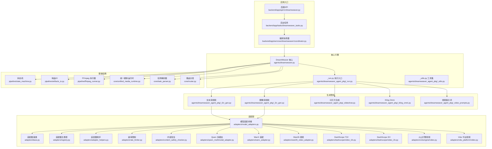
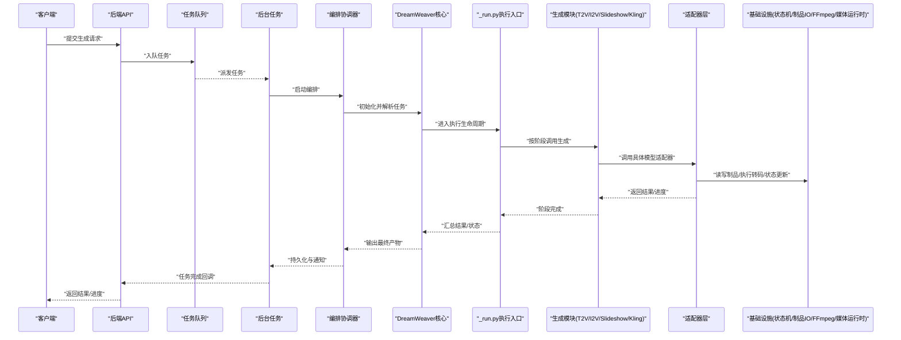
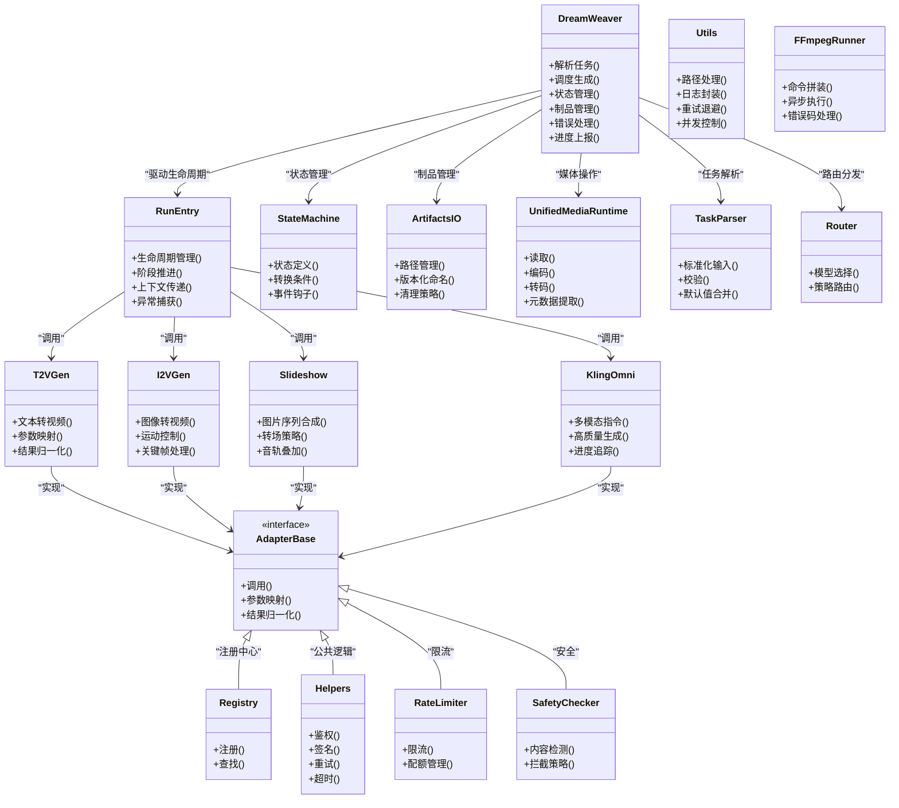

# 梦境编织者核心引擎

<cite>
**本文引用的文件**   
- [dreamweaver.py](file://agents/dreamweaver.py)
- [_run.py](file://agents/dreamweaver_agent_pkg/_run.py)
- [_utils.py](file://agents/dreamweaver_agent_pkg/_utils.py)
- [_write_video.py](file://agents/dreamweaver_agent_pkg/_write_video.py)
- [_t2v_gen.py](file://agents/dreamweaver_agent_pkg/_t2v_gen.py)
- [_i2v_gen.py](file://agents/dreamweaver_agent_pkg/_i2v_gen.py)
- [_video_prompts.py](file://agents/dreamweaver_agent_pkg/_video_prompts.py)
- [_slideshow.py](file://agents/dreamweaver_agent_pkg/_slideshow.py)
- [_kling_omni.py](file://agents/dreamweaver_agent_pkg/_kling_omni.py)
- [state_machine.py](file://pipeline/state_machine.py)
- [artifacts_io.py](file://pipeline/artifacts_io.py)
- [ffmpeg_runner.py](file://pipeline/ffmpeg_runner.py)
- [model_adapters.py](file://adapters/model_adapters.py)
- [registry.py](file://adapters/registry.py)
- [base.py](file://adapters/base.py)
- [adapter_helpers.py](file://adapters/adapter_helpers.py)
- [rate_limiter.py](file://adapters/rate_limiter.py)
- [content_safety_checker.py](file://adapters/content_safety_checker.py)
- [qwen_multimodal_adapter.py](file://adapters/qwen_multimodal_adapter.py)
- [wanx_adapter.py](file://adapters/wanx_adapter.py)
- [wan26_video_adapter.py](file://adapters/wan26_video_adapter.py)
- [dashscope/video_t2v.py](file://adapters/dashscope/video_t2v.py)
- [dashscope/video_i2v.py](file://adapters/dashscope/video_i2v.py)
- [volcengine/video.py](file://adapters/volcengine/video.py)
- [vidu_platform/video.py](file://adapters/vidu_platform/video.py)
- [core/unified_media_runtime.py](file://core/unified_media_runtime.py)
- [core/task_parser.py](file://core/task_parser.py)
- [core/router.py](file://core/router.py)
- [backend/app/services/dreamweaver/coordinator.py](file://backend/app/services/dreamweaver/coordinator.py)
- [backend/app/tasks/dreamweaver_tasks.py](file://backend/app/tasks/dreamweaver_tasks.py)
- [backend/app/api/v1/dreamweaver.py](file://backend/app/api/v1/dreamweaver.py)
</cite>

## 目录
1. [简介](#简介)
2. [项目结构](#项目结构)
3. [核心组件](#核心组件)
4. [架构总览](#架构总览)
5. [详细组件分析](#详细组件分析)
6. [依赖关系分析](#依赖关系分析)
7. [性能考虑](#性能考虑)
8. [故障排除指南](#故障排除指南)
9. [结论](#结论)
10. [附录：使用示例与参数说明](#附录使用示例与参数说明)

## 简介
本技术文档面向“梦境编织者”核心引擎，聚焦以下目标：
- 深入解析 dreamweaver.py 的核心架构、任务调度机制与状态管理
- 梳理 _run.py 的执行流程与生命周期管理
- 详解 _utils.py 的工具函数与辅助方法
- 完整阐述视频生成的整体工作流：任务解析、资源分配、进度跟踪与错误处理
- 解释多模态内容整合机制：文本、图像、音频、视频的协同生成
- 提供配置与调用示例、关键参数与返回值说明
- 给出性能优化建议与故障排除指南

## 项目结构
围绕“梦境编织者”的关键代码分布在 agents、adapters、pipeline、core 与 backend 等模块中：
- agents/dreamweaver.py：核心编排器，负责任务解析、调度、状态管理与结果聚合
- agents/dreamweaver_agent_pkg/*：具体执行子模块（运行入口、工具、T2V/I2V 生成、提示词、幻灯片、Kling Omni 等）
- pipeline/*：通用流水线能力（状态机、制品 IO、FFmpeg 执行）
- adapters/*：多模型适配器（视频、图像、TTS、多模态），统一抽象与注册
- core/*：统一媒体运行时、任务解析、路由等基础设施
- backend/*：后端服务层（API、任务队列、编排协调）

图表来源
- [dreamweaver.py](file://agents/dreamweaver.py)
- [_run.py](file://agents/dreamweaver_agent_pkg/_run.py)
- [_utils.py](file://agents/dreamweaver_agent_pkg/_utils.py)
- [_t2v_gen.py](file://agents/dreamweaver_agent_pkg/_t2v_gen.py)
- [_i2v_gen.py](file://agents/dreamweaver_agent_pkg/_i2v_gen.py)
- [_slideshow.py](file://agents/dreamweaver_agent_pkg/_slideshow.py)
- [_kling_omni.py](file://agents/dreamweaver_agent_pkg/_kling_omni.py)
- [_video_prompts.py](file://agents/dreamweaver_agent_pkg/_video_prompts.py)
- [state_machine.py](file://pipeline/state_machine.py)
- [artifacts_io.py](file://pipeline/artifacts_io.py)
- [ffmpeg_runner.py](file://pipeline/ffmpeg_runner.py)
- [model_adapters.py](file://adapters/model_adapters.py)
- [registry.py](file://adapters/registry.py)
- [base.py](file://adapters/base.py)
- [adapter_helpers.py](file://adapters/adapter_helpers.py)
- [rate_limiter.py](file://adapters/rate_limiter.py)
- [content_safety_checker.py](file://adapters/content_safety_checker.py)
- [qwen_multimodal_adapter.py](file://adapters/qwen_multimodal_adapter.py)
- [wanx_adapter.py](file://adapters/wanx_adapter.py)
- [wan26_video_adapter.py](file://adapters/wan26_video_adapter.py)
- [dashscope/video_t2v.py](file://adapters/dashscope/video_t2v.py)
- [dashscope/video_i2v.py](file://adapters/dashscope/video_i2v.py)
- [volcengine/video.py](file://adapters/volcengine/video.py)
- [vidu_platform/video.py](file://adapters/vidu_platform/video.py)
- [core/unified_media_runtime.py](file://core/unified_media_runtime.py)
- [core/task_parser.py](file://core/task_parser.py)
- [core/router.py](file://core/router.py)
- [backend/app/api/v1/dreamweaver.py](file://backend/app/api/v1/dreamweaver.py)
- [backend/app/tasks/dreamweaver_tasks.py](file://backend/app/tasks/dreamweaver_tasks.py)
- [backend/app/services/dreamweaver/coordinator.py](file://backend/app/services/dreamweaver/coordinator.py)

章节来源
- [dreamweaver.py](file://agents/dreamweaver.py)
- [_run.py](file://agents/dreamweaver_agent_pkg/_run.py)
- [_utils.py](file://agents/dreamweaver_agent_pkg/_utils.py)
- [state_machine.py](file://pipeline/state_machine.py)
- [artifacts_io.py](file://pipeline/artifacts_io.py)
- [ffmpeg_runner.py](file://pipeline/ffmpeg_runner.py)
- [model_adapters.py](file://adapters/model_adapters.py)
- [registry.py](file://adapters/registry.py)
- [base.py](file://adapters/base.py)
- [adapter_helpers.py](file://adapters/adapter_helpers.py)
- [rate_limiter.py](file://adapters/rate_limiter.py)
- [content_safety_checker.py](file://adapters/content_safety_checker.py)
- [qwen_multimodal_adapter.py](file://adapters/qwen_multimodal_adapter.py)
- [wanx_adapter.py](file://adapters/wanx_adapter.py)
- [wan26_video_adapter.py](file://adapters/wan26_video_adapter.py)
- [dashscope/video_t2v.py](file://adapters/dashscope/video_t2v.py)
- [dashscope/video_i2v.py](file://adapters/dashscope/video_i2v.py)
- [volcengine/video.py](file://adapters/volcengine/video.py)
- [vidu_platform/video.py](file://adapters/vidu_platform/video.py)
- [core/unified_media_runtime.py](file://core/unified_media_runtime.py)
- [core/task_parser.py](file://core/task_parser.py)
- [core/router.py](file://core/router.py)
- [backend/app/api/v1/dreamweaver.py](file://backend/app/api/v1/dreamweaver.py)
- [backend/app/tasks/dreamweaver_tasks.py](file://backend/app/tasks/dreamweaver_tasks.py)
- [backend/app/services/dreamweaver/coordinator.py](file://backend/app/services/dreamweaver/coordinator.py)

## 核心组件
- DreamWeaver 核心（agents/dreamweaver.py）
  - 职责：任务解析、调度策略、状态机驱动、制品路径管理、错误恢复、进度上报
  - 关键点：与状态机、制品IO、FFmpeg、统一媒体运行时、任务解析器、路由器的集成
- 执行入口（agents/dreamweaver_agent_pkg/_run.py）
  - 职责：生命周期管理、阶段推进、上下文传递、异常捕获与回滚
- 工具集（agents/dreamweaver_agent_pkg/_utils.py）
  - 职责：路径处理、时间戳/文件名规范、日志封装、重试与退避、并发控制
- 生成模块
  - 文本转视频（_t2v_gen.py）、图像转视频（_i2v_gen.py）、幻灯片（_slideshow.py）、Kling Omni（_kling_omni.py）、提示词（_video_prompts.py）
- 适配层（adapters/*）
  - 统一抽象（base.py）、注册表（registry.py）、助手（adapter_helpers.py）、速率限制（rate_limiter.py）、内容安全（content_safety_checker.py）
  - 具体实现：Qwen 多模态、WanX、Wan26、DashScope T2V/I2V、VolcEngine、Vidu 平台
- 基础设施（core/*, pipeline/*）
  - 统一媒体运行时（unified_media_runtime.py）、任务解析器（task_parser.py）、路由（router.py）、状态机（state_machine.py）、制品IO（artifacts_io.py）、FFmpeg（ffmpeg_runner.py）
- 后端服务（backend/*）
  - API（dreamweaver.py）、任务队列（dreamweaver_tasks.py）、编排协调器（coordinator.py）

章节来源
- [dreamweaver.py](file://agents/dreamweaver.py)
- [_run.py](file://agents/dreamweaver_agent_pkg/_run.py)
- [_utils.py](file://agents/dreamweaver_agent_pkg/_utils.py)
- [_t2v_gen.py](file://agents/dreamweaver_agent_pkg/_t2v_gen.py)
- [_i2v_gen.py](file://agents/dreamweaver_agent_pkg/_i2v_gen.py)
- [_slideshow.py](file://agents/dreamweaver_agent_pkg/_slideshow.py)
- [_kling_omni.py](file://agents/dreamweaver_agent_pkg/_kling_omni.py)
- [_video_prompts.py](file://agents/dreamweaver_agent_pkg/_video_prompts.py)
- [base.py](file://adapters/base.py)
- [registry.py](file://adapters/registry.py)
- [adapter_helpers.py](file://adapters/adapter_helpers.py)
- [rate_limiter.py](file://adapters/rate_limiter.py)
- [content_safety_checker.py](file://adapters/content_safety_checker.py)
- [qwen_multimodal_adapter.py](file://adapters/qwen_multimodal_adapter.py)
- [wanx_adapter.py](file://adapters/wanx_adapter.py)
- [wan26_video_adapter.py](file://adapters/wan26_video_adapter.py)
- [dashscope/video_t2v.py](file://adapters/dashscope/video_t2v.py)
- [dashscope/video_i2v.py](file://adapters/dashscope/video_i2v.py)
- [volcengine/video.py](file://adapters/volcengine/video.py)
- [vidu_platform/video.py](file://adapters/vidu_platform/video.py)
- [core/unified_media_runtime.py](file://core/unified_media_runtime.py)
- [core/task_parser.py](file://core/task_parser.py)
- [core/router.py](file://core/router.py)
- [pipeline/state_machine.py](file://pipeline/state_machine.py)
- [pipeline/artifacts_io.py](file://pipeline/artifacts_io.py)
- [pipeline/ffmpeg_runner.py](file://pipeline/ffmpeg_runner.py)
- [backend/app/api/v1/dreamweaver.py](file://backend/app/api/v1/dreamweaver.py)
- [backend/app/tasks/dreamweaver_tasks.py](file://backend/app/tasks/dreamweaver_tasks.py)
- [backend/app/services/dreamweaver/coordinator.py](file://backend/app/services/dreamweaver/coordinator.py)

## 架构总览
“梦境编织者”采用分层解耦架构：
- 接入层：后端 API 接收请求，入队后台任务
- 编排层：协调器将任务分发给 DreamWeaver 核心
- 执行层：_run.py 驱动各生成阶段，状态机维护生命周期
- 适配层：通过统一适配器接口调用不同厂商的视频/图像/TTS/多模态能力
- 基础设施层：统一媒体运行时、任务解析、路由、状态机、制品IO、FFmpeg

图表来源
- [backend/app/api/v1/dreamweaver.py](file://backend/app/api/v1/dreamweaver.py)
- [backend/app/tasks/dreamweaver_tasks.py](file://backend/app/tasks/dreamweaver_tasks.py)
- [backend/app/services/dreamweaver/coordinator.py](file://backend/app/services/dreamweaver/coordinator.py)
- [dreamweaver.py](file://agents/dreamweaver.py)
- [_run.py](file://agents/dreamweaver_agent_pkg/_run.py)
- [_t2v_gen.py](file://agents/dreamweaver_agent_pkg/_t2v_gen.py)
- [_i2v_gen.py](file://agents/dreamweaver_agent_pkg/_i2v_gen.py)
- [_slideshow.py](file://agents/dreamweaver_agent_pkg/_slideshow.py)
- [_kling_omni.py](file://agents/dreamweaver_agent_pkg/_kling_omni.py)
- [base.py](file://adapters/base.py)
- [state_machine.py](file://pipeline/state_machine.py)
- [artifacts_io.py](file://pipeline/artifacts_io.py)
- [ffmpeg_runner.py](file://pipeline/ffmpeg_runner.py)
- [core/unified_media_runtime.py](file://core/unified_media_runtime.py)

## 详细组件分析

### DreamWeaver 核心（agents/dreamweaver.py）
- 核心职责
  - 任务解析：基于 core/task_parser.py 将输入转换为内部任务描述
  - 调度策略：根据任务类型选择 T2V/I2V/幻灯片/Kling 等生成路径
  - 状态管理：通过 pipeline/state_machine.py 驱动阶段流转
  - 资源管理：借助 artifacts_io.py 管理中间与最终制品路径
  - 错误处理：捕获异常、记录诊断信息、触发回滚或重试
  - 进度上报：结合统一媒体运行时与后端任务系统推送进度事件
- 关键交互
  - 与 _run.py 的生命周期对接
  - 与适配器层进行模型调用
  - 与 FFmpeg 执行器协作进行转码/合成
  - 与路由分发器协调不同提供商的适配选择

章节来源
- [dreamweaver.py](file://agents/dreamweaver.py)
- [core/task_parser.py](file://core/task_parser.py)
- [pipeline/state_machine.py](file://pipeline/state_machine.py)
- [pipeline/artifacts_io.py](file://pipeline/artifacts_io.py)
- [pipeline/ffmpeg_runner.py](file://pipeline/ffmpeg_runner.py)
- [core/unified_media_runtime.py](file://core/unified_media_runtime.py)

### 执行入口与生命周期（agents/dreamweaver_agent_pkg/_run.py）
- 生命周期阶段
  - 初始化：加载配置、创建临时目录、准备上下文
  - 预处理：校验输入、构建提示词、资源预取
  - 生成阶段：顺序或并行调用 T2V/I2V/幻灯片/Kling
  - 后处理：转码、拼接、质量检查、制品归档
  - 清理与回滚：失败时释放资源、回滚中间制品
- 进度与错误
  - 阶段级进度上报
  - 异常分类与可恢复性判断
  - 重试策略与退避

章节来源
- [_run.py](file://agents/dreamweaver_agent_pkg/_run.py)

### 工具函数与辅助方法（agents/dreamweaver_agent_pkg/_utils.py）
- 常用功能
  - 路径规范化、文件名生成、时间戳格式化
  - 日志封装、结构化输出
  - 重试与指数退避、并发限流
  - 资源占用监控与阈值告警
- 设计要点
  - 无副作用的纯函数优先
  - 统一的错误包装与诊断信息
  - 可插拔的扩展点（如自定义路径规则）

章节来源
- [_utils.py](file://agents/dreamweaver_agent_pkg/_utils.py)

### 视频生成模块
- 文本转视频（_t2v_gen.py）
  - 输入：文本提示、风格/时长/分辨率等参数
  - 输出：视频片段、元数据、进度事件
  - 适配：通过 model_adapters.py 选择具体 T2V 适配器
- 图像转视频（_i2v_gen.py）
  - 输入：参考图、运动描述、时长/帧率
  - 输出：视频片段、关键帧、过渡效果
  - 适配：I2V 适配器（如 DashScope I2V）
- 幻灯片（_slideshow.py）
  - 输入：图片序列、转场策略、背景音乐
  - 输出：合成视频、字幕轨道
- Kling Omni（_kling_omni.py）
  - 输入：多模态指令（文本+图像+音频）
  - 输出：高质量视频片段
- 提示词（_video_prompts.py）
  - 模板管理、动态填充、风格约束

章节来源
- [_t2v_gen.py](file://agents/dreamweaver_agent_pkg/_t2v_gen.py)
- [_i2v_gen.py](file://agents/dreamweaver_agent_pkg/_i2v_gen.py)
- [_slideshow.py](file://agents/dreamweaver_agent_pkg/_slideshow.py)
- [_kling_omni.py](file://agents/dreamweaver_agent_pkg/_kling_omni.py)
- [_video_prompts.py](file://agents/dreamweaver_agent_pkg/_video_prompts.py)

### 适配器层（adapters/*）
- 统一抽象（base.py）
  - 定义调用接口、参数映射、结果归一化
- 注册表（registry.py）
  - 动态注册与查找适配器实例
- 助手（adapter_helpers.py）
  - 公共逻辑：鉴权、签名、重试、超时
- 速率限制（rate_limiter.py）
  - 令牌桶/滑动窗口限流，避免超限
- 内容安全（content_safety_checker.py）
  - 敏感内容检测与拦截
- 具体实现
  - Qwen 多模态（qwen_multimodal_adapter.py）
  - WanX（wanx_adapter.py）
  - Wan26 视频（wan26_video_adapter.py）
  - DashScope T2V/I2V（dashscope/video_t2v.py, dashscope/video_i2v.py）
  - VolcEngine（volcengine/video.py）
  - Vidu 平台（vidu_platform/video.py）

章节来源
- [base.py](file://adapters/base.py)
- [registry.py](file://adapters/registry.py)
- [adapter_helpers.py](file://adapters/adapter_helpers.py)
- [rate_limiter.py](file://adapters/rate_limiter.py)
- [content_safety_checker.py](file://adapters/content_safety_checker.py)
- [qwen_multimodal_adapter.py](file://adapters/qwen_multimodal_adapter.py)
- [wanx_adapter.py](file://adapters/wanx_adapter.py)
- [wan26_video_adapter.py](file://adapters/wan26_video_adapter.py)
- [dashscope/video_t2v.py](file://adapters/dashscope/video_t2v.py)
- [dashscope/video_i2v.py](file://adapters/dashscope/video_i2v.py)
- [volcengine/video.py](file://adapters/volcengine/video.py)
- [vidu_platform/video.py](file://adapters/vidu_platform/video.py)

### 基础设施（core/*, pipeline/*）
- 统一媒体运行时（core/unified_media_runtime.py）
  - 抽象媒体操作：读取、编码、转码、元数据提取
- 任务解析器（core/task_parser.py）
  - 标准化输入、校验、默认值合并
- 路由分发（core/router.py）
  - 根据模型能力与策略选择最佳适配器
- 状态机（pipeline/state_machine.py）
  - 阶段定义、转换条件、事件钩子
- 制品IO（pipeline/artifacts_io.py）
  - 临时目录管理、版本化命名、清理策略
- FFmpeg 执行器（pipeline/ffmpeg_runner.py）
  - 命令拼装、异步执行、错误码处理

章节来源
- [core/unified_media_runtime.py](file://core/unified_media_runtime.py)
- [core/task_parser.py](file://core/task_parser.py)
- [core/router.py](file://core/router.py)
- [pipeline/state_machine.py](file://pipeline/state_machine.py)
- [pipeline/artifacts_io.py](file://pipeline/artifacts_io.py)
- [pipeline/ffmpeg_runner.py](file://pipeline/ffmpeg_runner.py)

## 依赖关系分析
- 低耦合高内聚
  - DreamWeaver 核心仅依赖抽象接口（状态机、制品IO、媒体运行时、任务解析、路由）
  - 生成模块通过适配器层屏蔽厂商差异
- 直接依赖
  - _run.py 依赖生成模块与工具集
  - 生成模块依赖适配器层
  - 适配器层依赖基础设施（限流、安全、助手）
- 潜在循环依赖
  - 通过 registry.py 与 base.py 的抽象避免循环
- 外部依赖
  - 各视频/图像/TTS 厂商 SDK（DashScope、VolcEngine、Vidu、WanX、Wan26、Qwen）

图表来源
- [dreamweaver.py](file://agents/dreamweaver.py)
- [_run.py](file://agents/dreamweaver_agent_pkg/_run.py)
- [_utils.py](file://agents/dreamweaver_agent_pkg/_utils.py)
- [_t2v_gen.py](file://agents/dreamweaver_agent_pkg/_t2v_gen.py)
- [_i2v_gen.py](file://agents/dreamweaver_agent_pkg/_i2v_gen.py)
- [_slideshow.py](file://agents/dreamweaver_agent_pkg/_slideshow.py)
- [_kling_omni.py](file://agents/dreamweaver_agent_pkg/_kling_omni.py)
- [base.py](file://adapters/base.py)
- [registry.py](file://adapters/registry.py)
- [adapter_helpers.py](file://adapters/adapter_helpers.py)
- [rate_limiter.py](file://adapters/rate_limiter.py)
- [content_safety_checker.py](file://adapters/content_safety_checker.py)
- [state_machine.py](file://pipeline/state_machine.py)
- [artifacts_io.py](file://pipeline/artifacts_io.py)
- [ffmpeg_runner.py](file://pipeline/ffmpeg_runner.py)
- [core/unified_media_runtime.py](file://core/unified_media_runtime.py)
- [core/task_parser.py](file://core/task_parser.py)
- [core/router.py](file://core/router.py)

章节来源
- [dreamweaver.py](file://agents/dreamweaver.py)
- [_run.py](file://agents/dreamweaver_agent_pkg/_run.py)
- [_utils.py](file://agents/dreamweaver_agent_pkg/_utils.py)
- [_t2v_gen.py](file://agents/dreamweaver_agent_pkg/_t2v_gen.py)
- [_i2v_gen.py](file://agents/dreamweaver_agent_pkg/_i2v_gen.py)
- [_slideshow.py](file://agents/dreamweaver_agent_pkg/_slideshow.py)
- [_kling_omni.py](file://agents/dreamweaver_agent_pkg/_kling_omni.py)
- [base.py](file://adapters/base.py)
- [registry.py](file://adapters/registry.py)
- [adapter_helpers.py](file://adapters/adapter_helpers.py)
- [rate_limiter.py](file://adapters/rate_limiter.py)
- [content_safety_checker.py](file://adapters/content_safety_checker.py)
- [state_machine.py](file://pipeline/state_machine.py)
- [artifacts_io.py](file://pipeline/artifacts_io.py)
- [ffmpeg_runner.py](file://pipeline/ffmpeg_runner.py)
- [core/unified_media_runtime.py](file://core/unified_media_runtime.py)
- [core/task_parser.py](file://core/task_parser.py)
- [core/router.py](file://core/router.py)

## 性能考虑
- 并发与并行
  - 对独立片段生成采用并行调用，提升吞吐
  - 控制并发度以避免下游限流
- 缓存与复用
  - 中间制品缓存、提示词缓存、模型预热
- 资源管理
  - 及时释放临时文件、限制内存峰值
- 传输优化
  - 流式上传/下载、断点续传
- 适配层优化
  - 批量请求、连接池、超时与重试策略调优
- FFmpeg 优化
  - 硬件加速、预设参数、批处理脚本

[本节为通用指导，不直接分析具体文件]

## 故障排除指南
- 常见问题定位
  - 任务解析失败：检查输入格式与必填字段
  - 适配器调用失败：查看鉴权、签名、网络超时
  - 内容安全拦截：调整提示词或白名单策略
  - 速率限制：降低并发或申请更高配额
  - FFmpeg 错误：检查命令参数与依赖库
- 诊断手段
  - 启用详细日志、导出任务上下文
  - 使用状态机事件追踪阶段转换
  - 制品路径检查与完整性校验
- 恢复策略
  - 自动重试与退避
  - 失败回滚与部分重跑
  - 降级到备用适配器

章节来源
- [dreamweaver.py](file://agents/dreamweaver.py)
- [_run.py](file://agents/dreamweaver_agent_pkg/_run.py)
- [_utils.py](file://agents/dreamweaver_agent_pkg/_utils.py)
- [content_safety_checker.py](file://adapters/content_safety_checker.py)
- [rate_limiter.py](file://adapters/rate_limiter.py)
- [pipeline/state_machine.py](file://pipeline/state_machine.py)
- [pipeline/artifacts_io.py](file://pipeline/artifacts_io.py)
- [pipeline/ffmpeg_runner.py](file://pipeline/ffmpeg_runner.py)

## 结论
“梦境编织者”核心引擎通过清晰的分层架构与模块化设计，实现了多模态内容的高效生成与编排。其任务解析、状态机驱动、适配器抽象与基础设施支撑共同保障了系统的可扩展性与稳定性。配合合理的性能优化与完善的故障排除策略，可在复杂业务场景下稳定交付高质量视频内容。

[本节为总结性内容，不直接分析具体文件]

## 附录：使用示例与参数说明
- 典型调用流程
  - 后端 API 接收请求，入队后台任务
  - 后台任务启动编排协调器，调用 DreamWeaver 核心
  - _run.py 驱动各生成阶段，适配器层调用具体模型
  - 状态机推进阶段，制品IO管理中间与最终产物
  - FFmpeg 执行转码与合成，统一媒体运行时处理媒体操作
- 关键参数
  - 任务类型：T2V/I2V/幻灯片/Kling
  - 模型选择：提供商与模型ID
  - 生成参数：时长、分辨率、帧率、风格、提示词
  - 资源参数：并发度、超时、重试次数
  - 安全参数：内容安全策略、白名单
- 返回值
  - 任务ID、阶段状态、进度事件
  - 最终制品路径、元数据、质量评分
  - 错误信息与诊断日志

[本节为概念性说明，不直接分析具体文件]