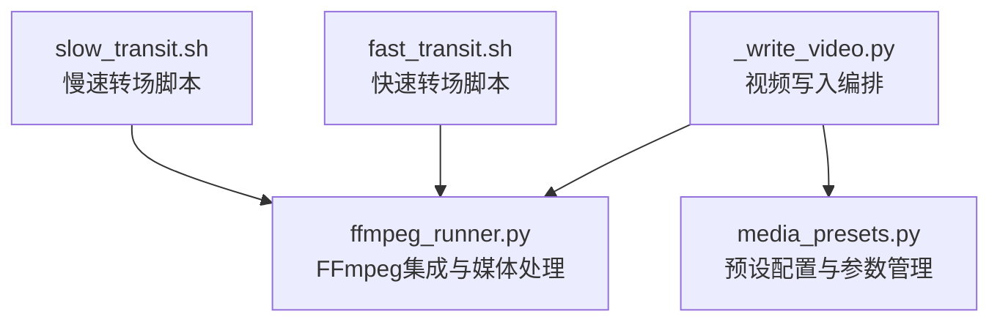
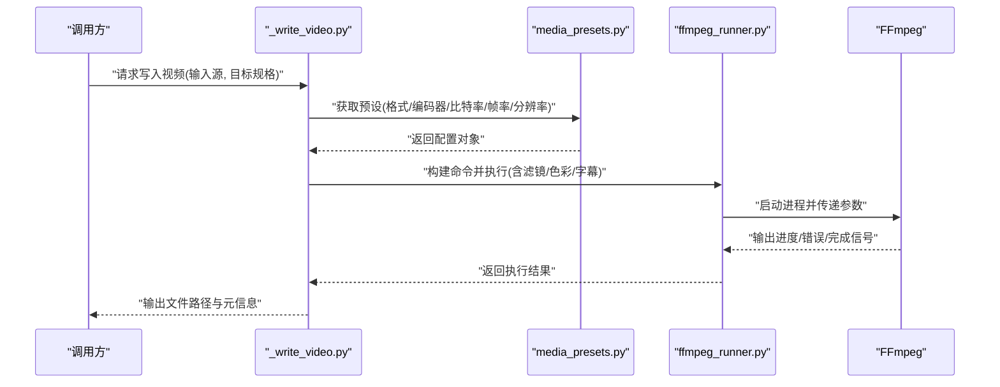
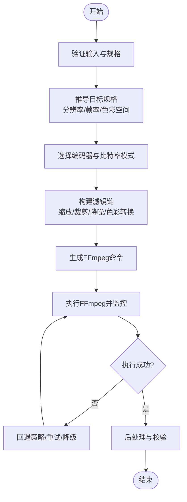
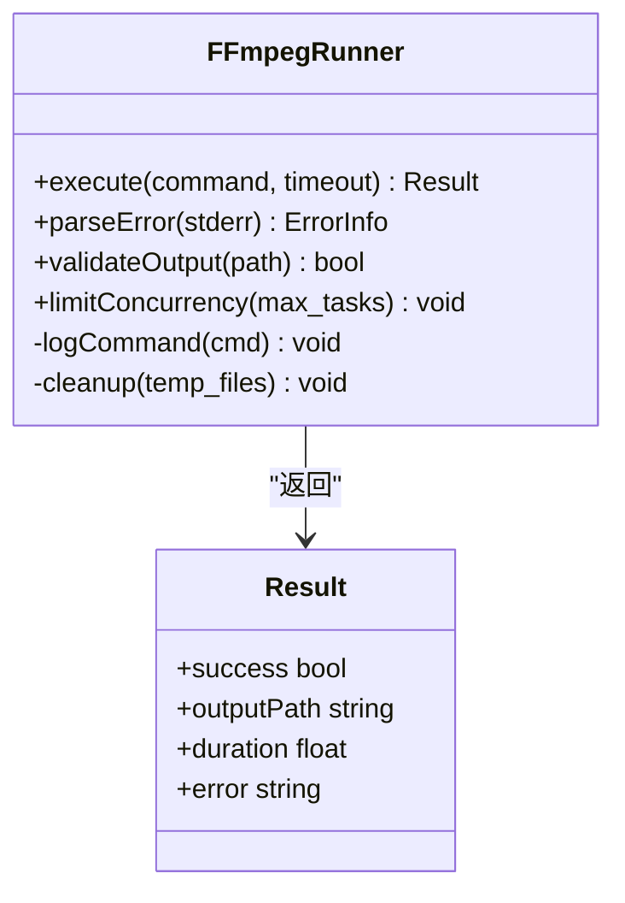
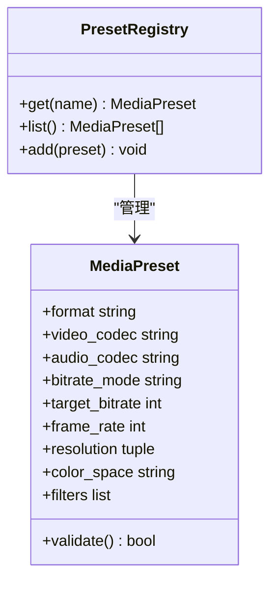
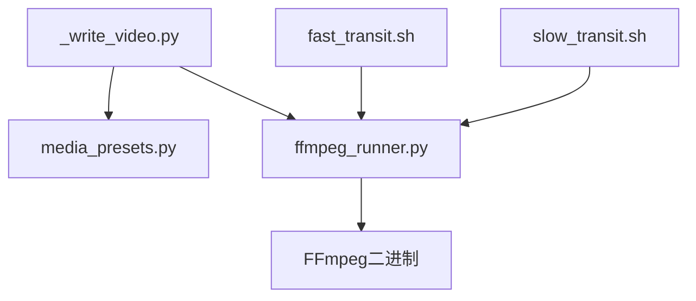

# 视频写入模块

<cite>
**本文引用的文件**   
- [pipeline/ffmpeg_runner.py](file://pipeline/ffmpeg_runner.py)
- [pipeline/media_presets.py](file://pipeline/media_presets.py)
- [agents/dreamweaver_agent_pkg/_write_video.py](file://agents/dreamweaver_agent_pkg/_write_video.py)
- [scripts/ffmpeg/fast_transit.sh](file://scripts/ffmpeg/fast_transit.sh)
- [scripts/ffmpeg/slow_transit.sh](file://scripts/ffmpeg/slow_transit.sh)
</cite>

## 目录
1. [简介](#简介)
2. [项目结构](#项目结构)
3. [核心组件](#核心组件)
4. [架构总览](#架构总览)
5. [详细组件分析](#详细组件分析)
6. [依赖关系分析](#依赖关系分析)
7. [性能考量](#性能考量)
8. [故障排查指南](#故障排查指南)
9. [结论](#结论)
10. [附录](#附录)

## 简介
本技术文档聚焦于视频写入模块，围绕以下三个关键文件展开：
- _write_video.py：负责编排视频编码、格式转换与输出流程。
- ffmpeg_runner.py：封装FFmpeg调用，提供媒体处理与转码能力。
- media_presets.py：集中管理预设配置与参数，统一编码器选择与质量策略。

文档将深入解析编码器选择策略、比特率控制与质量优化；支持的输出格式（MP4、MOV、AVI等）与编码参数；帧率设置、分辨率调整与色彩空间转换；以及音频同步机制（音轨对齐与时间轴校准）。同时给出具体代码示例路径与不同场景下的最佳实践，并提供视频文件优化与压缩技巧。

## 项目结构
视频写入相关代码主要分布在 pipeline 与 agents/dreamweaver_agent_pkg 两个目录中，脚本位于 scripts/ffmpeg。整体组织遵循“编排层（_write_video.py）—执行层（ffmpeg_runner.py）—配置层（media_presets.py）”的分层设计，便于扩展与维护。

图表来源
- [agents/dreamweaver_agent_pkg/_write_video.py](file://agents/dreamweaver_agent_pkg/_write_video.py)
- [pipeline/ffmpeg_runner.py](file://pipeline/ffmpeg_runner.py)
- [pipeline/media_presets.py](file://pipeline/media_presets.py)
- [scripts/ffmpeg/fast_transit.sh](file://scripts/ffmpeg/fast_transit.sh)
- [scripts/ffmpeg/slow_transit.sh](file://scripts/ffmpeg/slow_transit.sh)

章节来源
- [agents/dreamweaver_agent_pkg/_write_video.py](file://agents/dreamweaver_agent_pkg/_write_video.py)
- [pipeline/ffmpeg_runner.py](file://pipeline/ffmpeg_runner.py)
- [pipeline/media_presets.py](file://pipeline/media_presets.py)
- [scripts/ffmpeg/fast_transit.sh](file://scripts/ffmpeg/fast_transit.sh)
- [scripts/ffmpeg/slow_transit.sh](file://scripts/ffmpeg/slow_transit.sh)

## 核心组件
- 视频写入编排器（_write_video.py）
  - 职责：根据输入素材与目标规格，组装FFmpeg命令，协调多路音视频流合并、滤镜链与输出封装。
  - 关键点：编码器选择、比特率模式（CBR/VBR）、帧率与分辨率映射、色彩空间转换、字幕与元数据注入。
- FFmpeg执行器（ffmpeg_runner.py）
  - 职责：安全地调用FFmpeg二进制，处理进程生命周期、错误捕获、日志记录与资源清理。
  - 关键点：命令行构建、超时控制、并发限制、回退策略与结果校验。
- 预设配置（media_presets.py）
  - 职责：集中定义常见输出格式（MP4/MOV/AVI等）的编码器、比特率、帧率、分辨率、色彩空间与滤镜模板。
  - 关键点：按场景（网络发布、本地归档、移动端播放）切换预设，支持动态覆盖与校验。

章节来源
- [agents/dreamweaver_agent_pkg/_write_video.py](file://agents/dreamweaver_agent_pkg/_write_video.py)
- [pipeline/ffmpeg_runner.py](file://pipeline/ffmpeg_runner.py)
- [pipeline/media_presets.py](file://pipeline/media_presets.py)

## 架构总览
视频写入的整体流程从编排器开始，读取或生成目标规格，查询预设配置，构建FFmpeg命令并执行，最终产出符合要求的视频文件。FFmpeg执行器负责底层调用与异常处理，预设配置确保一致性与可维护性。

图表来源
- [agents/dreamweaver_agent_pkg/_write_video.py](file://agents/dreamweaver_agent_pkg/_write_video.py)
- [pipeline/media_presets.py](file://pipeline/media_presets.py)
- [pipeline/ffmpeg_runner.py](file://pipeline/ffmpeg_runner.py)

## 详细组件分析

### 视频写入编排器（_write_video.py）
- 功能要点
  - 输入验证：检查输入文件存在性、可读性与基本属性（时长、轨道数）。
  - 规格推导：根据目标平台与设备特性，自动推导分辨率、帧率与色彩空间。
  - 编码器选择：依据预设与输入特性选择最优编码器（如H.264/H.265、AAC/Opus）。
  - 滤镜链构建：插入缩放、裁剪、去隔行、降噪、色彩空间转换等滤镜。
  - 输出封装：指定容器格式（MP4/MOV/AVI），设置元数据与字幕轨道。
- 关键流程
  - 参数装配：将用户配置与默认值合并，进行合法性校验。
  - 命令生成：拼装FFmpeg参数，包括输入、滤镜、编码器与输出。
  - 执行与监控：通过执行器运行FFmpeg，收集日志与状态。
  - 后处理：校验输出文件完整性，必要时触发重编码或修复。

图表来源
- [agents/dreamweaver_agent_pkg/_write_video.py](file://agents/dreamweaver_agent_pkg/_write_video.py)

章节来源
- [agents/dreamweaver_agent_pkg/_write_video.py](file://agents/dreamweaver_agent_pkg/_write_video.py)

### FFmpeg执行器（ffmpeg_runner.py）
- 功能要点
  - 进程管理：创建、监控与终止FFmpeg进程，避免僵尸进程。
  - 错误处理：捕获标准错误输出，分类错误类型并抛出明确异常。
  - 日志记录：结构化记录命令、参数、耗时与输出摘要。
  - 资源限制：限制CPU/内存使用，防止系统过载。
  - 并发控制：限制并行转码任务数量，保障稳定性。
- 关键流程
  - 命令构建：接收编排器传入的参数，拼接为完整命令行。
  - 执行与回调：启动进程，实时读取输出，触发进度回调。
  - 结果校验：检查退出码与输出文件大小，判定是否成功。
  - 清理与回收：释放临时文件与句柄，确保环境整洁。

图表来源
- [pipeline/ffmpeg_runner.py](file://pipeline/ffmpeg_runner.py)

章节来源
- [pipeline/ffmpeg_runner.py](file://pipeline/ffmpeg_runner.py)

### 预设配置（media_presets.py）
- 功能要点
  - 预设集合：定义多种输出场景（高清、标清、移动端、归档）的编码器、比特率、帧率、分辨率与色彩空间。
  - 参数校验：确保组合合法（如编码器与容器兼容性、比特率范围）。
  - 动态覆盖：允许运行时覆盖部分参数，满足个性化需求。
  - 扩展机制：新增预设无需修改核心逻辑，保持高内聚低耦合。
- 关键数据结构
  - 预设对象：包含格式、视频编码器、音频编码器、比特率模式、帧率、分辨率、色彩空间、滤镜模板等字段。
  - 规则表：定义不同输入到输出的映射规则与约束条件。

图表来源
- [pipeline/media_presets.py](file://pipeline/media_presets.py)

章节来源
- [pipeline/media_presets.py](file://pipeline/media_presets.py)

### 转场脚本（fast_transit.sh / slow_transit.sh）
- 功能要点
  - 快速转场：适用于短片段拼接，减少计算开销。
  - 慢速转场：适用于高质量过渡，增加滤镜复杂度。
  - 自动化：批量处理多个文件，提升效率。
- 使用建议
  - 在批量转码前预处理素材，减少后续滤镜压力。
  - 结合预设配置，选择合适的转场策略。

章节来源
- [scripts/ffmpeg/fast_transit.sh](file://scripts/ffmpeg/fast_transit.sh)
- [scripts/ffmpeg/slow_transit.sh](file://scripts/ffmpeg/slow_transit.sh)

## 依赖关系分析
- 内部依赖
  - _write_video.py 依赖 media_presets.py 获取配置，依赖 ffmpeg_runner.py 执行命令。
  - ffmpeg_runner.py 依赖系统FFmpeg二进制，无其他Python依赖。
  - media_presets.py 独立模块，仅依赖基础数据类型。
- 外部依赖
  - FFmpeg：核心转码引擎，需安装并加入PATH。
  - 可选：GPU加速库（NVIDIA NVENC、Intel QSV等），取决于编码器支持。

图表来源
- [agents/dreamweaver_agent_pkg/_write_video.py](file://agents/dreamweaver_agent_pkg/_write_video.py)
- [pipeline/media_presets.py](file://pipeline/media_presets.py)
- [pipeline/ffmpeg_runner.py](file://pipeline/ffmpeg_runner.py)
- [scripts/ffmpeg/fast_transit.sh](file://scripts/ffmpeg/fast_transit.sh)
- [scripts/ffmpeg/slow_transit.sh](file://scripts/ffmpeg/slow_transit.sh)

章节来源
- [agents/dreamweaver_agent_pkg/_write_video.py](file://agents/dreamweaver_agent_pkg/_write_video.py)
- [pipeline/media_presets.py](file://pipeline/media_presets.py)
- [pipeline/ffmpeg_runner.py](file://pipeline/ffmpeg_runner.py)
- [scripts/ffmpeg/fast_transit.sh](file://scripts/ffmpeg/fast_transit.sh)
- [scripts/ffmpeg/slow_transit.sh](file://scripts/ffmpeg/slow_transit.sh)

## 性能考量
- 编码器选择
  - H.264：兼容性好，适合网络传播与移动端播放。
  - H.265：更高压缩比，适合高分辨率与带宽受限场景。
  - 硬件加速：优先使用NVENC/QSV等硬件编码器，降低CPU占用。
- 比特率控制
  - CBR：稳定码率，适合直播与实时传输。
  - VBR：动态码率，平衡质量与体积，适合点播与归档。
  - 双遍编码：首遍统计，次遍优化，提升质量但耗时较长。
- 帧率与分辨率
  - 帧率：匹配内容节奏，避免过高导致冗余。
  - 分辨率：根据目标设备与带宽选择，避免过度缩放。
- 色彩空间
  - BT.709：标准电视与网络视频。
  - BT.2020：HDR内容，需终端支持。
  - 转换时注意伽马校正与色域映射，避免失真。
- 滤镜优化
  - 减少不必要的滤镜，避免重复操作。
  - 使用多线程与并行处理，提升吞吐。
- 资源管理
  - 限制并发任务数，防止系统过载。
  - 及时清理临时文件，释放磁盘空间。

## 故障排查指南
- 常见问题
  - FFmpeg未安装或PATH配置错误：检查环境变量与二进制路径。
  - 编码器不支持：确认目标平台与容器兼容性。
  - 权限不足：确保输出目录可写，输入文件可读。
  - 内存溢出：降低分辨率或帧率，减少滤镜复杂度。
  - 音频不同步：检查时间戳与采样率，必要时重新对齐。
- 调试技巧
  - 启用详细日志，定位错误位置。
  - 逐步简化命令，隔离问题。
  - 使用ffprobe分析输入与输出文件属性。
  - 监控系统资源，识别瓶颈。

## 结论
视频写入模块通过分层设计与模块化实现，提供了灵活、高效且稳定的视频编码与格式转换能力。通过预设配置统一管理参数，借助FFmpeg执行器保证底层可靠性，编排器则专注于业务逻辑与流程控制。在实际应用中，应根据场景选择合适的编码器、比特率与滤镜策略，兼顾质量与性能。同时，完善的错误处理与调试工具有助于快速定位与解决问题。

## 附录
- 最佳实践
  - 网络发布：H.264+AAC，CBR/VBR混合，1080p/30fps，BT.709。
  - 移动端播放：H.264+AAC，VBR，720p/24fps，BT.709，小体积优先。
  - 高清归档：H.265+Opus，CRF模式，4K/60fps，BT.2020，高质量优先。
  - 实时直播：H.264+AAC，CBR，低延迟滤镜，稳定码率。
- 代码示例路径
  - 编码器参数配置：参考 [_write_video.py](file://agents/dreamweaver_agent_pkg/_write_video.py) 中的参数装配与校验逻辑。
  - FFmpeg命令构建：参考 [ffmpeg_runner.py](file://pipeline/ffmpeg_runner.py) 中的命令生成与执行流程。
  - 预设管理与覆盖：参考 [media_presets.py](file://pipeline/media_presets.py) 中的预设定义与规则表。
  - 转场脚本使用：参考 [fast_transit.sh](file://scripts/ffmpeg/fast_transit.sh) 与 [slow_transit.sh](file://scripts/ffmpeg/slow_transit.sh)。