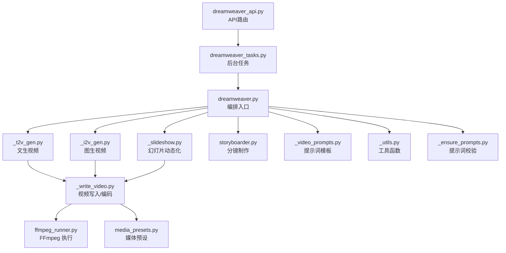
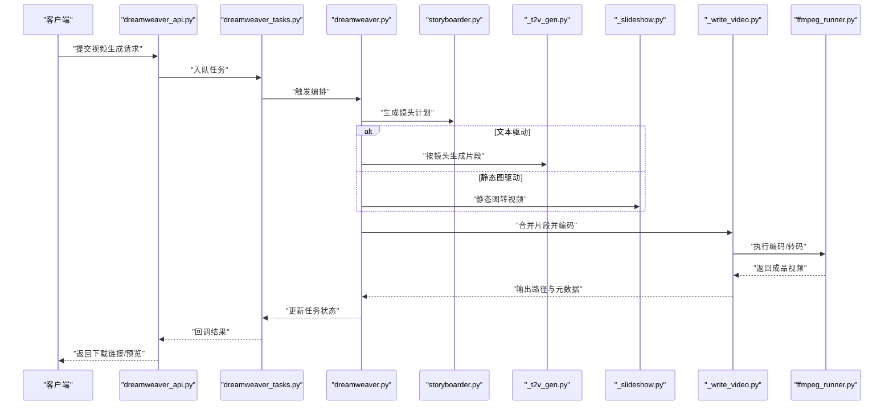
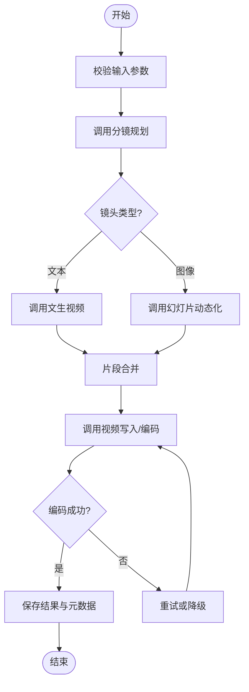
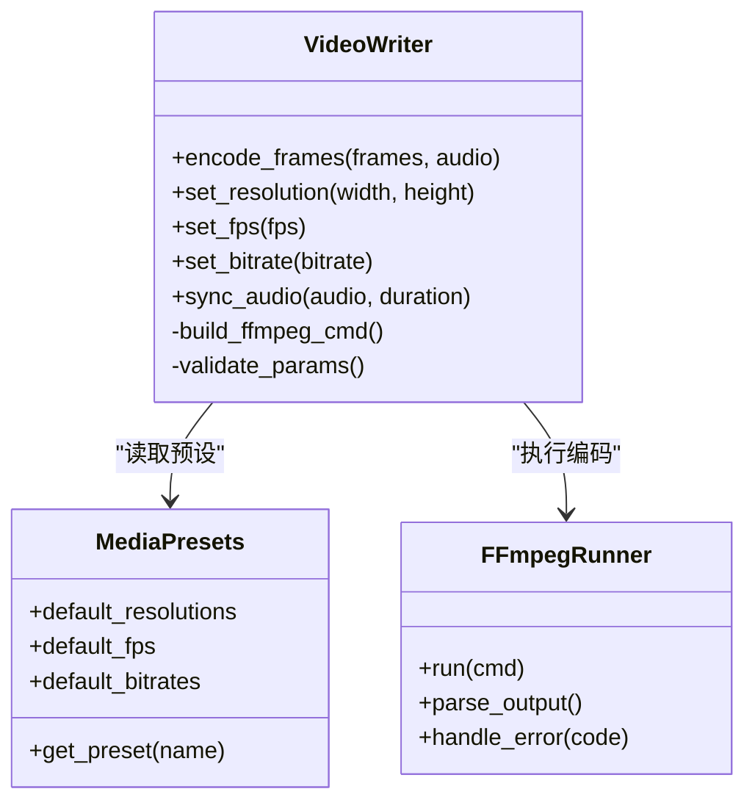
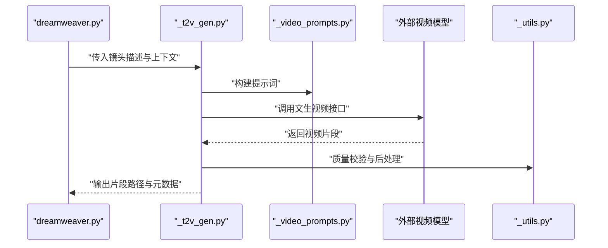
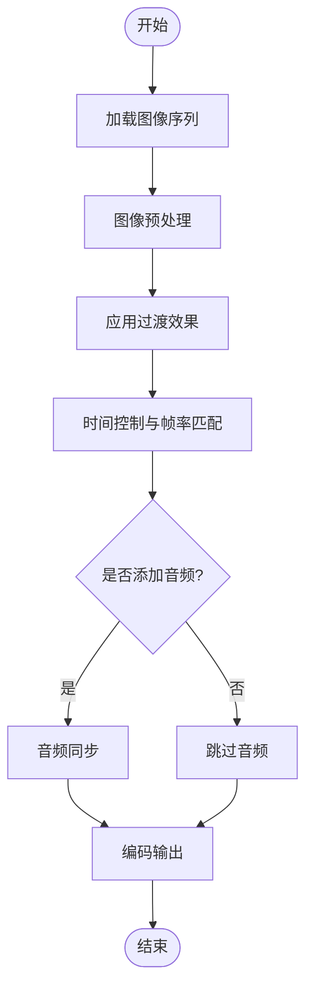
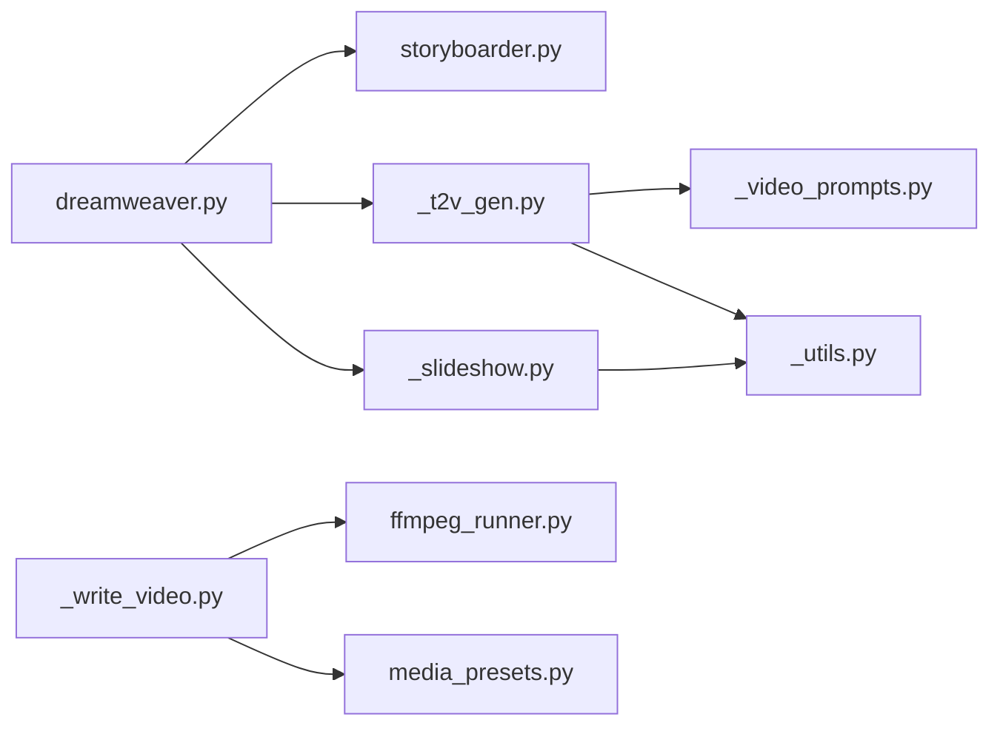

# 视频生成代理

<cite>
**本文引用的文件**   
- [dreamweaver.py](file://agents/dreamweaver.py)
- [_write_video.py](file://agents/dreamweaver_agent_pkg/_write_video.py)
- [_t2v_gen.py](file://agents/dreamweaver_agent_pkg/_t2v_gen.py)
- [_slideshow.py](file://agents/dreamweaver_agent_pkg/_slideshow.py)
- [storyboarder.py](file://agents/storyboarder.py)
- [_run.py](file://agents/dreamweaver_agent_pkg/_run.py)
- [_video_prompts.py](file://agents/dreamweaver_agent_pkg/_video_prompts.py)
- [_utils.py](file://agents/dreamweaver_agent_pkg/_utils.py)
- [_i2v_gen.py](file://agents/dreamweaver_agent_pkg/_i2v_gen.py)
- [_kling_omni.py](file://agents/dreamweaver_agent_pkg/_kling_omni.py)
- [_ensure_prompts.py](file://agents/dreamweaver_agent_pkg/_ensure_prompts.py)
- [ffmpeg_runner.py](file://pipeline/ffmpeg_runner.py)
- [media_presets.py](file://pipeline/media_presets.py)
- [state_machine.py](file://pipeline/state_machine.py)
- [dreamweaver_tasks.py](file://backend/app/tasks/dreamweaver_tasks.py)
- [dreamweaver_api.py](file://backend/app/api/v1/dreamweaver_api/dreamweaver.py)
</cite>

## 目录
1. [简介](#简介)
2. [项目结构](#项目结构)
3. [核心组件](#核心组件)
4. [架构总览](#架构总览)
5. [详细组件分析](#详细组件分析)
6. [依赖关系分析](#依赖关系分析)
7. [性能考量](#性能考量)
8. [故障排除指南](#故障排除指南)
9. [结论](#结论)
10. [附录](#附录)

## 简介
本技术文档聚焦“视频生成代理”模块，围绕梦境编织者（dreamweaver）的视频合成引擎、多模态内容整合与渲染管线展开。重点覆盖以下子模块：
- 视频写入与媒体编码（_write_video.py）
- 文生视频生成（_t2v_gen.py）
- 幻灯片动态化（_slideshow.py）
- 分镜制作代理（storyboarder.py）
同时说明整体工作流程、帧率控制、分辨率设置、音频同步机制，并提供使用示例、参数配置与排错方法，以及性能优化与最佳实践建议。

## 项目结构
该模块采用“编排器 + 专用子代理”的分层组织方式：
- 编排入口与任务调度：dreamweaver.py 作为统一入口，协调各子代理；后端通过 dreamweaver_tasks.py 和 dreamweaver_api.py 暴露接口与任务队列。
- 视频生成子代理：_t2v_gen.py（文生视频）、_i2v_gen.py（图生视频）、_kling_omni.py（特定模型适配）、_slideshow.py（静态图像转视频）。
- 媒体处理与渲染：_write_video.py 负责帧序列到视频的编码封装；pipeline/ffmpeg_runner.py 调用 FFmpeg 完成转码与合成；media_presets.py 提供预设的分辨率、帧率、码率等参数。
- 分镜规划：storyboarder.py 负责镜头拆解、时长估算、场景设计与提示词生成，为后续视频生成提供结构化输入。
- 辅助能力：_video_prompts.py 管理视频相关提示词模板；_utils.py 提供通用工具函数；_ensure_prompts.py 确保提示词完整性。



**图表来源** 
- [dreamweaver.py](file://agents/dreamweaver.py)
- [_t2v_gen.py](file://agents/dreamweaver_agent_pkg/_t2v_gen.py)
- [_i2v_gen.py](file://agents/dreamweaver_agent_pkg/_i2v_gen.py)
- [_slideshow.py](file://agents/dreamweaver_agent_pkg/_slideshow.py)
- [storyboarder.py](file://agents/storyboarder.py)
- [_write_video.py](file://agents/dreamweaver_agent_pkg/_write_video.py)
- [ffmpeg_runner.py](file://pipeline/ffmpeg_runner.py)
- [media_presets.py](file://pipeline/media_presets.py)
- [_video_prompts.py](file://agents/dreamweaver_agent_pkg/_video_prompts.py)
- [_utils.py](file://agents/dreamweaver_agent_pkg/_utils.py)
- [_ensure_prompts.py](file://agents/dreamweaver_agent_pkg/_ensure_prompts.py)
- [dreamweaver_tasks.py](file://backend/app/tasks/dreamweaver_tasks.py)
- [dreamweaver_api.py](file://backend/app/api/v1/dreamweaver_api/dreamweaver.py)

**章节来源**
- [dreamweaver.py](file://agents/dreamweaver.py)
- [_run.py](file://agents/dreamweaver_agent_pkg/_run.py)
- [dreamweaver_tasks.py](file://backend/app/tasks/dreamweaver_tasks.py)
- [dreamweaver_api.py](file://backend/app/api/v1/dreamweaver_api/dreamweaver.py)

## 核心组件
- 梦境编织者（dreamweaver.py）：统一编排视频生成流程，解析请求、选择子代理、管理上下文与状态机，输出最终视频制品。
- 文生视频（_t2v_gen.py）：基于文本提示生成视频片段，支持多模型适配与结果回退策略。
- 图生视频（_i2v_gen.py）：以图像为起点进行视频延展或风格迁移。
- 幻灯片动态化（_slideshow.py）：将静态图片序列转换为带过渡效果的短视频。
- 视频写入（_write_video.py）：将帧序列与音频流编码为指定格式，控制分辨率、帧率、码率与容器封装。
- 分镜制作（storyboarder.py）：根据脚本或需求生成镜头计划、时长分配、场景描述与提示词，驱动后续生成。
- FFmpeg 集成（ffmpeg_runner.py）：封装 FFmpeg 命令，实现转码、拼接、滤镜与字幕合成。
- 媒体预设（media_presets.py）：集中管理分辨率、帧率、码率、色彩空间等默认值与约束。

**章节来源**
- [dreamweaver.py](file://agents/dreamweaver.py)
- [_t2v_gen.py](file://agents/dreamweaver_agent_pkg/_t2v_gen.py)
- [_i2v_gen.py](file://agents/dreamweaver_agent_pkg/_i2v_gen.py)
- [_slideshow.py](file://agents/dreamweaver_agent_pkg/_slideshow.py)
- [_write_video.py](file://agents/dreamweaver_agent_pkg/_write_video.py)
- [storyboarder.py](file://agents/storyboarder.py)
- [ffmpeg_runner.py](file://pipeline/ffmpeg_runner.py)
- [media_presets.py](file://pipeline/media_presets.py)

## 架构总览
系统采用“编排器 + 子代理 + 媒体处理”的分层架构：
- 编排层：dreamweaver.py 接收高层请求，构建上下文，调度 storyboarder 生成镜头计划，再按镜头类型选择 _t2v_gen / _i2v_gen / _slideshow 生成片段。
- 生成层：各子代理调用外部模型或本地算法产出帧序列或中间产物。
- 渲染层：_write_video.py 调用 ffmpeg_runner.py 完成编码封装，依据 media_presets.py 的参数进行质量控制。
- 任务与API层：dreamweaver_tasks.py 提供异步任务能力，dreamweaver_api.py 暴露 HTTP 接口供前端或外部系统调用。



**图表来源** 
- [dreamweaver_api.py](file://backend/app/api/v1/dreamweaver_api/dreamweaver.py)
- [dreamweaver_tasks.py](file://backend/app/tasks/dreamweaver_tasks.py)
- [dreamweaver.py](file://agents/dreamweaver.py)
- [storyboarder.py](file://agents/storyboarder.py)
- [_t2v_gen.py](file://agents/dreamweaver_agent_pkg/_t2v_gen.py)
- [_slideshow.py](file://agents/dreamweaver_agent_pkg/_slideshow.py)
- [_write_video.py](file://agents/dreamweaver_agent_pkg/_write_video.py)
- [ffmpeg_runner.py](file://pipeline/ffmpeg_runner.py)

## 详细组件分析

### 梦境编织者（dreamweaver.py）
- 职责：解析请求、构建上下文、选择子代理、管理状态机、汇总结果。
- 关键流程：
  - 初始化与参数校验：读取媒体预设、验证分辨率与帧率范围。
  - 分镜规划：调用 storyboarder 生成镜头列表与时长分配。
  - 片段生成：按镜头类型分发至 _t2v_gen 或 _slideshow。
  - 合成与编码：调用 _write_video 进行合并与编码。
  - 状态更新：记录生成事件与结果路径。
- 错误处理：对模型调用失败、编码异常进行重试或降级。



**图表来源** 
- [dreamweaver.py](file://agents/dreamweaver.py)
- [storyboarder.py](file://agents/storyboarder.py)
- [_t2v_gen.py](file://agents/dreamweaver_agent_pkg/_t2v_gen.py)
- [_slideshow.py](file://agents/dreamweaver_agent_pkg/_slideshow.py)
- [_write_video.py](file://agents/dreamweaver_agent_pkg/_write_video.py)

**章节来源**
- [dreamweaver.py](file://agents/dreamweaver.py)
- [state_machine.py](file://pipeline/state_machine.py)

### 视频写入模块（_write_video.py）
- 职责：将帧序列与音频流编码为指定格式，控制分辨率、帧率、码率、容器封装。
- 关键功能：
  - 帧序列处理：排序、裁剪、缩放、去重。
  - 音频同步：对齐音轨与视频时长，处理静音段与淡入淡出。
  - 编码参数：根据 media_presets 设置编码器、比特率、像素格式。
  - FFmpeg 调用：通过 ffmpeg_runner 执行命令，捕获日志与错误。
- 性能优化：批处理帧、并行编码、缓存中间产物。



**图表来源** 
- [_write_video.py](file://agents/dreamweaver_agent_pkg/_write_video.py)
- [media_presets.py](file://pipeline/media_presets.py)
- [ffmpeg_runner.py](file://pipeline/ffmpeg_runner.py)

**章节来源**
- [_write_video.py](file://agents/dreamweaver_agent_pkg/_write_video.py)
- [media_presets.py](file://pipeline/media_presets.py)
- [ffmpeg_runner.py](file://pipeline/ffmpeg_runner.py)

### 文生视频生成（_t2v_gen.py）
- 职责：基于文本提示生成视频片段，支持多模型适配与回退。
- 关键流程：
  - 提示词构建：结合 _video_prompts 模板与上下文生成高质量提示。
  - 模型调用：优先尝试高性能模型，失败时回退至备用模型。
  - 结果处理：校验输出质量、裁剪多余片段、标准化格式。
- 错误处理：网络超时、模型限流、内容安全审核失败等场景的重试与降级。



**图表来源** 
- [_t2v_gen.py](file://agents/dreamweaver_agent_pkg/_t2v_gen.py)
- [_video_prompts.py](file://agents/dreamweaver_agent_pkg/_video_prompts.py)
- [_utils.py](file://agents/dreamweaver_agent_pkg/_utils.py)

**章节来源**
- [_t2v_gen.py](file://agents/dreamweaver_agent_pkg/_t2v_gen.py)
- [_video_prompts.py](file://agents/dreamweaver_agent_pkg/_video_prompts.py)
- [_utils.py](file://agents/dreamweaver_agent_pkg/_utils.py)

### 幻灯片制作（_slideshow.py）
- 职责：将静态图像序列转换为带过渡效果的短视频。
- 关键功能：
  - 图像预处理：统一尺寸、色彩校正、去噪。
  - 过渡效果：淡入淡出、滑动、缩放等。
  - 时间控制：每张图片停留时长、总时长与帧率匹配。
  - 音频叠加：可选背景音乐或旁白同步。
- 性能优化：批量处理图像、预计算过渡帧、减少内存占用。



**图表来源** 
- [_slideshow.py](file://agents/dreamweaver_agent_pkg/_slideshow.py)

**章节来源**
- [_slideshow.py](file://agents/dreamweaver_agent_pkg/_slideshow.py)

### 分镜制作代理（storyboarder.py）
- 职责：根据脚本或需求生成镜头计划、时长分配、场景描述与提示词。
- 关键功能：
  - 镜头拆解：识别场景转换、动作节点与情绪变化。
  - 时长估算：基于文本长度与语义复杂度估计镜头时长。
  - 提示词生成：结合 _video_prompts 与上下文生成高质量提示。
  - 输出结构：标准化的镜头列表，包含画面描述、时长、转场方式。
- 错误处理：文本解析失败、时长估算异常时的回退策略。

```mermaid
classDiagram
class Storyboarder {
+plan_scenes(script)
+estimate_duration(text)
+generate_prompts(scene)
+output_storyboard()
-parse_script()
-analyze_semantics()
}
class Prompts as "_video_prompts.py"
Storyboarder --> Prompts : "生成提示词"
```

**图表来源** 
- [storyboarder.py](file://agents/storyboarder.py)
- [_video_prompts.py](file://agents/dreamweaver_agent_pkg/_video_prompts.py)

**章节来源**
- [storyboarder.py](file://agents/storyboarder.py)
- [_video_prompts.py](file://agents/dreamweaver_agent_pkg/_video_prompts.py)

## 依赖关系分析
- 内部依赖：
  - dreamweaver.py 依赖 storyboarder.py、_t2v_gen.py、_slideshow.py、_write_video.py。
  - _write_video.py 依赖 ffmpeg_runner.py 与 media_presets.py。
  - _t2v_gen.py 依赖 _video_prompts.py 与 _utils.py。
- 外部依赖：
  - 视频模型接口（如 Kling、Wanx 等适配器）。
  - FFmpeg 二进制工具用于编码与转码。
- 潜在循环依赖：当前设计避免循环，但需注意 _utils.py 被多个模块引用时的耦合度。



**图表来源** 
- [dreamweaver.py](file://agents/dreamweaver.py)
- [storyboarder.py](file://agents/storyboarder.py)
- [_t2v_gen.py](file://agents/dreamweaver_agent_pkg/_t2v_gen.py)
- [_slideshow.py](file://agents/dreamweaver_agent_pkg/_slideshow.py)
- [_write_video.py](file://agents/dreamweaver_agent_pkg/_write_video.py)
- [_video_prompts.py](file://agents/dreamweaver_agent_pkg/_video_prompts.py)
- [_utils.py](file://agents/dreamweaver_agent_pkg/_utils.py)
- [ffmpeg_runner.py](file://pipeline/ffmpeg_runner.py)
- [media_presets.py](file://pipeline/media_presets.py)

**章节来源**
- [dreamweaver.py](file://agents/dreamweaver.py)
- [_write_video.py](file://agents/dreamweaver_agent_pkg/_write_video.py)
- [_t2v_gen.py](file://agents/dreamweaver_agent_pkg/_t2v_gen.py)
- [_slideshow.py](file://agents/dreamweaver_agent_pkg/_slideshow.py)
- [storyboarder.py](file://agents/storyboarder.py)

## 性能考量
- 帧率控制：
  - 根据内容类型选择合适帧率（如对话场景 24fps，动作场景 30fps）。
  - 避免过高帧率导致编码时间与存储成本增加。
- 分辨率设置：
  - 默认 1080p，移动端可降级至 720p。
  - 使用 media_presets 统一管理分辨率与宽高比。
- 音频同步：
  - 精确对齐音轨与视频时长，处理静音段与淡入淡出。
  - 使用 AAC 编码保证兼容性与音质平衡。
- 编码优化：
  - 使用硬件加速（如 NVENC）提升编码速度。
  - 合理设置比特率与关键帧间隔，平衡画质与文件大小。
- 并发与缓存：
  - 并行处理多个镜头片段，减少总耗时。
  - 缓存中间产物（如过渡帧、提示词结果）避免重复计算。

[本节为通用指导，不直接分析具体文件]

## 故障排除指南
- 常见问题：
  - 模型调用失败：检查网络连通性、API 密钥与配额限制。
  - 编码错误：确认 FFmpeg 安装与参数合法性，查看日志定位问题。
  - 音频不同步：检查音轨时长与视频时长一致性，调整采样率与声道数。
  - 内存不足：减少并发数、降低分辨率或帧率，清理临时文件。
- 调试方法：
  - 启用详细日志，记录每一步输入输出。
  - 使用单元测试验证关键函数（如提示词生成、编码参数）。
  - 逐步禁用功能定位问题（如先测试无音频视频生成）。

**章节来源**
- [ffmpeg_runner.py](file://pipeline/ffmpeg_runner.py)
- [_write_video.py](file://agents/dreamweaver_agent_pkg/_write_video.py)
- [_t2v_gen.py](file://agents/dreamweaver_agent_pkg/_t2v_gen.py)

## 结论
视频生成代理模块通过分层架构实现了从分镜规划到视频合成的完整流水线。dreamweaver.py 作为编排核心，协调 storyboarder、_t2v_gen、_slideshow 与 _write_video 等组件，结合 FFmpeg 与媒体预设，提供高质量的视频生成能力。通过合理的参数配置、性能优化与故障排除策略，可满足多样化视频创作需求。

[本节为总结性内容，不直接分析具体文件]

## 附录
- 使用示例：
  - 创建文生视频：准备文本提示与镜头描述，调用 dreamweaver API，选择文生视频模式。
  - 制作幻灯片视频：上传图像序列，设置停留时长与过渡效果，添加背景音乐。
  - 自定义参数：调整分辨率、帧率、码率与编码器，满足特定平台要求。
- 最佳实践：
  - 使用高分辨率参考图提升生成质量。
  - 分段生成与后期拼接，便于迭代与修改。
  - 定期清理临时文件，释放存储空间。

[本节为补充信息，不直接分析具体文件]