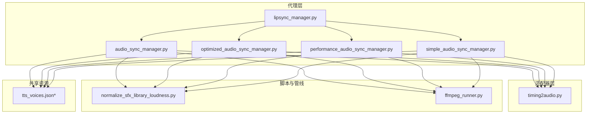
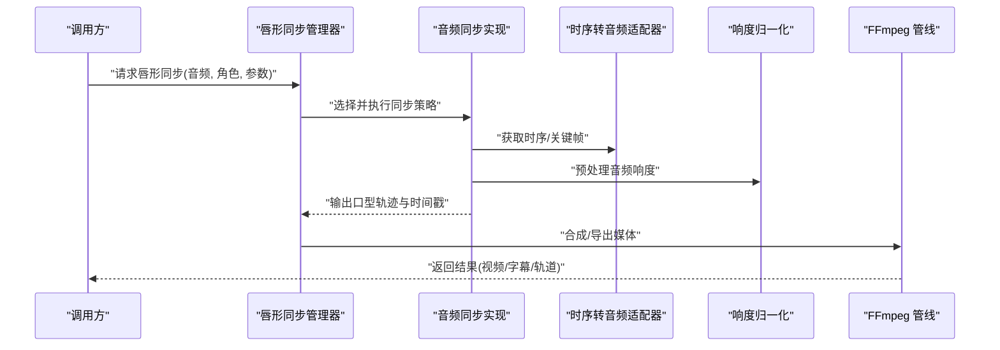
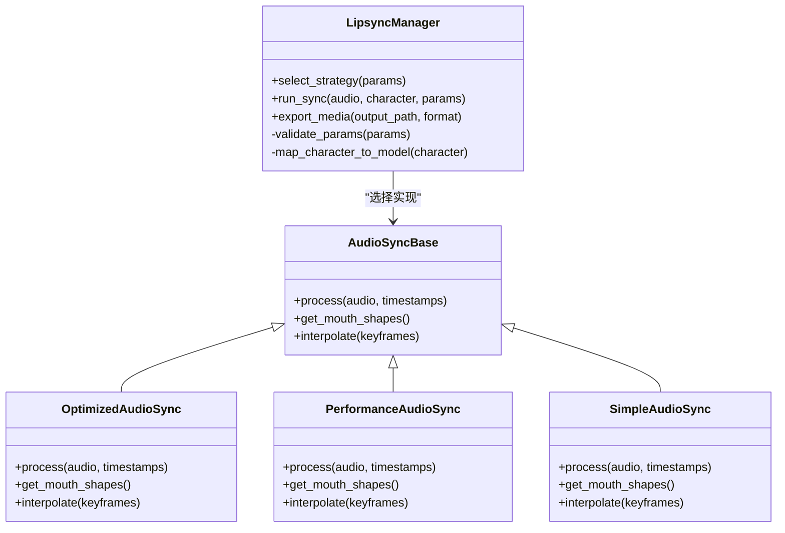
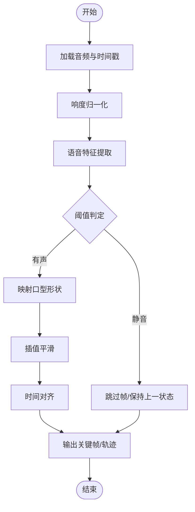
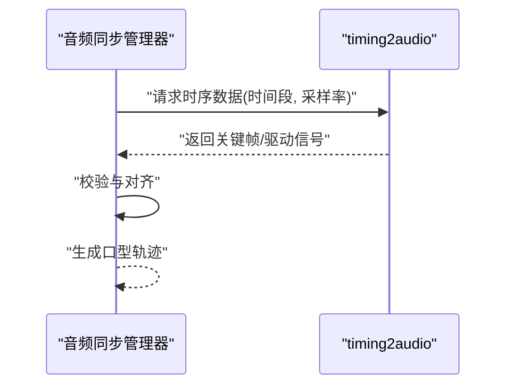
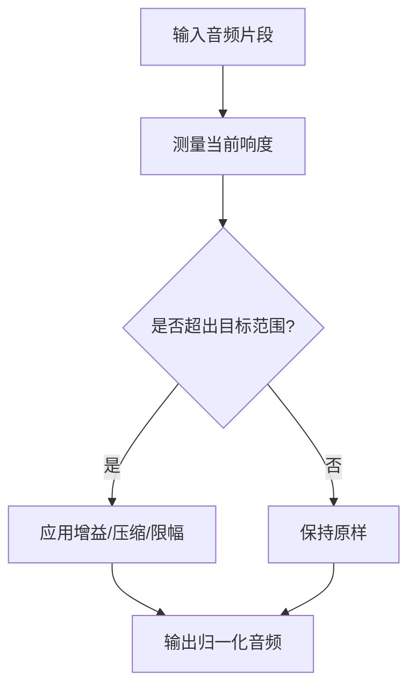
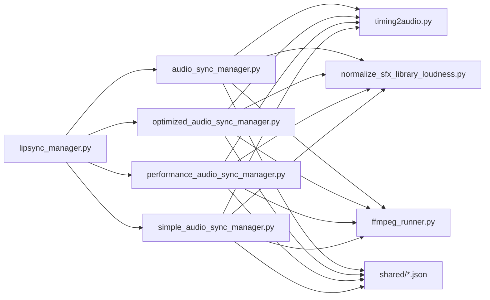

# 唇形同步管理器

<cite>
**本文引用的文件**   
- [agents/lipsync_manager.py](file://agents/lipsync_manager.py)
- [agents/audio_sync_manager.py](file://agents/audio_sync_manager.py)
- [agents/optimized_audio_sync_manager.py](file://agents/optimized_audio_sync_manager.py)
- [agents/performance_audio_sync_manager.py](file://agents/performance_audio_sync_manager.py)
- [agents/simple_audio_sync_manager.py](file://agents/simple_audio_sync_manager.py)
- [adapters/vidu_platform/timing2audio.py](file://adapters/vidu_platform/timing2audio.py)
- [scripts/normalize_sfx_library_loudness.py](file://scripts/normalize_sfx_library_loudness.py)
- [backend/scripts/normalize_sfx_library_loudness.py](file://backend/scripts/normalize_sfx_library_loudness.py)
- [pipeline/ffmpeg_runner.py](file://pipeline/ffmpeg_runner.py)
- [shared/qwen3_tts_voices.json](file://shared/qwen3_tts_voices.json)
- [shared/cosyvoice_v3_plus_voices.json](file://shared/cosyvoice_v3_plus_voices.json)
- [shared/mimo_v2_5_tts_voices.json](file://shared/mimo_v2_5_tts_voices.json)
- [shared/seed_tts_2_0_voices.json](file://shared/seed_tts_2_0_voices.json)
- [shared/stepaudio_2_5_tts_voices.json](file://shared/stepaudio_2_5_tts_voices.json)
- [shared/cosyvoice_v3_5_plus_voices.json](file://shared/cosyvoice_v3_5_plus_voices.json)
</cite>

## 目录
1. [简介](#简介)
2. [项目结构](#项目结构)
3. [核心组件](#核心组件)
4. [架构总览](#架构总览)
5. [详细组件分析](#详细组件分析)
6. [依赖关系分析](#依赖关系分析)
7. [性能考量](#性能考量)
8. [故障排查指南](#故障排查指南)
9. [结论](#结论)
10. [附录](#附录)

## 简介
本技术文档面向“唇形同步管理器”的设计与实现，聚焦以下目标：
- 口型匹配算法：语音特征到口型动画的映射关系、时间同步机制。
- 音频响度归一化（loudness_normalizer）对同步精度的影响及优化方法。
- 不同角色的口型模型、表情控制与动画插值技术。
- 使用示例：配置唇形同步参数、调整同步精度、处理特殊语音情况。
- 性能优化策略、实时处理能力限制与质量评估标准。
- 与视频编辑工具的集成方法与导出格式支持。

## 项目结构
与唇形同步相关的代码主要分布在 agents、adapters、scripts、pipeline 以及 shared 等目录中：
- agents：唇形同步管理器与多种音频同步实现（基础、优化、性能、简单）。
- adapters：外部平台对接（如 Vidu 平台的时序转音频工具）。
- scripts：音频响度归一化脚本（SFX 库级）。
- pipeline：FFmpeg 调用封装，用于音视频合成与导出。
- shared：TTS 音色与角色配置数据，支撑多角色口型模型。

图表来源
- [agents/lipsync_manager.py](file://agents/lipsync_manager.py)
- [agents/audio_sync_manager.py](file://agents/audio_sync_manager.py)
- [agents/optimized_audio_sync_manager.py](file://agents/optimized_audio_sync_manager.py)
- [agents/performance_audio_sync_manager.py](file://agents/performance_audio_sync_manager.py)
- [agents/simple_audio_sync_manager.py](file://agents/simple_audio_sync_manager.py)
- [adapters/vidu_platform/timing2audio.py](file://adapters/vidu_platform/timing2audio.py)
- [scripts/normalize_sfx_library_loudness.py](file://scripts/normalize_sfx_library_loudness.py)
- [backend/scripts/normalize_sfx_library_loudness.py](file://backend/scripts/normalize_sfx_library_loudness.py)
- [pipeline/ffmpeg_runner.py](file://pipeline/ffmpeg_runner.py)
- [shared/qwen3_tts_voices.json](file://shared/qwen3_tts_voices.json)
- [shared/cosyvoice_v3_plus_voices.json](file://shared/cosyvoice_v3_plus_voices.json)
- [shared/mimo_v2_5_tts_voices.json](file://shared/mimo_v2_5_tts_voices.json)
- [shared/seed_tts_2_0_voices.json](file://shared/seed_tts_2_0_voices.json)
- [shared/stepaudio_2_5_tts_voices.json](file://shared/stepaudio_2_5_tts_voices.json)
- [shared/cosyvoice_v3_5_plus_voices.json](file://shared/cosyvoice_v3_5_plus_voices.json)

章节来源
- [agents/lipsync_manager.py](file://agents/lipsync_manager.py)
- [agents/audio_sync_manager.py](file://agents/audio_sync_manager.py)
- [agents/optimized_audio_sync_manager.py](file://agents/optimized_audio_sync_manager.py)
- [agents/performance_audio_sync_manager.py](file://agents/performance_audio_sync_manager.py)
- [agents/simple_audio_sync_manager.py](file://agents/simple_audio_sync_manager.py)
- [adapters/vidu_platform/timing2audio.py](file://adapters/vidu_platform/timing2audio.py)
- [scripts/normalize_sfx_library_loudness.py](file://scripts/normalize_sfx_library_loudness.py)
- [backend/scripts/normalize_sfx_library_loudness.py](file://backend/scripts/normalize_sfx_library_loudness.py)
- [pipeline/ffmpeg_runner.py](file://pipeline/ffmpeg_runner.py)
- [shared/qwen3_tts_voices.json](file://shared/qwen3_tts_voices.json)
- [shared/cosyvoice_v3_plus_voices.json](file://shared/cosyvoice_v3_plus_voices.json)
- [shared/mimo_v2_5_tts_voices.json](file://shared/mimo_v2_5_tts_voices.json)
- [shared/seed_tts_2_0_voices.json](file://shared/seed_tts_2_0_voices.json)
- [shared/stepaudio_2_5_tts_voices.json](file://shared/stepaudio_2_5_tts_voices.json)
- [shared/cosyvoice_v3_5_plus_voices.json](file://shared/cosyvoice_v3_5_plus_voices.json)

## 核心组件
- 唇形同步管理器（lipsync_manager.py）：协调音频同步策略、选择具体实现、管理角色口型模型与参数。
- 音频同步管理器族（audio_sync_manager.py、optimized_audio_sync_manager.py、performance_audio_sync_manager.py、simple_audio_sync_manager.py）：提供不同复杂度与性能的同步实现，涵盖特征提取、时间对齐、插值与渲染。
- 时序转音频适配器（timing2audio.py）：将外部平台的时序信息转换为音频驱动信号或关键帧序列。
- 响度归一化脚本（normalize_sfx_library_loudness.py）：统一 SFX 库响度，提升唇形同步稳定性与一致性。
- FFmpeg 管线（ffmpeg_runner.py）：音视频合成、转码与导出，支持常见媒体格式。
- 角色音色配置（shared/*.json）：定义不同 TTS 引擎下的音色与角色映射，为多角色口型模型提供基础数据。

章节来源
- [agents/lipsync_manager.py](file://agents/lipsync_manager.py)
- [agents/audio_sync_manager.py](file://agents/audio_sync_manager.py)
- [agents/optimized_audio_sync_manager.py](file://agents/optimized_audio_sync_manager.py)
- [agents/performance_audio_sync_manager.py](file://agents/performance_audio_sync_manager.py)
- [agents/simple_audio_sync_manager.py](file://agents/simple_audio_sync_manager.py)
- [adapters/vidu_platform/timing2audio.py](file://adapters/vidu_platform/timing2audio.py)
- [scripts/normalize_sfx_library_loudness.py](file://scripts/normalize_sfx_library_loudness.py)
- [backend/scripts/normalize_sfx_library_loudness.py](file://backend/scripts/normalize_sfx_library_loudness.py)
- [pipeline/ffmpeg_runner.py](file://pipeline/ffmpeg_runner.py)
- [shared/qwen3_tts_voices.json](file://shared/qwen3_tts_voices.json)
- [shared/cosyvoice_v3_plus_voices.json](file://shared/cosyvoice_v3_plus_voices.json)
- [shared/mimo_v2_5_tts_voices.json](file://shared/mimo_v2_5_tts_voices.json)
- [shared/seed_tts_2_0_voices.json](file://shared/seed_tts_2_0_voices.json)
- [shared/stepaudio_2_5_tts_voices.json](file://shared/stepaudio_2_5_tts_voices.json)
- [shared/cosyvoice_v3_5_plus_voices.json](file://shared/cosyvoice_v3_5_plus_voices.json)

## 架构总览
唇形同步系统采用分层架构：上层由唇形同步管理器编排策略，中层由多种音频同步实现负责特征到口型的映射与时间对齐，下层通过适配器与管线完成外部时序转换与媒体导出。

图表来源
- [agents/lipsync_manager.py](file://agents/lipsync_manager.py)
- [agents/audio_sync_manager.py](file://agents/audio_sync_manager.py)
- [agents/optimized_audio_sync_manager.py](file://agents/optimized_audio_sync_manager.py)
- [agents/performance_audio_sync_manager.py](file://agents/performance_audio_sync_manager.py)
- [agents/simple_audio_sync_manager.py](file://agents/simple_audio_sync_manager.py)
- [adapters/vidu_platform/timing2audio.py](file://adapters/vidu_platform/timing2audio.py)
- [scripts/normalize_sfx_library_loudness.py](file://scripts/normalize_sfx_library_loudness.py)
- [backend/scripts/normalize_sfx_library_loudness.py](file://backend/scripts/normalize_sfx_library_loudness.py)
- [pipeline/ffmpeg_runner.py](file://pipeline/ffmpeg_runner.py)

## 详细组件分析

### 唇形同步管理器（lipsync_manager.py）
职责与要点：
- 策略选择：根据输入条件（角色、TTS 引擎、延迟要求）选择具体的音频同步实现。
- 参数管理：集中管理唇形同步相关参数（如窗口大小、阈值、插值方式、平滑系数）。
- 角色模型：基于 shared/*.json 中的音色与角色配置，绑定不同角色的口型模型与表情控制。
- 错误处理：捕获异常并回退到更稳健的实现或降级策略。

图表来源
- [agents/lipsync_manager.py](file://agents/lipsync_manager.py)
- [agents/audio_sync_manager.py](file://agents/audio_sync_manager.py)
- [agents/optimized_audio_sync_manager.py](file://agents/optimized_audio_sync_manager.py)
- [agents/performance_audio_sync_manager.py](file://agents/performance_audio_sync_manager.py)
- [agents/simple_audio_sync_manager.py](file://agents/simple_audio_sync_manager.py)

章节来源
- [agents/lipsync_manager.py](file://agents/lipsync_manager.py)
- [agents/audio_sync_manager.py](file://agents/audio_sync_manager.py)
- [agents/optimized_audio_sync_manager.py](file://agents/optimized_audio_sync_manager.py)
- [agents/performance_audio_sync_manager.py](file://agents/performance_audio_sync_manager.py)
- [agents/simple_audio_sync_manager.py](file://agents/simple_audio_sync_manager.py)

### 音频同步实现族
- 基础实现（audio_sync_manager.py）：通用流程，包含特征提取、阈值判定、时间对齐与插值。
- 优化实现（optimized_audio_sync_manager.py）：引入缓存、批处理与更高效特征计算，降低 CPU 占用。
- 性能实现（performance_audio_sync_manager.py）：针对高吞吐场景，减少内存拷贝与锁竞争。
- 简单实现（simple_audio_sync_manager.py）：最小可用版本，便于调试与快速验证。

图表来源
- [agents/audio_sync_manager.py](file://agents/audio_sync_manager.py)
- [agents/optimized_audio_sync_manager.py](file://agents/optimized_audio_sync_manager.py)
- [agents/performance_audio_sync_manager.py](file://agents/performance_audio_sync_manager.py)
- [agents/simple_audio_sync_manager.py](file://agents/simple_audio_sync_manager.py)

章节来源
- [agents/audio_sync_manager.py](file://agents/audio_sync_manager.py)
- [agents/optimized_audio_sync_manager.py](file://agents/optimized_audio_sync_manager.py)
- [agents/performance_audio_sync_manager.py](file://agents/performance_audio_sync_manager.py)
- [agents/simple_audio_sync_manager.py](file://agents/simple_audio_sync_manager.py)

### 时序转音频适配器（timing2audio.py）
- 功能：将外部平台（如 Vidu）提供的时序信息转换为音频驱动信号或关键帧序列。
- 关键点：时间单位换算、边界对齐、缺失段填充、抖动抑制。

图表来源
- [adapters/vidu_platform/timing2audio.py](file://adapters/vidu_platform/timing2audio.py)

章节来源
- [adapters/vidu_platform/timing2audio.py](file://adapters/vidu_platform/timing2audio.py)

### 响度归一化（normalize_sfx_library_loudness.py）
- 作用：统一 SFX 库响度，避免音量波动导致口型同步偏差。
- 影响：提高唇形同步精度与一致性；减少极端静音/爆音导致的误触发。
- 优化建议：
  - 使用感知响度（如 LUFS）进行全局归一化。
  - 动态范围压缩与峰值限幅结合，保留自然听感。
  - 批量处理与缓存中间结果，提升效率。

图表来源
- [scripts/normalize_sfx_library_loudness.py](file://scripts/normalize_sfx_library_loudness.py)
- [backend/scripts/normalize_sfx_library_loudness.py](file://backend/scripts/normalize_sfx_library_loudness.py)

章节来源
- [scripts/normalize_sfx_library_loudness.py](file://scripts/normalize_sfx_library_loudness.py)
- [backend/scripts/normalize_sfx_library_loudness.py](file://backend/scripts/normalize_sfx_library_loudness.py)

### FFmpeg 管线（ffmpeg_runner.py）
- 功能：音视频合成、转码、导出，支持常见格式（MP4、MOV、WebM、AAC、PCM 等）。
- 集成点：唇形同步输出关键帧/轨迹后，通过 FFmpeg 合成为最终媒体文件。
- 注意事项：编码参数、帧率、比特率、声道布局需与上游一致，避免重采样带来的时间偏移。

章节来源
- [pipeline/ffmpeg_runner.py](file://pipeline/ffmpeg_runner.py)

### 角色音色与口型模型（shared/*.json）
- 内容：不同 TTS 引擎（Qwen3、CosyVoice、Mimo、Seed TTS、StepAudio）的音色与角色映射。
- 用途：为不同角色绑定专属口型模型与表情控制参数，确保多角色场景的一致性。
- 扩展：新增角色时更新对应 JSON，并在唇形同步管理器中注册映射。

章节来源
- [shared/qwen3_tts_voices.json](file://shared/qwen3_tts_voices.json)
- [shared/cosyvoice_v3_plus_voices.json](file://shared/cosyvoice_v3_plus_voices.json)
- [shared/mimo_v2_5_tts_voices.json](file://shared/mimo_v2_5_tts_voices.json)
- [shared/seed_tts_2_0_voices.json](file://shared/seed_tts_2_0_voices.json)
- [shared/stepaudio_2_5_tts_voices.json](file://shared/stepaudio_2_5_tts_voices.json)
- [shared/cosyvoice_v3_5_plus_voices.json](file://shared/cosyvoice_v3_5_plus_voices.json)

## 依赖关系分析
唇形同步管理器依赖音频同步实现、外部时序适配器、响度归一化脚本与 FFmpeg 管线；同时以 shared/*.json 作为角色与音色数据的静态依赖。

图表来源
- [agents/lipsync_manager.py](file://agents/lipsync_manager.py)
- [agents/audio_sync_manager.py](file://agents/audio_sync_manager.py)
- [agents/optimized_audio_sync_manager.py](file://agents/optimized_audio_sync_manager.py)
- [agents/performance_audio_sync_manager.py](file://agents/performance_audio_sync_manager.py)
- [agents/simple_audio_sync_manager.py](file://agents/simple_audio_sync_manager.py)
- [adapters/vidu_platform/timing2audio.py](file://adapters/vidu_platform/timing2audio.py)
- [scripts/normalize_sfx_library_loudness.py](file://scripts/normalize_sfx_library_loudness.py)
- [backend/scripts/normalize_sfx_library_loudness.py](file://backend/scripts/normalize_sfx_library_loudness.py)
- [pipeline/ffmpeg_runner.py](file://pipeline/ffmpeg_runner.py)
- [shared/qwen3_tts_voices.json](file://shared/qwen3_tts_voices.json)
- [shared/cosyvoice_v3_plus_voices.json](file://shared/cosyvoice_v3_plus_voices.json)
- [shared/mimo_v2_5_tts_voices.json](file://shared/mimo_v2_5_tts_voices.json)
- [shared/seed_tts_2_0_voices.json](file://shared/seed_tts_2_0_voices.json)
- [shared/stepaudio_2_5_tts_voices.json](file://shared/stepaudio_2_5_tts_voices.json)
- [shared/cosyvoice_v3_5_plus_voices.json](file://shared/cosyvoice_v3_5_plus_voices.json)

章节来源
- [agents/lipsync_manager.py](file://agents/lipsync_manager.py)
- [agents/audio_sync_manager.py](file://agents/audio_sync_manager.py)
- [agents/optimized_audio_sync_manager.py](file://agents/optimized_audio_sync_manager.py)
- [agents/performance_audio_sync_manager.py](file://agents/performance_audio_sync_manager.py)
- [agents/simple_audio_sync_manager.py](file://agents/simple_audio_sync_manager.py)
- [adapters/vidu_platform/timing2audio.py](file://adapters/vidu_platform/timing2audio.py)
- [scripts/normalize_sfx_library_loudness.py](file://scripts/normalize_sfx_library_loudness.py)
- [backend/scripts/normalize_sfx_library_loudness.py](file://backend/scripts/normalize_sfx_library_loudness.py)
- [pipeline/ffmpeg_runner.py](file://pipeline/ffmpeg_runner.py)
- [shared/qwen3_tts_voices.json](file://shared/qwen3_tts_voices.json)
- [shared/cosyvoice_v3_plus_voices.json](file://shared/cosyvoice_v3_plus_voices.json)
- [shared/mimo_v2_5_tts_voices.json](file://shared/mimo_v2_5_tts_voices.json)
- [shared/seed_tts_2_0_voices.json](file://shared/seed_tts_2_0_voices.json)
- [shared/stepaudio_2_5_tts_voices.json](file://shared/stepaudio_2_5_tts_voices.json)
- [shared/cosyvoice_v3_5_plus_voices.json](file://shared/cosyvoice_v3_5_plus_voices.json)

## 性能考量
- 特征提取优化：使用向量化计算与缓存，减少重复计算开销。
- 批处理与流水线：将音频分块处理，降低内存峰值与 GC 压力。
- 插值与平滑：选择合适的插值算法（线性、样条）与窗口大小，平衡流畅性与响应速度。
- 实时能力：在高吞吐场景下优先选择 performance 实现，必要时启用硬件加速（GPU/CPU 指令集）。
- 导出性能：合理设置 FFmpeg 编码参数（如预置、线程数），避免过度压缩导致耗时增加。

[本节为通用指导，不直接分析具体文件]

## 故障排查指南
常见问题与定位步骤：
- 口型不同步：检查时间戳对齐、采样率一致性、FFmpeg 重采样设置。
- 静音误触发：调整阈值与静音检测窗口，启用响度归一化。
- 爆音/削波：在归一化阶段加入峰值限幅与动态范围压缩。
- 角色口型不一致：核对 shared/*.json 中的角色映射与模型参数。
- 外部时序异常：校验 timing2audio 输出的关键帧密度与边界填充。

章节来源
- [agents/audio_sync_manager.py](file://agents/audio_sync_manager.py)
- [agents/optimized_audio_sync_manager.py](file://agents/optimized_audio_sync_manager.py)
- [agents/performance_audio_sync_manager.py](file://agents/performance_audio_sync_manager.py)
- [agents/simple_audio_sync_manager.py](file://agents/simple_audio_sync_manager.py)
- [adapters/vidu_platform/timing2audio.py](file://adapters/vidu_platform/timing2audio.py)
- [scripts/normalize_sfx_library_loudness.py](file://scripts/normalize_sfx_library_loudness.py)
- [backend/scripts/normalize_sfx_library_loudness.py](file://backend/scripts/normalize_sfx_library_loudness.py)
- [pipeline/ffmpeg_runner.py](file://pipeline/ffmpeg_runner.py)

## 结论
唇形同步管理器通过分层架构与多实现策略，实现了从语音特征到口型动画的稳定映射与时间同步。响度归一化显著提升同步精度与一致性，FFmpeg 管线保障高质量导出。针对不同角色与 TTS 引擎，借助共享音色配置实现个性化口型模型与表情控制。在实际应用中，应根据性能需求与质量目标选择合适的同步实现与参数配置。

[本节为总结性内容，不直接分析具体文件]

## 附录

### 使用示例与配置要点
- 配置唇形同步参数：
  - 窗口大小、阈值、插值方式、平滑系数需在唇形同步管理器中设置。
  - 根据角色选择对应的口型模型与表情控制参数。
- 调整同步精度：
  - 提高特征分辨率与时间对齐精度。
  - 使用优化或性能实现以提升稳定性。
- 处理特殊语音：
  - 对静音/爆音进行预处理（归一化、限幅）。
  - 对长停顿进行插值保持，避免口型回弹。

章节来源
- [agents/lipsync_manager.py](file://agents/lipsync_manager.py)
- [agents/audio_sync_manager.py](file://agents/audio_sync_manager.py)
- [agents/optimized_audio_sync_manager.py](file://agents/optimized_audio_sync_manager.py)
- [agents/performance_audio_sync_manager.py](file://agents/performance_audio_sync_manager.py)
- [agents/simple_audio_sync_manager.py](file://agents/simple_audio_sync_manager.py)

### 与视频编辑工具的集成与导出格式
- 集成方法：
  - 通过 FFmpeg 管线输出标准媒体文件（MP4、MOV、WebM）与音轨（AAC、PCM）。
  - 可配合字幕文件（SRT、ASS、VTT）进行后期编辑。
- 导出格式支持：
  - 视频：H.264/H.265、VP9、AV1（视编码器支持）。
  - 音频：AAC、PCM、Opus。
  - 字幕：SRT、ASS、VTT。

章节来源
- [pipeline/ffmpeg_runner.py](file://pipeline/ffmpeg_runner.py)