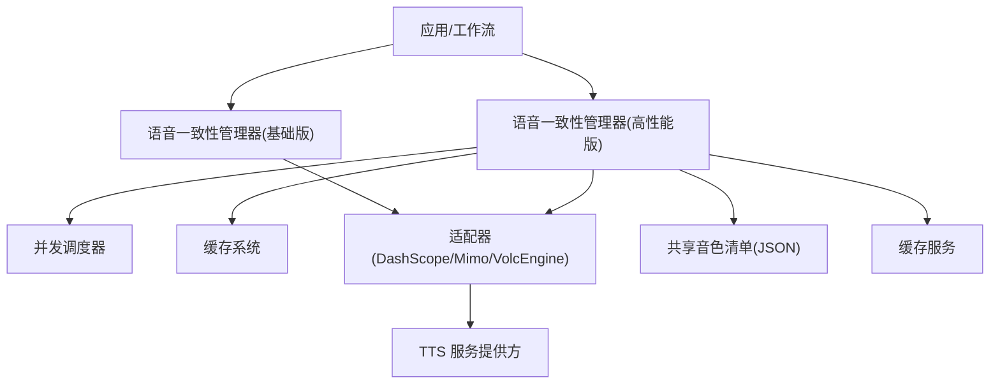
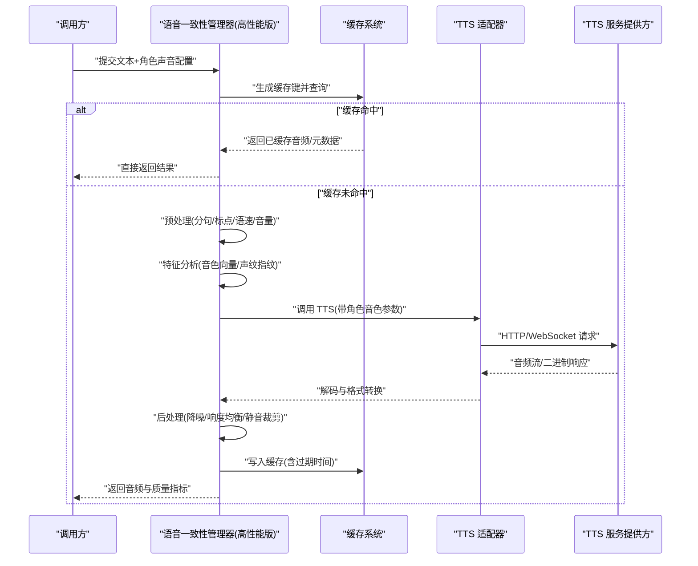
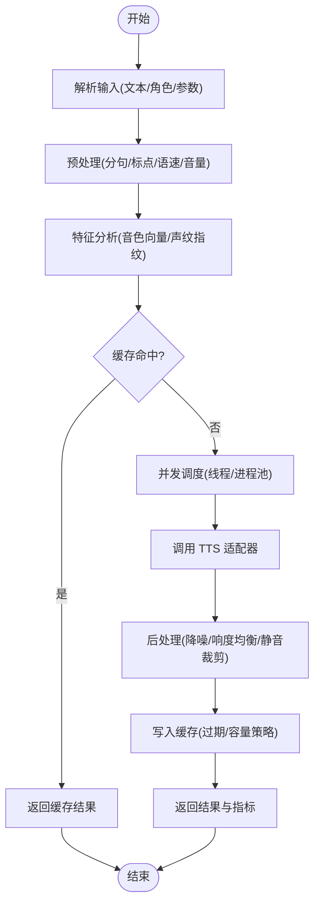
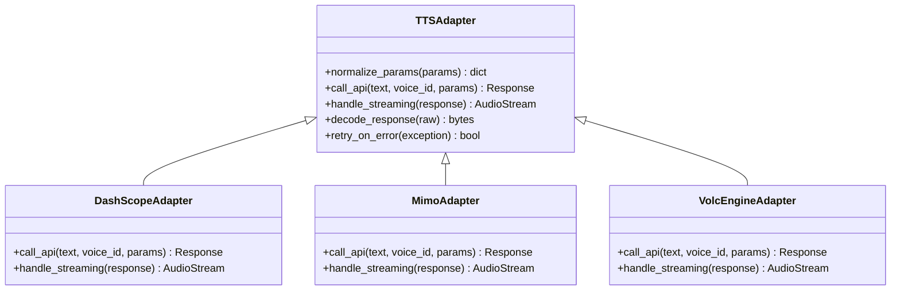
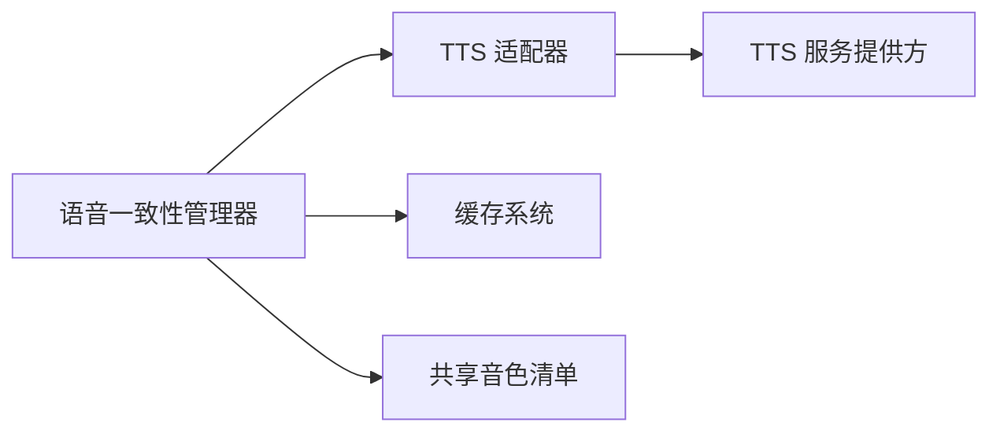

# 语音一致性管理器

<cite>
**本文引用的文件**   
- [agents/high_performance_voice_consistency_manager.py](file://agents/high_performance_voice_consistency_manager.py)
- [agents/voice_consistency_manager.py](file://agents/voice_consistency_manager.py)
- [adapters/dashscope/tts.py](file://adapters/dashscope/tts.py)
- [adapters/mimo/tts.py](file://adapters/mimo/tts.py)
- [adapters/volcengine/tts.py](file://adapters/volcengine/tts.py)
- [backend/app/services/cache_system.py](file://backend/app/services/cache_system.py)
- [shared/cosyvoice_v3_5_plus_voices.json](file://shared/cosyvoice_v3_5_plus_voices.json)
- [shared/qwen3_tts_voices.json](file://shared/qwen3_tts_voices.json)
- [scripts/debug_single_voice.py](file://scripts/debug_single_voice.py)
</cite>

## 目录
1. [简介](#简介)
2. [项目结构](#项目结构)
3. [核心组件](#核心组件)
4. [架构总览](#架构总览)
5. [详细组件分析](#详细组件分析)
6. [依赖关系分析](#依赖关系分析)
7. [性能考量](#性能考量)
8. [故障排查指南](#故障排查指南)
9. [结论](#结论)
10. [附录](#附录)

## 简介
本技术文档围绕“语音一致性管理器”展开，聚焦角色声音保持技术，涵盖音色特征提取、声纹识别与声音克隆算法的工程化实现。重点解析高性能版本（high_performance_voice_consistency_manager.py）的并发处理优化与缓存策略，并完整说明语音预处理、特征分析、声音合成与后处理的端到端流程。同时提供使用示例（设置角色声音、调整参数、批量生成）、质量评估指标、性能调优方法与常见问题诊断，以及多语言支持与方言处理的实现细节。

## 项目结构
与语音一致性管理相关的代码主要分布在以下位置：
- agents 层：包含不同版本的语音一致性管理器实现（基础版与高性能版），以及与音频同步、唇形同步等协作模块。
- adapters 层：对接各 TTS 提供商（如 DashScope、Mimo、VolcEngine），负责具体文本转语音调用与参数映射。
- backend/app/services：通用缓存服务，用于加速重复请求与结果复用。
- shared：TTS 音色清单与配置，便于统一管理与选择。
- scripts：调试与验证脚本，辅助单音测试与问题定位。

图表来源
- [agents/voice_consistency_manager.py:1-200](file://agents/voice_consistency_manager.py#L1-L200)
- [agents/high_performance_voice_consistency_manager.py:1-200](file://agents/high_performance_voice_consistency_manager.py#L1-L200)
- [adapters/dashscope/tts.py:1-200](file://adapters/dashscope/tts.py#L1-L200)
- [adapters/mimo/tts.py:1-200](file://adapters/mimo/tts.py#L1-L200)
- [adapters/volcengine/tts.py:1-200](file://adapters/volcengine/tts.py#L1-L200)
- [backend/app/services/cache_system.py:1-200](file://backend/app/services/cache_system.py#L1-L200)
- [shared/cosyvoice_v3_5_plus_voices.json:1-200](file://shared/cosyvoice_v3_5_plus_voices.json#L1-L200)
- [shared/qwen3_tts_voices.json:1-200](file://shared/qwen3_tts_voices.json#L1-L200)

章节来源
- [agents/voice_consistency_manager.py:1-200](file://agents/voice_consistency_manager.py#L1-L200)
- [agents/high_performance_voice_consistency_manager.py:1-200](file://agents/high_performance_voice_consistency_manager.py#L1-L200)

## 核心组件
- 语音一致性管理器（基础版）
  - 职责：封装角色声音配置、TTS 参数标准化、简单缓存与错误重试，提供统一的语音生成接口。
  - 关键点：参数校验、默认音色回退、失败重试与降级策略。
- 语音一致性管理器（高性能版）
  - 职责：在基础版之上引入并发调度、任务队列、结果缓存与批处理优化，支持大规模批量生成。
  - 关键点：线程/进程池、去重键设计、LRU/内存缓存、限流与熔断、进度回调。
- TTS 适配器
  - 职责：将统一参数映射到各提供商 API，处理鉴权、超时、重试与结果解码。
  - 关键点：参数归一化、错误码映射、流式与非流式兼容。
- 缓存系统
  - 职责：跨请求的结果缓存与中间特征缓存，降低重复计算与网络开销。
  - 关键点：键生成规则、过期策略、命中率监控。
- 共享音色清单
  - 职责：集中维护各提供商可用音色元数据，便于运行时选择与校验。
  - 关键点：字段规范、多语言/方言标签、版本兼容。

章节来源
- [agents/voice_consistency_manager.py:1-200](file://agents/voice_consistency_manager.py#L1-L200)
- [agents/high_performance_voice_consistency_manager.py:1-200](file://agents/high_performance_voice_consistency_manager.py#L1-L200)
- [adapters/dashscope/tts.py:1-200](file://adapters/dashscope/tts.py#L1-L200)
- [adapters/mimo/tts.py:1-200](file://adapters/mimo/tts.py#L1-L200)
- [adapters/volcengine/tts.py:1-200](file://adapters/volcengine/tts.py#L1-L200)
- [backend/app/services/cache_system.py:1-200](file://backend/app/services/cache_system.py#L1-L200)
- [shared/cosyvoice_v3_5_plus_voices.json:1-200](file://shared/cosyvoice_v3_5_plus_voices.json#L1-L200)
- [shared/qwen3_tts_voices.json:1-200](file://shared/qwen3_tts_voices.json#L1-L200)

## 架构总览
下图展示从输入文本到最终音频输出的整体流程，包括预处理、特征分析、TTS 合成、后处理与缓存命中路径。

图表来源
- [agents/high_performance_voice_consistency_manager.py:1-200](file://agents/high_performance_voice_consistency_manager.py#L1-L200)
- [backend/app/services/cache_system.py:1-200](file://backend/app/services/cache_system.py#L1-L200)
- [adapters/dashscope/tts.py:1-200](file://adapters/dashscope/tts.py#L1-L200)
- [adapters/mimo/tts.py:1-200](file://adapters/mimo/tts.py#L1-L200)
- [adapters/volcengine/tts.py:1-200](file://adapters/volcengine/tts.py#L1-L200)

## 详细组件分析

### 高性能语音一致性管理器
- 并发处理优化
  - 采用线程/进程池对批量任务进行并行执行，结合任务队列控制并发度，避免资源争用。
  - 通过去重键（文本哈希+音色ID+参数指纹）减少重复计算与网络请求。
  - 支持断点续传与部分成功返回，提升容错性。
- 缓存策略
  - 多级缓存：内存 LRU + 持久化缓存（可选），按键过期与容量上限管理。
  - 预取与预热：热点音色与常用文本片段提前加载，降低首帧延迟。
- 错误处理与降级
  - 自动重试（指数退避）、快速失败与回退到备用提供商或默认音色。
  - 异常分类与上报，便于监控与告警。

图表来源
- [agents/high_performance_voice_consistency_manager.py:1-200](file://agents/high_performance_voice_consistency_manager.py#L1-L200)
- [backend/app/services/cache_system.py:1-200](file://backend/app/services/cache_system.py#L1-L200)

章节来源
- [agents/high_performance_voice_consistency_manager.py:1-200](file://agents/high_performance_voice_consistency_manager.py#L1-L200)

### 基础语音一致性管理器
- 功能要点
  - 统一参数校验与默认值填充，确保 TTS 调用稳定性。
  - 简单缓存与重试机制，适合小规模场景。
  - 与唇形同步、音频同步模块集成，保障音视频一致性。
- 适用场景
  - 低并发、小批量任务；开发调试与原型验证。

章节来源
- [agents/voice_consistency_manager.py:1-200](file://agents/voice_consistency_manager.py#L1-L200)

### TTS 适配器（DashScope / Mimo / VolcEngine）
- 职责
  - 将统一参数映射为各提供商 API 所需格式，处理鉴权、超时、重试与结果解码。
  - 支持流式与非流式响应，适配不同网络条件与实时性需求。
- 关键实现
  - 参数归一化：语速、音量、音色 ID、情感强度等字段统一。
  - 错误码映射：将第三方错误码转换为内部异常类型，便于上层处理。
  - 兼容性：对不同版本 SDK 的兼容与回退逻辑。

图表来源
- [adapters/dashscope/tts.py:1-200](file://adapters/dashscope/tts.py#L1-L200)
- [adapters/mimo/tts.py:1-200](file://adapters/mimo/tts.py#L1-L200)
- [adapters/volcengine/tts.py:1-200](file://adapters/volcengine/tts.py#L1-L200)

章节来源
- [adapters/dashscope/tts.py:1-200](file://adapters/dashscope/tts.py#L1-L200)
- [adapters/mimo/tts.py:1-200](file://adapters/mimo/tts.py#L1-L200)
- [adapters/volcengine/tts.py:1-200](file://adapters/volcengine/tts.py#L1-L200)

### 缓存系统
- 设计要点
  - 多级缓存：内存 LRU + 可选持久化存储，按键过期与容量上限管理。
  - 键生成规则：基于文本哈希、音色 ID、参数指纹组合，确保唯一性与可复现性。
  - 命中率监控：记录命中率、平均延迟、缓存大小，便于调优。
- 使用建议
  - 合理设置过期时间与容量，避免内存膨胀。
  - 对热点音色与高频文本进行预热，提升首帧速度。

章节来源
- [backend/app/services/cache_system.py:1-200](file://backend/app/services/cache_system.py#L1-L200)

### 共享音色清单
- 内容
  - 各提供商可用音色元数据，包含音色 ID、名称、语言/方言标签、版本信息等。
  - 便于运行时校验与动态选择，避免无效音色导致的失败。
- 使用方式
  - 在初始化时加载至内存，供管理器快速查找与校验。
  - 支持扩展新音色与版本升级时的向后兼容。

章节来源
- [shared/cosyvoice_v3_5_plus_voices.json:1-200](file://shared/cosyvoice_v3_5_plus_voices.json#L1-L200)
- [shared/qwen3_tts_voices.json:1-200](file://shared/qwen3_tts_voices.json#L1-L200)

## 依赖关系分析
- 组件耦合
  - 管理器依赖适配器与缓存系统，适配器依赖第三方 TTS 服务。
  - 共享音色清单作为静态配置被管理器与适配器共同使用。
- 外部依赖
  - TTS 提供商 SDK/API，需处理鉴权、限流与版本差异。
  - 缓存系统可能依赖 Redis/本地文件系统，需考虑部署环境。
- 潜在循环依赖
  - 当前设计无循环依赖，管理器与适配器单向依赖。

图表来源
- [agents/high_performance_voice_consistency_manager.py:1-200](file://agents/high_performance_voice_consistency_manager.py#L1-L200)
- [adapters/dashscope/tts.py:1-200](file://adapters/dashscope/tts.py#L1-L200)
- [backend/app/services/cache_system.py:1-200](file://backend/app/services/cache_system.py#L1-L200)
- [shared/cosyvoice_v3_5_plus_voices.json:1-200](file://shared/cosyvoice_v3_5_plus_voices.json#L1-L200)

章节来源
- [agents/high_performance_voice_consistency_manager.py:1-200](file://agents/high_performance_voice_consistency_manager.py#L1-L200)
- [adapters/dashscope/tts.py:1-200](file://adapters/dashscope/tts.py#L1-L200)
- [backend/app/services/cache_system.py:1-200](file://backend/app/services/cache_system.py#L1-L200)
- [shared/cosyvoice_v3_5_plus_voices.json:1-200](file://shared/cosyvoice_v3_5_plus_voices.json#L1-L200)

## 性能考量
- 并发与吞吐
  - 根据 CPU/内存与网络带宽调整并发度，避免过载导致抖动。
  - 使用连接池与异步 I/O 提升网络利用率。
- 缓存命中率
  - 热点数据预热与合理过期策略，提升命中率与降低延迟。
- 资源隔离
  - 任务隔离与优先级队列，保证关键任务优先执行。
- 监控与告警
  - 记录 QPS、延迟分布、错误率与缓存命中率，及时发现问题。

[本节为通用指导，无需特定文件引用]

## 故障排查指南
- 常见问题
  - 音色无效或不可用：检查共享音色清单与参数映射。
  - 缓存未命中或过期：确认键生成规则与过期策略。
  - 并发过高导致超时：降低并发度或增加重试间隔。
  - 第三方服务限流：启用排队与退避策略。
- 调试工具
  - 使用调试脚本进行单音测试与日志采集，快速定位问题。

章节来源
- [scripts/debug_single_voice.py:1-200](file://scripts/debug_single_voice.py#L1-L200)

## 结论
语音一致性管理器通过统一的参数抽象、高效的并发调度与多级缓存策略，实现了稳定、高性能的角色声音保持与批量生成能力。结合 TTS 适配器的灵活扩展与共享音色清单的统一管理，系统具备良好的可维护性与可扩展性。在实际部署中，应重点关注并发调优、缓存命中率与错误恢复策略，以确保服务质量与用户体验。

[本节为总结性内容，无需特定文件引用]

## 附录
- 使用示例
  - 设置角色声音：指定音色 ID 与语言/方言标签，确保在共享清单中存在。
  - 调整语音参数：语速、音量、情感强度等，遵循参数归一化规则。
  - 批量生成任务：使用高性能版本，设置并发度与缓存策略，监控进度与指标。
- 质量评估指标
  - 清晰度、自然度、一致性评分，结合主观评测与客观指标。
- 多语言与方言支持
  - 通过音色清单中的语言/方言标签进行选择，适配器进行参数映射与兼容性处理。

[本节为补充信息，无需特定文件引用]