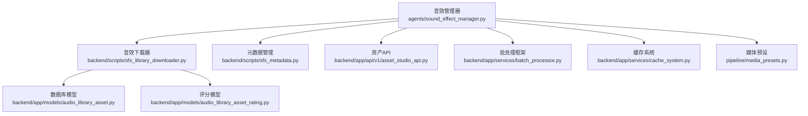
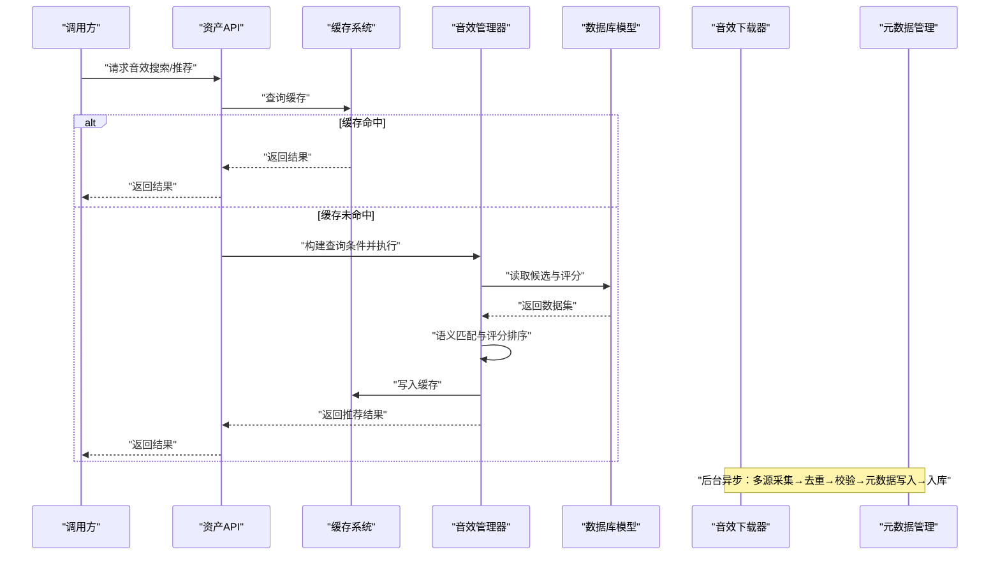
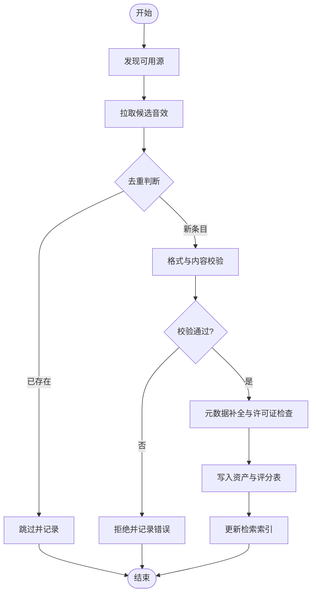
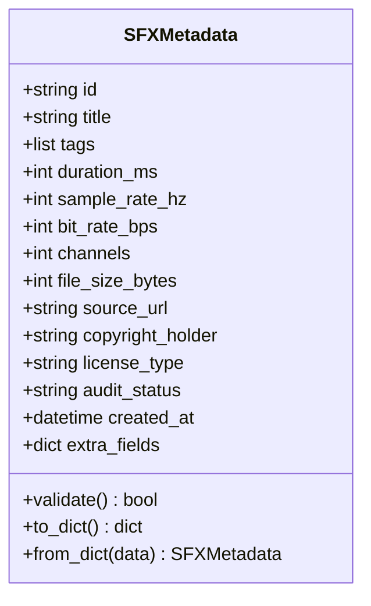
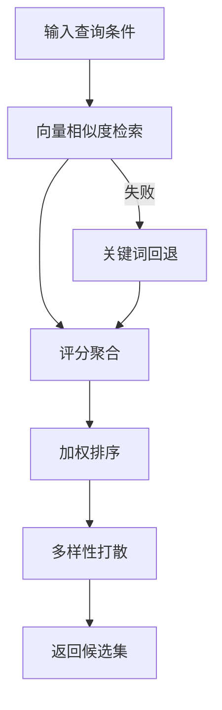
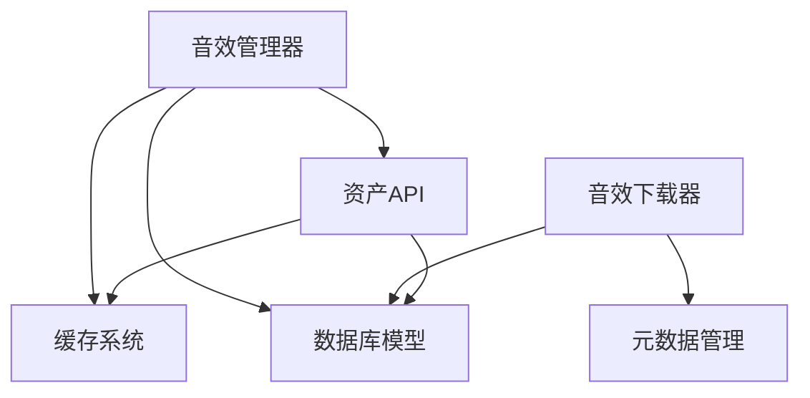

# 音效管理器

<cite>
**本文引用的文件**   
- [sound_effect_manager.py](file://agents/sound_effect_manager.py)
- [sfx_library_downloader.py](file://backend/scripts/sfx_library_downloader.py)
- [sfx_metadata.py](file://backend/scripts/sfx_metadata.py)
- [normalize_sfx_library_loudness.py](file://backend/scripts/normalize_sfx_library_loudness.py)
- [test_sfx_library_downloader.py](file://backend/tests/test_sfx_library_downloader.py)
- [test_sfx_library_downloader_paths.py](file://backend/tests/test_sfx_library_downloader_paths.py)
- [audio_library_asset.py](file://backend/app/models/audio_library_asset.py)
- [audio_library_asset_rating.py](file://backend/app/models/audio_library_asset_rating.py)
- [asset_studio_api.py](file://backend/app/api/v1/asset_studio_api.py)
- [batch_processor.py](file://backend/app/services/batch_processor.py)
- [cache_system.py](file://backend/app/services/cache_system.py)
- [media_presets.py](file://pipeline/media_presets.py)
</cite>

## 目录
1. [简介](#简介)
2. [项目结构](#项目结构)
3. [核心组件](#核心组件)
4. [架构总览](#架构总览)
5. [详细组件分析](#详细组件分析)
6. [依赖关系分析](#依赖关系分析)
7. [性能考量](#性能考量)
8. [故障排查指南](#故障排查指南)
9. [结论](#结论)
10. [附录](#附录)

## 简介
本技术文档面向“音效管理器”子系统，聚焦以下目标：
- 深入解析音效库管理、音效分类与智能推荐算法的实现思路与扩展点。
- 详细说明音效下载器（sfx_library_downloader.py）的多源采集、去重与验证机制。
- 阐述音效元数据管理（sfx_metadata.py）、版权信息处理与许可证管理策略。
- 提供搜索、选择与集成音效到项目的具体示例路径与最佳实践。
- 解释支持的音效格式、质量标准与压缩策略。
- 给出音效库扩展方法、自定义分类规则与批量处理工具的使用指南。

该子系统服务于音频内容生产管线，为章节/场景级音频生成与后期合成提供高质量、可检索、可合规的音效素材。

## 项目结构
音效管理器相关代码分布在 agents、backend 脚本与服务、以及 pipeline 配置中：
- agents/sound_effect_manager.py：音效管理与调度入口，负责按场景/章节需求进行音效检索、评分与推荐。
- backend/scripts/sfx_library_downloader.py：多源采集与入库流水线，包含抓取、去重、校验与落盘。
- backend/scripts/sfx_metadata.py：音效元数据模型与读写接口，统一描述字段、版权与许可证。
- backend/scripts/normalize_sfx_library_loudness.py：批量响度标准化脚本，确保库内一致性。
- backend/app/models/*：数据库模型（资产、评分等），支撑持久化与查询。
- backend/app/api/v1/asset_studio_api.py：资产服务 API，暴露搜索、筛选与推荐能力。
- backend/app/services/batch_processor.py：通用批处理框架，用于大规模音效处理任务。
- backend/app/services/cache_system.py：缓存系统，加速重复查询与热门资源命中。
- pipeline/media_presets.py：媒体预设（编码、采样率、比特率等），定义质量与压缩策略。

图表来源
- [sound_effect_manager.py](file://agents/sound_effect_manager.py)
- [sfx_library_downloader.py](file://backend/scripts/sfx_library_downloader.py)
- [sfx_metadata.py](file://backend/scripts/sfx_metadata.py)
- [asset_studio_api.py](file://backend/app/api/v1/asset_studio_api.py)
- [batch_processor.py](file://backend/app/services/batch_processor.py)
- [cache_system.py](file://backend/app/services/cache_system.py)
- [media_presets.py](file://pipeline/media_presets.py)
- [audio_library_asset.py](file://backend/app/models/audio_library_asset.py)
- [audio_library_asset_rating.py](file://backend/app/models/audio_library_asset_rating.py)

章节来源
- [sound_effect_manager.py](file://agents/sound_effect_manager.py)
- [sfx_library_downloader.py](file://backend/scripts/sfx_library_downloader.py)
- [sfx_metadata.py](file://backend/scripts/sfx_metadata.py)
- [asset_studio_api.py](file://backend/app/api/v1/asset_studio_api.py)
- [batch_processor.py](file://backend/app/services/batch_processor.py)
- [cache_system.py](file://backend/app/services/cache_system.py)
- [media_presets.py](file://pipeline/media_presets.py)
- [audio_library_asset.py](file://backend/app/models/audio_library_asset.py)
- [audio_library_asset_rating.py](file://backend/app/models/audio_library_asset_rating.py)

## 核心组件
- 音效管理器（Sound Effect Manager）
  - 职责：根据上下文（章节/场景/情绪/动作）进行语义匹配、候选集生成、评分排序与最终推荐。
  - 关键能力：多条件过滤、相似度计算、评分聚合、结果缓存、回退策略。
- 音效下载器（SFX Library Downloader）
  - 职责：从多个外部源（如公共库、协作仓库）采集候选音效，执行去重、格式校验、元数据补全与入库。
  - 关键流程：源发现→拉取→去重→校验→元数据写入→落盘→索引更新。
- 元数据管理（SFX Metadata）
  - 职责：统一定义音效元数据结构（标题、标签、时长、采样率、版权、许可证、来源等），并提供读写接口。
  - 关键能力：字段校验、默认值填充、许可证合规检查、版本兼容。
- 资产API（Asset Studio API）
  - 职责：对外暴露搜索、筛选、分页、排序与推荐接口；支持权限控制与审计。
- 批处理框架（Batch Processor）
  - 职责：将大型任务切分为批次，支持并发、重试、进度上报与失败隔离。
- 缓存系统（Cache System）
  - 职责：热点查询缓存、结果缓存、分布式键空间管理，降低重复计算与IO开销。
- 媒体预设（Media Presets）
  - 职责：定义输出格式、采样率、比特率、响度标准与压缩参数，保证一致性与兼容性。

章节来源
- [sound_effect_manager.py](file://agents/sound_effect_manager.py)
- [sfx_library_downloader.py](file://backend/scripts/sfx_library_downloader.py)
- [sfx_metadata.py](file://backend/scripts/sfx_metadata.py)
- [asset_studio_api.py](file://backend/app/api/v1/asset_studio_api.py)
- [batch_processor.py](file://backend/app/services/batch_processor.py)
- [cache_system.py](file://backend/app/services/cache_system.py)
- [media_presets.py](file://pipeline/media_presets.py)

## 架构总览
音效管理器整体采用“采集—治理—检索—推荐—使用”的分层架构：
- 采集层：多源下载器负责抓取与初步清洗。
- 治理层：元数据模型与校验、响度标准化、许可证合规检查。
- 检索层：API 暴露搜索与筛选能力，结合缓存提升性能。
- 推荐层：基于语义与评分的排序算法，产出候选集与最终推荐。
- 使用层：下游管线（章节/场景音频生成）按需消费。

图表来源
- [asset_studio_api.py](file://backend/app/api/v1/asset_studio_api.py)
- [cache_system.py](file://backend/app/services/cache_system.py)
- [sound_effect_manager.py](file://agents/sound_effect_manager.py)
- [audio_library_asset.py](file://backend/app/models/audio_library_asset.py)
- [sfx_library_downloader.py](file://backend/scripts/sfx_library_downloader.py)
- [sfx_metadata.py](file://backend/scripts/sfx_metadata.py)

## 详细组件分析

### 音效下载器（sfx_library_downloader.py）
- 多源采集
  - 支持多种来源（例如公共协议、协作仓库、本地目录），通过适配器模式接入新源。
  - 每个源提供统一的“发现—拉取—解析”接口，便于扩展。
- 去重机制
  - 基于指纹（哈希）与元数据关键字段（标题、时长、采样率）双重去重，避免重复入库。
  - 冲突解决策略：优先保留高置信度或更高音质版本。
- 验证机制
  - 格式校验（容器、编码、声道数、采样率）。
  - 内容校验（时长范围、静音检测、峰值限制）。
  - 元数据完整性校验（必填字段、许可证合法性）。
- 入库与索引
  - 写入资产表与评分表，更新索引以便快速检索。
  - 记录采集日志与错误明细，便于回溯。

图表来源
- [sfx_library_downloader.py](file://backend/scripts/sfx_library_downloader.py)
- [audio_library_asset.py](file://backend/app/models/audio_library_asset.py)
- [audio_library_asset_rating.py](file://backend/app/models/audio_library_asset_rating.py)

章节来源
- [sfx_library_downloader.py](file://backend/scripts/sfx_library_downloader.py)
- [test_sfx_library_downloader.py](file://backend/tests/test_sfx_library_downloader.py)
- [test_sfx_library_downloader_paths.py](file://backend/tests/test_sfx_library_downloader_paths.py)
- [audio_library_asset.py](file://backend/app/models/audio_library_asset.py)
- [audio_library_asset_rating.py](file://backend/app/models/audio_library_asset_rating.py)

### 音效元数据管理（sfx_metadata.py）
- 数据结构
  - 字段包括：标识符、标题、标签、时长、采样率、比特率、声道、文件大小、来源URL、版权持有者、许可证类型、审核状态、入库时间等。
  - 支持扩展字段（JSON 或扩展表），保持向后兼容。
- 校验与默认值
  - 必填字段校验、类型转换、默认值填充。
  - 许可证白名单与黑名单策略，非法许可证直接拒绝入库。
- 版本与迁移
  - 元数据版本字段，支持平滑升级与历史兼容。
  - 迁移脚本在导入时自动补齐缺失字段。

图表来源
- [sfx_metadata.py](file://backend/scripts/sfx_metadata.py)

章节来源
- [sfx_metadata.py](file://backend/scripts/sfx_metadata.py)

### 音效分类与智能推荐算法
- 分类体系
  - 预置分类：环境、动作、拟音、过渡、氛围等。
  - 自定义分类：支持用户定义标签树与层级，便于细粒度检索。
- 智能推荐
  - 语义匹配：基于文本描述与标签向量的相似度计算。
  - 评分聚合：综合质量分、使用热度、评分统计与业务权重。
  - 排序策略：加权打分+多样性打散，避免结果同质化。
- 回退机制
  - 当向量检索不可用时，回退到关键词匹配与规则过滤。

图表来源
- [sound_effect_manager.py](file://agents/sound_effect_manager.py)
- [asset_studio_api.py](file://backend/app/api/v1/asset_studio_api.py)

章节来源
- [sound_effect_manager.py](file://agents/sound_effect_manager.py)
- [asset_studio_api.py](file://backend/app/api/v1/asset_studio_api.py)

### 版权信息与许可证管理
- 许可证类型
  - 支持 CC0、CC BY、CC BY-SA、CC BY-NC、PD（公有领域）等常见类型。
  - 自定义许可证映射，允许企业私有协议登记。
- 合规检查
  - 入库前校验许可证是否允许商用与修改。
  - 对限制性条款（如禁止二次分发）进行标记与提示。
- 审计与追踪
  - 记录许可证变更历史与审批流程。
  - 导出合规报告，支持法务审查。

章节来源
- [sfx_metadata.py](file://backend/scripts/sfx_metadata.py)
- [audio_library_asset.py](file://backend/app/models/audio_library_asset.py)

### 音效格式支持与质量标准
- 支持格式
  - 无损：WAV、FLAC。
  - 有损：MP3、AAC（适配移动端与低带宽场景）。
- 质量标准
  - 采样率：44.1kHz/48kHz 为主流，支持 96kHz 高保真。
  - 比特率：无损无压缩；有损建议 ≥192kbps。
  - 响度：遵循 LUFS 标准，确保听感一致。
- 压缩策略
  - 按用途分层：母带级（无损）、发布级（有损）、预览级（更低码率）。
  - 自动转码：入库后生成多档副本，满足不同播放端需求。

章节来源
- [media_presets.py](file://pipeline/media_presets.py)
- [normalize_sfx_library_loudness.py](file://backend/scripts/normalize_sfx_library_loudness.py)

### 音效库扩展方法与自定义分类规则
- 扩展点
  - 新增数据源：实现统一采集接口，注册到下载器。
  - 新增分类：在分类树中添加节点，并在检索层建立索引。
  - 新增评分维度：扩展评分函数与权重配置。
- 自定义规则
  - 标签映射：将外部标签映射到内部分类。
  - 规则引擎：基于正则或表达式进行自动化打标与过滤。

章节来源
- [sfx_library_downloader.py](file://backend/scripts/sfx_library_downloader.py)
- [sfx_metadata.py](file://backend/scripts/sfx_metadata.py)
- [sound_effect_manager.py](file://agents/sound_effect_manager.py)

### 批量处理工具使用指南
- 响度标准化
  - 使用 normalize_sfx_library_loudness.py 对库内音效进行 LUFS 标准化，确保一致性。
- 批处理框架
  - 使用 batch_processor.py 将大任务拆分为批次，支持并发与重试。
  - 监控进度与失败重试，保障任务可靠性。

章节来源
- [normalize_sfx_library_loudness.py](file://backend/scripts/normalize_sfx_library_loudness.py)
- [batch_processor.py](file://backend/app/services/batch_processor.py)

## 依赖关系分析
- 模块耦合
  - 音效管理器依赖资产API、缓存系统与数据库模型。
  - 下载器依赖元数据模型与数据库模型，负责数据入湖。
- 外部依赖
  - 媒体处理库（FFmpeg）用于格式转换与质量分析。
  - 向量检索库（可选）用于语义匹配。
- 潜在循环依赖
  - 通过分层与接口抽象避免循环引用。

图表来源
- [sound_effect_manager.py](file://agents/sound_effect_manager.py)
- [asset_studio_api.py](file://backend/app/api/v1/asset_studio_api.py)
- [cache_system.py](file://backend/app/services/cache_system.py)
- [sfx_library_downloader.py](file://backend/scripts/sfx_library_downloader.py)
- [sfx_metadata.py](file://backend/scripts/sfx_metadata.py)
- [audio_library_asset.py](file://backend/app/models/audio_library_asset.py)

章节来源
- [sound_effect_manager.py](file://agents/sound_effect_manager.py)
- [asset_studio_api.py](file://backend/app/api/v1/asset_studio_api.py)
- [cache_system.py](file://backend/app/services/cache_system.py)
- [sfx_library_downloader.py](file://backend/scripts/sfx_library_downloader.py)
- [sfx_metadata.py](file://backend/scripts/sfx_metadata.py)
- [audio_library_asset.py](file://backend/app/models/audio_library_asset.py)

## 性能考量
- 缓存策略
  - 热点查询缓存（标签、热门音效）减少数据库压力。
  - 结果缓存与失效策略（TTL、事件驱动刷新）。
- 并发与批处理
  - 下载与转码任务并行执行，提升吞吐。
  - 批处理框架支持限流与背压，防止过载。
- 存储与索引
  - 分库分表与分区索引优化查询性能。
  - 向量索引与倒排索引结合，兼顾语义与精确匹配。

[本节为通用指导，不直接分析具体文件]

## 故障排查指南
- 常见问题
  - 下载失败：检查网络、源可用性、认证配置。
  - 校验失败：确认格式、采样率、时长范围是否符合预设。
  - 许可证违规：核对许可证类型与白名单，必要时人工审核。
- 调试手段
  - 查看下载器日志与错误明细。
  - 使用测试用例定位问题（如 test_sfx_library_downloader.py）。
  - 启用缓存调试与慢查询日志。

章节来源
- [test_sfx_library_downloader.py](file://backend/tests/test_sfx_library_downloader.py)
- [test_sfx_library_downloader_paths.py](file://backend/tests/test_sfx_library_downloader_paths.py)
- [sfx_library_downloader.py](file://backend/scripts/sfx_library_downloader.py)

## 结论
音效管理器通过“采集—治理—检索—推荐—使用”的分层架构，实现了高效、可扩展且合规的音效库管理能力。下载器的多源采集与严格校验保障了数据质量；元数据模型与许可证管理确保了合规性；智能推荐与缓存机制提升了检索效率与用户体验。未来可通过引入更丰富的语义特征与动态权重策略，进一步优化推荐效果与性能。

[本节为总结，不直接分析具体文件]

## 附录
- 使用示例（路径参考）
  - 搜索音效：调用资产API，传入标签、分类、时长范围等条件。
  - 选择音效：根据评分与多样性策略挑选候选，结合业务权重确定最终结果。
  - 集成到项目：将选中的音效ID与元数据注入到章节/场景音频生成管线。
- 扩展清单
  - 新增数据源适配器。
  - 新增分类节点与映射规则。
  - 新增评分维度与权重配置。

[本节为补充说明，不直接分析具体文件]