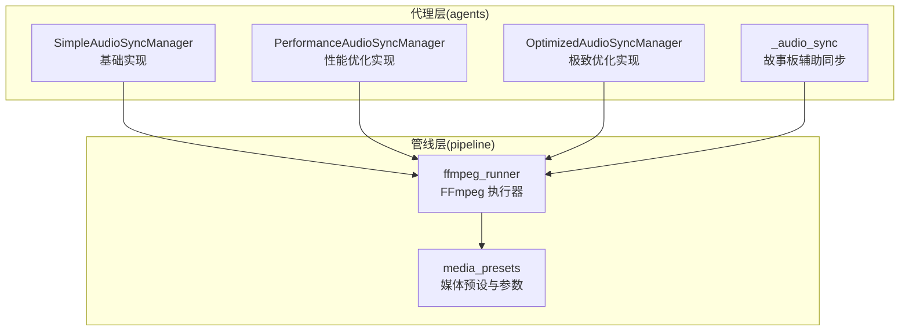
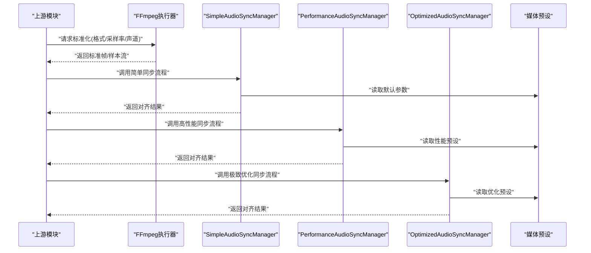
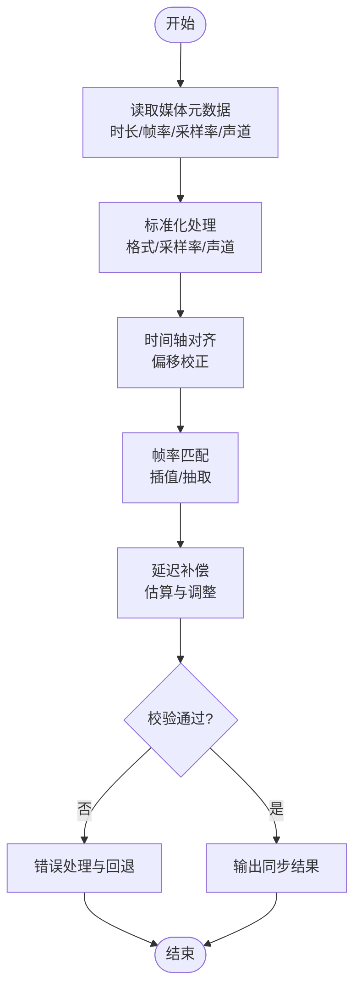
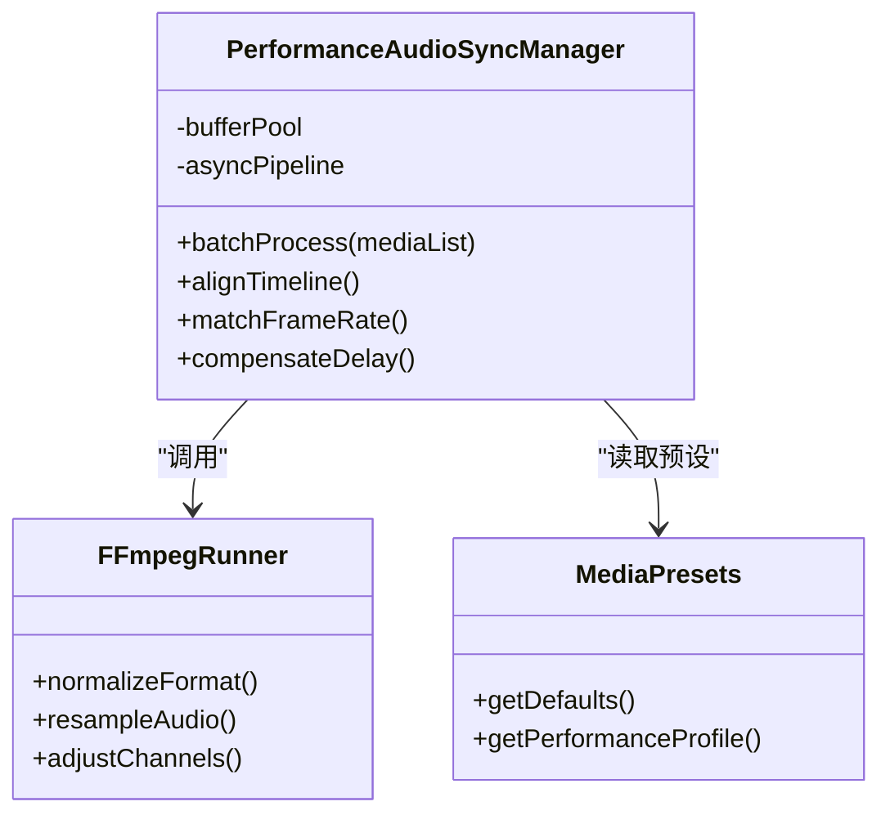
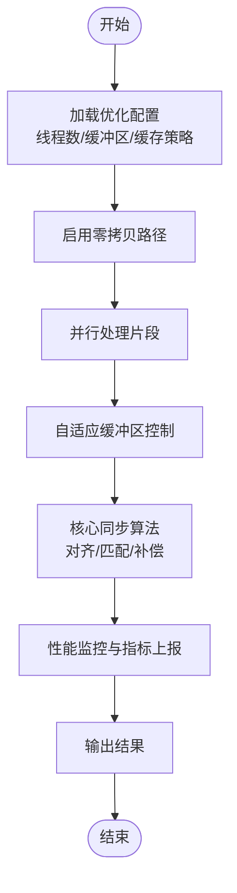
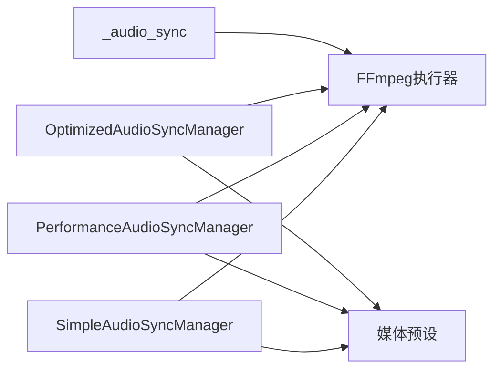

# 音频同步管理器

<cite>
**本文引用的文件**
- [simple_audio_sync_manager.py](file://agents/simple_audio_sync_manager.py)
- [performance_audio_sync_manager.py](file://agents/performance_audio_sync_manager.py)
- [optimized_audio_sync_manager.py](file://agents/optimized_audio_sync_manager.py)
- [_audio_sync.py](file://agents/storyboarder_pkg/_audio_sync.py)
- [ffmpeg_runner.py](file://pipeline/ffmpeg_runner.py)
- [media_presets.py](file://pipeline/media_presets.py)
</cite>

## 目录
1. [简介](#简介)
2. [项目结构](#项目结构)
3. [核心组件](#核心组件)
4. [架构总览](#架构总览)
5. [详细组件分析](#详细组件分析)
6. [依赖关系分析](#依赖关系分析)
7. [性能考量](#性能考量)
8. [故障排查指南](#故障排查指南)
9. [结论](#结论)
10. [附录](#附录)

## 简介
本技术文档围绕“音频同步管理器”展开，聚焦于音画同步的核心算法与工程实现，包括时间轴对齐、帧率匹配与延迟补偿机制。文档覆盖三类实现：基础版（simple）、性能优化版（performance）与进一步优化版（optimized），并解释其差异与适用场景。同时给出音频格式转换、采样率处理、声道配置等关键技术细节，并提供参数配置、错误处理与性能监控的实践建议，帮助读者在复杂媒体管线中稳定地实现高精度音画同步。

## 项目结构
音频同步相关代码主要分布在 agents 层与 pipeline 层：
- agents 层提供三种不同复杂度与性能的音频同步管理器实现，分别面向易用性、吞吐量和极致性能。
- storyboarder_pkg 中的 _audio_sync.py 提供故事板阶段的辅助同步能力。
- pipeline 层的 ffmpeg_runner.py 与 media_presets.py 负责底层媒体转码、重采样与格式统一，为上层同步算法提供一致的数据输入。

**图示来源**
- [simple_audio_sync_manager.py](file://agents/simple_audio_sync_manager.py)
- [performance_audio_sync_manager.py](file://agents/performance_audio_sync_manager.py)
- [optimized_audio_sync_manager.py](file://agents/optimized_audio_sync_manager.py)
- [_audio_sync.py](file://agents/storyboarder_pkg/_audio_sync.py)
- [ffmpeg_runner.py](file://pipeline/ffmpeg_runner.py)
- [media_presets.py](file://pipeline/media_presets.py)

**章节来源**
- [simple_audio_sync_manager.py](file://agents/simple_audio_sync_manager.py)
- [performance_audio_sync_manager.py](file://agents/performance_audio_sync_manager.py)
- [optimized_audio_sync_manager.py](file://agents/optimized_audio_sync_manager.py)
- [_audio_sync.py](file://agents/storyboarder_pkg/_audio_sync.py)
- [ffmpeg_runner.py](file://pipeline/ffmpeg_runner.py)
- [media_presets.py](file://pipeline/media_presets.py)

## 核心组件
- SimpleAudioSyncManager：以清晰易用的接口实现时间轴对齐、帧率匹配与延迟补偿，适合快速集成与调试。
- PerformanceAudioSyncManager：引入批处理、缓冲池与更高效的计算路径，提升吞吐与降低延迟。
- OptimizedAudioSyncManager：进一步采用零拷贝策略、内存复用与并行化，适用于高并发与低延迟场景。
- _audio_sync：面向故事板阶段，提供轻量级同步工具与校验逻辑。
- ffmpeg_runner：封装 FFmpeg 调用，完成格式转换、重采样、声道数调整与时间戳修正。
- media_presets：集中管理音视频编码参数、采样率、帧率与质量预设。

**章节来源**
- [simple_audio_sync_manager.py](file://agents/simple_audio_sync_manager.py)
- [performance_audio_sync_manager.py](file://agents/performance_audio_sync_manager.py)
- [optimized_audio_sync_manager.py](file://agents/optimized_audio_sync_manager.py)
- [_audio_sync.py](file://agents/storyboarder_pkg/_audio_sync.py)
- [ffmpeg_runner.py](file://pipeline/ffmpeg_runner.py)
- [media_presets.py](file://pipeline/media_presets.py)

## 架构总览
下图展示了从输入到输出的完整数据流与控制流：上游媒体通过 ffmpeg_runner 进行标准化处理，随后由不同版本的 AudioSyncManager 执行时间轴对齐、帧率匹配与延迟补偿，最终输出同步后的媒体或元数据。

**图示来源**
- [ffmpeg_runner.py](file://pipeline/ffmpeg_runner.py)
- [media_presets.py](file://pipeline/media_presets.py)
- [simple_audio_sync_manager.py](file://agents/simple_audio_sync_manager.py)
- [performance_audio_sync_manager.py](file://agents/performance_audio_sync_manager.py)
- [optimized_audio_sync_manager.py](file://agents/optimized_audio_sync_manager.py)

## 详细组件分析

### 基础实现：SimpleAudioSyncManager
- 设计目标：简洁、可维护、易于理解，便于快速验证同步算法。
- 关键能力：
  - 时间轴对齐：基于参考时间戳将音频与视频帧对齐，支持偏移量校正。
  - 帧率匹配：对视频帧序列进行插值或抽取，使帧率与音频采样率保持一致的时间步长。
  - 延迟补偿：根据系统延迟与解码延迟估算，动态调整播放起始点与缓冲区大小。
- 数据结构：
  - 使用列表或队列存储帧与音频样本，按时间戳排序。
  - 保存每段媒体的时长、帧率、采样率与声道数等元数据。
- 错误处理：
  - 对缺失时间戳、异常时长、不兼容的采样率进行校验与回退。
- 适用场景：
  - 开发调试、小规模批量处理、对延迟要求不高的场景。

**图示来源**
- [simple_audio_sync_manager.py](file://agents/simple_audio_sync_manager.py)

**章节来源**
- [simple_audio_sync_manager.py](file://agents/simple_audio_sync_manager.py)

### 性能优化版本：PerformanceAudioSyncManager
- 设计目标：在高吞吐与低延迟之间取得平衡，减少 CPU 与内存开销。
- 关键改进：
  - 批处理：将多段媒体合并处理，减少函数调用与锁竞争。
  - 缓冲池：复用数组与对象，避免频繁分配与释放。
  - 高效计算：使用向量化或更优的插值算法，降低帧率匹配的开销。
  - 异步流水线：将解码、对齐、编码解耦，提高整体吞吐。
- 适用场景：
  - 实时或近实时的音画同步、大规模批量任务、服务器端处理。

**图示来源**
- [performance_audio_sync_manager.py](file://agents/performance_audio_sync_manager.py)
- [ffmpeg_runner.py](file://pipeline/ffmpeg_runner.py)
- [media_presets.py](file://pipeline/media_presets.py)

**章节来源**
- [performance_audio_sync_manager.py](file://agents/performance_audio_sync_manager.py)

### 优化版本：OptimizedAudioSyncManager
- 设计目标：极致性能与极低延迟，适用于高并发与资源受限环境。
- 关键改进：
  - 零拷贝策略：在可能的情况下避免数据复制，直接操作内存视图。
  - 内存复用：全局缓存常用对象与中间结果，减少 GC 压力。
  - 并行化：利用多线程或多进程并行处理独立片段。
  - 自适应控制：根据负载动态调整缓冲区大小与线程数。
- 适用场景：
  - 高并发服务、边缘设备、对时延极其敏感的应用。

**图示来源**
- [optimized_audio_sync_manager.py](file://agents/optimized_audio_sync_manager.py)

**章节来源**
- [optimized_audio_sync_manager.py](file://agents/optimized_audio_sync_manager.py)

### 故事板辅助同步：_audio_sync
- 功能定位：在故事板生成阶段提供轻量级的音频同步工具，如时长估算、边界对齐与基本校验。
- 典型用法：
  - 根据脚本段落估算音频时长。
  - 将多个片段拼接后做边界平滑与时间戳修正。
- 适用场景：
  - 内容规划、预览生成、离线预处理。

**章节来源**
- [_audio_sync.py](file://agents/storyboarder_pkg/_audio_sync.py)

### 媒体标准化：ffmpeg_runner 与 media_presets
- ffmpeg_runner：
  - 封装 FFmpeg 命令，完成格式转换、重采样、声道数调整、时间戳修正。
  - 提供统一的输入输出接口，屏蔽底层差异。
- media_presets：
  - 集中管理编码参数、采样率、帧率、质量预设。
  - 提供默认值与性能/质量模式切换。

**章节来源**
- [ffmpeg_runner.py](file://pipeline/ffmpeg_runner.py)
- [media_presets.py](file://pipeline/media_presets.py)

## 依赖关系分析
- SimpleAudioSyncManager 依赖 ffmpeg_runner 进行媒体标准化，依赖 media_presets 获取默认参数。
- PerformanceAudioSyncManager 在基础之上引入缓冲池与异步流水线，仍依赖 ffmpeg_runner 与 media_presets。
- OptimizedAudioSyncManager 进一步依赖内存管理与并行化工具，强调零拷贝与自适应控制。
- _audio_sync 作为故事板阶段的辅助模块，通常与上述管理器解耦，仅在特定流程中被调用。

**图示来源**
- [simple_audio_sync_manager.py](file://agents/simple_audio_sync_manager.py)
- [performance_audio_sync_manager.py](file://agents/performance_audio_sync_manager.py)
- [optimized_audio_sync_manager.py](file://agents/optimized_audio_sync_manager.py)
- [_audio_sync.py](file://agents/storyboarder_pkg/_audio_sync.py)
- [ffmpeg_runner.py](file://pipeline/ffmpeg_runner.py)
- [media_presets.py](file://pipeline/media_presets.py)

**章节来源**
- [simple_audio_sync_manager.py](file://agents/simple_audio_sync_manager.py)
- [performance_audio_sync_manager.py](file://agents/performance_audio_sync_manager.py)
- [optimized_audio_sync_manager.py](file://agents/optimized_audio_sync_manager.py)
- [_audio_sync.py](file://agents/storyboarder_pkg/_audio_sync.py)
- [ffmpeg_runner.py](file://pipeline/ffmpeg_runner.py)
- [media_presets.py](file://pipeline/media_presets.py)

## 性能考量
- 时间轴对齐精度：
  - 使用亚毫秒级时间戳与浮点运算，确保对齐误差控制在可接受范围。
  - 对于极端抖动，可采用滑动窗口平均与卡尔曼滤波进行平滑。
- 帧率匹配策略：
  - 插值优先于抽取，以保持视觉流畅；在资源紧张时可切换为抽取模式。
  - 使用线性或样条插值，权衡质量与性能。
- 延迟补偿机制：
  - 基于历史统计估计解码与渲染延迟，动态调整起始偏移与缓冲区大小。
  - 引入反馈回路，持续修正偏差。
- 缓冲区管理：
  - 固定大小环形缓冲与可变大小缓冲结合，避免溢出与下溢。
  - 预分配与复用减少内存碎片。
- 内存优化：
  - 零拷贝路径与内存视图，避免不必要的复制。
  - 对象池与缓存，降低 GC 压力。
- 监控与调优：
  - 记录关键指标：对齐误差、帧率偏差、延迟分布、CPU/内存占用。
  - 提供阈值告警与自动降级策略。

[本节为通用指导，不直接分析具体文件]

## 故障排查指南
- 常见错误：
  - 时间戳缺失或不连续：检查输入媒体是否包含正确时间戳，必要时进行补全或插值。
  - 采样率不匹配：确认 ffmpeg_runner 的重采样参数与媒体预设一致。
  - 声道数不一致：统一为单声道或立体声，避免混音问题。
  - 延迟过大：增大缓冲区、启用自适应控制、检查解码与渲染链路瓶颈。
- 诊断步骤：
  - 打印各阶段耗时与指标，定位慢点。
  - 回放原始与处理后媒体，对比时间轴与音画一致性。
  - 使用最小复现用例隔离问题。
- 恢复策略：
  - 回退到上一稳定版本或默认参数。
  - 启用降级模式（如关闭插值、减少并行度）。

**章节来源**
- [ffmpeg_runner.py](file://pipeline/ffmpeg_runner.py)
- [media_presets.py](file://pipeline/media_presets.py)

## 结论
音频同步管理器通过时间轴对齐、帧率匹配与延迟补偿三大核心算法，实现了稳定可靠的音画同步。基础版适合快速集成与调试，性能版在吞吐与延迟间取得平衡，优化版则面向极致性能与低延迟场景。配合 ffmpeg_runner 与 media_presets 的媒体标准化能力，可在复杂管线中灵活选择合适实现，并通过监控与调优保障质量与稳定性。

[本节为总结，不直接分析具体文件]

## 附录
- 参数配置建议：
  - 采样率：统一为 48kHz 或 44.1kHz，依据下游需求选择。
  - 帧率：与显示设备或平台规范一致，常见 24/30/60fps。
  - 声道：根据播放设备与带宽限制选择单声道或立体声。
- 错误处理最佳实践：
  - 输入校验前置，失败快速返回。
  - 异常捕获与日志记录，便于追踪。
  - 提供回退与重试机制。
- 性能监控要点：
  - 关键路径耗时、内存峰值、GC 次数。
  - 对齐误差分布、延迟分位数。
  - 资源利用率与饱和度。

[本节为补充信息，不直接分析具体文件]