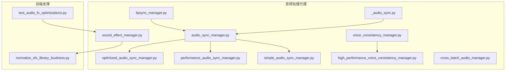
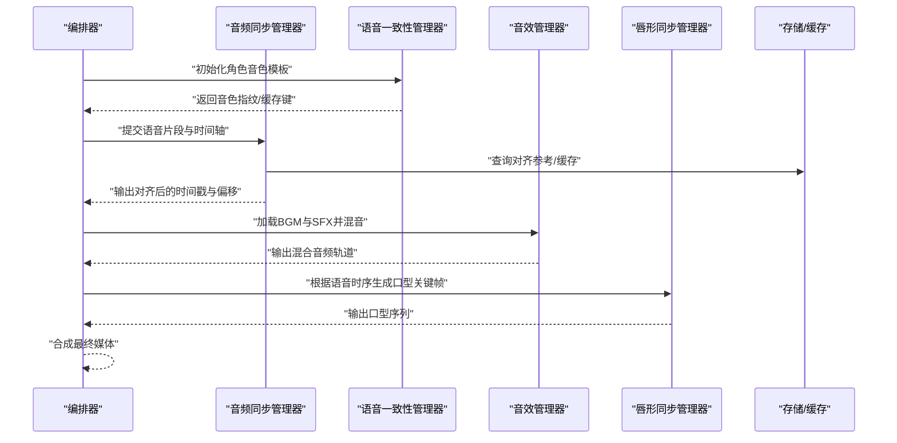
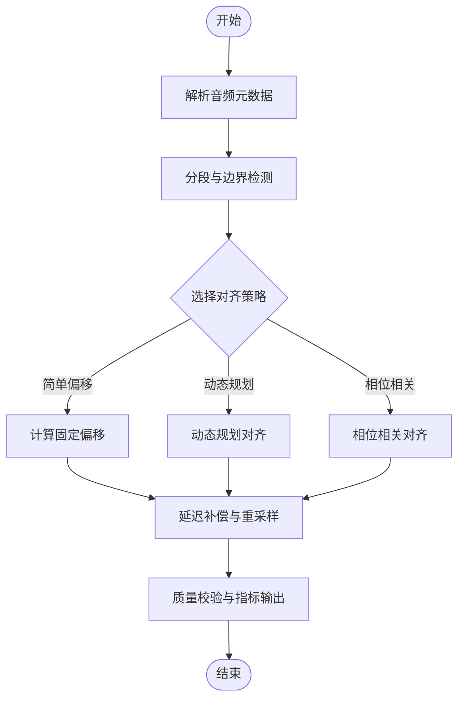
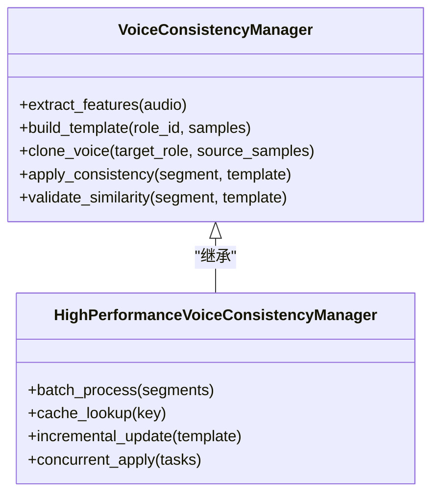
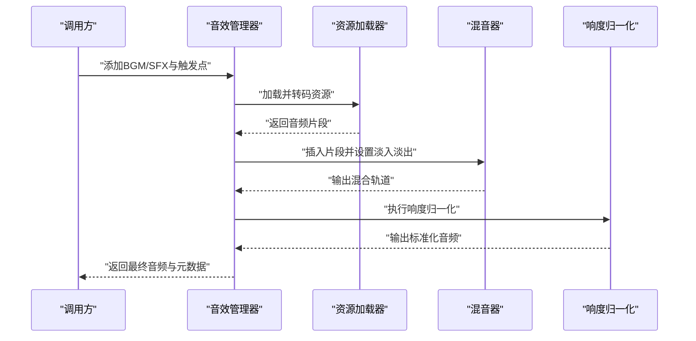
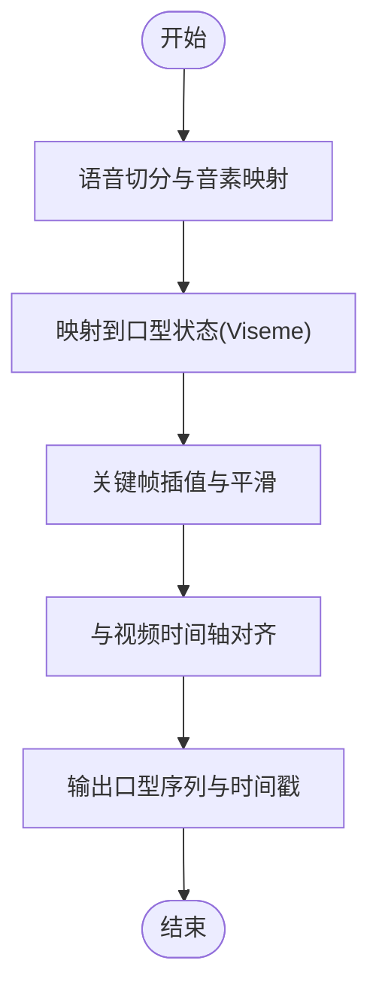
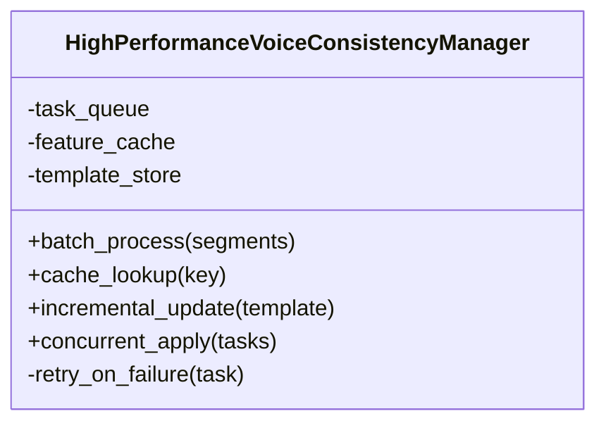
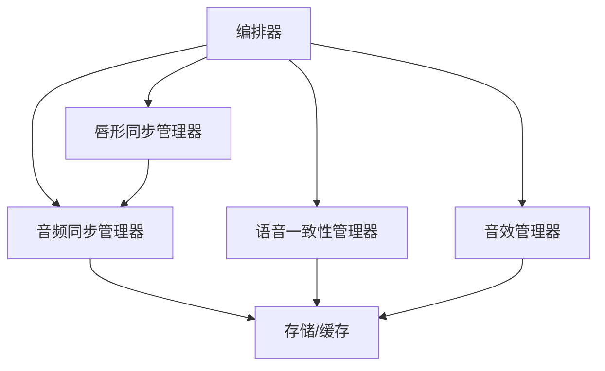

# 音频处理代理

<cite>
**本文引用的文件**   
- [audio_sync_manager.py](file://agents/audio_sync_manager.py)
- [voice_consistency_manager.py](file://agents/voice_consistency_manager.py)
- [sound_effect_manager.py](file://agents/sound_effect_manager.py)
- [lipsync_manager.py](file://agents/lipsync_manager.py)
- [high_performance_voice_consistency_manager.py](file://agents/high_performance_voice_consistency_manager.py)
- [optimized_audio_sync_manager.py](file://agents/optimized_audio_sync_manager.py)
- [performance_audio_sync_manager.py](file://agents/performance_audio_sync_manager.py)
- [simple_audio_sync_manager.py](file://agents/simple_audio_sync_manager.py)
- [cross_batch_audio_manager.py](file://agents/cross_batch_audio_manager.py)
- [_audio_sync.py](file://agents/storyboarder_pkg/_audio_sync.py)
- [test_audio_fx_optimizations.py](file://backend/tests/test_audio_fx_optimizations.py)
- [scripts/normalize_sfx_library_loudness.py](file://backend/scripts/normalize_sfx_library_loudness.py)
</cite>

## 目录
1. [简介](#简介)
2. [项目结构](#项目结构)
3. [核心组件](#核心组件)
4. [架构总览](#架构总览)
5. [详细组件分析](#详细组件分析)
6. [依赖关系分析](#依赖关系分析)
7. [性能考量](#性能考量)
8. [故障排查指南](#故障排查指南)
9. [结论](#结论)
10. [附录：使用示例与参数配置](#附录使用示例与参数配置)

## 简介
本技术文档面向音频处理代理模块，围绕以下关键能力展开：音画同步（时间轴对齐）、语音一致性（角色声音保持与音色克隆）、音效管理（背景音乐与特效音）、唇形同步（口型匹配与语音驱动动画），以及高性能并发优化。文档旨在帮助开发者快速理解系统架构、掌握核心算法与数据流，并提供可操作的使用示例、参数配置与质量管控方法，同时给出性能调优与常见问题解决方案。

## 项目结构
音频处理相关代码主要位于 agents 目录，包含多种同步与一致性管理器实现，以及音效与唇形同步模块；后端测试与脚本提供了音效库归一化与质量验证用例。整体组织遵循“按功能域划分”的模块化设计，便于扩展与维护。

图表来源
- [audio_sync_manager.py](file://agents/audio_sync_manager.py)
- [optimized_audio_sync_manager.py](file://agents/optimized_audio_sync_manager.py)
- [performance_audio_sync_manager.py](file://agents/performance_audio_sync_manager.py)
- [simple_audio_sync_manager.py](file://agents/simple_audio_sync_manager.py)
- [voice_consistency_manager.py](file://agents/voice_consistency_manager.py)
- [high_performance_voice_consistency_manager.py](file://agents/high_performance_voice_consistency_manager.py)
- [sound_effect_manager.py](file://agents/sound_effect_manager.py)
- [lipsync_manager.py](file://agents/lipsync_manager.py)
- [cross_batch_audio_manager.py](file://agents/cross_batch_audio_manager.py)
- [_audio_sync.py](file://agents/storyboarder_pkg/_audio_sync.py)
- [test_audio_fx_optimizations.py](file://backend/tests/test_audio_fx_optimizations.py)
- [scripts/normalize_sfx_library_loudness.py](file://backend/scripts/normalize_sfx_library_loudness.py)

章节来源
- [audio_sync_manager.py](file://agents/audio_sync_manager.py)
- [voice_consistency_manager.py](file://agents/voice_consistency_manager.py)
- [sound_effect_manager.py](file://agents/sound_effect_manager.py)
- [lipsync_manager.py](file://agents/lipsync_manager.py)
- [high_performance_voice_consistency_manager.py](file://agents/high_performance_voice_consistency_manager.py)
- [optimized_audio_sync_manager.py](file://agents/optimized_audio_sync_manager.py)
- [performance_audio_sync_manager.py](file://agents/performance_audio_sync_manager.py)
- [simple_audio_sync_manager.py](file://agents/simple_audio_sync_manager.py)
- [cross_batch_audio_manager.py](file://agents/cross_batch_audio_manager.py)
- [_audio_sync.py](file://agents/storyboarder_pkg/_audio_sync.py)
- [test_audio_fx_optimizations.py](file://backend/tests/test_audio_fx_optimizations.py)
- [scripts/normalize_sfx_library_loudness.py](file://backend/scripts/normalize_sfx_library_loudness.py)

## 核心组件
- 音频同步管理器（audio_sync_manager.py）：负责将语音片段与视频时间轴对齐，提供多策略的帧级或样本级对齐、延迟补偿与重采样控制。
- 语音一致性管理器（voice_consistency_manager.py）：维护角色声音特征与音色模板，支持跨段落的音色保持与克隆，确保同一角色的语音风格一致。
- 音效管理器（sound_effect_manager.py）：统一管理背景音乐与特效音的加载、混音、淡入淡出、响度标准化与事件触发。
- 唇形同步管理器（lipsync_manager.py）：基于语音时序生成口型驱动的关键帧或形状参数，实现口型与语音的精确匹配。
- 高性能语音一致性管理器（high_performance_voice_consistency_manager.py）：在一致性基础上引入并发缓存、批处理与增量更新，提升吞吐并降低延迟。
- 其他变体：optimized_audio_sync_manager.py、performance_audio_sync_manager.py、simple_audio_sync_manager.py 提供不同复杂度与性能的同步策略；cross_batch_audio_manager.py 用于跨批次音频资源管理与复用。

章节来源
- [audio_sync_manager.py](file://agents/audio_sync_manager.py)
- [voice_consistency_manager.py](file://agents/voice_consistency_manager.py)
- [sound_effect_manager.py](file://agents/sound_effect_manager.py)
- [lipsync_manager.py](file://agents/lipsync_manager.py)
- [high_performance_voice_consistency_manager.py](file://agents/high_performance_voice_consistency_manager.py)
- [optimized_audio_sync_manager.py](file://agents/optimized_audio_sync_manager.py)
- [performance_audio_sync_manager.py](file://agents/performance_audio_sync_manager.py)
- [simple_audio_sync_manager.py](file://agents/simple_audio_sync_manager.py)
- [cross_batch_audio_manager.py](file://agents/cross_batch_audio_manager.py)

## 架构总览
音频处理子系统以“同步—一致性—音效—唇形”为主线，辅以高性能优化与跨批次管理。上层编排器通过统一接口调用各管理器，完成从文本到音视频合成的全流程。

图表来源
- [audio_sync_manager.py](file://agents/audio_sync_manager.py)
- [voice_consistency_manager.py](file://agents/voice_consistency_manager.py)
- [sound_effect_manager.py](file://agents/sound_effect_manager.py)
- [lipsync_manager.py](file://agents/lipsync_manager.py)

## 详细组件分析

### 音频同步管理器（audio_sync_manager.py）
- 职责：将语音片段与视频时间轴进行对齐，计算延迟、补偿与重采样，保证音画同步精度。
- 关键流程：
  - 输入校验与元数据解析（采样率、声道、时长）。
  - 时间轴分段与边界检测（静音段、能量阈值）。
  - 对齐策略选择（简单偏移、动态规划、相位相关）。
  - 延迟补偿与重采样（避免削波与失真）。
  - 输出对齐结果与质量指标（误差、抖动）。
- 性能要点：缓存对齐参考、批量处理、内存映射大文件。

图表来源
- [audio_sync_manager.py](file://agents/audio_sync_manager.py)
- [_audio_sync.py](file://agents/storyboarder_pkg/_audio_sync.py)

章节来源
- [audio_sync_manager.py](file://agents/audio_sync_manager.py)
- [_audio_sync.py](file://agents/storyboarder_pkg/_audio_sync.py)

### 语音一致性管理器（voice_consistency_manager.py）
- 职责：维护角色音色特征，支持跨段落的声音保持一致与音色克隆。
- 关键流程：
  - 音色特征提取（频谱包络、基频轨迹、共振峰等）。
  - 模板构建与索引（按角色/场景分组）。
  - 克隆与适配（迁移学习或参数映射）。
  - 一致性校验（相似度阈值、漂移检测）。
- 质量要点：避免过度平滑导致失真，保留情感与语速变化。

图表来源
- [voice_consistency_manager.py](file://agents/voice_consistency_manager.py)
- [high_performance_voice_consistency_manager.py](file://agents/high_performance_voice_consistency_manager.py)

章节来源
- [voice_consistency_manager.py](file://agents/voice_consistency_manager.py)
- [high_performance_voice_consistency_manager.py](file://agents/high_performance_voice_consistency_manager.py)

### 音效管理器（sound_effect_manager.py）
- 职责：统一管理背景音乐（BGM）与特效音（SFX），提供混音、淡入淡出、响度标准化与事件触发。
- 关键流程：
  - 资源加载与格式转换（采样率、位深、声道数）。
  - 事件绑定与时间线插入（按时间点或相对偏移）。
  - 混音与动态范围控制（压缩、限幅、均衡）。
  - 响度归一化（LUFS/LKFS标准）。
- 工具与脚本：normalize_sfx_library_loudness.py 用于批量归一化音效库。

图表来源
- [sound_effect_manager.py](file://agents/sound_effect_manager.py)
- [scripts/normalize_sfx_library_loudness.py](file://backend/scripts/normalize_sfx_library_loudness.py)

章节来源
- [sound_effect_manager.py](file://agents/sound_effect_manager.py)
- [scripts/normalize_sfx_library_loudness.py](file://backend/scripts/normalize_sfx_library_loudness.py)

### 唇形同步管理器（lipsync_manager.py）
- 职责：根据语音时序生成口型关键帧或形状参数，实现口型与语音的精确匹配。
- 关键流程：
  - 语音切分与音素识别（或近似映射）。
  - 口型状态机（如 IPA 到 viseme 的映射）。
  - 关键帧插值与平滑（避免跳变）。
  - 与视频时间轴对齐（帧级同步）。
- 输出：口型序列、权重曲线、时间戳。

图表来源
- [lipsync_manager.py](file://agents/lipsync_manager.py)

章节来源
- [lipsync_manager.py](file://agents/lipsync_manager.py)

### 高性能语音一致性管理器（high_performance_voice_consistency_manager.py）
- 优化策略：
  - 并发处理：多线程/协程并行应用一致性规则。
  - 批处理：批量拉取与处理片段，减少 I/O 开销。
  - 缓存机制：按角色/片段哈希缓存特征与模板。
  - 增量更新：模板随新样本逐步修正，避免全量重建。
- 并发模型：任务队列、锁粒度控制、错误隔离与重试。

图表来源
- [high_performance_voice_consistency_manager.py](file://agents/high_performance_voice_consistency_manager.py)

章节来源
- [high_performance_voice_consistency_manager.py](file://agents/high_performance_voice_consistency_manager.py)

### 其他同步变体与跨批次管理
- optimized_audio_sync_manager.py：在基础同步上增加自适应阈值与在线校准。
- performance_audio_sync_manager.py：侧重吞吐优化，适合大批量离线处理。
- simple_audio_sync_manager.py：轻量实现，适用于快速原型与低延迟场景。
- cross_batch_audio_manager.py：跨批次音频资源复用、去重与生命周期管理。

章节来源
- [optimized_audio_sync_manager.py](file://agents/optimized_audio_sync_manager.py)
- [performance_audio_sync_manager.py](file://agents/performance_audio_sync_manager.py)
- [simple_audio_sync_manager.py](file://agents/simple_audio_sync_manager.py)
- [cross_batch_audio_manager.py](file://agents/cross_batch_audio_manager.py)

## 依赖关系分析
- 组件内聚性：各管理器职责清晰，耦合度低，便于独立演进。
- 外部依赖：音频编解码库、信号处理库、缓存/存储后端。
- 潜在循环依赖：通过接口抽象与事件总线解耦，避免直接循环引用。
- 集成点：编排器作为统一入口，协调各管理器协作。

图表来源
- [audio_sync_manager.py](file://agents/audio_sync_manager.py)
- [voice_consistency_manager.py](file://agents/voice_consistency_manager.py)
- [sound_effect_manager.py](file://agents/sound_effect_manager.py)
- [lipsync_manager.py](file://agents/lipsync_manager.py)

章节来源
- [audio_sync_manager.py](file://agents/audio_sync_manager.py)
- [voice_consistency_manager.py](file://agents/voice_consistency_manager.py)
- [sound_effect_manager.py](file://agents/sound_effect_manager.py)
- [lipsync_manager.py](file://agents/lipsync_manager.py)

## 性能考量
- 音频同步：
  - 使用内存映射与分块读取降低大文件 I/O 压力。
  - 缓存对齐参考与中间结果，避免重复计算。
  - 选择合适的对齐策略（简单偏移 vs 动态规划）平衡精度与速度。
- 语音一致性：
  - 特征提取与模板构建异步化，批处理提升吞吐。
  - 缓存按角色/片段哈希命中，减少重复处理。
  - 增量更新模板，避免全量重建带来的抖动。
- 音效管理：
  - 预加载常用 BGM/SFX，减少冷启动延迟。
  - 混音与归一化流水线化，利用 SIMD/GPU 加速。
  - 响度归一化采用 LUFS/LKFS 标准，确保听感一致。
- 唇形同步：
  - 音素到 viseme 映射表预编译，减少运行时查找。
  - 关键帧插值使用高效插值算法，避免跳变。
- 监控与度量：
  - 记录对齐误差、一致性相似度、混音峰值、口型抖动等指标。
  - 结合测试用例（如 test_audio_fx_optimizations.py）进行回归验证。

章节来源
- [test_audio_fx_optimizations.py](file://backend/tests/test_audio_fx_optimizations.py)

## 故障排查指南
- 音画不同步：
  - 检查采样率与声道配置是否一致。
  - 查看对齐策略与阈值设置，必要时切换为更稳健的策略。
  - 验证延迟补偿是否生效，关注重采样导致的相位偏移。
- 语音不一致：
  - 检查模板构建样本质量与数量。
  - 确认一致性相似度阈值是否过严或过松。
  - 观察漂移检测日志，必要时触发模板增量更新。
- 音效异常：
  - 确认资源路径与格式兼容性。
  - 检查混音通道分配与音量比例。
  - 使用响度归一化工具验证 LUFS/LKFS 达标。
- 唇形不同步：
  - 核对音素映射表与 viseme 定义。
  - 检查关键帧插值参数与时间轴对齐精度。
  - 可视化口型曲线，定位跳变或滞后点。

章节来源
- [sound_effect_manager.py](file://agents/sound_effect_manager.py)
- [scripts/normalize_sfx_library_loudness.py](file://backend/scripts/normalize_sfx_library_loudness.py)
- [test_audio_fx_optimizations.py](file://backend/tests/test_audio_fx_optimizations.py)

## 结论
音频处理代理模块通过清晰的组件划分与高效的算法实现，覆盖了音画同步、语音一致性、音效管理与唇形同步等核心能力。在高并发与大规模处理场景下，通过缓存、批处理与增量更新等优化策略，显著提升了吞吐与稳定性。建议在生产环境中结合监控指标与测试用例持续优化，确保音质与用户体验。

## 附录：使用示例与参数配置
- 音频同步示例：
  - 输入：语音片段、视频时间轴、对齐策略。
  - 输出：对齐后的时间戳、偏移量、质量指标。
  - 参数：采样率、阈值、策略选择、重采样模式。
- 语音一致性示例：
  - 输入：角色 ID、样本片段、模板更新策略。
  - 输出：音色指纹、一致性评分、克隆结果。
  - 参数：相似度阈值、缓存键、增量更新频率。
- 音效管理示例：
  - 输入：BGM/SFX 列表、触发时间点、混音参数。
  - 输出：混合音频、响度报告、事件日志。
  - 参数：淡入淡出时长、压缩比、目标 LUFS。
- 唇形同步示例：
  - 输入：语音时序、音素映射表、插值参数。
  - 输出：口型关键帧序列、时间戳、抖动指标。
  - 参数：viseme 映射、插值平滑系数、帧率。

章节来源
- [audio_sync_manager.py](file://agents/audio_sync_manager.py)
- [voice_consistency_manager.py](file://agents/voice_consistency_manager.py)
- [sound_effect_manager.py](file://agents/sound_effect_manager.py)
- [lipsync_manager.py](file://agents/lipsync_manager.py)
- [high_performance_voice_consistency_manager.py](file://agents/high_performance_voice_consistency_manager.py)