# UI主题系统

<cite>
**本文引用的文件**   
- [tailwind.config.js](file://frontend/tailwind.config.js)
- [postcss.config.js](file://frontend/postcss.config.js)
- [index.css](file://frontend/src/index.css)
- [App.tsx](file://frontend/src/App.tsx)
- [main.tsx](file://frontend/src/main.tsx)
- [vite.config.ts](file://frontend/vite.config.ts)
- [package.json](file://frontend/package.json)
</cite>

## 目录
1. [简介](#简介)
2. [项目结构](#项目结构)
3. [核心组件](#核心组件)
4. [架构总览](#架构总览)
5. [详细组件分析](#详细组件分析)
6. [依赖关系分析](#依赖关系分析)
7. [性能考量](#性能考量)
8. [故障排查指南](#故障排查指南)
9. [结论](#结论)
10. [附录](#附录)

## 简介
本文件为小说创作代理系统的UI主题系统提供全面文档，覆盖Tailwind CSS配置、颜色系统与字体规范、响应式设计与断点策略、移动端适配方案、主题切换机制、动态样式注入与CSS变量管理、图标系统与SVG资源管理、样式隔离与冲突解决、主题定制与品牌色配置、深色模式实现，以及样式性能优化与打包优化等最佳实践。内容基于前端工程中的样式与构建配置进行系统化梳理，帮助开发者快速理解并高效扩展主题能力。

## 项目结构
前端采用Vite + React + TypeScript技术栈，样式体系以Tailwind CSS为核心，PostCSS作为构建期处理工具，全局样式入口位于src/index.css，应用根组件在src/App.tsx中初始化主题相关逻辑，构建与插件配置集中在vite.config.ts与postcss.config.js，依赖与脚本定义在package.json中。

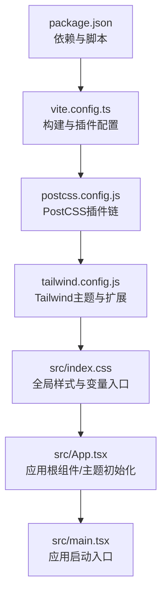

**图表来源** 
- [package.json](file://frontend/package.json)
- [vite.config.ts](file://frontend/vite.config.ts)
- [postcss.config.js](file://frontend/postcss.config.js)
- [tailwind.config.js](file://frontend/tailwind.config.js)
- [index.css](file://frontend/src/index.css)
- [App.tsx](file://frontend/src/App.tsx)
- [main.tsx](file://frontend/src/main.tsx)

**章节来源**
- [package.json](file://frontend/package.json)
- [vite.config.ts](file://frontend/vite.config.ts)
- [postcss.config.js](file://frontend/postcss.config.js)
- [tailwind.config.js](file://frontend/tailwind.config.js)
- [index.css](file://frontend/src/index.css)
- [App.tsx](file://frontend/src/App.tsx)
- [main.tsx](file://frontend/src/main.tsx)

## 核心组件
- Tailwind配置：集中定义颜色、字体、断点、动画、插件等主题扩展点，便于统一管理与按需生成样式。
- PostCSS链：串联Tailwind、CSS变量处理、兼容性转换等，确保样式在构建期被正确解析与优化。
- 全局样式入口：定义CSS变量、基础排版、暗色模式开关、通用组件样式基线。
- 应用根组件：负责主题状态管理、动态样式注入（如媒体查询或运行时变量更新）、深色模式切换。
- 构建配置：Vite集成Tailwind与PostCSS，控制产物体积与开发体验。

**章节来源**
- [tailwind.config.js](file://frontend/tailwind.config.js)
- [postcss.config.js](file://frontend/postcss.config.js)
- [index.css](file://frontend/src/index.css)
- [App.tsx](file://frontend/src/App.tsx)
- [vite.config.ts](file://frontend/vite.config.ts)

## 架构总览
主题系统由“配置层—构建层—运行层”三层组成：
- 配置层：tailwind.config.js定义设计令牌（颜色、字体、间距、断点），postcss.config.js组织插件链。
- 构建层：Vite通过PostCSS与Tailwind生成最终CSS，按需裁剪未使用样式，提升加载性能。
- 运行层：index.css暴露CSS变量与基础样式，App.tsx维护主题状态并在运行时切换深色模式或动态注入样式。

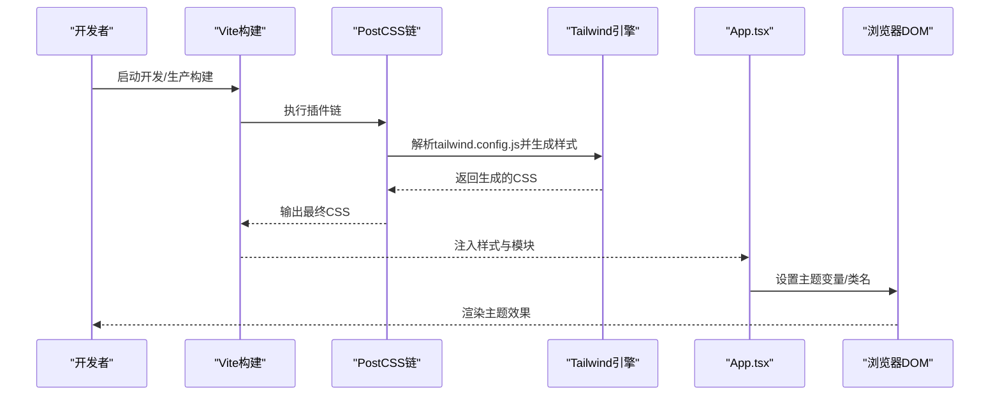

**图表来源** 
- [vite.config.ts](file://frontend/vite.config.ts)
- [postcss.config.js](file://frontend/postcss.config.js)
- [tailwind.config.js](file://frontend/tailwind.config.js)
- [App.tsx](file://frontend/src/App.tsx)

## 详细组件分析

### Tailwind CSS配置与颜色系统
- 颜色系统：在配置中定义语义化颜色（如primary、secondary、background、text等），并通过命名空间统一管理，避免硬编码颜色值。
- 字体规范：集中声明字体族、字重、行高，保证跨组件一致性；支持多语言字体回退。
- 扩展点：通过extend扩展默认主题，新增自定义颜色、尺寸、阴影、圆角等设计令牌。
- 插件集成：启用必要的Tailwind插件（如forms、typography）以提升表单与富文本样式一致性。

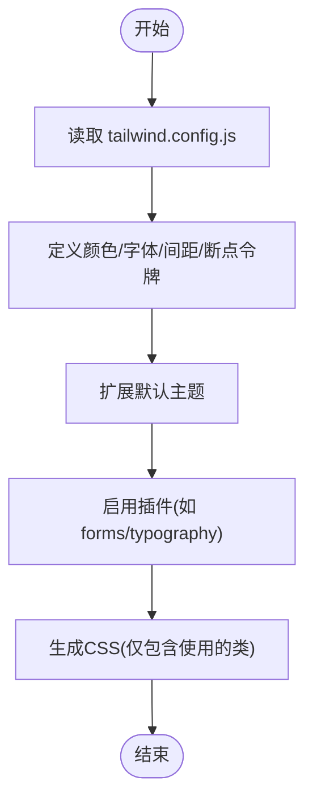

**图表来源** 
- [tailwind.config.js](file://frontend/tailwind.config.js)

**章节来源**
- [tailwind.config.js](file://frontend/tailwind.config.js)

### PostCSS与构建链
- 插件顺序：Tailwind优先处理，随后进行CSS变量兼容、autoprefixer、压缩等。
- 构建目标：根据环境（开发/生产）调整优化策略，生产环境启用最小化与缓存。
- 与Vite集成：通过vite.config.ts配置PostCSS与Tailwind插件，确保样式按需生成与热更新。

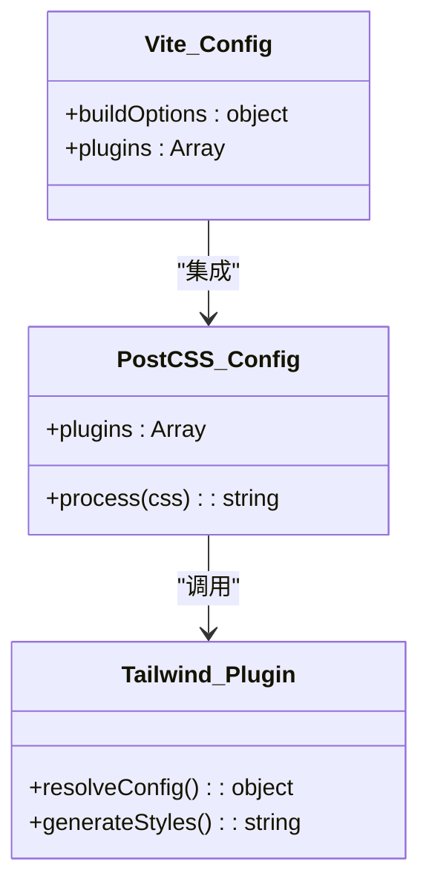

**图表来源** 
- [postcss.config.js](file://frontend/postcss.config.js)
- [vite.config.ts](file://frontend/vite.config.ts)

**章节来源**
- [postcss.config.js](file://frontend/postcss.config.js)
- [vite.config.ts](file://frontend/vite.config.ts)

### 全局样式与CSS变量管理
- 变量定义：在index.css中声明CSS变量（如--color-primary、--font-base），供Tailwind与组件样式引用。
- 基础样式：重置浏览器默认样式，定义全局排版、链接、按钮基线样式。
- 暗色模式：通过data-theme或类名切换，变量值随主题变化自动更新。

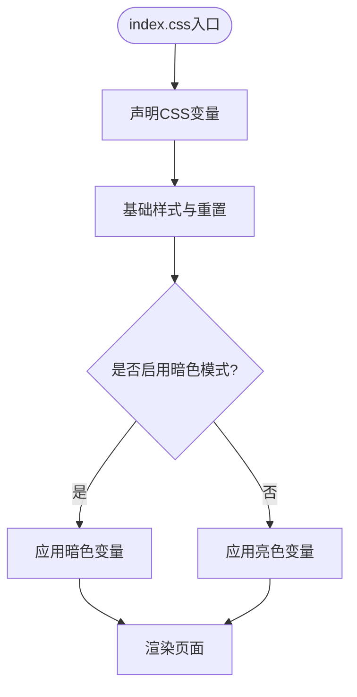

**图表来源** 
- [index.css](file://frontend/src/index.css)

**章节来源**
- [index.css](file://frontend/src/index.css)

### 主题切换机制与动态样式注入
- 状态管理：App.tsx维护当前主题状态（亮/暗），并提供切换方法。
- 动态注入：通过document.documentElement.setAttribute或classList.toggle切换data-theme或类名，触发CSS变量更新。
- 媒体查询：结合prefers-color-scheme检测系统偏好，初始主题与用户选择保持一致。

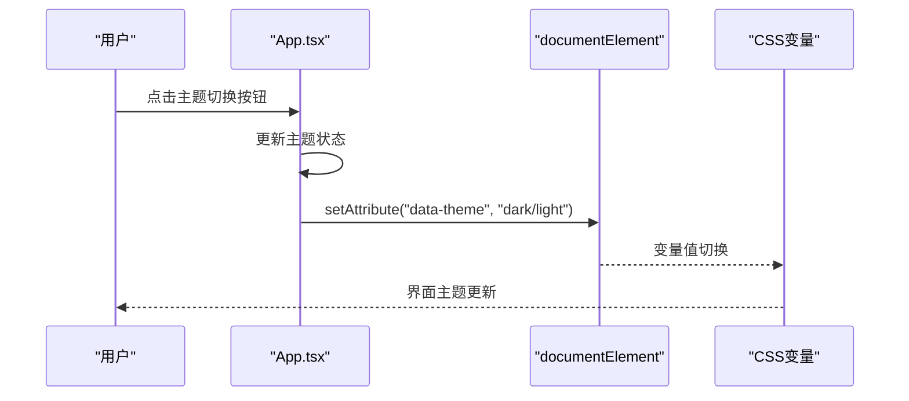

**图表来源** 
- [App.tsx](file://frontend/src/App.tsx)

**章节来源**
- [App.tsx](file://frontend/src/App.tsx)

### 响应式设计策略与断点定义
- 断点策略：在tailwind.config.js中定义sm、md、lg、xl等断点，匹配常见设备宽度。
- 移动端优先：样式从移动端开始编写，逐步增强到桌面端，减少重复代码。
- 容器查询：如需更细粒度控制，可启用容器查询插件（需额外配置）。

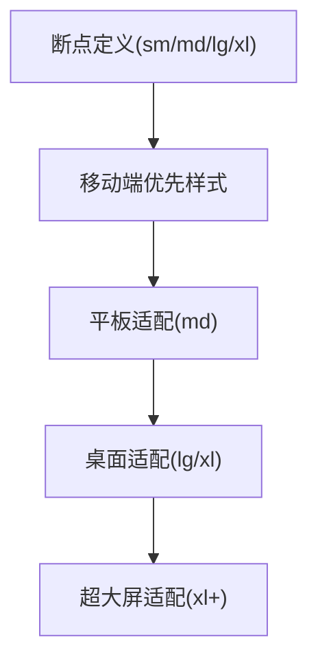

**图表来源** 
- [tailwind.config.js](file://frontend/tailwind.config.js)

**章节来源**
- [tailwind.config.js](file://frontend/tailwind.config.js)

### 图标系统与SVG资源管理
- SVG内联：推荐将常用图标以内联SVG形式引入，便于通过CSS变量控制颜色与尺寸。
- 图标替换：通过className或属性切换不同SVG路径，实现动态图标替换。
- 资源优化：使用SVGO或构建插件压缩SVG，减少体积。

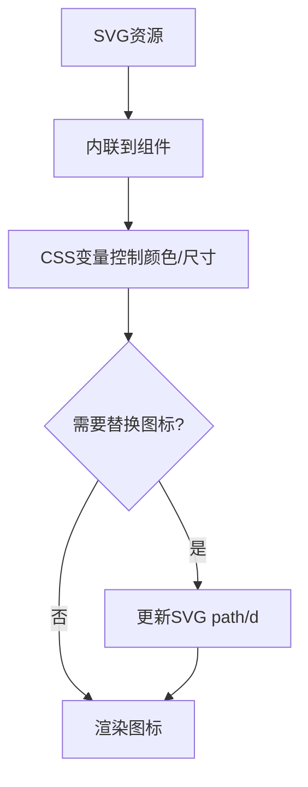

**图表来源** 
- [App.tsx](file://frontend/src/App.tsx)
- [index.css](file://frontend/src/index.css)

**章节来源**
- [App.tsx](file://frontend/src/App.tsx)
- [index.css](file://frontend/src/index.css)

### 样式隔离与组件样式封装
- 模块化：每个组件独立样式文件或使用CSS Modules/Tailwind类名隔离。
- 命名空间：通过BEM或前缀避免类名冲突，如btn-primary、card-shadow。
- 作用域：利用CSS变量限定样式影响范围，避免全局污染。

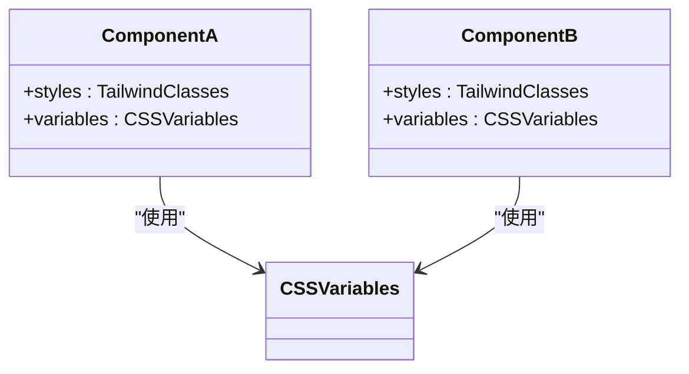

**图表来源** 
- [index.css](file://frontend/src/index.css)
- [App.tsx](file://frontend/src/App.tsx)

**章节来源**
- [index.css](file://frontend/src/index.css)
- [App.tsx](file://frontend/src/App.tsx)

### 主题定制指南与品牌色配置
- 品牌色：在tailwind.config.js中定义brand主色与辅助色，统一全站视觉。
- 语义化命名：使用semantic color names（如bg-surface、text-heading）提升可维护性。
- 深色模式：通过data-theme切换变量值，确保对比度符合无障碍标准。

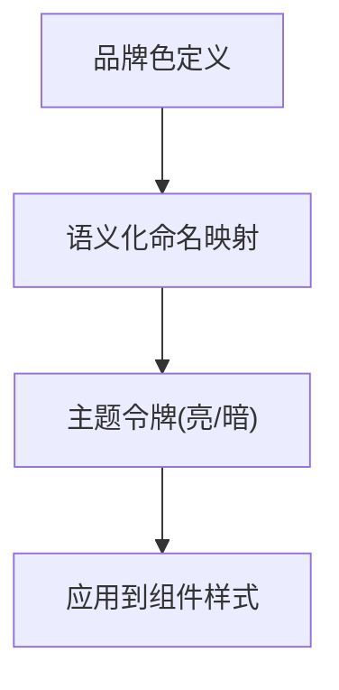

**图表来源** 
- [tailwind.config.js](file://frontend/tailwind.config.js)
- [index.css](file://frontend/src/index.css)

**章节来源**
- [tailwind.config.js](file://frontend/tailwind.config.js)
- [index.css](file://frontend/src/index.css)

### 深色模式实现
- 系统偏好：监听prefers-color-scheme，初始主题与系统一致。
- 用户选择：提供切换控件，持久化用户偏好（localStorage或状态管理）。
- 变量驱动：所有颜色通过CSS变量控制，切换时仅需更新变量值。

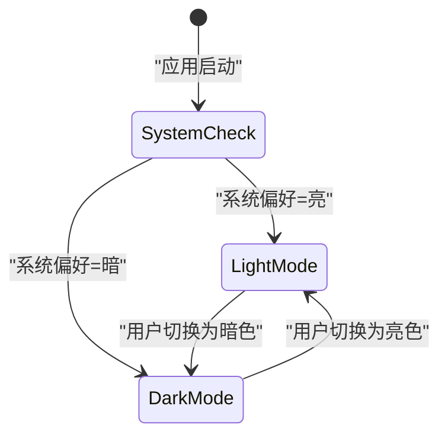

**图表来源** 
- [App.tsx](file://frontend/src/App.tsx)
- [index.css](file://frontend/src/index.css)

**章节来源**
- [App.tsx](file://frontend/src/App.tsx)
- [index.css](file://frontend/src/index.css)

## 依赖关系分析
- 构建依赖：Vite、PostCSS、Tailwind CSS及其插件。
- 运行时依赖：React、TypeScript、可能的状态管理库（如zustand/redux）。
- 样式依赖：CSS变量、媒体查询、动画库（可选）。

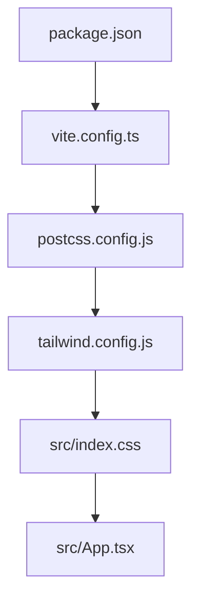

**图表来源** 
- [package.json](file://frontend/package.json)
- [vite.config.ts](file://frontend/vite.config.ts)
- [postcss.config.js](file://frontend/postcss.config.js)
- [tailwind.config.js](file://frontend/tailwind.config.js)
- [index.css](file://frontend/src/index.css)
- [App.tsx](file://frontend/src/App.tsx)

**章节来源**
- [package.json](file://frontend/package.json)
- [vite.config.ts](file://frontend/vite.config.ts)
- [postcss.config.js](file://frontend/postcss.config.js)
- [tailwind.config.js](file://frontend/tailwind.config.js)
- [index.css](file://frontend/src/index.css)
- [App.tsx](file://frontend/src/App.tsx)

## 性能考量
- 按需生成：Tailwind仅生成使用的类，减少CSS体积。
- 构建优化：生产环境启用CSS压缩、Tree Shaking、缓存策略。
- 运行时优化：避免频繁DOM操作，批量更新CSS变量；使用will-change提示浏览器优化。
- 资源优化：SVG压缩、字体子集化、懒加载非关键样式。

[本节为通用指导，无需特定文件来源]

## 故障排查指南
- 样式未生效：检查PostCSS链顺序、Tailwind配置是否正确、类名是否拼写错误。
- 主题切换无效：确认data-theme或类名是否正确设置，CSS变量是否覆盖预期。
- 构建失败：检查依赖版本兼容性、配置文件语法、环境变量。
- 性能问题：使用浏览器开发者工具分析CSS体积与渲染瓶颈，优化变量与动画。

**章节来源**
- [postcss.config.js](file://frontend/postcss.config.js)
- [tailwind.config.js](file://frontend/tailwind.config.js)
- [index.css](file://frontend/src/index.css)
- [App.tsx](file://frontend/src/App.tsx)

## 结论
本主题系统以Tailwind CSS为核心，结合PostCSS与Vite构建流程，实现了灵活、可扩展且高性能的UI主题方案。通过CSS变量驱动的主题切换、语义化颜色与字体规范、响应式断点策略，以及严格的样式隔离与优化实践，确保了系统在多设备、多主题场景下的稳定表现与良好用户体验。建议持续遵循本文档的最佳实践，逐步完善品牌设计与无障碍支持。

[本节为总结性内容，无需特定文件来源]

## 附录
- 术语表：Tailwind、PostCSS、CSS变量、断点、暗色模式等。
- 参考链接：Tailwind官方文档、Vite构建优化指南、CSS变量最佳实践。

[本节为补充信息，无需特定文件来源]