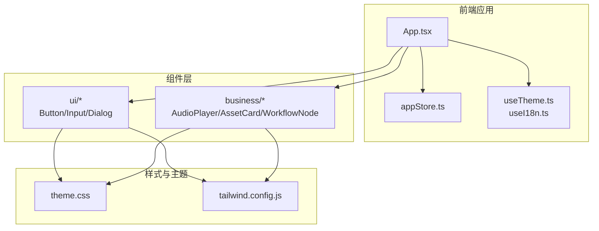
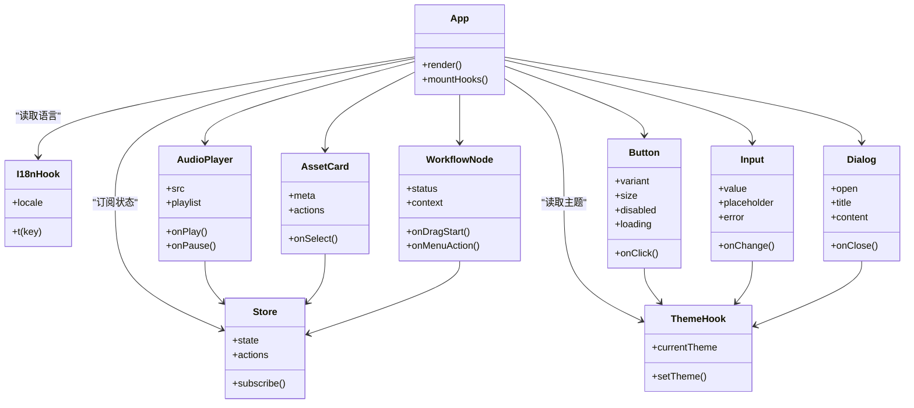
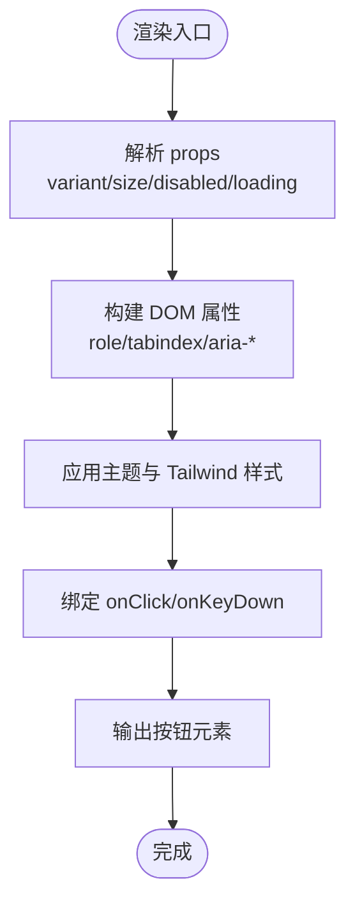
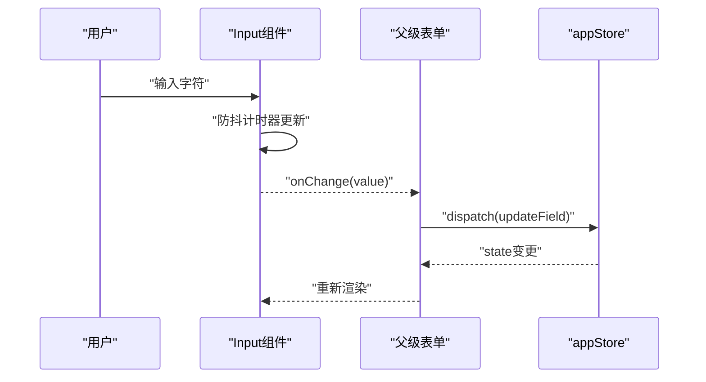
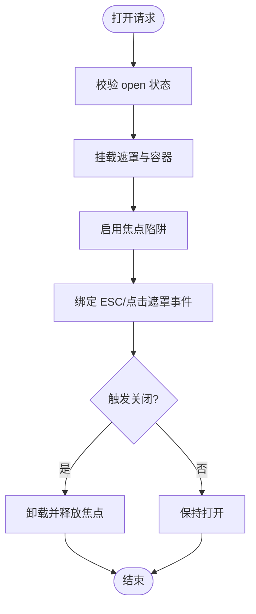
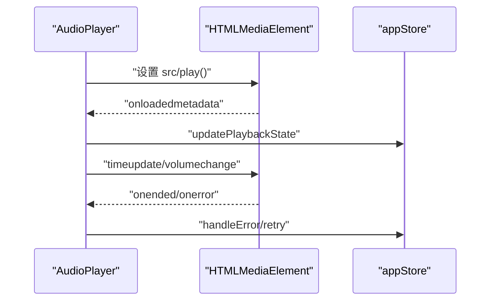
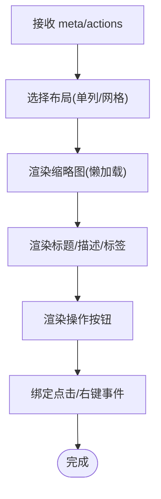
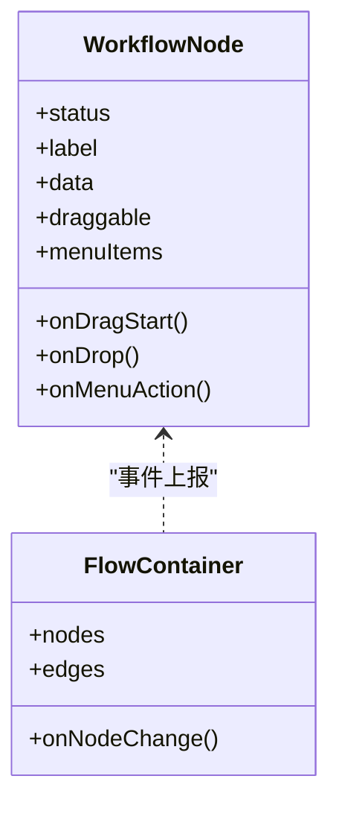
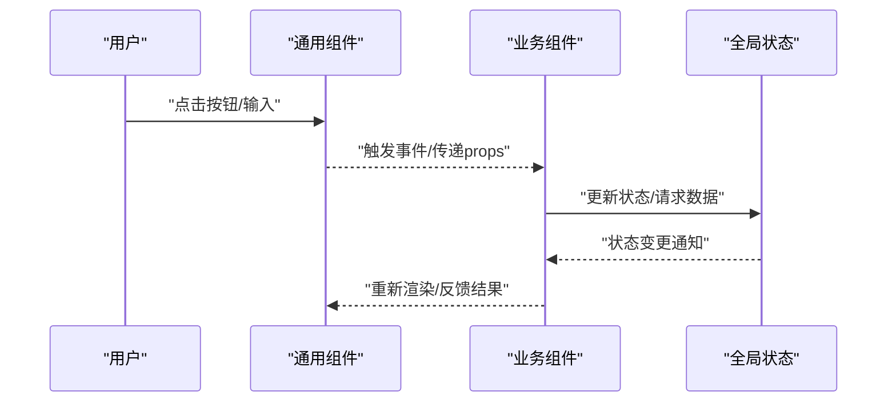
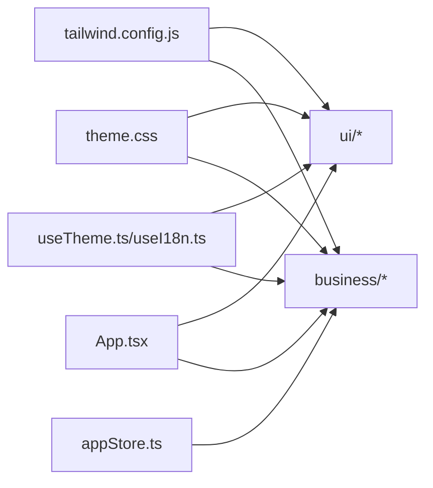

# UI组件库

<cite>
**本文引用的文件**   
- [frontend/src/components/index.ts](file://frontend/src/components/index.ts)
- [frontend/src/components/ui/Button.tsx](file://frontend/src/components/ui/Button.tsx)
- [frontend/src/components/ui/Input.tsx](file://frontend/src/components/ui/Input.tsx)
- [frontend/src/components/ui/Dialog.tsx](file://frontend/src/components/ui/Dialog.tsx)
- [frontend/src/components/business/AudioPlayer.tsx](file://frontend/src/components/business/AudioPlayer.tsx)
- [frontend/src/components/business/AssetCard.tsx](file://frontend/src/components/business/AssetCard.tsx)
- [frontend/src/components/business/WorkflowNode.tsx](file://frontend/src/components/business/WorkflowNode.tsx)
- [frontend/src/styles/theme.css](file://frontend/src/styles/theme.css)
- [frontend/tailwind.config.js](file://frontend/tailwind.config.js)
- [frontend/src/hooks/useTheme.ts](file://frontend/src/hooks/useTheme.ts)
- [frontend/src/hooks/useI18n.ts](file://frontend/src/hooks/useI18n.ts)
- [frontend/src/store/appStore.ts](file://frontend/src/store/appStore.ts)
- [frontend/src/App.tsx](file://frontend/src/App.tsx)
- [frontend/package.json](file://frontend/package.json)
</cite>

## 目录
1. [简介](#简介)
2. [项目结构](#项目结构)
3. [核心组件](#核心组件)
4. [架构总览](#架构总览)
5. [详细组件分析](#详细组件分析)
6. [依赖关系分析](#依赖关系分析)
7. [性能考虑](#性能考虑)
8. [故障排查指南](#故障排查指南)
9. [结论](#结论)
10. [附录：API参考与最佳实践](#附录api参考与最佳实践)

## 简介
本文件为小说创作代理系统的UI组件库提供全面文档，覆盖通用组件（按钮、输入框、对话框等）与业务组件（音频播放器、资产卡片、工作流节点等）。内容包含使用方法、属性配置、样式系统、主题支持、响应式设计、组合模式、事件处理、状态管理、可访问性、国际化与性能优化建议，并附带完整的API参考、使用示例与最佳实践。

## 项目结构
前端采用模块化组织方式，组件按“通用UI”和“业务组件”分层，样式通过Tailwind CSS与主题CSS统一管理，状态由集中式store管理，国际化与主题通过hooks暴露。

图表来源
- [frontend/src/App.tsx](file://frontend/src/App.tsx)
- [frontend/src/store/appStore.ts](file://frontend/src/store/appStore.ts)
- [frontend/src/hooks/useTheme.ts](file://frontend/src/hooks/useTheme.ts)
- [frontend/src/hooks/useI18n.ts](file://frontend/src/hooks/useI18n.ts)
- [frontend/src/styles/theme.css](file://frontend/src/styles/theme.css)
- [frontend/tailwind.config.js](file://frontend/tailwind.config.js)

章节来源
- [frontend/src/App.tsx](file://frontend/src/App.tsx)
- [frontend/package.json](file://frontend/package.json)

## 核心组件
本节概述通用组件与业务组件的职责边界与交互约定。

- 通用组件（ui）
  - Button：基础按钮，支持尺寸、变体、禁用态、加载态、图标插槽、事件回调。
  - Input：表单输入控件，支持占位符、校验提示、只读/禁用、前缀/后缀、聚焦行为。
  - Dialog：模态对话框，支持标题、内容、底部操作区、遮罩点击关闭、ESC关闭、焦点管理。
- 业务组件（business）
  - AudioPlayer：音频播放控制，支持进度条、音量、倍速、播放列表、错误重试。
  - AssetCard：资源展示卡片，支持缩略图、元数据、标签、操作按钮、点击跳转。
  - WorkflowNode：工作流节点，支持状态指示、连线、拖拽、上下文菜单、事件上报。

章节来源
- [frontend/src/components/ui/Button.tsx](file://frontend/src/components/ui/Button.tsx)
- [frontend/src/components/ui/Input.tsx](file://frontend/src/components/ui/Input.tsx)
- [frontend/src/components/ui/Dialog.tsx](file://frontend/src/components/ui/Dialog.tsx)
- [frontend/src/components/business/AudioPlayer.tsx](file://frontend/src/components/business/AudioPlayer.tsx)
- [frontend/src/components/business/AssetCard.tsx](file://frontend/src/components/business/AssetCard.tsx)
- [frontend/src/components/business/WorkflowNode.tsx](file://frontend/src/components/business/WorkflowNode.tsx)

## 架构总览
组件库遵循“展示层-业务层-状态层-样式层”的分层架构，通过hooks统一主题与国际化，通过store集中管理全局状态，组件之间以props与事件通信。

图表来源
- [frontend/src/App.tsx](file://frontend/src/App.tsx)
- [frontend/src/store/appStore.ts](file://frontend/src/store/appStore.ts)
- [frontend/src/hooks/useTheme.ts](file://frontend/src/hooks/useTheme.ts)
- [frontend/src/hooks/useI18n.ts](file://frontend/src/hooks/useI18n.ts)
- [frontend/src/components/ui/Button.tsx](file://frontend/src/components/ui/Button.tsx)
- [frontend/src/components/ui/Input.tsx](file://frontend/src/components/ui/Input.tsx)
- [frontend/src/components/ui/Dialog.tsx](file://frontend/src/components/ui/Dialog.tsx)
- [frontend/src/components/business/AudioPlayer.tsx](file://frontend/src/components/business/AudioPlayer.tsx)
- [frontend/src/components/business/AssetCard.tsx](file://frontend/src/components/business/AssetCard.tsx)
- [frontend/src/components/business/WorkflowNode.tsx](file://frontend/src/components/business/WorkflowNode.tsx)

## 详细组件分析

### 通用组件：Button
- 功能特性
  - 多尺寸（sm/md/lg）、多变体（primary/secondary/outline/danger）、禁用态、加载态、图标插槽。
  - 键盘可访问性（Enter/Space触发），ARIA角色与标签。
- 关键属性
  - variant、size、disabled、loading、icon、ariaLabel、className、style
- 事件
  - onClick、onKeyDown
- 样式与主题
  - 基于Tailwind颜色与间距变量，受主题钩子影响。
- 组合模式
  - 与Input/Dialog组合用于表单提交；与Tooltip配合显示辅助信息。
- 可访问性
  - role="button"、tabindex、aria-disabled、aria-label、focus-visible样式。

图表来源
- [frontend/src/components/ui/Button.tsx](file://frontend/src/components/ui/Button.tsx)
- [frontend/tailwind.config.js](file://frontend/tailwind.config.js)
- [frontend/src/hooks/useTheme.ts](file://frontend/src/hooks/useTheme.ts)

章节来源
- [frontend/src/components/ui/Button.tsx](file://frontend/src/components/ui/Button.tsx)

### 通用组件：Input
- 功能特性
  - 文本输入、占位符、错误提示、只读/禁用、前缀/后缀、自动聚焦、防抖输入。
- 关键属性
  - value、placeholder、error、readOnly、disabled、prefix、suffix、debounceMs、onChange、onFocus、onBlur
- 事件
  - onChange、onFocus、onBlur、onKeyDown
- 样式与主题
  - 边框、圆角、阴影、颜色随主题切换；错误态高亮。
- 组合模式
  - 与Form/Dialog组合进行数据收集；与Validation规则集成。
- 可访问性
  - aria-invalid、aria-describedby、label关联、焦点顺序。

图表来源
- [frontend/src/components/ui/Input.tsx](file://frontend/src/components/ui/Input.tsx)
- [frontend/src/store/appStore.ts](file://frontend/src/store/appStore.ts)

章节来源
- [frontend/src/components/ui/Input.tsx](file://frontend/src/components/ui/Input.tsx)

### 通用组件：Dialog
- 功能特性
  - 标题、内容、底部操作区、遮罩点击关闭、ESC关闭、焦点陷阱、滚动锁定。
- 关键属性
  - open、title、content、actions、closeOnOverlay、closeOnEsc、trapFocus
- 事件
  - onClose、onOpenChange
- 样式与主题
  - 居中、阴影、背景色、动画过渡；暗色主题适配。
- 组合模式
  - 与表单、确认提示、媒体预览组合。
- 可访问性
  - role="dialog"、aria-modal、aria-labelledby、焦点管理。

图表来源
- [frontend/src/components/ui/Dialog.tsx](file://frontend/src/components/ui/Dialog.tsx)

章节来源
- [frontend/src/components/ui/Dialog.tsx](file://frontend/src/components/ui/Dialog.tsx)

### 业务组件：AudioPlayer
- 功能特性
  - 播放/暂停、进度拖动、音量调节、倍速、播放列表、错误重试、缓存预加载。
- 关键属性
  - src、playlist、autoplay、loop、volume、speed、showControls、retryOnError
- 事件
  - onPlay、onPause、onEnded、onError、onTimeUpdate、onLoadedMetadata
- 状态管理
  - 播放状态、当前索引、缓冲进度、错误码。
- 样式与主题
  - 控件布局、进度条颜色、图标主题。
- 可访问性
  - aria-labels、键盘控制、屏幕阅读器提示。

图表来源
- [frontend/src/components/business/AudioPlayer.tsx](file://frontend/src/components/business/AudioPlayer.tsx)
- [frontend/src/store/appStore.ts](file://frontend/src/store/appStore.ts)

章节来源
- [frontend/src/components/business/AudioPlayer.tsx](file://frontend/src/components/business/AudioPlayer.tsx)

### 业务组件：AssetCard
- 功能特性
  - 缩略图、标题、描述、标签、操作按钮（预览/下载/删除）、点击跳转。
- 关键属性
  - meta、actions、onSelect、onPreview、onDelete、layout
- 事件
  - onSelect、onPreview、onDelete、onContextMenu
- 样式与主题
  - 卡片阴影、圆角、悬停效果、图片懒加载。
- 组合模式
  - 与Grid/Flex布局组合；与Dialog预览结合。
- 可访问性
  - alt文本、键盘导航、语义化标签。

图表来源
- [frontend/src/components/business/AssetCard.tsx](file://frontend/src/components/business/AssetCard.tsx)

章节来源
- [frontend/src/components/business/AssetCard.tsx](file://frontend/src/components/business/AssetCard.tsx)

### 业务组件：WorkflowNode
- 功能特性
  - 状态指示（待处理/进行中/成功/失败）、连线、拖拽、上下文菜单、事件上报。
- 关键属性
  - status、label、data、draggable、menuItems、onDragStart、onMenuAction
- 事件
  - onDragStart、onDrop、onMenuAction、onStatusChange
- 样式与主题
  - 节点形状、连接线样式、状态颜色映射。
- 组合模式
  - 与流程图容器组合；与工具栏/侧边栏联动。
- 可访问性
  - 键盘移动、Aria状态、焦点可见性。

图表来源
- [frontend/src/components/business/WorkflowNode.tsx](file://frontend/src/components/business/WorkflowNode.tsx)

章节来源
- [frontend/src/components/business/WorkflowNode.tsx](file://frontend/src/components/business/WorkflowNode.tsx)

### 概念总览
以下流程图展示组件间典型交互流程（概念性，不直接映射具体代码文件）：

[此图为概念性流程，无需图表来源]

## 依赖关系分析
组件库依赖Tailwind CSS进行原子化样式，主题通过CSS变量与JS钩子注入，状态由集中式store管理，国际化通过hooks提供翻译函数。

图表来源
- [frontend/tailwind.config.js](file://frontend/tailwind.config.js)
- [frontend/src/styles/theme.css](file://frontend/src/styles/theme.css)
- [frontend/src/hooks/useTheme.ts](file://frontend/src/hooks/useTheme.ts)
- [frontend/src/hooks/useI18n.ts](file://frontend/src/hooks/useI18n.ts)
- [frontend/src/store/appStore.ts](file://frontend/src/store/appStore.ts)
- [frontend/src/App.tsx](file://frontend/src/App.tsx)

章节来源
- [frontend/package.json](file://frontend/package.json)
- [frontend/tailwind.config.js](file://frontend/tailwind.config.js)

## 性能考虑
- 渲染优化
  - 使用React.memo包裹纯展示组件（如AssetCard），避免不必要的重渲染。
  - 对长列表使用虚拟滚动或分页加载。
- 资源加载
  - 图片懒加载与按需加载音频资源，减少首屏体积。
  - 音频预加载策略（preload=metadata）提升交互响应。
- 事件与计算
  - 输入防抖与节流，避免频繁状态更新。
  - 将昂贵计算移出渲染路径，使用useMemo/useCallback。
- 主题与样式
  - 避免在运行时动态生成大量样式类，优先使用Tailwind预设与CSS变量。
- 可访问性与性能平衡
  - 焦点管理与ARIA属性开销较低，但应避免过度监听导致阻塞。

[本节为通用指导，无需章节来源]

## 故障排查指南
- 常见问题
  - 主题未生效：检查theme.css是否被引入，useTheme是否正确调用。
  - 国际化缺失：确认useI18n的locale与翻译键存在。
  - 音频无法播放：检查src有效性、浏览器权限、网络跨域。
  - 对话框焦点丢失：确认trapFocus逻辑与z-index层级。
- 调试建议
  - 使用浏览器开发者工具检查DOM属性与事件绑定。
  - 打印store状态变化定位问题。
  - 对异步操作添加日志与错误边界。

章节来源
- [frontend/src/hooks/useTheme.ts](file://frontend/src/hooks/useTheme.ts)
- [frontend/src/hooks/useI18n.ts](file://frontend/src/hooks/useI18n.ts)
- [frontend/src/store/appStore.ts](file://frontend/src/store/appStore.ts)

## 结论
本组件库以清晰的层次结构与统一的样式/主题/国际化机制，支撑小说创作代理系统的多样化界面需求。通过良好的可访问性与性能优化策略，确保用户体验与开发效率。建议在实际使用中遵循本文档的最佳实践，并结合业务场景进行适度扩展。

[本节为总结，无需章节来源]

## 附录：API参考与最佳实践

### API参考（摘要）
- Button
  - 属性：variant、size、disabled、loading、icon、ariaLabel、className、style
  - 事件：onClick、onKeyDown
- Input
  - 属性：value、placeholder、error、readOnly、disabled、prefix、suffix、debounceMs、onChange、onFocus、onBlur
  - 事件：onChange、onFocus、onBlur、onKeyDown
- Dialog
  - 属性：open、title、content、actions、closeOnOverlay、closeOnEsc、trapFocus
  - 事件：onClose、onOpenChange
- AudioPlayer
  - 属性：src、playlist、autoplay、loop、volume、speed、showControls、retryOnError
  - 事件：onPlay、onPause、onEnded、onError、onTimeUpdate、onLoadedMetadata
- AssetCard
  - 属性：meta、actions、onSelect、onPreview、onDelete、layout
  - 事件：onSelect、onPreview、onDelete、onContextMenu
- WorkflowNode
  - 属性：status、label、data、draggable、menuItems、onDragStart、onMenuAction
  - 事件：onDragStart、onDrop、onMenuAction、onStatusChange

章节来源
- [frontend/src/components/ui/Button.tsx](file://frontend/src/components/ui/Button.tsx)
- [frontend/src/components/ui/Input.tsx](file://frontend/src/components/ui/Input.tsx)
- [frontend/src/components/ui/Dialog.tsx](file://frontend/src/components/ui/Dialog.tsx)
- [frontend/src/components/business/AudioPlayer.tsx](file://frontend/src/components/business/AudioPlayer.tsx)
- [frontend/src/components/business/AssetCard.tsx](file://frontend/src/components/business/AssetCard.tsx)
- [frontend/src/components/business/WorkflowNode.tsx](file://frontend/src/components/business/WorkflowNode.tsx)

### 使用示例（路径指引）
- 按钮与表单组合：参见 [frontend/src/components/ui/Button.tsx](file://frontend/src/components/ui/Button.tsx)、[frontend/src/components/ui/Input.tsx](file://frontend/src/components/ui/Input.tsx)
- 对话框内嵌表单：参见 [frontend/src/components/ui/Dialog.tsx](file://frontend/src/components/ui/Dialog.tsx)
- 音频播放列表：参见 [frontend/src/components/business/AudioPlayer.tsx](file://frontend/src/components/business/AudioPlayer.tsx)
- 资源卡片网格：参见 [frontend/src/components/business/AssetCard.tsx](file://frontend/src/components/business/AssetCard.tsx)
- 工作流节点拖拽：参见 [frontend/src/components/business/WorkflowNode.tsx](file://frontend/src/components/business/WorkflowNode.tsx)

### 最佳实践
- 组件设计
  - 单一职责、props最小化、默认值合理、类型安全。
- 样式与主题
  - 优先使用Tailwind预设，自定义样式集中在theme.css，避免行内样式滥用。
- 状态管理
  - 局部状态尽量在组件内，全局状态放入store，避免重复状态。
- 可访问性
  - 所有交互元素具备语义化标签与键盘支持，错误提示可被读屏器识别。
- 国际化
  - 所有文案通过i18n键引用，避免硬编码字符串。
- 性能
  - 懒加载、防抖节流、避免大对象频繁创建，合理使用memo与缓存。

[本节为通用指导，无需章节来源]