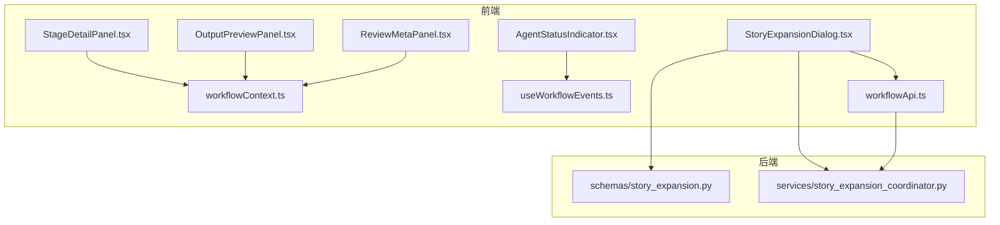
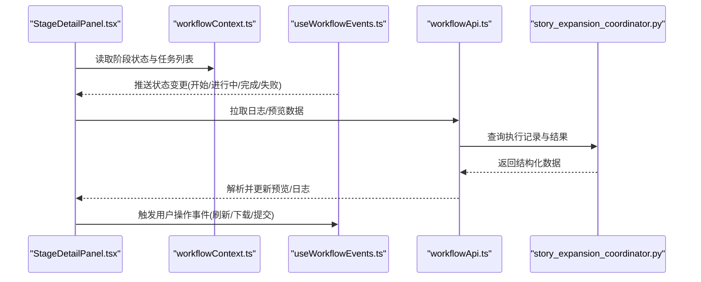
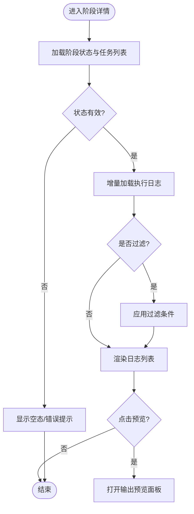
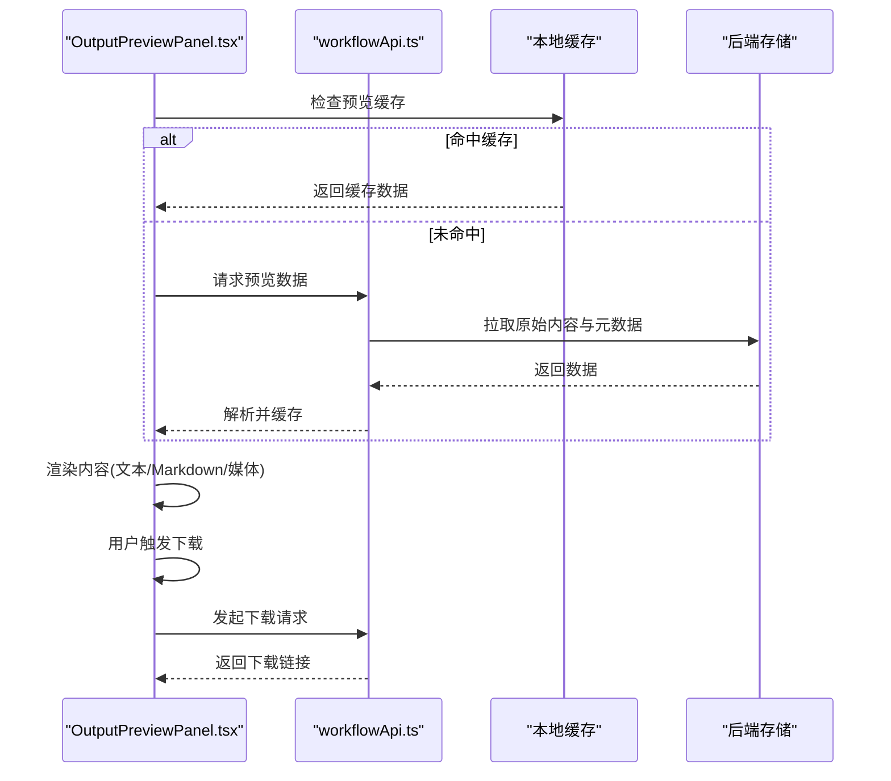
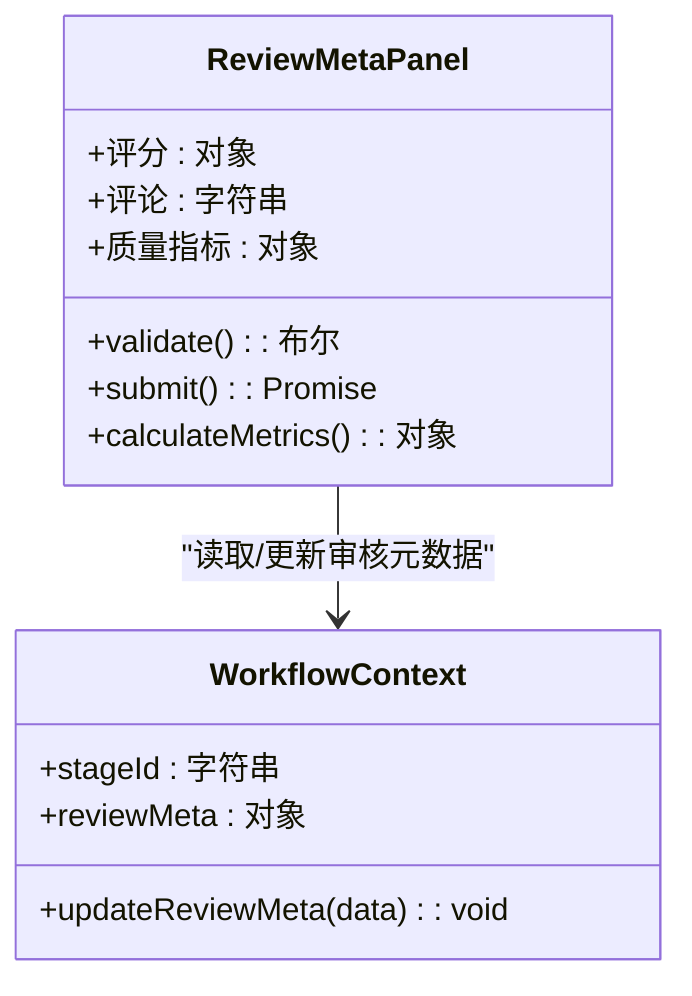
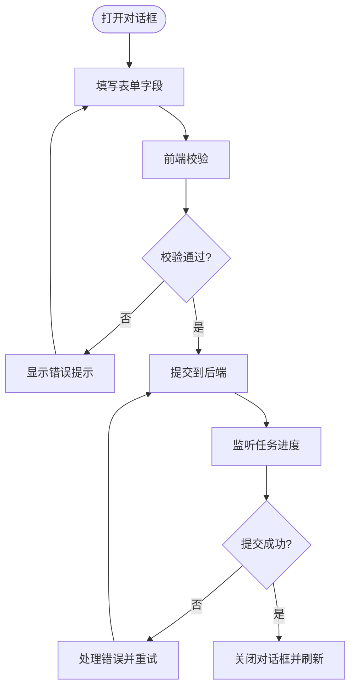
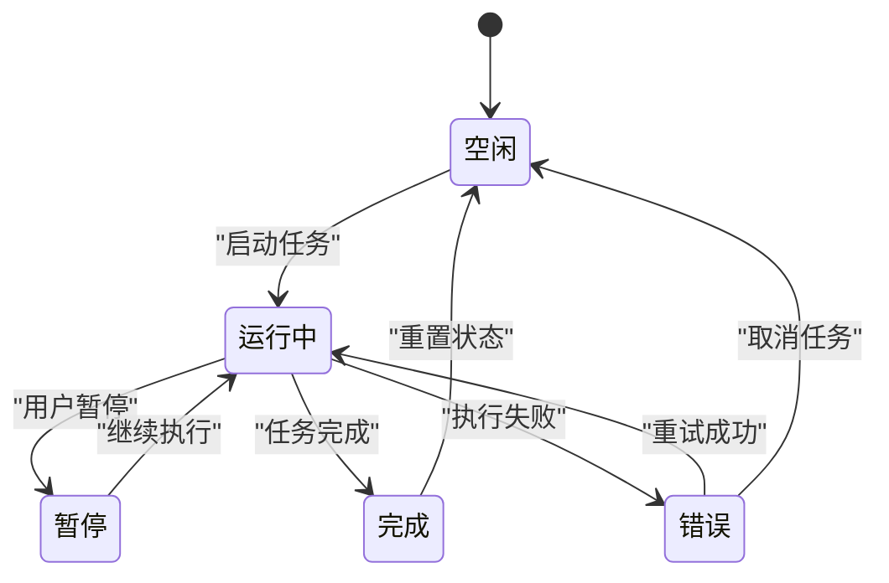
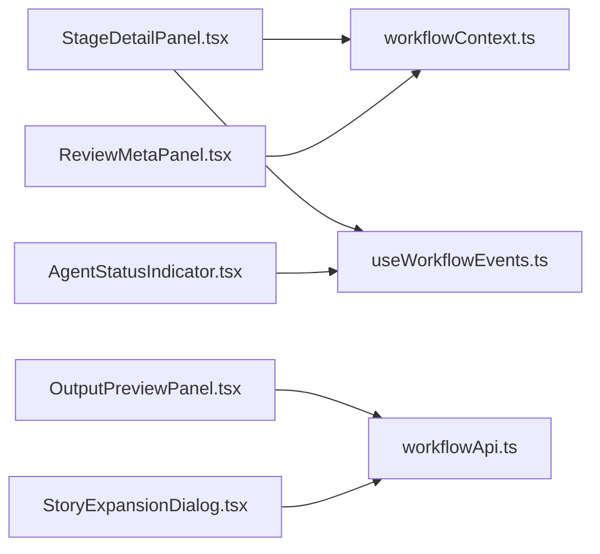

# 工作流组件

<cite>
**本文引用的文件**   
- [StageDetailPanel.tsx](file://frontend/src/components/workflow/StageDetailPanel.tsx)
- [OutputPreviewPanel.tsx](file://frontend/src/components/workflow/OutputPreviewPanel.tsx)
- [ReviewMetaPanel.tsx](file://frontend/src/components/workflow/ReviewMetaPanel.tsx)
- [StoryExpansionDialog.tsx](file://frontend/src/components/workflow/StoryExpansionDialog.tsx)
- [AgentStatusIndicator.tsx](file://frontend/src/components/workflow/AgentStatusIndicator.tsx)
- [workflowContext.ts](file://frontend/src/store/workflowContext.ts)
- [useWorkflowEvents.ts](file://frontend/src/hooks/useWorkflowEvents.ts)
- [workflowApi.ts](file://frontend/src/services/workflowApi.ts)
- [story_expansion_schema.py](file://backend/app/schemas/story_expansion.py)
- [story_expansion_coordinator.py](file://backend/app/services/story_expansion_coordinator.py)
</cite>

## 目录
1. [简介](#简介)
2. [项目结构](#项目结构)
3. [核心组件](#核心组件)
4. [架构总览](#架构总览)
5. [详细组件分析](#详细组件分析)
6. [依赖分析](#依赖分析)
7. [性能考虑](#性能考虑)
8. [故障排查指南](#故障排查指南)
9. [结论](#结论)
10. [附录](#附录)

## 简介
本文件面向小说创作代理系统的工作流编排前端组件，聚焦以下五个关键UI组件：阶段详情面板（StageDetailPanel）、输出预览面板（OutputPreviewPanel）、审核元数据面板（ReviewMetaPanel）、故事扩展对话框（StoryExpansionDialog）与代理状态指示器（AgentStatusIndicator）。文档将系统性阐述各组件的职责、交互流程、数据模型、错误处理与性能优化建议，并给出集成模式、事件通信与状态同步的最佳实践。

## 项目结构
工作流相关的前端组件位于 frontend/src/components/workflow 目录下，配合 hooks、store、services 等模块完成状态管理、事件订阅与API调用；后端通过 schemas 与 services 提供校验与协调逻辑。下图概览了前后端协作关系与主要文件路径。

图表来源 
- [StageDetailPanel.tsx](file://frontend/src/components/workflow/StageDetailPanel.tsx)
- [OutputPreviewPanel.tsx](file://frontend/src/components/workflow/OutputPreviewPanel.tsx)
- [ReviewMetaPanel.tsx](file://frontend/src/components/workflow/ReviewMetaPanel.tsx)
- [StoryExpansionDialog.tsx](file://frontend/src/components/workflow/StoryExpansionDialog.tsx)
- [AgentStatusIndicator.tsx](file://frontend/src/components/workflow/AgentStatusIndicator.tsx)
- [workflowContext.ts](file://frontend/src/store/workflowContext.ts)
- [useWorkflowEvents.ts](file://frontend/src/hooks/useWorkflowEvents.ts)
- [workflowApi.ts](file://frontend/src/services/workflowApi.ts)
- [story_expansion_schema.py](file://backend/app/schemas/story_expansion.py)
- [story_expansion_coordinator.py](file://backend/app/services/story_expansion_coordinator.py)

章节来源
- [StageDetailPanel.tsx](file://frontend/src/components/workflow/StageDetailPanel.tsx)
- [OutputPreviewPanel.tsx](file://frontend/src/components/workflow/OutputPreviewPanel.tsx)
- [ReviewMetaPanel.tsx](file://frontend/src/components/workflow/ReviewMetaPanel.tsx)
- [StoryExpansionDialog.tsx](file://frontend/src/components/workflow/StoryExpansionDialog.tsx)
- [AgentStatusIndicator.tsx](file://frontend/src/components/workflow/AgentStatusIndicator.tsx)
- [workflowContext.ts](file://frontend/src/store/workflowContext.ts)
- [useWorkflowEvents.ts](file://frontend/src/hooks/useWorkflowEvents.ts)
- [workflowApi.ts](file://frontend/src/services/workflowApi.ts)
- [story_expansion_schema.py](file://backend/app/schemas/story_expansion.py)
- [story_expansion_coordinator.py](file://backend/app/services/story_expansion_coordinator.py)

## 核心组件
- 阶段详情面板（StageDetailPanel）
  - 职责：展示当前阶段的运行状态、任务列表、执行日志与结果预览入口。
  - 关键点：状态映射、日志滚动加载、结果预览联动。
- 输出预览面板（OutputPreviewPanel）
  - 职责：渲染多格式内容（文本、Markdown、图片、视频），支持格式转换与下载。
  - 关键点：安全渲染、格式检测、缓存策略、下载触发。
- 审核元数据面板（ReviewMetaPanel）
  - 职责：展示评分、评论输入框、质量指标计算与提交。
  - 关键点：评分聚合、评论校验、指标计算、提交反馈。
- 故事扩展对话框（StoryExpansionDialog）
  - 职责：表单设计、数据验证、提交到后端协调器。
  - 关键点：字段校验、错误提示、异步提交、进度反馈。
- 代理状态指示器（AgentStatusIndicator）
  - 职责：监控代理状态、显示进度、错误提示。
  - 关键点：状态机、进度条、错误重试、WebSocket/SSE事件监听。

章节来源
- [StageDetailPanel.tsx](file://frontend/src/components/workflow/StageDetailPanel.tsx)
- [OutputPreviewPanel.tsx](file://frontend/src/components/workflow/OutputPreviewPanel.tsx)
- [ReviewMetaPanel.tsx](file://frontend/src/components/workflow/ReviewMetaPanel.tsx)
- [StoryExpansionDialog.tsx](file://frontend/src/components/workflow/StoryExpansionDialog.tsx)
- [AgentStatusIndicator.tsx](file://frontend/src/components/workflow/AgentStatusIndicator.tsx)

## 架构总览
工作流组件采用“组件 + 上下文 + 事件 + API”的解耦模式：
- 组件层：负责UI渲染与用户交互。
- 上下文层：集中管理工作流状态（如阶段状态、任务队列、预览数据）。
- 事件层：通过自定义事件或hooks订阅后端推送（SSE/WebSocket），驱动UI更新。
- API层：封装HTTP请求，统一错误处理与重试策略。

图表来源 
- [StageDetailPanel.tsx](file://frontend/src/components/workflow/StageDetailPanel.tsx)
- [workflowContext.ts](file://frontend/src/store/workflowContext.ts)
- [useWorkflowEvents.ts](file://frontend/src/hooks/useWorkflowEvents.ts)
- [workflowApi.ts](file://frontend/src/services/workflowApi.ts)
- [story_expansion_coordinator.py](file://backend/app/services/story_expansion_coordinator.py)

## 详细组件分析

### 阶段详情面板（StageDetailPanel）
- 功能要点
  - 任务状态展示：根据后端状态码映射为可视化标签（待执行、执行中、成功、失败、取消）。
  - 执行日志查看：分页/增量加载，支持关键字过滤与时间戳排序。
  - 结果预览：点击后跳转至输出预览面板，传递阶段ID与结果标识。
- 数据流
  - 从 workflowContext 获取阶段与任务状态。
  - 通过 useWorkflowEvents 订阅状态变更，实时更新UI。
  - 调用 workflowApi 拉取日志与结果，错误时回退到本地缓存。
- 错误处理
  - 网络异常：显示重试按钮与降级提示。
  - 数据缺失：占位符与空态提示。
- 性能优化
  - 日志虚拟滚动，避免大列表卡顿。
  - 结果预览懒加载与缓存。

图表来源 
- [StageDetailPanel.tsx](file://frontend/src/components/workflow/StageDetailPanel.tsx)
- [workflowContext.ts](file://frontend/src/store/workflowContext.ts)
- [useWorkflowEvents.ts](file://frontend/src/hooks/useWorkflowEvents.ts)
- [workflowApi.ts](file://frontend/src/services/workflowApi.ts)

章节来源
- [StageDetailPanel.tsx](file://frontend/src/components/workflow/StageDetailPanel.tsx)
- [workflowContext.ts](file://frontend/src/store/workflowContext.ts)
- [useWorkflowEvents.ts](file://frontend/src/hooks/useWorkflowEvents.ts)
- [workflowApi.ts](file://frontend/src/services/workflowApi.ts)

### 输出预览面板（OutputPreviewPanel）
- 功能要点
  - 内容渲染：支持文本、Markdown、图片、视频等多格式渲染。
  - 格式转换：在客户端进行轻量转换（如Markdown转HTML），必要时调用后端服务。
  - 下载操作：生成可下载文件，支持命名规则与批量导出。
- 数据流
  - 接收阶段详情面板传递的结果标识。
  - 通过 workflowApi 获取原始内容与元数据。
  - 使用缓存策略减少重复请求。
- 错误处理
  - 媒体加载失败：显示占位图与重试。
  - 转换失败：回退到原始格式或提示用户。
- 性能优化
  - 大文件分块加载与懒加载。
  - 预览缩略图与缓存命中。

图表来源 
- [OutputPreviewPanel.tsx](file://frontend/src/components/workflow/OutputPreviewPanel.tsx)
- [workflowApi.ts](file://frontend/src/services/workflowApi.ts)

章节来源
- [OutputPreviewPanel.tsx](file://frontend/src/components/workflow/OutputPreviewPanel.tsx)
- [workflowApi.ts](file://frontend/src/services/workflowApi.ts)

### 审核元数据面板（ReviewMetaPanel）
- 功能要点
  - 评分展示：多维度评分（如连贯性、创意性、可读性）与总分计算。
  - 评论输入：富文本或结构化评论，支持必填项校验。
  - 质量指标：基于评分与评论自动计算质量指标（如一致性、风险等级）。
- 数据流
  - 从 workflowContext 获取阶段审核元数据。
  - 用户修改评分与评论后，实时校验并提交。
  - 通过 workflowApi 提交审核结果，更新后端状态。
- 错误处理
  - 校验失败：高亮错误字段并提示修复。
  - 提交失败：显示错误原因并提供重试。
- 性能优化
  - 防抖输入与批量提交。
  - 评分变化时局部重渲染。

图表来源 
- [ReviewMetaPanel.tsx](file://frontend/src/components/workflow/ReviewMetaPanel.tsx)
- [workflowContext.ts](file://frontend/src/store/workflowContext.ts)

章节来源
- [ReviewMetaPanel.tsx](file://frontend/src/components/workflow/ReviewMetaPanel.tsx)
- [workflowContext.ts](file://frontend/src/store/workflowContext.ts)

### 故事扩展对话框（StoryExpansionDialog）
- 功能要点
  - 表单设计：包含标题、摘要、扩展方向、约束条件等字段。
  - 数据验证：前端校验必填项、长度限制、格式匹配。
  - 提交处理：调用后端 story_expansion_coordinator，处理异步任务与进度反馈。
- 数据流
  - 用户填写表单后，触发 validate() 进行校验。
  - 通过 workflowApi 提交到后端，监听任务状态。
  - 成功后关闭对话框并刷新阶段详情。
- 错误处理
  - 校验失败：即时提示并阻止提交。
  - 提交失败：显示错误详情与重试选项。
- 性能优化
  - 表单防抖与增量保存。
  - 大文本分片上传（如需要）。

图表来源 
- [StoryExpansionDialog.tsx](file://frontend/src/components/workflow/StoryExpansionDialog.tsx)
- [workflowApi.ts](file://frontend/src/services/workflowApi.ts)
- [story_expansion_schema.py](file://backend/app/schemas/story_expansion.py)
- [story_expansion_coordinator.py](file://backend/app/services/story_expansion_coordinator.py)

章节来源
- [StoryExpansionDialog.tsx](file://frontend/src/components/workflow/StoryExpansionDialog.tsx)
- [workflowApi.ts](file://frontend/src/services/workflowApi.ts)
- [story_expansion_schema.py](file://backend/app/schemas/story_expansion.py)
- [story_expansion_coordinator.py](file://backend/app/services/story_expansion_coordinator.py)

### 代理状态指示器（AgentStatusIndicator）
- 功能要点
  - 状态监控：显示代理当前状态（空闲、运行中、暂停、错误）。
  - 进度显示：进度条与百分比，支持分段进度。
  - 错误提示：错误类型、消息与重试按钮。
- 数据流
  - 通过 useWorkflowEvents 订阅状态事件。
  - 更新本地状态并驱动UI渲染。
  - 错误时触发告警与重试逻辑。
- 错误处理
  - 连接中断：自动重连与状态恢复。
  - 超时处理：提示用户并允许取消。
- 性能优化
  - 事件节流与去抖。
  - 状态变更最小化重渲染。

图表来源 
- [AgentStatusIndicator.tsx](file://frontend/src/components/workflow/AgentStatusIndicator.tsx)
- [useWorkflowEvents.ts](file://frontend/src/hooks/useWorkflowEvents.ts)

章节来源
- [AgentStatusIndicator.tsx](file://frontend/src/components/workflow/AgentStatusIndicator.tsx)
- [useWorkflowEvents.ts](file://frontend/src/hooks/useWorkflowEvents.ts)

## 依赖分析
组件间依赖关系清晰，遵循单向数据流与事件驱动模式：
- StageDetailPanel 依赖 workflowContext 与 useWorkflowEvents。
- OutputPreviewPanel 依赖 workflowApi 与本地缓存。
- ReviewMetaPanel 依赖 workflowContext 与表单校验库。
- StoryExpansionDialog 依赖 workflowApi 与后端 schema 校验。
- AgentStatusIndicator 依赖 useWorkflowEvents 与状态管理器。

图表来源 
- [StageDetailPanel.tsx](file://frontend/src/components/workflow/StageDetailPanel.tsx)
- [OutputPreviewPanel.tsx](file://frontend/src/components/workflow/OutputPreviewPanel.tsx)
- [ReviewMetaPanel.tsx](file://frontend/src/components/workflow/ReviewMetaPanel.tsx)
- [StoryExpansionDialog.tsx](file://frontend/src/components/workflow/StoryExpansionDialog.tsx)
- [AgentStatusIndicator.tsx](file://frontend/src/components/workflow/AgentStatusIndicator.tsx)
- [workflowContext.ts](file://frontend/src/store/workflowContext.ts)
- [useWorkflowEvents.ts](file://frontend/src/hooks/useWorkflowEvents.ts)
- [workflowApi.ts](file://frontend/src/services/workflowApi.ts)

章节来源
- [StageDetailPanel.tsx](file://frontend/src/components/workflow/StageDetailPanel.tsx)
- [OutputPreviewPanel.tsx](file://frontend/src/components/workflow/OutputPreviewPanel.tsx)
- [ReviewMetaPanel.tsx](file://frontend/src/components/workflow/ReviewMetaPanel.tsx)
- [StoryExpansionDialog.tsx](file://frontend/src/components/workflow/StoryExpansionDialog.tsx)
- [AgentStatusIndicator.tsx](file://frontend/src/components/workflow/AgentStatusIndicator.tsx)
- [workflowContext.ts](file://frontend/src/store/workflowContext.ts)
- [useWorkflowEvents.ts](file://frontend/src/hooks/useWorkflowEvents.ts)
- [workflowApi.ts](file://frontend/src/services/workflowApi.ts)

## 性能考虑
- 日志与预览数据采用虚拟滚动与懒加载，避免大列表与大图渲染卡顿。
- 使用缓存策略减少重复请求，提升响应速度。
- 表单输入与事件处理采用防抖与节流，降低不必要的计算与渲染。
- 错误重试与降级机制确保用户体验稳定。

## 故障排查指南
- 日志无法加载：检查网络连接与API权限，查看浏览器控制台错误。
- 预览渲染失败：确认媒体格式支持与安全策略，尝试重新加载。
- 审核提交失败：核对字段校验规则与后端接口契约，查看错误响应。
- 代理状态异常：检查事件订阅与重连逻辑，确认后端服务状态。

章节来源
- [StageDetailPanel.tsx](file://frontend/src/components/workflow/StageDetailPanel.tsx)
- [OutputPreviewPanel.tsx](file://frontend/src/components/workflow/OutputPreviewPanel.tsx)
- [ReviewMetaPanel.tsx](file://frontend/src/components/workflow/ReviewMetaPanel.tsx)
- [StoryExpansionDialog.tsx](file://frontend/src/components/workflow/StoryExpansionDialog.tsx)
- [AgentStatusIndicator.tsx](file://frontend/src/components/workflow/AgentStatusIndicator.tsx)

## 结论
工作流组件通过清晰的职责划分与解耦架构，实现了高效的状态管理、事件通信与数据渲染。遵循最佳实践可进一步提升系统的稳定性与用户体验。建议在后续迭代中持续优化性能与错误处理，确保大规模任务下的流畅体验。

## 附录
- 集成模式建议：
  - 使用上下文集中管理状态，避免组件间直接耦合。
  - 通过事件总线或hooks实现松耦合通信。
  - API层统一封装错误处理与重试逻辑。
- 状态同步策略：
  - 乐观更新与悲观回滚结合，确保UI响应性与数据一致性。
  - 使用版本号或时间戳解决并发冲突。
- 事件通信规范：
  - 定义明确的事件类型与载荷结构。
  - 避免循环事件与无限递归。