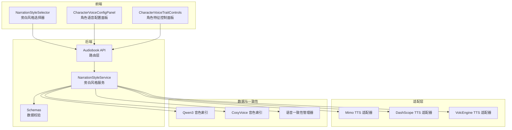
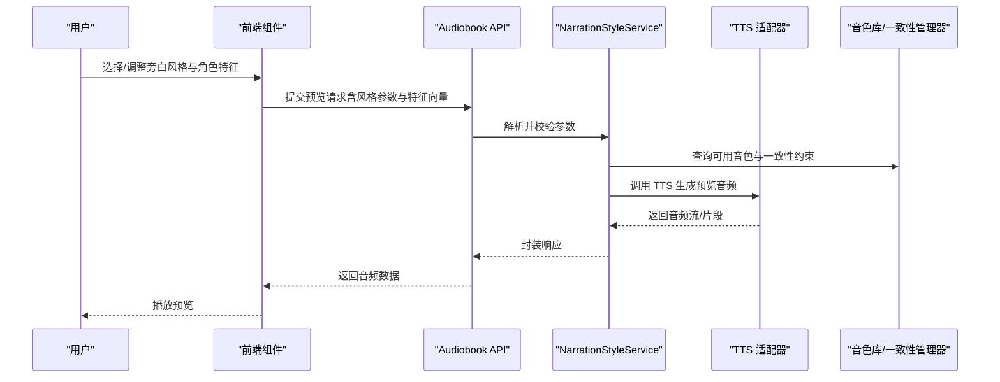
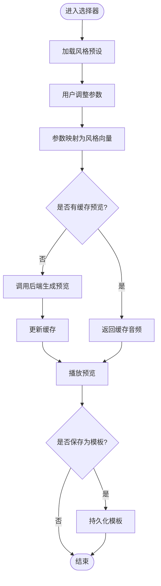
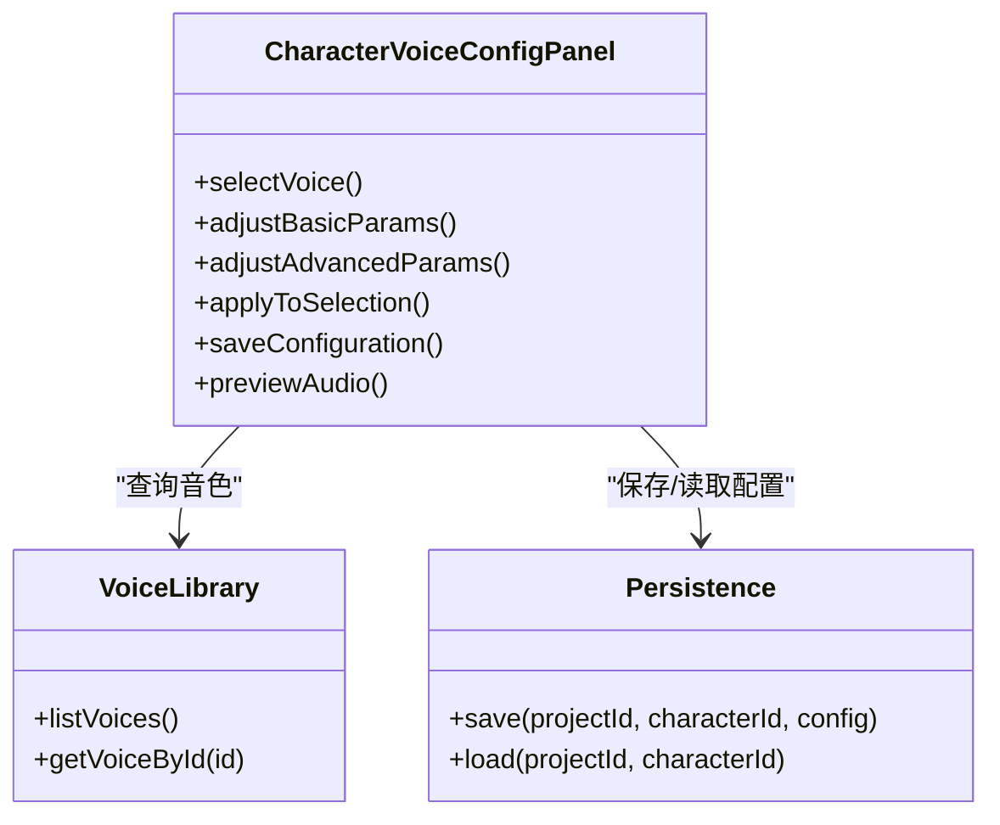
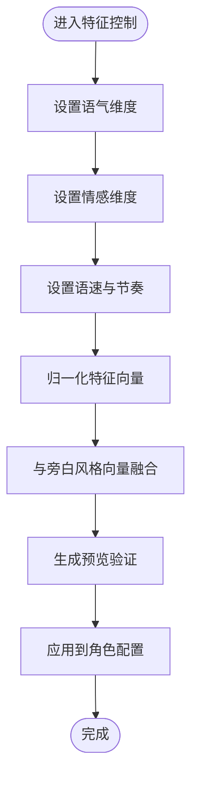
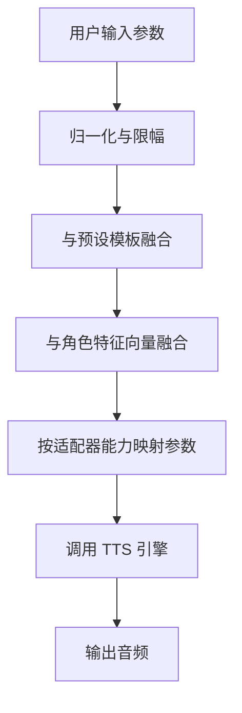
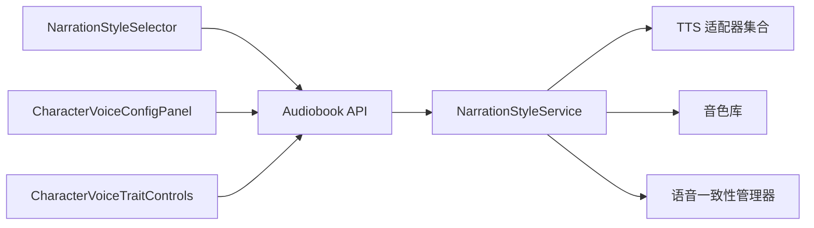

# 旁白风格组件

<cite>
**本文引用的文件**   
- [frontend/src/components/audiobook/NarrationStyleSelector.tsx](file://frontend/src/components/audiobook/NarrationStyleSelector.tsx)
- [frontend/src/components/audiobook/CharacterVoiceConfigPanel.tsx](file://frontend/src/components/audiobook/CharacterVoiceConfigPanel.tsx)
- [frontend/src/components/audiobook/CharacterVoiceTraitControls.tsx](file://frontend/src/components/audiobook/CharacterVoiceTraitControls.tsx)
- [backend/app/api/v1/audiobook.py](file://backend/app/api/v1/audiobook.py)
- [backend/app/services/audiobook/narration_style_service.py](file://backend/app/services/audiobook/narration_style_service.py)
- [backend/app/schemas/audiobook.py](file://backend/app/schemas/audiobook.py)
- [shared/qwen3_tts_voices.json](file://shared/qwen3_tts_voices.json)
- [shared/cosyvoice_v3_plus_voices.json](file://shared/cosyvoice_v3_plus_voices.json)
- [adapters/mimo/tts.py](file://adapters/mimo/tts.py)
- [adapters/dashscope/tts.py](file://adapters/dashscope/tts.py)
- [adapters/volcengine/tts.py](file://adapters/volcengine/tts.py)
- [agents/high_performance_voice_consistency_manager.py](file://agents/high_performance_voice_consistency_manager.py)
- [agents/performance_voice_consistency_manager.py](file://agents/performance_voice_consistency_manager.py)
- [agents/simple_voice_consistency_manager.py](file://agents/simple_voice_consistency_manager.py)
- [backend/tests/test_audiobook_narration_style_routes.py](file://backend/tests/test_audiobook_narration_style_routes.py)
</cite>

## 目录
1. [简介](#简介)
2. [项目结构](#项目结构)
3. [核心组件](#核心组件)
4. [架构总览](#架构总览)
5. [详细组件分析](#详细组件分析)
6. [依赖关系分析](#依赖关系分析)
7. [性能考量](#性能考量)
8. [故障排查指南](#故障排查指南)
9. [结论](#结论)
10. [附录](#附录)

## 简介
本文件面向小说创作代理系统中的“旁白风格”相关前端与后端组件，系统性阐述以下能力：
- NarrationStyleSelector（旁白风格选择器）：内置风格预设、自定义配置、实时预览。
- CharacterVoiceConfigPanel（角色语音配置面板）：参数调节、效果应用、保存机制。
- CharacterVoiceTraitControls（角色特征控制面板）：语气、情感、语速等特征的细粒度控制。
- 旁白风格的算法原理、参数映射、效果合成与性能优化策略。
- 集成示例、自定义风格开发与调试技巧。

## 项目结构
围绕旁白风格的前端组件位于 frontend/src/components/audiobook 下，后端服务与路由在 backend/app 中，TTS 适配器在 adapters 下，共享音色数据在 shared 下，一致性管理在 agents 下。整体采用前后端分离架构，前端通过 API 调用后端服务，再由 TTS 适配器驱动具体语音引擎。

图表来源 
- [frontend/src/components/audiobook/NarrationStyleSelector.tsx](file://frontend/src/components/audiobook/NarrationStyleSelector.tsx)
- [frontend/src/components/audiobook/CharacterVoiceConfigPanel.tsx](file://frontend/src/components/audiobook/CharacterVoiceConfigPanel.tsx)
- [frontend/src/components/audiobook/CharacterVoiceTraitControls.tsx](file://frontend/src/components/audiobook/CharacterVoiceTraitControls.tsx)
- [backend/app/api/v1/audiobook.py](file://backend/app/api/v1/audiobook.py)
- [backend/app/services/audiobook/narration_style_service.py](file://backend/app/services/audiobook/narration_style_service.py)
- [backend/app/schemas/audiobook.py](file://backend/app/schemas/audiobook.py)
- [adapters/mimo/tts.py](file://adapters/mimo/tts.py)
- [adapters/dashscope/tts.py](file://adapters/dashscope/tts.py)
- [adapters/volcengine/tts.py](file://adapters/volcengine/tts.py)
- [shared/qwen3_tts_voices.json](file://shared/qwen3_tts_voices.json)
- [shared/cosyvoice_v3_plus_voices.json](file://shared/cosyvoice_v3_plus_voices.json)
- [agents/high_performance_voice_consistency_manager.py](file://agents/high_performance_voice_consistency_manager.py)

章节来源
- [backend/app/api/v1/audiobook.py](file://backend/app/api/v1/audiobook.py)
- [backend/app/services/audiobook/narration_style_service.py](file://backend/app/services/audiobook/narration_style_service.py)
- [backend/app/schemas/audiobook.py](file://backend/app/schemas/audiobook.py)

## 核心组件
- NarrationStyleSelector（旁白风格选择器）
  - 功能：提供多种旁白风格预设（如“沉稳叙述”“轻快讲述”“悬疑氛围”等），支持用户自定义风格参数组合，并提供实时预览播放。
  - 交互：下拉选择预设、滑块/输入框调整关键参数（语速、语调、情感强度）、试听按钮触发预览。
  - 数据流：前端状态变更 -> 调用后端预览接口 -> 返回音频片段 -> 前端播放器渲染。

- CharacterVoiceConfigPanel（角色语音配置面板）
  - 功能：为特定角色配置 TTS 音色、说话人 ID、音量、混响、均衡等参数；支持一键应用与持久化保存。
  - 交互：表单控件绑定角色上下文，参数修改即时生效于预览；保存后写入项目设置或角色档案。
  - 数据流：参数校验 -> 构建请求体 -> 调用保存接口 -> 返回成功并刷新 UI。

- CharacterVoiceTraitControls（角色特征控制面板）
  - 功能：对角色的语气、情感、语速、停顿、重音等进行细粒度控制，便于匹配不同剧情场景。
  - 交互：多组滑块与开关联动，实时生成特征向量，用于合成阶段影响输出。
  - 数据流：特征值聚合 -> 合并到旁白风格配置 -> 参与效果合成。

章节来源
- [frontend/src/components/audiobook/NarrationStyleSelector.tsx](file://frontend/src/components/audiobook/NarrationStyleSelector.tsx)
- [frontend/src/components/audiobook/CharacterVoiceConfigPanel.tsx](file://frontend/src/components/audiobook/CharacterVoiceConfigPanel.tsx)
- [frontend/src/components/audiobook/CharacterVoiceTraitControls.tsx](file://frontend/src/components/audiobook/CharacterVoiceTraitControls.tsx)

## 架构总览
旁白风格系统由“前端组件 + 后端服务 + TTS 适配器 + 音色库 + 一致性管理器”构成。前端负责展示与交互，后端负责参数校验、风格计算与调度，TTS 适配器对接不同厂商的语音合成引擎，音色库提供可选择的说话人集合，一致性管理器确保同一角色在不同段落中的声音稳定。

图表来源 
- [backend/app/api/v1/audiobook.py](file://backend/app/api/v1/audiobook.py)
- [backend/app/services/audiobook/narration_style_service.py](file://backend/app/services/audiobook/narration_style_service.py)
- [adapters/mimo/tts.py](file://adapters/mimo/tts.py)
- [adapters/dashscope/tts.py](file://adapters/dashscope/tts.py)
- [adapters/volcengine/tts.py](file://adapters/volcengine/tts.py)
- [shared/qwen3_tts_voices.json](file://shared/qwen3_tts_voices.json)
- [shared/cosyvoice_v3_plus_voices.json](file://shared/cosyvoice_v3_plus_voices.json)
- [agents/high_performance_voice_consistency_manager.py](file://agents/high_performance_voice_consistency_manager.py)

## 详细组件分析

### NarrationStyleSelector 旁白风格选择器
- 风格预设
  - 内置多套旁白风格模板，涵盖语速、语调、情感强度、停顿密度等维度。
  - 预设之间可通过权重叠加进行混合，形成过渡风格。
- 自定义配置
  - 用户可通过滑块与输入框调整关键参数，系统将其映射为标准化的风格向量。
  - 支持保存为个人风格模板，供后续复用。
- 实时预览
  - 参数变化时触发轻量级预览任务，避免全量合成带来的延迟。
  - 预览结果缓存，相同参数组合直接返回已生成的音频片段。

图表来源 
- [frontend/src/components/audiobook/NarrationStyleSelector.tsx](file://frontend/src/components/audiobook/NarrationStyleSelector.tsx)
- [backend/app/services/audiobook/narration_style_service.py](file://backend/app/services/audiobook/narration_style_service.py)

章节来源
- [frontend/src/components/audiobook/NarrationStyleSelector.tsx](file://frontend/src/components/audiobook/NarrationStyleSelector.tsx)
- [backend/app/services/audiobook/narration_style_service.py](file://backend/app/services/audiobook/narration_style_service.py)

### CharacterVoiceConfigPanel 角色语音配置面板
- 参数调节
  - 音色选择：从共享音色库中选择说话人 ID。
  - 基础参数：音量、语速、音调、混响、均衡等。
  - 高级参数：停顿概率、重音强度、呼吸声比例等。
- 效果应用
  - 参数变更后立即生成预览，验证效果是否符合预期。
  - 支持批量应用到多个角色或段落。
- 保存机制
  - 将配置序列化并通过 API 保存到项目设置或角色档案。
  - 支持版本化管理，便于回滚与对比。

图表来源 
- [frontend/src/components/audiobook/CharacterVoiceConfigPanel.tsx](file://frontend/src/components/audiobook/CharacterVoiceConfigPanel.tsx)
- [shared/qwen3_tts_voices.json](file://shared/qwen3_tts_voices.json)
- [shared/cosyvoice_v3_plus_voices.json](file://shared/cosyvoice_v3_plus_voices.json)

章节来源
- [frontend/src/components/audiobook/CharacterVoiceConfigPanel.tsx](file://frontend/src/components/audiobook/CharacterVoiceConfigPanel.tsx)
- [shared/qwen3_tts_voices.json](file://shared/qwen3_tts_voices.json)
- [shared/cosyvoice_v3_plus_voices.json](file://shared/cosyvoice_v3_plus_voices.json)

### CharacterVoiceTraitControls 角色特征控制面板
- 语气控制
  - 通过滑块调节正式程度、亲切度、权威感等语气维度。
- 情感控制
  - 支持快乐、悲伤、愤怒、紧张等多维情感强度的线性调节。
- 语速与节奏
  - 语速、停顿密度、重音分布可调，影响朗读的自然度与戏剧性。
- 特征合成
  - 将各维度数值归一化为特征向量，与旁白风格向量融合，参与最终合成。

图表来源 
- [frontend/src/components/audiobook/CharacterVoiceTraitControls.tsx](file://frontend/src/components/audiobook/CharacterVoiceTraitControls.tsx)
- [backend/app/services/audiobook/narration_style_service.py](file://backend/app/services/audiobook/narration_style_service.py)

章节来源
- [frontend/src/components/audiobook/CharacterVoiceTraitControls.tsx](file://frontend/src/components/audiobook/CharacterVoiceTraitControls.tsx)
- [backend/app/services/audiobook/narration_style_service.py](file://backend/app/services/audiobook/narration_style_service.py)

### 旁白风格算法原理与参数映射
- 参数空间
  - 基础参数：语速、音调、音量、混响、均衡。
  - 高级参数：停顿概率、重音强度、呼吸声比例、情感强度。
- 映射规则
  - 将用户输入映射为标准化向量，限制范围并进行平滑处理，避免突变。
  - 预设模板作为初始向量，用户调整以增量方式覆盖默认值。
- 效果合成
  - 将角色特征向量与旁白风格向量加权融合，得到最终合成参数。
  - 根据 TTS 适配器能力进行参数裁剪与转换，确保兼容性。
- 性能优化
  - 预览缓存：相同参数组合直接返回缓存音频。
  - 异步任务：长耗时合成走后台队列，前端通过进度事件反馈。
  - 降级策略：当某适配器不可用时自动切换至备选引擎。

图表来源 
- [backend/app/services/audiobook/narration_style_service.py](file://backend/app/services/audiobook/narration_style_service.py)
- [adapters/mimo/tts.py](file://adapters/mimo/tts.py)
- [adapters/dashscope/tts.py](file://adapters/dashscope/tts.py)
- [adapters/volcengine/tts.py](file://adapters/volcengine/tts.py)

章节来源
- [backend/app/services/audiobook/narration_style_service.py](file://backend/app/services/audiobook/narration_style_service.py)
- [adapters/mimo/tts.py](file://adapters/mimo/tts.py)
- [adapters/dashscope/tts.py](file://adapters/dashscope/tts.py)
- [adapters/volcengine/tts.py](file://adapters/volcengine/tts.py)

### 集成示例与自定义开发
- 集成步骤
  - 在前端页面引入 NarrationStyleSelector、CharacterVoiceConfigPanel、CharacterVoiceTraitControls。
  - 绑定项目上下文与角色上下文，确保音色与配置正确作用域。
  - 监听参数变化事件，调用后端预览接口获取音频片段。
- 自定义风格开发
  - 定义新的风格模板，包含基础与高级参数的默认值。
  - 在后端注册新风格，并在前端添加对应的 UI 控件。
  - 编写测试用例验证风格映射与合成效果。
- 调试技巧
  - 使用浏览器开发者工具检查参数发送与响应格式。
  - 在后端日志中打印参数映射与适配器调用细节。
  - 逐步缩小问题范围，先验证参数合法性，再检查适配器兼容性。

章节来源
- [frontend/src/components/audiobook/NarrationStyleSelector.tsx](file://frontend/src/components/audiobook/NarrationStyleSelector.tsx)
- [frontend/src/components/audiobook/CharacterVoiceConfigPanel.tsx](file://frontend/src/components/audiobook/CharacterVoiceConfigPanel.tsx)
- [frontend/src/components/audiobook/CharacterVoiceTraitControls.tsx](file://frontend/src/components/audiobook/CharacterVoiceTraitControls.tsx)
- [backend/app/services/audiobook/narration_style_service.py](file://backend/app/services/audiobook/narration_style_service.py)

## 依赖关系分析
- 前端组件依赖后端 API 进行参数校验与音频生成。
- 后端服务依赖 TTS 适配器与音色库，同时受一致性管理器约束。
- 一致性管理器确保同一角色在不同段落的声音稳定性，避免漂移。

图表来源 
- [backend/app/api/v1/audiobook.py](file://backend/app/api/v1/audiobook.py)
- [backend/app/services/audiobook/narration_style_service.py](file://backend/app/services/audiobook/narration_style_service.py)
- [adapters/mimo/tts.py](file://adapters/mimo/tts.py)
- [adapters/dashscope/tts.py](file://adapters/dashscope/tts.py)
- [adapters/volcengine/tts.py](file://adapters/volcengine/tts.py)
- [shared/qwen3_tts_voices.json](file://shared/qwen3_tts_voices.json)
- [shared/cosyvoice_v3_plus_voices.json](file://shared/cosyvoice_v3_plus_voices.json)
- [agents/high_performance_voice_consistency_manager.py](file://agents/high_performance_voice_consistency_manager.py)

章节来源
- [backend/app/api/v1/audiobook.py](file://backend/app/api/v1/audiobook.py)
- [backend/app/services/audiobook/narration_style_service.py](file://backend/app/services/audiobook/narration_style_service.py)
- [agents/high_performance_voice_consistency_manager.py](file://agents/high_performance_voice_consistency_manager.py)
- [agents/performance_voice_consistency_manager.py](file://agents/performance_voice_consistency_manager.py)
- [agents/simple_voice_consistency_manager.py](file://agents/simple_voice_consistency_manager.py)

## 性能考量
- 预览缓存：对相同参数组合的音频片段进行缓存，减少重复合成。
- 异步任务：长耗时合成走后台队列，前端通过 SSE 或轮询获取进度。
- 适配器降级：当主适配器不可用时自动切换到备选引擎，保证可用性。
- 参数裁剪：根据适配器能力对参数进行裁剪与转换，避免无效调用。
- 资源隔离：不同角色的合成任务隔离执行，防止相互干扰。

[本节为通用指导，不直接分析具体文件]

## 故障排查指南
- 常见问题
  - 参数非法：检查前端输入范围与后端校验逻辑。
  - 适配器不可用：查看适配器健康状态与密钥配置。
  - 音色缺失：确认音色库索引是否完整且与适配器兼容。
  - 一致性失败：检查一致性管理器的约束条件与历史配置。
- 调试方法
  - 启用详细日志，记录参数映射与适配器调用细节。
  - 使用最小复现案例定位问题范围。
  - 逐步禁用特性（如缓存、降级）以隔离问题。

章节来源
- [backend/tests/test_audiobook_narration_style_routes.py](file://backend/tests/test_audiobook_narration_style_routes.py)

## 结论
旁白风格组件通过前端可视化配置与后端服务化能力相结合，实现了灵活的旁白风格定制与角色语音控制。借助 TTS 适配器与音色库，系统能够适配多种语音引擎，并通过一致性管理器保障角色声音的稳定性和连贯性。在实际使用中，建议充分利用预览缓存与异步任务机制提升用户体验，同时遵循参数映射与适配器降级的最佳实践以确保系统的健壮性与可扩展性。

## 附录
- 术语表
  - 旁白风格：描述叙述者语气、情感、节奏等综合表现的风格集合。
  - 角色语音：针对特定角色的音色与说话人配置。
  - 特征向量：将语气、情感、语速等维度数值化为数学向量。
  - 一致性管理器：确保同一角色在不同段落中声音稳定的模块。
- 参考文件
  - 前端组件：NarrationStyleSelector、CharacterVoiceConfigPanel、CharacterVoiceTraitControls。
  - 后端服务：NarrationStyleService、Audiobook API。
  - 适配器：Mimo、DashScope、VolcEngine。
  - 音色库：Qwen3、CosyVoice。
  - 一致性管理器：高性能、性能、简单三种实现。