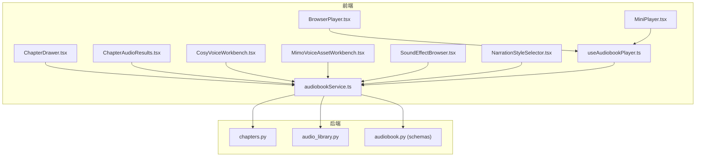
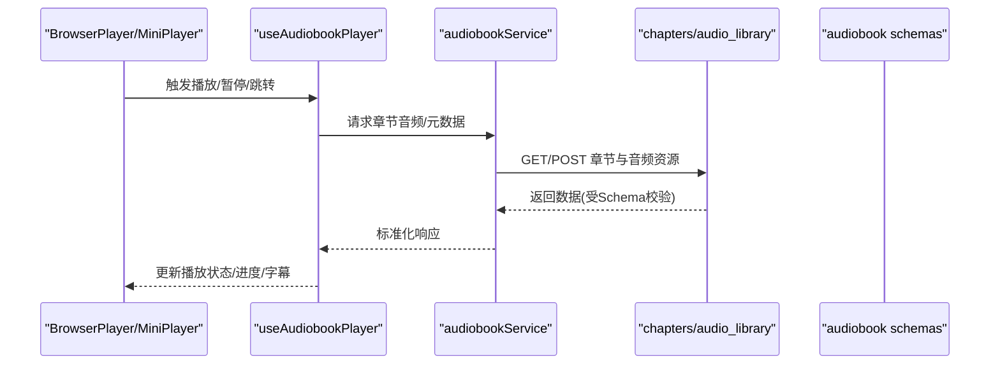
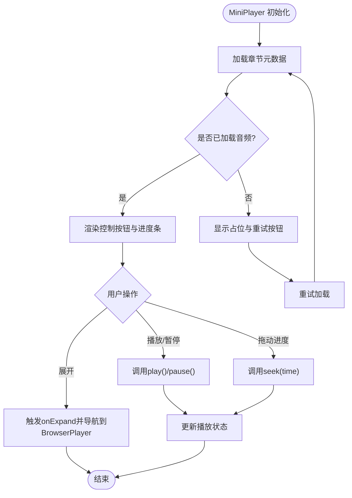
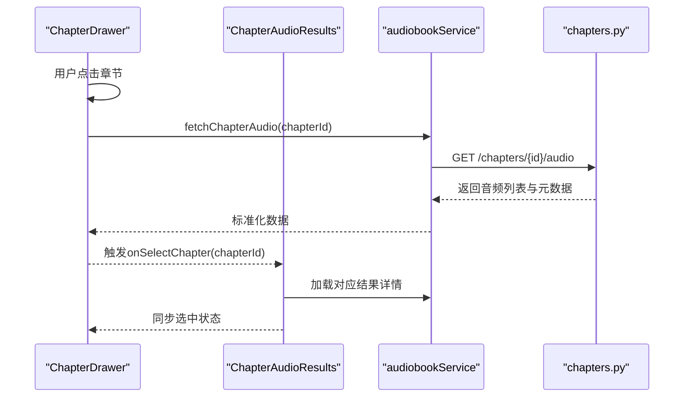
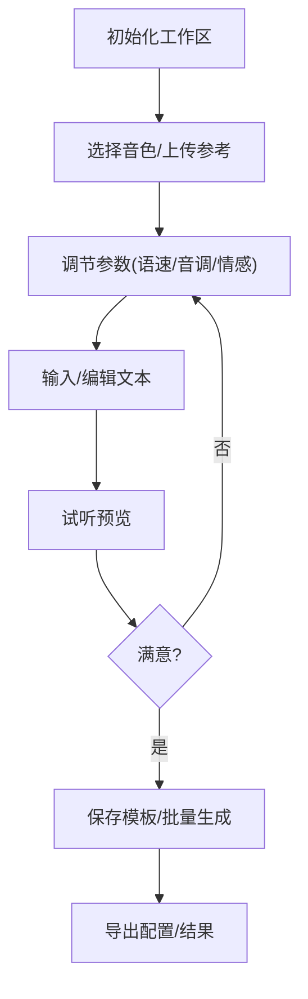
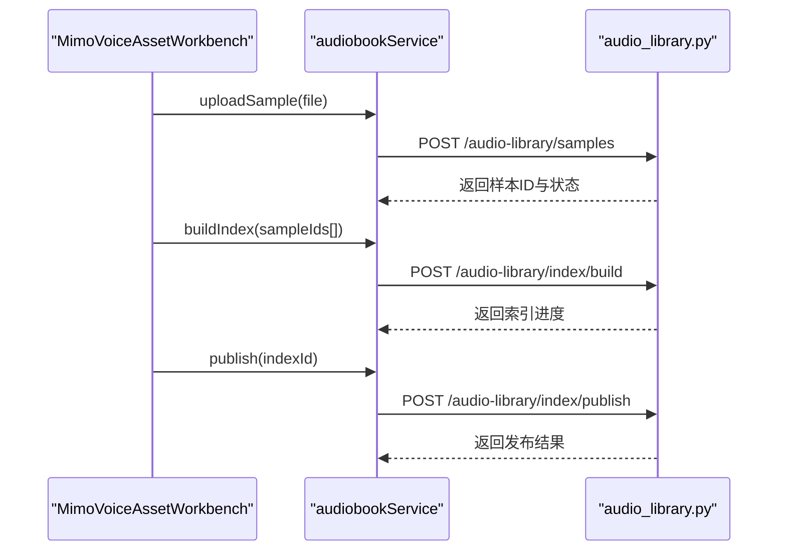
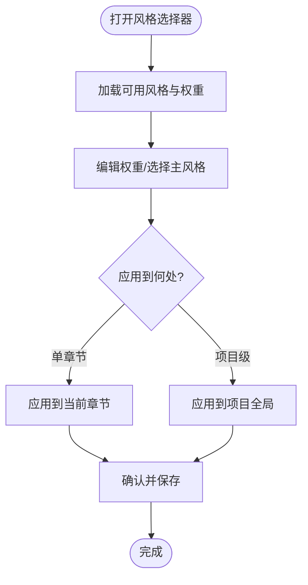
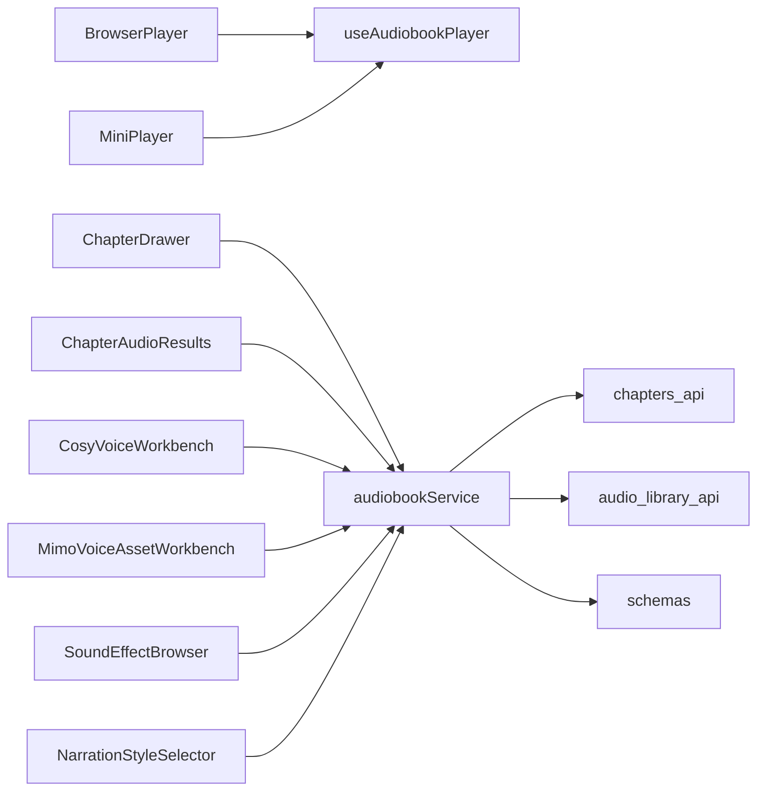

# 有声书组件

<cite>
**本文档引用的文件**   
- [frontend/src/components/audiobook/BrowserPlayer.tsx](file://frontend/src/components/audiobook/BrowserPlayer.tsx)
- [frontend/src/components/audiobook/MiniPlayer.tsx](file://frontend/src/components/audiobook/MiniPlayer.tsx)
- [frontend/src/components/audiobook/ChapterDrawer.tsx](file://frontend/src/components/audiobook/ChapterDrawer.tsx)
- [frontend/src/components/audiobook/ChapterAudioResults.tsx](file://frontend/src/components/audiobook/ChapterAudioResults.tsx)
- [frontend/src/components/audiobook/CosyVoiceWorkbench.tsx](file://frontend/src/components/audiobook/CosyVoiceWorkbench.tsx)
- [frontend/src/components/audiobook/MimoVoiceAssetWorkbench.tsx](file://frontend/src/components/audiobook/MimoVoiceAssetWorkbench.tsx)
- [frontend/src/components/audiobook/SoundEffectBrowser.tsx](file://frontend/src/components/audiobook/SoundEffectBrowser.tsx)
- [frontend/src/components/audiobook/NarrationStyleSelector.tsx](file://frontend/src/components/audiobook/NarrationStyleSelector.tsx)
- [frontend/src/hooks/useAudiobookPlayer.ts](file://frontend/src/hooks/useAudiobookPlayer.ts)
- [frontend/src/services/audiobookService.ts](file://frontend/src/services/audiobookService.ts)
- [backend/app/api/v1/audiobook_api/chapters.py](file://backend/app/api/v1/audiobook_api/chapters.py)
- [backend/app/api/v1/audiobook_api/audio_library.py](file://backend/app/api/v1/audiobook_api/audio_library.py)
- [backend/app/schemas/audiobook.py](file://backend/app/schemas/audiobook.py)
</cite>

## 目录
1. [简介](#简介)
2. [项目结构](#项目结构)
3. [核心组件](#核心组件)
4. [架构总览](#架构总览)
5. [详细组件分析](#详细组件分析)
6. [依赖关系分析](#依赖关系分析)
7. [性能考虑](#性能考虑)
8. [故障排查指南](#故障排查指南)
9. [结论](#结论)
10. [附录](#附录)

## 简介
本文件面向小说创作代理系统的“有声书”相关前端UI组件，聚焦以下目标：
- 音频播放器组件（BrowserPlayer、MiniPlayer）的功能特性、播放控制与用户交互。
- 章节管理组件（ChapterDrawer、ChapterAudioResults）的使用方式与数据绑定。
- 语音设计工作区（CosyVoiceWorkbench、MimoVoiceAssetWorkbench）的配置选项与操作界面。
- 音效库浏览器、旁白风格选择器等业务组件的API接口、状态管理与事件处理。
- 组件组合使用示例、自定义扩展方法与性能优化建议。

## 项目结构
前端以React+TypeScript组织，按功能域划分组件目录；后端提供FastAPI路由与Schema定义，支撑前端的数据获取与任务编排。



图表来源
- [frontend/src/components/audiobook/BrowserPlayer.tsx](file://frontend/src/components/audiobook/BrowserPlayer.tsx)
- [frontend/src/components/audiobook/MiniPlayer.tsx](file://frontend/src/components/audiobook/MiniPlayer.tsx)
- [frontend/src/components/audiobook/ChapterDrawer.tsx](file://frontend/src/components/audiobook/ChapterDrawer.tsx)
- [frontend/src/components/audiobook/ChapterAudioResults.tsx](file://frontend/src/components/audiobook/ChapterAudioResults.tsx)
- [frontend/src/components/audiobook/CosyVoiceWorkbench.tsx](file://frontend/src/components/audiobook/CosyVoiceWorkbench.tsx)
- [frontend/src/components/audiobook/MimoVoiceAssetWorkbench.tsx](file://frontend/src/components/audiobook/MimoVoiceAssetWorkbench.tsx)
- [frontend/src/components/audiobook/SoundEffectBrowser.tsx](file://frontend/src/components/audiobook/SoundEffectBrowser.tsx)
- [frontend/src/components/audiobook/NarrationStyleSelector.tsx](file://frontend/src/components/audiobook/NarrationStyleSelector.tsx)
- [frontend/src/hooks/useAudiobookPlayer.ts](file://frontend/src/hooks/useAudiobookPlayer.ts)
- [frontend/src/services/audiobookService.ts](file://frontend/src/services/audiobookService.ts)
- [backend/app/api/v1/audiobook_api/chapters.py](file://backend/app/api/v1/audiobook_api/chapters.py)
- [backend/app/api/v1/audiobook_api/audio_library.py](file://backend/app/api/v1/audiobook_api/audio_library.py)
- [backend/app/schemas/audiobook.py](file://backend/app/schemas/audiobook.py)

章节来源
- [frontend/src/components/audiobook/BrowserPlayer.tsx](file://frontend/src/components/audiobook/BrowserPlayer.tsx)
- [frontend/src/components/audiobook/MiniPlayer.tsx](file://frontend/src/components/audiobook/MiniPlayer.tsx)
- [frontend/src/components/audiobook/ChapterDrawer.tsx](file://frontend/src/components/audiobook/ChapterDrawer.tsx)
- [frontend/src/components/audiobook/ChapterAudioResults.tsx](file://frontend/src/components/audiobook/ChapterAudioResults.tsx)
- [frontend/src/components/audiobook/CosyVoiceWorkbench.tsx](file://frontend/src/components/audiobook/CosyVoiceWorkbench.tsx)
- [frontend/src/components/audiobook/MimoVoiceAssetWorkbench.tsx](file://frontend/src/components/audiobook/MimoVoiceAssetWorkbench.tsx)
- [frontend/src/components/audiobook/SoundEffectBrowser.tsx](file://frontend/src/components/audiobook/SoundEffectBrowser.tsx)
- [frontend/src/components/audiobook/NarrationStyleSelector.tsx](file://frontend/src/components/audiobook/NarrationStyleSelector.tsx)
- [frontend/src/hooks/useAudiobookPlayer.ts](file://frontend/src/hooks/useAudiobookPlayer.ts)
- [frontend/src/services/audiobookService.ts](file://frontend/src/services/audiobookService.ts)
- [backend/app/api/v1/audiobook_api/chapters.py](file://backend/app/api/v1/audiobook_api/chapters.py)
- [backend/app/api/v1/audiobook_api/audio_library.py](file://backend/app/api/v1/audiobook_api/audio_library.py)
- [backend/app/schemas/audiobook.py](file://backend/app/schemas/audiobook.py)

## 核心组件
- BrowserPlayer：桌面端全屏播放器，支持进度拖拽、音量调节、倍速切换、字幕显示、章节跳转、循环模式等。
- MiniPlayer：悬浮迷你播放器，常驻页面底部，支持基础播放控制与快速切章。
- ChapterDrawer：侧边章节抽屉，展示章节列表、生成状态、预览与下载入口。
- ChapterAudioResults：章节音频结果面板，展示多版本试听、评分、对比与导出。
- CosyVoiceWorkbench：CosyVoice语音工作区，提供音色选择、参数调节、试听与保存。
- MimoVoiceAssetWorkbench：Mimo语音资产工作区，管理克隆样本、索引与发布。
- SoundEffectBrowser：音效库浏览器，支持搜索、分类、试听与添加到时间线。
- NarrationStyleSelector：旁白风格选择器，提供风格标签、权重配置与批量应用。

章节来源
- [frontend/src/components/audiobook/BrowserPlayer.tsx](file://frontend/src/components/audiobook/BrowserPlayer.tsx)
- [frontend/src/components/audiobook/MiniPlayer.tsx](file://frontend/src/components/audiobook/MiniPlayer.tsx)
- [frontend/src/components/audiobook/ChapterDrawer.tsx](file://frontend/src/components/audiobook/ChapterDrawer.tsx)
- [frontend/src/components/audiobook/ChapterAudioResults.tsx](file://frontend/src/components/audiobook/ChapterAudioResults.tsx)
- [frontend/src/components/audiobook/CosyVoiceWorkbench.tsx](file://frontend/src/components/audiobook/CosyVoiceWorkbench.tsx)
- [frontend/src/components/audiobook/MimoVoiceAssetWorkbench.tsx](file://frontend/src/components/audiobook/MimoVoiceAssetWorkbench.tsx)
- [frontend/src/components/audiobook/SoundEffectBrowser.tsx](file://frontend/src/components/audiobook/SoundEffectBrowser.tsx)
- [frontend/src/components/audiobook/NarrationStyleSelector.tsx](file://frontend/src/components/audiobook/NarrationStyleSelector.tsx)

## 架构总览
前端通过统一的服务层与hooks进行状态与网络请求封装，组件仅负责渲染与交互。后端提供REST API与Schema校验，保证数据一致性。



图表来源
- [frontend/src/hooks/useAudiobookPlayer.ts](file://frontend/src/hooks/useAudiobookPlayer.ts)
- [frontend/src/services/audiobookService.ts](file://frontend/src/services/audiobookService.ts)
- [backend/app/api/v1/audiobook_api/chapters.py](file://backend/app/api/v1/audiobook_api/chapters.py)
- [backend/app/api/v1/audiobook_api/audio_library.py](file://backend/app/api/v1/audiobook_api/audio_library.py)
- [backend/app/schemas/audiobook.py](file://backend/app/schemas/audiobook.py)

## 详细组件分析

### 音频播放器：BrowserPlayer
- 功能特性
  - 播放控制：播放/暂停、上一段/下一段、随机/循环、静音。
  - 进度控制：拖拽滑块、点击跳转、缓冲指示。
  - 音质与速度：倍速切换、音量调节、声道平衡。
  - 字幕与时间轴：VTT/SRT加载、高亮当前句、滚动跟随。
  - 章节联动：与ChapterDrawer同步选中项。
- 用户交互
  - 键盘快捷键：空格播放/暂停、左右键跳转、上下键音量。
  - 手势支持：移动端滑动调整进度与音量。
- 状态管理
  - 使用useAudiobookPlayer维护isPlaying、currentTime、duration、volume、speed、loopMode等。
- 事件处理
  - onPlay、onPause、onSeek、onVolumeChange、onSpeedChange、onChapterChange。

```mermaid
classDiagram
class BrowserPlayer {
+props : { chapterId, initialTime, showSubtitles }
+state : isPlaying, currentTime, duration, volume, speed, loopMode
+methods : play(), pause(), seek(time), setVolume(v), setSpeed(s), toggleLoop()
+events : onPlay, onPause, onSeek, onVolumeChange, onSpeedChange, onChapterChange
}
class useAudiobookPlayer {
+state : audioRef, metadata, progress
+actions : loadTrack(), updateProgress(), handleEnded()
}
BrowserPlayer --> useAudiobookPlayer : "订阅状态与动作"
```

图表来源
- [frontend/src/components/audiobook/BrowserPlayer.tsx](file://frontend/src/components/audiobook/BrowserPlayer.tsx)
- [frontend/src/hooks/useAudiobookPlayer.ts](file://frontend/src/hooks/useAudiobookPlayer.ts)

章节来源
- [frontend/src/components/audiobook/BrowserPlayer.tsx](file://frontend/src/components/audiobook/BrowserPlayer.tsx)
- [frontend/src/hooks/useAudiobookPlayer.ts](file://frontend/src/hooks/useAudiobookPlayer.ts)

### 音频播放器：MiniPlayer
- 功能特性
  - 最小化播放：显示当前章节标题、进度条、基本控制按钮。
  - 悬浮置顶：不遮挡内容，支持收起/展开。
  - 快捷切章：下拉选择章节或输入章节号跳转。
- 用户交互
  - 点击展开进入BrowserPlayer全屏视图。
  - 拖拽进度条实时更新播放位置。
- 状态管理
  - 复用useAudiobookPlayer，保持与BrowserPlayer一致的状态模型。
- 事件处理
  - onExpand、onChapterSelect、onSeek、onTogglePlay。



图表来源
- [frontend/src/components/audiobook/MiniPlayer.tsx](file://frontend/src/components/audiobook/MiniPlayer.tsx)
- [frontend/src/hooks/useAudiobookPlayer.ts](file://frontend/src/hooks/useAudiobookPlayer.ts)

章节来源
- [frontend/src/components/audiobook/MiniPlayer.tsx](file://frontend/src/components/audiobook/MiniPlayer.tsx)
- [frontend/src/hooks/useAudiobookPlayer.ts](file://frontend/src/hooks/useAudiobookPlayer.ts)

### 章节管理：ChapterDrawer
- 功能特性
  - 章节列表：分页/懒加载、搜索过滤、排序（序号/时长/状态）。
  - 状态标识：未生成、生成中、已完成、失败重试。
  - 操作入口：试听、重新生成、下载、导出SRT/VTT。
- 数据绑定
  - 与ChapterAudioResults联动，选中章节后刷新结果面板。
  - 支持批量操作（批量试听、批量导出）。
- 事件处理
  - onSelectChapter、onRetry、onExport、onBatchAction。



图表来源
- [frontend/src/components/audiobook/ChapterDrawer.tsx](file://frontend/src/components/audiobook/ChapterDrawer.tsx)
- [frontend/src/components/audiobook/ChapterAudioResults.tsx](file://frontend/src/components/audiobook/ChapterAudioResults.tsx)
- [frontend/src/services/audiobookService.ts](file://frontend/src/services/audiobookService.ts)
- [backend/app/api/v1/audiobook_api/chapters.py](file://backend/app/api/v1/audiobook_api/chapters.py)

章节来源
- [frontend/src/components/audiobook/ChapterDrawer.tsx](file://frontend/src/components/audiobook/ChapterDrawer.tsx)
- [frontend/src/components/audiobook/ChapterAudioResults.tsx](file://frontend/src/components/audiobook/ChapterAudioResults.tsx)
- [frontend/src/services/audiobookService.ts](file://frontend/src/services/audiobookService.ts)
- [backend/app/api/v1/audiobook_api/chapters.py](file://backend/app/api/v1/audiobook_api/chapters.py)

### 章节音频结果：ChapterAudioResults
- 功能特性
  - 多版本试听：同一章节多个TTS版本对比。
  - 评分与标注：用户打分、问题标注、反馈提交。
  - 导出与分享：导出音频、字幕、元数据JSON。
- 数据绑定
  - 接收ChapterDrawer选中的chapterId，自动拉取结果。
  - 支持实时刷新与缓存策略。
- 事件处理
  - onRate、onAnnotate、onExport、onShare。

```mermaid
classDiagram
class ChapterAudioResults {
+props : { chapterId }
+state : versions[], selectedVersion, annotations[]
+methods : loadVersions(), rate(versionId, score), annotate(versionId, note)
+events : onRate, onAnnotate, onExport, onShare
}
class audiobookService {
+getChapterAudio(id) : Promise<AudioList>
+submitFeedback(data) : Promise<Success>
}
ChapterAudioResults --> audiobookService : "数据获取与提交"
```

图表来源
- [frontend/src/components/audiobook/ChapterAudioResults.tsx](file://frontend/src/components/audiobook/ChapterAudioResults.tsx)
- [frontend/src/services/audiobookService.ts](file://frontend/src/services/audiobookService.ts)

章节来源
- [frontend/src/components/audiobook/ChapterAudioResults.tsx](file://frontend/src/components/audiobook/ChapterAudioResults.tsx)
- [frontend/src/services/audiobookService.ts](file://frontend/src/services/audiobookService.ts)

### 语音工作区：CosyVoiceWorkbench
- 配置选项
  - 音色选择：从共享voice列表中选择或上传参考音。
  - 参数调节：语速、音调、情感强度、停顿控制。
  - 输出格式：采样率、编码格式、分段策略。
- 操作界面
  - 文本输入框、段落编辑、预览播放、保存为模板。
  - 批量生成：按章节或段落批量合成。
- 事件处理
  - onPreview、onSaveTemplate、onBatchGenerate、onExportConfig。



图表来源
- [frontend/src/components/audiobook/CosyVoiceWorkbench.tsx](file://frontend/src/components/audiobook/CosyVoiceWorkbench.tsx)
- [frontend/src/services/audiobookService.ts](file://frontend/src/services/audiobookService.ts)

章节来源
- [frontend/src/components/audiobook/CosyVoiceWorkbench.tsx](file://frontend/src/components/audiobook/CosyVoiceWorkbench.tsx)
- [frontend/src/services/audiobookService.ts](file://frontend/src/services/audiobookService.ts)

### 语音工作区：MimoVoiceAssetWorkbench
- 功能特性
  - 样本管理：上传克隆样本、去噪预处理、质量检查。
  - 索引构建：生成voice index.json、相似度检索。
  - 发布流程：审核、上架、版本管理。
- 操作界面
  - 样本列表、预览播放、索引状态、发布按钮。
- 事件处理
  - onUploadSample、onBuildIndex、onPublish、onDelete。



图表来源
- [frontend/src/components/audiobook/MimoVoiceAssetWorkbench.tsx](file://frontend/src/components/audiobook/MimoVoiceAssetWorkbench.tsx)
- [frontend/src/services/audiobookService.ts](file://frontend/src/services/audiobookService.ts)
- [backend/app/api/v1/audiobook_api/audio_library.py](file://backend/app/api/v1/audiobook_api/audio_library.py)

章节来源
- [frontend/src/components/audiobook/MimoVoiceAssetWorkbench.tsx](file://frontend/src/components/audiobook/MimoVoiceAssetWorkbench.tsx)
- [frontend/src/services/audiobookService.ts](file://frontend/src/services/audiobookService.ts)
- [backend/app/api/v1/audiobook_api/audio_library.py](file://backend/app/api/v1/audiobook_api/audio_library.py)

### 业务组件：SoundEffectBrowser
- 功能特性
  - 搜索与筛选：关键词、分类、时长、版权类型。
  - 试听与收藏：在线试听、加入收藏夹、添加到时间线。
  - 导入与导出：批量导入、导出清单。
- 数据绑定
  - 与播放器时间线联动，插入音效片段。
- 事件处理
  - onSearch、onFilter、onAddToTimeline、onExportManifest。

```mermaid
classDiagram
class SoundEffectBrowser {
+props : { timelineRef }
+state : results[], favorites[], filters
+methods : search(query), filter(criteria), addToTimeline(item)
+events : onSearch, onFilter, onAddToTimeline, onExportManifest
}
class audiobookService {
+searchSfx(query, criteria) : Promise<SfxList>
+addToTimeline(timelineId, items) : Promise<Success>
}
SoundEffectBrowser --> audiobookService : "查询与操作"
```

图表来源
- [frontend/src/components/audiobook/SoundEffectBrowser.tsx](file://frontend/src/components/audiobook/SoundEffectBrowser.tsx)
- [frontend/src/services/audiobookService.ts](file://frontend/src/services/audiobookService.ts)

章节来源
- [frontend/src/components/audiobook/SoundEffectBrowser.tsx](file://frontend/src/components/audiobook/SoundEffectBrowser.tsx)
- [frontend/src/services/audiobookService.ts](file://frontend/src/services/audiobookService.ts)

### 业务组件：NarrationStyleSelector
- 功能特性
  - 风格标签：叙事风格、情绪基调、节奏偏好。
  - 权重配置：为不同风格设置权重，影响TTS生成。
  - 批量应用：应用到章节或项目级别。
- 数据绑定
  - 与CosyVoiceWorkbench和MimoVoiceAssetWorkbench共享风格配置。
- 事件处理
  - onApplyStyle、onSetWeight、onBatchApply。



图表来源
- [frontend/src/components/audiobook/NarrationStyleSelector.tsx](file://frontend/src/components/audiobook/NarrationStyleSelector.tsx)
- [frontend/src/services/audiobookService.ts](file://frontend/src/services/audiobookService.ts)

章节来源
- [frontend/src/components/audiobook/NarrationStyleSelector.tsx](file://frontend/src/components/audiobook/NarrationStyleSelector.tsx)
- [frontend/src/services/audiobookService.ts](file://frontend/src/services/audiobookService.ts)

## 依赖关系分析
- 组件间耦合
  - BrowserPlayer与MiniPlayer共享useAudiobookPlayer，避免状态分裂。
  - ChapterDrawer与ChapterAudioResults通过chapterId强关联，确保数据一致性。
  - 工作区组件（CosyVoiceWorkbench、MimoVoiceAssetWorkbench）通过audiobookService统一访问后端。
- 外部依赖
  - 后端API提供章节、音频、音效库与索引服务。
  - Schema定义约束前后端数据结构，减少解析错误。



图表来源
- [frontend/src/components/audiobook/BrowserPlayer.tsx](file://frontend/src/components/audiobook/BrowserPlayer.tsx)
- [frontend/src/components/audiobook/MiniPlayer.tsx](file://frontend/src/components/audiobook/MiniPlayer.tsx)
- [frontend/src/components/audiobook/ChapterDrawer.tsx](file://frontend/src/components/audiobook/ChapterDrawer.tsx)
- [frontend/src/components/audiobook/ChapterAudioResults.tsx](file://frontend/src/components/audiobook/ChapterAudioResults.tsx)
- [frontend/src/components/audiobook/CosyVoiceWorkbench.tsx](file://frontend/src/components/audiobook/CosyVoiceWorkbench.tsx)
- [frontend/src/components/audiobook/MimoVoiceAssetWorkbench.tsx](file://frontend/src/components/audiobook/MimoVoiceAssetWorkbench.tsx)
- [frontend/src/components/audiobook/SoundEffectBrowser.tsx](file://frontend/src/components/audiobook/SoundEffectBrowser.tsx)
- [frontend/src/components/audiobook/NarrationStyleSelector.tsx](file://frontend/src/components/audiobook/NarrationStyleSelector.tsx)
- [frontend/src/hooks/useAudiobookPlayer.ts](file://frontend/src/hooks/useAudiobookPlayer.ts)
- [frontend/src/services/audiobookService.ts](file://frontend/src/services/audiobookService.ts)
- [backend/app/api/v1/audiobook_api/chapters.py](file://backend/app/api/v1/audiobook_api/chapters.py)
- [backend/app/api/v1/audiobook_api/audio_library.py](file://backend/app/api/v1/audiobook_api/audio_library.py)
- [backend/app/schemas/audiobook.py](file://backend/app/schemas/audiobook.py)

章节来源
- [frontend/src/hooks/useAudiobookPlayer.ts](file://frontend/src/hooks/useAudiobookPlayer.ts)
- [frontend/src/services/audiobookService.ts](file://frontend/src/services/audiobookService.ts)
- [backend/app/api/v1/audiobook_api/chapters.py](file://backend/app/api/v1/audiobook_api/chapters.py)
- [backend/app/api/v1/audiobook_api/audio_library.py](file://backend/app/api/v1/audiobook_api/audio_library.py)
- [backend/app/schemas/audiobook.py](file://backend/app/schemas/audiobook.py)

## 性能考虑
- 播放性能
  - 预加载：在用户悬停或即将播放时预加载音频片段。
  - 分片加载：大文件采用HTTP Range请求，提升首帧播放速度。
  - 字幕优化：延迟加载与虚拟滚动，减少DOM压力。
- 渲染性能
  - 列表虚拟化：ChapterDrawer与SoundEffectBrowser使用虚拟列表。
  - 防抖与节流：搜索与过滤操作加防抖，避免频繁请求。
- 网络优化
  - 缓存策略：对静态资源与常用配置启用浏览器缓存。
  - 错误重试：指数退避与降级策略，提升稳定性。

[本节为通用指导，无需特定文件引用]

## 故障排查指南
- 常见问题
  - 音频无法播放：检查网络权限、CORS配置、音频格式兼容性。
  - 字幕不同步：验证字幕时间戳格式与播放器时钟校准。
  - 章节状态异常：查看后端日志与任务队列状态。
- 调试技巧
  - 使用浏览器开发者工具监控网络请求与媒体事件。
  - 在服务层添加详细日志，定位数据转换错误。
  - 单元测试覆盖关键路径，如useAudiobookPlayer与audiobookService。

章节来源
- [frontend/src/hooks/useAudiobookPlayer.ts](file://frontend/src/hooks/useAudiobookPlayer.ts)
- [frontend/src/services/audiobookService.ts](file://frontend/src/services/audiobookService.ts)

## 结论
本套有声书组件体系以清晰的分层与职责分离为基础，通过统一的hooks与服务层实现状态与数据的一致性。播放器、章节管理与工作区组件协同工作，提供完整的有声书创作与试听体验。结合性能优化与故障排查策略，可进一步提升用户体验与系统稳定性。

[本节为总结性内容，无需特定文件引用]

## 附录
- 组件组合示例
  - 在页面中同时引入BrowserPlayer与ChapterDrawer，实现章节切换与播放联动。
  - 将MiniPlayer置于全局布局，确保跨页面播放连续性。
  - 在工作区中集成NarrationStyleSelector，统一风格配置。
- 自定义扩展方法
  - 扩展useAudiobookPlayer以支持新的播放模式（如ASR回读）。
  - 在audiobookService中添加自定义API调用，适配新后端能力。
  - 为SoundEffectBrowser增加第三方音效源接入。

[本节为补充说明，无需特定文件引用]