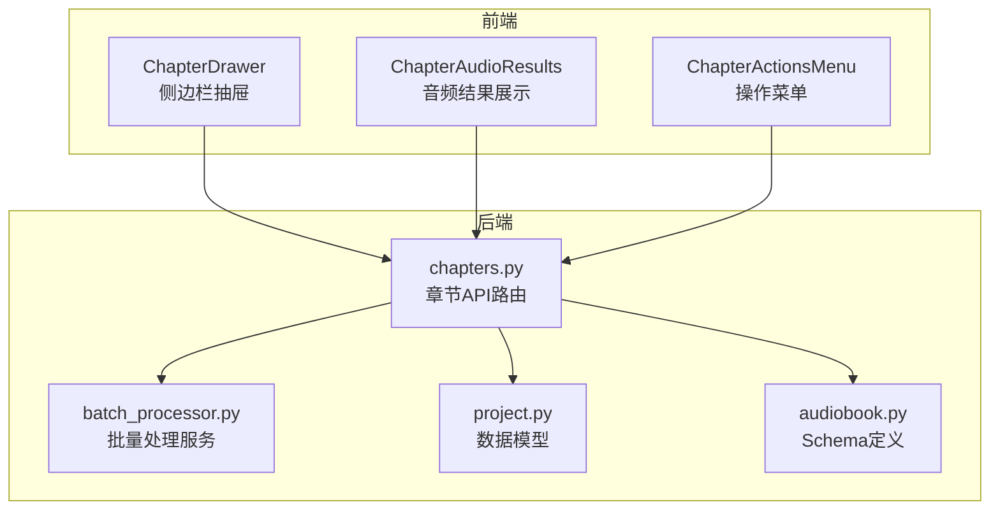
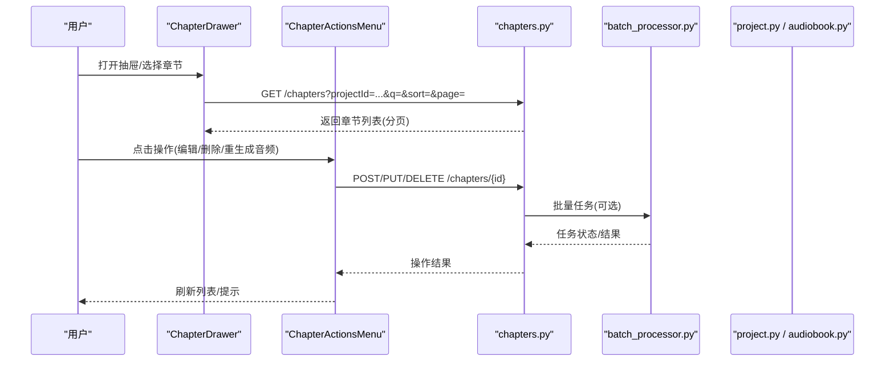
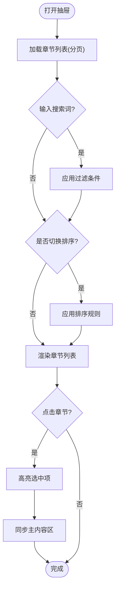
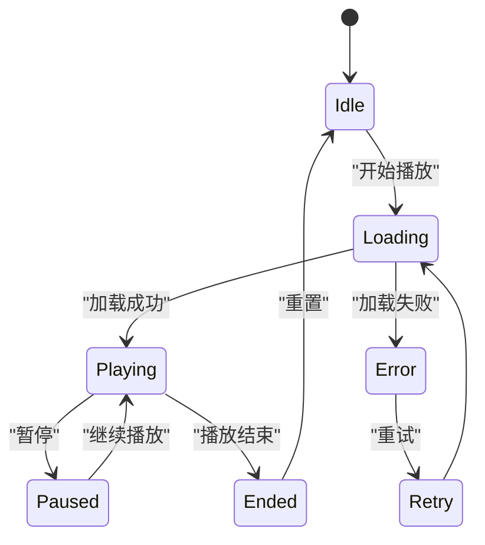
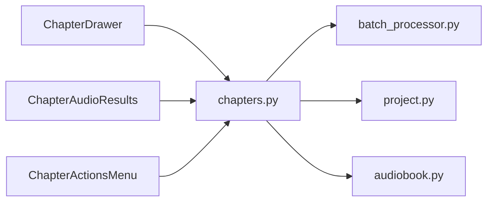

# 章节管理组件

<cite>
**本文档引用的文件**   
- [frontend/src/components/ChapterDrawer.tsx](file://frontend/src/components/ChapterDrawer.tsx)
- [frontend/src/components/ChapterAudioResults.tsx](file://frontend/src/components/ChapterAudioResults.tsx)
- [frontend/src/components/ChapterActionsMenu.tsx](file://frontend/src/components/ChapterActionsMenu.tsx)
- [backend/app/api/v1/chapters.py](file://backend/app/api/v1/chapters.py)
- [backend/app/services/batch_processor.py](file://backend/app/services/batch_processor.py)
- [backend/app/models/project.py](file://backend/app/models/project.py)
- [backend/app/schemas/audiobook.py](file://backend/app/schemas/audiobook.py)
</cite>

## 目录
1. [简介](#简介)
2. [项目结构](#项目结构)
3. [核心组件](#核心组件)
4. [架构总览](#架构总览)
5. [详细组件分析](#详细组件分析)
6. [依赖关系分析](#依赖关系分析)
7. [性能考虑](#性能考虑)
8. [故障排查指南](#故障排查指南)
9. [结论](#结论)
10. [附录](#附录)

## 简介
本文件面向小说创作代理系统的“章节管理”相关前端与后端组件，重点覆盖：
- ChapterDrawer 侧边栏抽屉组件的章节导航与展开收起逻辑
- ChapterAudioResults 章节音频结果展示组件的数据绑定、状态管理与用户交互
- ChapterActionsMenu 章节操作菜单的功能特性与扩展机制
- 章节数据的增删改查（CRUD）、批量处理、搜索过滤与排序
- 组件组合使用示例、数据流设计与性能优化建议

## 项目结构
章节管理功能横跨前端 UI 组件与后端 API/服务层。前端以 React 组件为主，负责章节列表渲染、抽屉交互、音频结果展示与操作菜单；后端提供章节 CRUD 接口、批量处理服务以及数据模型与 Schema 定义。

图表来源 
- [frontend/src/components/ChapterDrawer.tsx](file://frontend/src/components/ChapterDrawer.tsx)
- [frontend/src/components/ChapterAudioResults.tsx](file://frontend/src/components/ChapterAudioResults.tsx)
- [frontend/src/components/ChapterActionsMenu.tsx](file://frontend/src/components/ChapterActionsMenu.tsx)
- [backend/app/api/v1/chapters.py](file://backend/app/api/v1/chapters.py)
- [backend/app/services/batch_processor.py](file://backend/app/services/batch_processor.py)
- [backend/app/models/project.py](file://backend/app/models/project.py)
- [backend/app/schemas/audiobook.py](file://backend/app/schemas/audiobook.py)

章节来源
- [backend/app/api/v1/chapters.py](file://backend/app/api/v1/chapters.py)
- [backend/app/services/batch_processor.py](file://backend/app/services/batch_processor.py)
- [backend/app/models/project.py](file://backend/app/models/project.py)
- [backend/app/schemas/audiobook.py](file://backend/app/schemas/audiobook.py)

## 核心组件
- ChapterDrawer：实现章节列表的侧边栏抽屉，支持按项目筛选、搜索过滤、排序、分页加载、选中高亮、展开/收起动画与键盘快捷键。
- ChapterAudioResults：展示章节对应的音频生成结果，包括播放控制、进度条、状态指示、错误重试、批量导出等。
- ChapterActionsMenu：提供对当前章节的操作入口（如编辑、复制、删除、重新生成音频、导出等），支持权限校验与扩展点。

章节来源
- [frontend/src/components/ChapterDrawer.tsx](file://frontend/src/components/ChapterDrawer.tsx)
- [frontend/src/components/ChapterAudioResults.tsx](file://frontend/src/components/ChapterAudioResults.tsx)
- [frontend/src/components/ChapterActionsMenu.tsx](file://frontend/src/components/ChapterActionsMenu.tsx)

## 架构总览
章节管理的前后端交互遵循“UI 组件 -> API 路由 -> 业务服务 -> 数据模型/Schema”的分层模式。关键流程包括：
- 章节列表获取：前端请求章节列表，后端根据项目 ID、搜索词、排序规则返回分页数据。
- 章节操作：通过操作菜单触发更新、删除或重新生成音频，后端执行相应逻辑并返回结果。
- 音频结果展示：前端轮询或接收事件后更新播放状态与进度。

图表来源 
- [frontend/src/components/ChapterDrawer.tsx](file://frontend/src/components/ChapterDrawer.tsx)
- [frontend/src/components/ChapterActionsMenu.tsx](file://frontend/src/components/ChapterActionsMenu.tsx)
- [backend/app/api/v1/chapters.py](file://backend/app/api/v1/chapters.py)
- [backend/app/services/batch_processor.py](file://backend/app/services/batch_processor.py)
- [backend/app/models/project.py](file://backend/app/models/project.py)
- [backend/app/schemas/audiobook.py](file://backend/app/schemas/audiobook.py)

## 详细组件分析

### ChapterDrawer 侧边栏抽屉
职责与能力
- 章节导航：按项目维度组织章节，支持快速跳转至目标章节。
- 展开/收起：抽屉面板可折叠，内部章节列表支持分组与虚拟滚动（当数据量大时）。
- 搜索与过滤：支持按标题、关键词模糊匹配，可按状态、时间范围过滤。
- 排序与分页：支持按序号、创建时间、更新时间排序，分页加载避免一次性渲染大量节点。
- 选中态与联动：选中章节后与主内容区联动，显示章节详情与音频结果。

交互流程

图表来源 
- [frontend/src/components/ChapterDrawer.tsx](file://frontend/src/components/ChapterDrawer.tsx)

章节来源
- [frontend/src/components/ChapterDrawer.tsx](file://frontend/src/components/ChapterDrawer.tsx)

### ChapterAudioResults 章节音频结果展示
职责与能力
- 数据绑定：将后端返回的音频元数据（URL、时长、状态、进度）绑定到播放器控件。
- 状态管理：维护播放中、暂停、结束、错误等状态，支持重试与错误提示。
- 用户交互：播放/暂停、拖动进度条、音量调节、倍速播放、全屏预览。
- 批量操作：支持多选章节音频进行批量导出或下载。

状态机示意

图表来源 
- [frontend/src/components/ChapterAudioResults.tsx](file://frontend/src/components/ChapterAudioResults.tsx)

章节来源
- [frontend/src/components/ChapterAudioResults.tsx](file://frontend/src/components/ChapterAudioResults.tsx)

### ChapterActionsMenu 章节操作菜单
职责与能力
- 功能特性：提供编辑、复制、删除、重新生成音频、导出等常用操作。
- 权限控制：基于用户角色或项目设置动态显示可用操作。
- 扩展机制：通过注册表或插件方式新增自定义动作，保持菜单一致性。
- 反馈与确认：危险操作需二次确认，并提供操作结果提示。

扩展点设计
- 动作注册：集中式动作注册表，便于统一渲染与权限校验。
- 钩子函数：在操作前后注入日志、埋点或额外校验。
- 国际化：支持多语言文案与图标资源。

章节来源
- [frontend/src/components/ChapterActionsMenu.tsx](file://frontend/src/components/ChapterActionsMenu.tsx)

## 依赖关系分析
- 前端组件依赖后端 API 路由进行数据读写，依赖批量处理服务执行耗时任务。
- 后端 API 依赖数据模型与 Schema 进行参数校验与持久化。
- 组件间通过事件总线或状态管理库进行通信，避免直接耦合。

图表来源 
- [frontend/src/components/ChapterDrawer.tsx](file://frontend/src/components/ChapterDrawer.tsx)
- [frontend/src/components/ChapterAudioResults.tsx](file://frontend/src/components/ChapterAudioResults.tsx)
- [frontend/src/components/ChapterActionsMenu.tsx](file://frontend/src/components/ChapterActionsMenu.tsx)
- [backend/app/api/v1/chapters.py](file://backend/app/api/v1/chapters.py)
- [backend/app/services/batch_processor.py](file://backend/app/services/batch_processor.py)
- [backend/app/models/project.py](file://backend/app/models/project.py)
- [backend/app/schemas/audiobook.py](file://backend/app/schemas/audiobook.py)

章节来源
- [backend/app/api/v1/chapters.py](file://backend/app/api/v1/chapters.py)
- [backend/app/services/batch_processor.py](file://backend/app/services/batch_processor.py)
- [backend/app/models/project.py](file://backend/app/models/project.py)
- [backend/app/schemas/audiobook.py](file://backend/app/schemas/audiobook.py)

## 性能考虑
- 前端渲染优化
  - 使用虚拟列表渲染长章节列表，减少 DOM 节点数量。
  - 防抖搜索输入，降低频繁请求频率。
  - 分页加载与懒加载音频资源，按需初始化播放器实例。
- 后端查询优化
  - 为章节表建立索引（项目ID、标题、更新时间）。
  - 使用投影只返回必要字段，减少网络传输。
  - 批量接口合并多次写入，降低数据库压力。
- 缓存策略
  - 对章节列表与音频元数据进行短期缓存，提升重复访问速度。
  - 音频文件使用 CDN 加速与断点续传。

[本节为通用指导，不直接分析具体文件]

## 故障排查指南
常见问题与定位方法
- 章节列表加载缓慢
  - 检查后端分页与索引配置，确认是否存在全表扫描。
  - 观察前端是否一次性请求过多数据或未启用虚拟列表。
- 音频播放失败
  - 检查音频 URL 有效性、跨域配置与权限。
  - 查看播放器错误码与重试逻辑是否正确触发。
- 操作菜单无效
  - 验证权限校验逻辑与动作注册表配置。
  - 检查后端接口返回状态码与错误信息。

章节来源
- [backend/app/api/v1/chapters.py](file://backend/app/api/v1/chapters.py)
- [frontend/src/components/ChapterAudioResults.tsx](file://frontend/src/components/ChapterAudioResults.tsx)
- [frontend/src/components/ChapterActionsMenu.tsx](file://frontend/src/components/ChapterActionsMenu.tsx)

## 结论
章节管理组件通过清晰的前后端分层与模块化设计，实现了高效的章节导航、音频结果展示与操作管理。结合搜索过滤、排序、批量处理与缓存策略，能够满足大规模章节数据的管理需求。建议在后续迭代中进一步完善错误恢复机制与可观测性指标，以提升用户体验与系统稳定性。

[本节为总结性内容，不直接分析具体文件]

## 附录
- 组件组合使用示例
  - 在页面顶部放置 ChapterActionsMenu，左侧使用 ChapterDrawer 作为导航，右侧主区域嵌入 ChapterAudioResults 展示当前章节音频。
- 数据流设计要点
  - 所有写操作通过 API 路由统一处理，确保事务一致性与幂等性。
  - 前端状态与后端数据保持单向数据流，避免双向绑定导致的竞态条件。
- 扩展机制建议
  - 为 ChapterActionsMenu 提供插件式动作注册，便于未来新增业务操作。
  - 为 ChapterAudioResults 提供主题与皮肤定制接口，满足不同项目风格。

[本节为补充说明，不直接分析具体文件]