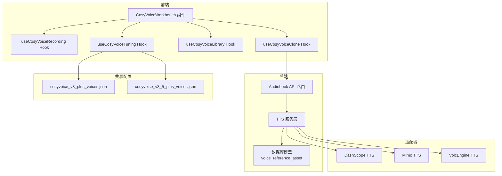
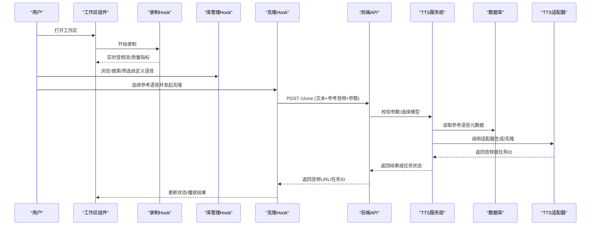
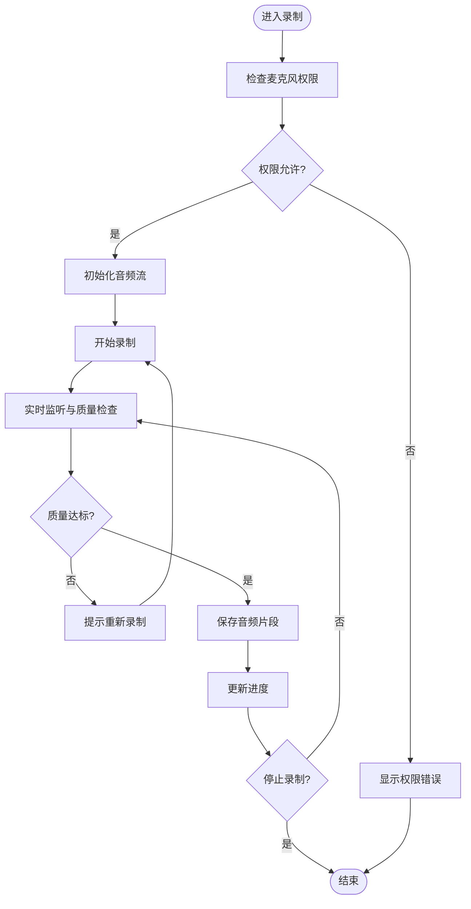
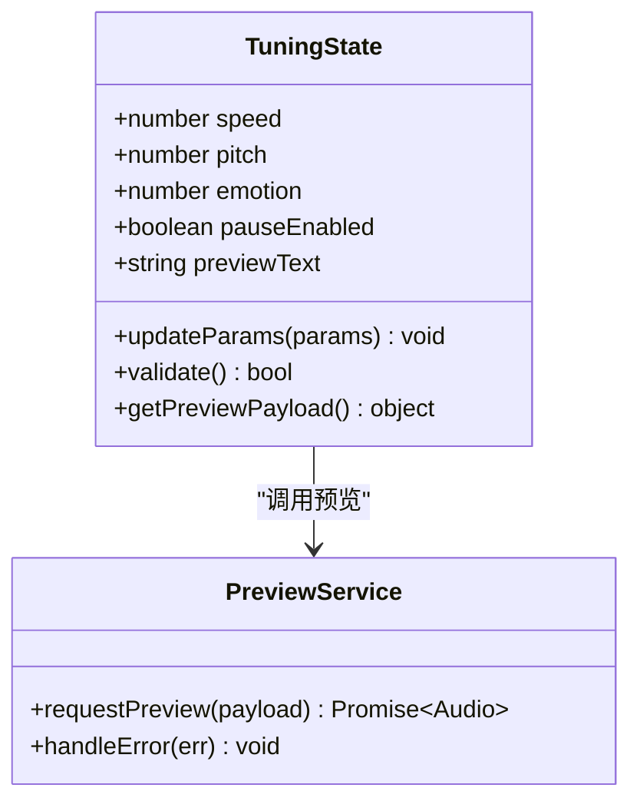
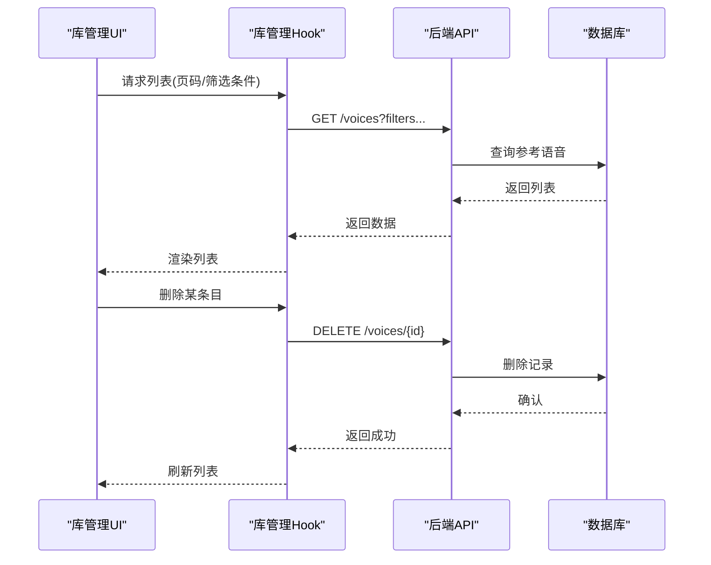
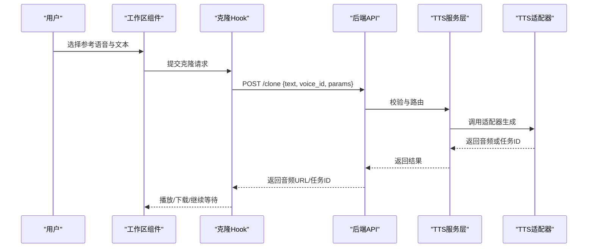
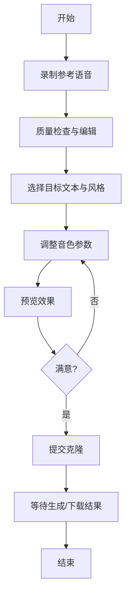
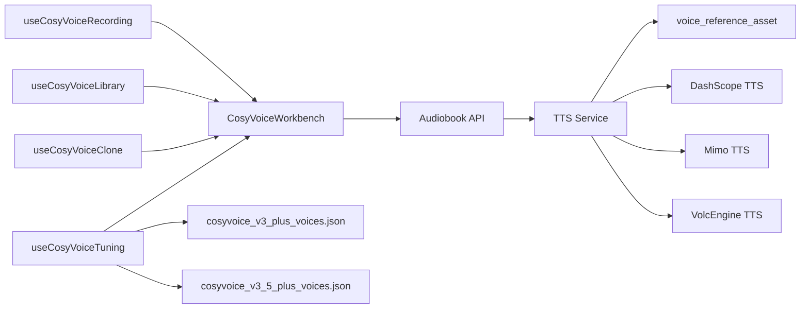

# CosyVoice语音克隆工作区

<cite>
**本文引用的文件**   
- [frontend/src/components/CosyVoiceWorkbench.tsx](file://frontend/src/components/CosyVoiceWorkbench.tsx)
- [frontend/src/hooks/useCosyVoiceRecording.ts](file://frontend/src/hooks/useCosyVoiceRecording.ts)
- [frontend/src/hooks/useCosyVoiceTuning.ts](file://frontend/src/hooks/useCosyVoiceTuning.ts)
- [frontend/src/hooks/useCosyVoiceLibrary.ts](file://frontend/src/hooks/useCosyVoiceLibrary.ts)
- [frontend/src/hooks/useCosyVoiceClone.ts](file://frontend/src/hooks/useCosyVoiceClone.ts)
- [backend/app/api/v1/audiobook.py](file://backend/app/api/v1/audiobook.py)
- [backend/app/services/audiobook/tts_service.py](file://backend/app/services/audiobook/tts_service.py)
- [backend/app/models/voice_reference_asset.py](file://backend/app/models/voice_reference_asset.py)
- [shared/cosyvoice_v3_plus_voices.json](file://shared/cosyvoice_v3_plus_voices.json)
- [shared/cosyvoice_v3_5_plus_voices.json](file://shared/cosyvoice_v3_5_plus_voices.json)
- [adapters/dashscope/tts.py](file://adapters/dashscope/tts.py)
- [adapters/mimo/tts.py](file://adapters/mimo/tts.py)
- [adapters/volcengine/tts.py](file://adapters/volcengine/tts.py)
- [scripts/debug_single_voice.py](file://scripts/debug_single_voice.py)
</cite>

## 目录
1. [简介](#简介)
2. [项目结构](#项目结构)
3. [核心组件](#核心组件)
4. [架构总览](#架构总览)
5. [详细组件分析](#详细组件分析)
6. [依赖关系分析](#依赖关系分析)
7. [性能考量](#性能考量)
8. [故障排查指南](#故障排查指南)
9. [结论](#结论)
10. [附录](#附录)

## 简介
本文件面向CosyVoice语音克隆工作区（CosyVoiceWorkbench）的开发者与使用者，系统性阐述其核心功能与实现要点，包括：
- 语音录制界面：实时监听、音频质量检查、录制进度显示与错误处理
- 音色设计面板：语速、音调、情感等参数的调节与实时预览
- 自定义语音列表管理：浏览、搜索、筛选与管理操作
- 语音克隆流程：完整步骤、API调用、状态管理与错误恢复
- 集成示例、最佳实践与常见问题解决方案

该工作区通过前端交互与后端服务协同，结合多模型适配器（如DashScope、Mimo、VolcEngine），提供端到端的语音克隆体验。

## 项目结构
CosyVoice工作区由前后端共同组成：
- 前端：React + TypeScript，包含工作区主组件、录制Hook、音色调优Hook、库管理Hook与克隆流程Hook
- 后端：FastAPI路由与服务层，负责TTS/克隆接口、资源持久化与任务编排
- 共享配置：CosyVoice音色清单与参数定义
- 适配器：对接不同TTS/克隆供应商

图表来源
- [frontend/src/components/CosyVoiceWorkbench.tsx](file://frontend/src/components/CosyVoiceWorkbench.tsx)
- [frontend/src/hooks/useCosyVoiceRecording.ts](file://frontend/src/hooks/useCosyVoiceRecording.ts)
- [frontend/src/hooks/useCosyVoiceTuning.ts](file://frontend/src/hooks/useCosyVoiceTuning.ts)
- [frontend/src/hooks/useCosyVoiceLibrary.ts](file://frontend/src/hooks/useCosyVoiceLibrary.ts)
- [frontend/src/hooks/useCosyVoiceClone.ts](file://frontend/src/hooks/useCosyVoiceClone.ts)
- [backend/app/api/v1/audiobook.py](file://backend/app/api/v1/audiobook.py)
- [backend/app/services/audiobook/tts_service.py](file://backend/app/services/audiobook/tts_service.py)
- [backend/app/models/voice_reference_asset.py](file://backend/app/models/voice_reference_asset.py)
- [shared/cosyvoice_v3_plus_voices.json](file://shared/cosyvoice_v3_plus_voices.json)
- [shared/cosyvoice_v3_5_plus_voices.json](file://shared/cosyvoice_v3_5_plus_voices.json)
- [adapters/dashscope/tts.py](file://adapters/dashscope/tts.py)
- [adapters/mimo/tts.py](file://adapters/mimo/tts.py)
- [adapters/volcengine/tts.py](file://adapters/volcengine/tts.py)

章节来源
- [frontend/src/components/CosyVoiceWorkbench.tsx](file://frontend/src/components/CosyVoiceWorkbench.tsx)
- [backend/app/api/v1/audiobook.py](file://backend/app/api/v1/audiobook.py)
- [backend/app/services/audiobook/tts_service.py](file://backend/app/services/audiobook/tts_service.py)
- [shared/cosyvoice_v3_plus_voices.json](file://shared/cosyvoice_v3_plus_voices.json)
- [shared/cosyvoice_v3_5_plus_voices.json](file://shared/cosyvoice_v3_5_plus_voices.json)

## 核心组件
- 工作区主组件：整合录制、音色调优、库管理与克隆流程，提供统一UI入口
- 录制Hook：封装浏览器录音能力，支持实时监听、质量检查、进度与错误处理
- 音色调优Hook：维护语速、音调、情感等参数，驱动实时预览
- 库管理Hook：管理自定义语音资产，支持浏览、搜索、筛选与删除等操作
- 克隆Hook：编排克隆流程，调用后端API，管理状态与重试

章节来源
- [frontend/src/components/CosyVoiceWorkbench.tsx](file://frontend/src/components/CosyVoiceWorkbench.tsx)
- [frontend/src/hooks/useCosyVoiceRecording.ts](file://frontend/src/hooks/useCosyVoiceRecording.ts)
- [frontend/src/hooks/useCosyVoiceTuning.ts](file://frontend/src/hooks/useCosyVoiceTuning.ts)
- [frontend/src/hooks/useCosyVoiceLibrary.ts](file://frontend/src/hooks/useCosyVoiceLibrary.ts)
- [frontend/src/hooks/useCosyVoiceClone.ts](file://frontend/src/hooks/useCosyVoiceClone.ts)

## 架构总览
整体采用“前端交互 + 后端服务 + 多模型适配器”的分层架构：
- 前端通过Hooks组织业务逻辑，保持组件简洁
- 后端以FastAPI暴露REST接口，服务层协调TTS/克隆任务与资源管理
- 适配器抽象不同供应商的TTS/克隆能力，便于扩展与替换

图表来源
- [frontend/src/components/CosyVoiceWorkbench.tsx](file://frontend/src/components/CosyVoiceWorkbench.tsx)
- [frontend/src/hooks/useCosyVoiceRecording.ts](file://frontend/src/hooks/useCosyVoiceRecording.ts)
- [frontend/src/hooks/useCosyVoiceLibrary.ts](file://frontend/src/hooks/useCosyVoiceLibrary.ts)
- [frontend/src/hooks/useCosyVoiceClone.ts](file://frontend/src/hooks/useCosyVoiceClone.ts)
- [backend/app/api/v1/audiobook.py](file://backend/app/api/v1/audiobook.py)
- [backend/app/services/audiobook/tts_service.py](file://backend/app/services/audiobook/tts_service.py)
- [backend/app/models/voice_reference_asset.py](file://backend/app/models/voice_reference_asset.py)
- [adapters/dashscope/tts.py](file://adapters/dashscope/tts.py)
- [adapters/mimo/tts.py](file://adapters/mimo/tts.py)
- [adapters/volcengine/tts.py](file://adapters/volcengine/tts.py)

## 详细组件分析

### 语音录制界面与Hook
- 实时监听：通过浏览器MediaRecorder或Web Audio API捕获麦克风输入，实时推送波形与音量指标
- 音频质量检查：检测静音段、削波、采样率与时长阈值，提示重新录制
- 录制进度显示：基于时间戳与缓冲区长度计算进度条
- 错误处理：权限拒绝、设备不可用、网络异常等场景的用户提示与降级策略

图表来源
- [frontend/src/hooks/useCosyVoiceRecording.ts](file://frontend/src/hooks/useCosyVoiceRecording.ts)

章节来源
- [frontend/src/hooks/useCosyVoiceRecording.ts](file://frontend/src/hooks/useCosyVoiceRecording.ts)

### 音色设计面板与Hook
- 参数调节：语速、音调、情感强度、停顿控制等滑块与开关
- 实时预览：根据当前参数组合触发轻量TTS预览，快速验证效果
- 参数校验：范围限制、互斥规则与默认值回退
- 状态同步：将最终参数序列化到克隆请求中

图表来源
- [frontend/src/hooks/useCosyVoiceTuning.ts](file://frontend/src/hooks/useCosyVoiceTuning.ts)

章节来源
- [frontend/src/hooks/useCosyVoiceTuning.ts](file://frontend/src/hooks/useCosyVoiceTuning.ts)
- [shared/cosyvoice_v3_plus_voices.json](file://shared/cosyvoice_v3_plus_voices.json)
- [shared/cosyvoice_v3_5_plus_voices.json](file://shared/cosyvoice_v3_5_plus_voices.json)

### 自定义语音列表管理
- 浏览：分页加载、缩略图与元数据展示
- 搜索：按名称、标签、创建时间模糊匹配
- 筛选：按来源（本地上传/系统音色）、质量等级、使用次数过滤
- 管理：重命名、删除、设为默认参考、批量操作

图表来源
- [frontend/src/hooks/useCosyVoiceLibrary.ts](file://frontend/src/hooks/useCosyVoiceLibrary.ts)
- [backend/app/api/v1/audiobook.py](file://backend/app/api/v1/audiobook.py)
- [backend/app/models/voice_reference_asset.py](file://backend/app/models/voice_reference_asset.py)

章节来源
- [frontend/src/hooks/useCosyVoiceLibrary.ts](file://frontend/src/hooks/useCosyVoiceLibrary.ts)
- [backend/app/api/v1/audiobook.py](file://backend/app/api/v1/audiobook.py)
- [backend/app/models/voice_reference_asset.py](file://backend/app/models/voice_reference_asset.py)

### 语音克隆流程与Hook
- 步骤说明：选择参考语音 -> 输入文本 -> 设置音色参数 -> 发起克隆 -> 获取结果/任务状态
- API调用：POST /clone，携带文本、参考音频ID、参数对象
- 状态管理：pending/processing/success/error，支持轮询或SSE回调
- 错误恢复：网络重试、参数修正、降级到备用模型

图表来源
- [frontend/src/hooks/useCosyVoiceClone.ts](file://frontend/src/hooks/useCosyVoiceClone.ts)
- [backend/app/api/v1/audiobook.py](file://backend/app/api/v1/audiobook.py)
- [backend/app/services/audiobook/tts_service.py](file://backend/app/services/audiobook/tts_service.py)
- [adapters/dashscope/tts.py](file://adapters/dashscope/tts.py)
- [adapters/mimo/tts.py](file://adapters/mimo/tts.py)
- [adapters/volcengine/tts.py](file://adapters/volcengine/tts.py)

章节来源
- [frontend/src/hooks/useCosyVoiceClone.ts](file://frontend/src/hooks/useCosyVoiceClone.ts)
- [backend/app/api/v1/audiobook.py](file://backend/app/api/v1/audiobook.py)
- [backend/app/services/audiobook/tts_service.py](file://backend/app/services/audiobook/tts_service.py)

### 概念性概览
以下流程图展示了从录制到克隆的整体用户体验路径，不直接映射具体代码文件：

[本图为概念性流程，无需源码引用]

## 依赖关系分析
- 前端Hooks之间低耦合，通过工作区组件聚合
- 后端服务层对数据库与适配器解耦，便于替换与扩展
- 共享音色清单为前端参数校验与默认值提供依据

图表来源
- [frontend/src/components/CosyVoiceWorkbench.tsx](file://frontend/src/components/CosyVoiceWorkbench.tsx)
- [frontend/src/hooks/useCosyVoiceRecording.ts](file://frontend/src/hooks/useCosyVoiceRecording.ts)
- [frontend/src/hooks/useCosyVoiceTuning.ts](file://frontend/src/hooks/useCosyVoiceTuning.ts)
- [frontend/src/hooks/useCosyVoiceLibrary.ts](file://frontend/src/hooks/useCosyVoiceLibrary.ts)
- [frontend/src/hooks/useCosyVoiceClone.ts](file://frontend/src/hooks/useCosyVoiceClone.ts)
- [backend/app/api/v1/audiobook.py](file://backend/app/api/v1/audiobook.py)
- [backend/app/services/audiobook/tts_service.py](file://backend/app/services/audiobook/tts_service.py)
- [backend/app/models/voice_reference_asset.py](file://backend/app/models/voice_reference_asset.py)
- [shared/cosyvoice_v3_plus_voices.json](file://shared/cosyvoice_v3_plus_voices.json)
- [shared/cosyvoice_v3_5_plus_voices.json](file://shared/cosyvoice_v3_5_plus_voices.json)
- [adapters/dashscope/tts.py](file://adapters/dashscope/tts.py)
- [adapters/mimo/tts.py](file://adapters/mimo/tts.py)
- [adapters/volcengine/tts.py](file://adapters/volcengine/tts.py)

章节来源
- [backend/app/api/v1/audiobook.py](file://backend/app/api/v1/audiobook.py)
- [backend/app/services/audiobook/tts_service.py](file://backend/app/services/audiobook/tts_service.py)
- [shared/cosyvoice_v3_plus_voices.json](file://shared/cosyvoice_v3_plus_voices.json)
- [shared/cosyvoice_v3_5_plus_voices.json](file://shared/cosyvoice_v3_5_plus_voices.json)

## 性能考量
- 录制阶段：限制采样率与缓冲大小，避免内存峰值；在低端设备上启用软降级
- 预览阶段：短文本、低采样率预览，减少首帧延迟
- 克隆阶段：异步任务与流式返回结合，提升长文本体验
- 缓存策略：热门音色与预览结果本地缓存，降低重复请求
- 并发控制：队列化克隆任务，防止后端过载

[本节为通用指导，无需源码引用]

## 故障排查指南
- 录制失败：检查浏览器权限、麦克风设备可用性、HTTPS环境要求
- 预览无响应：确认参数合法、网络可达、TTS服务健康
- 克隆失败：查看错误码与日志，必要时切换适配器或回退模型
- 列表加载慢：检查分页与索引，优化筛选条件

章节来源
- [scripts/debug_single_voice.py](file://scripts/debug_single_voice.py)

## 结论
CosyVoice工作区通过清晰的前后端分层与模块化Hooks，实现了完整的语音克隆体验。录制、音色调优、库管理与克隆流程相互独立又紧密协作，配合多模型适配器具备良好的可扩展性与稳定性。建议在生产环境中加强监控与限流，持续优化录制质量与生成性能。

[本节为总结，无需源码引用]

## 附录
- 集成示例：参考调试脚本与测试用例，快速验证单音色与WebSocket流程
- 最佳实践：合理设置预览与克隆参数，优先使用高质量参考音频
- 常见问题：权限、网络、格式兼容性等问题的定位与修复

[本节为补充信息，无需源码引用]