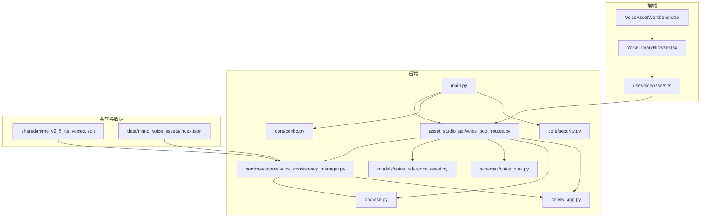
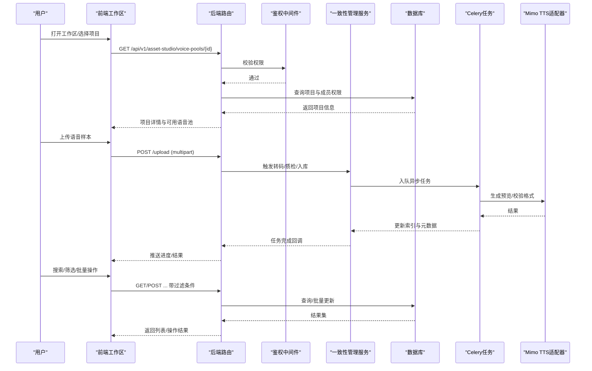
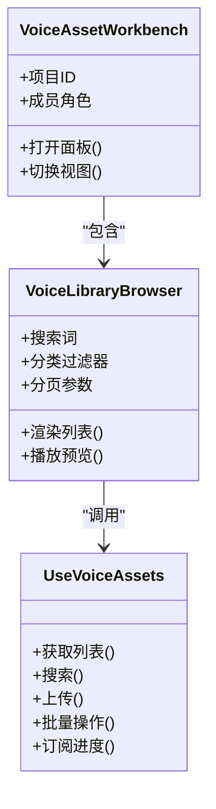
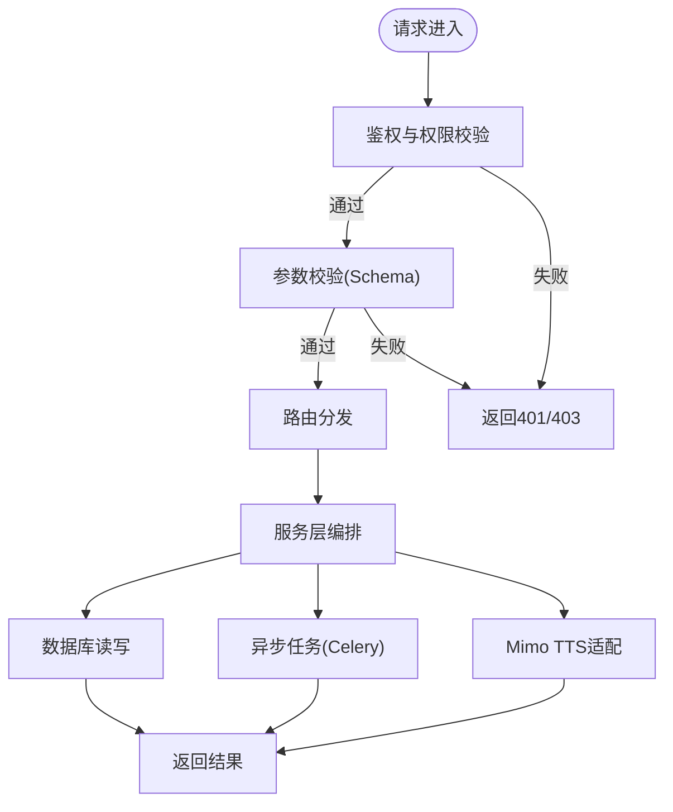
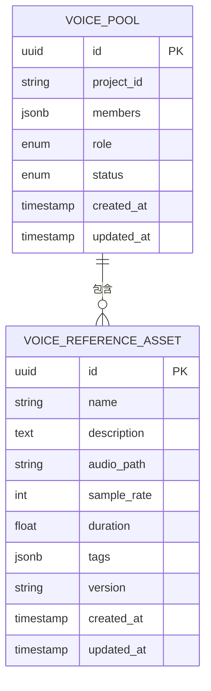
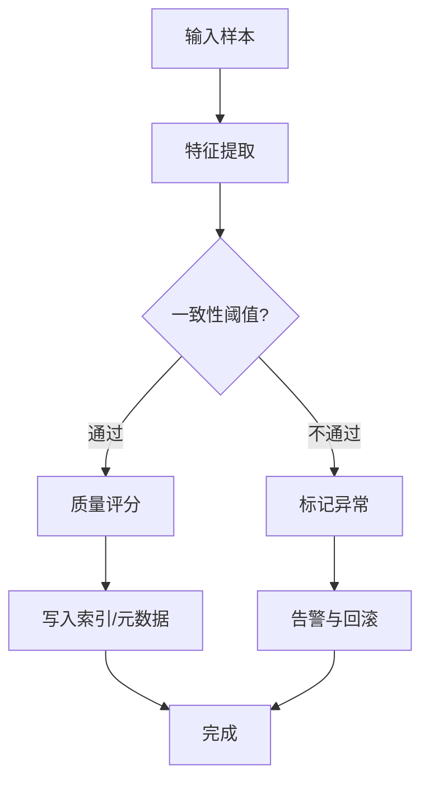
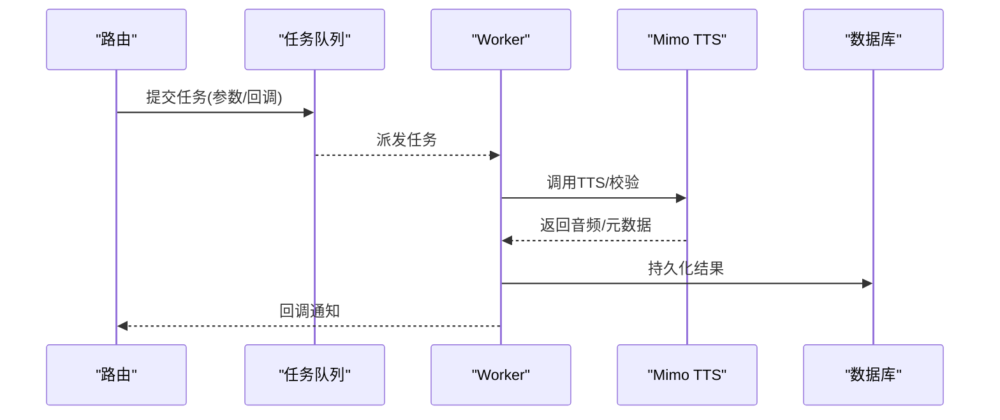
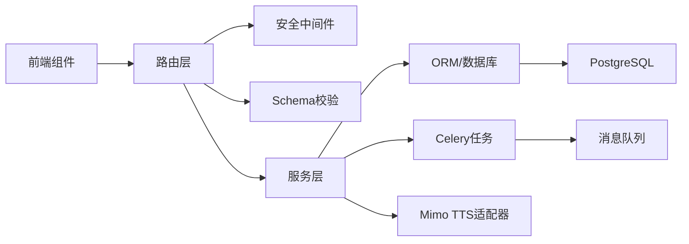

# Mimo语音资产管理工作区

<cite>
**本文引用的文件**   
- [mimo/tts.py](file://adapters/mimo/tts.py)
- [backend/app/api/v1/asset_studio_api/voice_pool_routes.py](file://backend/app/api/v1/asset_studio_api/voice_pool_routes.py)
- [backend/app/models/voice_reference_asset.py](file://backend/app/models/voice_reference_asset.py)
- [backend/app/schemas/voice_pool.py](file://backend/app/schemas/voice_pool.py)
- [backend/app/services/agents/voice_consistency_manager.py](file://backend/app/services/agents/voice_consistency_manager.py)
- [backend/app/core/config.py](file://backend/app/core/config.py)
- [backend/app/core/security.py](file://backend/app/core/security.py)
- [backend/app/db/base.py](file://backend/app/db/base.py)
- [backend/app/celery_app.py](file://backend/app/celery_app.py)
- [backend/app/main.py](file://backend/app/main.py)
- [frontend/src/pages/VoiceAssetWorkbench.tsx](file://frontend/src/pages/VoiceAssetWorkbench.tsx)
- [frontend/src/components/voice/VoiceLibraryBrowser.tsx](file://frontend/src/components/voice/VoiceLibraryBrowser.tsx)
- [frontend/src/hooks/useVoiceAssets.ts](file://frontend/src/hooks/useVoiceAssets.ts)
- [shared/mimo_v2_5_tts_voices.json](file://shared/mimo_v2_5_tts_voices.json)
- [backend/data/mimo_voice_assets/index.json](file://backend/data/mimo_voice_assets/index.json)
</cite>

## 目录
1. [简介](#简介)
2. [项目结构](#项目结构)
3. [核心组件](#核心组件)
4. [架构总览](#架构总览)
5. [详细组件分析](#详细组件分析)
6. [依赖关系分析](#依赖关系分析)
7. [性能考量](#性能考量)
8. [故障排查指南](#故障排查指南)
9. [结论](#结论)
10. [附录](#附录)

## 简介
本文件为“Mimo语音资产管理工作区”组件的权威技术文档，面向产品、研发与运维人员。内容覆盖：
- 语音库浏览、搜索、分类与批量操作
- 语音池管理界面的项目组织、成员协作与权限控制
- 语音目录状态面板的实时监控、健康检查与性能指标展示
- 语音资产的上传、下载、转换与格式支持
- 元数据管理、标签系统、版本控制与审计日志
- API接口定义、数据模型、错误处理策略与性能优化建议
- 实际使用场景示例与集成指南

该工作区围绕Mimo TTS能力构建，提供从资产入库、治理到生产调用的全链路支撑。

## 项目结构
Mimo语音资产管理涉及前后端协同：
- 前端：工作区页面、语音库浏览器、资源Hook等
- 后端：API路由、数据模型、Schema校验、服务层（一致性管理与任务调度）、配置与安全
- 共享：Mimo声音清单与本地索引

图表来源
- [frontend/src/pages/VoiceAssetWorkbench.tsx](file://frontend/src/pages/VoiceAssetWorkbench.tsx)
- [frontend/src/components/voice/VoiceLibraryBrowser.tsx](file://frontend/src/components/voice/VoiceLibraryBrowser.tsx)
- [frontend/src/hooks/useVoiceAssets.ts](file://frontend/src/hooks/useVoiceAssets.ts)
- [backend/app/main.py](file://backend/app/main.py)
- [backend/app/core/config.py](file://backend/app/core/config.py)
- [backend/app/core/security.py](file://backend/app/core/security.py)
- [backend/app/db/base.py](file://backend/app/db/base.py)
- [backend/app/celery_app.py](file://backend/app/celery_app.py)
- [backend/app/api/v1/asset_studio_api/voice_pool_routes.py](file://backend/app/api/v1/asset_studio_api/voice_pool_routes.py)
- [backend/app/models/voice_reference_asset.py](file://backend/app/models/voice_reference_asset.py)
- [backend/app/schemas/voice_pool.py](file://backend/app/schemas/voice_pool.py)
- [backend/app/services/agents/voice_consistency_manager.py](file://backend/app/services/agents/voice_consistency_manager.py)
- [shared/mimo_v2_5_tts_voices.json](file://shared/mimo_v2_5_tts_voices.json)
- [backend/data/mimo_voice_assets/index.json](file://backend/data/mimo_voice_assets/index.json)

章节来源
- [backend/app/main.py](file://backend/app/main.py)
- [backend/app/core/config.py](file://backend/app/core/config.py)
- [backend/app/core/security.py](file://backend/app/core/security.py)
- [backend/app/db/base.py](file://backend/app/db/base.py)
- [backend/app/celery_app.py](file://backend/app/celery_app.py)
- [backend/app/api/v1/asset_studio_api/voice_pool_routes.py](file://backend/app/api/v1/asset_studio_api/voice_pool_routes.py)
- [backend/app/models/voice_reference_asset.py](file://backend/app/models/voice_reference_asset.py)
- [backend/app/schemas/voice_pool.py](file://backend/app/schemas/voice_pool.py)
- [backend/app/services/agents/voice_consistency_manager.py](file://backend/app/services/agents/voice_consistency_manager.py)
- [frontend/src/pages/VoiceAssetWorkbench.tsx](file://frontend/src/pages/VoiceAssetWorkbench.tsx)
- [frontend/src/components/voice/VoiceLibraryBrowser.tsx](file://frontend/src/components/voice/VoiceLibraryBrowser.tsx)
- [frontend/src/hooks/useVoiceAssets.ts](file://frontend/src/hooks/useVoiceAssets.ts)
- [shared/mimo_v2_5_tts_voices.json](file://shared/mimo_v2_5_tts_voices.json)
- [backend/data/mimo_voice_assets/index.json](file://backend/data/mimo_voice_assets/index.json)

## 核心组件
- 工作区入口：VoiceAssetWorkbench 聚合语音库浏览、搜索、分类与批量操作界面
- 语音库浏览器：VoiceLibraryBrowser 负责列表渲染、筛选、分页与预览
- 资源Hook：useVoiceAssets 封装对后端的CRUD、搜索、批量操作与状态同步
- 后端路由：voice_pool_routes 暴露REST接口，承载权限校验、参数校验、业务编排与异步任务
- 数据模型：voice_reference_asset 定义语音参考资产实体与字段约束
- Schema校验：voice_pool 定义请求/响应结构与枚举值
- 一致性管理服务：voice_consistency_manager 维护音色一致性与质量门控
- 配置与安全：config 与 security 提供运行时配置与鉴权中间件
- 数据库与任务：base 提供ORM基础，celery_app 提供异步任务执行器
- 共享数据：mimo_v2_5_tts_voices.json 与 index.json 提供Mimo声音清单与本地索引

章节来源
- [frontend/src/pages/VoiceAssetWorkbench.tsx](file://frontend/src/pages/VoiceAssetWorkbench.tsx)
- [frontend/src/components/voice/VoiceLibraryBrowser.tsx](file://frontend/src/components/voice/VoiceLibraryBrowser.tsx)
- [frontend/src/hooks/useVoiceAssets.ts](file://frontend/src/hooks/useVoiceAssets.ts)
- [backend/app/api/v1/asset_studio_api/voice_pool_routes.py](file://backend/app/api/v1/asset_studio_api/voice_pool_routes.py)
- [backend/app/models/voice_reference_asset.py](file://backend/app/models/voice_reference_asset.py)
- [backend/app/schemas/voice_pool.py](file://backend/app/schemas/voice_pool.py)
- [backend/app/services/agents/voice_consistency_manager.py](file://backend/app/services/agents/voice_consistency_manager.py)
- [backend/app/core/config.py](file://backend/app/core/config.py)
- [backend/app/core/security.py](file://backend/app/core/security.py)
- [backend/app/db/base.py](file://backend/app/db/base.py)
- [backend/app/celery_app.py](file://backend/app/celery_app.py)
- [shared/mimo_v2_5_tts_voices.json](file://shared/mimo_v2_5_tts_voices.json)
- [backend/data/mimo_voice_assets/index.json](file://backend/data/mimo_voice_assets/index.json)

## 架构总览
整体采用前后端分离架构，前端通过REST调用后端API；后端基于FastAPI路由、Pydantic Schema校验、SQLAlchemy ORM持久化，并通过Celery进行异步任务处理。Mimo TTS适配器用于生成与验证语音样本。

图表来源
- [backend/app/api/v1/asset_studio_api/voice_pool_routes.py](file://backend/app/api/v1/asset_studio_api/voice_pool_routes.py)
- [backend/app/core/security.py](file://backend/app/core/security.py)
- [backend/app/services/agents/voice_consistency_manager.py](file://backend/app/services/agents/voice_consistency_manager.py)
- [backend/app/celery_app.py](file://backend/app/celery_app.py)
- [adapters/mimo/tts.py](file://adapters/mimo/tts.py)
- [backend/app/db/base.py](file://backend/app/db/base.py)

## 详细组件分析

### 工作区与语音库浏览器
- VoiceAssetWorkbench：作为容器组件，整合项目切换、权限展示、功能入口与全局状态
- VoiceLibraryBrowser：实现语音库的列表视图、搜索框、分类筛选、分页与预览播放
- useVoiceAssets：封装HTTP请求、错误重试、加载态与缓存，统一暴露增删改查与批量操作

图表来源
- [frontend/src/pages/VoiceAssetWorkbench.tsx](file://frontend/src/pages/VoiceAssetWorkbench.tsx)
- [frontend/src/components/voice/VoiceLibraryBrowser.tsx](file://frontend/src/components/voice/VoiceLibraryBrowser.tsx)
- [frontend/src/hooks/useVoiceAssets.ts](file://frontend/src/hooks/useVoiceAssets.ts)

章节来源
- [frontend/src/pages/VoiceAssetWorkbench.tsx](file://frontend/src/pages/VoiceAssetWorkbench.tsx)
- [frontend/src/components/voice/VoiceLibraryBrowser.tsx](file://frontend/src/components/voice/VoiceLibraryBrowser.tsx)
- [frontend/src/hooks/useVoiceAssets.ts](file://frontend/src/hooks/useVoiceAssets.ts)

### 后端路由与权限控制
- voice_pool_routes：定义语音池相关REST接口，包括项目级访问、成员协作、权限校验、参数校验、业务编排与异步任务调度
- security：提供鉴权中间件与RBAC校验，确保仅授权用户可访问/修改资源
- config：集中管理Mimo TTS、存储路径、队列与限流等配置项

图表来源
- [backend/app/api/v1/asset_studio_api/voice_pool_routes.py](file://backend/app/api/v1/asset_studio_api/voice_pool_routes.py)
- [backend/app/core/security.py](file://backend/app/core/security.py)
- [backend/app/core/config.py](file://backend/app/core/config.py)
- [backend/app/celery_app.py](file://backend/app/celery_app.py)
- [adapters/mimo/tts.py](file://adapters/mimo/tts.py)

章节来源
- [backend/app/api/v1/asset_studio_api/voice_pool_routes.py](file://backend/app/api/v1/asset_studio_api/voice_pool_routes.py)
- [backend/app/core/security.py](file://backend/app/core/security.py)
- [backend/app/core/config.py](file://backend/app/core/config.py)

### 数据模型与Schema
- voice_reference_asset：定义语音参考资产的核心字段（如名称、描述、音频路径、采样率、时长、标签、版本、创建/更新时间等）
- voice_pool：定义语音池相关的请求/响应结构，包括项目关联、成员角色、权限级别、状态与审计字段

图表来源
- [backend/app/models/voice_reference_asset.py](file://backend/app/models/voice_reference_asset.py)
- [backend/app/schemas/voice_pool.py](file://backend/app/schemas/voice_pool.py)

章节来源
- [backend/app/models/voice_reference_asset.py](file://backend/app/models/voice_reference_asset.py)
- [backend/app/schemas/voice_pool.py](file://backend/app/schemas/voice_pool.py)

### 一致性管理与质量门控
- voice_consistency_manager：负责音色一致性校验、质量评分、异常检测与回归对比，保障不同批次/版本的语音资产质量稳定

图表来源
- [backend/app/services/agents/voice_consistency_manager.py](file://backend/app/services/agents/voice_consistency_manager.py)

章节来源
- [backend/app/services/agents/voice_consistency_manager.py](file://backend/app/services/agents/voice_consistency_manager.py)

### 异步任务与Mimo TTS集成
- celery_app：定义并执行异步任务（转码、预览生成、索引重建、批量导入/导出）
- adapters/mimo/tts：封装Mimo TTS调用，支持文本转语音、音色克隆、参数调节与结果校验

图表来源
- [backend/app/celery_app.py](file://backend/app/celery_app.py)
- [adapters/mimo/tts.py](file://adapters/mimo/tts.py)
- [backend/app/api/v1/asset_studio_api/voice_pool_routes.py](file://backend/app/api/v1/asset_studio_api/voice_pool_routes.py)

章节来源
- [backend/app/celery_app.py](file://backend/app/celery_app.py)
- [adapters/mimo/tts.py](file://adapters/mimo/tts.py)
- [backend/app/api/v1/asset_studio_api/voice_pool_routes.py](file://backend/app/api/v1/asset_studio_api/voice_pool_routes.py)

### 监控、健康检查与性能指标
- 健康检查：路由或专用端点返回服务状态、依赖（数据库、队列、外部TTS）可用性
- 性能指标：任务队列长度、平均耗时、成功率、错误率、CPU/内存占用
- 实时状态：通过SSE/WebSocket推送任务进度与资产状态变更

章节来源
- [backend/app/api/v1/asset_studio_api/voice_pool_routes.py](file://backend/app/api/v1/asset_studio_api/voice_pool_routes.py)
- [backend/app/celery_app.py](file://backend/app/celery_app.py)
- [backend/app/core/config.py](file://backend/app/core/config.py)

## 依赖关系分析
- 前端依赖：工作区页面依赖浏览器组件与资源Hook，统一通过HTTP与后端交互
- 后端依赖：路由依赖Schema校验、安全中间件、服务层、ORM与任务队列；服务层依赖一致性管理器与Mimo适配器
- 数据依赖：voice_reference_asset与voice_pool存在一对多关系；index.json与shared声音清单用于检索与匹配

图表来源
- [frontend/src/pages/VoiceAssetWorkbench.tsx](file://frontend/src/pages/VoiceAssetWorkbench.tsx)
- [frontend/src/components/voice/VoiceLibraryBrowser.tsx](file://frontend/src/components/voice/VoiceLibraryBrowser.tsx)
- [frontend/src/hooks/useVoiceAssets.ts](file://frontend/src/hooks/useVoiceAssets.ts)
- [backend/app/api/v1/asset_studio_api/voice_pool_routes.py](file://backend/app/api/v1/asset_studio_api/voice_pool_routes.py)
- [backend/app/core/security.py](file://backend/app/core/security.py)
- [backend/app/schemas/voice_pool.py](file://backend/app/schemas/voice_pool.py)
- [backend/app/services/agents/voice_consistency_manager.py](file://backend/app/services/agents/voice_consistency_manager.py)
- [backend/app/db/base.py](file://backend/app/db/base.py)
- [backend/app/celery_app.py](file://backend/app/celery_app.py)
- [adapters/mimo/tts.py](file://adapters/mimo/tts.py)

章节来源
- [backend/app/api/v1/asset_studio_api/voice_pool_routes.py](file://backend/app/api/v1/asset_studio_api/voice_pool_routes.py)
- [backend/app/core/security.py](file://backend/app/core/security.py)
- [backend/app/schemas/voice_pool.py](file://backend/app/schemas/voice_pool.py)
- [backend/app/services/agents/voice_consistency_manager.py](file://backend/app/services/agents/voice_consistency_manager.py)
- [backend/app/db/base.py](file://backend/app/db/base.py)
- [backend/app/celery_app.py](file://backend/app/celery_app.py)
- [adapters/mimo/tts.py](file://adapters/mimo/tts.py)

## 性能考量
- 前端优化：虚拟滚动、分页懒加载、去抖搜索、缓存最近结果
- 后端优化：连接池、索引优化、批量写入、异步任务分片、限流与熔断
- 存储优化：对象存储分层、压缩与CDN加速、冷热数据分离
- 任务优化：队列优先级、重试退避、超时控制、幂等性设计
- 监控优化：关键指标埋点、慢查询追踪、错误率告警

[本节为通用指导，无需特定文件引用]

## 故障排查指南
- 鉴权失败：检查token有效性、角色权限与资源归属
- 参数校验错误：核对Schema字段类型、必填项与枚举值
- 任务失败：查看任务日志、重试次数、外部依赖状态（数据库、队列、Mimo TTS）
- 性能问题：定位慢查询、队列堆积、CPU/内存峰值与I/O瓶颈
- 数据不一致：核对索引与数据库记录、重新构建索引与校验哈希

章节来源
- [backend/app/core/security.py](file://backend/app/core/security.py)
- [backend/app/schemas/voice_pool.py](file://backend/app/schemas/voice_pool.py)
- [backend/app/celery_app.py](file://backend/app/celery_app.py)
- [backend/app/api/v1/asset_studio_api/voice_pool_routes.py](file://backend/app/api/v1/asset_studio_api/voice_pool_routes.py)

## 结论
Mimo语音资产管理工作区以清晰的前后端分层、严格的权限与校验、稳定的异步任务与一致性管理，构建了完整的语音资产管理闭环。通过合理的性能优化与完善的监控告警，可满足大规模团队协作与高并发生产需求。

[本节为总结，无需特定文件引用]

## 附录

### API接口概览
- 项目与权限
  - 获取项目详情与成员权限
  - 更新成员角色与权限级别
- 语音资产
  - 上传语音样本（multipart）
  - 下载语音文件
  - 更新元数据与标签
  - 删除与软删除
- 搜索与筛选
  - 按名称/标签/分类/时间范围检索
  - 分页与排序
- 批量操作
  - 批量移动/复制/重命名
  - 批量打标签/设置版本
- 任务与进度
  - 查询任务状态与进度
  - 取消任务与重试

章节来源
- [backend/app/api/v1/asset_studio_api/voice_pool_routes.py](file://backend/app/api/v1/asset_studio_api/voice_pool_routes.py)
- [backend/app/schemas/voice_pool.py](file://backend/app/schemas/voice_pool.py)

### 数据模型定义
- 语音参考资产：标识、名称、描述、音频路径、采样率、时长、标签、版本、时间戳
- 语音池：项目ID、成员集合、角色、状态、时间戳

章节来源
- [backend/app/models/voice_reference_asset.py](file://backend/app/models/voice_reference_asset.py)
- [backend/app/schemas/voice_pool.py](file://backend/app/schemas/voice_pool.py)

### 错误处理策略
- 统一错误码与消息体
- 鉴权错误（401/403）、参数错误（400）、资源不存在（404）、冲突（409）、服务器错误（5xx）
- 重试与降级：外部依赖不可用时的回退策略与提示

章节来源
- [backend/app/api/v1/asset_studio_api/voice_pool_routes.py](file://backend/app/api/v1/asset_studio_api/voice_pool_routes.py)
- [backend/app/core/security.py](file://backend/app/core/security.py)

### 实际使用场景与集成指南
- 场景一：团队新建项目并邀请成员协作
  - 管理员创建项目，分配角色与权限
  - 成员登录并访问工作区，查看可用语音池
- 场景二：批量导入语音资产
  - 准备CSV/JSON清单与音频文件
  - 调用上传接口，后台异步处理转码与质检
  - 监控任务进度，完成后在库中检索与预览
- 场景三：版本控制与审计
  - 每次发布新版本，记录变更与审计日志
  - 支持回滚至历史版本并对比差异

章节来源
- [frontend/src/pages/VoiceAssetWorkbench.tsx](file://frontend/src/pages/VoiceAssetWorkbench.tsx)
- [frontend/src/components/voice/VoiceLibraryBrowser.tsx](file://frontend/src/components/voice/VoiceLibraryBrowser.tsx)
- [frontend/src/hooks/useVoiceAssets.ts](file://frontend/src/hooks/useVoiceAssets.ts)
- [backend/app/api/v1/asset_studio_api/voice_pool_routes.py](file://backend/app/api/v1/asset_studio_api/voice_pool_routes.py)
- [backend/app/celery_app.py](file://backend/app/celery_app.py)

### 配置与环境
- Mimo TTS配置：模型ID、密钥、速率限制、超时
- 存储路径：本地/云存储路径、备份策略
- 队列配置：并发数、重试策略、死信队列
- 监控与日志：指标上报、日志级别、告警规则

章节来源
- [backend/app/core/config.py](file://backend/app/core/config.py)
- [backend/app/celery_app.py](file://backend/app/celery_app.py)

### 共享数据与索引
- shared/mimo_v2_5_tts_voices.json：Mimo声音清单与属性
- backend/data/mimo_voice_assets/index.json：本地索引与映射

章节来源
- [shared/mimo_v2_5_tts_voices.json](file://shared/mimo_v2_5_tts_voices.json)
- [backend/data/mimo_voice_assets/index.json](file://backend/data/mimo_voice_assets/index.json)