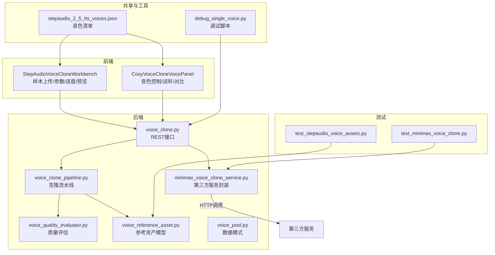
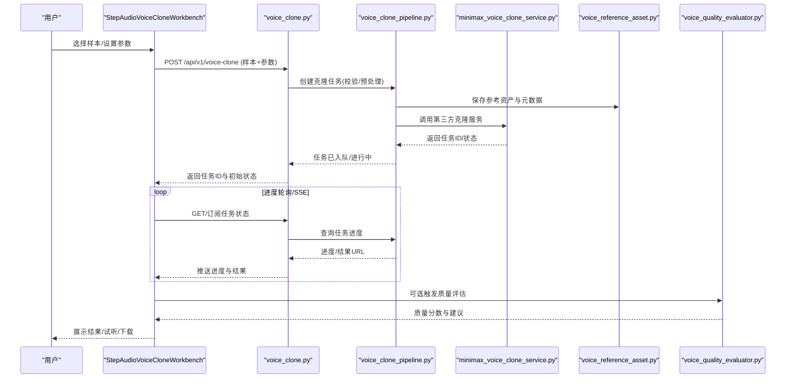
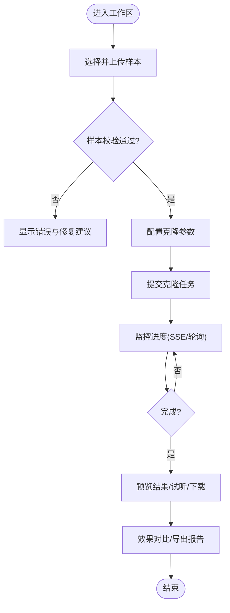
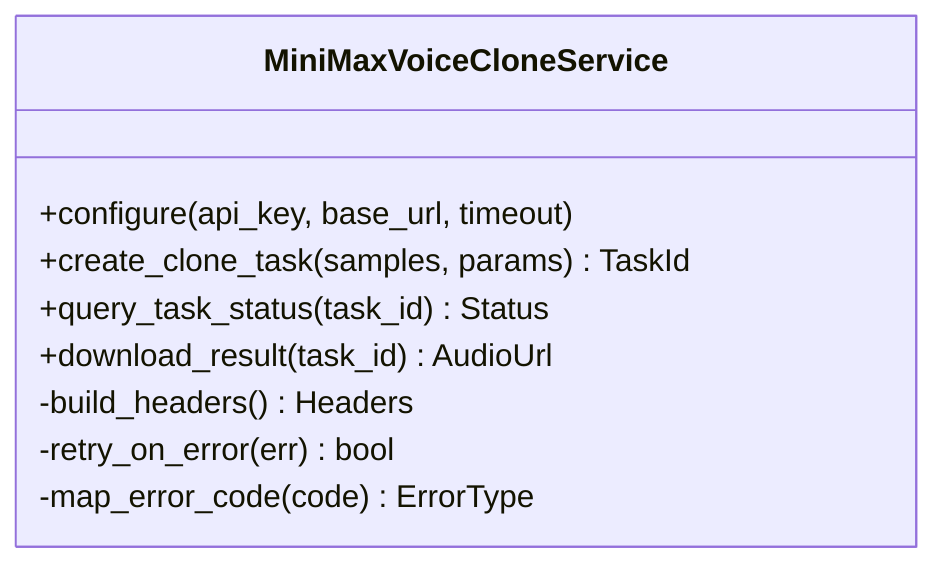
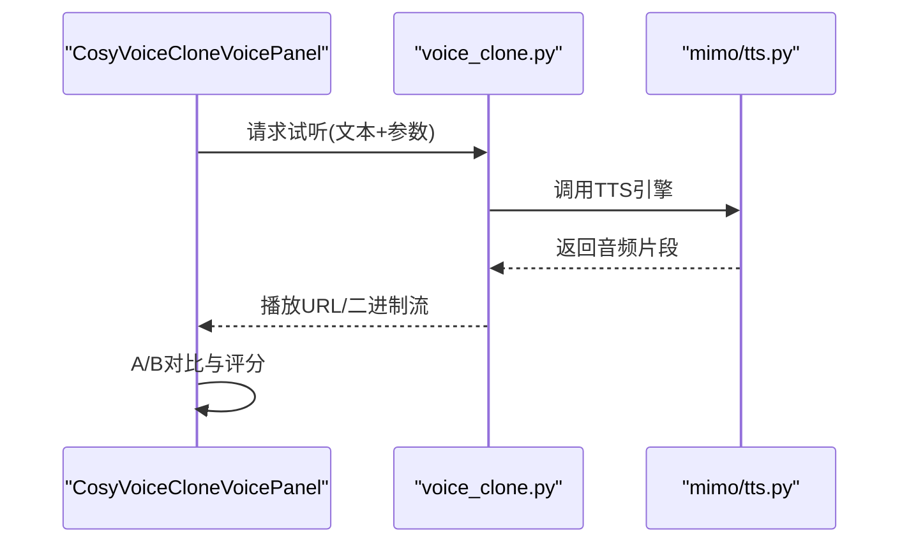
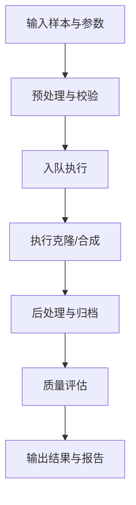
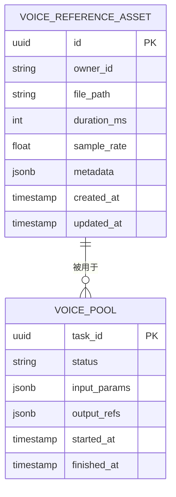
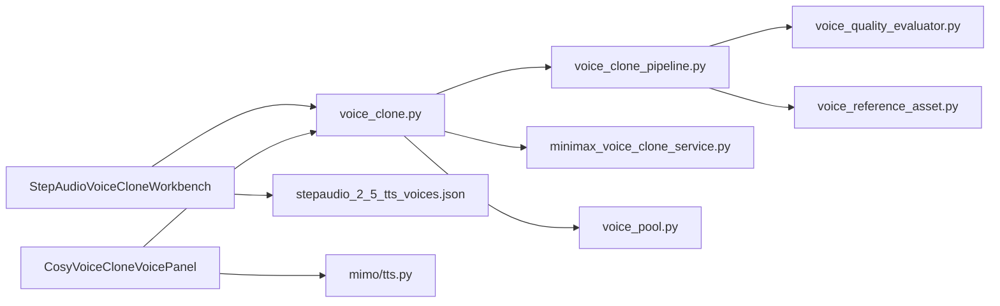

# StepAudio语音克隆工作区

<cite>
**本文引用的文件**   
- [frontend/src/components/voice/StepAudioVoiceCloneWorkbench.tsx](file://frontend/src/components/voice/StepAudioVoiceCloneWorkbench.tsx)
- [frontend/src/components/voice/CosyVoiceCloneVoicePanel.tsx](file://frontend/src/components/voice/CosyVoiceCloneVoicePanel.tsx)
- [backend/app/api/v1/audiobook_api/voice_clone.py](file://backend/app/api/v1/audiobook_api/voice_clone.py)
- [backend/app/services/providers/minimax_voice_clone_service.py](file://backend/app/services/providers/minimax_voice_clone_service.py)
- [backend/app/schemas/voice_pool.py](file://backend/app/schemas/voice_pool.py)
- [shared/stepaudio_2_5_tts_voices.json](file://shared/stepaudio_2_5_tts_voices.json)
- [adapters/mimo/tts.py](file://adapters/mimo/tts.py)
- [backend/app/models/voice_reference_asset.py](file://backend/app/models/voice_reference_asset.py)
- [backend/app/services/audiobook/voice_clone_pipeline.py](file://backend/app/services/audiobook/voice_clone_pipeline.py)
- [backend/app/services/audiobook/voice_quality_evaluator.py](file://backend/app/services/audiobook/voice_quality_evaluator.py)
- [scripts/debug_single_voice.py](file://scripts/debug_single_voice.py)
- [tests/test_minimax_voice_clone.py](file://tests/test_minimax_voice_clone.py)
- [tests/test_stepaudio_voice_assets.py](file://tests/test_stepaudio_voice_assets.py)
</cite>

## 目录
1. [简介](#简介)
2. [项目结构](#项目结构)
3. [核心组件](#核心组件)
4. [架构总览](#架构总览)
5. [详细组件分析](#详细组件分析)
6. [依赖关系分析](#依赖关系分析)
7. [性能考量](#性能考量)
8. [故障排除指南](#故障排除指南)
9. [结论](#结论)
10. [附录](#附录)

## 简介
本文件面向StepAudio语音克隆工作区的开发者与使用者，系统性说明前端工作区、后端服务与第三方集成之间的关系，覆盖样本上传、克隆参数配置、进度监控、结果预览、质量评估与优化建议。重点包括：
- StepAudioVoiceCloneWorkbench：样本上传、参数配置、进度与结果预览
- MiniMaxVoiceCloneWorkbench（后端服务）：API认证、请求封装、响应处理与重试机制
- CosyVoiceCloneVoicePanel：音色控制面板、参数调节、实时试听与效果对比
- 质量评估标准、最佳实践、扩展方法与故障排查

## 项目结构
StepAudio语音克隆涉及前后端协作：
- 前端：工作区组件与音色面板
- 后端：REST API、服务层、模型适配与数据模型
- 共享资源：音色清单与调试脚本
- 测试：端到端与单测用例

图表来源 
- [frontend/src/components/voice/StepAudioVoiceCloneWorkbench.tsx](file://frontend/src/components/voice/StepAudioVoiceCloneWorkbench.tsx)
- [frontend/src/components/voice/CosyVoiceCloneVoicePanel.tsx](file://frontend/src/components/voice/CosyVoiceCloneVoicePanel.tsx)
- [backend/app/api/v1/audiobook_api/voice_clone.py](file://backend/app/api/v1/audiobook_api/voice_clone.py)
- [backend/app/services/providers/minimax_voice_clone_service.py](file://backend/app/services/providers/minimax_voice_clone_service.py)
- [backend/app/services/audiobook/voice_clone_pipeline.py](file://backend/app/services/audiobook/voice_clone_pipeline.py)
- [backend/app/services/audiobook/voice_quality_evaluator.py](file://backend/app/services/audiobook/voice_quality_evaluator.py)
- [backend/app/models/voice_reference_asset.py](file://backend/app/models/voice_reference_asset.py)
- [backend/app/schemas/voice_pool.py](file://backend/app/schemas/voice_pool.py)
- [shared/stepaudio_2_5_tts_voices.json](file://shared/stepaudio_2_5_tts_voices.json)
- [scripts/debug_single_voice.py](file://scripts/debug_single_voice.py)
- [tests/test_minimax_voice_clone.py](file://tests/test_minimax_voice_clone.py)
- [tests/test_stepaudio_voice_assets.py](file://tests/test_stepaudio_voice_assets.py)

章节来源
- [frontend/src/components/voice/StepAudioVoiceCloneWorkbench.tsx](file://frontend/src/components/voice/StepAudioVoiceCloneWorkbench.tsx)
- [frontend/src/components/voice/CosyVoiceCloneVoicePanel.tsx](file://frontend/src/components/voice/CosyVoiceCloneVoicePanel.tsx)
- [backend/app/api/v1/audiobook_api/voice_clone.py](file://backend/app/api/v1/audiobook_api/voice_clone.py)
- [backend/app/services/providers/minimax_voice_clone_service.py](file://backend/app/services/providers/minimax_voice_clone_service.py)
- [backend/app/services/audiobook/voice_clone_pipeline.py](file://backend/app/services/audiobook/voice_clone_pipeline.py)
- [backend/app/services/audiobook/voice_quality_evaluator.py](file://backend/app/services/audiobook/voice_quality_evaluator.py)
- [backend/app/models/voice_reference_asset.py](file://backend/app/models/voice_reference_asset.py)
- [backend/app/schemas/voice_pool.py](file://backend/app/schemas/voice_pool.py)
- [shared/stepaudio_2_5_tts_voices.json](file://shared/stepaudio_2_5_tts_voices.json)
- [scripts/debug_single_voice.py](file://scripts/debug_single_voice.py)
- [tests/test_minimax_voice_clone.py](file://tests/test_minimax_voice_clone.py)
- [tests/test_stepaudio_voice_assets.py](file://tests/test_stepaudio_voice_assets.py)

## 核心组件
- StepAudioVoiceCloneWorkbench：提供样本上传、克隆参数配置、任务提交、进度监控与结果预览的一体化界面。
- MiniMaxVoiceCloneService：封装第三方MiniMax语音克隆服务的认证、请求构建、响应解析与错误重试。
- CosyVoiceCloneVoicePanel：提供音色参数调节、实时试听与效果对比的交互面板。
- Voice Clone Pipeline：串联样本校验、预处理、异步任务调度、结果落盘与状态回传。
- Quality Evaluator：对生成音频进行客观指标计算与主观评分辅助。
- Data Models & Schemas：统一输入输出结构与持久化模型定义。

章节来源
- [frontend/src/components/voice/StepAudioVoiceCloneWorkbench.tsx](file://frontend/src/components/voice/StepAudioVoiceCloneWorkbench.tsx)
- [backend/app/services/providers/minimax_voice_clone_service.py](file://backend/app/services/providers/minimax_voice_clone_service.py)
- [frontend/src/components/voice/CosyVoiceCloneVoicePanel.tsx](file://frontend/src/components/voice/CosyVoiceCloneVoicePanel.tsx)
- [backend/app/services/audiobook/voice_clone_pipeline.py](file://backend/app/services/audiobook/voice_clone_pipeline.py)
- [backend/app/services/audiobook/voice_quality_evaluator.py](file://backend/app/services/audiobook/voice_quality_evaluator.py)
- [backend/app/models/voice_reference_asset.py](file://backend/app/models/voice_reference_asset.py)
- [backend/app/schemas/voice_pool.py](file://backend/app/schemas/voice_pool.py)

## 架构总览
整体流程从前端的“工作区”发起，经后端API路由到服务层，再调用第三方或内部TTS/克隆能力，最终返回结果供前端预览与下载。

图表来源 
- [frontend/src/components/voice/StepAudioVoiceCloneWorkbench.tsx](file://frontend/src/components/voice/StepAudioVoiceCloneWorkbench.tsx)
- [backend/app/api/v1/audiobook_api/voice_clone.py](file://backend/app/api/v1/audiobook_api/voice_clone.py)
- [backend/app/services/audiobook/voice_clone_pipeline.py](file://backend/app/services/audiobook/voice_clone_pipeline.py)
- [backend/app/services/providers/minimax_voice_clone_service.py](file://backend/app/services/providers/minimax_voice_clone_service.py)
- [backend/app/models/voice_reference_asset.py](file://backend/app/models/voice_reference_asset.py)
- [backend/app/services/audiobook/voice_quality_evaluator.py](file://backend/app/services/audiobook/voice_quality_evaluator.py)

## 详细组件分析

### StepAudioVoiceCloneWorkbench（工作区）
职责
- 样本上传：支持多格式音频，自动校验时长、采样率与噪声水平提示
- 参数配置：克隆强度、风格相似度、语速、音高偏移等
- 任务管理：提交任务、轮询进度、取消任务
- 结果预览：在线播放、波形查看、下载与分享

交互要点
- 上传前本地校验，失败即时反馈
- 大文件分片上传与断点续传（如启用）
- 进度条与事件流更新（SSE或轮询）
- 结果缓存与对比回放

章节来源
- [frontend/src/components/voice/StepAudioVoiceCloneWorkbench.tsx](file://frontend/src/components/voice/StepAudioVoiceCloneWorkbench.tsx)

### MiniMaxVoiceCloneService（第三方服务集成）
职责
- 认证管理：密钥轮换、签名与鉴权头构造
- 请求封装：参数映射、超时与限流
- 响应处理：状态码解析、错误码映射、重试策略
- 容错降级：失败回退、熔断与告警

关键行为
- 指数退避重试与最大重试次数限制
- 可配置超时、连接池与并发上限
- 错误分类：网络错误、业务错误、配额不足、权限拒绝

图表来源 
- [backend/app/services/providers/minimax_voice_clone_service.py](file://backend/app/services/providers/minimax_voice_clone_service.py)

章节来源
- [backend/app/services/providers/minimax_voice_clone_service.py](file://backend/app/services/providers/minimax_voice_clone_service.py)
- [tests/test_minimax_voice_clone.py](file://tests/test_minimax_voice_clone.py)

### CosyVoiceCloneVoicePanel（音色控制面板）
职责
- 参数调节：音色相似度、情感强度、韵律控制、说话人相似度阈值
- 实时试听：短文本合成快速试听
- 效果对比：A/B对比、评分记录与偏好学习

交互要点
- 参数联动与默认值推荐
- 试听队列管理与去重
- 对比视图与结果快照

图表来源 
- [frontend/src/components/voice/CosyVoiceCloneVoicePanel.tsx](file://frontend/src/components/voice/CosyVoiceCloneVoicePanel.tsx)
- [backend/app/api/v1/audiobook_api/voice_clone.py](file://backend/app/api/v1/audiobook_api/voice_clone.py)
- [adapters/mimo/tts.py](file://adapters/mimo/tts.py)

章节来源
- [frontend/src/components/voice/CosyVoiceCloneVoicePanel.tsx](file://frontend/src/components/voice/CosyVoiceCloneVoicePanel.tsx)
- [adapters/mimo/tts.py](file://adapters/mimo/tts.py)

### 语音克隆流水线（Pipeline）
职责
- 样本校验与预处理：格式转换、降噪、归一化
- 任务编排：异步执行、状态机推进、结果归档
- 质量评估：客观指标与主观评分聚合
- 审计与追踪：日志、指标与可观测性

章节来源
- [backend/app/services/audiobook/voice_clone_pipeline.py](file://backend/app/services/audiobook/voice_clone_pipeline.py)
- [backend/app/services/audiobook/voice_quality_evaluator.py](file://backend/app/services/audiobook/voice_quality_evaluator.py)

### 数据模型与模式
- voice_reference_asset：存储参考音频、元数据、版本与关联任务
- voice_pool：统一的输入输出Schema，确保前后端一致

图表来源 
- [backend/app/models/voice_reference_asset.py](file://backend/app/models/voice_reference_asset.py)
- [backend/app/schemas/voice_pool.py](file://backend/app/schemas/voice_pool.py)

章节来源
- [backend/app/models/voice_reference_asset.py](file://backend/app/models/voice_reference_asset.py)
- [backend/app/schemas/voice_pool.py](file://backend/app/schemas/voice_pool.py)

### 音色清单与示例
- stepaudio_2_5_tts_voices.json：预置音色列表与属性，便于前端下拉选择与默认参数填充

章节来源
- [shared/stepaudio_2_5_tts_voices.json](file://shared/stepaudio_2_5_tts_voices.json)

## 依赖关系分析
- 前端组件依赖后端REST API与WebSocket/SSE事件
- 后端服务依赖第三方MiniMax服务与内部TTS适配器
- 数据模型与Schema贯穿前后端，保证契约一致性
- 测试覆盖关键路径：第三方集成、资产持久化与端到端流程

图表来源 
- [frontend/src/components/voice/StepAudioVoiceCloneWorkbench.tsx](file://frontend/src/components/voice/StepAudioVoiceCloneWorkbench.tsx)
- [frontend/src/components/voice/CosyVoiceCloneVoicePanel.tsx](file://frontend/src/components/voice/CosyVoiceCloneVoicePanel.tsx)
- [backend/app/api/v1/audiobook_api/voice_clone.py](file://backend/app/api/v1/audiobook_api/voice_clone.py)
- [backend/app/services/audiobook/voice_clone_pipeline.py](file://backend/app/services/audiobook/voice_clone_pipeline.py)
- [backend/app/services/providers/minimax_voice_clone_service.py](file://backend/app/services/providers/minimax_voice_clone_service.py)
- [backend/app/services/audiobook/voice_quality_evaluator.py](file://backend/app/services/audiobook/voice_quality_evaluator.py)
- [backend/app/models/voice_reference_asset.py](file://backend/app/models/voice_reference_asset.py)
- [backend/app/schemas/voice_pool.py](file://backend/app/schemas/voice_pool.py)
- [shared/stepaudio_2_5_tts_voices.json](file://shared/stepaudio_2_5_tts_voices.json)
- [adapters/mimo/tts.py](file://adapters/mimo/tts.py)

章节来源
- [backend/app/api/v1/audiobook_api/voice_clone.py](file://backend/app/api/v1/audiobook_api/voice_clone.py)
- [backend/app/services/providers/minimax_voice_clone_service.py](file://backend/app/services/providers/minimax_voice_clone_service.py)
- [backend/app/services/audiobook/voice_clone_pipeline.py](file://backend/app/services/audiobook/voice_clone_pipeline.py)
- [backend/app/services/audiobook/voice_quality_evaluator.py](file://backend/app/services/audiobook/voice_quality_evaluator.py)
- [backend/app/models/voice_reference_asset.py](file://backend/app/models/voice_reference_asset.py)
- [backend/app/schemas/voice_pool.py](file://backend/app/schemas/voice_pool.py)
- [shared/stepaudio_2_5_tts_voices.json](file://shared/stepaudio_2_5_tts_voices.json)
- [adapters/mimo/tts.py](file://adapters/mimo/tts.py)

## 性能考量
- 样本预处理：批量转码与并行I/O，避免阻塞主线程
- 任务调度：使用消息队列与消费者池，合理设置并发度
- 缓存策略：试听结果与中间产物缓存，减少重复计算
- 网络优化：连接复用、超时与重试策略调优
- 资源限制：CPU/GPU配额、内存峰值与磁盘IO监控

[本节为通用指导，不直接分析具体文件]

## 故障排除指南
常见问题与定位方法
- 样本上传失败：检查格式、大小、采样率与权限；查看上传日志
- 任务卡住：检查队列堆积、消费者健康与第三方服务状态
- 第三方调用失败：核对密钥、签名、域名与配额；查看重试与熔断日志
- 音质不佳：检查样本质量、参数配置与后处理链；运行质量评估报告
- 试听无声音：确认播放器兼容性与CDN可达性

实用工具
- debug_single_voice.py：单样本调试与可视化
- 测试用例：验证第三方集成与资产持久化

章节来源
- [scripts/debug_single_voice.py](file://scripts/debug_single_voice.py)
- [tests/test_minimax_voice_clone.py](file://tests/test_minimax_voice_clone.py)
- [tests/test_stepaudio_voice_assets.py](file://tests/test_stepaudio_voice_assets.py)

## 结论
StepAudio语音克隆工作区通过清晰的前后端分层与稳健的服务集成，实现了从样本上传、参数配置、进度监控到结果预览的全链路体验。借助MiniMax第三方服务与内部TTS适配器，系统具备可扩展性与高可用性。配合质量评估与调试工具，可有效提升克隆质量与开发效率。

[本节为总结性内容，不直接分析具体文件]

## 附录

### 克隆流程规范
- 输入：样本音频、文本、克隆参数（相似度、语速、音高等）
- 处理：预处理→任务编排→第三方/内部合成→后处理→质量评估
- 输出：音频文件、元数据、质量报告与下载链接

### API接口规范（摘要）
- 提交克隆任务：POST /api/v1/voice-clone
  - 请求体：样本引用、文本、参数对象
  - 响应：任务ID、初始状态
- 查询任务状态：GET /api/v1/voice-clone/{task_id}
  - 响应：状态、进度、结果URL
- 试听接口：POST /api/v1/voice-clone/preview
  - 请求体：短文本与参数
  - 响应：音频片段URL或流

### 数据格式定义（摘要）
- 任务对象：包含status、input_params、output_refs、started_at、finished_at
- 参考资产：包含owner_id、file_path、duration_ms、sample_rate、metadata
- 音色清单：包含id、name、attributes、default_params

### 集成示例（步骤）
- 前端：选择样本与音色，提交任务，轮询进度，预览结果
- 后端：接收请求，校验参数，写入参考资产，入队执行，回调状态
- 第三方：MiniMax服务调用，错误重试，结果回传

### 质量评估标准
- 客观指标：SNR、MOS、清晰度、失真度、时延
- 主观评分：听感自然度、相似度、情感表达
- 建议阈值：根据场景设定合格线，未达标自动回退或提示

### 优化建议与最佳实践
- 样本采集：安静环境、均匀语速、丰富情感
- 参数调优：先小步快跑，逐步逼近目标音色
- 监控告警：关键指标与错误率阈值告警
- 灰度发布：新模型与参数灰度上线，观察指标

### 扩展开发方法
- 新增第三方服务：实现适配器接口，注册到服务发现
- 新增评估指标：接入评估管线，输出标准化报告
- 前端扩展：新增控件与可视化，保持Schema一致