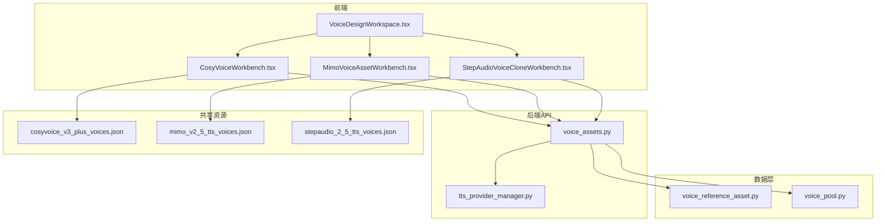
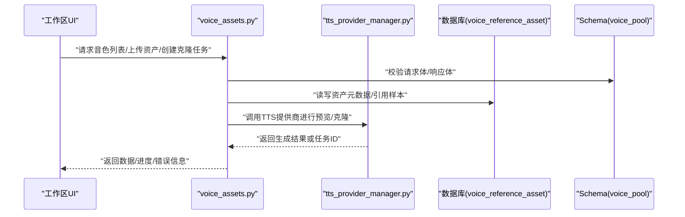
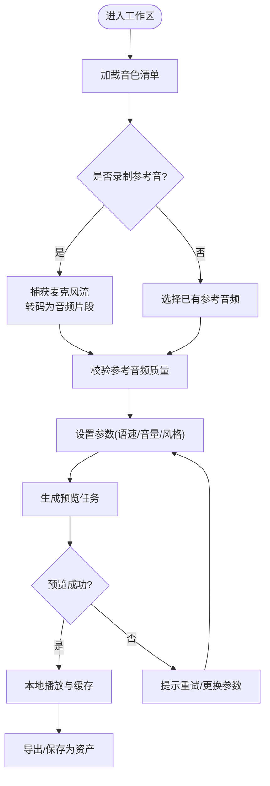
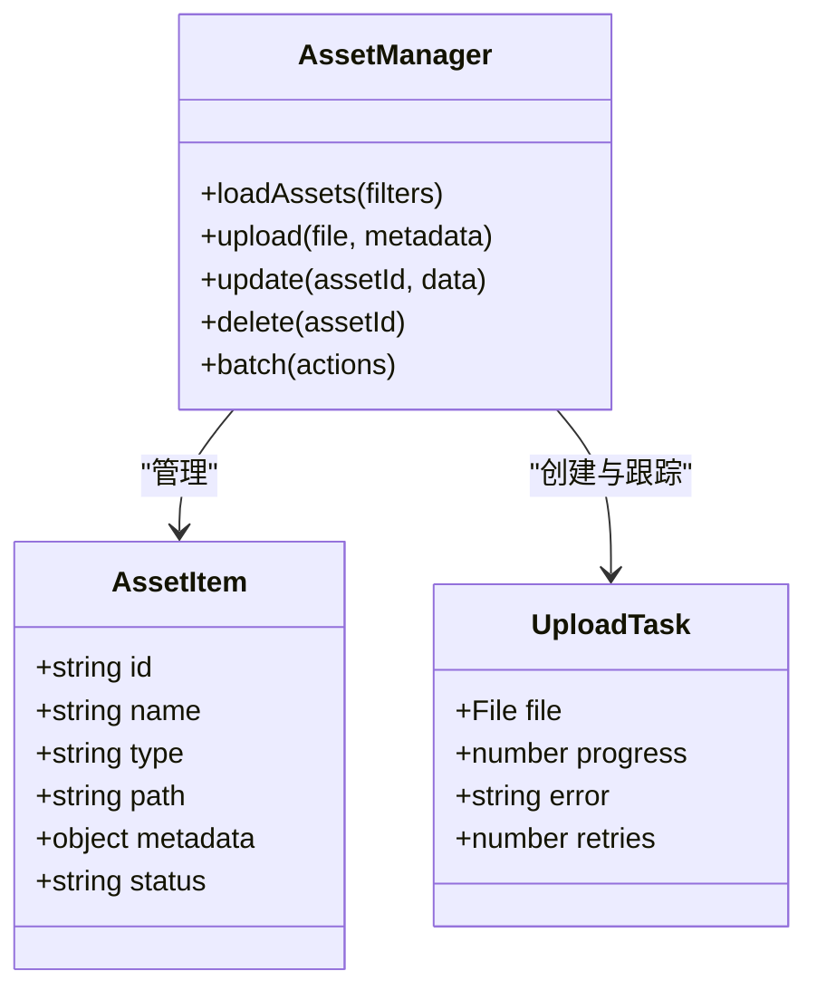
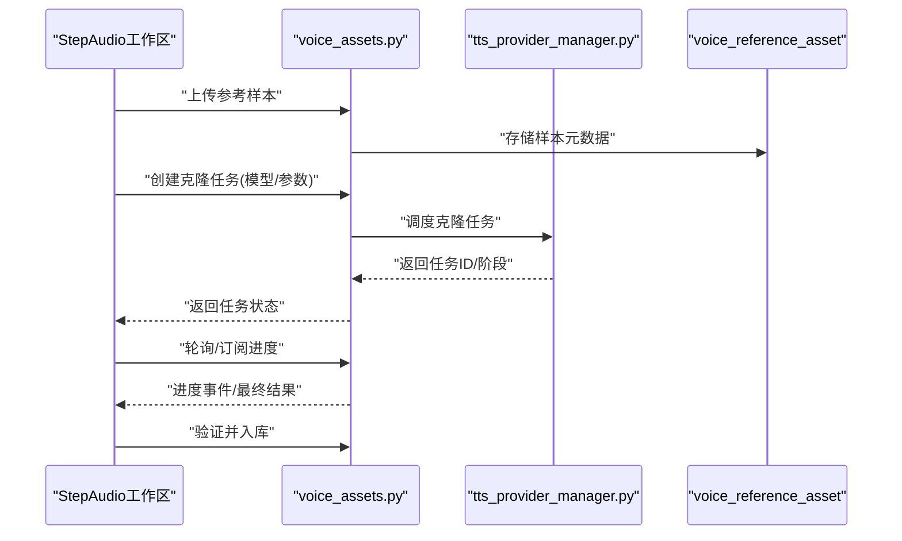
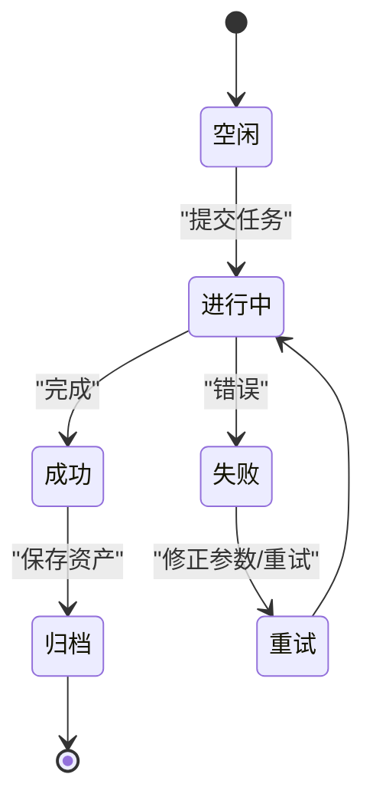
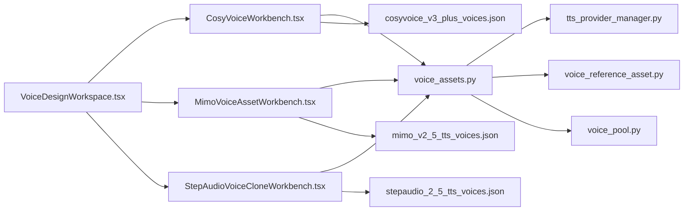

# 语音设计工作区

<cite>
**本文引用的文件**   
- [frontend/src/pages/VoiceDesignWorkspace.tsx](file://frontend/src/pages/VoiceDesignWorkspace.tsx)
- [frontend/src/components/voice/CosyVoiceWorkbench.tsx](file://frontend/src/components/voice/CosyVoiceWorkbench.tsx)
- [frontend/src/components/voice/MimoVoiceAssetWorkbench.tsx](file://frontend/src/components/voice/MimoVoiceAssetWorkbench.tsx)
- [frontend/src/components/voice/StepAudioVoiceCloneWorkbench.tsx](file://frontend/src/components/voice/StepAudioVoiceCloneWorkbench.tsx)
- [backend/app/api/v1/asset_studio_api/voice_assets.py](file://backend/app/api/v1/asset_studio_api/voice_assets.py)
- [backend/app/schemas/voice_pool.py](file://backend/app/schemas/voice_pool.py)
- [backend/app/models/voice_reference_asset.py](file://backend/app/models/voice_reference_asset.py)
- [backend/app/services/audiobook/tts_provider_manager.py](file://backend/app/services/audiobook/tts_provider_manager.py)
- [shared/cosyvoice_v3_plus_voices.json](file://shared/cosyvoice_v3_plus_voices.json)
- [shared/mimo_v2_5_tts_voices.json](file://shared/mimo_v2_5_tts_voices.json)
- [shared/stepaudio_2_5_tts_voices.json](file://shared/stepaudio_2_5_tts_voices.json)
</cite>

## 目录
1. [简介](#简介)
2. [项目结构](#项目结构)
3. [核心组件](#核心组件)
4. [架构总览](#架构总览)
5. [详细组件分析](#详细组件分析)
6. [依赖关系分析](#依赖关系分析)
7. [性能考虑](#性能考虑)
8. [故障排查指南](#故障排查指南)
9. [结论](#结论)
10. [附录](#附录)

## 简介
本文件面向“小说创作代理系统”的语音设计工作区，聚焦三大工作区组件：
- CosyVoiceWorkbench：CosyVoice 语音克隆工作区，支持录音、音色选择、参数调节与预览播放。
- MimoVoiceAssetWorkbench：Mimo 语音资产管理工作区，提供资产浏览、上传与管理能力。
- StepAudioVoiceCloneWorkbench：StepAudio 语音克隆工作区，覆盖克隆流程与配置选项。

文档将系统性阐述各组件的功能边界、API 接口、状态管理、实时预览与批量操作，并给出集成示例、扩展方法与最佳实践，帮助开发者快速上手与二次开发。

## 项目结构
语音设计工作区由前端页面与工作区子组件构成，后端通过统一的资产 API 提供服务，数据模型与 Schema 定义在 backend/app 下，共享音色清单位于 shared 目录。

图表来源 
- [frontend/src/pages/VoiceDesignWorkspace.tsx](file://frontend/src/pages/VoiceDesignWorkspace.tsx)
- [frontend/src/components/voice/CosyVoiceWorkbench.tsx](file://frontend/src/components/voice/CosyVoiceWorkbench.tsx)
- [frontend/src/components/voice/MimoVoiceAssetWorkbench.tsx](file://frontend/src/components/voice/MimoVoiceAssetWorkbench.tsx)
- [frontend/src/components/voice/StepAudioVoiceCloneWorkbench.tsx](file://frontend/src/components/voice/StepAudioVoiceCloneWorkbench.tsx)
- [backend/app/api/v1/asset_studio_api/voice_assets.py](file://backend/app/api/v1/asset_studio_api/voice_assets.py)
- [backend/app/services/audiobook/tts_provider_manager.py](file://backend/app/services/audiobook/tts_provider_manager.py)
- [backend/app/models/voice_reference_asset.py](file://backend/app/models/voice_reference_asset.py)
- [backend/app/schemas/voice_pool.py](file://backend/app/schemas/voice_pool.py)
- [shared/cosyvoice_v3_plus_voices.json](file://shared/cosyvoice_v3_plus_voices.json)
- [shared/mimo_v2_5_tts_voices.json](file://shared/mimo_v2_5_tts_voices.json)
- [shared/stepaudio_2_5_tts_voices.json](file://shared/stepaudio_2_5_tts_voices.json)

章节来源
- [frontend/src/pages/VoiceDesignWorkspace.tsx](file://frontend/src/pages/VoiceDesignWorkspace.tsx)
- [backend/app/api/v1/asset_studio_api/voice_assets.py](file://backend/app/api/v1/asset_studio_api/voice_assets.py)

## 核心组件
- CosyVoiceWorkbench
  - 功能要点：录音采集、音色列表加载、参数面板（语速、音量、风格等）、实时预览与试听回放。
  - 交互流程：用户录制或选择参考音频 → 选择目标音色 → 调整参数 → 生成预览 → 播放与导出。
  - 状态管理：录音状态、预览状态、错误提示、参数校验结果。
- MimoVoiceAssetWorkbench
  - 功能要点：资产列表浏览、分页与筛选、上传新资产、元数据编辑、删除与批量操作。
  - 交互流程：选择分类/标签 → 浏览资产 → 上传或更新 → 预览与下载。
  - 状态管理：加载态、选中项、批量操作进度、上传进度与失败重试。
- StepAudioVoiceCloneWorkbench
  - 功能要点：克隆样本准备、克隆任务创建、进度跟踪、结果回传与验证。
  - 交互流程：上传参考样本 → 配置克隆参数 → 提交任务 → 轮询/回调获取结果 → 预览与入库。
  - 状态管理：任务生命周期、错误码映射、重试策略。

章节来源
- [frontend/src/components/voice/CosyVoiceWorkbench.tsx](file://frontend/src/components/voice/CosyVoiceWorkbench.tsx)
- [frontend/src/components/voice/MimoVoiceAssetWorkbench.tsx](file://frontend/src/components/voice/MimoVoiceAssetWorkbench.tsx)
- [frontend/src/components/voice/StepAudioVoiceCloneWorkbench.tsx](file://frontend/src/components/voice/StepAudioVoiceCloneWorkbench.tsx)

## 架构总览
语音设计工作区的整体架构遵循“前端工作区组件 + 统一资产API + 数据模型与Schema + 共享音色清单”的分层模式。前端负责交互与状态，后端暴露 RESTful API 处理资产与克隆任务，数据持久化与校验由模型与 Schema 保障，音色清单作为静态资源配置供前端渲染。

图表来源 
- [backend/app/api/v1/asset_studio_api/voice_assets.py](file://backend/app/api/v1/asset_studio_api/voice_assets.py)
- [backend/app/services/audiobook/tts_provider_manager.py](file://backend/app/services/audiobook/tts_provider_manager.py)
- [backend/app/models/voice_reference_asset.py](file://backend/app/models/voice_reference_asset.py)
- [backend/app/schemas/voice_pool.py](file://backend/app/schemas/voice_pool.py)

## 详细组件分析

### CosyVoiceWorkbench 组件分析
- 职责边界
  - 录音：浏览器麦克风权限与流式捕获，转码为可上传格式。
  - 音色选择：从共享清单加载可用音色，支持搜索与过滤。
  - 参数调节：语速、音量、情感/风格等参数的输入与校验。
  - 预览播放：生成短音频片段并本地播放，支持缓存与对比。
- 关键数据结构
  - 录音片段对象：包含二进制数据、时长、采样率、格式。
  - 音色条目：包含 ID、名称、描述、适用场景、默认参数。
  - 预览任务：文本、音色ID、参数集、状态、URL。
- 错误处理
  - 权限拒绝、设备不可用、网络超时、生成失败的回退与提示。
- 性能优化
  - 本地缓存预览结果，避免重复生成；分片上传大文件；懒加载音色列表。

图表来源 
- [frontend/src/components/voice/CosyVoiceWorkbench.tsx](file://frontend/src/components/voice/CosyVoiceWorkbench.tsx)
- [shared/cosyvoice_v3_plus_voices.json](file://shared/cosyvoice_v3_plus_voices.json)

章节来源
- [frontend/src/components/voice/CosyVoiceWorkbench.tsx](file://frontend/src/components/voice/CosyVoiceWorkbench.tsx)
- [shared/cosyvoice_v3_plus_voices.json](file://shared/cosyvoice_v3_plus_voices.json)

### MimoVoiceAssetWorkbench 组件分析
- 职责边界
  - 资产浏览：分页、排序、筛选（类型、标签、时间）。
  - 上传管理：拖拽上传、进度条、断点续传、元数据填写。
  - 资产管理：编辑、删除、批量操作（启用/禁用、导出）。
- 关键数据结构
  - 资产条目：ID、名称、类型、路径、元数据、状态。
  - 上传任务：文件句柄、进度、错误码、重试次数。
- 错误处理
  - 文件格式不支持、大小超限、权限不足、服务器错误的友好提示与重试。
- 性能优化
  - 虚拟滚动长列表；并发控制上传队列；服务端压缩与转码。

图表来源 
- [frontend/src/components/voice/MimoVoiceAssetWorkbench.tsx](file://frontend/src/components/voice/MimoVoiceAssetWorkbench.tsx)
- [backend/app/api/v1/asset_studio_api/voice_assets.py](file://backend/app/api/v1/asset_studio_api/voice_assets.py)

章节来源
- [frontend/src/components/voice/MimoVoiceAssetWorkbench.tsx](file://frontend/src/components/voice/MimoVoiceAssetWorkbench.tsx)
- [backend/app/api/v1/asset_studio_api/voice_assets.py](file://backend/app/api/v1/asset_studio_api/voice_assets.py)

### StepAudioVoiceCloneWorkbench 组件分析
- 职责边界
  - 克隆样本准备：上传参考音频、自动切分与标注。
  - 克隆任务创建：选择模型、设置参数、提交任务。
  - 进度跟踪：轮询或事件推送，显示阶段与耗时。
  - 结果验证：试听、质量评估、入库或回滚。
- 关键数据结构
  - 克隆任务：样本ID、模型ID、参数、状态、结果URL。
  - 进度事件：阶段名、百分比、错误信息。
- 错误处理
  - 样本不达标、模型不可用、超时与失败的降级策略。
- 性能优化
  - 异步任务队列、结果缓存、增量更新。

图表来源 
- [frontend/src/components/voice/StepAudioVoiceCloneWorkbench.tsx](file://frontend/src/components/voice/StepAudioVoiceCloneWorkbench.tsx)
- [backend/app/api/v1/asset_studio_api/voice_assets.py](file://backend/app/api/v1/asset_studio_api/voice_assets.py)
- [backend/app/services/audiobook/tts_provider_manager.py](file://backend/app/services/audiobook/tts_provider_manager.py)
- [backend/app/models/voice_reference_asset.py](file://backend/app/models/voice_reference_asset.py)

章节来源
- [frontend/src/components/voice/StepAudioVoiceCloneWorkbench.tsx](file://frontend/src/components/voice/StepAudioVoiceCloneWorkbench.tsx)
- [backend/app/api/v1/asset_studio_api/voice_assets.py](file://backend/app/api/v1/asset_studio_api/voice_assets.py)
- [backend/app/services/audiobook/tts_provider_manager.py](file://backend/app/services/audiobook/tts_provider_manager.py)
- [backend/app/models/voice_reference_asset.py](file://backend/app/models/voice_reference_asset.py)

### 概念总览
- 语音工作区通用流程
  - 输入：文本/参考音频/参数
  - 处理：TTS/克隆引擎
  - 输出：音频片段/资产条目/任务状态
- 状态机
  - 空闲 → 进行中 → 成功/失败 → 可重试/归档

[本图为概念流程图，不直接映射具体源码文件]

## 依赖关系分析
- 前端组件依赖
  - VoiceDesignWorkspace 聚合三个工作区组件，统一路由与状态容器。
  - 各工作区组件依赖共享音色清单与后端 API。
- 后端服务依赖
  - voice_assets.py 协调资产 CRUD、任务调度与结果回写。
  - tts_provider_manager.py 抽象多提供商 TTS 能力。
  - 数据模型与 Schema 确保一致性校验与持久化。

图表来源 
- [frontend/src/pages/VoiceDesignWorkspace.tsx](file://frontend/src/pages/VoiceDesignWorkspace.tsx)
- [frontend/src/components/voice/CosyVoiceWorkbench.tsx](file://frontend/src/components/voice/CosyVoiceWorkbench.tsx)
- [frontend/src/components/voice/MimoVoiceAssetWorkbench.tsx](file://frontend/src/components/voice/MimoVoiceAssetWorkbench.tsx)
- [frontend/src/components/voice/StepAudioVoiceCloneWorkbench.tsx](file://frontend/src/components/voice/StepAudioVoiceCloneWorkbench.tsx)
- [backend/app/api/v1/asset_studio_api/voice_assets.py](file://backend/app/api/v1/asset_studio_api/voice_assets.py)
- [backend/app/services/audiobook/tts_provider_manager.py](file://backend/app/services/audiobook/tts_provider_manager.py)
- [backend/app/models/voice_reference_asset.py](file://backend/app/models/voice_reference_asset.py)
- [backend/app/schemas/voice_pool.py](file://backend/app/schemas/voice_pool.py)
- [shared/cosyvoice_v3_plus_voices.json](file://shared/cosyvoice_v3_plus_voices.json)
- [shared/mimo_v2_5_tts_voices.json](file://shared/mimo_v2_5_tts_voices.json)
- [shared/stepaudio_2_5_tts_voices.json](file://shared/stepaudio_2_5_tts_voices.json)

章节来源
- [backend/app/api/v1/asset_studio_api/voice_assets.py](file://backend/app/api/v1/asset_studio_api/voice_assets.py)
- [backend/app/schemas/voice_pool.py](file://backend/app/schemas/voice_pool.py)
- [backend/app/models/voice_reference_asset.py](file://backend/app/models/voice_reference_asset.py)

## 性能考虑
- 前端
  - 使用虚拟列表渲染大量资产；对预览音频进行本地缓存；分片与并发限制上传。
  - 懒加载音色清单与详情，减少首屏体积。
- 后端
  - 任务队列异步处理克隆与生成；结果缓存与去重；数据库索引优化查询。
  - 媒体转码与压缩流水线，降低带宽与存储成本。
- 网络
  - SSE/WebSocket 推送进度，减少轮询开销；CDN 分发静态音色清单与预览音频。

[本节为通用指导，不直接分析具体文件]

## 故障排查指南
- 常见问题定位
  - 录音失败：检查浏览器权限与设备可用性；确认音频编码格式。
  - 预览失败：核对文本与参数合法性；查看 TTS 提供商状态与配额。
  - 上传失败：确认文件大小与格式；检查服务端存储与权限。
  - 克隆任务失败：查看样本质量与标注；重试与降级策略。
- 调试建议
  - 前端控制台日志与网络面板；后端访问日志与错误堆栈；数据库记录与迁移状态。
  - 使用最小复现用例与隔离测试环境。

章节来源
- [backend/app/api/v1/asset_studio_api/voice_assets.py](file://backend/app/api/v1/asset_studio_api/voice_assets.py)
- [backend/app/services/audiobook/tts_provider_manager.py](file://backend/app/services/audiobook/tts_provider_manager.py)

## 结论
语音设计工作区以清晰的前端组件划分与统一的后端 API 为核心，结合数据模型与共享音色清单，实现了录音、音色选择、参数调节、预览播放、资产管理与克隆任务的完整闭环。通过合理的状态管理与错误处理机制，以及前后端的性能优化策略，可为小说创作代理系统提供稳定高效的语音设计与资产管理能力。

[本节为总结性内容，不直接分析具体文件]

## 附录
- 集成示例
  - 在工作区中嵌入自定义音色提供者：扩展音色清单与参数映射。
  - 批量操作：实现批量启用/禁用、导出与导入资产。
- 自定义扩展方法
  - 新增工作区组件：遵循现有组件结构与 API 契约。
  - 接入新的 TTS 提供商：在 provider manager 中注册适配器。
- 最佳实践
  - 参数校验前置，减少无效请求；结果缓存与去重；渐进式增强用户体验。

[本节为补充说明，不直接分析具体文件]