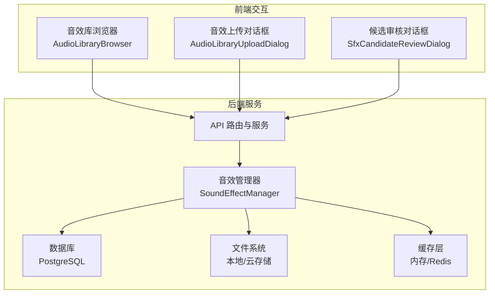
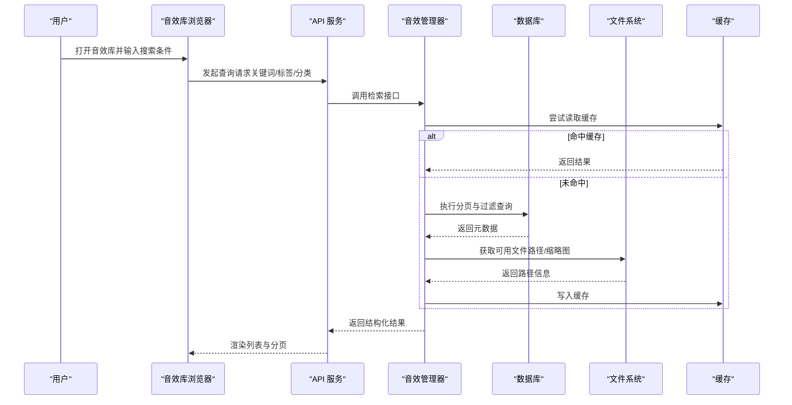
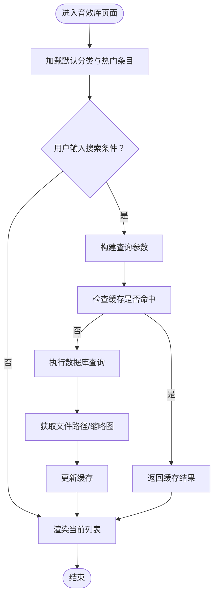
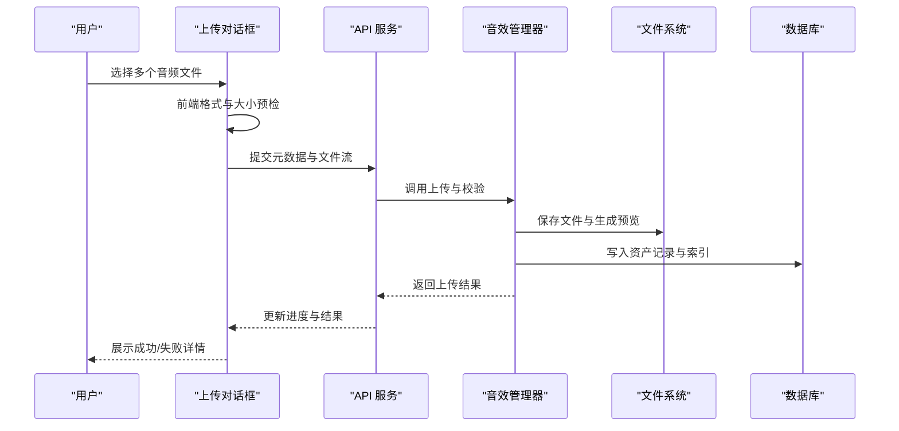
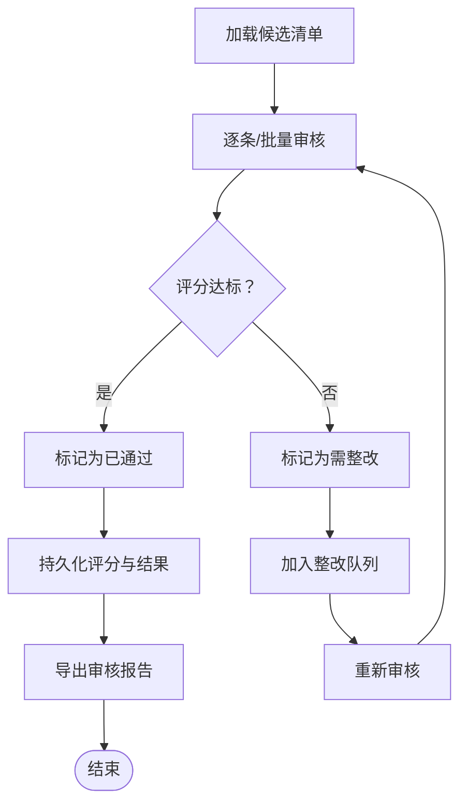
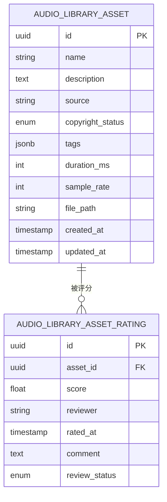
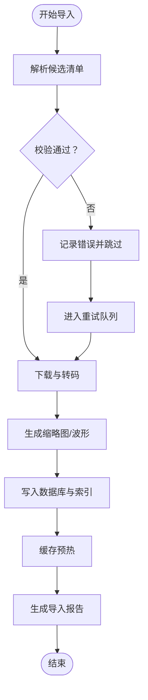
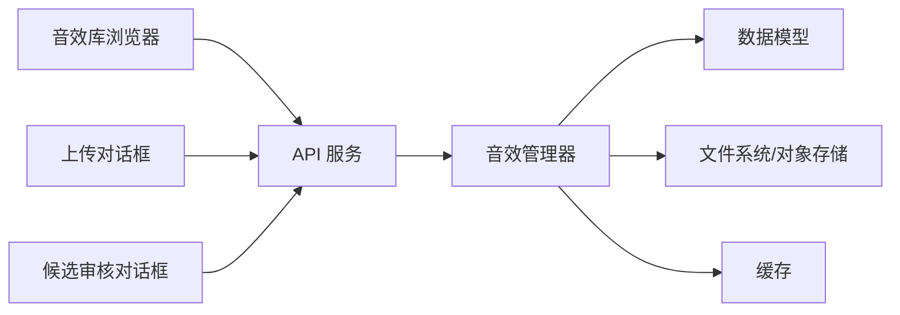

# 音效库组件

<cite>
**本文引用的文件**   
- [sound_effect_manager.py](file://agents/sound_effect_manager.py)
- [audio_library_asset.py](file://backend/app/models/audio_library_asset.py)
- [audio_library_asset_rating.py](file://backend/app/models/audio_library_asset_rating.py)
- [test_audio_library_asset_repository.py](file://backend/tests/test_audio_library_asset_repository.py)
- [test_sfx_library_downloader.py](file://backend/tests/test_sfx_library_downloader.py)
- [test_sfx_library_downloader_paths.py](file://backend/tests/test_sfx_library_downloader_paths.py)
- [scripts/normalize_sfx_library_loudness.py](file://backend/scripts/normalize_sfx_library_loudness.py)
- [data/audio_library/sfx_candidates.jsonl](file://backend/data/audio_library/sfx_candidates.jsonl)
- [data/audio_library/sfx_import_manifest_cc0_selected12_20260511.jsonl](file://backend/data/audio_library/sfx_import_manifest_cc0_selected12_20260511.jsonl)
</cite>

## 目录
1. [简介](#简介)
2. [项目结构](#项目结构)
3. [核心组件](#核心组件)
4. [架构总览](#架构总览)
5. [详细组件分析](#详细组件分析)
6. [依赖关系分析](#依赖关系分析)
7. [性能考虑](#性能考虑)
8. [故障排查指南](#故障排查指南)
9. [结论](#结论)
10. [附录](#附录)

## 简介
本文件面向小说创作代理系统的“音效库”相关组件，聚焦以下目标：
- 说明 AudioLibraryBrowser（音效库浏览器）的音频文件浏览、搜索过滤与分类管理能力。
- 说明 AudioLibraryUploadDialog（音效上传对话框）的文件选择、格式验证与批量上传机制。
- 说明 SfxCandidateReviewDialog（音效候选审核对话框）的审核流程与质量评估能力。
- 梳理音效库的数据模型、存储策略、缓存机制与性能优化要点。
- 提供使用示例、自定义配置项与扩展开发指南，帮助开发者快速集成与二次开发。

## 项目结构
音效库相关代码主要分布在后端服务与数据层：
- 业务编排与管理：agents/sound_effect_manager.py
- 数据模型：backend/app/models/audio_library_asset.py、backend/app/models/audio_library_asset_rating.py
- 测试与校验：backend/tests/test_audio_library_asset_repository.py、backend/tests/test_sfx_library_downloader.py、backend/tests/test_sfx_library_downloader_paths.py
- 批处理脚本：backend/scripts/normalize_sfx_library_loudness.py
- 候选与导入清单：backend/data/audio_library/sfx_candidates.jsonl、sfx_import_manifest_*.jsonl

[本图为概念性架构图，不直接映射具体源码文件]

## 核心组件
- 音效管理器（SoundEffectManager）
  - 职责：协调音效资源的检索、筛选、分类、上传、审核与入库；管理元数据与评分；对接存储与缓存。
  - 关键能力：分页查询、关键词与标签过滤、按来源/版权状态筛选、批量导入、质量评分聚合、去重与冲突处理。
- 数据模型（AudioLibraryAsset / AudioLibraryAssetRating）
  - 职责：持久化音效资产与评分记录，支撑查询、统计与审计。
- 下载与导入工具（测试覆盖）
  - 职责：从外部源拉取候选音效，生成导入清单，校验路径与命名规范，确保一致性。
- 批处理脚本（响度归一化）
  - 职责：对已有音效进行响度标准化，提升播放体验一致性。

**章节来源**
- [sound_effect_manager.py](file://agents/sound_effect_manager.py)
- [audio_library_asset.py](file://backend/app/models/audio_library_asset.py)
- [audio_library_asset_rating.py](file://backend/app/models/audio_library_asset_rating.py)
- [test_sfx_library_downloader.py](file://backend/tests/test_sfx_library_downloader.py)
- [test_sfx_library_downloader_paths.py](file://backend/tests/test_sfx_library_downloader_paths.py)
- [scripts/normalize_sfx_library_loudness.py](file://backend/scripts/normalize_sfx_library_loudness.py)

## 架构总览
音效库整体采用“前端交互 + 后端服务 + 数据/存储 + 缓存”的分层架构：
- 前端通过三个核心组件完成浏览、上传与审核。
- 后端以音效管理器为核心，统一封装资源访问逻辑。
- 数据层由数据库与文件系统组成，分别承载元数据与媒体文件。
- 缓存层用于热点查询与预览加速。

**图表来源**
- [sound_effect_manager.py](file://agents/sound_effect_manager.py)
- [audio_library_asset.py](file://backend/app/models/audio_library_asset.py)
- [audio_library_asset_rating.py](file://backend/app/models/audio_library_asset_rating.py)

## 详细组件分析

### AudioLibraryBrowser（音效库浏览器）
- 功能要点
  - 音频文件浏览：支持分页、排序、预览链接展示。
  - 搜索过滤：支持关键词、标签、来源、版权状态、时长范围等维度组合过滤。
  - 分类管理：支持按类别、子类别、主题标签组织与切换。
- 交互流程
  - 初始化加载默认分类与热门条目。
  - 用户输入查询条件后触发异步检索，优先命中缓存。
  - 失败重试与错误提示，支持空结果引导与推荐。
- 性能优化
  - 服务端分页与投影字段裁剪，减少传输体积。
  - 缓存热点查询结果，设置合理过期策略。
  - 懒加载缩略图与预览片段，降低首屏压力。

[本图为概念流程图，不直接映射具体源码文件]

**章节来源**
- [sound_effect_manager.py](file://agents/sound_effect_manager.py)
- [audio_library_asset.py](file://backend/app/models/audio_library_asset.py)
- [audio_library_asset_rating.py](file://backend/app/models/audio_library_asset_rating.py)

### AudioLibraryUploadDialog（音效上传对话框）
- 功能要点
  - 文件选择：支持多选、拖拽、批量选择，限制最大数量与单文件大小。
  - 格式验证：校验扩展名、MIME类型、采样率、声道数、时长上限等。
  - 批量上传：分片上传、并发控制、断点续传、进度反馈与失败重试。
- 上传流程
  - 前端预检通过后提交元数据与文件流。
  - 后端校验与转码（必要时），落盘并生成缩略图/波形。
  - 写入数据库记录，建立索引与缓存预热。
- 错误处理
  - 非法格式、损坏文件、权限不足、磁盘空间不足等异常分支提示与回滚。

**图表来源**
- [sound_effect_manager.py](file://agents/sound_effect_manager.py)
- [audio_library_asset.py](file://backend/app/models/audio_library_asset.py)

**章节来源**
- [sound_effect_manager.py](file://agents/sound_effect_manager.py)
- [audio_library_asset.py](file://backend/app/models/audio_library_asset.py)

### SfxCandidateReviewDialog（音效候选审核对话框）
- 功能要点
  - 审核流程：候选列表加载、试听、标注质量、打标签、通过/拒绝。
  - 质量评估：基于规则与人工评分的综合打分，支持阈值判定与自动入库。
  - 批量操作：批量通过/拒绝、批量打标签、导出审核结果。
- 审核流程
  - 从候选清单或数据库加载待审条目。
  - 逐条或批量进行评估，记录评分与备注。
  - 达到阈值后自动转入已批准库，否则进入整改队列。

**图表来源**
- [audio_library_asset_rating.py](file://backend/app/models/audio_library_asset_rating.py)

**章节来源**
- [audio_library_asset_rating.py](file://backend/app/models/audio_library_asset_rating.py)

### 数据结构与存储策略
- 数据模型
  - 音效资产：标识、名称、描述、来源、版权状态、分类标签、时长、采样率、文件路径、创建/更新时间等。
  - 评分记录：关联资产、评分值、评分人、评分时间、备注、审核状态等。
- 存储策略
  - 元数据：关系型数据库（PostgreSQL），支持事务与复杂查询。
  - 媒体文件：本地文件系统或对象存储（如 S3/OSS），按分类与日期分层目录。
  - 缓存：内存或 Redis，缓存高频查询结果与预览片段。
- 索引与查询
  - 针对关键词、标签、分类、来源、版权状态建立索引，优化过滤与分页。
  - 全文检索可结合搜索引擎（可选）。

**图表来源**
- [audio_library_asset.py](file://backend/app/models/audio_library_asset.py)
- [audio_library_asset_rating.py](file://backend/app/models/audio_library_asset_rating.py)

**章节来源**
- [audio_library_asset.py](file://backend/app/models/audio_library_asset.py)
- [audio_library_asset_rating.py](file://backend/app/models/audio_library_asset_rating.py)

### 候选与导入机制
- 候选来源
  - 外部抓取与整理，形成候选清单（JSONL/JSON）。
  - 导入清单（Manifest）记录批次、来源、版权信息与选择策略。
- 导入流程
  - 解析清单，校验条目完整性与合法性。
  - 下载与转码，生成缩略图与波形。
  - 写入数据库，建立索引与缓存预热。
  - 失败条目进入重试队列，记录日志与告警。

**图表来源**
- [data/audio_library/sfx_candidates.jsonl](file://backend/data/audio_library/sfx_candidates.jsonl)
- [data/audio_library/sfx_import_manifest_cc0_selected12_20260511.jsonl](file://backend/data/audio_library/sfx_import_manifest_cc0_selected12_20260511.jsonl)

**章节来源**
- [test_sfx_library_downloader.py](file://backend/tests/test_sfx_library_downloader.py)
- [test_sfx_library_downloader_paths.py](file://backend/tests/test_sfx_library_downloader_paths.py)
- [data/audio_library/sfx_candidates.jsonl](file://backend/data/audio_library/sfx_candidates.jsonl)
- [data/audio_library/sfx_import_manifest_cc0_selected12_20260511.jsonl](file://backend/data/audio_library/sfx_import_manifest_cc0_selected12_20260511.jsonl)

### 批处理与质量保障
- 响度归一化
  - 对既有音效进行响度标准化，保证播放一致性。
  - 支持批量处理、进度跟踪与失败重试。
- 质量评估
  - 结合自动检测（时长、采样率、噪声水平）与人工评分。
  - 设定阈值与规则，自动标记通过或需整改。

**章节来源**
- [scripts/normalize_sfx_library_loudness.py](file://backend/scripts/normalize_sfx_library_loudness.py)
- [audio_library_asset_rating.py](file://backend/app/models/audio_library_asset_rating.py)

## 依赖关系分析
- 组件耦合
  - 音效管理器依赖数据模型、存储服务与缓存。
  - 上传与审核模块依赖管理器提供的统一接口。
- 外部依赖
  - 数据库驱动、对象存储 SDK、缓存客户端、媒体处理工具（FFmpeg）。
- 潜在风险
  - 循环依赖应避免，接口契约需稳定。
  - 大文件上传与转码需限流与超时保护。

[本图为概念依赖图，不直接映射具体源码文件]

**章节来源**
- [sound_effect_manager.py](file://agents/sound_effect_manager.py)
- [audio_library_asset.py](file://backend/app/models/audio_library_asset.py)
- [audio_library_asset_rating.py](file://backend/app/models/audio_library_asset_rating.py)

## 性能考虑
- 查询优化
  - 分页与投影裁剪，避免全量字段传输。
  - 复合索引与全文检索，提升过滤与搜索效率。
- 缓存策略
  - 热点查询结果缓存，设置合理的 TTL 与失效策略。
  - 预览片段与缩略图缓存，减少重复计算。
- 上传与转码
  - 分片上传与并发控制，避免阻塞主线程。
  - 异步任务队列处理转码与索引构建。
- I/O 优化
  - 文件分层目录与命名规范，便于定位与清理。
  - 冷热分离，归档低频访问文件。

[本节为通用指导，无需特定文件引用]

## 故障排查指南
- 常见问题
  - 上传失败：检查文件格式、大小限制、权限与磁盘空间。
  - 审核卡顿：确认候选清单完整性与网络连通性。
  - 查询缓慢：检查索引与缓存命中率，优化过滤条件。
- 诊断步骤
  - 查看导入日志与错误队列，定位失败条目。
  - 检查数据库连接与慢查询日志。
  - 监控缓存命中率与内存占用。
- 恢复措施
  - 重试失败任务，清理脏数据与重建索引。
  - 调整并发与超时参数，缓解资源竞争。

**章节来源**
- [test_audio_library_asset_repository.py](file://backend/tests/test_audio_library_asset_repository.py)
- [test_sfx_library_downloader.py](file://backend/tests/test_sfx_library_downloader.py)
- [test_sfx_library_downloader_paths.py](file://backend/tests/test_sfx_library_downloader_paths.py)

## 结论
音效库组件通过清晰的前端交互、稳健的后端管理与可靠的数据存储，实现了高效的音频资源浏览、上传与审核能力。借助缓存与索引优化，系统在大规模数据下仍保持良好性能。建议在生产环境完善监控与告警，持续优化转码与上传流程，确保用户体验与系统稳定性。

[本节为总结性内容，无需特定文件引用]

## 附录
- 使用示例
  - 浏览：在浏览器中设置关键词与标签，分页查看结果。
  - 上传：选择多个音频文件，等待进度完成并查看结果。
  - 审核：批量评估候选条目，导出审核报告。
- 自定义配置
  - 上传限制：最大文件数、单文件大小、允许格式。
  - 审核阈值：评分阈值、自动入库规则。
  - 缓存策略：TTL、容量上限、预热策略。
- 扩展开发
  - 新增分类与标签体系，扩展过滤维度。
  - 接入新的存储后端与缓存方案。
  - 增加自动化质量检测与评分模型。

[本节为通用指导，无需特定文件引用]