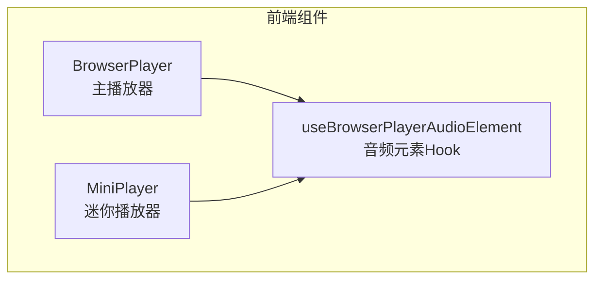
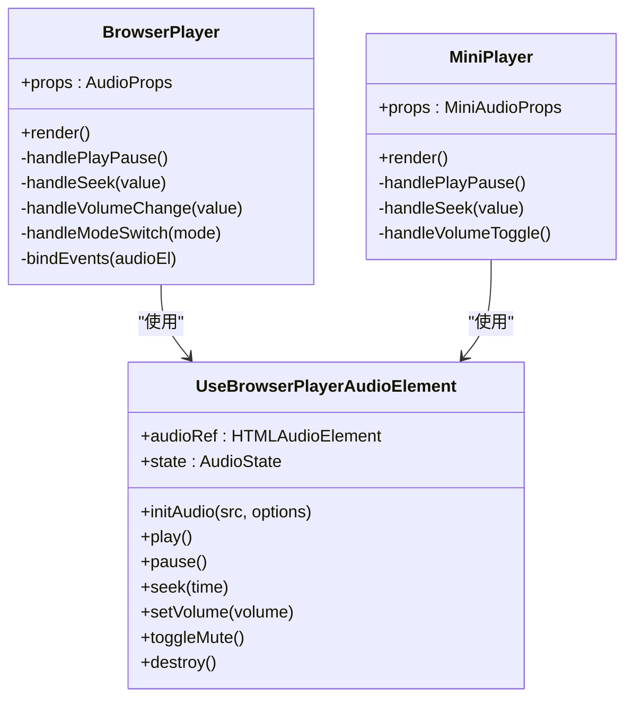
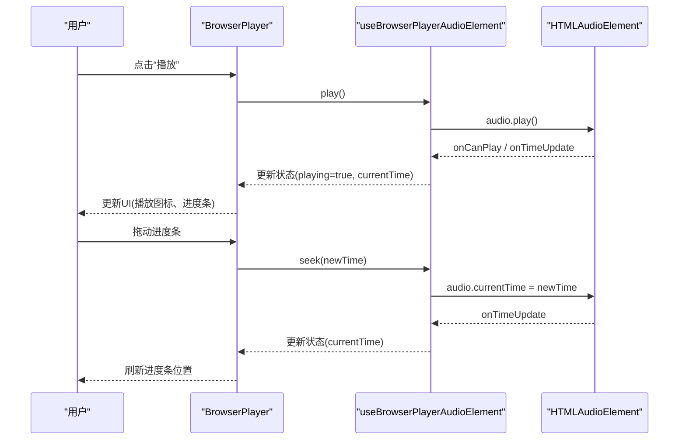
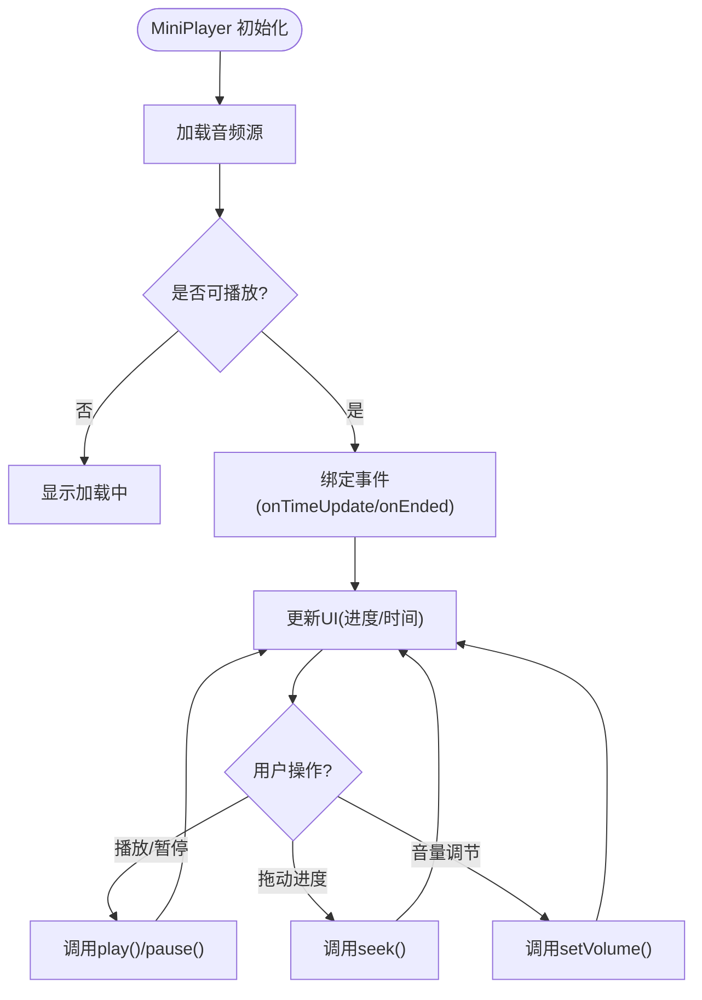
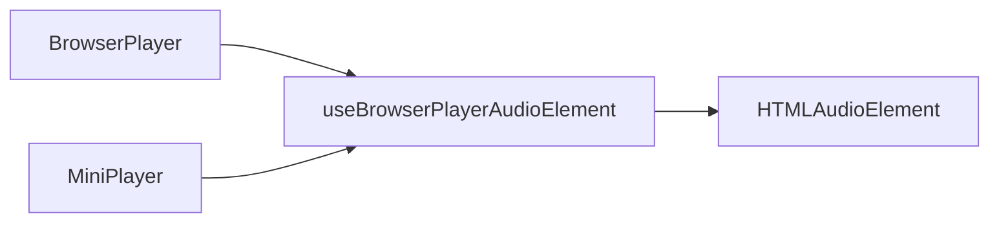

# 音频播放器组件

<cite>
**本文引用的文件**   
- [frontend/src/components/AudioPlayer/BrowserPlayer.tsx](file://frontend/src/components/AudioPlayer/BrowserPlayer.tsx)
- [frontend/src/components/AudioPlayer/MiniPlayer.tsx](file://frontend/src/components/AudioPlayer/MiniPlayer.tsx)
- [frontend/src/hooks/useBrowserPlayerAudioElement.ts](file://frontend/src/hooks/useBrowserPlayerAudioElement.ts)
- [frontend/src/components/AudioPlayer/index.ts](file://frontend/src/components/AudioPlayer/index.ts)
</cite>

## 目录
1. [简介](#简介)
2. [项目结构](#项目结构)
3. [核心组件](#核心组件)
4. [架构总览](#架构总览)
5. [详细组件分析](#详细组件分析)
6. [依赖关系分析](#依赖关系分析)
7. [性能考虑](#性能考虑)
8. [故障排除指南](#故障排除指南)
9. [结论](#结论)
10. [附录](#附录)

## 简介
本文件为小说创作代理系统的音频播放器组件提供完整技术文档，聚焦以下目标：
- BrowserPlayer 主播放器的功能与实现：播放控制、进度条操作、音量调节、播放模式切换等。
- MiniPlayer 迷你播放器的设计理念与实现方式。
- useBrowserPlayerAudioElement 自定义 Hook 的音频元素管理与状态同步机制。
- 播放器组件的 API 接口、事件处理、样式定制与响应式设计。
- 集成示例、性能优化技巧与常见问题排查。

## 项目结构
音频播放器相关代码位于前端模块中，主要包含三个部分：
- BrowserPlayer：主播放器组件，负责完整的播放界面与控制逻辑。
- MiniPlayer：迷你播放器组件，用于紧凑场景下的基础播放能力。
- useBrowserPlayerAudioElement：自定义 Hook，封装原生 <audio> 元素的生命周期与状态管理。



**图表来源** 
- [frontend/src/components/AudioPlayer/BrowserPlayer.tsx](file://frontend/src/components/AudioPlayer/BrowserPlayer.tsx)
- [frontend/src/components/AudioPlayer/MiniPlayer.tsx](file://frontend/src/components/AudioPlayer/MiniPlayer.tsx)
- [frontend/src/hooks/useBrowserPlayerAudioElement.ts](file://frontend/src/hooks/useBrowserPlayerAudioElement.ts)

**章节来源**
- [frontend/src/components/AudioPlayer/BrowserPlayer.tsx](file://frontend/src/components/AudioPlayer/BrowserPlayer.tsx)
- [frontend/src/components/AudioPlayer/MiniPlayer.tsx](file://frontend/src/components/AudioPlayer/MiniPlayer.tsx)
- [frontend/src/hooks/useBrowserPlayerAudioElement.ts](file://frontend/src/hooks/useBrowserPlayerAudioElement.ts)

## 核心组件
- BrowserPlayer（主播放器）
  - 职责：提供完整的播放控制界面与交互，包括播放/暂停、上一首/下一首、循环/随机/单曲循环、音量滑块、静音切换、进度条拖拽与点击跳转、时间显示、加载状态提示等。
  - 关键特性：
    - 播放控制：play/pause、seek、volume/mute。
    - 播放模式：顺序、随机、单曲循环、列表循环。
    - 进度条：支持拖拽与点击跳转，实时更新当前时间与剩余时间。
    - 事件监听：onCanPlay、onTimeUpdate、onEnded、onError、onWaiting、onLoadedMetadata 等。
    - 响应式布局：适配桌面与移动端，触控友好的控件尺寸。
    - 可访问性：ARIA 标签与键盘导航支持。
- MiniPlayer（迷你播放器）
  - 职责：在空间受限区域提供最小化播放能力，通常包含播放/暂停、进度指示、音量控制开关。
  - 设计理念：轻量、可嵌入、与主播放器共享底层音频状态。
- useBrowserPlayerAudioElement（音频元素 Hook）
  - 职责：统一管理原生 <audio> 元素的创建、挂载、事件绑定、状态同步（currentTime、duration、buffered、paused、ended、error、volume、muted）。
  - 状态同步：通过 React state 或 ref 暴露当前播放状态，供组件消费；避免不必要的重渲染。
  - 生命周期：在组件挂载时初始化 audio 元素，卸载时清理事件与资源。

**章节来源**
- [frontend/src/components/AudioPlayer/BrowserPlayer.tsx](file://frontend/src/components/AudioPlayer/BrowserPlayer.tsx)
- [frontend/src/components/AudioPlayer/MiniPlayer.tsx](file://frontend/src/components/AudioPlayer/MiniPlayer.tsx)
- [frontend/src/hooks/useBrowserPlayerAudioElement.ts](file://frontend/src/hooks/useBrowserPlayerAudioElement.ts)

## 架构总览
下图展示了播放器组件之间的依赖关系与数据流向：BrowserPlayer 与 MiniPlayer 均依赖 useBrowserPlayerAudioElement 提供的音频元素管理能力，并通过统一的事件模型进行状态同步。



**图表来源** 
- [frontend/src/components/AudioPlayer/BrowserPlayer.tsx](file://frontend/src/components/AudioPlayer/BrowserPlayer.tsx)
- [frontend/src/components/AudioPlayer/MiniPlayer.tsx](file://frontend/src/components/AudioPlayer/MiniPlayer.tsx)
- [frontend/src/hooks/useBrowserPlayerAudioElement.ts](file://frontend/src/hooks/useBrowserPlayerAudioElement.ts)

## 详细组件分析

### BrowserPlayer 主播放器
- 播放控制
  - 播放/暂停：调用 Hook 的 play/pause 方法，并更新 UI 状态。
  - 上一首/下一首：根据播放模式切换源地址，重新加载媒体。
- 进度条操作
  - 拖拽与点击：计算目标时间并调用 seek，同时更新缓冲进度。
  - 实时同步：订阅 onTimeUpdate 事件，刷新当前时间与进度条位置。
- 音量调节
  - 滑块控制：设置 volume 值，支持小数精度。
  - 静音切换：快速切换 muted 状态，并在 UI 上反映图标变化。
- 播放模式切换
  - 顺序播放：按列表顺序播放，到末尾停止。
  - 随机播放：从列表中随机选择下一个曲目。
  - 单曲循环：重复播放当前曲目。
  - 列表循环：播放完列表后回到开头继续。
- 事件处理
  - onCanPlay：标记可播放，隐藏加载指示。
  - onWaiting：显示加载中状态。
  - onEnded：自动切换到下一首或根据模式处理。
  - onError：捕获错误并提示用户。
  - onLoadedMetadata：获取时长信息，初始化进度条范围。
- 样式定制与响应式设计
  - 主题变量：颜色、字体、圆角、阴影等可通过 CSS 变量覆盖。
  - 响应式布局：基于断点调整控件大小与间距，确保移动端易用性。
  - 无障碍：为按钮添加 aria-label，支持键盘操作。



**图表来源** 
- [frontend/src/components/AudioPlayer/BrowserPlayer.tsx](file://frontend/src/components/AudioPlayer/BrowserPlayer.tsx)
- [frontend/src/hooks/useBrowserPlayerAudioElement.ts](file://frontend/src/hooks/useBrowserPlayerAudioElement.ts)

**章节来源**
- [frontend/src/components/AudioPlayer/BrowserPlayer.tsx](file://frontend/src/components/AudioPlayer/BrowserPlayer.tsx)

### MiniPlayer 迷你播放器
- 设计理念
  - 精简界面：仅保留必要的播放控制与进度指示。
  - 可嵌入性：可在侧边栏、工具栏或浮动面板中使用。
  - 状态共享：与主播放器共享同一音频实例，避免重复加载。
- 实现要点
  - 播放/暂停：直接调用 Hook 的方法。
  - 进度指示：显示当前时间与总时长，支持点击跳转。
  - 音量控制：提供快捷静音切换与滑块微调。
  - 事件订阅：复用 Hook 的状态更新，保持 UI 一致。



**图表来源** 
- [frontend/src/components/AudioPlayer/MiniPlayer.tsx](file://frontend/src/components/AudioPlayer/MiniPlayer.tsx)
- [frontend/src/hooks/useBrowserPlayerAudioElement.ts](file://frontend/src/hooks/useBrowserPlayerAudioElement.ts)

**章节来源**
- [frontend/src/components/AudioPlayer/MiniPlayer.tsx](file://frontend/src/components/AudioPlayer/MiniPlayer.tsx)

### useBrowserPlayerAudioElement 自定义 Hook
- 音频元素管理
  - 创建与挂载：在组件挂载时创建 <audio> 元素，并附加到 DOM。
  - 事件绑定：集中管理 onTimeUpdate、onEnded、onError、onWaiting、onCanPlay 等事件。
  - 资源清理：组件卸载时移除事件监听器并释放内存。
- 状态同步机制
  - 核心状态：currentTime、duration、buffered、paused、ended、error、volume、muted。
  - 更新策略：使用稳定的 state 引用，避免频繁重渲染；必要时使用 ref 存储瞬时值。
  - 外部同步：提供回调或上下文，允许父组件订阅状态变化。
- API 设计
  - initAudio(src, options)：初始化音频源与配置。
  - play()/pause()：控制播放与暂停。
  - seek(time)：跳转到指定时间。
  - setVolume(volume)/toggleMute()：音量与静音控制。
  - destroy()：销毁音频元素与事件。

```mermaid
classDiagram
class UseBrowserPlayerAudioElement {
+audioRef : HTMLAudioElement
+state : {
currentTime : number
duration : number
buffered : TimeRanges
paused : boolean
ended : boolean
error : Error|null
volume : number
muted : boolean
}
+initAudio(src, options) void
+play() void
+pause() void
+seek(time) void
+setVolume(volume) void
+toggleMute() void
+destroy() void
-bindEvents() void
-updateState() void
}
```

**图表来源** 
- [frontend/src/hooks/useBrowserPlayerAudioElement.ts](file://frontend/src/hooks/useBrowserPlayerAudioElement.ts)

**章节来源**
- [frontend/src/hooks/useBrowserPlayerAudioElement.ts](file://frontend/src/hooks/useBrowserPlayerAudioElement.ts)

## 依赖关系分析
- 组件间耦合
  - BrowserPlayer 与 MiniPlayer 均依赖 useBrowserPlayerAudioElement，形成松耦合的依赖结构。
  - 通过 Hook 抽象出音频元素管理逻辑，便于复用与维护。
- 外部依赖
  - 浏览器原生 <audio> API：提供播放、缓冲、事件等能力。
  - React Hooks：useState、useEffect、useRef 等用于状态与生命周期管理。
- 潜在循环依赖
  - 组件与 Hook 之间无循环导入，结构清晰。



**图表来源** 
- [frontend/src/components/AudioPlayer/BrowserPlayer.tsx](file://frontend/src/components/AudioPlayer/BrowserPlayer.tsx)
- [frontend/src/components/AudioPlayer/MiniPlayer.tsx](file://frontend/src/components/AudioPlayer/MiniPlayer.tsx)
- [frontend/src/hooks/useBrowserPlayerAudioElement.ts](file://frontend/src/hooks/useBrowserPlayerAudioElement.ts)

**章节来源**
- [frontend/src/components/AudioPlayer/BrowserPlayer.tsx](file://frontend/src/components/AudioPlayer/BrowserPlayer.tsx)
- [frontend/src/components/AudioPlayer/MiniPlayer.tsx](file://frontend/src/components/AudioPlayer/MiniPlayer.tsx)
- [frontend/src/hooks/useBrowserPlayerAudioElement.ts](file://frontend/src/hooks/useBrowserPlayerAudioElement.ts)

## 性能考虑
- 事件节流与防抖
  - 对 onTimeUpdate 等高频率事件进行节流，减少状态更新频率。
  - 进度条拖拽时使用防抖，避免频繁 seek 调用。
- 内存管理
  - 及时移除事件监听器，防止内存泄漏。
  - 在组件卸载时销毁音频元素，释放资源。
- 渲染优化
  - 使用 memoization 避免不必要的重渲染。
  - 将稳定状态放入 ref，仅在需要时触发更新。
- 网络优化
  - 预加载下一首音频，提升切换流畅度。
  - 使用合适的缓存策略，减少重复下载。

[本节为通用指导，不直接分析具体文件]

## 故障排除指南
- 常见问题
  - 音频无法播放：检查 src 是否正确、浏览器兼容性、用户手势要求。
  - 进度不同步：确认 onTimeUpdate 事件是否正常触发，是否存在节流过度。
  - 音量无效：检查 muted 状态与 volume 值的优先级。
  - 内存泄漏：确保在组件卸载时清理事件与音频元素。
- 调试技巧
  - 打印关键状态：currentTime、paused、error 等。
  - 监听所有事件：onCanPlay、onWaiting、onEnded、onError 等。
  - 使用浏览器开发者工具的网络面板检查音频加载情况。
- 错误处理
  - 捕获 onError 事件并提示用户。
  - 提供重试机制，应对网络波动。

**章节来源**
- [frontend/src/hooks/useBrowserPlayerAudioElement.ts](file://frontend/src/hooks/useBrowserPlayerAudioElement.ts)

## 结论
音频播放器组件通过 BrowserPlayer、MiniPlayer 与 useBrowserPlayerAudioElement 的协作，实现了功能完整、易于扩展且性能优化的播放体验。Hook 抽象了音频元素管理逻辑，使组件专注于 UI 与交互。建议在实际使用中遵循性能优化最佳实践，并完善错误处理与用户体验反馈。

[本节为总结性内容，不直接分析具体文件]

## 附录
- API 接口参考
  - BrowserPlayer props：src、playlist、mode、onEvent、style 等。
  - MiniPlayer props：src、onEvent、compact 等。
  - useBrowserPlayerAudioElement 返回值：audioRef、state、methods。
- 集成示例
  - 在主应用中引入 BrowserPlayer，传入音频源与播放列表。
  - 在侧边栏嵌入 MiniPlayer，共享同一音频实例。
- 样式定制
  - 通过 CSS 变量覆盖主题色、字体、尺寸等。
  - 使用 Tailwind 或自定义类名调整布局与动画。

[本节为补充信息，不直接分析具体文件]