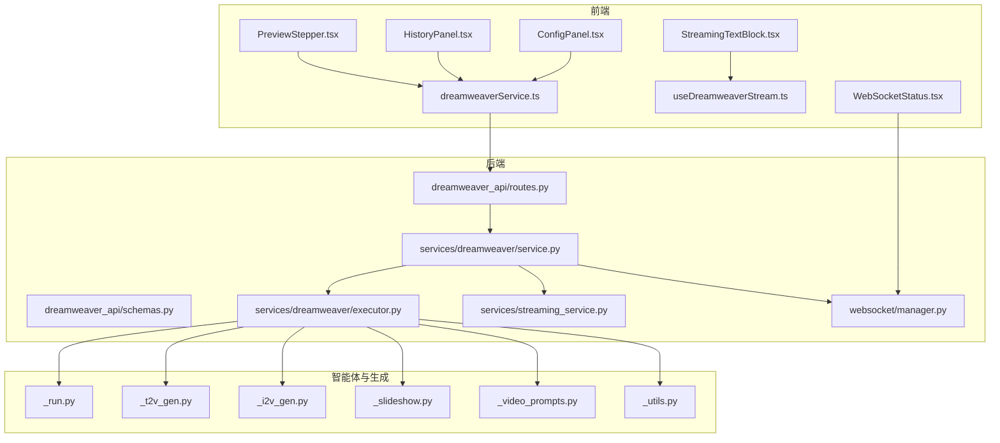
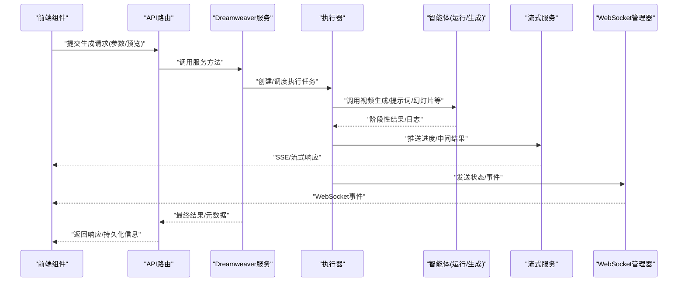
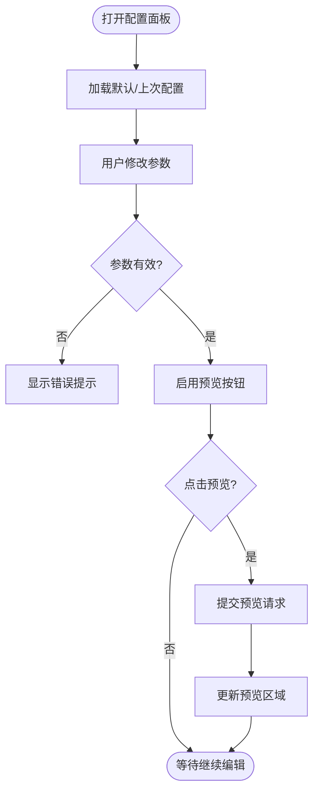
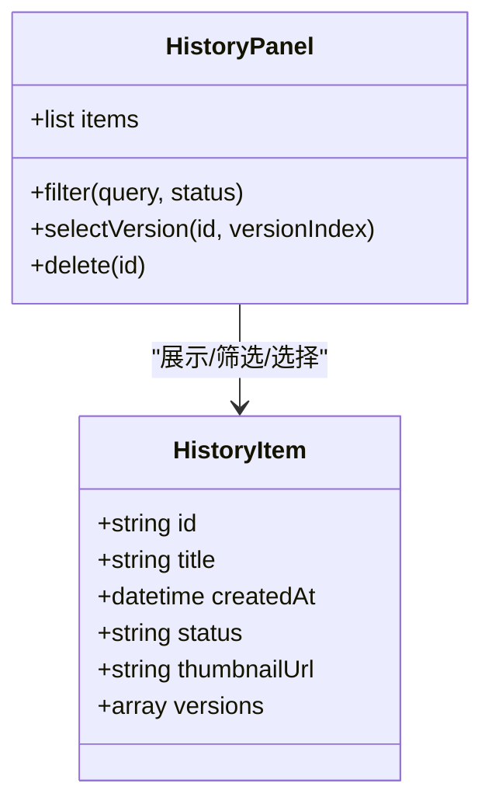
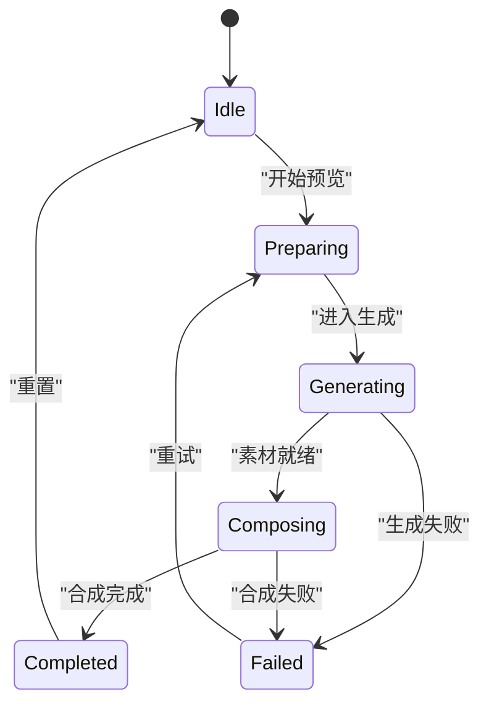
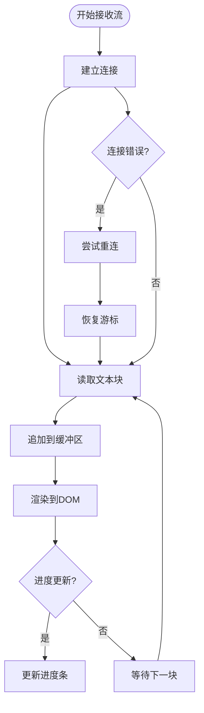
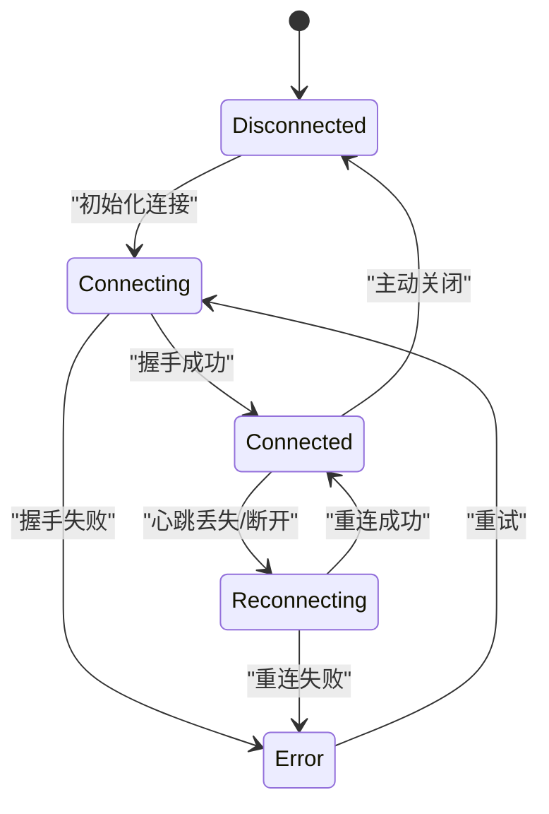
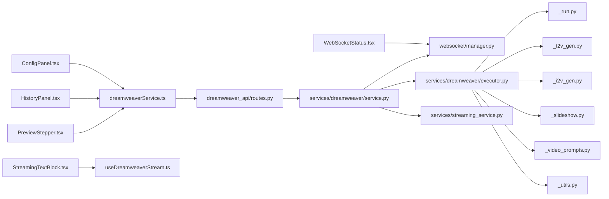

# 梦境编织者组件

<cite>
**本文引用的文件**   
- [dreamweaver.py](file://agents/dreamweaver.py)
- [_run.py](file://agents/dreamweaver_agent_pkg/_run.py)
- [_t2v_gen.py](file://agents/dreamweaver_agent_pkg/_t2v_gen.py)
- [_i2v_gen.py](file://agents/dreamweaver_agent_pkg/_i2v_gen.py)
- [_slideshow.py](file://agents/dreamweaver_agent_pkg/_slideshow.py)
- [_video_prompts.py](file://agents/dreamweaver_agent_pkg/_video_prompts.py)
- [_utils.py](file://agents/dreamweaver_agent_pkg/_utils.py)
- [dreamweaver_api/__init__.py](file://backend/app/api/v1/dreamweaver_api/__init__.py)
- [dreamweaver_api/routes.py](file://backend/app/api/v1/dreamweaver_api/routes.py)
- [dreamweaver_api/schemas.py](file://backend/app/api/v1/dreamweaver_api/schemas.py)
- [services/dreamweaver/service.py](file://backend/app/services/dreamweaver/service.py)
- [services/dreamweaver/executor.py](file://backend/app/services/dreamweaver/executor.py)
- [services/streaming_service.py](file://backend/app/services/streaming_service.py)
- [websocket/manager.py](file://backend/app/websocket/manager.py)
- [frontend/src/components/Dreamweaver/ConfigPanel.tsx](file://frontend/src/components/Dreamweaver/ConfigPanel.tsx)
- [frontend/src/components/Dreamweaver/HistoryPanel.tsx](file://frontend/src/components/Dreamweaver/HistoryPanel.tsx)
- [frontend/src/components/Dreamweaver/PreviewStepper.tsx](file://frontend/src/components/Dreamweaver/PreviewStepper.tsx)
- [frontend/src/components/Dreamweaver/StreamingTextBlock.tsx](file://frontend/src/components/Dreamweaver/StreamingTextBlock.tsx)
- [frontend/src/components/Dreamweaver/WebSocketStatus.tsx](file://frontend/src/components/Dreamweaver/WebSocketStatus.tsx)
- [frontend/src/hooks/useDreamweaverStream.ts](file://frontend/src/hooks/useDreamweaverStream.ts)
- [frontend/src/services/dreamweaverService.ts](file://frontend/src/services/dreamweaverService.ts)
</cite>

## 目录
1. [简介](#简介)
2. [项目结构](#项目结构)
3. [核心组件](#核心组件)
4. [架构总览](#架构总览)
5. [详细组件分析](#详细组件分析)
6. [依赖关系分析](#依赖关系分析)
7. [性能考量](#性能考量)
8. [故障排除指南](#故障排除指南)
9. [结论](#结论)
10. [附录](#附录)

## 简介
本文件为“梦境编织者视频生成组件”的前端与后端集成文档，聚焦以下目标：
- 配置面板（ConfigPanel）的参数设置、校验规则与实时预览
- 历史记录面板（HistoryPanel）的数据展示、筛选与版本管理
- 预览步进器（PreviewStepper）的流程控制、状态切换与错误处理
- 流式文本块（StreamingTextBlock）的实时渲染、进度显示与中断恢复
- WebSocket 状态组件（WebSocketStatus）的连接管理、重连策略与错误提示
- 组件集成的完整示例与常见问题排查

该组件贯穿前端交互、后端编排、流式传输与 WebSocket 通信，形成端到端的视频生成工作流。

## 项目结构
本项目采用前后端分离架构：
- 前端位于 frontend/src，包含 Dreamweaver 相关 UI 组件、hooks 与服务层
- 后端位于 backend/app，提供 API、服务编排、任务执行与 WebSocket 管理
- 智能体与视频生成逻辑位于 agents 与 services/dreamweaver

**图表来源** 
- [dreamweaver_api/routes.py](file://backend/app/api/v1/dreamweaver_api/routes.py)
- [services/dreamweaver/service.py](file://backend/app/services/dreamweaver/service.py)
- [services/dreamweaver/executor.py](file://backend/app/services/dreamweaver/executor.py)
- [services/streaming_service.py](file://backend/app/services/streaming_service.py)
- [websocket/manager.py](file://backend/app/websocket/manager.py)
- [_run.py](file://agents/dreamweaver_agent_pkg/_run.py)
- [_t2v_gen.py](file://agents/dreamweaver_agent_pkg/_t2v_gen.py)
- [_i2v_gen.py](file://agents/dreamweaver_agent_pkg/_i2v_gen.py)
- [_slideshow.py](file://agents/dreamweaver_agent_pkg/_slideshow.py)
- [_video_prompts.py](file://agents/dreamweaver_agent_pkg/_video_prompts.py)
- [_utils.py](file://agents/dreamweaver_agent_pkg/_utils.py)

**章节来源**
- [dreamweaver_api/routes.py](file://backend/app/api/v1/dreamweaver_api/routes.py)
- [services/dreamweaver/service.py](file://backend/app/services/dreamweaver/service.py)
- [services/dreamweaver/executor.py](file://backend/app/services/dreamweaver/executor.py)
- [services/streaming_service.py](file://backend/app/services/streaming_service.py)
- [websocket/manager.py](file://backend/app/websocket/manager.py)
- [_run.py](file://agents/dreamweaver_agent_pkg/_run.py)
- [_t2v_gen.py](file://agents/dreamweaver_agent_pkg/_t2v_gen.py)
- [_i2v_gen.py](file://agents/dreamweaver_agent_pkg/_i2v_gen.py)
- [_slideshow.py](file://agents/dreamweaver_agent_pkg/_slideshow.py)
- [_video_prompts.py](file://agents/dreamweaver_agent_pkg/_video_prompts.py)
- [_utils.py](file://agents/dreamweaver_agent_pkg/_utils.py)

## 核心组件
- ConfigPanel：负责参数输入、校验与实时预览触发
- HistoryPanel：展示历史生成记录，支持筛选与版本切换
- PreviewStepper：控制预览流程（步骤推进、状态切换、错误处理）
- StreamingTextBlock：渲染流式文本，显示进度并支持中断恢复
- WebSocketStatus：管理 WebSocket 连接状态、重连与错误提示

这些组件共同构成用户与后端服务之间的交互界面，并通过 hooks 和服务层进行数据同步与事件驱动更新。

**章节来源**
- [frontend/src/components/Dreamweaver/ConfigPanel.tsx](file://frontend/src/components/Dreamweaver/ConfigPanel.tsx)
- [frontend/src/components/Dreamweaver/HistoryPanel.tsx](file://frontend/src/components/Dreamweaver/HistoryPanel.tsx)
- [frontend/src/components/Dreamweaver/PreviewStepper.tsx](file://frontend/src/components/Dreamweaver/PreviewStepper.tsx)
- [frontend/src/components/Dreamweaver/StreamingTextBlock.tsx](file://frontend/src/components/Dreamweaver/StreamingTextBlock.tsx)
- [frontend/src/components/Dreamweaver/WebSocketStatus.tsx](file://frontend/src/components/Dreamweaver/WebSocketStatus.tsx)

## 架构总览
整体流程从前端发起请求，经 API 路由进入服务层，再由执行器调度智能体完成视频生成，过程中通过流式服务与 WebSocket 向前端推送进度与结果。

**图表来源** 
- [dreamweaver_api/routes.py](file://backend/app/api/v1/dreamweaver_api/routes.py)
- [services/dreamweaver/service.py](file://backend/app/services/dreamweaver/service.py)
- [services/dreamweaver/executor.py](file://backend/app/services/dreamweaver/executor.py)
- [services/streaming_service.py](file://backend/app/services/streaming_service.py)
- [websocket/manager.py](file://backend/app/websocket/manager.py)
- [_run.py](file://agents/dreamweaver_agent_pkg/_run.py)
- [_t2v_gen.py](file://agents/dreamweaver_agent_pkg/_t2v_gen.py)
- [_i2v_gen.py](file://agents/dreamweaver_agent_pkg/_i2v_gen.py)
- [_slideshow.py](file://agents/dreamweaver_agent_pkg/_slideshow.py)
- [_video_prompts.py](file://agents/dreamweaver_agent_pkg/_video_prompts.py)
- [_utils.py](file://agents/dreamweaver_agent_pkg/_utils.py)

## 详细组件分析

### 配置面板（ConfigPanel）
职责与功能：
- 参数设置：模型选择、分辨率、时长、风格、提示词等
- 验证规则：必填项检查、范围限制、格式校验
- 实时预览：根据参数变化触发轻量预览或占位渲染

交互要点：
- 表单变更时即时校验并反馈错误
- 预览按钮触发后禁用重复提交
- 保存配置到本地缓存以便下次加载

**图表来源** 
- [frontend/src/components/Dreamweaver/ConfigPanel.tsx](file://frontend/src/components/Dreamweaver/ConfigPanel.tsx)

**章节来源**
- [frontend/src/components/Dreamweaver/ConfigPanel.tsx](file://frontend/src/components/Dreamweaver/ConfigPanel.tsx)

### 历史记录面板（HistoryPanel）
职责与功能：
- 数据展示：列出历史生成任务（标题、时间、状态、缩略图/链接）
- 筛选操作：按状态、时间、关键词过滤
- 版本管理：同一任务的多个版本切换与对比

交互要点：
- 分页与懒加载提升性能
- 选中版本后回填到预览或编辑区
- 删除/归档操作需二次确认

**图表来源** 
- [frontend/src/components/Dreamweaver/HistoryPanel.tsx](file://frontend/src/components/Dreamweaver/HistoryPanel.tsx)

**章节来源**
- [frontend/src/components/Dreamweaver/HistoryPanel.tsx](file://frontend/src/components/Dreamweaver/HistoryPanel.tsx)

### 预览步进器（PreviewStepper）
职责与功能：
- 流程控制：分步推进（准备→生成中→合成→完成）
- 状态切换：基于后端事件更新 UI 状态
- 错误处理：捕获异常并提示用户，允许重试

关键状态：
- idle：空闲
- preparing：准备阶段
- generating：生成中
- composing：合成阶段
- completed：完成
- failed：失败

**图表来源** 
- [frontend/src/components/Dreamweaver/PreviewStepper.tsx](file://frontend/src/components/Dreamweaver/PreviewStepper.tsx)

**章节来源**
- [frontend/src/components/Dreamweaver/PreviewStepper.tsx](file://frontend/src/components/Dreamweaver/PreviewStepper.tsx)

### 流式文本块（StreamingTextBlock）
职责与功能：
- 实时渲染：增量追加文本片段
- 进度显示：显示当前进度百分比或阶段
- 中断恢复：网络中断后自动恢复并续传

实现要点：
- 使用流式读取（SSE/ReadableStream）
- 防抖合并频繁更新，避免重排抖动
- 断线重连与游标恢复

**图表来源** 
- [frontend/src/components/Dreamweaver/StreamingTextBlock.tsx](file://frontend/src/components/Dreamweaver/StreamingTextBlock.tsx)
- [frontend/src/hooks/useDreamweaverStream.ts](file://frontend/src/hooks/useDreamweaverStream.ts)

**章节来源**
- [frontend/src/components/Dreamweaver/StreamingTextBlock.tsx](file://frontend/src/components/Dreamweaver/StreamingTextBlock.tsx)
- [frontend/src/hooks/useDreamweaverStream.ts](file://frontend/src/hooks/useDreamweaverStream.ts)

### WebSocket 状态组件（WebSocketStatus）
职责与功能：
- 连接管理：建立、关闭、心跳检测
- 重连策略：指数退避、最大重试次数
- 错误提示：连接失败、超时、服务端错误的友好提示

状态机：
- disconnected：断开
- connecting：连接中
- connected：已连接
- reconnecting：重连中
- error：错误

**图表来源** 
- [frontend/src/components/Dreamweaver/WebSocketStatus.tsx](file://frontend/src/components/Dreamweaver/WebSocketStatus.tsx)
- [websocket/manager.py](file://backend/app/websocket/manager.py)

**章节来源**
- [frontend/src/components/Dreamweaver/WebSocketStatus.tsx](file://frontend/src/components/Dreamweaver/WebSocketStatus.tsx)
- [websocket/manager.py](file://backend/app/websocket/manager.py)

## 依赖关系分析
- 前端组件依赖 hooks 与服务层进行数据获取与事件订阅
- 服务层依赖 API 路由定义与后端服务编排
- 执行器依赖智能体模块完成具体生成任务
- 流式服务与 WebSocket 管理器负责实时通信

**图表来源** 
- [frontend/src/components/Dreamweaver/ConfigPanel.tsx](file://frontend/src/components/Dreamweaver/ConfigPanel.tsx)
- [frontend/src/components/Dreamweaver/HistoryPanel.tsx](file://frontend/src/components/Dreamweaver/HistoryPanel.tsx)
- [frontend/src/components/Dreamweaver/PreviewStepper.tsx](file://frontend/src/components/Dreamweaver/PreviewStepper.tsx)
- [frontend/src/components/Dreamweaver/StreamingTextBlock.tsx](file://frontend/src/components/Dreamweaver/StreamingTextBlock.tsx)
- [frontend/src/components/Dreamweaver/WebSocketStatus.tsx](file://frontend/src/components/Dreamweaver/WebSocketStatus.tsx)
- [frontend/src/hooks/useDreamweaverStream.ts](file://frontend/src/hooks/useDreamweaverStream.ts)
- [frontend/src/services/dreamweaverService.ts](file://frontend/src/services/dreamweaverService.ts)
- [dreamweaver_api/routes.py](file://backend/app/api/v1/dreamweaver_api/routes.py)
- [services/dreamweaver/service.py](file://backend/app/services/dreamweaver/service.py)
- [services/dreamweaver/executor.py](file://backend/app/services/dreamweaver/executor.py)
- [services/streaming_service.py](file://backend/app/services/streaming_service.py)
- [websocket/manager.py](file://backend/app/websocket/manager.py)
- [_run.py](file://agents/dreamweaver_agent_pkg/_run.py)
- [_t2v_gen.py](file://agents/dreamweaver_agent_pkg/_t2v_gen.py)
- [_i2v_gen.py](file://agents/dreamweaver_agent_pkg/_i2v_gen.py)
- [_slideshow.py](file://agents/dreamweaver_agent_pkg/_slideshow.py)
- [_video_prompts.py](file://agents/dreamweaver_agent_pkg/_video_prompts.py)
- [_utils.py](file://agents/dreamweaver_agent_pkg/_utils.py)

**章节来源**
- [frontend/src/services/dreamweaverService.ts](file://frontend/src/services/dreamweaverService.ts)
- [dreamweaver_api/routes.py](file://backend/app/api/v1/dreamweaver_api/routes.py)
- [services/dreamweaver/service.py](file://backend/app/services/dreamweaver/service.py)
- [services/dreamweaver/executor.py](file://backend/app/services/dreamweaver/executor.py)
- [services/streaming_service.py](file://backend/app/services/streaming_service.py)
- [websocket/manager.py](file://backend/app/websocket/manager.py)

## 性能考量
- 前端渲染优化：对 StreamingTextBlock 使用虚拟滚动与增量更新，减少重排
- 历史列表懒加载：按需加载条目，降低初始负载
- 预览节流：在 ConfigPanel 中节流预览触发频率
- 后端并发控制：执行器限制并发任务数，避免资源争用
- 流式传输：优先使用 SSE/ReadableStream 减少延迟
- WebSocket 心跳：合理设置心跳间隔与超时阈值

[本节为通用指导，不直接分析具体文件]

## 故障排除指南
常见问题与解决思路：
- 预览无响应：检查 ConfigPanel 参数校验是否通过；查看浏览器控制台错误
- 历史列表为空：确认后端接口返回数据格式；检查筛选条件
- 预览卡住：检查 PreviewStepper 状态机是否陷入异常状态；查看 WebSocket 连接状态
- 流式文本不更新：确认 useDreamweaverStream 是否正确订阅；检查网络与 CORS
- WebSocket 频繁重连：检查服务端心跳与客户端重连策略；查看错误码与日志

定位建议：
- 前端：使用开发者工具监控网络请求与 WebSocket 帧
- 后端：查看 API 路由日志、服务层异常堆栈与执行器任务状态
- 智能体：检查生成任务日志与中间产物

**章节来源**
- [frontend/src/components/Dreamweaver/ConfigPanel.tsx](file://frontend/src/components/Dreamweaver/ConfigPanel.tsx)
- [frontend/src/components/Dreamweaver/HistoryPanel.tsx](file://frontend/src/components/Dreamweaver/HistoryPanel.tsx)
- [frontend/src/components/Dreamweaver/PreviewStepper.tsx](file://frontend/src/components/Dreamweaver/PreviewStepper.tsx)
- [frontend/src/components/Dreamweaver/StreamingTextBlock.tsx](file://frontend/src/components/Dreamweaver/StreamingTextBlock.tsx)
- [frontend/src/components/Dreamweaver/WebSocketStatus.tsx](file://frontend/src/components/Dreamweaver/WebSocketStatus.tsx)
- [frontend/src/hooks/useDreamweaverStream.ts](file://frontend/src/hooks/useDreamweaverStream.ts)
- [frontend/src/services/dreamweaverService.ts](file://frontend/src/services/dreamweaverService.ts)
- [dreamweaver_api/routes.py](file://backend/app/api/v1/dreamweaver_api/routes.py)
- [services/dreamweaver/service.py](file://backend/app/services/dreamweaver/service.py)
- [services/dreamweaver/executor.py](file://backend/app/services/dreamweaver/executor.py)
- [services/streaming_service.py](file://backend/app/services/streaming_service.py)
- [websocket/manager.py](file://backend/app/websocket/manager.py)

## 结论
梦境编织者视频生成组件通过清晰的前端组件划分与稳健的后端编排，实现了从参数配置到流式预览的完整闭环。合理的状态机设计、流式传输与 WebSocket 管理确保了良好的用户体验与系统稳定性。建议在后续迭代中持续优化性能与可观测性，完善错误恢复机制与用户引导。

[本节为总结，不直接分析具体文件]

## 附录
- 组件集成示例：将 ConfigPanel、HistoryPanel、PreviewStepper、StreamingTextBlock、WebSocketStatus 组合到页面容器，通过 dreamweaverService 统一协调
- 最佳实践：表单校验前置、预览节流、流式渲染防抖、WebSocket 心跳与重连策略
- 扩展点：新增生成步骤可在执行器中扩展；新增 UI 状态可在 PreviewStepper 中映射

[本节为补充说明，不直接分析具体文件]