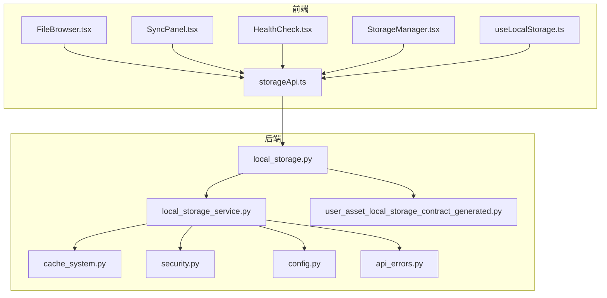
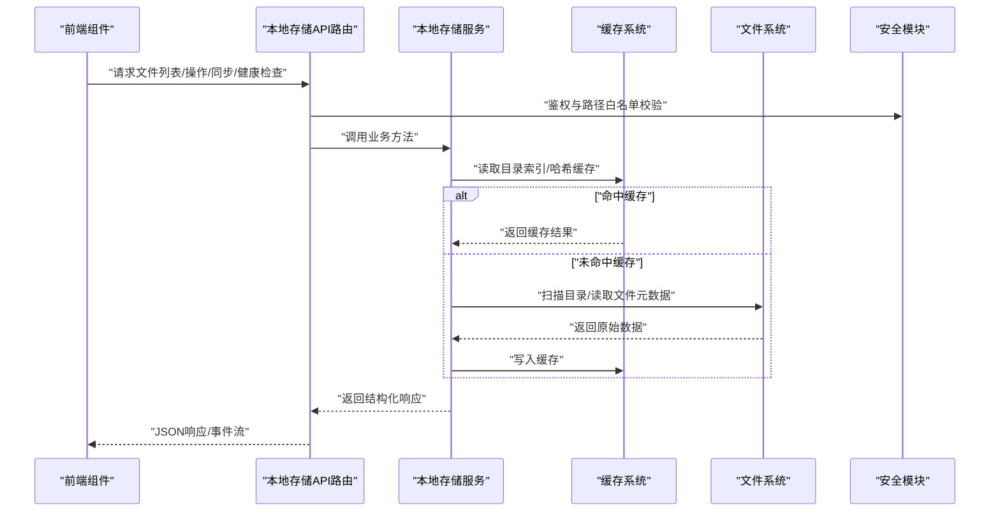
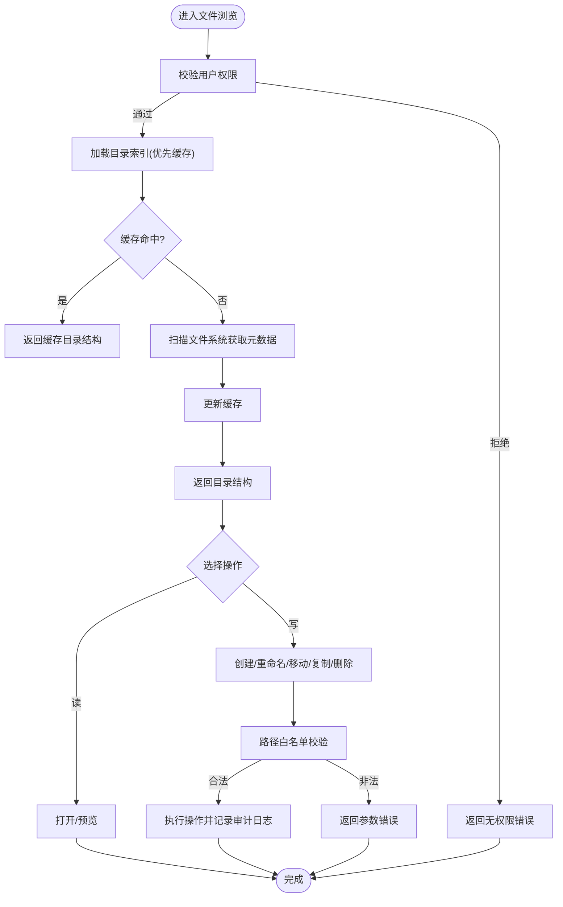
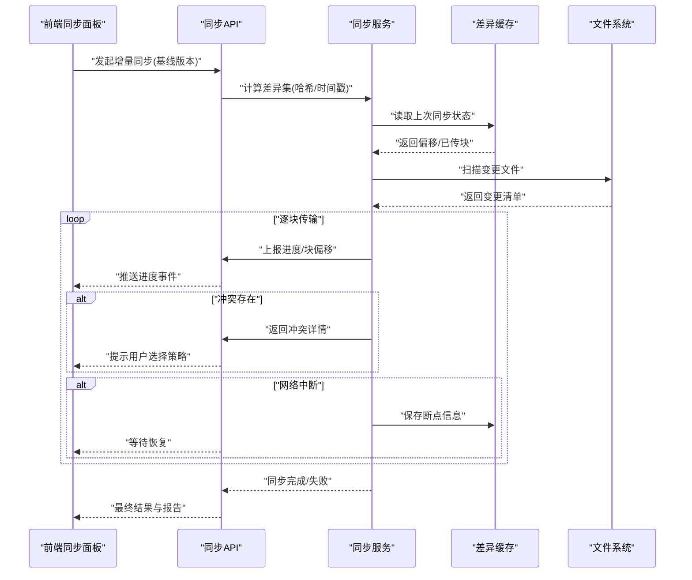
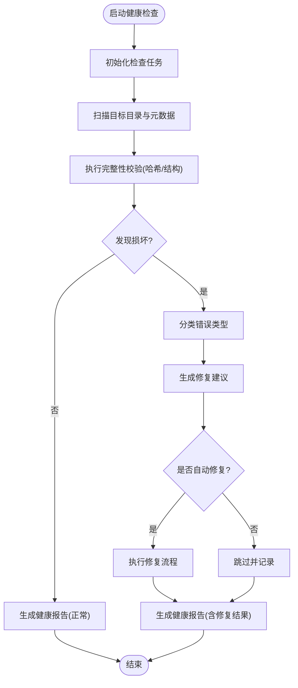
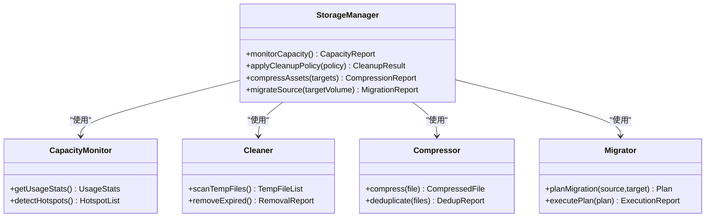
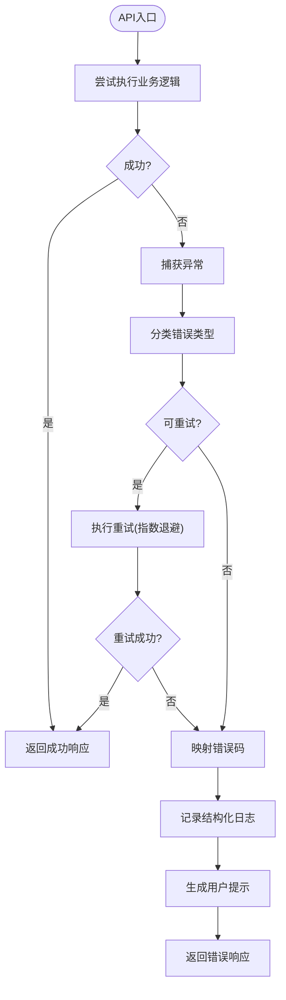
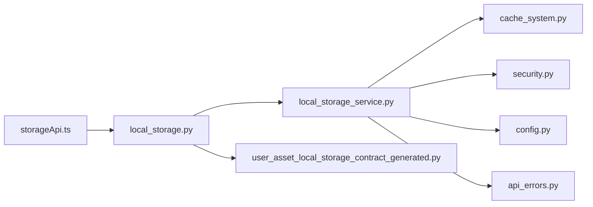

# 本地存储面板

<cite>
**本文引用的文件**   
- [backend/app/schemas/user_asset_local_storage_contract_generated.py](file://backend/app/schemas/user_asset_local_storage_contract_generated.py)
- [backend/app/api/v1/asset_studio_api/local_storage.py](file://backend/app/api/v1/asset_studio_api/local_storage.py)
- [backend/app/services/providers/local_storage_service.py](file://backend/app/services/providers/local_storage_service.py)
- [backend/app/services/cache_system.py](file://backend/app/services/cache_system.py)
- [backend/app/core/security.py](file://backend/app/core/security.py)
- [backend/app/core/config.py](file://backend/app/core/config.py)
- [backend/app/utils/api_errors.py](file://backend/app/utils/api_errors.py)
- [frontend/src/hooks/useLocalStorage.ts](file://frontend/src/hooks/useLocalStorage.ts)
- [frontend/src/components/storage/FileBrowser.tsx](file://frontend/src/components/storage/FileBrowser.tsx)
- [frontend/src/components/storage/SyncPanel.tsx](file://frontend/src/components/storage/SyncPanel.tsx)
- [frontend/src/components/storage/HealthCheck.tsx](file://frontend/src/components/storage/HealthCheck.tsx)
- [frontend/src/components/storage/StorageManager.tsx](file://frontend/src/components/storage/StorageManager.tsx)
- [frontend/src/services/storageApi.ts](file://frontend/src/services/storageApi.ts)
</cite>

## 目录
1. [简介](#简介)
2. [项目结构](#项目结构)
3. [核心组件](#核心组件)
4. [架构总览](#架构总览)
5. [详细组件分析](#详细组件分析)
6. [依赖关系分析](#依赖关系分析)
7. [性能考量](#性能考量)
8. [故障排查指南](#故障排查指南)
9. [结论](#结论)
10. [附录](#附录)

## 简介
本文件为“本地存储面板”组件的完整技术文档，面向开发者与运维人员。内容覆盖：
- 文件管理系统：文件浏览、目录结构、文件操作与权限控制
- 同步机制：增量同步、冲突检测、自动恢复与断点续传
- 健康检查：完整性验证、损坏检测、修复建议与健康报告
- 存储空间管理：容量监控、清理策略、压缩优化与迁移工具
- 错误处理：异常捕获、重试策略、用户提示与日志记录
- 安全考虑：数据加密、访问控制、备份恢复与隐私保护

## 项目结构
本地存储面板由前后端协同实现：
- 前端提供交互界面（文件浏览器、同步面板、健康检查、存储管理）
- 后端提供 API 与服务层（本地存储服务、缓存系统、安全与配置、错误处理）

图表来源
- [frontend/src/components/storage/FileBrowser.tsx](file://frontend/src/components/storage/FileBrowser.tsx)
- [frontend/src/components/storage/SyncPanel.tsx](file://frontend/src/components/storage/SyncPanel.tsx)
- [frontend/src/components/storage/HealthCheck.tsx](file://frontend/src/components/storage/HealthCheck.tsx)
- [frontend/src/components/storage/StorageManager.tsx](file://frontend/src/components/storage/StorageManager.tsx)
- [frontend/src/hooks/useLocalStorage.ts](file://frontend/src/hooks/useLocalStorage.ts)
- [frontend/src/services/storageApi.ts](file://frontend/src/services/storageApi.ts)
- [backend/app/api/v1/asset_studio_api/local_storage.py](file://backend/app/api/v1/asset_studio_api/local_storage.py)
- [backend/app/services/providers/local_storage_service.py](file://backend/app/services/providers/local_storage_service.py)
- [backend/app/services/cache_system.py](file://backend/app/services/cache_system.py)
- [backend/app/core/security.py](file://backend/app/core/security.py)
- [backend/app/core/config.py](file://backend/app/core/config.py)
- [backend/app/utils/api_errors.py](file://backend/app/utils/api_errors.py)
- [backend/app/schemas/user_asset_local_storage_contract_generated.py](file://backend/app/schemas/user_asset_local_storage_contract_generated.py)

章节来源
- [backend/app/api/v1/asset_studio_api/local_storage.py](file://backend/app/api/v1/asset_studio_api/local_storage.py)
- [backend/app/services/providers/local_storage_service.py](file://backend/app/services/providers/local_storage_service.py)
- [backend/app/services/cache_system.py](file://backend/app/services/cache_system.py)
- [backend/app/core/security.py](file://backend/app/core/security.py)
- [backend/app/core/config.py](file://backend/app/core/config.py)
- [backend/app/utils/api_errors.py](file://backend/app/utils/api_errors.py)
- [backend/app/schemas/user_asset_local_storage_contract_generated.py](file://backend/app/schemas/user_asset_local_storage_contract_generated.py)
- [frontend/src/components/storage/FileBrowser.tsx](file://frontend/src/components/storage/FileBrowser.tsx)
- [frontend/src/components/storage/SyncPanel.tsx](file://frontend/src/components/storage/SyncPanel.tsx)
- [frontend/src/components/storage/HealthCheck.tsx](file://frontend/src/components/storage/HealthCheck.tsx)
- [frontend/src/components/storage/StorageManager.tsx](file://frontend/src/components/storage/StorageManager.tsx)
- [frontend/src/hooks/useLocalStorage.ts](file://frontend/src/hooks/useLocalStorage.ts)
- [frontend/src/services/storageApi.ts](file://frontend/src/services/storageApi.ts)

## 核心组件
- 文件浏览器（前端）：展示目录树、支持搜索与筛选、执行打开/复制/移动/删除等操作
- 同步面板（前端）：触发全量/增量同步、显示进度与冲突列表、支持断点续传
- 健康检查（前端）：发起完整性校验、查看损坏报告、一键修复或导出报告
- 存储管理器（前端）：监控容量、执行清理、压缩优化、迁移任务
- 本地存储 API（后端路由）：统一暴露文件浏览、操作、同步、健康检查、存储管理等接口
- 本地存储服务（后端服务）：封装文件系统操作、元数据管理、缓存读写、权限校验
- 缓存系统（后端服务）：目录索引缓存、文件哈希缓存、增量同步差异计算
- 安全与配置（后端核心）：路径白名单、权限控制、加密开关、存储根路径等配置项
- 错误处理（后端工具）：标准化错误码、异常包装、重试策略、日志记录
- 数据契约（后端 Schema）：本地存储元数据模型、字段约束、版本兼容

章节来源
- [backend/app/api/v1/asset_studio_api/local_storage.py](file://backend/app/api/v1/asset_studio_api/local_storage.py)
- [backend/app/services/providers/local_storage_service.py](file://backend/app/services/providers/local_storage_service.py)
- [backend/app/services/cache_system.py](file://backend/app/services/cache_system.py)
- [backend/app/core/security.py](file://backend/app/core/security.py)
- [backend/app/core/config.py](file://backend/app/core/config.py)
- [backend/app/utils/api_errors.py](file://backend/app/utils/api_errors.py)
- [backend/app/schemas/user_asset_local_storage_contract_generated.py](file://backend/app/schemas/user_asset_local_storage_contract_generated.py)
- [frontend/src/components/storage/FileBrowser.tsx](file://frontend/src/components/storage/FileBrowser.tsx)
- [frontend/src/components/storage/SyncPanel.tsx](file://frontend/src/components/storage/SyncPanel.tsx)
- [frontend/src/components/storage/HealthCheck.tsx](file://frontend/src/components/storage/HealthCheck.tsx)
- [frontend/src/components/storage/StorageManager.tsx](file://frontend/src/components/storage/StorageManager.tsx)
- [frontend/src/hooks/useLocalStorage.ts](file://frontend/src/hooks/useLocalStorage.ts)
- [frontend/src/services/storageApi.ts](file://frontend/src/services/storageApi.ts)

## 架构总览
本地存储面板采用前后端分离架构，前端通过 REST/WS 调用后端 API，后端以存储服务为核心，结合缓存系统与权限控制，对外提供稳定可靠的文件管理能力。

图表来源
- [backend/app/api/v1/asset_studio_api/local_storage.py](file://backend/app/api/v1/asset_studio_api/local_storage.py)
- [backend/app/services/providers/local_storage_service.py](file://backend/app/services/providers/local_storage_service.py)
- [backend/app/services/cache_system.py](file://backend/app/services/cache_system.py)
- [backend/app/core/security.py](file://backend/app/core/security.py)

## 详细组件分析

### 文件管理系统（浏览、目录结构、操作、权限）
- 文件浏览：支持分页、排序、过滤；目录树懒加载；搜索关键词高亮
- 目录结构：维护虚拟目录映射，避免深层遍历；支持软链接解析与隔离
- 文件操作：创建、重命名、移动、复制、删除；批量操作事务化
- 权限控制：基于角色与资源路径的访问控制；写操作需显式授权；审计日志记录

图表来源
- [backend/app/api/v1/asset_studio_api/local_storage.py](file://backend/app/api/v1/asset_studio_api/local_storage.py)
- [backend/app/services/providers/local_storage_service.py](file://backend/app/services/providers/local_storage_service.py)
- [backend/app/core/security.py](file://backend/app/core/security.py)

章节来源
- [backend/app/api/v1/asset_studio_api/local_storage.py](file://backend/app/api/v1/asset_studio_api/local_storage.py)
- [backend/app/services/providers/local_storage_service.py](file://backend/app/services/providers/local_storage_service.py)
- [backend/app/core/security.py](file://backend/app/core/security.py)

### 同步机制（增量、冲突、恢复、断点续传）
- 增量同步：基于文件哈希与时间戳的差异计算，仅传输变更块
- 冲突检测：同文件多端修改时生成冲突标记，支持三方合并或保留策略
- 自动恢复：失败任务持久化状态，重启后从断点继续
- 断点续传：分块上传/下载，记录偏移量，网络中断后恢复

图表来源
- [backend/app/api/v1/asset_studio_api/local_storage.py](file://backend/app/api/v1/asset_studio_api/local_storage.py)
- [backend/app/services/providers/local_storage_service.py](file://backend/app/services/providers/local_storage_service.py)
- [backend/app/services/cache_system.py](file://backend/app/services/cache_system.py)

章节来源
- [backend/app/api/v1/asset_studio_api/local_storage.py](file://backend/app/api/v1/asset_studio_api/local_storage.py)
- [backend/app/services/providers/local_storage_service.py](file://backend/app/services/providers/local_storage_service.py)
- [backend/app/services/cache_system.py](file://backend/app/services/cache_system.py)

### 健康检查（完整性、损坏检测、修复建议、报告）
- 完整性验证：对关键文件进行哈希校验与结构检查
- 损坏检测：识别缺失、截断、格式不匹配的文件
- 修复建议：根据错误类型给出重建索引、重新下载、替换备份等建议
- 健康报告：汇总检查结果、风险等级、修复步骤与耗时统计

图表来源
- [backend/app/api/v1/asset_studio_api/local_storage.py](file://backend/app/api/v1/asset_studio_api/local_storage.py)
- [backend/app/services/providers/local_storage_service.py](file://backend/app/services/providers/local_storage_service.py)

章节来源
- [backend/app/api/v1/asset_studio_api/local_storage.py](file://backend/app/api/v1/asset_studio_api/local_storage.py)
- [backend/app/services/providers/local_storage_service.py](file://backend/app/services/providers/local_storage_service.py)

### 存储空间管理（容量、清理、压缩、迁移）
- 容量监控：实时统计磁盘使用率、热点目录占用、大文件分布
- 清理策略：按时间/大小/访问频率清理临时文件与过期缓存
- 压缩优化：对静态资源进行按需压缩与去重
- 迁移工具：跨卷/跨设备迁移，保持元数据一致性与引用完整

图表来源
- [backend/app/api/v1/asset_studio_api/local_storage.py](file://backend/app/api/v1/asset_studio_api/local_storage.py)
- [backend/app/services/providers/local_storage_service.py](file://backend/app/services/providers/local_storage_service.py)

章节来源
- [backend/app/api/v1/asset_studio_api/local_storage.py](file://backend/app/api/v1/asset_studio_api/local_storage.py)
- [backend/app/services/providers/local_storage_service.py](file://backend/app/services/providers/local_storage_service.py)

### 错误处理机制（异常、重试、提示、日志）
- 异常捕获：统一包装 IO、权限、参数错误，避免崩溃
- 重试策略：指数退避与最大重试次数，区分可重试与不可重试错误
- 用户提示：前端根据错误码展示友好消息与操作建议
- 日志记录：结构化日志包含请求ID、操作对象、耗时与堆栈摘要

图表来源
- [backend/app/utils/api_errors.py](file://backend/app/utils/api_errors.py)
- [backend/app/api/v1/asset_studio_api/local_storage.py](file://backend/app/api/v1/asset_studio_api/local_storage.py)

章节来源
- [backend/app/utils/api_errors.py](file://backend/app/utils/api_errors.py)
- [backend/app/api/v1/asset_studio_api/local_storage.py](file://backend/app/api/v1/asset_studio_api/local_storage.py)

### 安全考虑（加密、访问控制、备份恢复、隐私）
- 数据加密：敏感元数据与传输通道启用加密；可选静态数据加密
- 访问控制：基于角色的路径级权限；写操作二次确认与审计
- 备份恢复：定期快照与增量备份；恢复时一致性校验
- 隐私保护：脱敏日志、最小权限原则、数据生命周期管理

章节来源
- [backend/app/core/security.py](file://backend/app/core/security.py)
- [backend/app/core/config.py](file://backend/app/core/config.py)
- [backend/app/api/v1/asset_studio_api/local_storage.py](file://backend/app/api/v1/asset_studio_api/local_storage.py)

## 依赖关系分析
- 前端依赖：React 组件、Hooks、API 客户端
- 后端依赖：FastAPI 路由、存储服务、缓存系统、安全与配置、错误处理、Schema 校验
- 外部依赖：文件系统、磁盘 I/O、可选加密库、日志框架

图表来源
- [frontend/src/services/storageApi.ts](file://frontend/src/services/storageApi.ts)
- [backend/app/api/v1/asset_studio_api/local_storage.py](file://backend/app/api/v1/asset_studio_api/local_storage.py)
- [backend/app/services/providers/local_storage_service.py](file://backend/app/services/providers/local_storage_service.py)
- [backend/app/services/cache_system.py](file://backend/app/services/cache_system.py)
- [backend/app/core/security.py](file://backend/app/core/security.py)
- [backend/app/core/config.py](file://backend/app/core/config.py)
- [backend/app/utils/api_errors.py](file://backend/app/utils/api_errors.py)
- [backend/app/schemas/user_asset_local_storage_contract_generated.py](file://backend/app/schemas/user_asset_local_storage_contract_generated.py)

章节来源
- [frontend/src/services/storageApi.ts](file://frontend/src/services/storageApi.ts)
- [backend/app/api/v1/asset_studio_api/local_storage.py](file://backend/app/api/v1/asset_studio_api/local_storage.py)
- [backend/app/services/providers/local_storage_service.py](file://backend/app/services/providers/local_storage_service.py)
- [backend/app/services/cache_system.py](file://backend/app/services/cache_system.py)
- [backend/app/core/security.py](file://backend/app/core/security.py)
- [backend/app/core/config.py](file://backend/app/core/config.py)
- [backend/app/utils/api_errors.py](file://backend/app/utils/api_errors.py)
- [backend/app/schemas/user_asset_local_storage_contract_generated.py](file://backend/app/schemas/user_asset_local_storage_contract_generated.py)

## 性能考量
- 缓存优先：目录索引与哈希缓存减少 I/O 压力
- 增量同步：仅传输差异块，降低带宽与延迟
- 异步任务：长耗时操作（扫描、压缩、迁移）后台执行，前端轮询/事件驱动
- 批处理：批量文件操作合并提交，减少锁竞争
- 限流与背压：防止突发流量导致系统过载

[本节为通用指导，无需特定文件来源]

## 故障排查指南
- 常见问题
  - 权限不足：检查路径白名单与角色权限
  - 同步失败：查看断点信息与冲突列表，确认网络稳定性
  - 健康检查报错：根据错误分类定位损坏文件，执行修复建议
  - 容量告警：识别热点目录与大文件，执行清理策略
- 诊断步骤
  - 查看结构化日志与错误码
  - 检查缓存状态与索引一致性
  - 复现问题并收集上下文（请求ID、操作对象、耗时）
  - 必要时回滚到最近快照

章节来源
- [backend/app/utils/api_errors.py](file://backend/app/utils/api_errors.py)
- [backend/app/services/providers/local_storage_service.py](file://backend/app/services/providers/local_storage_service.py)
- [backend/app/services/cache_system.py](file://backend/app/services/cache_system.py)

## 结论
本地存储面板通过清晰的前后端分层、稳健的服务与缓存设计、完善的错误与安全机制，提供了可靠高效的文件管理与同步能力。建议在部署中启用加密与审计，并结合监控与告警提升可观测性。

[本节为总结，无需特定文件来源]

## 附录
- 术语表
  - 增量同步：仅同步变更数据的同步方式
  - 断点续传：在网络中断后从上次位置继续传输
  - 健康检查：对存储完整性与可用性的自动化检测
- 最佳实践
  - 合理设置缓存失效策略
  - 使用幂等接口保障重试安全
  - 定期执行健康检查与备份演练

[本节为补充信息，无需特定文件来源]