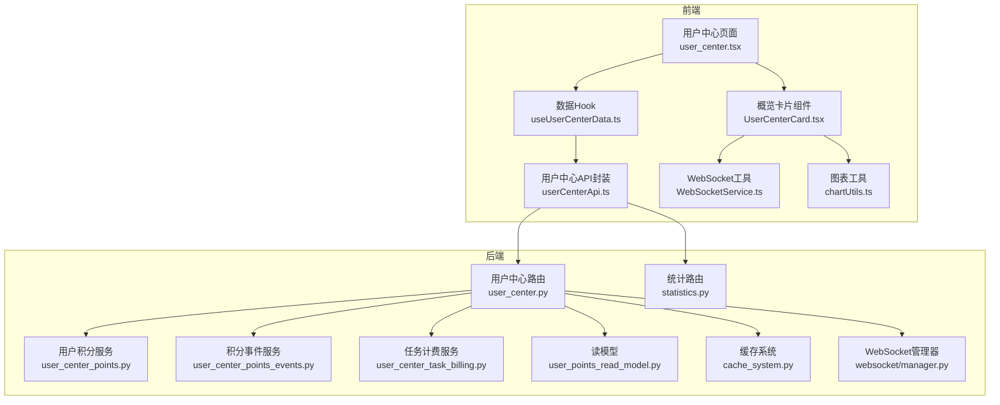
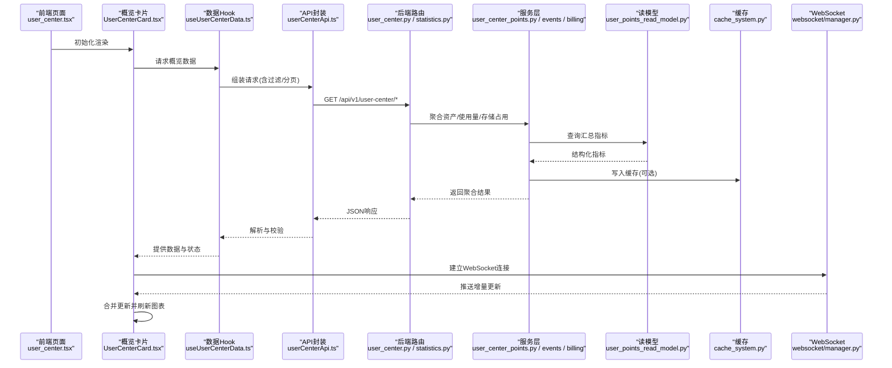
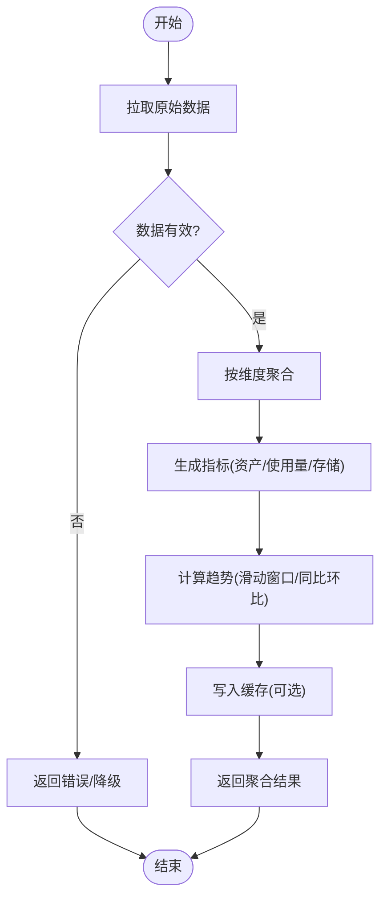
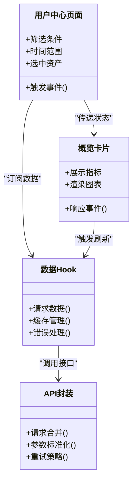
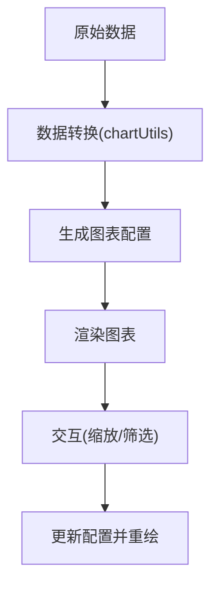
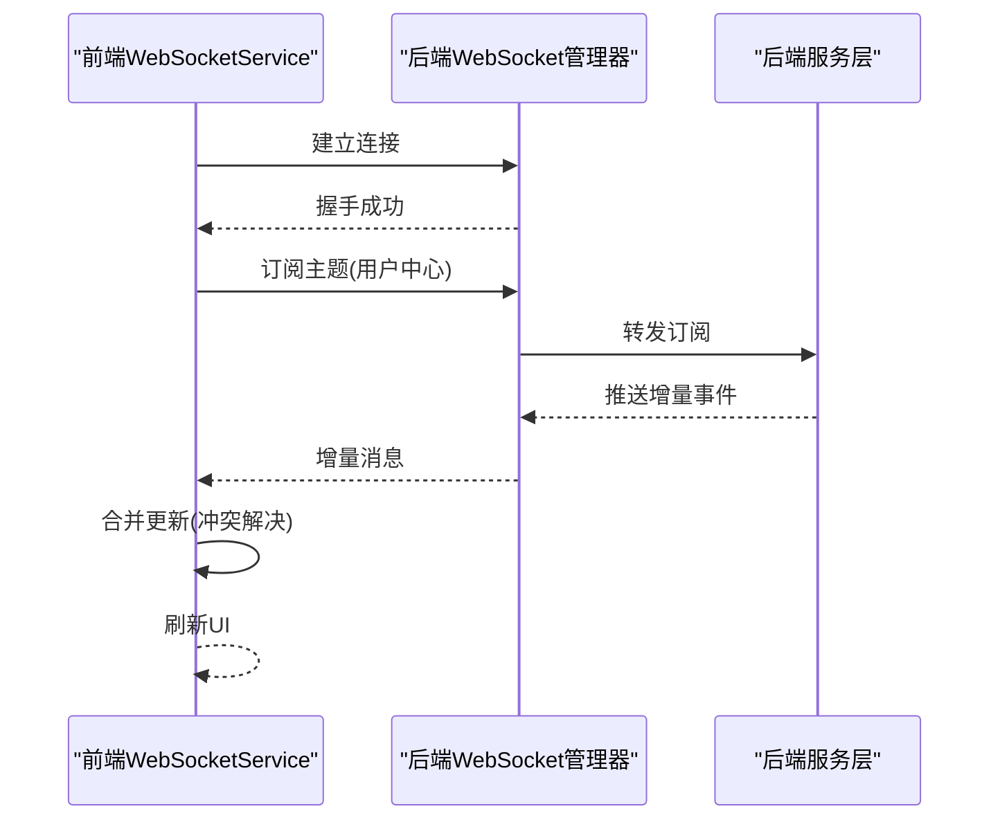
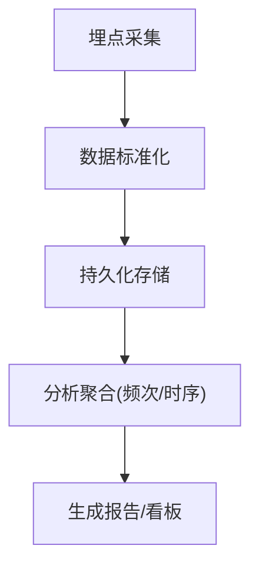
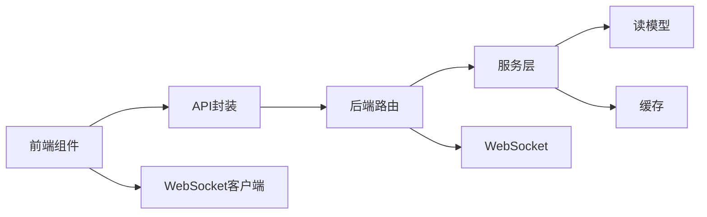

# 用户中心概览卡片

<cite>
**本文引用的文件**   
- [user_center.py](file://backend/app/api/v1/user_center.py)
- [statistics.py](file://backend/app/api/v1/statistics.py)
- [user_center_points.py](file://backend/app/services/user_center_points.py)
- [user_center_points_events.py](file://backend/app/services/user_center_points_events.py)
- [user_center_task_billing.py](file://backend/app/services/user_center_task_billing.py)
- [user_points_read_model.py](file://backend/app/services/user_points_read_model.py)
- [cache_system.py](file://backend/app/services/cache_system.py)
- [manager.py](file://backend/app/websocket/manager.py)
- [user_center.tsx](file://frontend/src/pages/user_center.tsx)
- [UserCenterCard.tsx](file://frontend/src/components/UserCenterCard.tsx)
- [useUserCenterData.ts](file://frontend/src/hooks/useUserCenterData.ts)
- [userCenterApi.ts](file://frontend/src/services/userCenterApi.ts)
- [WebSocketService.ts](file://frontend/src/utils/WebSocketService.ts)
- [chartUtils.ts](file://frontend/src/utils/chartUtils.ts)
</cite>

## 目录
1. [简介](#简介)
2. [项目结构](#项目结构)
3. [核心组件](#核心组件)
4. [架构总览](#架构总览)
5. [详细组件分析](#详细组件分析)
6. [依赖关系分析](#依赖关系分析)
7. [性能考虑](#性能考虑)
8. [故障排查指南](#故障排查指南)
9. [结论](#结论)
10. [附录](#附录)

## 简介
本文件为用户中心概览卡片组件的全面技术文档，聚焦以下能力：
- 数据聚合：资产统计、使用量计算、存储占用分析与趋势图表展示
- 联动操作机制：跨组件通信、状态同步与事件触发
- 数据可视化：饼图、柱状图、折线图与热力图的实现要点
- 实时更新：WebSocket 连接、增量更新与冲突解决策略
- 用户行为分析：访问记录、操作日志与使用偏好分析
- 性能优化：数据缓存、请求合并与渲染优化

## 项目结构
用户中心概览卡片由前后端协同实现：
- 后端提供用户中心 API、统计数据服务、积分与计费服务、缓存系统与 WebSocket 管理
- 前端提供页面、卡片组件、数据获取 Hook、API 封装、WebSocket 工具与图表工具

**图示来源** 
- [user_center.py](file://backend/app/api/v1/user_center.py)
- [statistics.py](file://backend/app/api/v1/statistics.py)
- [user_center_points.py](file://backend/app/services/user_center_points.py)
- [user_center_points_events.py](file://backend/app/services/user_center_points_events.py)
- [user_center_task_billing.py](file://backend/app/services/user_center_task_billing.py)
- [user_points_read_model.py](file://backend/app/services/user_points_read_model.py)
- [cache_system.py](file://backend/app/services/cache_system.py)
- [manager.py](file://backend/app/websocket/manager.py)
- [user_center.tsx](file://frontend/src/pages/user_center.tsx)
- [UserCenterCard.tsx](file://frontend/src/components/UserCenterCard.tsx)
- [useUserCenterData.ts](file://frontend/src/hooks/useUserCenterData.ts)
- [userCenterApi.ts](file://frontend/src/services/userCenterApi.ts)
- [WebSocketService.ts](file://frontend/src/utils/WebSocketService.ts)
- [chartUtils.ts](file://frontend/src/utils/chartUtils.ts)

**章节来源**
- [user_center.py](file://backend/app/api/v1/user_center.py)
- [statistics.py](file://backend/app/api/v1/statistics.py)
- [user_center_points.py](file://backend/app/services/user_center_points.py)
- [user_center_points_events.py](file://backend/app/services/user_center_points_events.py)
- [user_center_task_billing.py](file://backend/app/services/user_center_task_billing.py)
- [user_points_read_model.py](file://backend/app/services/user_points_read_model.py)
- [cache_system.py](file://backend/app/services/cache_system.py)
- [manager.py](file://backend/app/websocket/manager.py)
- [user_center.tsx](file://frontend/src/pages/user_center.tsx)
- [UserCenterCard.tsx](file://frontend/src/components/UserCenterCard.tsx)
- [useUserCenterData.ts](file://frontend/src/hooks/useUserCenterData.ts)
- [userCenterApi.ts](file://frontend/src/services/userCenterApi.ts)
- [WebSocketService.ts](file://frontend/src/utils/WebSocketService.ts)
- [chartUtils.ts](file://frontend/src/utils/chartUtils.ts)

## 核心组件
- 用户中心页面（user_center.tsx）：承载用户中心主布局与导航，集成概览卡片与其他功能模块。
- 概览卡片组件（UserCenterCard.tsx）：展示资产统计、使用量、存储占用与趋势图表，支持交互联动。
- 数据Hook（useUserCenterData.ts）：统一拉取与缓存用户中心数据，处理错误与重试逻辑。
- API封装（userCenterApi.ts）：封装用户中心相关接口调用，包含请求合并与参数标准化。
- WebSocket工具（WebSocketService.ts）：维护长连接、心跳、重连与消息分发。
- 图表工具（chartUtils.ts）：将原始数据转换为图表所需格式，并生成配置项。

**章节来源**
- [user_center.tsx](file://frontend/src/pages/user_center.tsx)
- [UserCenterCard.tsx](file://frontend/src/components/UserCenterCard.tsx)
- [useUserCenterData.ts](file://frontend/src/hooks/useUserCenterData.ts)
- [userCenterApi.ts](file://frontend/src/services/userCenterApi.ts)
- [WebSocketService.ts](file://frontend/src/utils/WebSocketService.ts)
- [chartUtils.ts](file://frontend/src/utils/chartUtils.ts)

## 架构总览
用户中心概览卡片的端到端流程如下：
- 前端通过 useUserCenterData 发起请求，经 userCenterApi 调用后端 user_center.py 与 statistics.py
- 后端服务层 user_center_points.py、user_center_points_events.py、user_center_task_billing.py 聚合数据，并通过 user_points_read_model.py 读取汇总结果
- 数据可经由 cache_system.py 缓存以提升性能；实时变更通过 websocket/manager.py 推送至前端
- 前端根据返回数据在 UserCenterCard.tsx 中渲染饼图、柱状图、折线图与热力图，并通过 WebSocketService.ts 接收增量更新

**图示来源** 
- [user_center.tsx](file://frontend/src/pages/user_center.tsx)
- [UserCenterCard.tsx](file://frontend/src/components/UserCenterCard.tsx)
- [useUserCenterData.ts](file://frontend/src/hooks/useUserCenterData.ts)
- [userCenterApi.ts](file://frontend/src/services/userCenterApi.ts)
- [user_center.py](file://backend/app/api/v1/user_center.py)
- [statistics.py](file://backend/app/api/v1/statistics.py)
- [user_center_points.py](file://backend/app/services/user_center_points.py)
- [user_center_points_events.py](file://backend/app/services/user_center_points_events.py)
- [user_center_task_billing.py](file://backend/app/services/user_center_task_billing.py)
- [user_points_read_model.py](file://backend/app/services/user_points_read_model.py)
- [cache_system.py](file://backend/app/services/cache_system.py)
- [manager.py](file://backend/app/websocket/manager.py)

## 详细组件分析

### 数据聚合功能
- 资产统计：按类型、状态、时间维度聚合用户资产数量与价值
- 使用量计算：统计各功能的调用次数、时长、资源消耗
- 存储占用分析：按文件类型、大小区间、生命周期分类统计
- 趋势图表展示：日/周/月粒度趋势，支持同比环比

**图示来源** 
- [user_center_points.py](file://backend/app/services/user_center_points.py)
- [user_center_points_events.py](file://backend/app/services/user_center_points_events.py)
- [user_center_task_billing.py](file://backend/app/services/user_center_task_billing.py)
- [user_points_read_model.py](file://backend/app/services/user_points_read_model.py)
- [cache_system.py](file://backend/app/services/cache_system.py)

**章节来源**
- [user_center_points.py](file://backend/app/services/user_center_points.py)
- [user_center_points_events.py](file://backend/app/services/user_center_points_events.py)
- [user_center_task_billing.py](file://backend/app/services/user_center_task_billing.py)
- [user_points_read_model.py](file://backend/app/services/user_points_read_model.py)
- [cache_system.py](file://backend/app/services/cache_system.py)

### 联动操作机制
- 跨组件通信：通过 React Context/状态管理或自定义事件总线传递筛选条件与选中项
- 状态同步：统一的数据源与单向数据流确保卡片与图表状态一致
- 事件触发：点击、筛选、时间范围切换等事件驱动数据重新聚合与渲染

**图示来源** 
- [user_center.tsx](file://frontend/src/pages/user_center.tsx)
- [UserCenterCard.tsx](file://frontend/src/components/UserCenterCard.tsx)
- [useUserCenterData.ts](file://frontend/src/hooks/useUserCenterData.ts)
- [userCenterApi.ts](file://frontend/src/services/userCenterApi.ts)

**章节来源**
- [user_center.tsx](file://frontend/src/pages/user_center.tsx)
- [UserCenterCard.tsx](file://frontend/src/components/UserCenterCard.tsx)
- [useUserCenterData.ts](file://frontend/src/hooks/useUserCenterData.ts)
- [userCenterApi.ts](file://frontend/src/services/userCenterApi.ts)

### 数据可视化展示
- 饼图：资产类型占比、状态分布
- 柱状图：使用量对比、存储占用分桶
- 折线图：趋势变化、峰值识别
- 热力图：时段活跃度、功能使用密度

**图示来源** 
- [chartUtils.ts](file://frontend/src/utils/chartUtils.ts)
- [UserCenterCard.tsx](file://frontend/src/components/UserCenterCard.tsx)

**章节来源**
- [chartUtils.ts](file://frontend/src/utils/chartUtils.ts)
- [UserCenterCard.tsx](file://frontend/src/components/UserCenterCard.tsx)

### 实时更新功能
- WebSocket连接：建立持久连接，处理心跳与断线重连
- 增量更新：仅推送变更字段，前端进行局部合并
- 冲突解决：基于时间戳或版本号进行合并策略

**图示来源** 
- [WebSocketService.ts](file://frontend/src/utils/WebSocketService.ts)
- [manager.py](file://backend/app/websocket/manager.py)

**章节来源**
- [WebSocketService.ts](file://frontend/src/utils/WebSocketService.ts)
- [manager.py](file://backend/app/websocket/manager.py)

### 用户行为分析
- 访问记录：页面访问、停留时长、来源渠道
- 操作日志：关键动作序列、失败重试、异常上报
- 使用偏好：功能使用频率、时间段偏好、设备类型

[本节为概念性说明，不直接分析具体文件]

## 依赖关系分析
- 前端依赖：React Hooks、图表库、WebSocket客户端
- 后端依赖：FastAPI路由、服务层、ORM读模型、缓存、WebSocket管理器
- 外部依赖：数据库、对象存储、消息队列（可选）

**图示来源** 
- [user_center.py](file://backend/app/api/v1/user_center.py)
- [statistics.py](file://backend/app/api/v1/statistics.py)
- [user_center_points.py](file://backend/app/services/user_center_points.py)
- [user_center_points_events.py](file://backend/app/services/user_center_points_events.py)
- [user_center_task_billing.py](file://backend/app/services/user_center_task_billing.py)
- [user_points_read_model.py](file://backend/app/services/user_points_read_model.py)
- [cache_system.py](file://backend/app/services/cache_system.py)
- [manager.py](file://backend/app/websocket/manager.py)
- [userCenterApi.ts](file://frontend/src/services/userCenterApi.ts)
- [WebSocketService.ts](file://frontend/src/utils/WebSocketService.ts)

**章节来源**
- [user_center.py](file://backend/app/api/v1/user_center.py)
- [statistics.py](file://backend/app/api/v1/statistics.py)
- [user_center_points.py](file://backend/app/services/user_center_points.py)
- [user_center_points_events.py](file://backend/app/services/user_center_points_events.py)
- [user_center_task_billing.py](file://backend/app/services/user_center_task_billing.py)
- [user_points_read_model.py](file://backend/app/services/user_points_read_model.py)
- [cache_system.py](file://backend/app/services/cache_system.py)
- [manager.py](file://backend/app/websocket/manager.py)
- [userCenterApi.ts](file://frontend/src/services/userCenterApi.ts)
- [WebSocketService.ts](file://frontend/src/utils/WebSocketService.ts)

## 性能考虑
- 数据缓存：热点指标缓存、分层缓存（内存/Redis）、失效策略
- 请求合并：批量接口、防抖节流、去重策略
- 渲染优化：虚拟列表、按需加载、图表懒渲染
- 网络优化：压缩、CDN、HTTP/2、连接复用

[本节为通用指导，不直接分析具体文件]

## 故障排查指南
- 连接问题：检查WebSocket握手、心跳超时、重连策略
- 数据不一致：核对缓存版本、增量合并顺序、冲突解决规则
- 性能瓶颈：定位慢查询、大对象传输、图表渲染开销
- 错误处理：统一错误码、降级策略、用户提示

**章节来源**
- [manager.py](file://backend/app/websocket/manager.py)
- [cache_system.py](file://backend/app/services/cache_system.py)
- [userCenterApi.ts](file://frontend/src/services/userCenterApi.ts)
- [WebSocketService.ts](file://frontend/src/utils/WebSocketService.ts)

## 结论
用户中心概览卡片通过前后端协作实现了完整的数据聚合、可视化与实时更新能力。借助缓存、请求合并与渲染优化，系统在性能与用户体验之间取得平衡。未来可进一步引入更精细的权限控制、多租户隔离与A/B测试框架。

[本节为总结性内容，不直接分析具体文件]

## 附录
- 术语表：资产、使用量、存储占用、趋势、增量更新、冲突解决
- 参考链接：内部API文档、部署手册、监控告警配置

[本节为补充信息，不直接分析具体文件]