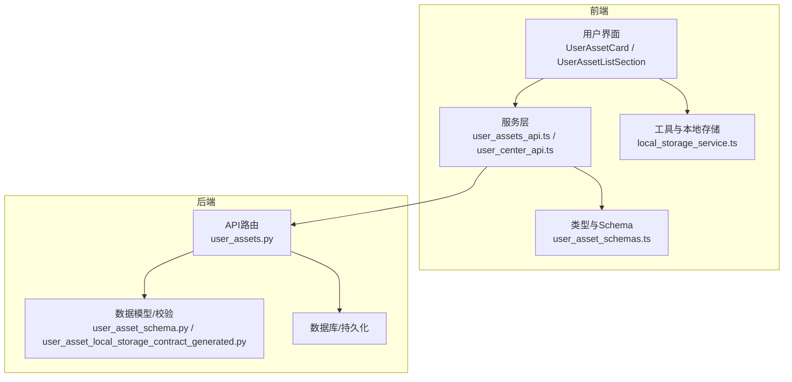
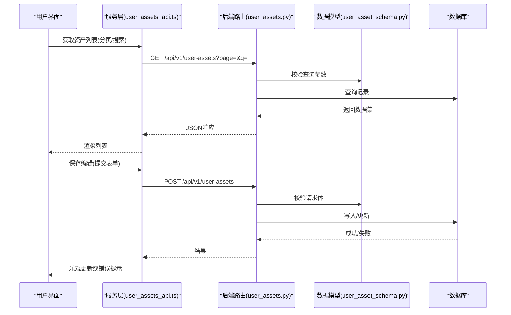
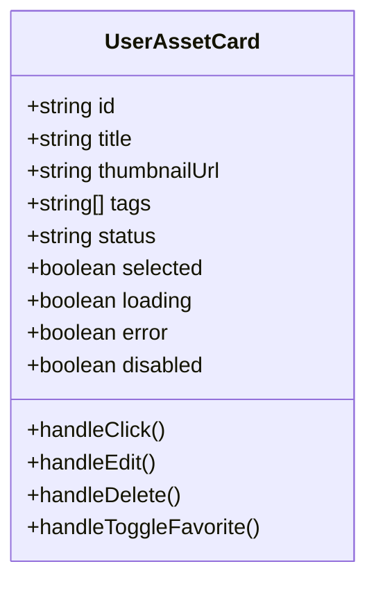
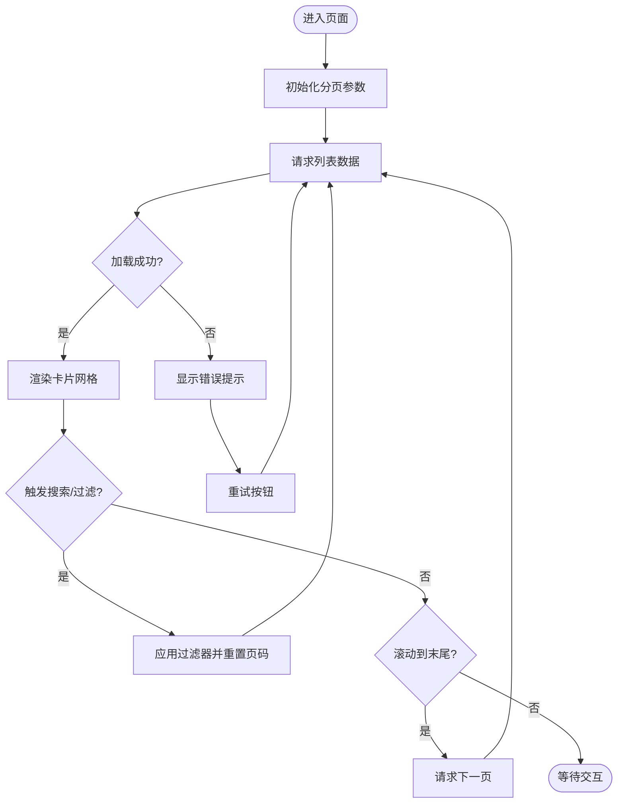
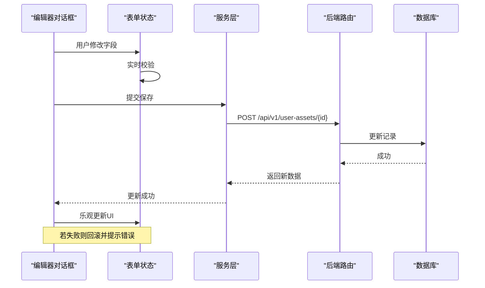
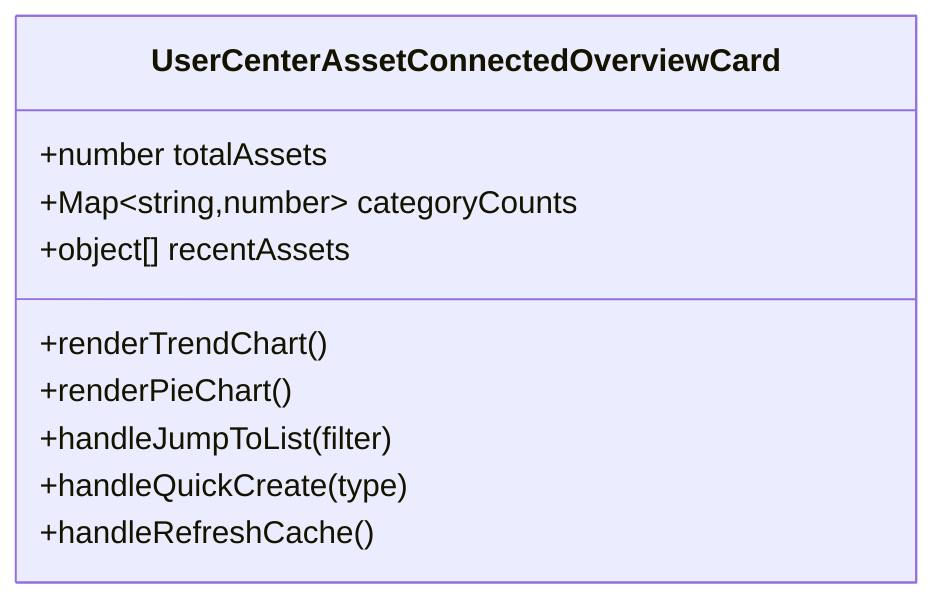
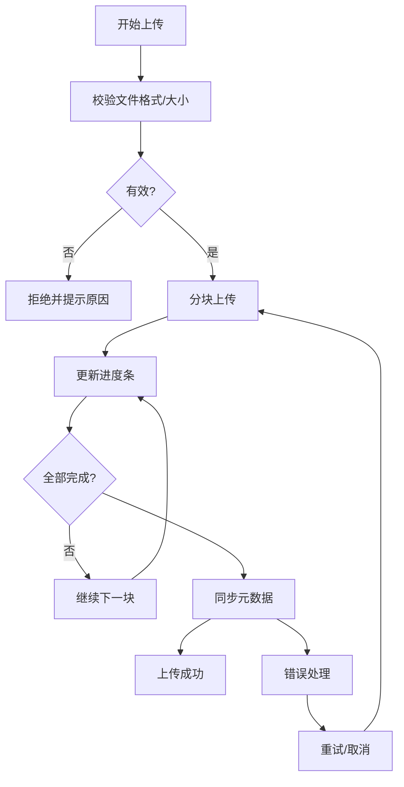
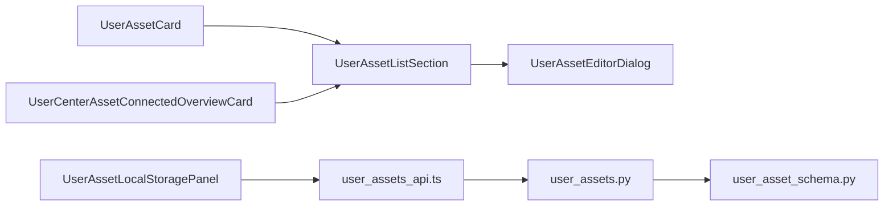

# 用户资产组件

<cite>
**本文档引用的文件**   
- [user_assets.tsx](file://frontend/src/components/user_assets/user_assets.tsx)
- [UserAssetCard.tsx](file://frontend/src/components/user_assets/UserAssetCard.tsx)
- [UserAssetListSection.tsx](file://frontend/src/components/user_assets/UserAssetListSection.tsx)
- [UserAssetEditorDialog.tsx](file://frontend/src/components/user_assets/UserAssetEditorDialog.tsx)
- [UserCenterAssetConnectedOverviewCard.tsx](file://frontend/src/components/user_assets/UserCenterAssetConnectedOverviewCard.tsx)
- [UserAssetLocalStoragePanel.tsx](file://frontend/src/components/user_assets/UserAssetLocalStoragePanel.tsx)
- [user_assets_api.ts](file://frontend/src/services/user_assets_api.ts)
- [user_asset_schemas.ts](file://frontend/src/types/user_asset_schemas.ts)
- [user_center_api.ts](file://frontend/src/services/user_center_api.ts)
- [local_storage_service.ts](file://frontend/src/utils/local_storage_service.ts)
- [user_assets_routes.py](file://backend/app/api/v1/user_assets.py)
- [user_asset_schema.py](file://backend/app/schemas/user_asset.py)
- [user_asset_local_storage_contract_generated.py](file://backend/app/schemas/user_asset_local_storage_contract_generated.py)
</cite>

## 目录
1. [简介](#简介)
2. [项目结构](#项目结构)
3. [核心组件](#核心组件)
4. [架构总览](#架构总览)
5. [详细组件分析](#详细组件分析)
6. [依赖分析](#依赖分析)
7. [性能考虑](#性能考虑)
8. [故障排查指南](#故障排查指南)
9. [结论](#结论)
10. [附录](#附录)

## 简介
本文件面向小说创作代理系统的“用户资产管理”前端与后端协作，聚焦以下组件：
- 资产卡片（UserAssetCard）：展示样式、交互操作与状态管理
- 资产列表（UserAssetListSection）：数据加载、分页处理与搜索过滤
- 资产编辑器对话框（UserAssetEditorDialog）：表单验证、数据绑定与保存机制
- 用户中心资产概览（UserCenterAssetConnectedOverviewCard）：数据聚合、统计展示与联动操作
- 本地存储面板（UserAssetLocalStoragePanel）：文件管理、同步状态与错误处理

文档将提供架构图、时序图、流程图与类图，帮助读者快速理解组件职责、数据流与最佳实践。

## 项目结构
用户资产管理相关的前端代码位于 frontend/src/components/user_assets 与 services、types、utils 等目录；后端 API 与 Schema 位于 backend/app/api/v1 与 backend/app/schemas。整体采用前后端分离的 RESTful 接口模式，前端通过服务层调用后端路由，Schema 定义用于校验与类型约束。

**图表来源** 
- [user_assets.tsx](file://frontend/src/components/user_assets/user_assets.tsx)
- [user_assets_api.ts](file://frontend/src/services/user_assets_api.ts)
- [user_asset_schemas.ts](file://frontend/src/types/user_asset_schemas.ts)
- [local_storage_service.ts](file://frontend/src/utils/local_storage_service.ts)
- [user_assets_routes.py](file://backend/app/api/v1/user_assets.py)
- [user_asset_schema.py](file://backend/app/schemas/user_asset.py)
- [user_asset_local_storage_contract_generated.py](file://backend/app/schemas/user_asset_local_storage_contract_generated.py)

**章节来源**
- [user_assets.tsx](file://frontend/src/components/user_assets/user_assets.tsx)
- [user_assets_api.ts](file://frontend/src/services/user_assets_api.ts)
- [user_asset_schemas.ts](file://frontend/src/types/user_asset_schemas.ts)
- [local_storage_service.ts](file://frontend/src/utils/local_storage_service.ts)
- [user_assets_routes.py](file://backend/app/api/v1/user_assets.py)
- [user_asset_schema.py](file://backend/app/schemas/user_asset.py)
- [user_asset_local_storage_contract_generated.py](file://backend/app/schemas/user_asset_local_storage_contract_generated.py)

## 核心组件
- 资产卡片（UserAssetCard）
  - 展示：缩略图、标题、标签、时间戳、状态标识
  - 交互：点击预览、编辑、删除、收藏/标记
  - 状态：选中态、加载态、错误态、禁用态
- 资产列表（UserAssetListSection）
  - 数据加载：分页请求、懒加载、骨架屏
  - 搜索过滤：关键词匹配、分类筛选、排序
  - 批量操作：多选、批量删除、导出
- 资产编辑器对话框（UserAssetEditorDialog）
  - 表单验证：必填项、格式校验、长度限制
  - 数据绑定：受控输入、字段映射、草稿自动保存
  - 保存机制：乐观更新、失败回滚、冲突提示
- 用户中心资产概览（UserCenterAssetConnectedOverviewCard）
  - 数据聚合：总数、分类计数、最近使用
  - 统计展示：趋势图、占比饼图、关键指标
  - 联动操作：跳转列表、快捷创建、刷新缓存
- 本地存储面板（UserAssetLocalStoragePanel）
  - 文件管理：上传、重命名、移动、删除
  - 同步状态：进度条、重试、断点续传
  - 错误处理：网络异常、权限不足、磁盘空间不足

**章节来源**
- [UserAssetCard.tsx](file://frontend/src/components/user_assets/UserAssetCard.tsx)
- [UserAssetListSection.tsx](file://frontend/src/components/user_assets/UserAssetListSection.tsx)
- [UserAssetEditorDialog.tsx](file://frontend/src/components/user_assets/UserAssetEditorDialog.tsx)
- [UserCenterAssetConnectedOverviewCard.tsx](file://frontend/src/components/user_assets/UserCenterAssetConnectedOverviewCard.tsx)
- [UserAssetLocalStoragePanel.tsx](file://frontend/src/components/user_assets/UserAssetLocalStoragePanel.tsx)

## 架构总览
用户资产模块采用“UI组件 -> 服务层 -> API路由 -> 数据模型/数据库”的分层架构。UI组件负责展示与交互，服务层封装HTTP请求与错误处理，API路由负责鉴权、参数校验与业务编排，数据模型负责持久化与一致性。

**图表来源** 
- [user_assets_api.ts](file://frontend/src/services/user_assets_api.ts)
- [user_assets_routes.py](file://backend/app/api/v1/user_assets.py)
- [user_asset_schema.py](file://backend/app/schemas/user_asset.py)

**章节来源**
- [user_assets_api.ts](file://frontend/src/services/user_assets_api.ts)
- [user_assets_routes.py](file://backend/app/api/v1/user_assets.py)
- [user_asset_schema.py](file://backend/app/schemas/user_asset.py)

## 详细组件分析

### 资产卡片（UserAssetCard）
- 展示样式
  - 缩略图占位与加载指示
  - 标题截断与悬浮提示
  - 标签与状态徽章（如“已发布”“草稿”）
- 交互操作
  - 点击打开预览或编辑器
  - 右键菜单（复制路径、分享、删除）
  - 收藏/星标切换
- 状态管理
  - 受控 props：selected、loading、error、disabled
  - 内部事件：onSelect、onEdit、onDelete、onToggleFavorite
  - 键盘可达性：Tab导航、Enter确认、Esc关闭

**图表来源** 
- [UserAssetCard.tsx](file://frontend/src/components/user_assets/UserAssetCard.tsx)

**章节来源**
- [UserAssetCard.tsx](file://frontend/src/components/user_assets/UserAssetCard.tsx)

### 资产列表（UserAssetListSection）
- 数据加载
  - 分页：page、pageSize、total、hasNext
  - 懒加载：滚动到底部触发下一页
  - 骨架屏：提升首屏体验
- 搜索过滤
  - 关键词：模糊匹配标题/描述
  - 分类：按类型/标签筛选
  - 排序：时间、名称、大小
- 批量操作
  - 全选/反选
  - 批量删除、导出CSV

**图表来源** 
- [UserAssetListSection.tsx](file://frontend/src/components/user_assets/UserAssetListSection.tsx)
- [user_assets_api.ts](file://frontend/src/services/user_assets_api.ts)

**章节来源**
- [UserAssetListSection.tsx](file://frontend/src/components/user_assets/UserAssetListSection.tsx)
- [user_assets_api.ts](file://frontend/src/services/user_assets_api.ts)

### 资产编辑器对话框（UserAssetEditorDialog）
- 表单验证
  - 必填项：标题、类型、来源
  - 格式校验：URL、文件大小、扩展名
  - 长度限制：标题最大字符数、描述最小字符数
- 数据绑定
  - 受控输入：onChange同步状态
  - 字段映射：后端字段与前端表单字段对应
  - 草稿自动保存：防抖写入本地存储
- 保存机制
  - 乐观更新：立即反映到UI
  - 失败回滚：捕获错误并恢复原值
  - 冲突提示：版本冲突时提示合并策略

**图表来源** 
- [UserAssetEditorDialog.tsx](file://frontend/src/components/user_assets/UserAssetEditorDialog.tsx)
- [user_assets_api.ts](file://frontend/src/services/user_assets_api.ts)
- [user_assets_routes.py](file://backend/app/api/v1/user_assets.py)

**章节来源**
- [UserAssetEditorDialog.tsx](file://frontend/src/components/user_assets/UserAssetEditorDialog.tsx)
- [user_assets_api.ts](file://frontend/src/services/user_assets_api.ts)
- [user_assets_routes.py](file://backend/app/api/v1/user_assets.py)

### 用户中心资产概览（UserCenterAssetConnectedOverviewCard）
- 数据聚合
  - 总数：所有资产数量
  - 分类计数：按类型/标签分组
  - 最近使用：按时间倒序取TopN
- 统计展示
  - 趋势折线图：近7天新增/删除
  - 占比饼图：类型分布
  - 关键指标：平均大小、热门标签
- 联动操作
  - 点击跳转到列表并预置筛选条件
  - 快捷创建：根据类型生成模板
  - 刷新缓存：强制拉取最新数据

**图表来源** 
- [UserCenterAssetConnectedOverviewCard.tsx](file://frontend/src/components/user_assets/UserCenterAssetConnectedOverviewCard.tsx)
- [user_center_api.ts](file://frontend/src/services/user_center_api.ts)

**章节来源**
- [UserCenterAssetConnectedOverviewCard.tsx](file://frontend/src/components/user_assets/UserCenterAssetConnectedOverviewCard.tsx)
- [user_center_api.ts](file://frontend/src/services/user_center_api.ts)

### 本地存储面板（UserAssetLocalStoragePanel）
- 文件管理
  - 上传：拖拽/选择文件，支持多文件
  - 重命名：输入框内编辑，冲突检测
  - 移动：选择目标目录，批量移动
  - 删除：软删除，回收站恢复
- 同步状态
  - 进度条：分块上传、断点续传
  - 重试：指数退避、手动重试
  - 队列：并发控制、优先级
- 错误处理
  - 网络异常：超时、DNS解析失败
  - 权限不足：403提示、申请权限
  - 磁盘空间不足：清理建议、扩容指引

**图表来源** 
- [UserAssetLocalStoragePanel.tsx](file://frontend/src/components/user_assets/UserAssetLocalStoragePanel.tsx)
- [local_storage_service.ts](file://frontend/src/utils/local_storage_service.ts)

**章节来源**
- [UserAssetLocalStoragePanel.tsx](file://frontend/src/components/user_assets/UserAssetLocalStoragePanel.tsx)
- [local_storage_service.ts](file://frontend/src/utils/local_storage_service.ts)

## 依赖分析
组件间依赖关系清晰，UI组件依赖服务层进行数据交互，服务层依赖API路由与Schema定义。本地存储面板依赖工具函数进行文件操作与状态管理。

**图表来源** 
- [UserAssetCard.tsx](file://frontend/src/components/user_assets/UserAssetCard.tsx)
- [UserAssetListSection.tsx](file://frontend/src/components/user_assets/UserAssetListSection.tsx)
- [UserAssetEditorDialog.tsx](file://frontend/src/components/user_assets/UserAssetEditorDialog.tsx)
- [UserCenterAssetConnectedOverviewCard.tsx](file://frontend/src/components/user_assets/UserCenterAssetConnectedOverviewCard.tsx)
- [UserAssetLocalStoragePanel.tsx](file://frontend/src/components/user_assets/UserAssetLocalStoragePanel.tsx)
- [user_assets_api.ts](file://frontend/src/services/user_assets_api.ts)
- [user_assets_routes.py](file://backend/app/api/v1/user_assets.py)
- [user_asset_schema.py](file://backend/app/schemas/user_asset.py)

**章节来源**
- [UserAssetCard.tsx](file://frontend/src/components/user_assets/UserAssetCard.tsx)
- [UserAssetListSection.tsx](file://frontend/src/components/user_assets/UserAssetListSection.tsx)
- [UserAssetEditorDialog.tsx](file://frontend/src/components/user_assets/UserAssetEditorDialog.tsx)
- [UserCenterAssetConnectedOverviewCard.tsx](file://frontend/src/components/user_assets/UserCenterAssetConnectedOverviewCard.tsx)
- [UserAssetLocalStoragePanel.tsx](file://frontend/src/components/user_assets/UserAssetLocalStoragePanel.tsx)
- [user_assets_api.ts](file://frontend/src/services/user_assets_api.ts)
- [user_assets_routes.py](file://backend/app/api/v1/user_assets.py)
- [user_asset_schema.py](file://backend/app/schemas/user_asset.py)

## 性能考虑
- 列表渲染优化
  - 虚拟滚动：仅渲染可视区域
  - 图片懒加载：按需加载缩略图
  - 防抖搜索：减少频繁请求
- 数据缓存
  - 内存缓存：短期重复数据
  - 本地缓存：离线可用
  - 增量更新：只更新变化字段
- 并发控制
  - 上传队列：限制并发数
  - 请求去重：相同参数合并
  - 错误重试：指数退避

[本节为通用指导，不直接分析具体文件]

## 故障排查指南
- 常见问题
  - 列表加载失败：检查网络连接、API状态码、分页参数
  - 搜索无结果：确认关键词、过滤器、排序规则
  - 编辑器保存失败：查看表单校验、字段映射、后端日志
  - 上传中断：检查分块大小、网络稳定性、存储空间
- 调试技巧
  - 浏览器开发者工具：Network、Console、Application
  - 后端日志：错误堆栈、SQL查询、中间件输出
  - 单元测试：覆盖边界条件、异常路径

**章节来源**
- [user_assets_api.ts](file://frontend/src/services/user_assets_api.ts)
- [user_assets_routes.py](file://backend/app/api/v1/user_assets.py)
- [local_storage_service.ts](file://frontend/src/utils/local_storage_service.ts)

## 结论
用户资产管理组件通过清晰的职责划分与分层架构，实现了高效的资产展示、编辑、管理与统计功能。遵循最佳实践与性能优化建议，可进一步提升用户体验与系统稳定性。建议在后续迭代中加强错误监控、性能分析与用户反馈收集。

[本节为总结，不直接分析具体文件]

## 附录
- 术语表
  - 资产：用户上传或生成的媒体资源（图片、音频、视频等）
  - 本地存储：浏览器本地存储或文件系统模拟
  - 乐观更新：先更新UI再异步同步数据
- 参考链接
  - API文档：后端路由与Schema定义
  - 设计指南：组件交互与状态管理规范

[本节为补充信息，不直接分析具体文件]