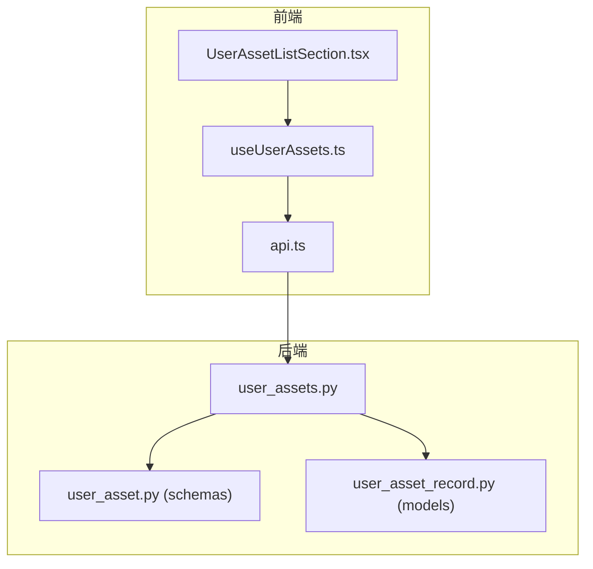
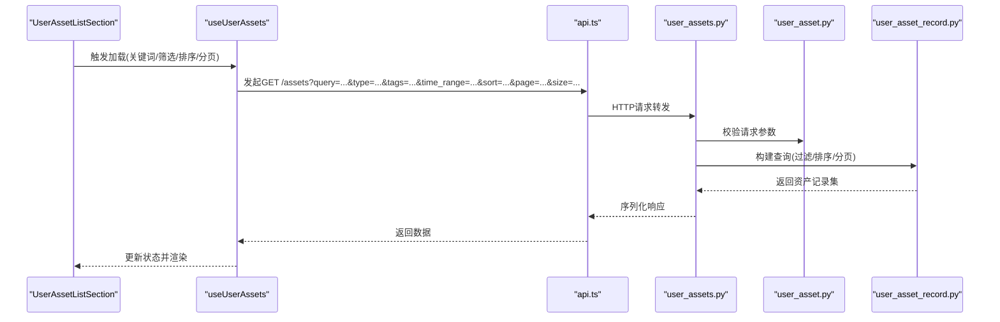
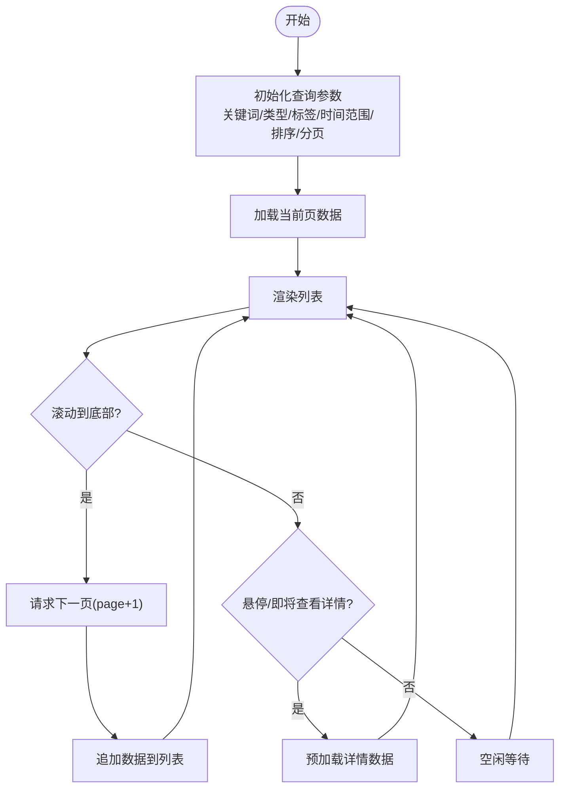
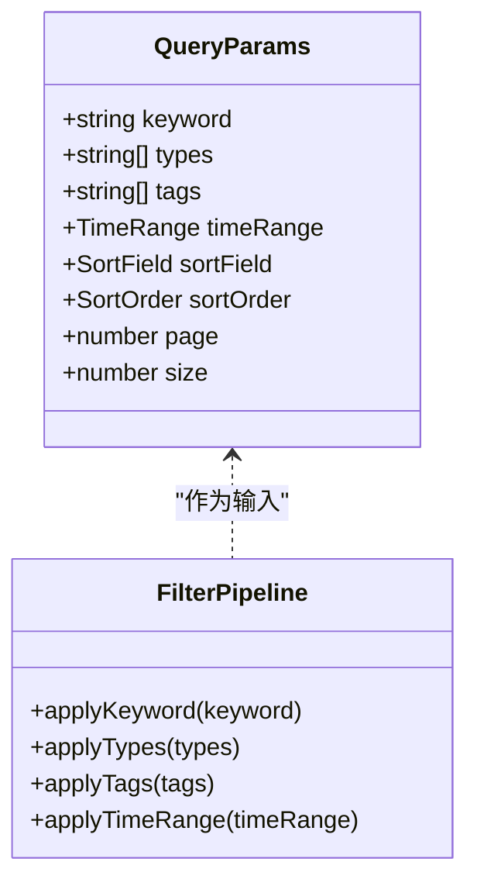
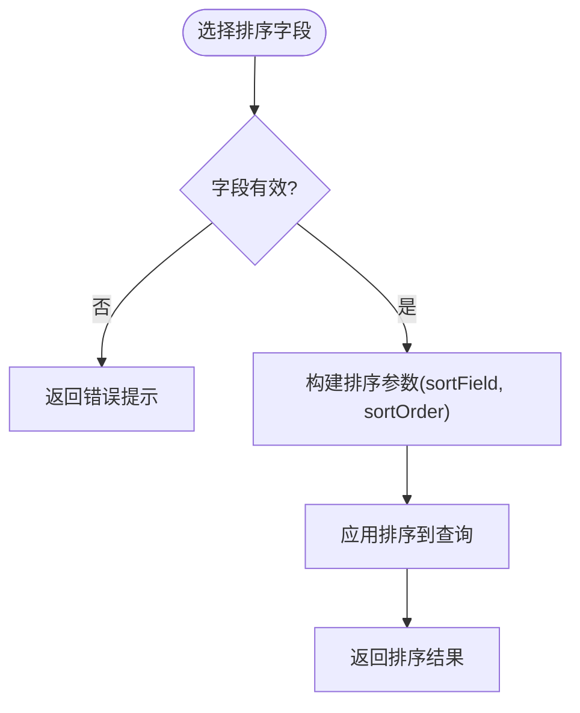
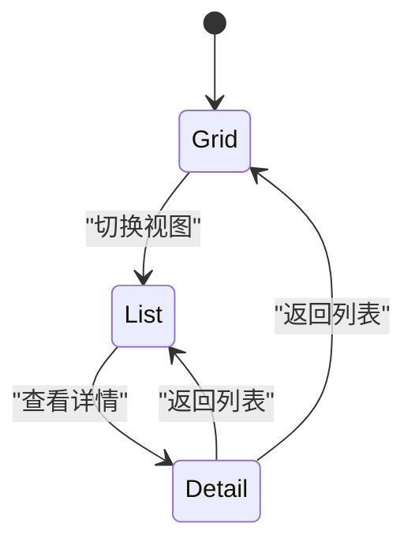
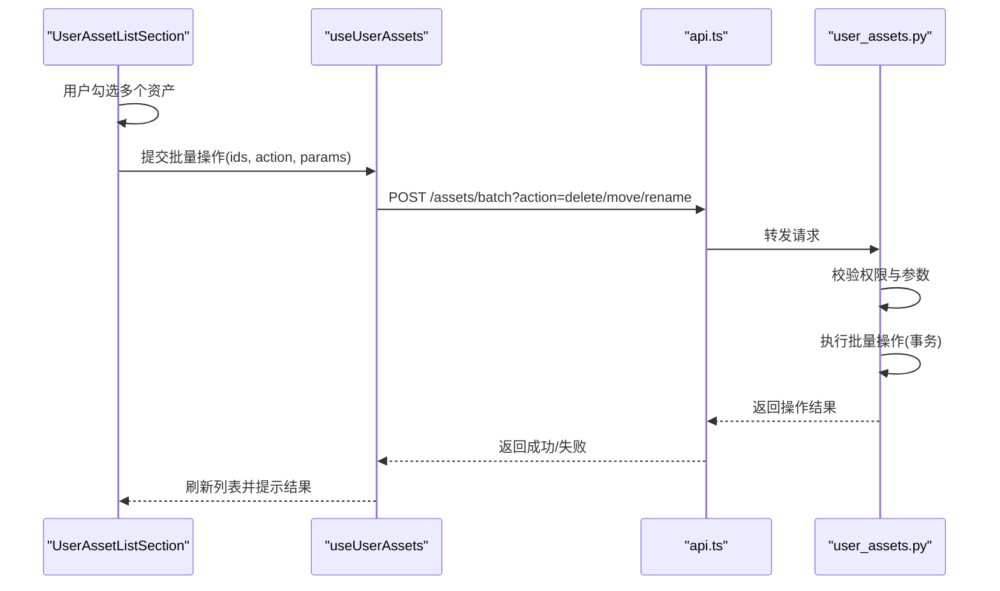
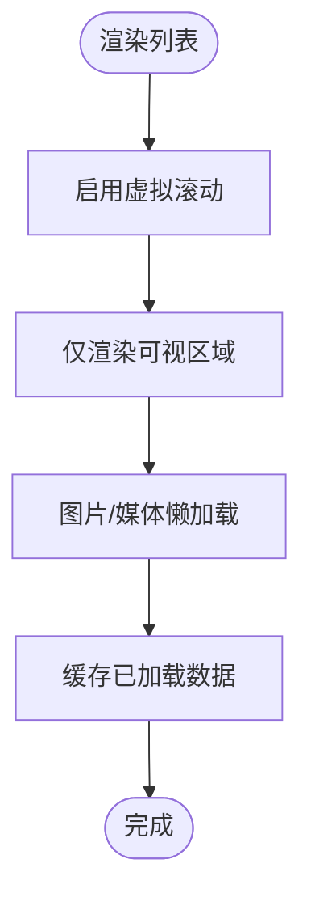
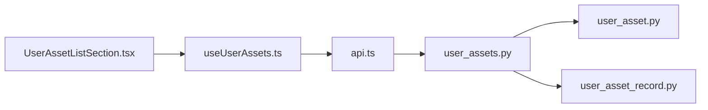

# 资产列表组件

<cite>
**本文引用的文件**   
- [frontend/src/components/asset/UserAssetListSection.tsx](file://frontend/src/components/asset/UserAssetListSection.tsx)
- [frontend/src/hooks/useUserAssets.ts](file://frontend/src/hooks/useUserAssets.ts)
- [backend/app/api/v1/user_assets.py](file://backend/app/api/v1/user_assets.py)
- [backend/app/schemas/user_asset.py](file://backend/app/schemas/user_asset.py)
- [backend/app/models/user_asset_record.py](file://backend/app/models/user_asset_record.py)
- [frontend/src/services/api.ts](file://frontend/src/services/api.ts)
</cite>

## 目录
1. [简介](#简介)
2. [项目结构](#项目结构)
3. [核心组件](#核心组件)
4. [架构总览](#架构总览)
5. [详细组件分析](#详细组件分析)
6. [依赖关系分析](#依赖关系分析)
7. [性能考虑](#性能考虑)
8. [故障排查指南](#故障排查指南)
9. [结论](#结论)
10. [附录](#附录)

## 简介
本文件为“资产列表组件（UserAssetListSection）”的全面技术文档，聚焦以下能力：
- 数据加载机制：分页、懒加载与预加载策略
- 搜索过滤：关键词搜索、类型筛选、标签过滤、时间范围查询
- 排序功能：按名称、时间、大小等字段排序及自定义排序规则
- 视图切换：网格视图、列表视图、详情视图
- 批量操作：批量选择、批量删除、批量移动、批量重命名
- 虚拟滚动与大列表优化方案

该组件位于前端资产模块，通过 hooks 与后端 API 交互，结合状态管理与 UI 渲染实现高效的大规模资产浏览与管理。

## 项目结构
与 UserAssetListSection 相关的前端与后端关键文件如下：
- 前端组件：UserAssetListSection.tsx
- 数据获取与状态管理：useUserAssets.ts
- 后端接口：user_assets.py
- 数据模型与校验：user_asset.py（schemas）、user_asset_record.py（models）
- 前端 API 封装：api.ts

**图表来源** 
- [frontend/src/components/asset/UserAssetListSection.tsx](file://frontend/src/components/asset/UserAssetListSection.tsx)
- [frontend/src/hooks/useUserAssets.ts](file://frontend/src/hooks/useUserAssets.ts)
- [frontend/src/services/api.ts](file://frontend/src/services/api.ts)
- [backend/app/api/v1/user_assets.py](file://backend/app/api/v1/user_assets.py)
- [backend/app/schemas/user_asset.py](file://backend/app/schemas/user_asset.py)
- [backend/app/models/user_asset_record.py](file://backend/app/models/user_asset_record.py)

**章节来源**
- [frontend/src/components/asset/UserAssetListSection.tsx](file://frontend/src/components/asset/UserAssetListSection.tsx)
- [frontend/src/hooks/useUserAssets.ts](file://frontend/src/hooks/useUserAssets.ts)
- [backend/app/api/v1/user_assets.py](file://backend/app/api/v1/user_assets.py)
- [backend/app/schemas/user_asset.py](file://backend/app/schemas/user_asset.py)
- [backend/app/models/user_asset_record.py](file://backend/app/models/user_asset_record.py)
- [frontend/src/services/api.ts](file://frontend/src/services/api.ts)

## 核心组件
- UserAssetListSection：负责渲染资产列表、处理用户交互（搜索、筛选、排序、视图切换、批量操作），并调用 useUserAssets 进行数据请求与缓存。
- useUserAssets：封装分页、懒加载、预加载逻辑，维护查询参数（关键词、类型、标签、时间范围、排序、分页），并提供统一的数据访问接口。
- 后端 user_assets.py：提供资产列表查询、过滤、排序、分页、批量操作的 REST 接口。
- schemas/user_asset.py：定义资产数据的输入输出结构，包括搜索、筛选、排序、分页参数。
- models/user_asset_record.py：数据库实体映射，支撑查询与批量操作。
- api.ts：前端 HTTP 客户端封装，统一请求路径、错误处理与重试策略。

**章节来源**
- [frontend/src/components/asset/UserAssetListSection.tsx](file://frontend/src/components/asset/UserAssetListSection.tsx)
- [frontend/src/hooks/useUserAssets.ts](file://frontend/src/hooks/useUserAssets.ts)
- [backend/app/api/v1/user_assets.py](file://backend/app/api/v1/user_assets.py)
- [backend/app/schemas/user_asset.py](file://backend/app/schemas/user_asset.py)
- [backend/app/models/user_asset_record.py](file://backend/app/models/user_asset_record.py)
- [frontend/src/services/api.ts](file://frontend/src/services/api.ts)

## 架构总览
整体数据流从 UI 层到服务层再到数据层的顺序如下：

**图表来源** 
- [frontend/src/components/asset/UserAssetListSection.tsx](file://frontend/src/components/asset/UserAssetListSection.tsx)
- [frontend/src/hooks/useUserAssets.ts](file://frontend/src/hooks/useUserAssets.ts)
- [frontend/src/services/api.ts](file://frontend/src/services/api.ts)
- [backend/app/api/v1/user_assets.py](file://backend/app/api/v1/user_assets.py)
- [backend/app/schemas/user_asset.py](file://backend/app/schemas/user_asset.py)
- [backend/app/models/user_asset_record.py](file://backend/app/models/user_asset_record.py)

## 详细组件分析

### 数据加载机制：分页、懒加载与预加载
- 分页加载
  - 前端通过 useUserAssets 维护 page、size 等分页参数，并在用户翻页时重新请求。
  - 后端根据 page、size 计算 offset/limit，返回当前页数据与总数。
- 懒加载
  - 当滚动接近可视区域底部时，自动触发下一页加载，避免一次性加载全部数据。
  - 使用 IntersectionObserver 或滚动事件监听实现触底检测。
- 预加载
  - 在用户悬停或即将进入某项详情时，提前拉取详情数据，减少等待时间。
  - 对热门资产或搜索结果首屏数据进行预取，提升用户体验。

**图表来源** 
- [frontend/src/hooks/useUserAssets.ts](file://frontend/src/hooks/useUserAssets.ts)
- [frontend/src/components/asset/UserAssetListSection.tsx](file://frontend/src/components/asset/UserAssetListSection.tsx)

**章节来源**
- [frontend/src/hooks/useUserAssets.ts](file://frontend/src/hooks/useUserAssets.ts)
- [frontend/src/components/asset/UserAssetListSection.tsx](file://frontend/src/components/asset/UserAssetListSection.tsx)

### 搜索与过滤：关键词、类型、标签、时间范围
- 关键词搜索
  - 支持对资产名称、描述、标签等字段进行模糊匹配。
  - 防抖处理，避免频繁请求。
- 类型筛选
  - 按资产类型（如图片、音频、视频等）过滤。
- 标签过滤
  - 支持多标签组合筛选，支持 AND/OR 语义。
- 时间范围查询
  - 支持创建时间、更新时间范围筛选。

**图表来源** 
- [backend/app/schemas/user_asset.py](file://backend/app/schemas/user_asset.py)
- [backend/app/api/v1/user_assets.py](file://backend/app/api/v1/user_assets.py)

**章节来源**
- [backend/app/schemas/user_asset.py](file://backend/app/schemas/user_asset.py)
- [backend/app/api/v1/user_assets.py](file://backend/app/api/v1/user_assets.py)

### 排序功能：字段排序与自定义规则
- 内置排序字段
  - 名称（升序/降序）
  - 时间（创建时间/更新时间）
  - 大小（文件大小）
- 自定义排序规则
  - 支持按评分、使用频率、最近访问等扩展字段排序。
  - 后端通过动态 SQL 或内存排序实现。

**图表来源** 
- [backend/app/schemas/user_asset.py](file://backend/app/schemas/user_asset.py)
- [backend/app/api/v1/user_assets.py](file://backend/app/api/v1/user_assets.py)

**章节来源**
- [backend/app/schemas/user_asset.py](file://backend/app/schemas/user_asset.py)
- [backend/app/api/v1/user_assets.py](file://backend/app/api/v1/user_assets.py)

### 视图切换：网格、列表、详情
- 网格视图
  - 以卡片形式展示缩略图、名称、类型、大小等关键信息。
- 列表视图
  - 以表格形式展示更多字段，便于对比与排序。
- 详情视图
  - 点击某项进入详情页面，展示完整元数据与预览。

**图表来源** 
- [frontend/src/components/asset/UserAssetListSection.tsx](file://frontend/src/components/asset/UserAssetListSection.tsx)

**章节来源**
- [frontend/src/components/asset/UserAssetListSection.tsx](file://frontend/src/components/asset/UserAssetListSection.tsx)

### 批量操作：选择、删除、移动、重命名
- 批量选择
  - 支持全选、反选、按条件勾选。
- 批量删除
  - 提交选中资产 ID 列表，后端执行事务性删除。
- 批量移动
  - 将选中资产移动到指定目录或分类。
- 批量重命名
  - 支持模板化重命名（如添加前缀/后缀、序号）。

**图表来源** 
- [frontend/src/components/asset/UserAssetListSection.tsx](file://frontend/src/components/asset/UserAssetListSection.tsx)
- [frontend/src/hooks/useUserAssets.ts](file://frontend/src/hooks/useUserAssets.ts)
- [frontend/src/services/api.ts](file://frontend/src/services/api.ts)
- [backend/app/api/v1/user_assets.py](file://backend/app/api/v1/user_assets.py)

**章节来源**
- [frontend/src/components/asset/UserAssetListSection.tsx](file://frontend/src/components/asset/UserAssetListSection.tsx)
- [frontend/src/hooks/useUserAssets.ts](file://frontend/src/hooks/useUserAssets.ts)
- [frontend/src/services/api.ts](file://frontend/src/services/api.ts)
- [backend/app/api/v1/user_assets.py](file://backend/app/api/v1/user_assets.py)

### 虚拟滚动与大列表优化
- 虚拟滚动
  - 仅渲染可视区域内的条目，大幅降低 DOM 节点数量。
  - 使用 react-window 或类似库实现高性能滚动。
- 大列表处理
  - 服务端分页限制每页最大条数，避免单次返回过多数据。
  - 前端缓存已加载页数据，减少重复请求。
  - 图片懒加载与占位符优化首屏渲染。

**图表来源** 
- [frontend/src/components/asset/UserAssetListSection.tsx](file://frontend/src/components/asset/UserAssetListSection.tsx)
- [frontend/src/hooks/useUserAssets.ts](file://frontend/src/hooks/useUserAssets.ts)

**章节来源**
- [frontend/src/components/asset/UserAssetListSection.tsx](file://frontend/src/components/asset/UserAssetListSection.tsx)
- [frontend/src/hooks/useUserAssets.ts](file://frontend/src/hooks/useUserAssets.ts)

## 依赖关系分析
组件与服务的依赖关系如下：

**图表来源** 
- [frontend/src/components/asset/UserAssetListSection.tsx](file://frontend/src/components/asset/UserAssetListSection.tsx)
- [frontend/src/hooks/useUserAssets.ts](file://frontend/src/hooks/useUserAssets.ts)
- [frontend/src/services/api.ts](file://frontend/src/services/api.ts)
- [backend/app/api/v1/user_assets.py](file://backend/app/api/v1/user_assets.py)
- [backend/app/schemas/user_asset.py](file://backend/app/schemas/user_asset.py)
- [backend/app/models/user_asset_record.py](file://backend/app/models/user_asset_record.py)

**章节来源**
- [frontend/src/components/asset/UserAssetListSection.tsx](file://frontend/src/components/asset/UserAssetListSection.tsx)
- [frontend/src/hooks/useUserAssets.ts](file://frontend/src/hooks/useUserAssets.ts)
- [frontend/src/services/api.ts](file://frontend/src/services/api.ts)
- [backend/app/api/v1/user_assets.py](file://backend/app/api/v1/user_assets.py)
- [backend/app/schemas/user_asset.py](file://backend/app/schemas/user_asset.py)
- [backend/app/models/user_asset_record.py](file://backend/app/models/user_asset_record.py)

## 性能考虑
- 请求优化
  - 使用防抖与节流减少高频搜索与筛选请求。
  - 合并批量操作为单次请求，降低网络开销。
- 渲染优化
  - 虚拟滚动与懒加载提升长列表性能。
  - 图片使用 WebP/AVIF 格式与 CDN 加速。
- 缓存策略
  - 前端缓存查询结果与热门数据。
  - 后端使用 Redis 缓存热点查询。
- 并发控制
  - 限制并发请求数，避免雪崩。
  - 使用队列处理耗时任务（如批量移动/重命名）。

[本节为通用指导，不直接分析具体文件]

## 故障排查指南
- 常见问题
  - 搜索无结果：检查关键词是否包含特殊字符，确认后端模糊匹配逻辑。
  - 分页异常：核对 page、size 参数边界值，确保后端未越界。
  - 排序无效：验证排序字段是否在允许列表中，检查后端排序实现。
  - 批量操作失败：检查权限与资产状态，查看事务回滚日志。
- 调试建议
  - 使用浏览器开发者工具查看网络请求与响应。
  - 在后端启用详细日志，定位查询构建与执行过程。
  - 对复杂查询进行 SQL 分析与索引优化。

**章节来源**
- [backend/app/api/v1/user_assets.py](file://backend/app/api/v1/user_assets.py)
- [backend/app/schemas/user_asset.py](file://backend/app/schemas/user_asset.py)
- [frontend/src/services/api.ts](file://frontend/src/services/api.ts)

## 结论
UserAssetListSection 组件通过前后端协作实现了高效的资产列表管理，涵盖分页、懒加载、预加载、搜索过滤、排序、视图切换与批量操作等核心功能。结合虚拟滚动与缓存策略，能够良好支撑大规模资产场景。建议在后续迭代中持续优化查询性能与用户体验，并加强错误处理与可观测性。

[本节为总结，不直接分析具体文件]

## 附录
- 术语表
  - 分页：将大数据集拆分为多页，逐页加载。
  - 懒加载：按需加载资源，提升首屏性能。
  - 预加载：提前获取可能需要的数据，减少等待。
  - 虚拟滚动：仅渲染可视区域内容，优化长列表。
- 参考文件
  - 前端组件与钩子：UserAssetListSection.tsx、useUserAssets.ts
  - 后端接口与模型：user_assets.py、user_asset.py、user_asset_record.py
  - 前端 API 封装：api.ts

[本节为补充信息，不直接分析具体文件]