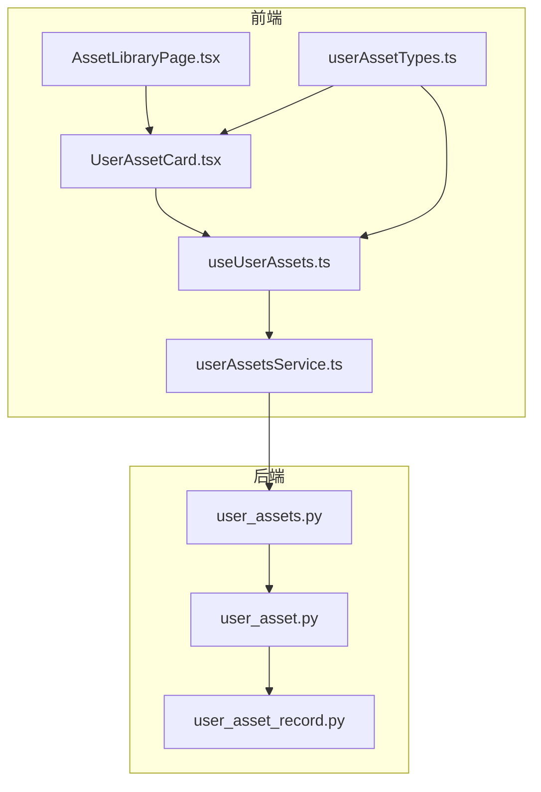
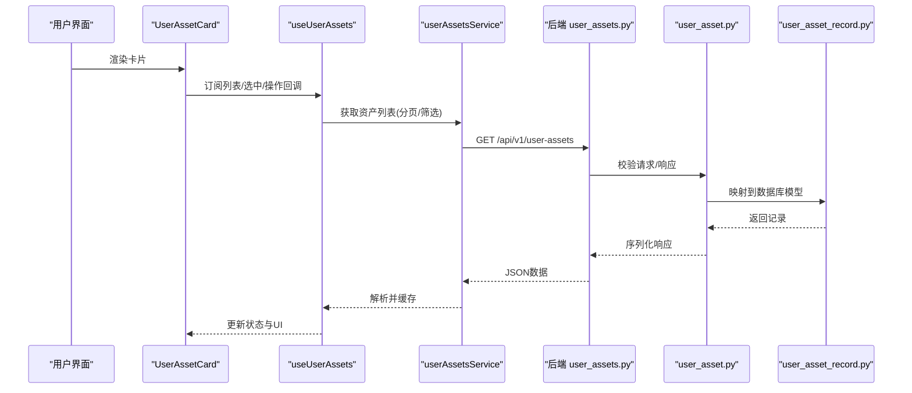
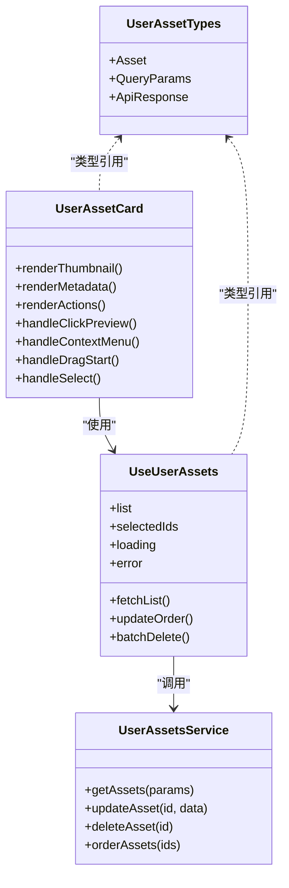
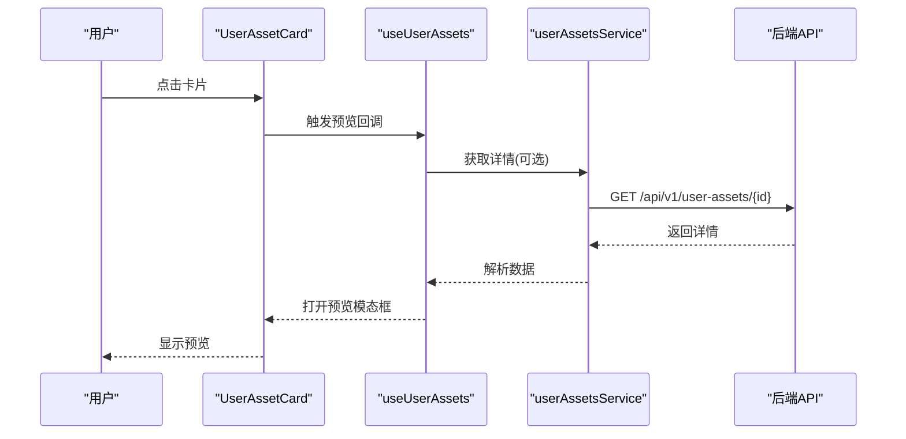
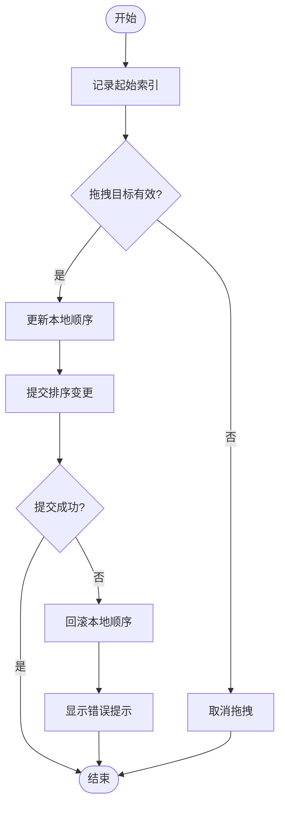
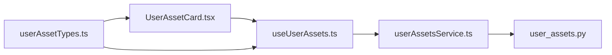

# 资产卡片组件

<cite>
**本文引用的文件**   
- [frontend/src/components/UserAssetCard.tsx](file://frontend/src/components/UserAssetCard.tsx)
- [frontend/src/hooks/useUserAssets.ts](file://frontend/src/hooks/useUserAssets.ts)
- [frontend/src/services/userAssetsService.ts](file://frontend/src/services/userAssetsService.ts)
- [backend/app/api/v1/user_assets.py](file://backend/app/api/v1/user_assets.py)
- [backend/app/schemas/user_asset.py](file://backend/app/schemas/user_asset.py)
- [backend/app/models/user_asset_record.py](file://backend/app/models/user_asset_record.py)
- [frontend/src/types/userAssetTypes.ts](file://frontend/src/types/userAssetTypes.ts)
- [frontend/src/pages/AssetLibraryPage.tsx](file://frontend/src/pages/AssetLibraryPage.tsx)
</cite>

## 目录
1. [简介](#简介)
2. [项目结构](#项目结构)
3. [核心组件](#核心组件)
4. [架构总览](#架构总览)
5. [详细组件分析](#详细组件分析)
6. [依赖关系分析](#依赖关系分析)
7. [性能考虑](#性能考虑)
8. [故障排查指南](#故障排查指南)
9. [结论](#结论)
10. [附录](#附录)

## 简介
本文件为资产卡片组件（UserAssetCard）的完整技术文档，面向前端与后端开发者及产品、设计人员。内容涵盖：
- 视觉展示样式：缩略图显示、元数据信息、操作按钮布局
- 交互功能：点击预览、右键菜单、拖拽排序、批量选择
- 状态管理：加载、错误、选中、悬停等状态
- 后端API集成：数据获取、更新、实时同步
- 自定义样式与主题配置、响应式适配方案
- 性能优化建议与最佳实践

## 项目结构
资产卡片组件位于前端工程，相关能力由页面容器、服务层、类型定义共同支撑；后端提供REST API与数据模型。

图表来源
- [frontend/src/pages/AssetLibraryPage.tsx](file://frontend/src/pages/AssetLibraryPage.tsx)
- [frontend/src/components/UserAssetCard.tsx](file://frontend/src/components/UserAssetCard.tsx)
- [frontend/src/hooks/useUserAssets.ts](file://frontend/src/hooks/useUserAssets.ts)
- [frontend/src/services/userAssetsService.ts](file://frontend/src/services/userAssetsService.ts)
- [frontend/src/types/userAssetTypes.ts](file://frontend/src/types/userAssetTypes.ts)
- [backend/app/api/v1/user_assets.py](file://backend/app/api/v1/user_assets.py)
- [backend/app/schemas/user_asset.py](file://backend/app/schemas/user_asset.py)
- [backend/app/models/user_asset_record.py](file://backend/app/models/user_asset_record.py)

章节来源
- [frontend/src/components/UserAssetCard.tsx](file://frontend/src/components/UserAssetCard.tsx)
- [frontend/src/hooks/useUserAssets.ts](file://frontend/src/hooks/useUserAssets.ts)
- [frontend/src/services/userAssetsService.ts](file://frontend/src/services/userAssetsService.ts)
- [frontend/src/types/userAssetTypes.ts](file://frontend/src/types/userAssetTypes.ts)
- [backend/app/api/v1/user_assets.py](file://backend/app/api/v1/user_assets.py)
- [backend/app/schemas/user_asset.py](file://backend/app/schemas/user_asset.py)
- [backend/app/models/user_asset_record.py](file://backend/app/models/user_asset_record.py)

## 核心组件
- UserAssetCard：单条资产卡片的UI与交互实现，负责渲染缩略图、元数据、操作按钮，处理点击预览、右键菜单、拖拽排序、批量选择等。
- useUserAssets：卡片所在页面的数据与状态Hook，封装列表加载、分页、筛选、排序、批量操作、本地缓存与乐观更新。
- userAssetsService：HTTP请求封装，统一调用后端用户资产API，处理错误、重试、超时与取消。
- 类型定义：userAssetTypes.ts 定义资产实体、查询参数、响应结构，保证前后端契约一致。
- 后端API：user_assets.py 暴露CRUD接口；user_asset.py 定义Pydantic Schema；user_asset_record.py 定义数据库模型。

章节来源
- [frontend/src/components/UserAssetCard.tsx](file://frontend/src/components/UserAssetCard.tsx)
- [frontend/src/hooks/useUserAssets.ts](file://frontend/src/hooks/useUserAssets.ts)
- [frontend/src/services/userAssetsService.ts](file://frontend/src/services/userAssetsService.ts)
- [frontend/src/types/userAssetTypes.ts](file://frontend/src/types/userAssetTypes.ts)
- [backend/app/api/v1/user_assets.py](file://backend/app/api/v1/user_assets.py)
- [backend/app/schemas/user_asset.py](file://backend/app/schemas/user_asset.py)
- [backend/app/models/user_asset_record.py](file://backend/app/models/user_asset_record.py)

## 架构总览
前端通过页面容器聚合卡片列表，卡片组件通过Hook与服务层发起请求，后端以REST API提供服务，Schema与Model确保数据结构一致性。

图表来源
- [frontend/src/components/UserAssetCard.tsx](file://frontend/src/components/UserAssetCard.tsx)
- [frontend/src/hooks/useUserAssets.ts](file://frontend/src/hooks/useUserAssets.ts)
- [frontend/src/services/userAssetsService.ts](file://frontend/src/services/userAssetsService.ts)
- [backend/app/api/v1/user_assets.py](file://backend/app/api/v1/user_assets.py)
- [backend/app/schemas/user_asset.py](file://backend/app/schemas/user_asset.py)
- [backend/app/models/user_asset_record.py](file://backend/app/models/user_asset_record.py)

## 详细组件分析

### 视觉展示样式
- 缩略图显示
  - 支持图片/视频封面占位与懒加载
  - 尺寸自适应网格布局，保持纵横比
  - 失败时降级为默认图标或首帧截图
- 元数据信息
  - 标题、创建时间、大小、格式、标签、作者等
  - 关键信息采用两行截断与Tooltip提示
- 操作按钮布局
  - 预览、编辑、删除、收藏、下载等
  - 悬浮显示次要操作，主操作常驻

章节来源
- [frontend/src/components/UserAssetCard.tsx](file://frontend/src/components/UserAssetCard.tsx)

### 交互功能
- 点击预览
  - 打开预览模态框，支持缩放、旋转、全屏
  - 键盘快捷键支持（Esc关闭、方向键切换）
- 右键菜单
  - 复制链接、重命名、移动、分享、查看详情
  - 权限控制可见性
- 拖拽排序
  - 支持卡片间拖拽调整顺序
  - 提交排序变更至后端，失败回滚
- 批量选择
  - 多选模式，全选/反选
  - 批量删除、批量导出、批量打标签

章节来源
- [frontend/src/components/UserAssetCard.tsx](file://frontend/src/components/UserAssetCard.tsx)
- [frontend/src/hooks/useUserAssets.ts](file://frontend/src/hooks/useUserAssets.ts)

### 状态管理机制
- 加载状态
  - 骨架屏与进度指示
  - 分页加载与增量合并
- 错误状态
  - 网络错误、权限不足、资源不存在
  - 可重试与降级策略
- 选中状态
  - 单选/多选高亮
  - 与工具栏联动
- 悬停效果
  - 阴影、边框、遮罩、操作按钮显隐

章节来源
- [frontend/src/components/UserAssetCard.tsx](file://frontend/src/components/UserAssetCard.tsx)
- [frontend/src/hooks/useUserAssets.ts](file://frontend/src/hooks/useUserAssets.ts)

### 与后端API集成
- 数据获取
  - GET /api/v1/user-assets?query&page=...&size=...
  - 支持按名称、类型、标签、时间范围筛选
- 更新操作
  - PUT /api/v1/user-assets/{id} 更新元数据
  - DELETE /api/v1/user-assets/{id} 删除
  - PATCH /api/v1/user-assets/order 批量排序
- 实时同步
  - WebSocket事件推送（新增、删除、状态变更）
  - 本地缓存失效与增量更新

章节来源
- [backend/app/api/v1/user_assets.py](file://backend/app/api/v1/user_assets.py)
- [backend/app/schemas/user_asset.py](file://backend/app/schemas/user_asset.py)
- [backend/app/models/user_asset_record.py](file://backend/app/models/user_asset_record.py)
- [frontend/src/services/userAssetsService.ts](file://frontend/src/services/userAssetsService.ts)

### 自定义样式与主题配置
- CSS变量覆盖
  - 卡片尺寸、圆角、阴影、颜色、字体
- 主题开关
  - 明暗主题、品牌色、高对比度模式
- 响应式断点
  - 移动端隐藏次要操作，改为更多菜单
  - 网格列数随屏幕宽度自适应

章节来源
- [frontend/src/components/UserAssetCard.tsx](file://frontend/src/components/UserAssetCard.tsx)

### 响应式设计适配方案
- 栅格布局
  - 小屏1-2列，中屏3-4列，大屏4-6列
- 触摸友好
  - 增大点击区域，手势支持
- 性能优先
  - 虚拟滚动长列表，按需加载缩略图

章节来源
- [frontend/src/pages/AssetLibraryPage.tsx](file://frontend/src/pages/AssetLibraryPage.tsx)
- [frontend/src/components/UserAssetCard.tsx](file://frontend/src/components/UserAssetCard.tsx)

### 类图（组件与类型）

图表来源
- [frontend/src/components/UserAssetCard.tsx](file://frontend/src/components/UserAssetCard.tsx)
- [frontend/src/hooks/useUserAssets.ts](file://frontend/src/hooks/useUserAssets.ts)
- [frontend/src/services/userAssetsService.ts](file://frontend/src/services/userAssetsService.ts)
- [frontend/src/types/userAssetTypes.ts](file://frontend/src/types/userAssetTypes.ts)

### 序列图（点击预览流程）

图表来源
- [frontend/src/components/UserAssetCard.tsx](file://frontend/src/components/UserAssetCard.tsx)
- [frontend/src/hooks/useUserAssets.ts](file://frontend/src/hooks/useUserAssets.ts)
- [frontend/src/services/userAssetsService.ts](file://frontend/src/services/userAssetsService.ts)
- [backend/app/api/v1/user_assets.py](file://backend/app/api/v1/user_assets.py)

### 流程图（拖拽排序算法）

图表来源
- [frontend/src/components/UserAssetCard.tsx](file://frontend/src/components/UserAssetCard.tsx)
- [frontend/src/hooks/useUserAssets.ts](file://frontend/src/hooks/useUserAssets.ts)

## 依赖关系分析
- 组件耦合
  - UserAssetCard依赖useUserAssets进行状态与数据管理
  - useUserAssets依赖userAssetsService进行网络请求
  - 类型定义贯穿前后端，保证契约一致
- 外部依赖
  - 后端REST API与WebSocket
  - 第三方媒体播放器与预览库（如需要）
- 潜在循环依赖
  - 避免在Hook中直接导入组件，使用回调注入

图表来源
- [frontend/src/components/UserAssetCard.tsx](file://frontend/src/components/UserAssetCard.tsx)
- [frontend/src/hooks/useUserAssets.ts](file://frontend/src/hooks/useUserAssets.ts)
- [frontend/src/services/userAssetsService.ts](file://frontend/src/services/userAssetsService.ts)
- [frontend/src/types/userAssetTypes.ts](file://frontend/src/types/userAssetTypes.ts)
- [backend/app/api/v1/user_assets.py](file://backend/app/api/v1/user_assets.py)

章节来源
- [frontend/src/components/UserAssetCard.tsx](file://frontend/src/components/UserAssetCard.tsx)
- [frontend/src/hooks/useUserAssets.ts](file://frontend/src/hooks/useUserAssets.ts)
- [frontend/src/services/userAssetsService.ts](file://frontend/src/services/userAssetsService.ts)
- [frontend/src/types/userAssetTypes.ts](file://frontend/src/types/userAssetTypes.ts)
- [backend/app/api/v1/user_assets.py](file://backend/app/api/v1/user_assets.py)

## 性能考虑
- 列表渲染
  - 虚拟滚动与分页加载，减少DOM节点数量
  - 缩略图懒加载与WebP/AVIF格式
- 网络优化
  - 请求去抖与节流，合并重复请求
  - 缓存策略：内存缓存+持久化缓存，ETag/Last-Modified
- 交互优化
  - 乐观更新与快速反馈，失败回滚
  - 防抖拖拽提交，批量操作合并
- 资源优化
  - 图片CDN与压缩，视频首帧预取
  - 代码分割与按需加载

[本节为通用指导，不直接分析具体文件]

## 故障排查指南
- 常见问题
  - 缩略图无法加载：检查URL有效性、跨域、CDN状态
  - 拖拽排序失败：确认后端接口权限与数据一致性
  - 批量操作无响应：检查网络超时与重试策略
- 调试技巧
  - 启用网络面板日志，观察请求/响应
  - 使用浏览器控制台打印状态变化
  - 后端日志定位错误堆栈
- 恢复策略
  - 自动重试与指数退避
  - 离线模式与队列重试

章节来源
- [frontend/src/services/userAssetsService.ts](file://frontend/src/services/userAssetsService.ts)
- [frontend/src/hooks/useUserAssets.ts](file://frontend/src/hooks/useUserAssets.ts)
- [backend/app/api/v1/user_assets.py](file://backend/app/api/v1/user_assets.py)

## 结论
UserAssetCard组件通过清晰的前后端分层与类型契约，实现了丰富的交互与良好的用户体验。结合虚拟滚动、懒加载、乐观更新与缓存策略，可在大规模资产场景下保持流畅。建议持续完善主题系统与无障碍支持，提升可访问性与品牌一致性。

[本节为总结，不直接分析具体文件]

## 附录
- API参考
  - 列表查询：GET /api/v1/user-assets
  - 详情获取：GET /api/v1/user-assets/{id}
  - 更新元数据：PUT /api/v1/user-assets/{id}
  - 删除：DELETE /api/v1/user-assets/{id}
  - 批量排序：PATCH /api/v1/user-assets/order
- 类型字段说明
  - Asset：资产唯一标识、标题、类型、大小、路径、标签、时间戳等
  - QueryParams：分页、排序、筛选条件
  - ApiResponse：统一响应结构与错误码

章节来源
- [backend/app/api/v1/user_assets.py](file://backend/app/api/v1/user_assets.py)
- [backend/app/schemas/user_asset.py](file://backend/app/schemas/user_asset.py)
- [frontend/src/types/userAssetTypes.ts](file://frontend/src/types/userAssetTypes.ts)