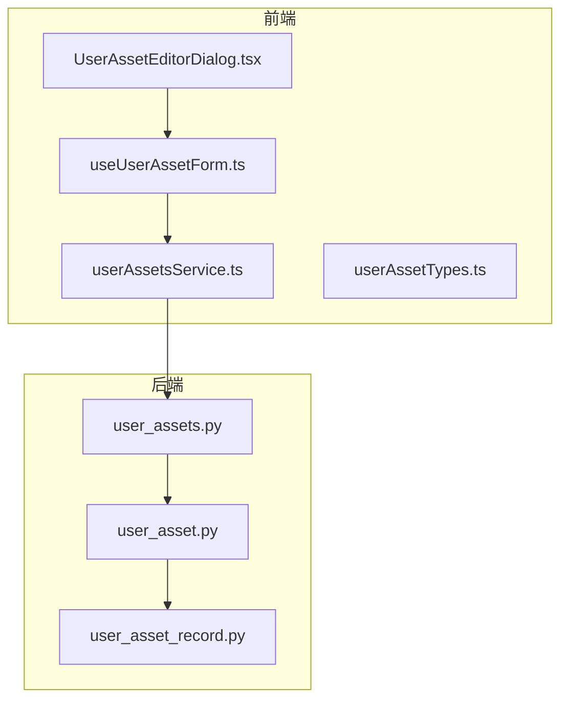
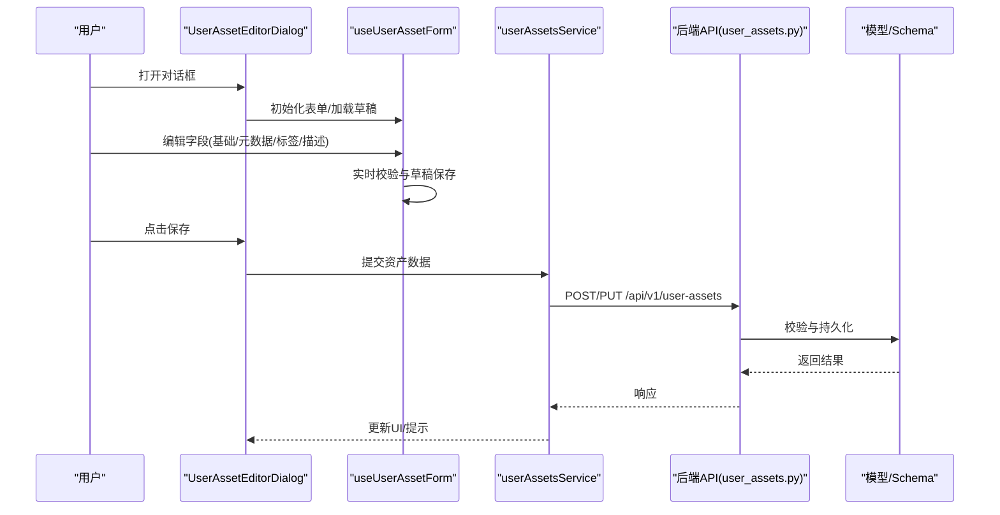
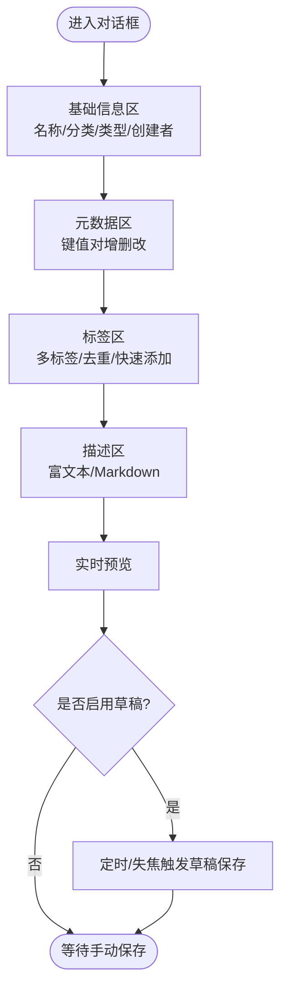
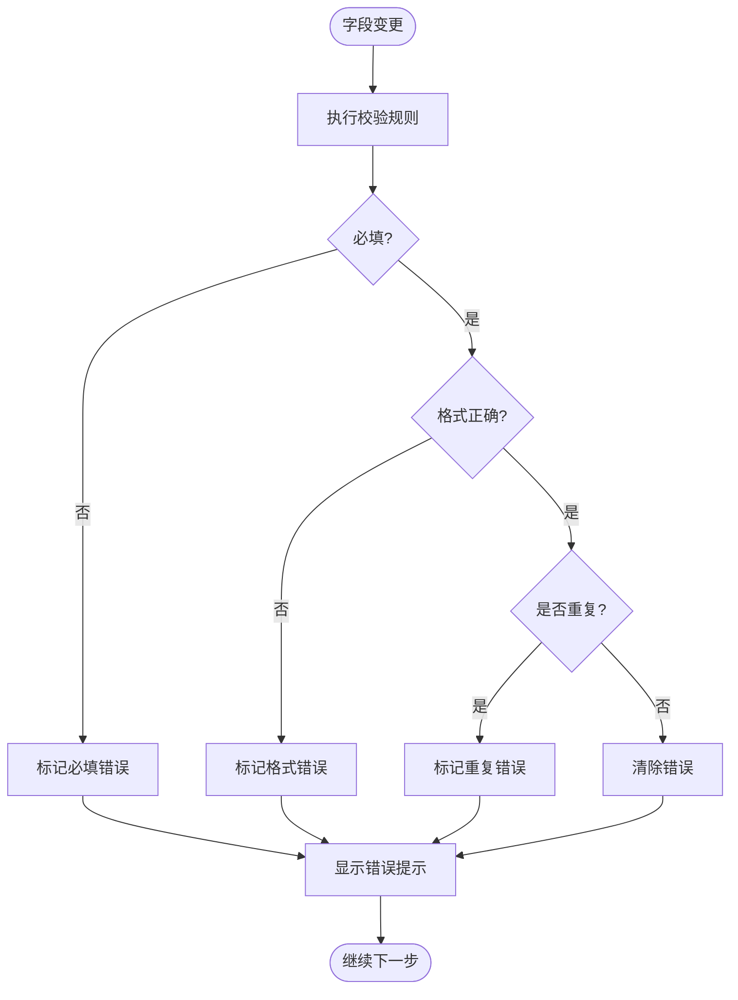
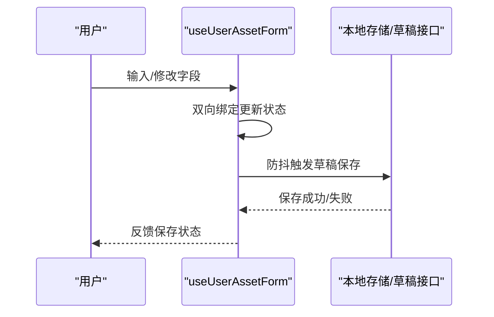
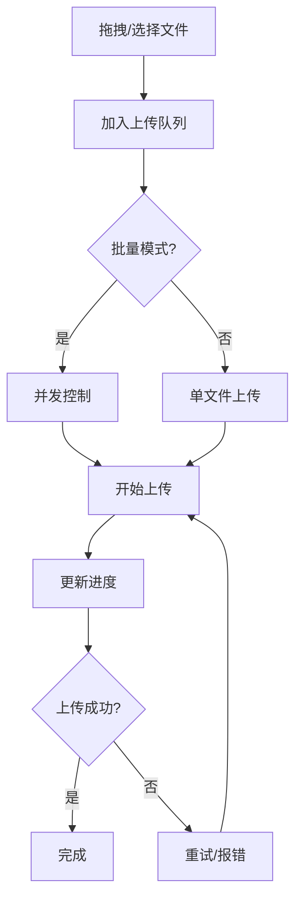
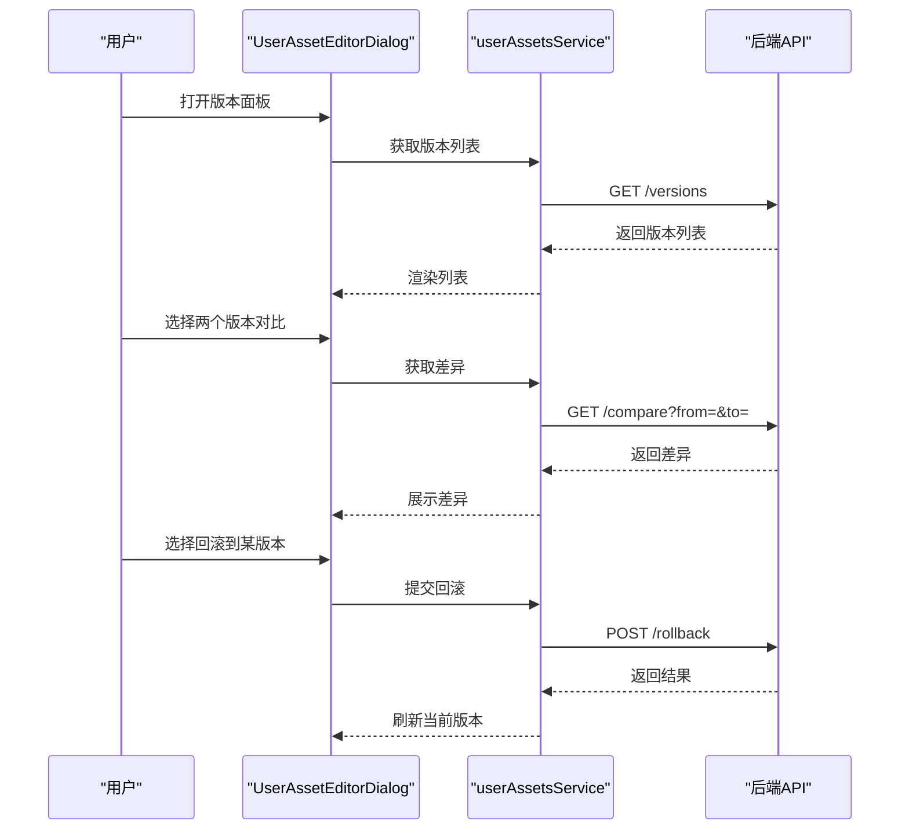
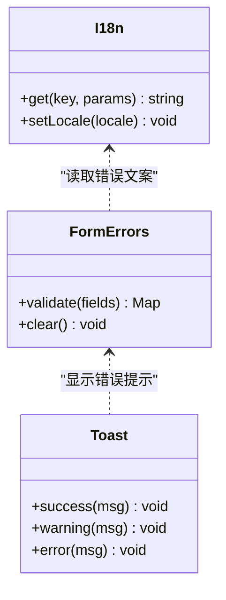
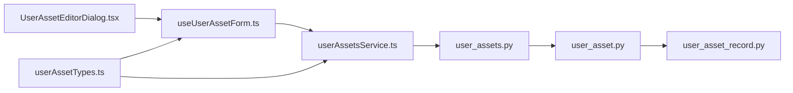

# 资产编辑器对话框

<cite>
**本文引用的文件**   
- [frontend/src/components/UserAssetEditorDialog.tsx](file://frontend/src/components/UserAssetEditorDialog.tsx)
- [frontend/src/hooks/useUserAssetForm.ts](file://frontend/src/hooks/useUserAssetForm.ts)
- [frontend/src/services/userAssetsService.ts](file://frontend/src/services/userAssetsService.ts)
- [backend/app/api/v1/user_assets.py](file://backend/app/api/v1/user_assets.py)
- [backend/app/schemas/user_asset.py](file://backend/app/schemas/user_asset.py)
- [backend/app/models/user_asset_record.py](file://backend/app/models/user_asset_record.py)
- [frontend/src/types/userAssetTypes.ts](file://frontend/src/types/userAssetTypes.ts)
</cite>

## 目录
1. [简介](#简介)
2. [项目结构](#项目结构)
3. [核心组件](#核心组件)
4. [架构总览](#架构总览)
5. [详细组件分析](#详细组件分析)
6. [依赖关系分析](#依赖关系分析)
7. [性能考量](#性能考量)
8. [故障排查指南](#故障排查指南)
9. [结论](#结论)
10. [附录](#附录)

## 简介
本文件为“资产编辑器对话框（UserAssetEditorDialog）”的完整技术文档，面向前端与后端开发者、产品与测试人员。内容覆盖：
- 表单结构设计：基础信息编辑、元数据修改、标签管理、描述文本编辑
- 表单验证机制：必填字段、格式校验、重复性检查、业务规则
- 数据绑定方式：双向绑定、实时预览、草稿保存
- 文件上传能力：拖拽上传、批量上传、进度显示、错误重试
- 版本管理：历史版本查看、版本对比、回滚操作
- 国际化支持与错误提示机制

## 项目结构
该功能横跨前后端：
- 前端：React 组件与 Hook 负责 UI、状态、校验、上传与版本交互；类型定义约束数据结构
- 后端：FastAPI 路由提供 CRUD 与版本接口；Pydantic Schema 校验请求体；SQLAlchemy 模型映射数据库表

**图表来源** 
- [frontend/src/components/UserAssetEditorDialog.tsx](file://frontend/src/components/UserAssetEditorDialog.tsx)
- [frontend/src/hooks/useUserAssetForm.ts](file://frontend/src/hooks/useUserAssetForm.ts)
- [frontend/src/services/userAssetsService.ts](file://frontend/src/services/userAssetsService.ts)
- [frontend/src/types/userAssetTypes.ts](file://frontend/src/types/userAssetTypes.ts)
- [backend/app/api/v1/user_assets.py](file://backend/app/api/v1/user_assets.py)
- [backend/app/schemas/user_asset.py](file://backend/app/schemas/user_asset.py)
- [backend/app/models/user_asset_record.py](file://backend/app/models/user_asset_record.py)

**章节来源**
- [frontend/src/components/UserAssetEditorDialog.tsx](file://frontend/src/components/UserAssetEditorDialog.tsx)
- [frontend/src/hooks/useUserAssetForm.ts](file://frontend/src/hooks/useUserAssetForm.ts)
- [frontend/src/services/userAssetsService.ts](file://frontend/src/services/userAssetsService.ts)
- [frontend/src/types/userAssetTypes.ts](file://frontend/src/types/userAssetTypes.ts)
- [backend/app/api/v1/user_assets.py](file://backend/app/api/v1/user_assets.py)
- [backend/app/schemas/user_asset.py](file://backend/app/schemas/user_asset.py)
- [backend/app/models/user_asset_record.py](file://backend/app/models/user_asset_record.py)

## 核心组件
- UserAssetEditorDialog：对话框容器，组织各区块（基础信息、元数据、标签、描述），控制打开/关闭、提交与取消流程
- useUserAssetForm：封装表单状态、校验、草稿保存、版本切换等逻辑
- userAssetsService：封装与后端的 HTTP 调用（CRUD、版本列表/详情、对比、回滚、上传）
- 类型定义：统一前后端数据结构契约
- 后端路由与 Schema：接收并校验请求，持久化到数据库

**章节来源**
- [frontend/src/components/UserAssetEditorDialog.tsx](file://frontend/src/components/UserAssetEditorDialog.tsx)
- [frontend/src/hooks/useUserAssetForm.ts](file://frontend/src/hooks/useUserAssetForm.ts)
- [frontend/src/services/userAssetsService.ts](file://frontend/src/services/userAssetsService.ts)
- [frontend/src/types/userAssetTypes.ts](file://frontend/src/types/userAssetTypes.ts)
- [backend/app/api/v1/user_assets.py](file://backend/app/api/v1/user_assets.py)
- [backend/app/schemas/user_asset.py](file://backend/app/schemas/user_asset.py)

## 架构总览
用户通过对话框编辑资产，表单层将变更同步至本地状态，支持草稿自动保存；提交时由服务层调用后端接口完成持久化。版本相关操作（查看历史、对比、回滚）通过独立接口完成。

**图表来源** 
- [frontend/src/components/UserAssetEditorDialog.tsx](file://frontend/src/components/UserAssetEditorDialog.tsx)
- [frontend/src/hooks/useUserAssetForm.ts](file://frontend/src/hooks/useUserAssetForm.ts)
- [frontend/src/services/userAssetsService.ts](file://frontend/src/services/userAssetsService.ts)
- [backend/app/api/v1/user_assets.py](file://backend/app/api/v1/user_assets.py)
- [backend/app/schemas/user_asset.py](file://backend/app/schemas/user_asset.py)
- [backend/app/models/user_asset_record.py](file://backend/app/models/user_asset_record.py)

## 详细组件分析

### 表单结构与字段设计
- 基础信息编辑：名称、分类、类型、创建者、时间戳等只读或可编辑字段
- 元数据修改：自定义键值对，支持增删改查
- 标签管理：多标签输入，支持快速添加、删除、去重
- 描述文本编辑：富文本或 Markdown 编辑器，支持实时预览

**图表来源** 
- [frontend/src/components/UserAssetEditorDialog.tsx](file://frontend/src/components/UserAssetEditorDialog.tsx)
- [frontend/src/hooks/useUserAssetForm.ts](file://frontend/src/hooks/useUserAssetForm.ts)

**章节来源**
- [frontend/src/components/UserAssetEditorDialog.tsx](file://frontend/src/components/UserAssetEditorDialog.tsx)
- [frontend/src/hooks/useUserAssetForm.ts](file://frontend/src/hooks/useUserAssetForm.ts)

### 表单验证机制
- 必填字段验证：名称、分类等关键字段为空时即时提示
- 格式校验：邮箱、URL、ID 等正则校验
- 重复性检查：名称/编码唯一性，提交前或失焦时发起后端查重
- 业务规则验证：如标签数量上限、元数据键名规范、描述长度限制

**图表来源** 
- [frontend/src/hooks/useUserAssetForm.ts](file://frontend/src/hooks/useUserAssetForm.ts)
- [backend/app/schemas/user_asset.py](file://backend/app/schemas/user_asset.py)

**章节来源**
- [frontend/src/hooks/useUserAssetForm.ts](file://frontend/src/hooks/useUserAssetForm.ts)
- [backend/app/schemas/user_asset.py](file://backend/app/schemas/user_asset.py)

### 数据绑定方式
- 双向数据绑定：表单字段与状态对象双向同步，输入即更新
- 实时预览：描述区输入即时渲染预览
- 草稿保存：防抖/节流策略，失焦或定时自动保存到本地存储或后端草稿接口

**图表来源** 
- [frontend/src/hooks/useUserAssetForm.ts](file://frontend/src/hooks/useUserAssetForm.ts)
- [frontend/src/services/userAssetsService.ts](file://frontend/src/services/userAssetsService.ts)

**章节来源**
- [frontend/src/hooks/useUserAssetForm.ts](file://frontend/src/hooks/useUserAssetForm.ts)
- [frontend/src/services/userAssetsService.ts](file://frontend/src/services/userAssetsService.ts)

### 文件上传功能
- 拖拽上传：支持拖拽文件到指定区域
- 批量上传：队列处理，顺序或并发上传
- 进度显示：每个文件独立进度条，总体进度汇总
- 错误重试：网络失败自动重试，支持手动重试

**图表来源** 
- [frontend/src/components/UserAssetEditorDialog.tsx](file://frontend/src/components/UserAssetEditorDialog.tsx)
- [frontend/src/services/userAssetsService.ts](file://frontend/src/services/userAssetsService.ts)

**章节来源**
- [frontend/src/components/UserAssetEditorDialog.tsx](file://frontend/src/components/UserAssetEditorDialog.tsx)
- [frontend/src/services/userAssetsService.ts](file://frontend/src/services/userAssetsService.ts)

### 版本管理功能
- 历史版本查看：列出所有版本，支持按时间排序
- 版本对比：选择两个版本进行差异对比（字段级）
- 回滚操作：将某个历史版本作为当前版本恢复

**图表来源** 
- [frontend/src/components/UserAssetEditorDialog.tsx](file://frontend/src/components/UserAssetEditorDialog.tsx)
- [frontend/src/services/userAssetsService.ts](file://frontend/src/services/userAssetsService.ts)
- [backend/app/api/v1/user_assets.py](file://backend/app/api/v1/user_assets.py)

**章节来源**
- [frontend/src/components/UserAssetEditorDialog.tsx](file://frontend/src/components/UserAssetEditorDialog.tsx)
- [frontend/src/services/userAssetsService.ts](file://frontend/src/services/userAssetsService.ts)
- [backend/app/api/v1/user_assets.py](file://backend/app/api/v1/user_assets.py)

### 国际化支持与错误提示机制
- 国际化：文案集中管理，根据语言包动态切换
- 错误提示：统一错误消息映射，区分客户端校验错误与服务端错误
- 提示样式：成功、警告、错误三类提示，支持自动消失与手动关闭

**图表来源** 
- [frontend/src/hooks/useUserAssetForm.ts](file://frontend/src/hooks/useUserAssetForm.ts)
- [frontend/src/services/userAssetsService.ts](file://frontend/src/services/userAssetsService.ts)

**章节来源**
- [frontend/src/hooks/useUserAssetForm.ts](file://frontend/src/hooks/useUserAssetForm.ts)
- [frontend/src/services/userAssetsService.ts](file://frontend/src/services/userAssetsService.ts)

## 依赖关系分析
- 前端组件依赖 Hook 与 Service，Hook 依赖类型定义
- 后端路由依赖 Schema 校验，Schema 依赖模型定义
- 前后端通过 RESTful API 通信，类型定义确保契约一致

**图表来源** 
- [frontend/src/components/UserAssetEditorDialog.tsx](file://frontend/src/components/UserAssetEditorDialog.tsx)
- [frontend/src/hooks/useUserAssetForm.ts](file://frontend/src/hooks/useUserAssetForm.ts)
- [frontend/src/services/userAssetsService.ts](file://frontend/src/services/userAssetsService.ts)
- [frontend/src/types/userAssetTypes.ts](file://frontend/src/types/userAssetTypes.ts)
- [backend/app/api/v1/user_assets.py](file://backend/app/api/v1/user_assets.py)
- [backend/app/schemas/user_asset.py](file://backend/app/schemas/user_asset.py)
- [backend/app/models/user_asset_record.py](file://backend/app/models/user_asset_record.py)

**章节来源**
- [frontend/src/components/UserAssetEditorDialog.tsx](file://frontend/src/components/UserAssetEditorDialog.tsx)
- [frontend/src/hooks/useUserAssetForm.ts](file://frontend/src/hooks/useUserAssetForm.ts)
- [frontend/src/services/userAssetsService.ts](file://frontend/src/services/userAssetsService.ts)
- [frontend/src/types/userAssetTypes.ts](file://frontend/src/types/userAssetTypes.ts)
- [backend/app/api/v1/user_assets.py](file://backend/app/api/v1/user_assets.py)
- [backend/app/schemas/user_asset.py](file://backend/app/schemas/user_asset.py)
- [backend/app/models/user_asset_record.py](file://backend/app/models/user_asset_record.py)

## 性能考量
- 表单校验：采用防抖与增量校验，避免全量重算
- 草稿保存：合并多次写入，减少 I/O 压力
- 文件上传：分片上传、并发控制、断点续传（可选）
- 版本对比：按需拉取差异数据，避免大对象传输
- 缓存：常用字典与配置本地缓存，减少重复请求

[本节为通用指导，不直接分析具体文件]

## 故障排查指南
- 表单无法提交：检查必填字段与格式校验错误，查看控制台错误日志
- 上传失败：确认网络状态、文件大小限制、服务端返回码，尝试重试
- 版本对比异常：核对版本 ID 是否存在，检查差异字段权限
- 草稿丢失：检查本地存储权限与清理策略，确认草稿接口可用性

**章节来源**
- [frontend/src/hooks/useUserAssetForm.ts](file://frontend/src/hooks/useUserAssetForm.ts)
- [frontend/src/services/userAssetsService.ts](file://frontend/src/services/userAssetsService.ts)
- [backend/app/api/v1/user_assets.py](file://backend/app/api/v1/user_assets.py)

## 结论
UserAssetEditorDialog 提供了完整的资产编辑体验，涵盖表单设计、校验、数据绑定、文件上传与版本管理。前后端通过清晰的契约与分层架构实现稳定可靠的交互。建议在生产环境完善错误监控、性能指标与用户体验优化。

[本节为总结，不直接分析具体文件]

## 附录
- 字段字典与校验规则参考类型定义与 Schema
- 接口清单参考后端路由文件
- 版本数据结构参考模型定义

[本节为补充说明，不直接分析具体文件]