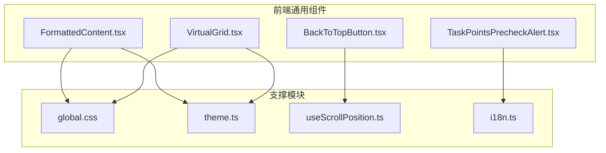
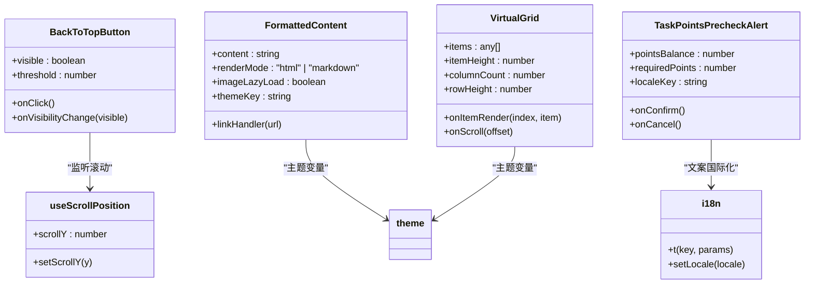
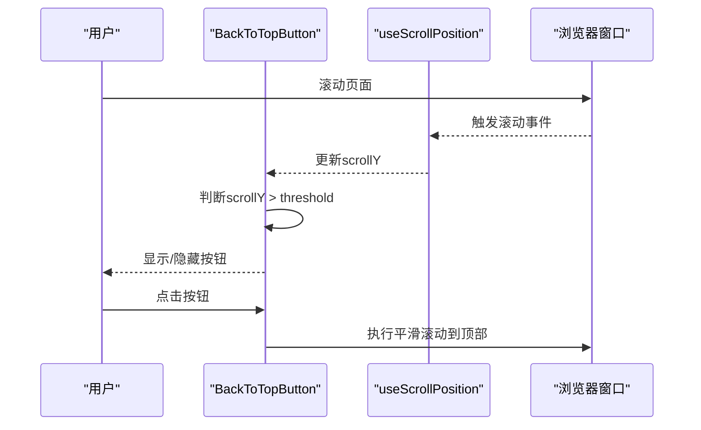
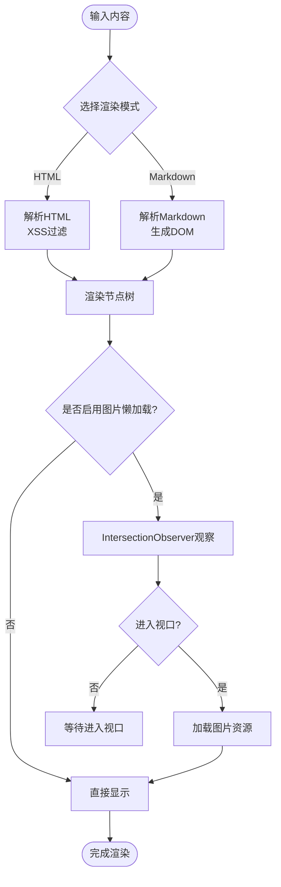
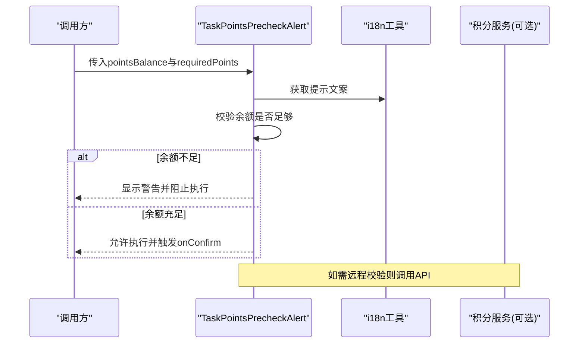
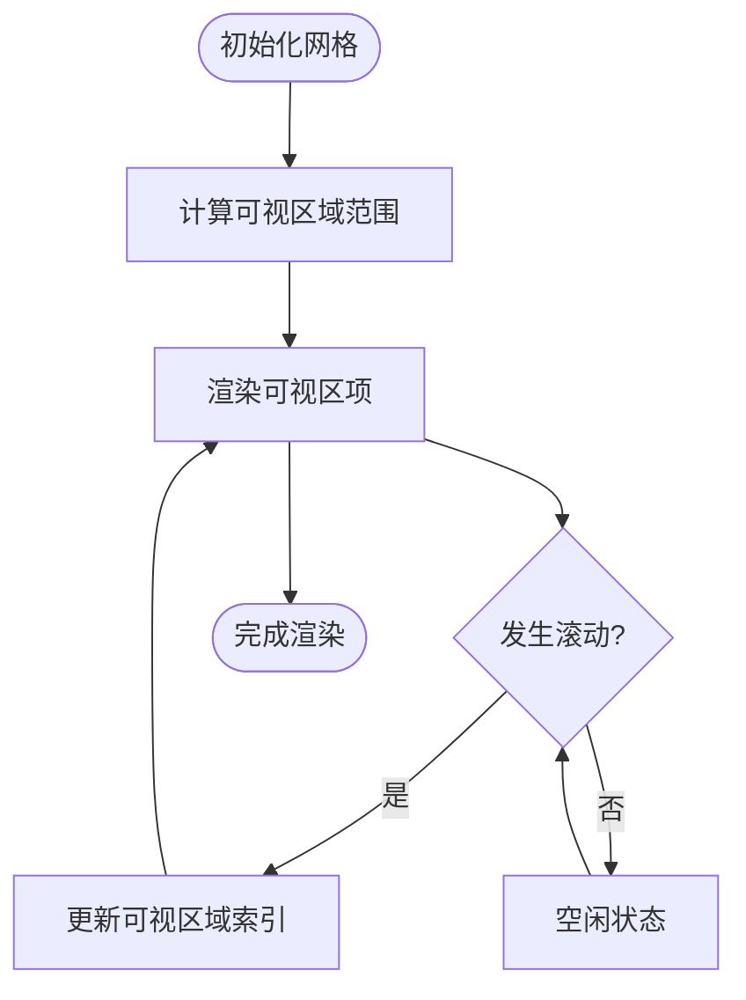
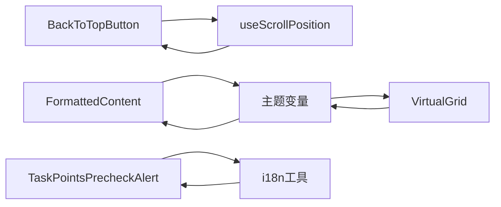
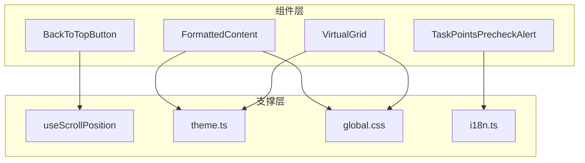

# 通用组件

<cite>
**本文档引用的文件**   
- [frontend/src/components/common/BackToTopButton.tsx](file://frontend/src/components/common/BackToTopButton.tsx)
- [frontend/src/components/common/FormattedContent.tsx](file://frontend/src/components/common/FormattedContent.tsx)
- [frontend/src/components/common/TaskPointsPrecheckAlert.tsx](file://frontend/src/components/common/TaskPointsPrecheckAlert.tsx)
- [frontend/src/components/common/VirtualGrid.tsx](file://frontend/src/components/common/VirtualGrid.tsx)
- [frontend/src/styles/global.css](file://frontend/src/styles/global.css)
- [frontend/src/hooks/useScrollPosition.ts](file://frontend/src/hooks/useScrollPosition.ts)
- [frontend/src/utils/i18n.ts](file://frontend/src/utils/i18n.ts)
- [frontend/src/constants/theme.ts](file://frontend/src/constants/theme.ts)
</cite>

## 目录
1. [简介](#简介)
2. [项目结构](#项目结构)
3. [核心组件](#核心组件)
4. [架构总览](#架构总览)
5. [详细组件分析](#详细组件分析)
6. [依赖关系分析](#依赖关系分析)
7. [性能考虑](#性能考虑)
8. [故障排查指南](#故障排查指南)
9. [结论](#结论)
10. [附录](#附录)

## 简介
本文件面向小说创作代理系统的前端通用UI组件，聚焦以下基础组件的使用与集成：
- BackToTopButton（返回顶部按钮）
- FormattedContent（格式化内容显示）
- TaskPointsPrecheckAlert（任务积分预检提示）
- VirtualGrid（虚拟网格）

文档涵盖各组件的属性配置、事件处理、样式定制、主题支持、响应式设计、可访问性、国际化配置与性能优化建议，并提供API参考、使用示例与最佳实践，帮助开发者快速集成。

## 项目结构
前端通用组件位于 frontend/src/components/common 目录下，配合全局样式、主题常量、滚动位置Hook以及i18n工具进行统一管理与扩展。

图表来源 
- [frontend/src/components/common/BackToTopButton.tsx](file://frontend/src/components/common/BackToTopButton.tsx)
- [frontend/src/components/common/FormattedContent.tsx](file://frontend/src/components/common/FormattedContent.tsx)
- [frontend/src/components/common/TaskPointsPrecheckAlert.tsx](file://frontend/src/components/common/TaskPointsPrecheckAlert.tsx)
- [frontend/src/components/common/VirtualGrid.tsx](file://frontend/src/components/common/VirtualGrid.tsx)
- [frontend/src/styles/global.css](file://frontend/src/styles/global.css)
- [frontend/src/constants/theme.ts](file://frontend/src/constants/theme.ts)
- [frontend/src/hooks/useScrollPosition.ts](file://frontend/src/hooks/useScrollPosition.ts)
- [frontend/src/utils/i18n.ts](file://frontend/src/utils/i18n.ts)

章节来源
- [frontend/src/components/common/BackToTopButton.tsx](file://frontend/src/components/common/BackToTopButton.tsx)
- [frontend/src/components/common/FormattedContent.tsx](file://frontend/src/components/common/FormattedContent.tsx)
- [frontend/src/components/common/TaskPointsPrecheckAlert.tsx](file://frontend/src/components/common/TaskPointsPrecheckAlert.tsx)
- [frontend/src/components/common/VirtualGrid.tsx](file://frontend/src/components/common/VirtualGrid.tsx)
- [frontend/src/styles/global.css](file://frontend/src/styles/global.css)
- [frontend/src/constants/theme.ts](file://frontend/src/constants/theme.ts)
- [frontend/src/hooks/useScrollPosition.ts](file://frontend/src/hooks/useScrollPosition.ts)
- [frontend/src/utils/i18n.ts](file://frontend/src/utils/i18n.ts)

## 核心组件
本节概述四个基础组件的职责与典型用法，后续章节将深入每个组件的API、交互流程与实现细节。

- BackToTopButton：在页面滚动超过阈值时显示“返回顶部”按钮，点击后平滑滚动至顶部，支持无障碍标签与键盘操作。
- FormattedContent：安全渲染富文本或Markdown片段，提供语法高亮、链接跳转、图片懒加载等能力，并支持主题色与暗色模式。
- TaskPointsPrecheckAlert：在执行任务前对积分余额与配额进行预检，展示警告或阻断信息，支持自定义回调与国际化文案。
- VirtualGrid：大数据量网格虚拟化渲染，按需渲染可视区域项，支持固定/可变尺寸、列数自适应与滚动性能优化。

章节来源
- [frontend/src/components/common/BackToTopButton.tsx](file://frontend/src/components/common/BackToTopButton.tsx)
- [frontend/src/components/common/FormattedContent.tsx](file://frontend/src/components/common/FormattedContent.tsx)
- [frontend/src/components/common/TaskPointsPrecheckAlert.tsx](file://frontend/src/components/common/TaskPointsPrecheckAlert.tsx)
- [frontend/src/components/common/VirtualGrid.tsx](file://frontend/src/components/common/VirtualGrid.tsx)

## 架构总览
通用组件通过统一的样式与主题系统进行外观控制，借助Hook与工具函数实现跨组件复用能力。

图表来源 
- [frontend/src/components/common/BackToTopButton.tsx](file://frontend/src/components/common/BackToTopButton.tsx)
- [frontend/src/components/common/FormattedContent.tsx](file://frontend/src/components/common/FormattedContent.tsx)
- [frontend/src/components/common/TaskPointsPrecheckAlert.tsx](file://frontend/src/components/common/TaskPointsPrecheckAlert.tsx)
- [frontend/src/components/common/VirtualGrid.tsx](file://frontend/src/components/common/VirtualGrid.tsx)
- [frontend/src/hooks/useScrollPosition.ts](file://frontend/src/hooks/useScrollPosition.ts)
- [frontend/src/utils/i18n.ts](file://frontend/src/utils/i18n.ts)
- [frontend/src/constants/theme.ts](file://frontend/src/constants/theme.ts)

## 详细组件分析

### BackToTopButton（返回顶部按钮）
- 功能要点
  - 当页面滚动距离超过阈值时自动显示；低于阈值隐藏。
  - 点击后平滑滚动到页面顶部。
  - 支持键盘Tab导航与Enter/Space触发。
  - 可通过aria-label与role提升可访问性。
- 属性配置
  - visible：是否显示按钮（可由外部状态控制）。
  - threshold：触发显示的滚动阈值（像素）。
  - onClick：点击回调。
  - onVisibilityChange：可见性变化回调。
- 事件处理
  - 内部监听滚动事件，更新滚动位置并计算可见性。
  - 点击事件调用平滑滚动API。
- 样式与主题
  - 使用全局CSS类名控制定位、圆角、阴影与过渡动画。
  - 支持主题变量（如背景色、悬停色），适配暗色模式。
- 可访问性
  - 设置aria-label为“返回顶部”，确保屏幕阅读器可读。
  - 支持键盘焦点与激活。
- 国际化
  - 若需多语言，可通过i18n工具注入文案。
- 性能优化
  - 滚动事件防抖/节流，避免频繁重排。
  - 使用requestAnimationFrame优化动画。
- 使用示例
  - 在页面根容器内引入组件，传入threshold与onClick即可。
  - 结合useScrollPosition Hook管理滚动位置。

图表来源 
- [frontend/src/components/common/BackToTopButton.tsx](file://frontend/src/components/common/BackToTopButton.tsx)
- [frontend/src/hooks/useScrollPosition.ts](file://frontend/src/hooks/useScrollPosition.ts)

章节来源
- [frontend/src/components/common/BackToTopButton.tsx](file://frontend/src/components/common/BackToTopButton.tsx)
- [frontend/src/hooks/useScrollPosition.ts](file://frontend/src/hooks/useScrollPosition.ts)

### FormattedContent（格式化内容显示）
- 功能要点
  - 安全渲染HTML或Markdown片段，内置XSS防护。
  - 支持链接点击处理、图片懒加载、代码块高亮。
  - 根据主题切换颜色与字体。
- 属性配置
  - content：要渲染的内容字符串。
  - renderMode：渲染模式（html/markdown）。
  - linkHandler：链接点击处理器。
  - imageLazyLoad：是否启用图片懒加载。
  - themeKey：主题键值，用于映射样式变量。
- 事件处理
  - 链接点击通过linkHandler拦截并路由。
  - 图片懒加载在进入视口时触发加载。
- 样式与主题
  - 基于全局CSS与主题变量，支持暗色模式与品牌色。
  - 代码块与引用块具备独立样式类。
- 可访问性
  - 为图片提供alt描述，链接提供title。
  - 保持语义化标签（h1-h6、p、ul/li等）。
- 国际化
  - 错误提示与占位文案可通过i18n注入。
- 性能优化
  - 大段内容分片渲染与虚拟滚动结合。
  - 图片懒加载与占位图减少首屏压力。
- 使用示例
  - 传入content与renderMode，必要时提供linkHandler。
  - 结合主题常量切换明暗主题。

图表来源 
- [frontend/src/components/common/FormattedContent.tsx](file://frontend/src/components/common/FormattedContent.tsx)
- [frontend/src/styles/global.css](file://frontend/src/styles/global.css)
- [frontend/src/constants/theme.ts](file://frontend/src/constants/theme.ts)

章节来源
- [frontend/src/components/common/FormattedContent.tsx](file://frontend/src/components/common/FormattedContent.tsx)
- [frontend/src/styles/global.css](file://frontend/src/styles/global.css)
- [frontend/src/constants/theme.ts](file://frontend/src/constants/theme.ts)

### TaskPointsPrecheckAlert（任务积分预检提示）
- 功能要点
  - 在执行任务前检查用户积分余额与所需积分。
  - 余额不足时显示警告或阻断提示，阻止任务启动。
  - 支持确认/取消回调与国际化文案。
- 属性配置
  - pointsBalance：当前积分余额。
  - requiredPoints：任务所需积分。
  - onConfirm：余额充足时的确认回调。
  - onCancel：取消操作的回调。
  - localeKey：国际化键值。
- 事件处理
  - 校验逻辑在组件挂载或props变更时执行。
  - 根据结果决定显示警告或允许继续。
- 样式与主题
  - 使用警示色与图标，适配主题变量。
  - 支持全屏遮罩或弹窗形式。
- 可访问性
  - 使用alert角色与aria-live确保读屏器播报。
  - 键盘操作支持Esc关闭与Enter确认。
- 国际化
  - 通过i18n工具获取不同语言的提示文案。
- 性能优化
  - 仅在必要时机触发预检，避免重复计算。
  - 缓存预检结果以减少网络请求。
- 使用示例
  - 在任务提交前调用预检组件，根据返回决定是否执行任务。

图表来源 
- [frontend/src/components/common/TaskPointsPrecheckAlert.tsx](file://frontend/src/components/common/TaskPointsPrecheckAlert.tsx)
- [frontend/src/utils/i18n.ts](file://frontend/src/utils/i18n.ts)

章节来源
- [frontend/src/components/common/TaskPointsPrecheckAlert.tsx](file://frontend/src/components/common/TaskPointsPrecheckAlert.tsx)
- [frontend/src/utils/i18n.ts](file://frontend/src/utils/i18n.ts)

### VirtualGrid（虚拟网格）
- 功能要点
  - 大数据量网格虚拟化渲染，仅渲染可视区域项。
  - 支持固定或可变行高、列数自适应与滚动性能优化。
- 属性配置
  - items：数据数组。
  - itemHeight：单项高度（固定或函数）。
  - columnCount：列数（固定或按宽度计算）。
  - rowHeight：行高（固定或函数）。
  - onItemRender：渲染单个项目的回调。
  - onScroll：滚动位置变化回调。
- 事件处理
  - 滚动事件驱动可视区域计算与项渲染。
  - 支持惯性滚动与边界检测。
- 样式与主题
  - 使用全局CSS类控制网格布局与间距。
  - 支持主题变量调整边框、背景与悬停效果。
- 可访问性
  - 为每项提供tabIndex与aria-label。
  - 支持键盘上下移动焦点。
- 性能优化
  - 使用虚拟滚动与增量更新减少重绘。
  - 合并多次滚动事件，降低计算频率。
- 使用示例
  - 传入items与onItemRender，根据需要设置columnCount与itemHeight。

图表来源 
- [frontend/src/components/common/VirtualGrid.tsx](file://frontend/src/components/common/VirtualGrid.tsx)
- [frontend/src/styles/global.css](file://frontend/src/styles/global.css)
- [frontend/src/constants/theme.ts](file://frontend/src/constants/theme.ts)

章节来源
- [frontend/src/components/common/VirtualGrid.tsx](file://frontend/src/components/common/VirtualGrid.tsx)
- [frontend/src/styles/global.css](file://frontend/src/styles/global.css)
- [frontend/src/constants/theme.ts](file://frontend/src/constants/theme.ts)

### 概念总览
以下为不绑定具体源码的概念流程图，帮助理解组件间的协作关系与数据流向。

[本图为概念示意，不直接映射具体源码文件]

## 依赖关系分析
组件之间的依赖主要体现在样式、主题、Hook与国际化工具上。

图表来源 
- [frontend/src/components/common/BackToTopButton.tsx](file://frontend/src/components/common/BackToTopButton.tsx)
- [frontend/src/components/common/FormattedContent.tsx](file://frontend/src/components/common/FormattedContent.tsx)
- [frontend/src/components/common/TaskPointsPrecheckAlert.tsx](file://frontend/src/components/common/TaskPointsPrecheckAlert.tsx)
- [frontend/src/components/common/VirtualGrid.tsx](file://frontend/src/components/common/VirtualGrid.tsx)
- [frontend/src/hooks/useScrollPosition.ts](file://frontend/src/hooks/useScrollPosition.ts)
- [frontend/src/constants/theme.ts](file://frontend/src/constants/theme.ts)
- [frontend/src/styles/global.css](file://frontend/src/styles/global.css)
- [frontend/src/utils/i18n.ts](file://frontend/src/utils/i18n.ts)

章节来源
- [frontend/src/components/common/BackToTopButton.tsx](file://frontend/src/components/common/BackToTopButton.tsx)
- [frontend/src/components/common/FormattedContent.tsx](file://frontend/src/components/common/FormattedContent.tsx)
- [frontend/src/components/common/TaskPointsPrecheckAlert.tsx](file://frontend/src/components/common/TaskPointsPrecheckAlert.tsx)
- [frontend/src/components/common/VirtualGrid.tsx](file://frontend/src/components/common/VirtualGrid.tsx)
- [frontend/src/hooks/useScrollPosition.ts](file://frontend/src/hooks/useScrollPosition.ts)
- [frontend/src/constants/theme.ts](file://frontend/src/constants/theme.ts)
- [frontend/src/styles/global.css](file://frontend/src/styles/global.css)
- [frontend/src/utils/i18n.ts](file://frontend/src/utils/i18n.ts)

## 性能考虑
- 滚动与动画
  - 使用防抖/节流限制滚动事件频率，结合requestAnimationFrame优化动画帧率。
  - 避免在滚动回调中进行昂贵计算，优先读取布局属性后再批量更新。
- 渲染优化
  - 对长列表与网格采用虚拟化渲染，减少DOM节点数量。
  - 图片懒加载与占位图降低首屏负载。
- 主题与样式
  - 使用CSS变量与主题常量，避免运行时大量样式计算。
  - 合理使用will-change与transform提升合成层性能。
- 内存管理
  - 及时清理事件监听与定时器，防止内存泄漏。
  - 大数据集分批处理，避免主线程阻塞。

[本节为通用指导，不直接分析具体文件]

## 故障排查指南
- BackToTopButton不显示
  - 检查threshold设置是否合理，确认滚动位置是否正确更新。
  - 验证useScrollPosition Hook是否被正确引入与订阅。
- FormattedContent渲染异常
  - 确认content格式与renderMode匹配。
  - 检查XSS过滤策略与链接处理器是否生效。
- TaskPointsPrecheckAlert未阻断任务
  - 核对pointsBalance与requiredPoints数值逻辑。
  - 确认i18n文案键值是否存在。
- VirtualGrid滚动卡顿
  - 检查itemHeight与rowHeight是否为固定值或高效函数。
  - 确认可视区域计算与渲染回调是否被节流。

章节来源
- [frontend/src/components/common/BackToTopButton.tsx](file://frontend/src/components/common/BackToTopButton.tsx)
- [frontend/src/components/common/FormattedContent.tsx](file://frontend/src/components/common/FormattedContent.tsx)
- [frontend/src/components/common/TaskPointsPrecheckAlert.tsx](file://frontend/src/components/common/TaskPointsPrecheckAlert.tsx)
- [frontend/src/components/common/VirtualGrid.tsx](file://frontend/src/components/common/VirtualGrid.tsx)
- [frontend/src/hooks/useScrollPosition.ts](file://frontend/src/hooks/useScrollPosition.ts)
- [frontend/src/utils/i18n.ts](file://frontend/src/utils/i18n.ts)

## 结论
上述通用组件为小说创作代理系统提供了稳定、可访问且高性能的基础UI能力。通过统一的样式与主题系统、完善的Hook与i18n支持，开发者可以快速构建一致的界面体验。建议在集成时遵循本文档的API参考与最佳实践，确保可维护性与可扩展性。

[本节为总结，不直接分析具体文件]

## 附录
- API参考速查
  - BackToTopButton：visible、threshold、onClick、onVisibilityChange
  - FormattedContent：content、renderMode、linkHandler、imageLazyLoad、themeKey
  - TaskPointsPrecheckAlert：pointsBalance、requiredPoints、onConfirm、onCancel、localeKey
  - VirtualGrid：items、itemHeight、columnCount、rowHeight、onItemRender、onScroll
- 最佳实践
  - 始终为可交互元素提供无障碍标签与键盘支持。
  - 使用主题变量与全局样式保持一致的外观。
  - 对大数据集与高频事件进行虚拟化与节流优化。
  - 通过i18n工具集中管理多语言文案。

[本节为补充信息，不直接分析具体文件]