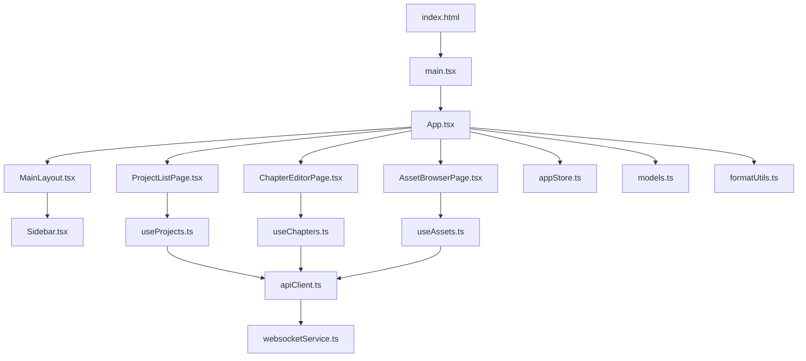
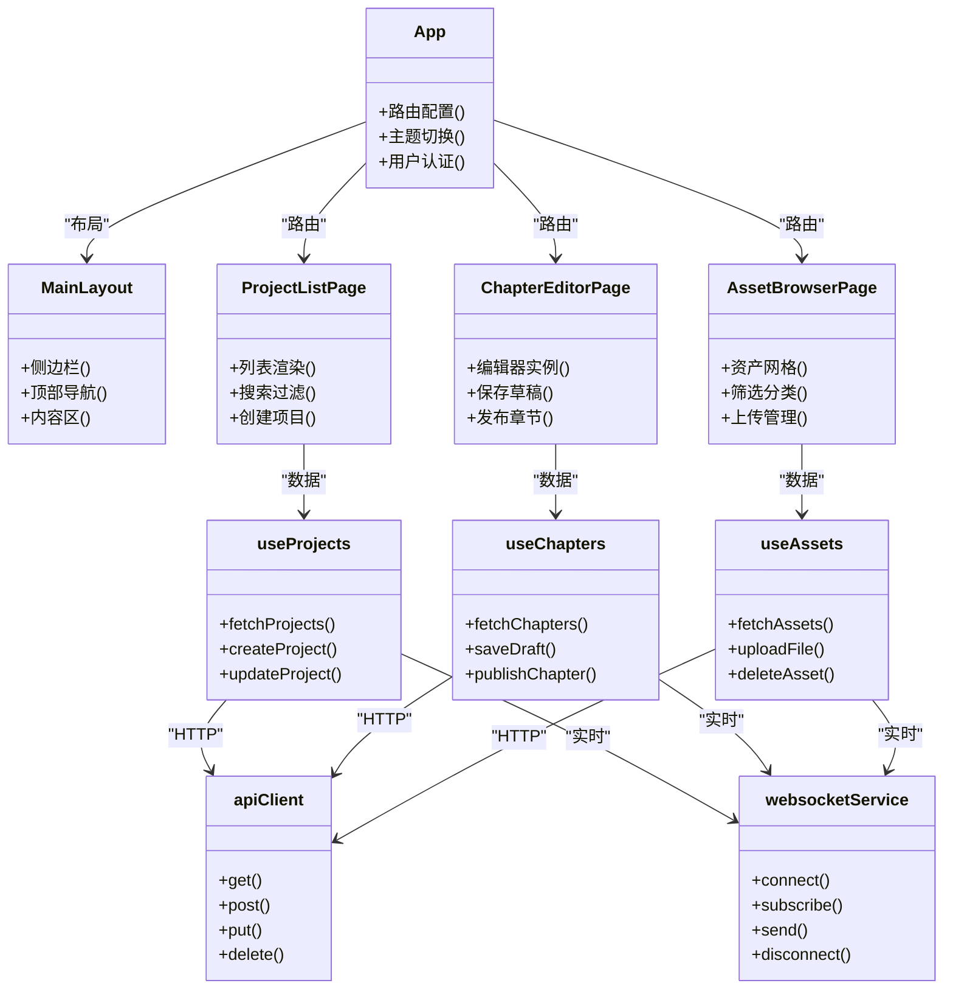
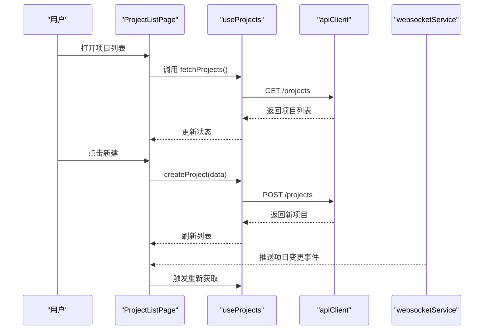
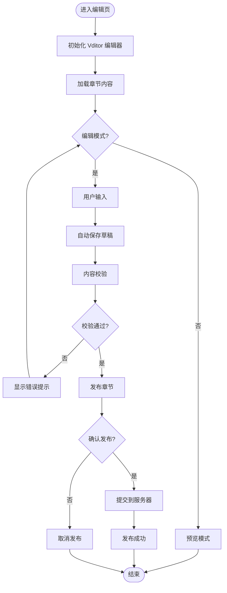
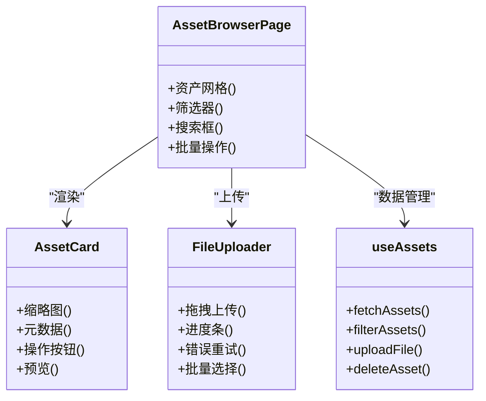
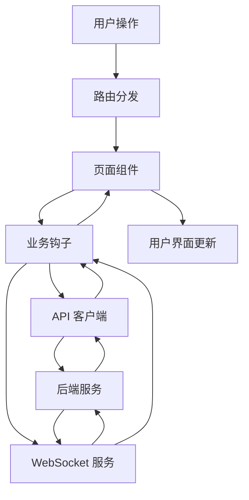
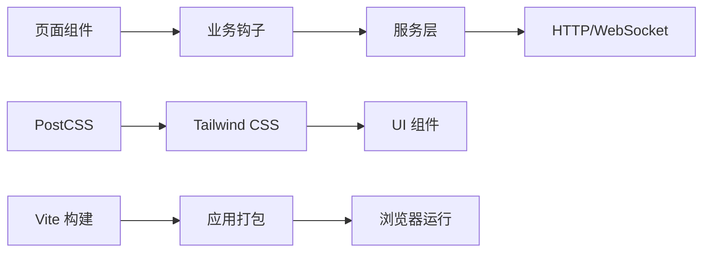

# 前端应用

<cite>
**本文引用的文件**   
- [frontend/package.json](file://frontend/package.json)
- [frontend/vite.config.ts](file://frontend/vite.config.ts)
- [frontend/tailwind.config.js](file://frontend/tailwind.config.js)
- [frontend/postcss.config.js](file://frontend/postcss.config.js)
- [frontend/index.html](file://frontend/index.html)
- [frontend/src/main.tsx](file://frontend/src/main.tsx)
- [frontend/src/App.tsx](file://frontend/src/App.tsx)
- [frontend/src/index.css](file://frontend/src/index.css)
- [frontend/src/pages/ProjectListPage.tsx](file://frontend/src/pages/ProjectListPage.tsx)
- [frontend/src/pages/ChapterEditorPage.tsx](file://frontend/src/pages/ChapterEditorPage.tsx)
- [frontend/src/pages/AssetBrowserPage.tsx](file://frontend/src/pages/AssetBrowserPage.tsx)
- [frontend/src/components/Layout/MainLayout.tsx](file://frontend/src/components/Layout/MainLayout.tsx)
- [frontend/src/components/Layout/Sidebar.tsx](file://frontend/src/components/Layout/Sidebar.tsx)
- [frontend/src/components/Editor/VditorEditor.tsx](file://frontend/src/components/Editor/VditorEditor.tsx)
- [frontend/src/components/Asset/FileUploader.tsx](file://frontend/src/components/Asset/FileUploader.tsx)
- [frontend/src/components/Asset/AssetCard.tsx](file://frontend/src/components/Asset/AssetCard.tsx)
- [frontend/src/hooks/useProjects.ts](file://frontend/src/hooks/useProjects.ts)
- [frontend/src/hooks/useChapters.ts](file://frontend/src/hooks/useChapters.ts)
- [frontend/src/hooks/useAssets.ts](file://frontend/src/hooks/useAssets.ts)
- [frontend/src/services/apiClient.ts](file://frontend/src/services/apiClient.ts)
- [frontend/src/services/websocketService.ts](file://frontend/src/services/websocketService.ts)
- [frontend/src/store/appStore.ts](file://frontend/src/store/appStore.ts)
- [frontend/src/types/models.ts](file://frontend/src/types/models.ts)
- [frontend/src/utils/formatUtils.ts](file://frontend/src/utils/formatUtils.ts)
- [frontend/Dockerfile](file://frontend/Dockerfile)
- [frontend/frontend.nginx.conf](file://frontend/frontend.nginx.conf)
</cite>

## 目录
1. [简介](#简介)
2. [项目结构](#项目结构)
3. [核心组件](#核心组件)
4. [架构总览](#架构总览)
5. [详细组件分析](#详细组件分析)
6. [依赖关系分析](#依赖关系分析)
7. [性能考虑](#性能考虑)
8. [故障排查指南](#故障排查指南)
9. [结论](#结论)
10. [附录](#附录)

## 简介
本文件面向小说创作代理系统的前端应用，提供全面的用户界面文档。内容涵盖 React 应用的组件架构、状态管理、路由设计、页面功能（项目管理、内容编辑、资产浏览）、用户交互模式、表单处理、实时通信、样式系统与主题定制、响应式设计与无障碍访问支持，以及开发环境搭建、构建部署与性能优化指导，并包含常见问题排查方法。

## 项目结构
前端采用 Vite + React + TypeScript 技术栈，使用 Tailwind CSS 进行样式管理，PostCSS 作为构建工具链的一部分。入口文件为 index.html，React 根挂载点位于 main.tsx，应用主组件 App.tsx 负责路由与全局布局。页面按功能划分在 pages 目录，通用 UI 组件集中在 components 目录，业务逻辑通过 hooks 组织，API 客户端与 WebSocket 服务封装在 services 目录，全局状态由 store 管理，类型定义位于 types 目录，工具函数在 utils 目录。

图表来源
- [frontend/index.html](file://frontend/index.html)
- [frontend/src/main.tsx](file://frontend/src/main.tsx)
- [frontend/src/App.tsx](file://frontend/src/App.tsx)
- [frontend/src/components/Layout/MainLayout.tsx](file://frontend/src/components/Layout/MainLayout.tsx)
- [frontend/src/components/Layout/Sidebar.tsx](file://frontend/src/components/Layout/Sidebar.tsx)
- [frontend/src/pages/ProjectListPage.tsx](file://frontend/src/pages/ProjectListPage.tsx)
- [frontend/src/pages/ChapterEditorPage.tsx](file://frontend/src/pages/ChapterEditorPage.tsx)
- [frontend/src/pages/AssetBrowserPage.tsx](file://frontend/src/pages/AssetBrowserPage.tsx)
- [frontend/src/hooks/useProjects.ts](file://frontend/src/hooks/useProjects.ts)
- [frontend/src/hooks/useChapters.ts](file://frontend/src/hooks/useChapters.ts)
- [frontend/src/hooks/useAssets.ts](file://frontend/src/hooks/useAssets.ts)
- [frontend/src/services/apiClient.ts](file://frontend/src/services/apiClient.ts)
- [frontend/src/services/websocketService.ts](file://frontend/src/services/websocketService.ts)
- [frontend/src/store/appStore.ts](file://frontend/src/store/appStore.ts)
- [frontend/src/types/models.ts](file://frontend/src/types/models.ts)
- [frontend/src/utils/formatUtils.ts](file://frontend/src/utils/formatUtils.ts)

章节来源
- [frontend/package.json](file://frontend/package.json)
- [frontend/vite.config.ts](file://frontend/vite.config.ts)
- [frontend/tailwind.config.js](file://frontend/tailwind.config.js)
- [frontend/postcss.config.js](file://frontend/postcss.config.js)
- [frontend/index.html](file://frontend/index.html)
- [frontend/src/main.tsx](file://frontend/src/main.tsx)
- [frontend/src/App.tsx](file://frontend/src/App.tsx)

## 核心组件
- 布局组件 MainLayout：提供顶部导航、侧边栏与内容区域，统一页面骨架与响应式行为。
- 侧边栏 Sidebar：展示导航菜单与快捷操作，支持折叠与高亮当前路由。
- 编辑器 VditorEditor：基于 Vditor 的富文本编辑器，支持 Markdown、实时预览、快捷键与扩展插件。
- 资产上传 FileUploader：支持拖拽上传、进度条、错误重试与批量选择。
- 资产卡片 AssetCard：展示缩略图、元数据与操作按钮（预览、下载、删除）。

章节来源
- [frontend/src/components/Layout/MainLayout.tsx](file://frontend/src/components/Layout/MainLayout.tsx)
- [frontend/src/components/Layout/Sidebar.tsx](file://frontend/src/components/Layout/Sidebar.tsx)
- [frontend/src/components/Editor/VditorEditor.tsx](file://frontend/src/components/Editor/VditorEditor.tsx)
- [frontend/src/components/Asset/FileUploader.tsx](file://frontend/src/components/Asset/FileUploader.tsx)
- [frontend/src/components/Asset/AssetCard.tsx](file://frontend/src/components/Asset/AssetCard.tsx)

## 架构总览
前端采用“页面-组件-钩子-服务”的分层架构：
- 页面层：ProjectListPage、ChapterEditorPage、AssetBrowserPage 等，负责路由与页面级状态。
- 组件层：布局、编辑器、资产相关 UI 组件，负责渲染与交互。
- 钩子层：useProjects、useChapters、useAssets 等，封装数据获取、缓存与副作用。
- 服务层：apiClient 与 websocketService，统一 HTTP 请求与实时通信。
- 状态层：appStore 管理全局状态（如主题、语言、用户信息）。
- 类型层：models.ts 定义前后端契约的数据模型。

图表来源
- [frontend/src/App.tsx](file://frontend/src/App.tsx)
- [frontend/src/components/Layout/MainLayout.tsx](file://frontend/src/components/Layout/MainLayout.tsx)
- [frontend/src/pages/ProjectListPage.tsx](file://frontend/src/pages/ProjectListPage.tsx)
- [frontend/src/pages/ChapterEditorPage.tsx](file://frontend/src/pages/ChapterEditorPage.tsx)
- [frontend/src/pages/AssetBrowserPage.tsx](file://frontend/src/pages/AssetBrowserPage.tsx)
- [frontend/src/hooks/useProjects.ts](file://frontend/src/hooks/useProjects.ts)
- [frontend/src/hooks/useChapters.ts](file://frontend/src/hooks/useChapters.ts)
- [frontend/src/hooks/useAssets.ts](file://frontend/src/hooks/useAssets.ts)
- [frontend/src/services/apiClient.ts](file://frontend/src/services/apiClient.ts)
- [frontend/src/services/websocketService.ts](file://frontend/src/services/websocketService.ts)

## 详细组件分析

### 项目管理界面（ProjectListPage）
- 功能：项目列表展示、搜索过滤、新建项目、编辑与删除。
- 状态管理：useProjects 钩子封装了项目的 CRUD 操作与本地缓存。
- 用户交互：表格行点击查看详情，模态框进行新增/编辑，确认对话框处理删除。
- 表单处理：使用受控组件与校验规则，提交前进行字段验证。
- 实时通信：WebSocket 监听项目状态变更，自动刷新列表。

图表来源
- [frontend/src/pages/ProjectListPage.tsx](file://frontend/src/pages/ProjectListPage.tsx)
- [frontend/src/hooks/useProjects.ts](file://frontend/src/hooks/useProjects.ts)
- [frontend/src/services/apiClient.ts](file://frontend/src/services/apiClient.ts)
- [frontend/src/services/websocketService.ts](file://frontend/src/services/websocketService.ts)

章节来源
- [frontend/src/pages/ProjectListPage.tsx](file://frontend/src/pages/ProjectListPage.tsx)
- [frontend/src/hooks/useProjects.ts](file://frontend/src/hooks/useProjects.ts)

### 内容编辑界面（ChapterEditorPage）
- 功能：Markdown 编辑器、实时预览、自动保存、版本历史、发布流程。
- 编辑器集成：VditorEditor 组件提供丰富的编辑能力，支持快捷键与插件扩展。
- 状态管理：useChapters 钩子管理章节内容、草稿状态与发布流程。
- 表单处理：编辑器内容作为表单数据，支持撤销/重做与冲突合并。
- 实时通信：WebSocket 接收协作编辑事件与服务器同步状态。

图表来源
- [frontend/src/pages/ChapterEditorPage.tsx](file://frontend/src/pages/ChapterEditorPage.tsx)
- [frontend/src/components/Editor/VditorEditor.tsx](file://frontend/src/components/Editor/VditorEditor.tsx)
- [frontend/src/hooks/useChapters.ts](file://frontend/src/hooks/useChapters.ts)

章节来源
- [frontend/src/pages/ChapterEditorPage.tsx](file://frontend/src/pages/ChapterEditorPage.tsx)
- [frontend/src/components/Editor/VditorEditor.tsx](file://frontend/src/components/Editor/VditorEditor.tsx)
- [frontend/src/hooks/useChapters.ts](file://frontend/src/hooks/useChapters.ts)

### 资产浏览界面（AssetBrowserPage）
- 功能：资产网格展示、分类筛选、搜索、批量操作、上传管理。
- 组件结构：AssetCard 展示单个资产，FileUploader 处理上传流程。
- 状态管理：useAssets 钩子管理资产列表、分页、筛选条件与上传队列。
- 用户交互：拖拽排序、右键菜单、键盘导航与无障碍标签。
- 实时通信：WebSocket 通知上传进度与资产状态变更。

图表来源
- [frontend/src/pages/AssetBrowserPage.tsx](file://frontend/src/pages/AssetBrowserPage.tsx)
- [frontend/src/components/Asset/AssetCard.tsx](file://frontend/src/components/Asset/AssetCard.tsx)
- [frontend/src/components/Asset/FileUploader.tsx](file://frontend/src/components/Asset/FileUploader.tsx)
- [frontend/src/hooks/useAssets.ts](file://frontend/src/hooks/useAssets.ts)

章节来源
- [frontend/src/pages/AssetBrowserPage.tsx](file://frontend/src/pages/AssetBrowserPage.tsx)
- [frontend/src/components/Asset/AssetCard.tsx](file://frontend/src/components/Asset/AssetCard.tsx)
- [frontend/src/components/Asset/FileUploader.tsx](file://frontend/src/components/Asset/FileUploader.tsx)
- [frontend/src/hooks/useAssets.ts](file://frontend/src/hooks/useAssets.ts)

### 概念总览
以下流程图展示了前端应用的整体工作流程，包括用户交互、数据流与实时通信：

[此图为概念性流程图，不直接映射具体源代码文件]

## 依赖关系分析
前端依赖关系清晰分层：页面依赖钩子，钩子依赖服务，服务依赖网络协议。Tailwind CSS 提供原子化样式，PostCSS 处理 CSS 转换，Vite 负责构建与热重载。

图表来源
- [frontend/package.json](file://frontend/package.json)
- [frontend/vite.config.ts](file://frontend/vite.config.ts)
- [frontend/tailwind.config.js](file://frontend/tailwind.config.js)
- [frontend/postcss.config.js](file://frontend/postcss.config.js)

章节来源
- [frontend/package.json](file://frontend/package.json)
- [frontend/vite.config.ts](file://frontend/vite.config.ts)
- [frontend/tailwind.config.js](file://frontend/tailwind.config.js)
- [frontend/postcss.config.js](file://frontend/postcss.config.js)

## 性能考虑
- 代码分割：使用 Vite 的动态导入实现路由级代码分割，减少初始包体积。
- 懒加载：图片与大型资源按需加载，提升首屏渲染速度。
- 缓存策略：HTTP 缓存与本地存储结合，减少重复请求。
- 虚拟滚动：长列表使用虚拟滚动优化渲染性能。
- 防抖节流：搜索与输入操作使用防抖节流降低计算开销。
- WebSocket 优化：连接池与消息去重，避免频繁重连。

## 故障排查指南
- 网络连接问题：检查 apiClient 的错误处理与重试机制，确认后端服务状态。
- WebSocket 连接失败：查看 websocketService 的连接日志与心跳检测。
- 编辑器内容丢失：检查自动保存逻辑与本地存储权限。
- 上传失败：验证 FileUploader 的错误处理与文件大小限制。
- 样式异常：确认 Tailwind CSS 配置与 PostCSS 插件链。
- 构建失败：检查 vite.config.ts 配置与依赖版本兼容性。

章节来源
- [frontend/src/services/apiClient.ts](file://frontend/src/services/apiClient.ts)
- [frontend/src/services/websocketService.ts](file://frontend/src/services/websocketService.ts)
- [frontend/src/components/Editor/VditorEditor.tsx](file://frontend/src/components/Editor/VditorEditor.tsx)
- [frontend/src/components/Asset/FileUploader.tsx](file://frontend/src/components/Asset/FileUploader.tsx)
- [frontend/tailwind.config.js](file://frontend/tailwind.config.js)
- [frontend/vite.config.ts](file://frontend/vite.config.ts)

## 结论
本前端应用采用现代化的 React + Vite 技术栈，通过清晰的组件分层与状态管理，实现了项目管理、内容编辑与资产浏览等核心功能。样式系统基于 Tailwind CSS，支持主题定制与响应式设计。实时通信通过 WebSocket 提供服务端状态同步。整体架构易于维护与扩展，适合小说创作代理系统的复杂需求。

## 附录

### 开发环境搭建
- 安装依赖：npm install
- 启动开发服务器：npm run dev
- 构建生产版本：npm run build
- 预览构建结果：npm run preview

### 构建部署
- Docker 镜像构建：docker build -t novel-frontend .
- Nginx 配置：参考 frontend.nginx.conf 进行静态资源托管
- 环境变量：通过 Vite 环境变量配置后端 API 地址

### 样式系统与主题定制
- Tailwind 配置：tailwind.config.js 中定义颜色、字体与断点
- 自定义主题：通过 CSS 变量与 Tailwind 插件扩展主题
- 响应式设计：使用 Tailwind 的响应式前缀适配不同屏幕尺寸

### 无障碍访问支持
- 语义化 HTML：使用正确的标签结构与 ARIA 属性
- 键盘导航：确保所有交互元素可通过键盘操作
- 屏幕阅读器：提供适当的描述文本与状态反馈
- 颜色对比度：遵循 WCAG 标准确保可读性

章节来源
- [frontend/package.json](file://frontend/package.json)
- [frontend/vite.config.ts](file://frontend/vite.config.ts)
- [frontend/Dockerfile](file://frontend/Dockerfile)
- [frontend/frontend.nginx.conf](file://frontend/frontend.nginx.conf)
- [frontend/tailwind.config.js](file://frontend/tailwind.config.js)
- [frontend/index.css](file://frontend/src/index.css)