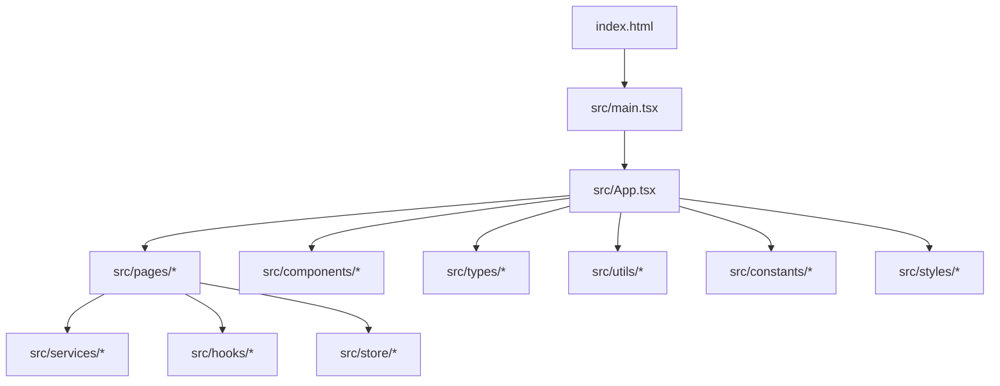
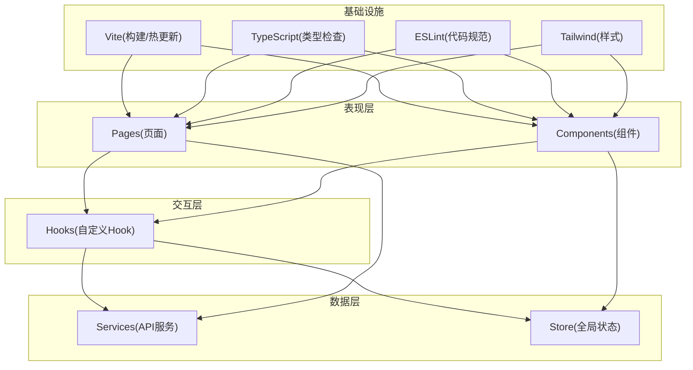
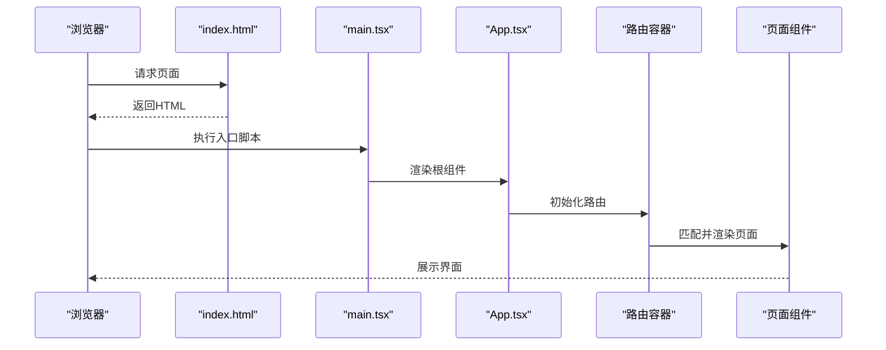
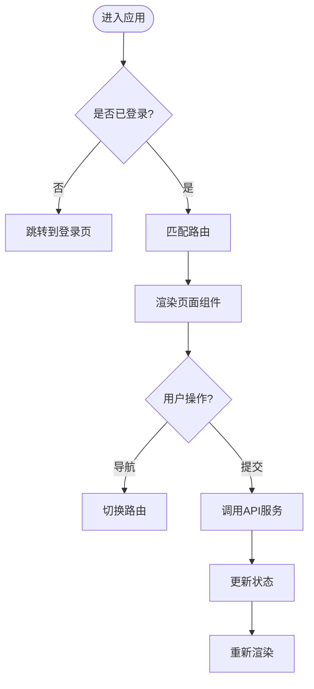
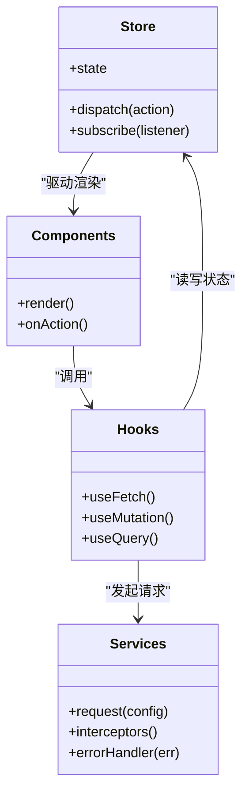
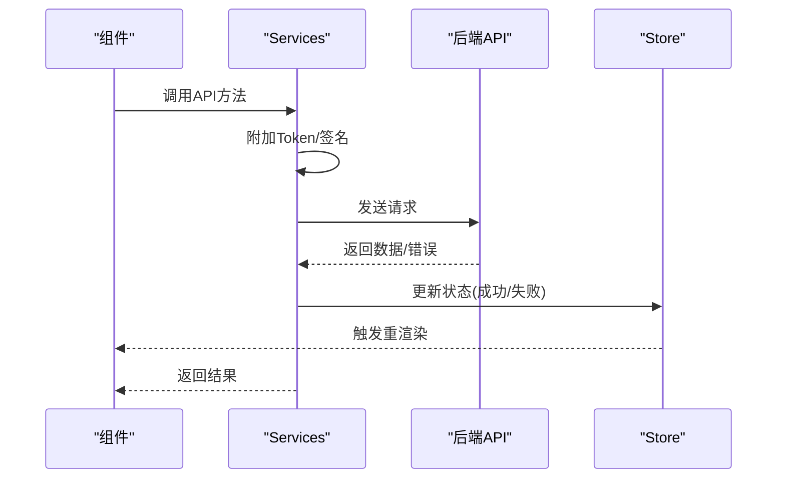
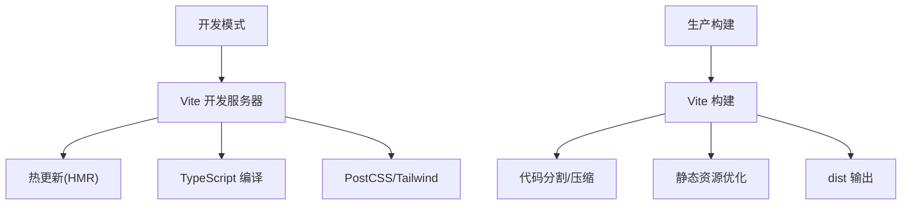
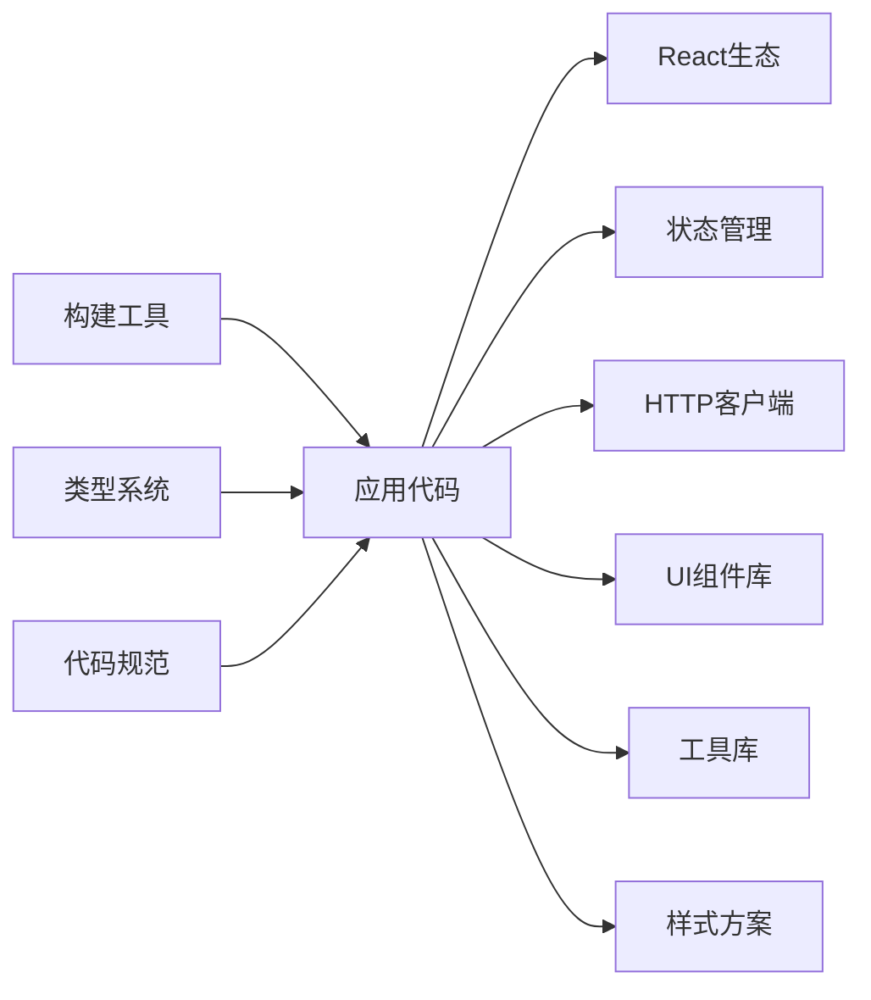

# 前端架构设计

<cite>
**本文引用的文件**   
- [frontend/package.json](file://frontend/package.json)
- [frontend/vite.config.ts](file://frontend/vite.config.ts)
- [frontend/tsconfig.json](file://frontend/tsconfig.json)
- [frontend/tsconfig.dev.json](file://frontend/tsconfig.dev.json)
- [frontend/tsconfig.node.json](file://frontend/tsconfig.node.json)
- [frontend/postcss.config.js](file://frontend/postcss.config.js)
- [frontend/tailwind.config.js](file://frontend/tailwind.config.js)
- [frontend/index.html](file://frontend/index.html)
- [frontend/Dockerfile](file://frontend/Dockerfile)
- [frontend/frontend.nginx.conf](file://frontend/frontend.nginx.conf)
- [frontend/src/main.tsx](file://frontend/src/main.tsx)
- [frontend/src/App.tsx](file://frontend/src/App.tsx)
- [frontend/src/vite-env.d.ts](file://frontend/src/vite-env.d.ts)
- [frontend/.eslintrc.cjs](file://frontend/.eslintrc.cjs)
</cite>

## 目录
1. [简介](#简介)
2. [项目结构](#项目结构)
3. [核心组件](#核心组件)
4. [架构总览](#架构总览)
5. [详细组件分析](#详细组件分析)
6. [依赖分析](#依赖分析)
7. [性能考虑](#性能考虑)
8. [故障排查指南](#故障排查指南)
9. [结论](#结论)
10. [附录](#附录)

## 简介
本文件面向“小说创作代理系统”的前端工程，聚焦 React + Vite + TypeScript 的技术栈，系统性阐述：
- 组件层次结构与模块组织方式
- Vite 构建配置、TypeScript 配置与开发环境设置
- 路由设计与页面导航、用户流程
- 状态管理策略、数据流设计与 API 集成模式
- 项目结构规范、文件组织与代码风格
- 性能优化策略、打包配置与生产部署
- 测试框架配置、单元测试与端到端测试策略

本说明力求在技术深度与可读性之间取得平衡，既适合初学者快速上手，也便于资深开发者深入理解。

## 项目结构
前端工程位于 frontend 目录，采用现代 React + Vite + TypeScript 的模块化组织方式。关键目录与职责如下：
- src/components：可复用 UI 组件（按功能或页面维度拆分）
- src/pages：页面级组件，通常对应路由
- src/hooks：自定义 Hook，封装业务逻辑与副作用
- src/services：API 服务层，统一请求封装与错误处理
- src/store：全局状态管理（如 Redux/Zustand/Context）
- src/types：TypeScript 类型定义
- src/utils：通用工具函数
- src/constants：常量与枚举
- src/styles：样式资源（Tailwind 等）
- public：静态资源（如 vditor 编辑器资源）

图表来源
- [frontend/index.html:1-20](file://frontend/index.html#L1-L20)
- [frontend/src/main.tsx:1-40](file://frontend/src/main.tsx#L1-L40)
- [frontend/src/App.tsx:1-60](file://frontend/src/App.tsx#L1-L60)

章节来源
- [frontend/package.json:1-60](file://frontend/package.json#L1-L60)
- [frontend/index.html:1-20](file://frontend/index.html#L1-L20)
- [frontend/src/main.tsx:1-40](file://frontend/src/main.tsx#L1-L40)
- [frontend/src/App.tsx:1-60](file://frontend/src/App.tsx#L1-L60)

## 核心组件
- 应用入口与根组件
  - main.tsx：初始化 React 应用、挂载 DOM、注册全局 Provider（如路由、状态管理、主题等）
  - App.tsx：顶层布局、路由容器、全局错误边界与加载态
- 页面与路由
  - pages 下每个文件代表一个页面组件，通过路由表进行映射
- 组件库与复用
  - components 提供按钮、表单、表格、媒体播放器、编辑器等基础与业务组件
- 状态与数据流
  - store 集中管理全局状态；hooks 封装局部状态与副作用；services 统一 API 调用

章节来源
- [frontend/src/main.tsx:1-40](file://frontend/src/main.tsx#L1-L40)
- [frontend/src/App.tsx:1-60](file://frontend/src/App.tsx#L1-L60)

## 架构总览
整体采用“分层清晰、职责单一”的架构：
- 表现层：React 组件（pages/components）
- 交互层：Hooks（事件、副作用、数据订阅）
- 数据层：Store（全局状态）、Services（HTTP/WebSocket/GraphQL）
- 基础设施：Vite 构建、TypeScript 编译、ESLint/Prettier 校验、Tailwind 样式

图表来源
- [frontend/src/main.tsx:1-40](file://frontend/src/main.tsx#L1-L40)
- [frontend/src/App.tsx:1-60](file://frontend/src/App.tsx#L1-L60)
- [frontend/vite.config.ts:1-80](file://frontend/vite.config.ts#L1-L80)
- [frontend/tsconfig.json:1-40](file://frontend/tsconfig.json#L1-L40)
- [frontend/.eslintrc.cjs:1-40](file://frontend/.eslintrc.cjs#L1-L40)
- [frontend/tailwind.config.js:1-40](file://frontend/tailwind.config.js#L1-L40)

## 详细组件分析

### 应用入口与根组件
- main.tsx：创建 React 根节点、注入全局上下文（路由、状态、主题）、挂载到 index.html 的根元素
- App.tsx：定义路由容器、全局错误边界、加载骨架屏、权限守卫与国际化语言包

图表来源
- [frontend/index.html:1-20](file://frontend/index.html#L1-L20)
- [frontend/src/main.tsx:1-40](file://frontend/src/main.tsx#L1-L40)
- [frontend/src/App.tsx:1-60](file://frontend/src/App.tsx#L1-L60)

章节来源
- [frontend/src/main.tsx:1-40](file://frontend/src/main.tsx#L1-L40)
- [frontend/src/App.tsx:1-60](file://frontend/src/App.tsx#L1-L60)

### 路由设计与页面导航
- 路由表：在 App.tsx 中集中定义，支持嵌套路由、懒加载与权限控制
- 导航：使用 react-router 提供的 Link/Navigate，结合鉴权守卫实现受保护路由
- 页面跳转：在业务组件内通过 useNavigate 编程式跳转

章节来源
- [frontend/src/App.tsx:1-60](file://frontend/src/App.tsx#L1-L60)

### 状态管理与数据流
- 全局状态：store 目录统一管理（如用户信息、项目列表、生成任务进度）
- 局部状态：组件内部 useState/useReducer，复杂副作用用 useEffect/useCallback
- 异步数据：services 封装 fetch/axios，统一拦截器处理 token、错误码、重试
- 数据流：单向数据流，组件触发 action -> store 更新 -> 订阅方重渲染

图表来源
- [frontend/src/store/*](file://frontend/src/store)
- [frontend/src/services/*](file://frontend/src/services)
- [frontend/src/hooks/*](file://frontend/src/hooks)
- [frontend/src/components/*](file://frontend/src/components)

章节来源
- [frontend/src/store/*](file://frontend/src/store)
- [frontend/src/services/*](file://frontend/src/services)
- [frontend/src/hooks/*](file://frontend/src/hooks)

### API 集成模式
- 统一请求封装：services 中封装 HTTP 客户端，统一处理 BaseURL、Headers、超时、重试
- 错误处理：统一拦截 401/403/5xx，提示用户并引导重试或退出
- 缓存策略：对读多写少的接口启用内存/本地缓存，减少重复请求
- WebSocket：用于实时任务进度、聊天、音视频流等场景

图表来源
- [frontend/src/services/*](file://frontend/src/services)
- [frontend/src/store/*](file://frontend/src/store)

章节来源
- [frontend/src/services/*](file://frontend/src/services)
- [frontend/src/store/*](file://frontend/src/store)

### 构建与开发环境
- Vite 配置：vite.config.ts 定义开发服务器、插件、别名、代理、构建产物
- TypeScript 配置：tsconfig.json 主配置，tsconfig.dev.json 开发增强，tsconfig.node.json Node 环境
- PostCSS/Tailwind：postcss.config.js 与 tailwind.config.js 管理样式链
- ESLint：.eslintrc.cjs 统一代码风格与规则

图表来源
- [frontend/vite.config.ts:1-80](file://frontend/vite.config.ts#L1-L80)
- [frontend/tsconfig.json:1-40](file://frontend/tsconfig.json#L1-L40)
- [frontend/tsconfig.dev.json:1-40](file://frontend/tsconfig.dev.json#L1-L40)
- [frontend/tsconfig.node.json:1-40](file://frontend/tsconfig.node.json#L1-L40)
- [frontend/postcss.config.js:1-40](file://frontend/postcss.config.js#L1-L40)
- [frontend/tailwind.config.js:1-40](file://frontend/tailwind.config.js#L1-L40)
- [frontend/.eslintrc.cjs:1-40](file://frontend/.eslintrc.cjs#L1-L40)

章节来源
- [frontend/vite.config.ts:1-80](file://frontend/vite.config.ts#L1-L80)
- [frontend/tsconfig.json:1-40](file://frontend/tsconfig.json#L1-L40)
- [frontend/tsconfig.dev.json:1-40](file://frontend/tsconfig.dev.json#L1-L40)
- [frontend/tsconfig.node.json:1-40](file://frontend/tsconfig.node.json#L1-L40)
- [frontend/postcss.config.js:1-40](file://frontend/postcss.config.js#L1-L40)
- [frontend/tailwind.config.js:1-40](file://frontend/tailwind.config.js#L1-L40)
- [frontend/.eslintrc.cjs:1-40](file://frontend/.eslintrc.cjs#L1-L40)

### 页面与组件组织
- 页面组件：按业务域划分（如项目管理、章节编辑、素材库、工作流），每个页面包含独立的状态与 API 调用
- 组件拆分：将大页面拆分为子组件，提升复用性与可测试性
- 样式策略：优先 Tailwind 原子类，必要时引入 CSS Modules 或 styled-components

章节来源
- [frontend/src/pages/*](file://frontend/src/pages)
- [frontend/src/components/*](file://frontend/src/components)

### 类型系统与契约
- types 目录集中定义接口、DTO、枚举，确保前后端契约一致
- vite-env.d.ts 声明 Vite 环境变量与模块类型

章节来源
- [frontend/src/types/*](file://frontend/src/types)
- [frontend/src/vite-env.d.ts:1-40](file://frontend/src/vite-env.d.ts#L1-L40)

## 依赖分析
- 运行时依赖：React、React Router、状态管理库（Redux/Zustand/MobX）、HTTP 客户端（Axios/Fetch）、UI 库（AntD/MUI/Headless UI）
- 开发依赖：Vite、TypeScript、ESLint、Prettier、PostCSS、Tailwind、测试框架（Jest/Vitest/Cypress）
- 构建产物：静态资源与 JS/CSS 按需分包，支持 CDN 与缓存策略

图表来源
- [frontend/package.json:1-120](file://frontend/package.json#L1-L120)

章节来源
- [frontend/package.json:1-120](file://frontend/package.json#L1-L120)

## 性能考虑
- 代码分割与懒加载：路由级与组件级懒加载，减少首屏体积
- 资源优化：图片 WebP/AVIF、字体子集化、静态资源哈希与长期缓存
- 构建优化：开启 Tree-shaking、压缩、并行构建、依赖预构建
- 运行时优化：虚拟列表、防抖节流、请求去重、错误重试与降级
- 监控与度量：接入性能埋点与错误上报，持续优化

[本节为通用指导，不直接分析具体文件]

## 故障排查指南
- 启动失败：检查端口占用、Node 版本、依赖安装与环境变量
- 构建失败：查看 TypeScript 错误、ESLint 规则、Vite 插件冲突
- 运行时错误：定位组件堆栈、网络请求失败、状态不一致
- 性能问题：使用浏览器性能面板、Webpack/Vite 分析工具定位瓶颈

章节来源
- [frontend/.eslintrc.cjs:1-40](file://frontend/.eslintrc.cjs#L1-L40)
- [frontend/vite.config.ts:1-80](file://frontend/vite.config.ts#L1-L80)

## 结论
本前端工程以 React + Vite + TypeScript 为核心，采用清晰的层次化架构与模块化组织，配合完善的构建、类型与代码规范体系，支撑小说创作代理系统的复杂业务需求。通过合理的状态管理、API 集成与性能优化策略，可实现高可用、易维护与可扩展的前端体验。

[本节为总结性内容，不直接分析具体文件]

## 附录

### 开发与部署
- 开发环境：npm/yarn/pnpm 安装依赖，启动 Vite 开发服务器，启用热更新与调试
- 生产构建：运行构建命令，产出 dist 目录，部署至 Nginx/CDN
- Docker 部署：基于官方镜像构建前端容器，反向代理与静态资源托管

章节来源
- [frontend/Dockerfile:1-60](file://frontend/Dockerfile#L1-L60)
- [frontend/frontend.nginx.conf:1-60](file://frontend/frontend.nginx.conf#L1-L60)

### 测试策略
- 单元测试：针对工具函数、Hooks、组件片段进行断言
- 组件测试：模拟渲染与交互，验证 UI 行为
- 端到端测试：模拟真实用户流程，覆盖关键路径
- 持续集成：在 CI 中执行 lint、类型检查、测试与构建

[本节为通用指导，不直接分析具体文件]