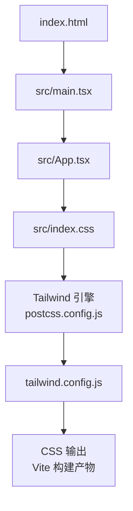
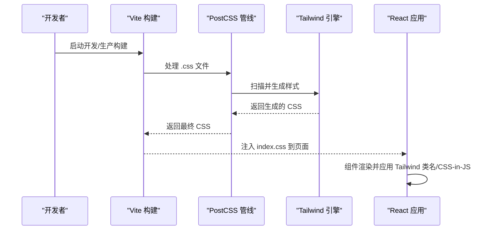
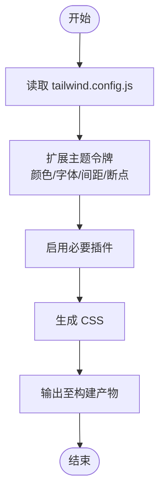
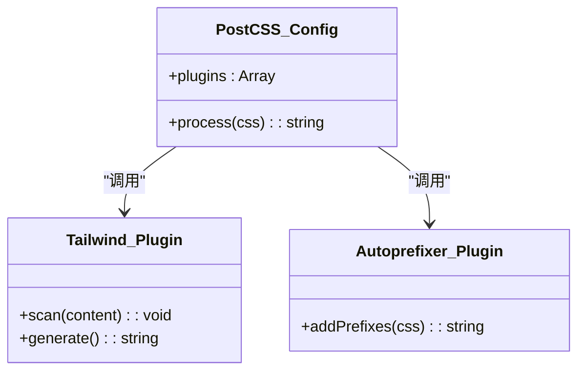
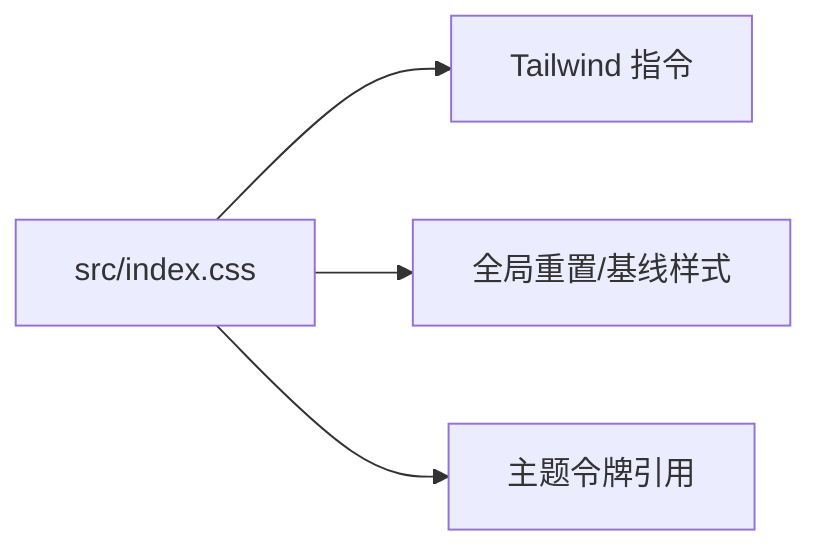
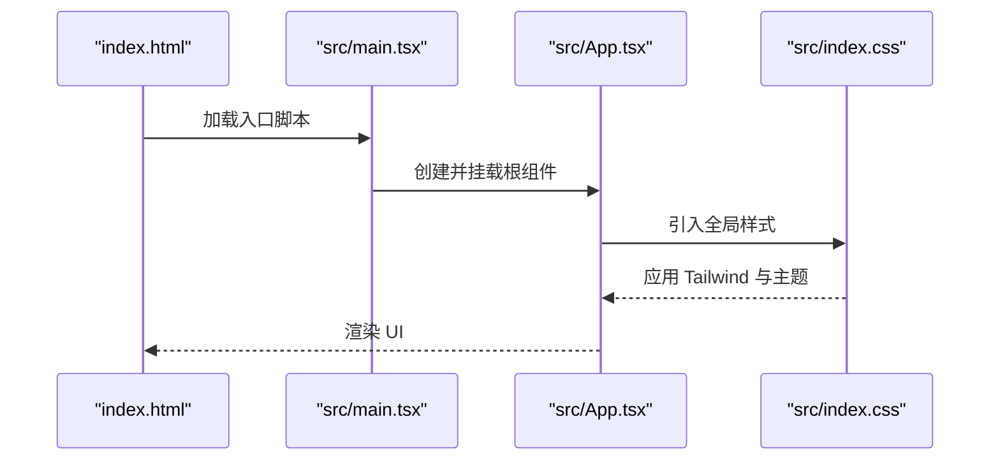
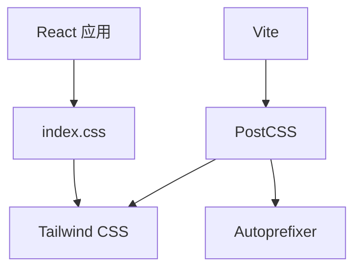

# 样式与主题

<cite>
**本文引用的文件**   
- [frontend/tailwind.config.js](file://frontend/tailwind.config.js)
- [frontend/postcss.config.js](file://frontend/postcss.config.js)
- [frontend/index.html](file://frontend/index.html)
- [frontend/src/index.css](file://frontend/src/index.css)
- [frontend/src/App.tsx](file://frontend/src/App.tsx)
- [frontend/src/main.tsx](file://frontend/src/main.tsx)
- [frontend/package.json](file://frontend/package.json)
</cite>

## 目录
1. [简介](#简介)
2. [项目结构](#项目结构)
3. [核心组件](#核心组件)
4. [架构总览](#架构总览)
5. [详细组件分析](#详细组件分析)
6. [依赖分析](#依赖分析)
7. [性能考虑](#性能考虑)
8. [故障排查指南](#故障排查指南)
9. [结论](#结论)
10. [附录](#附录) 

## 简介
本文件面向小说创作代理系统的前端样式系统，聚焦 Tailwind CSS 的配置与使用模式、CSS 模块化与组织规范、响应式与移动端适配、跨浏览器兼容性、动画与微交互实现、样式性能优化、CSS-in-JS 实践、调试技巧、主题定制（含暗色模式）以及无障碍访问优化。文档以仓库中前端代码为依据，提供可操作的指导与最佳实践。

## 项目结构
前端采用 Vite + React + TypeScript 技术栈，样式体系基于 Tailwind CSS 构建，PostCSS 作为构建管线的一部分。关键样式相关文件如下：
- 构建与工具链配置：postcss.config.js、package.json
- Tailwind 配置：tailwind.config.js
- 全局样式入口：index.html、src/index.css
- 应用根组件与入口脚本：src/App.tsx、src/main.tsx

图表来源 
- [frontend/index.html:1-50](file://frontend/index.html#L1-L50)
- [frontend/src/main.tsx:1-50](file://frontend/src/main.tsx#L1-L50)
- [frontend/src/App.tsx:1-50](file://frontend/src/App.tsx#L1-L50)
- [frontend/src/index.css:1-50](file://frontend/src/index.css#L1-L50)
- [frontend/postcss.config.js:1-50](file://frontend/postcss.config.js#L1-L50)
- [frontend/tailwind.config.js:1-50](file://frontend/tailwind.config.js#L1-L50)

章节来源
- [frontend/index.html:1-50](file://frontend/index.html#L1-L50)
- [frontend/src/main.tsx:1-50](file://frontend/src/main.tsx#L1-L50)
- [frontend/src/App.tsx:1-50](file://frontend/src/App.tsx#L1-L50)
- [frontend/src/index.css:1-50](file://frontend/src/index.css#L1-L50)
- [frontend/postcss.config.js:1-50](file://frontend/postcss.config.js#L1-L50)
- [frontend/tailwind.config.js:1-50](file://frontend/tailwind.config.js#L1-L50)

## 核心组件
- Tailwind 配置中心：集中定义主题扩展（颜色、字体、间距、断点等）、插件与生成策略。
- PostCSS 管线：串联 Tailwind、Autoprefixer、可能的其他插件，确保构建时生成兼容的 CSS。
- 全局样式入口：通过 index.css 引入 Tailwind 指令与全局样式，统一样式基线。
- 应用入口：main.tsx 初始化 React 应用，App.tsx 作为根组件挂载样式上下文与路由/状态。

章节来源
- [frontend/tailwind.config.js:1-50](file://frontend/tailwind.config.js#L1-L50)
- [frontend/postcss.config.js:1-50](file://frontend/postcss.config.js#L1-L50)
- [frontend/src/index.css:1-50](file://frontend/src/index.css#L1-L50)
- [frontend/src/main.tsx:1-50](file://frontend/src/main.tsx#L1-L50)
- [frontend/src/App.tsx:1-50](file://frontend/src/App.tsx#L1-L50)

## 架构总览
样式系统在构建期由 Vite 驱动，PostCSS 调用 Tailwind 扫描模板与样式文件，按需生成 CSS；运行时通过 index.css 注入全局样式，React 组件通过 Tailwind 类名或 CSS-in-JS 组合样式。

图表来源 
- [frontend/postcss.config.js:1-50](file://frontend/postcss.config.js#L1-L50)
- [frontend/tailwind.config.js:1-50](file://frontend/tailwind.config.js#L1-L50)
- [frontend/src/index.css:1-50](file://frontend/src/index.css#L1-L50)
- [frontend/src/main.tsx:1-50](file://frontend/src/main.tsx#L1-L50)
- [frontend/src/App.tsx:1-50](file://frontend/src/App.tsx#L1-L50)

## 详细组件分析

### Tailwind 配置与主题系统
- 自定义主题：在 tailwind.config.js 中扩展颜色、字体、间距、圆角、阴影、断点等，形成统一的设计令牌。
- 颜色系统：建议将品牌色、语义色（成功、警告、错误）与中性色分层管理，便于维护与复用。
- 字体配置：定义字族、行高、字号阶梯，保证可读性与一致性。
- 插件与功能：根据需求启用插件（如 forms、typography），避免不必要的体积膨胀。

图表来源 
- [frontend/tailwind.config.js:1-50](file://frontend/tailwind.config.js#L1-L50)

章节来源
- [frontend/tailwind.config.js:1-50](file://frontend/tailwind.config.js#L1-L50)

### PostCSS 管线与构建集成
- postcss.config.js 负责串联 Tailwind、Autoprefixer 等插件，确保跨浏览器兼容。
- 推荐开启 Purge/Tailwind 的 content 扫描，仅生成用到的样式，减小包体。
- 开发环境可启用 source map 提升调试体验。

图表来源 
- [frontend/postcss.config.js:1-50](file://frontend/postcss.config.js#L1-L50)

章节来源
- [frontend/postcss.config.js:1-50](file://frontend/postcss.config.js#L1-L50)

### 全局样式入口与模块化
- src/index.css 作为全局样式入口，引入 Tailwind 指令与基础重置。
- 组件级样式建议使用 Tailwind 类名组合，必要时以模块化的方式组织（如按功能域拆分）。
- 命名规范：优先使用语义化类名（如 btn-primary、card-header），避免硬编码值。

图表来源 
- [frontend/src/index.css:1-50](file://frontend/src/index.css#L1-L50)

章节来源
- [frontend/src/index.css:1-50](file://frontend/src/index.css#L1-L50)

### 应用入口与样式加载流程
- main.tsx 初始化应用并挂载根组件。
- App.tsx 作为根组件，负责布局与样式上下文（如主题切换、暗色模式）。
- index.html 引入构建后的 CSS，确保样式在首屏可用。

图表来源 
- [frontend/index.html:1-50](file://frontend/index.html#L1-L50)
- [frontend/src/main.tsx:1-50](file://frontend/src/main.tsx#L1-L50)
- [frontend/src/App.tsx:1-50](file://frontend/src/App.tsx#L1-L50)
- [frontend/src/index.css:1-50](file://frontend/src/index.css#L1-L50)

章节来源
- [frontend/index.html:1-50](file://frontend/index.html#L1-L50)
- [frontend/src/main.tsx:1-50](file://frontend/src/main.tsx#L1-L50)
- [frontend/src/App.tsx:1-50](file://frontend/src/App.tsx#L1-L50)
- [frontend/src/index.css:1-50](file://frontend/src/index.css#L1-L50)

### 响应式设计与移动端适配
- 断点策略：在 tailwind.config.js 中定义断点，遵循移动优先原则。
- 布局适配：使用栅格与弹性布局，结合 Tailwind 的响应式前缀（sm/md/lg/xl）进行适配。
- 触摸友好：按钮与输入控件尺寸满足触控要求，避免过小点击区域。

章节来源
- [frontend/tailwind.config.js:1-50](file://frontend/tailwind.config.js#L1-L50)

### 动画效果与微交互
- 过渡动画：使用 Tailwind 的 transition-* 与 animate-* 类实现平滑过渡与入场效果。
- 微交互：悬停、焦点、激活状态通过 hover/focus/active 伪类与 Tailwind 变体控制。
- 性能优化：优先使用 transform 与 opacity 动画，避免触发重排。

章节来源
- [frontend/src/index.css:1-50](file://frontend/src/index.css#L1-L50)
- [frontend/tailwind.config.js:1-50](file://frontend/tailwind.config.js#L1-L50)

### 跨浏览器兼容性
- Autoprefixer：在 postcss.config.js 中启用，自动添加厂商前缀。
- 特性检测：对高级 CSS 特性进行降级处理，确保旧版浏览器可用。
- 测试矩阵：覆盖主流浏览器版本，验证样式一致性与功能可用性。

章节来源
- [frontend/postcss.config.js:1-50](file://frontend/postcss.config.js#L1-L50)

### 样式性能优化
- 按需生成：配置 Tailwind 的 content 扫描，减少未使用样式。
- 压缩与缓存：生产环境启用 CSS 压缩与长效缓存。
- 资源拆分：将关键样式内联，非关键样式延迟加载。

章节来源
- [frontend/tailwind.config.js:1-50](file://frontend/tailwind.config.js#L1-L50)
- [frontend/postcss.config.js:1-50](file://frontend/postcss.config.js#L1-L50)

### CSS-in-JS 使用与实践
- 动态样式：在 React 组件中使用 CSS-in-JS 库（如 styled-components、emotion）处理条件样式与主题绑定。
- 与 Tailwind 协作：静态样式用 Tailwind，动态逻辑用 CSS-in-JS，避免冲突。
- 性能考量：避免频繁重新计算样式，使用 memoization 优化渲染。

章节来源
- [frontend/src/App.tsx:1-50](file://frontend/src/App.tsx#L1-L50)
- [frontend/package.json:1-50](file://frontend/package.json#L1-L50)

### 主题定制与暗色模式支持
- 主题令牌：在 tailwind.config.js 中定义明暗两套颜色变量，通过 data-theme 或 class 切换。
- 暗色模式：使用 Tailwind 的 dark: 前缀或 prefers-color-scheme 媒体查询实现。
- 用户偏好：提供设置面板允许用户切换主题，持久化选择。

章节来源
- [frontend/tailwind.config.js:1-50](file://frontend/tailwind.config.js#L1-L50)
- [frontend/src/App.tsx:1-50](file://frontend/src/App.tsx#L1-L50)

### 无障碍访问优化
- 对比度：确保文本与背景对比度符合 WCAG 标准。
- 键盘导航：为交互元素提供清晰的焦点样式与 Tab 顺序。
- 屏幕阅读器：使用 aria-* 属性增强语义描述。

章节来源
- [frontend/src/index.css:1-50](file://frontend/src/index.css#L1-L50)
- [frontend/src/App.tsx:1-50](file://frontend/src/App.tsx#L1-L50)

## 依赖分析
样式系统的依赖关系如下：
- Vite 作为构建工具，调用 PostCSS 处理 CSS。
- PostCSS 依赖 Tailwind 与 Autoprefixer 等插件。
- React 应用通过 index.css 引入样式，组件使用 Tailwind 类名或 CSS-in-JS。

图表来源 
- [frontend/package.json:1-50](file://frontend/package.json#L1-L50)
- [frontend/postcss.config.js:1-50](file://frontend/postcss.config.js#L1-L50)
- [frontend/tailwind.config.js:1-50](file://frontend/tailwind.config.js#L1-L50)
- [frontend/src/index.css:1-50](file://frontend/src/index.css#L1-L50)

章节来源
- [frontend/package.json:1-50](file://frontend/package.json#L1-L50)
- [frontend/postcss.config.js:1-50](file://frontend/postcss.config.js#L1-L50)
- [frontend/tailwind.config.js:1-50](file://frontend/tailwind.config.js#L1-L50)
- [frontend/src/index.css:1-50](file://frontend/src/index.css#L1-L50)

## 性能考虑
- 构建优化：启用 Tailwind 的 content 扫描与 CSS 压缩，减少包体大小。
- 运行时优化：避免过度使用复杂选择器与动画，优先使用 GPU 加速的属性。
- 缓存策略：对静态资源启用长效缓存，提高加载速度。

## 故障排查指南
- 样式未生效：检查 Tailwind 的 content 配置是否包含相关路径，确认 index.css 已正确引入。
- 动画卡顿：审查动画属性，避免触发重排，优先使用 transform 与 opacity。
- 主题切换无效：确认数据属性或类名切换逻辑正确，检查 CSS 变量是否更新。
- 浏览器兼容问题：查看 Autoprefixer 配置，确保目标浏览器列表正确。

章节来源
- [frontend/tailwind.config.js:1-50](file://frontend/tailwind.config.js#L1-L50)
- [frontend/postcss.config.js:1-50](file://frontend/postcss.config.js#L1-L50)
- [frontend/src/index.css:1-50](file://frontend/src/index.css#L1-L50)

## 结论
本样式系统以 Tailwind CSS 为核心，结合 PostCSS 与 Vite 构建管线，实现了高效、可维护且跨平台一致的样式方案。通过主题定制、响应式设计与动画优化，满足了小说创作代理系统的多样化需求。遵循本文档的最佳实践，可进一步提升样式质量与用户体验。

## 附录
- 术语表：Tailwind CSS、PostCSS、CSS-in-JS、WCAG、Autoprefixer
- 参考链接：Tailwind 官方文档、PostCSS 插件生态、React 样式最佳实践