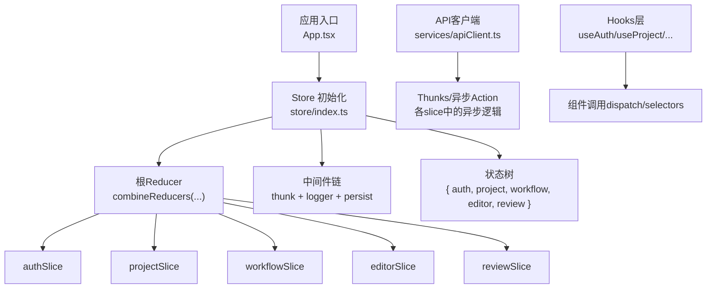
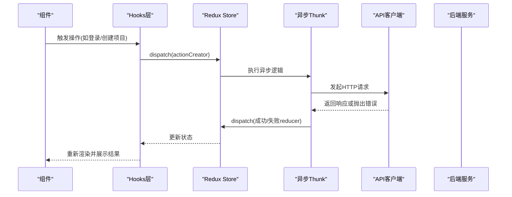
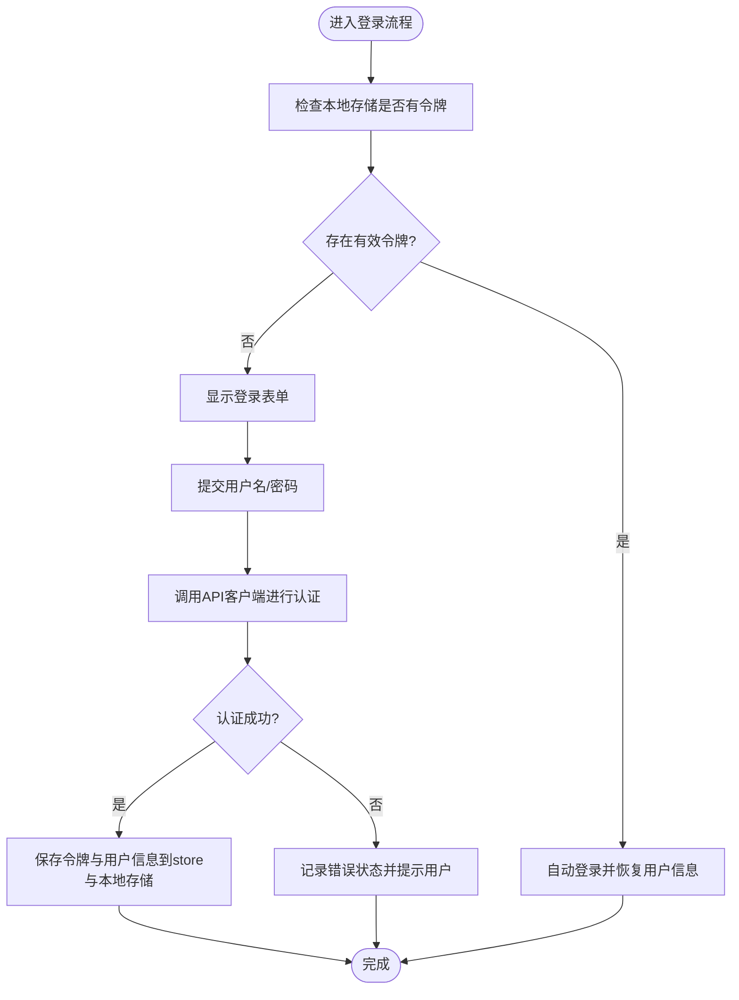
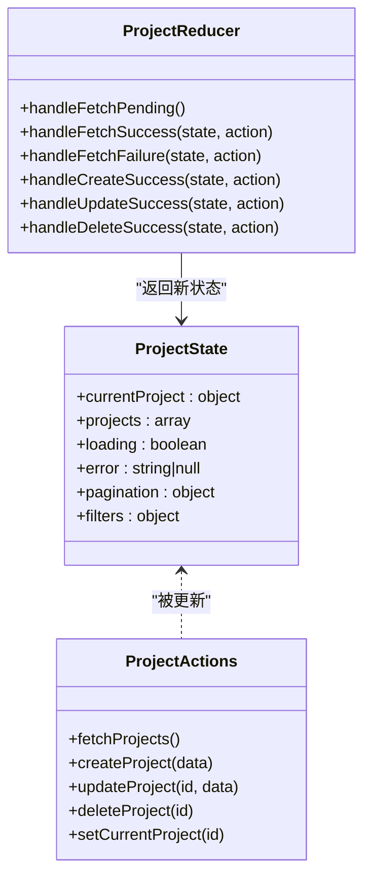
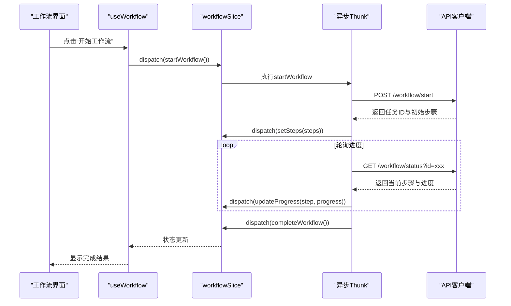
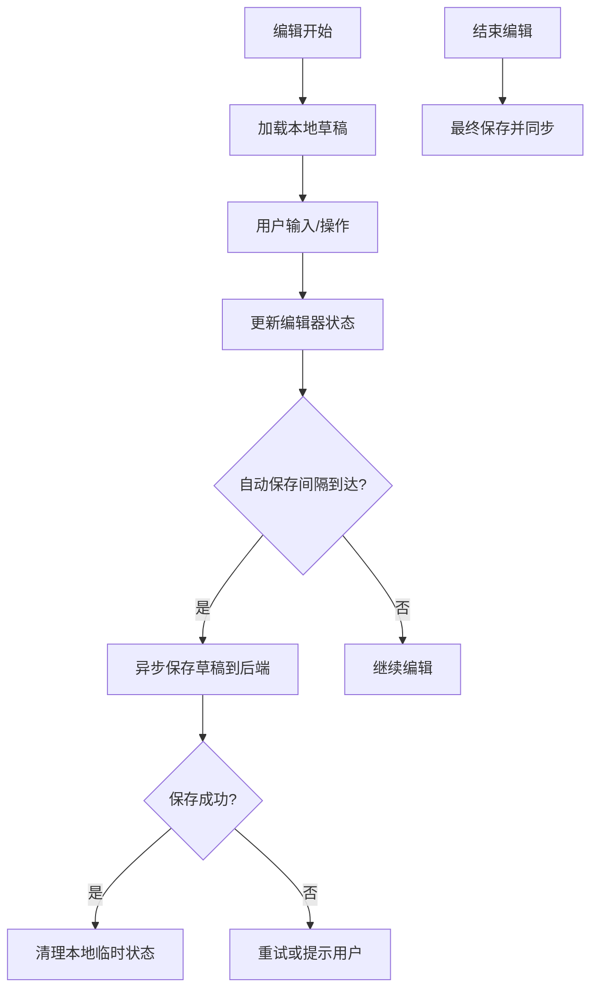
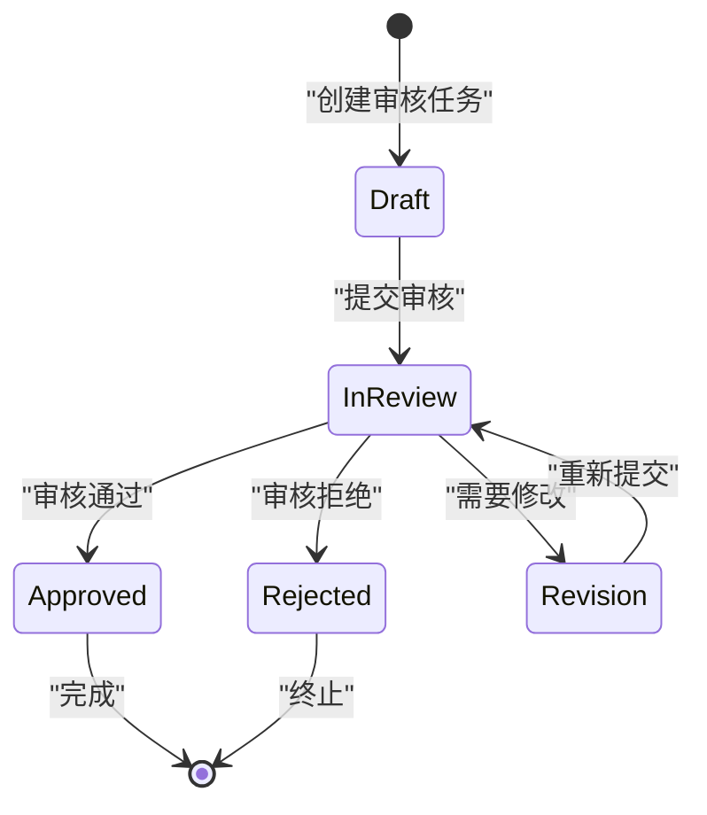
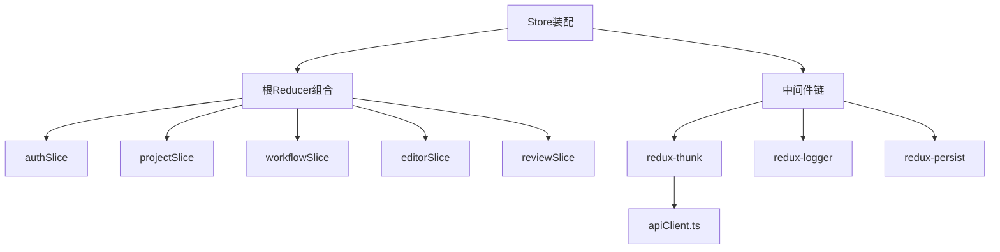

# Redux Store架构

<cite>
**本文引用的文件**   
- [frontend/src/store/index.ts](file://frontend/src/store/index.ts)
- [frontend/src/store/slices/authSlice.ts](file://frontend/src/store/slices/authSlice.ts)
- [frontend/src/store/slices/projectSlice.ts](file://frontend/src/store/slices/projectSlice.ts)
- [frontend/src/store/slices/workflowSlice.ts](file://frontend/src/store/slices/workflowSlice.ts)
- [frontend/src/store/slices/editorSlice.ts](file://frontend/src/store/slices/editorSlice.ts)
- [frontend/src/store/slices/reviewSlice.ts](file://frontend/src/store/slices/reviewSlice.ts)
- [frontend/src/services/apiClient.ts](file://frontend/src/services/apiClient.ts)
- [frontend/src/hooks/useAuth.ts](file://frontend/src/hooks/useAuth.ts)
- [frontend/src/hooks/useProject.ts](file://frontend/src/hooks/useProject.ts)
- [frontend/src/hooks/useWorkflow.ts](file://frontend/src/hooks/useWorkflow.ts)
- [frontend/src/hooks/useEditor.ts](file://frontend/src/hooks/useEditor.ts)
- [frontend/src/hooks/useReview.ts](file://frontend/src/hooks/useReview.ts)
</cite>

## 目录
1. [简介](#简介)
2. [项目结构](#项目结构)
3. [核心组件](#核心组件)
4. [架构总览](#架构总览)
5. [详细组件分析](#详细组件分析)
6. [依赖分析](#依赖分析)
7. [性能考虑](#性能考虑)
8. [故障排查指南](#故障排查指南)
9. [结论](#结论)
10. [附录](#附录)

## 简介
本技术文档面向小说创作代理系统的前端Redux Store架构，聚焦于store初始化配置、中间件集成与状态树结构设计。文档围绕以下slice展开：认证（auth）、项目（project）、工作流（workflow）、编辑器（editor）与审核（review）。内容涵盖action creators设计模式、reducer实现方式、state结构优化、异步处理、错误管理与持久化策略，并提供调试工具使用、性能监控与内存优化技巧，以及最佳实践与常见陷阱规避建议。

## 项目结构
前端采用基于功能域的slice组织方式，每个slice负责一个业务域的状态管理，包含reducer、action creators与thunk异步逻辑。Store入口统一装配根reducer、中间件与持久化插件，并通过自定义hooks暴露到组件层。

**图表来源** 
- [frontend/src/store/index.ts](file://frontend/src/store/index.ts)
- [frontend/src/services/apiClient.ts](file://frontend/src/services/apiClient.ts)

**章节来源**
- [frontend/src/store/index.ts](file://frontend/src/store/index.ts)
- [frontend/src/services/apiClient.ts](file://frontend/src/services/apiClient.ts)

## 核心组件
- Store初始化与装配：集中定义根reducer组合、中间件链（thunk、日志、持久化等），并导出store实例供全局注入。
- Slice模块：按领域划分，每个slice提供初始状态、同步reducer与异步thunk，封装该领域的状态变更与副作用。
- API客户端：统一封装HTTP请求、错误处理与重试策略，供thunk调用。
- Hooks层：通过react-redux的useSelector与useDispatch封装常用选择器与动作派发，简化组件使用。

**章节来源**
- [frontend/src/store/index.ts](file://frontend/src/store/index.ts)
- [frontend/src/store/slices/authSlice.ts](file://frontend/src/store/slices/authSlice.ts)
- [frontend/src/store/slices/projectSlice.ts](file://frontend/src/store/slices/projectSlice.ts)
- [frontend/src/store/slices/workflowSlice.ts](file://frontend/src/store/slices/workflowSlice.ts)
- [frontend/src/store/slices/editorSlice.ts](file://frontend/src/store/slices/editorSlice.ts)
- [frontend/src/store/slices/reviewSlice.ts](file://frontend/src/store/slices/reviewSlice.ts)
- [frontend/src/services/apiClient.ts](file://frontend/src/services/apiClient.ts)
- [frontend/src/hooks/useAuth.ts](file://frontend/src/hooks/useAuth.ts)
- [frontend/src/hooks/useProject.ts](file://frontend/src/hooks/useProject.ts)
- [frontend/src/hooks/useWorkflow.ts](file://frontend/src/hooks/useWorkflow.ts)
- [frontend/src/hooks/useEditor.ts](file://frontend/src/hooks/useEditor.ts)
- [frontend/src/hooks/useReview.ts](file://frontend/src/hooks/useReview.ts)

## 架构总览
下图展示了从组件到store再到后端API的完整数据流，包括异步流程与错误处理路径。

**图表来源** 
- [frontend/src/store/index.ts](file://frontend/src/store/index.ts)
- [frontend/src/services/apiClient.ts](file://frontend/src/services/apiClient.ts)
- [frontend/src/hooks/useAuth.ts](file://frontend/src/hooks/useAuth.ts)
- [frontend/src/hooks/useProject.ts](file://frontend/src/hooks/useProject.ts)

## 详细组件分析

### Store初始化与中间件
- 根reducer组合：将各slice的reducer合并为单一状态树，便于类型推导与选择性订阅。
- 中间件链：
  - thunk：支持异步action creators，封装网络请求与状态更新。
  - logger：开发环境下打印dispatch与state变化，便于调试。
  - 持久化：将关键状态（如认证token、用户偏好）序列化至本地存储，并在应用重启时恢复。
- 根state结构：{ auth, project, workflow, editor, review }，每个字段对应一个slice。

**章节来源**
- [frontend/src/store/index.ts](file://frontend/src/store/index.ts)

### authSlice（认证状态）
- 状态结构：包含用户信息、认证令牌、加载状态与错误信息。
- action creators：
  - 同步：设置用户信息、清除认证状态。
  - 异步：登录、注册、刷新令牌、退出登录。
- reducer实现：根据action类型更新认证相关字段，确保不可变更新。
- 错误处理：捕获网络异常与服务器错误，填充错误状态以便UI提示。
- 持久化：令牌与用户信息在本地存储中持久化，避免重复登录。

**图表来源** 
- [frontend/src/store/slices/authSlice.ts](file://frontend/src/store/slices/authSlice.ts)
- [frontend/src/services/apiClient.ts](file://frontend/src/services/apiClient.ts)

**章节来源**
- [frontend/src/store/slices/authSlice.ts](file://frontend/src/store/slices/authSlice.ts)
- [frontend/src/hooks/useAuth.ts](file://frontend/src/hooks/useAuth.ts)

### projectSlice（项目状态）
- 状态结构：当前项目、项目列表、加载状态、错误信息、分页与筛选参数。
- action creators：
  - 同步：切换当前项目、更新项目元数据。
  - 异步：获取项目列表、创建项目、更新项目设置、删除项目。
- reducer实现：维护项目集合与当前选中项，支持增量更新与缓存失效。
- 错误处理：区分网络错误与业务错误，提供用户友好的提示。
- 持久化：可选持久化最近访问的项目ID与筛选条件。

**图表来源** 
- [frontend/src/store/slices/projectSlice.ts](file://frontend/src/store/slices/projectSlice.ts)

**章节来源**
- [frontend/src/store/slices/projectSlice.ts](file://frontend/src/store/slices/projectSlice.ts)
- [frontend/src/hooks/useProject.ts](file://frontend/src/hooks/useProject.ts)

### workflowSlice（工作流状态）
- 状态结构：工作流步骤、任务队列、进度、错误与审计日志。
- action creators：
  - 同步：添加步骤、标记完成、重置工作流。
  - 异步：启动工作流、执行下一步、取消任务、拉取进度。
- reducer实现：维护步骤顺序与依赖关系，确保状态一致性。
- 错误处理：捕获执行异常，支持重试与回滚。
- 持久化：关键步骤与进度可持久化以支持断点续跑。

**图表来源** 
- [frontend/src/store/slices/workflowSlice.ts](file://frontend/src/store/slices/workflowSlice.ts)
- [frontend/src/services/apiClient.ts](file://frontend/src/services/apiClient.ts)
- [frontend/src/hooks/useWorkflow.ts](file://frontend/src/hooks/useWorkflow.ts)

**章节来源**
- [frontend/src/store/slices/workflowSlice.ts](file://frontend/src/store/slices/workflowSlice.ts)
- [frontend/src/hooks/useWorkflow.ts](file://frontend/src/hooks/useWorkflow.ts)

### editorSlice（编辑器状态）
- 状态结构：编辑器内容、光标位置、历史记录、协作会话与冲突标记。
- action creators：
  - 同步：插入文本、删除片段、撤销/重做、合并冲突。
  - 异步：保存草稿、拉取远程版本、同步协作变更。
- reducer实现：维护内容不可变更新，支持时间旅行与差异计算。
- 错误处理：保存失败时保留本地修改并提示用户。
- 持久化：草稿与历史自动保存到本地存储。

**图表来源** 
- [frontend/src/store/slices/editorSlice.ts](file://frontend/src/store/slices/editorSlice.ts)
- [frontend/src/services/apiClient.ts](file://frontend/src/services/apiClient.ts)

**章节来源**
- [frontend/src/store/slices/editorSlice.ts](file://frontend/src/store/slices/editorSlice.ts)
- [frontend/src/hooks/useEditor.ts](file://frontend/src/hooks/useEditor.ts)

### reviewSlice（审核状态）
- 状态结构：审核任务、意见列表、评分、状态流转与审计记录。
- action creators：
  - 同步：添加意见、更新评分、切换审核状态。
  - 异步：提交审核、拉取审核结果、批量处理意见。
- reducer实现：维护审核生命周期状态机，确保状态转换合法。
- 错误处理：审核失败时保留草稿并允许重试。
- 持久化：审核草稿与历史可持久化。

**图表来源** 
- [frontend/src/store/slices/reviewSlice.ts](file://frontend/src/store/slices/reviewSlice.ts)

**章节来源**
- [frontend/src/store/slices/reviewSlice.ts](file://frontend/src/store/slices/reviewSlice.ts)
- [frontend/src/hooks/useReview.ts](file://frontend/src/hooks/useReview.ts)

## 依赖分析
- slice间耦合：通过根state组合解耦，避免直接相互引用；跨slice数据通过selectors组合读取。
- 外部依赖：API客户端统一处理网络请求，thunk仅关注业务逻辑与状态更新。
- 中间件依赖：thunk依赖redux-thunk，logger依赖redux-logger，持久化依赖redux-persist。

**图表来源** 
- [frontend/src/store/index.ts](file://frontend/src/store/index.ts)
- [frontend/src/services/apiClient.ts](file://frontend/src/services/apiClient.ts)

**章节来源**
- [frontend/src/store/index.ts](file://frontend/src/store/index.ts)
- [frontend/src/services/apiClient.ts](file://frontend/src/services/apiClient.ts)

## 性能考虑
- 选择性订阅：使用selectors精确订阅所需状态片段，避免全量重渲染。
- 不可变更新：确保reducer返回新对象，利用浅比较优化re-render。
- 懒加载：按需加载slice或组件，减少初始包体积。
- 去抖与节流：对高频操作（如编辑器输入）进行防抖，减少不必要的dispatch。
- 缓存策略：对只读数据（如项目列表）实施缓存与失效策略，降低重复请求。
- 内存优化：及时清理事件监听器与定时器，避免内存泄漏。

[本节为通用指导，无需特定文件来源]

## 故障排查指南
- 调试工具：启用Redux DevTools查看state快照与action历史，结合logger中间件输出详细日志。
- 常见问题：
  - 状态未更新：检查action类型是否匹配reducer case，确认dispatch是否正确。
  - 异步失败：查看API客户端错误处理与thunk中的try-catch分支。
  - 持久化异常：检查本地存储格式与版本兼容性，必要时清空缓存重建。
- 定位技巧：使用浏览器控制台过滤特定slice的日志，或通过DevTools过滤action类型。

**章节来源**
- [frontend/src/store/index.ts](file://frontend/src/store/index.ts)
- [frontend/src/services/apiClient.ts](file://frontend/src/services/apiClient.ts)

## 结论
本Redux Store架构通过清晰的slice划分、统一的中间件链与API客户端封装，实现了高内聚、低耦合的状态管理。各slice遵循一致的设计模式，便于扩展与维护。结合调试工具与性能优化策略，可有效提升开发效率与应用体验。建议在后续迭代中持续优化状态结构与异步处理逻辑，确保系统的可扩展性与稳定性。

[本节为总结性内容，无需特定文件来源]

## 附录
- 最佳实践：
  - 保持reducer纯函数特性，避免副作用。
  - 使用TypeScript严格类型定义state与action。
  - 将复杂逻辑下沉至thunk或自定义hooks。
  - 合理拆分slice，避免单片过大。
- 常见陷阱：
  - 直接修改state导致不可变更新失效。
  - 过度订阅导致不必要重渲染。
  - 忽略错误边界导致应用崩溃。
  - 持久化数据未处理版本迁移。

[本节为通用指导，无需特定文件来源]