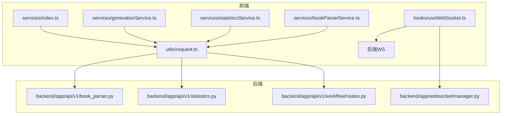
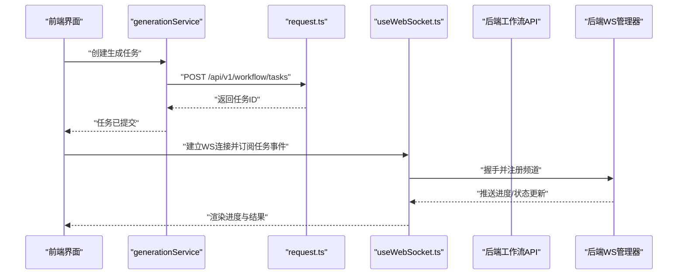
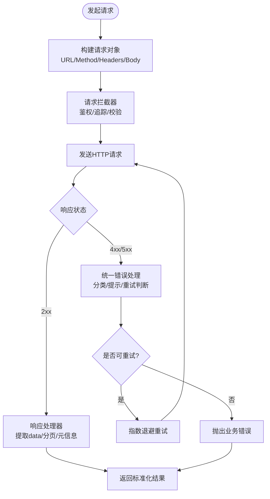
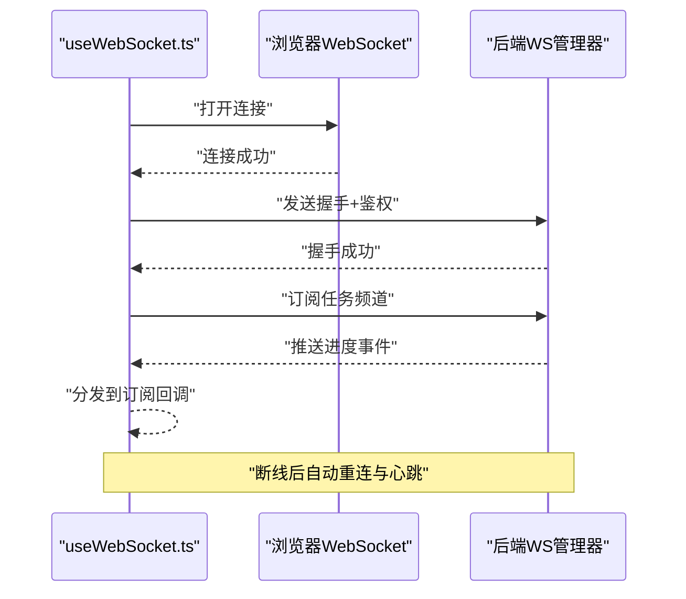
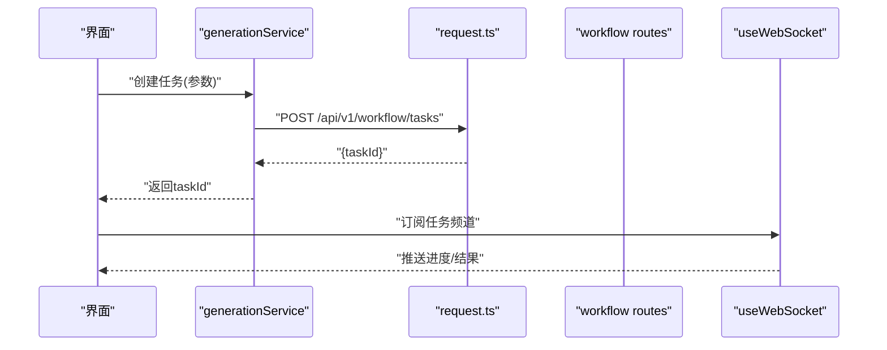
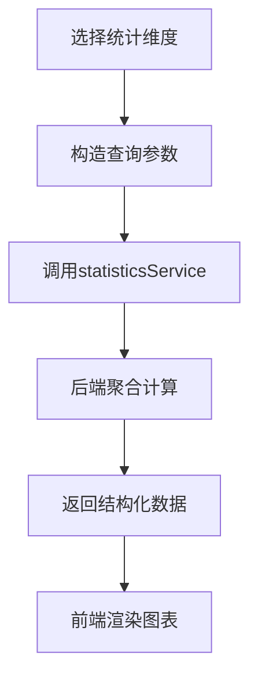
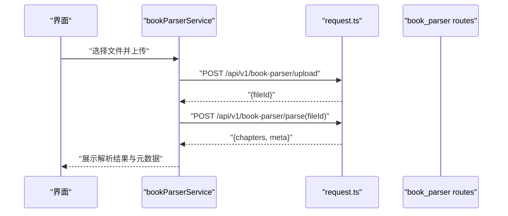
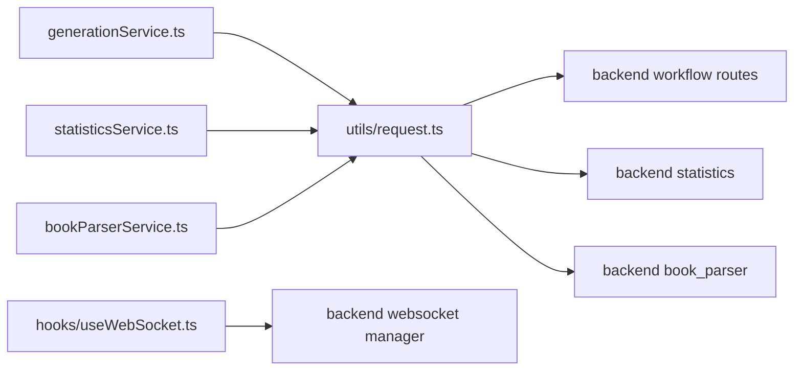

# 服务层API封装

<cite>
**本文引用的文件**   
- [frontend/src/services/index.ts](file://frontend/src/services/index.ts)
- [frontend/src/utils/request.ts](file://frontend/src/utils/request.ts)
- [frontend/src/hooks/useWebSocket.ts](file://frontend/src/hooks/useWebSocket.ts)
- [frontend/src/services/generationService.ts](file://frontend/src/services/generationService.ts)
- [frontend/src/services/statisticsService.ts](file://frontend/src/services/statisticsService.ts)
- [frontend/src/services/bookParserService.ts](file://frontend/src/services/bookParserService.ts)
- [backend/app/api/v1/book_parser.py](file://backend/app/api/v1/book_parser.py)
- [backend/app/api/v1/statistics.py](file://backend/app/api/v1/statistics.py)
- [backend/app/api/v1/workflow/routes.py](file://backend/app/api/v1/workflow/routes.py)
- [backend/app/websocket/manager.py](file://backend/app/websocket/manager.py)
</cite>

## 目录
1. [简介](#简介)
2. [项目结构](#项目结构)
3. [核心组件](#核心组件)
4. [架构总览](#架构总览)
5. [详细组件分析](#详细组件分析)
6. [依赖关系分析](#依赖关系分析)
7. [性能考量](#性能考量)
8. [故障排查指南](#故障排查指南)
9. [结论](#结论)
10. [附录](#附录)

## 简介
本技术文档面向小说创作代理系统的前端服务层API封装，聚焦以下目标：
- RESTful API封装设计：请求拦截器、响应处理器与统一错误处理
- WebSocket服务：连接管理、消息协议设计与实时通信机制
- 生成服务：任务调度、进度跟踪与结果处理
- 统计服务：数据收集、聚合计算与可视化支持
- Book Parser API：文件解析、内容分析与元数据处理
- 通用能力：API版本管理、请求重试机制、离线支持
- 非功能特性：网络优化、缓存策略与安全考虑

## 项目结构
前端服务层主要位于 frontend/src 下，关键目录与职责如下：
- services：按业务域划分的API封装（如 generationService、statisticsService、bookParserService）
- utils：通用工具（如 request.ts 提供HTTP请求封装）
- hooks：React Hooks封装（如 useWebSocket.ts 提供WebSocket生命周期管理）
- contracts：前后端契约定义（类型与接口）
- types：全局类型定义
- components/pages：页面与组件调用上述服务

图表来源
- [frontend/src/services/index.ts](file://frontend/src/services/index.ts)
- [frontend/src/utils/request.ts](file://frontend/src/utils/request.ts)
- [frontend/src/hooks/useWebSocket.ts](file://frontend/src/hooks/useWebSocket.ts)
- [backend/app/api/v1/book_parser.py](file://backend/app/api/v1/book_parser.py)
- [backend/app/api/v1/statistics.py](file://backend/app/api/v1/statistics.py)
- [backend/app/api/v1/workflow/routes.py](file://backend/app/api/v1/workflow/routes.py)
- [backend/app/websocket/manager.py](file://backend/app/websocket/manager.py)

章节来源
- [frontend/src/services/index.ts](file://frontend/src/services/index.ts)
- [frontend/src/utils/request.ts](file://frontend/src/utils/request.ts)
- [frontend/src/hooks/useWebSocket.ts](file://frontend/src/hooks/useWebSocket.ts)

## 核心组件
- HTTP请求封装（request.ts）
  - 负责基础URL、请求头、超时、重试、错误统一处理、版本前缀等
  - 提供统一的get/post/put/delete等方法，便于上层服务调用
- 服务封装（services/*）
  - generationService：封装生成任务的创建、查询、取消、进度拉取
  - statisticsService：封装统计数据的获取、过滤、聚合
  - bookParserService：封装文件上传、解析、内容分析、元数据导出
- WebSocket钩子（useWebSocket.ts）
  - 管理连接生命周期、重连、心跳、消息订阅与事件分发

章节来源
- [frontend/src/utils/request.ts](file://frontend/src/utils/request.ts)
- [frontend/src/services/generationService.ts](file://frontend/src/services/generationService.ts)
- [frontend/src/services/statisticsService.ts](file://frontend/src/services/statisticsService.ts)
- [frontend/src/services/bookParserService.ts](file://frontend/src/services/bookParserService.ts)
- [frontend/src/hooks/useWebSocket.ts](file://frontend/src/hooks/useWebSocket.ts)

## 架构总览
整体采用“前端服务层 + 后端REST/WS”的分层架构。前端通过统一的HTTP封装访问后端API；长时任务通过WebSocket进行实时推送；Book Parser、Statistics、Generation等服务分别对应后端路由模块。

图表来源
- [frontend/src/services/generationService.ts](file://frontend/src/services/generationService.ts)
- [frontend/src/utils/request.ts](file://frontend/src/utils/request.ts)
- [frontend/src/hooks/useWebSocket.ts](file://frontend/src/hooks/useWebSocket.ts)
- [backend/app/api/v1/workflow/routes.py](file://backend/app/api/v1/workflow/routes.py)
- [backend/app/websocket/manager.py](file://backend/app/websocket/manager.py)

## 详细组件分析

### REST请求封装（request.ts）
- 设计要点
  - 统一Base URL与API版本前缀（如 /api/v1）
  - 请求拦截器：注入认证头、追踪ID、时间戳、Content-Type等
  - 响应处理器：标准化成功/失败结构，提取数据体或错误信息
  - 错误统一处理：区分网络错误、业务错误、超时、权限不足等，并提供用户友好提示
  - 重试机制：对幂等GET请求或可重试错误码进行指数退避重试
  - 缓存策略：可选的内存缓存（短TTL）与浏览器缓存控制（Cache-Control）
  - 安全：敏感头清理、XSS防护、CORS配置建议
- 典型流程
  - 构建请求 -> 拦截器增强 -> 发送 -> 响应处理 -> 错误归一化 -> 返回数据

章节来源
- [frontend/src/utils/request.ts](file://frontend/src/utils/request.ts)

### WebSocket服务（useWebSocket.ts）
- 设计要点
  - 连接管理：自动连接、断线重连、心跳保活、最大重连次数
  - 消息协议：定义消息类型（连接、订阅、进度、结果、错误）、载荷结构与序列化
  - 事件分发：基于频道/主题的消息路由，避免跨任务干扰
  - 生命周期：初始化、订阅、接收、清理、错误恢复
- 典型流程
  - 建立连接 -> 鉴权握手 -> 订阅频道 -> 接收事件 -> 触发回调 -> 异常处理与重连

图表来源
- [frontend/src/hooks/useWebSocket.ts](file://frontend/src/hooks/useWebSocket.ts)
- [backend/app/websocket/manager.py](file://backend/app/websocket/manager.py)

章节来源
- [frontend/src/hooks/useWebSocket.ts](file://frontend/src/hooks/useWebSocket.ts)
- [backend/app/websocket/manager.py](file://backend/app/websocket/manager.py)

### 生成服务（generationService.ts）
- 功能范围
  - 任务创建：提交生成参数（模型、提示词、资源等）
  - 任务查询：根据任务ID获取状态与结果
  - 进度跟踪：结合WebSocket事件与轮询兜底
  - 结果处理：下载产物、预览、归档
- 与后端交互
  - REST：/api/v1/workflow/tasks（创建/查询/取消）
  - WS：任务频道的事件推送（进度、完成、失败）

图表来源
- [frontend/src/services/generationService.ts](file://frontend/src/services/generationService.ts)
- [frontend/src/utils/request.ts](file://frontend/src/utils/request.ts)
- [frontend/src/hooks/useWebSocket.ts](file://frontend/src/hooks/useWebSocket.ts)
- [backend/app/api/v1/workflow/routes.py](file://backend/app/api/v1/workflow/routes.py)

章节来源
- [frontend/src/services/generationService.ts](file://frontend/src/services/generationService.ts)
- [backend/app/api/v1/workflow/routes.py](file://backend/app/api/v1/workflow/routes.py)

### 统计服务（statisticsService.ts）
- 功能范围
  - 数据收集：从后端聚合接口获取指标（任务量、成功率、耗时分布等）
  - 聚合计算：前端二次聚合（分组、过滤、时间窗口）
  - 可视化支持：输出图表所需的数据格式（折线、柱状、饼图等）
- 与后端交互
  - REST：/api/v1/statistics（查询、过滤、聚合）

图表来源
- [frontend/src/services/statisticsService.ts](file://frontend/src/services/statisticsService.ts)
- [backend/app/api/v1/statistics.py](file://backend/app/api/v1/statistics.py)

章节来源
- [frontend/src/services/statisticsService.ts](file://frontend/src/services/statisticsService.ts)
- [backend/app/api/v1/statistics.py](file://backend/app/api/v1/statistics.py)

### Book Parser API（bookParserService.ts）
- 功能范围
  - 文件解析：支持多种格式（TXT、EPUB、PDF等），分块读取与编码检测
  - 内容分析：章节划分、段落清洗、关键词提取、摘要生成
  - 元数据处理：作者、标题、版本、标签、版权信息等
- 与后端交互
  - REST：/api/v1/book-parser（上传、解析、分析、导出）

图表来源
- [frontend/src/services/bookParserService.ts](file://frontend/src/services/bookParserService.ts)
- [frontend/src/utils/request.ts](file://frontend/src/utils/request.ts)
- [backend/app/api/v1/book_parser.py](file://backend/app/api/v1/book_parser.py)

章节来源
- [frontend/src/services/bookParserService.ts](file://frontend/src/services/bookParserService.ts)
- [backend/app/api/v1/book_parser.py](file://backend/app/api/v1/book_parser.py)

### 概念性概览
- 版本管理：所有REST接口以 /api/v1 为前缀，后续可通过 /api/v2 平滑演进
- 重试机制：针对网络抖动与临时服务端错误，采用指数退避与最大重试次数限制
- 离线支持：本地缓存关键只读数据（如模型列表、模板），在网络不可用时降级显示

[本节为概念性说明，不直接分析具体文件]

## 依赖关系分析
前端服务层依赖关系清晰，低耦合高内聚：
- services/* 依赖 utils/request.ts
- hooks/useWebSocket.ts 独立于HTTP封装，专注实时通信
- 各服务通过 contracts/types 保证前后端数据结构一致性

图表来源
- [frontend/src/services/generationService.ts](file://frontend/src/services/generationService.ts)
- [frontend/src/services/statisticsService.ts](file://frontend/src/services/statisticsService.ts)
- [frontend/src/services/bookParserService.ts](file://frontend/src/services/bookParserService.ts)
- [frontend/src/utils/request.ts](file://frontend/src/utils/request.ts)
- [frontend/src/hooks/useWebSocket.ts](file://frontend/src/hooks/useWebSocket.ts)
- [backend/app/api/v1/workflow/routes.py](file://backend/app/api/v1/workflow/routes.py)
- [backend/app/api/v1/statistics.py](file://backend/app/api/v1/statistics.py)
- [backend/app/api/v1/book_parser.py](file://backend/app/api/v1/book_parser.py)
- [backend/app/websocket/manager.py](file://backend/app/websocket/manager.py)

章节来源
- [frontend/src/services/index.ts](file://frontend/src/services/index.ts)
- [frontend/src/utils/request.ts](file://frontend/src/utils/request.ts)
- [frontend/src/hooks/useWebSocket.ts](file://frontend/src/hooks/useWebSocket.ts)

## 性能考量
- 网络优化
  - 合并请求：批量操作减少往返次数
  - 压缩传输：启用Gzip/Brotli（后端配置）
  - 连接复用：HTTP Keep-Alive与WS单连接多频道
- 缓存策略
  - 内存缓存：短TTL缓存热点数据（如模型目录、统计快照）
  - 浏览器缓存：合理设置Cache-Control与ETag
- 异步与并发
  - 使用Promise.allSettled并行请求，提升吞吐
  - 限流与防抖：输入框搜索、频繁点击场景
- 安全
  - 令牌刷新与过期处理
  - 敏感数据脱敏与最小权限原则

[本节为通用指导，不直接分析具体文件]

## 故障排查指南
- 常见问题
  - 网络连接失败：检查网络状态、代理、CORS配置
  - 鉴权失败：确认Token有效性与刷新逻辑
  - 任务无进度：检查WS订阅是否正确、频道名是否匹配
  - 解析失败：确认文件格式与编码、后端解析服务状态
- 定位方法
  - 查看请求日志与响应体
  - 检查WS事件流与错误码
  - 使用浏览器开发者工具与后端日志关联

章节来源
- [frontend/src/utils/request.ts](file://frontend/src/utils/request.ts)
- [frontend/src/hooks/useWebSocket.ts](file://frontend/src/hooks/useWebSocket.ts)

## 结论
本服务层API封装通过统一的HTTP与WS抽象，实现了清晰的职责分离与良好的扩展性。REST封装确保一致的错误处理与重试机制，WS钩子保障实时通信的稳定性。各业务服务围绕核心能力展开，便于维护与测试。建议在后续迭代中持续完善监控、埋点与性能度量，进一步提升用户体验与系统可靠性。

[本节为总结性内容，不直接分析具体文件]

## 附录
- API版本管理建议
  - 保持向后兼容，废弃字段需标记并保留至少两个大版本
  - 变更通过OpenAPI/Swagger文档同步
- 离线支持实践
  - Service Worker缓存静态资源与关键数据
  - 离线队列与同步策略
- 安全最佳实践
  - HTTPS强制、HSTS、CSP、CSRF防护
  - 输入校验与输出编码

[本节为补充建议，不直接分析具体文件]