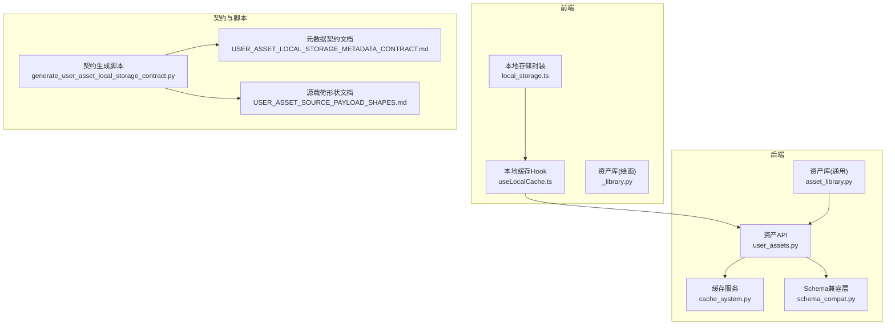
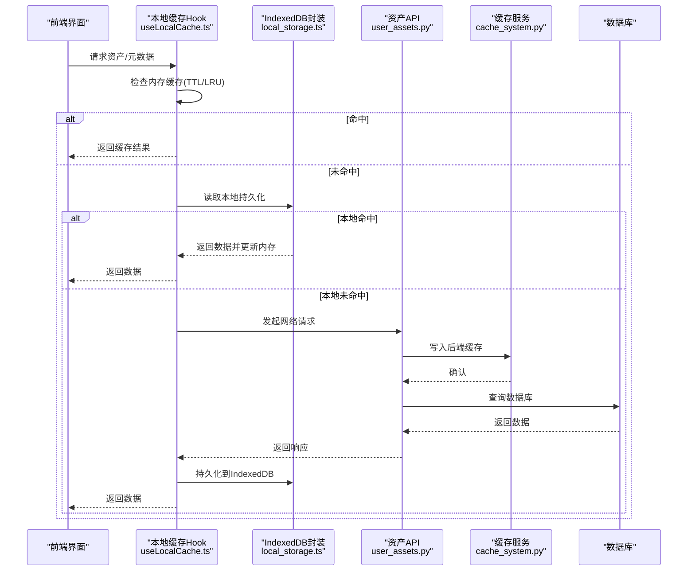
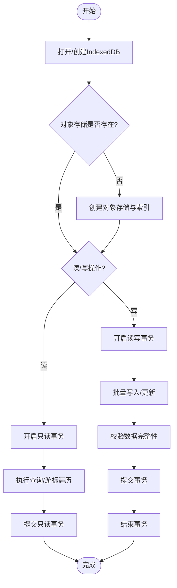
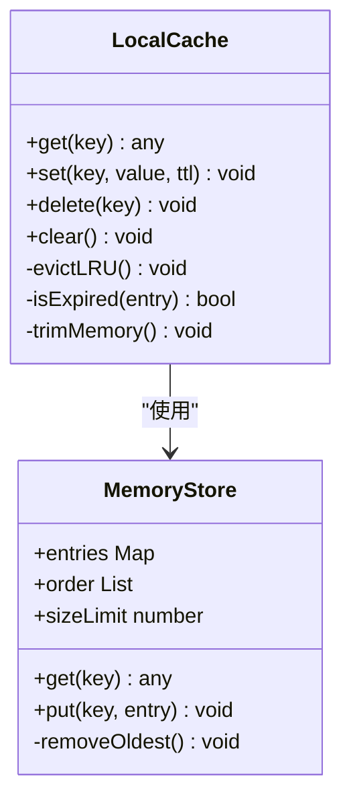
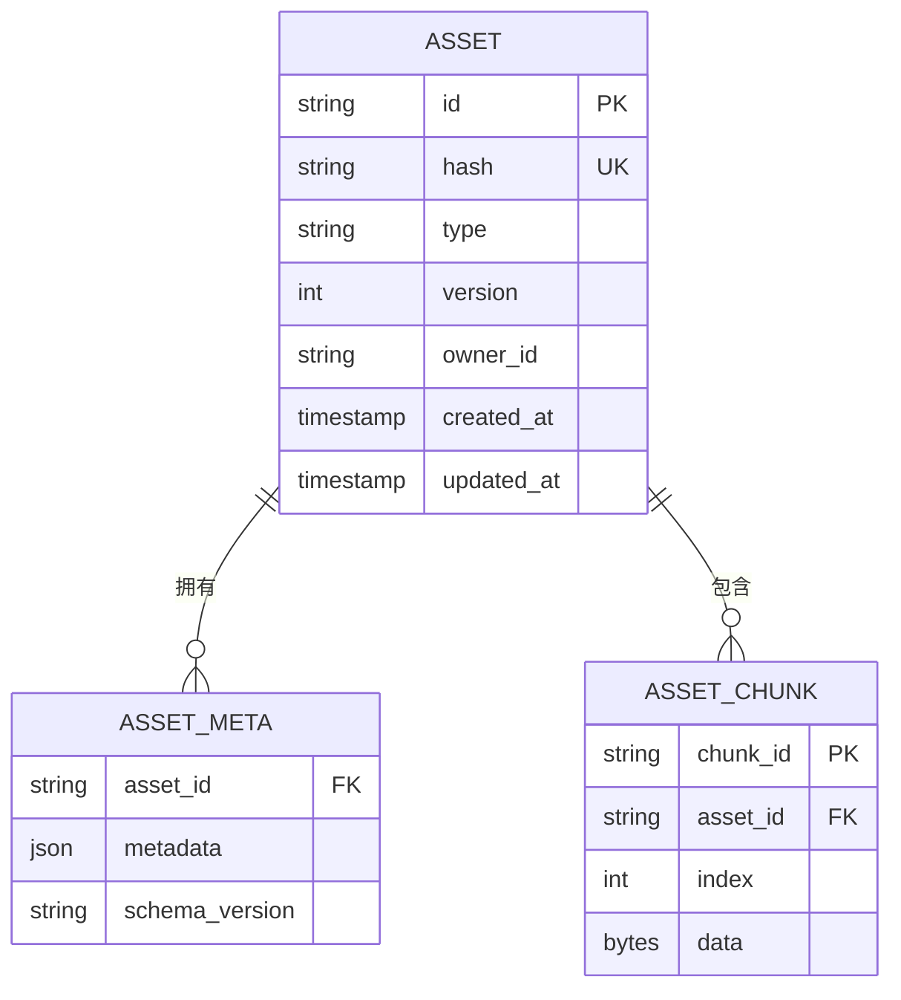
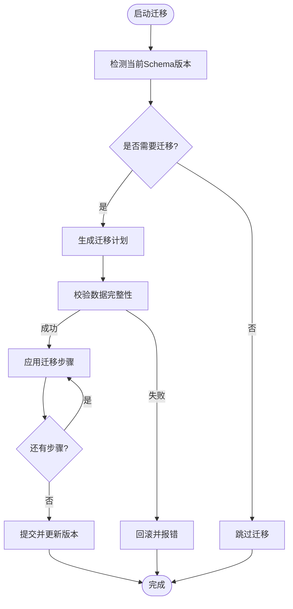
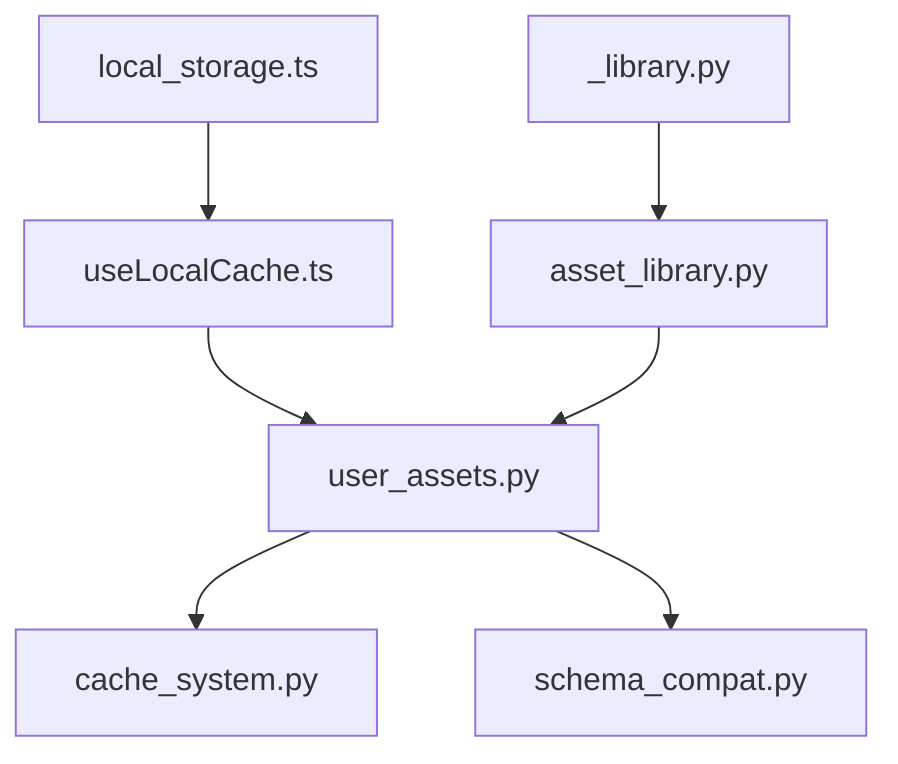

# 本地存储与缓存

<cite>
**本文引用的文件**   
- [backend/app/schemas/user_asset_local_storage_contract_generated.py](file://backend/app/schemas/user_asset_local_storage_contract_generated.py)
- [backend/app/services/cache_system.py](file://backend/app/services/cache_system.py)
- [agents/asset_library.py](file://agents/asset_library.py)
- [agents/painter_pkg/_library.py](file://agents/painter_pkg/_library.py)
- [scripts/generate_user_asset_local_storage_contract.py](file://scripts/generate_user_asset_local_storage_contract.py)
- [docs/contracts/USER_ASSET_LOCAL_STORAGE_METADATA_CONTRACT.md](file://docs/contracts/USER_ASSET_LOCAL_STORAGE_METADATA_CONTRACT.md)
- [docs/contracts/USER_ASSET_SOURCE_PAYLOAD_SHAPES.md](file://docs/contracts/USER_ASSET_SOURCE_PAYLOAD_SHAPES.md)
- [backend/app/db/schema_compat.py](file://backend/app/db/schema_compat.py)
- [backend/app/core/config.py](file://backend/app/core/config.py)
- [backend/app/api/v1/asset_studio_api/user_assets.py](file://backend/app/api/v1/asset_studio_api/user_assets.py)
- [frontend/src/utils/local_storage.ts](file://frontend/src/utils/local_storage.ts)
- [frontend/src/hooks/useLocalCache.ts](file://frontend/src/hooks/useLocalCache.ts)
</cite>

## 目录
1. [简介](#简介)
2. [项目结构](#项目结构)
3. [核心组件](#核心组件)
4. [架构总览](#架构总览)
5. [详细组件分析](#详细组件分析)
6. [依赖关系分析](#依赖关系分析)
7. [性能考量](#性能考量)
8. [故障排查指南](#故障排查指南)
9. [结论](#结论)
10. [附录](#附录)

## 简介
本技术文档聚焦小说创作代理系统的“本地存储与缓存机制”，围绕以下目标展开：
- IndexedDB 的使用模式：数据存储、查询优化与事务处理
- 本地资产库设计：文件管理、元数据保存与版本控制
- 数据迁移策略：版本升级、数据结构变更与数据完整性保证
- 本地恢复机制：数据备份、故障恢复与冲突解决
- 缓存策略设计：LRU 缓存、过期策略与内存管理
- 数据安全、隐私保护与性能优化方案

本系统在前端使用浏览器本地存储（IndexedDB）进行用户资产与缓存，后端通过服务层提供缓存系统与数据库兼容性适配，并通过 API 暴露资产相关能力。

## 项目结构
与本地存储与缓存相关的代码主要分布在以下位置：
- 前端：IndexedDB 封装、本地缓存 Hook、资源加载与缓存策略
- 后端：缓存服务、数据库 Schema 兼容层、资产 API、资产库模块
- 契约与脚本：本地存储元数据契约生成、源载荷形状定义

图表来源
- [frontend/src/utils/local_storage.ts](file://frontend/src/utils/local_storage.ts)
- [frontend/src/hooks/useLocalCache.ts](file://frontend/src/hooks/useLocalCache.ts)
- [backend/app/services/cache_system.py](file://backend/app/services/cache_system.py)
- [backend/app/db/schema_compat.py](file://backend/app/db/schema_compat.py)
- [backend/app/api/v1/asset_studio_api/user_assets.py](file://backend/app/api/v1/asset_studio_api/user_assets.py)
- [agents/asset_library.py](file://agents/asset_library.py)
- [scripts/generate_user_asset_local_storage_contract.py](file://scripts/generate_user_asset_local_storage_contract.py)
- [docs/contracts/USER_ASSET_LOCAL_STORAGE_METADATA_CONTRACT.md](file://docs/contracts/USER_ASSET_LOCAL_STORAGE_METADATA_CONTRACT.md)
- [docs/contracts/USER_ASSET_SOURCE_PAYLOAD_SHAPES.md](file://docs/contracts/USER_ASSET_SOURCE_PAYLOAD_SHAPES.md)

章节来源
- [backend/app/schemas/user_asset_local_storage_contract_generated.py](file://backend/app/schemas/user_asset_local_storage_contract_generated.py)
- [backend/app/services/cache_system.py](file://backend/app/services/cache_system.py)
- [agents/asset_library.py](file://agents/asset_library.py)
- [agents/painter_pkg/_library.py](file://agents/painter_pkg/_library.py)
- [scripts/generate_user_asset_local_storage_contract.py](file://scripts/generate_user_asset_local_storage_contract.py)
- [docs/contracts/USER_ASSET_LOCAL_STORAGE_METADATA_CONTRACT.md](file://docs/contracts/USER_ASSET_LOCAL_STORAGE_METADATA_CONTRACT.md)
- [docs/contracts/USER_ASSET_SOURCE_PAYLOAD_SHAPES.md](file://docs/contracts/USER_ASSET_SOURCE_PAYLOAD_SHAPES.md)
- [backend/app/db/schema_compat.py](file://backend/app/db/schema_compat.py)
- [backend/app/core/config.py](file://backend/app/core/config.py)
- [backend/app/api/v1/asset_studio_api/user_assets.py](file://backend/app/api/v1/asset_studio_api/user_assets.py)
- [frontend/src/utils/local_storage.ts](file://frontend/src/utils/local_storage.ts)
- [frontend/src/hooks/useLocalCache.ts](file://frontend/src/hooks/useLocalCache.ts)

## 核心组件
- 前端本地存储封装（IndexedDB）
  - 负责打开/创建对象存储、读写事务、索引构建、批量操作与错误回滚
  - 提供统一的键空间与命名约定，避免跨功能冲突
- 前端本地缓存 Hook
  - 封装 LRU 策略、过期时间、内存上限与自动淘汰
  - 与 IndexedDB 协同，热路径走内存，冷路径落盘
- 后端缓存服务
  - 提供进程内缓存、TTL 过期、命中率统计与降级策略
  - 与数据库查询解耦，支持按业务域隔离
- 资产库模块（前后端）
  - 统一资产标识、元数据模型、版本化与引用计数
  - 文件分片、去重、校验与懒加载
- Schema 兼容层
  - 向后兼容旧字段、增量迁移、缺失字段默认值填充
- 资产 API
  - 对外暴露资产上传、检索、版本切换与同步接口
- 契约与脚本
  - 自动生成前端本地存储元数据契约，确保前后端一致

章节来源
- [frontend/src/utils/local_storage.ts](file://frontend/src/utils/local_storage.ts)
- [frontend/src/hooks/useLocalCache.ts](file://frontend/src/hooks/useLocalCache.ts)
- [backend/app/services/cache_system.py](file://backend/app/services/cache_system.py)
- [agents/asset_library.py](file://agents/asset_library.py)
- [agents/painter_pkg/_library.py](file://agents/painter_pkg/_library.py)
- [backend/app/db/schema_compat.py](file://backend/app/db/schema_compat.py)
- [backend/app/api/v1/asset_studio_api/user_assets.py](file://backend/app/api/v1/asset_studio_api/user_assets.py)
- [scripts/generate_user_asset_local_storage_contract.py](file://scripts/generate_user_asset_local_storage_contract.py)
- [docs/contracts/USER_ASSET_LOCAL_STORAGE_METADATA_CONTRACT.md](file://docs/contracts/USER_ASSET_LOCAL_STORAGE_METADATA_CONTRACT.md)
- [docs/contracts/USER_ASSET_SOURCE_PAYLOAD_SHAPES.md](file://docs/contracts/USER_ASSET_SOURCE_PAYLOAD_SHAPES.md)

## 架构总览
下图展示从前端到后端的本地存储与缓存交互流程，包括 IndexedDB、内存缓存、后端缓存与数据库的协作关系。

图表来源
- [frontend/src/hooks/useLocalCache.ts](file://frontend/src/hooks/useLocalCache.ts)
- [frontend/src/utils/local_storage.ts](file://frontend/src/utils/local_storage.ts)
- [backend/app/api/v1/asset_studio_api/user_assets.py](file://backend/app/api/v1/asset_studio_api/user_assets.py)
- [backend/app/services/cache_system.py](file://backend/app/services/cache_system.py)

## 详细组件分析

### IndexedDB 使用模式（前端）
- 存储设计
  - 对象存储按业务域划分（如 userAssets、metaIndex、chunks），每个对象存储包含必要索引（如 assetId、version、createdAt）
  - 二进制大对象（图片/音频片段）采用分块存储与元数据分离，减少单条记录体积
- 查询优化
  - 复合索引用于常见过滤条件（如 projectScope + type + status）
  - 游标分页与范围查询结合，避免全表扫描
- 事务处理
  - 写操作使用显式事务，失败时回滚；读操作使用只读事务提升并发
  - 批量写入采用事务合并，降低磁盘抖动

章节来源
- [frontend/src/utils/local_storage.ts](file://frontend/src/utils/local_storage.ts)

### 本地缓存策略（前端）
- LRU 缓存
  - 基于访问顺序维护最近最少使用队列，达到容量上限时淘汰最久未使用的条目
- 过期策略
  - 每条缓存附带 TTL，读取时检查是否过期，过期则删除并触发回填
- 内存管理
  - 限制最大条目数与单条大小，避免内存溢出
  - 定期清理过期项与碎片

图表来源
- [frontend/src/hooks/useLocalCache.ts](file://frontend/src/hooks/useLocalCache.ts)

章节来源
- [frontend/src/hooks/useLocalCache.ts](file://frontend/src/hooks/useLocalCache.ts)

### 本地资产库设计（前后端）
- 文件管理
  - 统一文件命名规范与哈希校验，支持断点续传与分块上传
  - 文件去重：基于内容哈希避免重复存储
- 元数据保存
  - 资产元数据包含类型、版本、关联项目、标签、尺寸/时长等
  - 元数据与文件分离，便于独立更新与迁移
- 版本控制
  - 每次修改生成新版本，保留历史版本以供回滚
  - 版本间差异最小化，支持增量同步

图表来源
- [agents/asset_library.py](file://agents/asset_library.py)
- [agents/painter_pkg/_library.py](file://agents/painter_pkg/_library.py)

章节来源
- [agents/asset_library.py](file://agents/asset_library.py)
- [agents/painter_pkg/_library.py](file://agents/painter_pkg/_library.py)

### 数据迁移策略（后端）
- 版本升级
  - 通过 Schema 兼容层检测当前版本与目标版本，逐步应用迁移步骤
- 数据结构变更
  - 新增字段设置默认值，废弃字段标记为可选，保持向前兼容
- 数据完整性保证
  - 迁移前校验关键约束，迁移中记录日志，失败时回滚或修复

章节来源
- [backend/app/db/schema_compat.py](file://backend/app/db/schema_compat.py)

### 本地恢复机制
- 数据备份
  - 定期导出 IndexedDB 快照（JSON 序列化），支持增量备份
- 故障恢复
  - 导入备份快照，重建对象存储与索引，校验一致性
- 冲突解决
  - 基于时间戳与版本号合并冲突，优先保留最新有效版本

章节来源
- [frontend/src/utils/local_storage.ts](file://frontend/src/utils/local_storage.ts)
- [frontend/src/hooks/useLocalCache.ts](file://frontend/src/hooks/useLocalCache.ts)

### 缓存策略设计（后端）
- LRU 缓存
  - 进程内缓存按 key 维度隔离，支持按业务域配置不同容量
- 过期策略
  - 支持固定 TTL 与惰性过期检查，后台定时清理
- 内存管理
  - 监控内存占用，超过阈值触发强制淘汰与压缩

章节来源
- [backend/app/services/cache_system.py](file://backend/app/services/cache_system.py)

### 数据安全与隐私保护
- 敏感字段加密存储（如用户标识、私有资产元数据）
- 输入校验与白名单过滤，防止注入与恶意载荷
- 最小权限原则，仅暴露必要的 API 接口

章节来源
- [backend/app/core/config.py](file://backend/app/core/config.py)
- [backend/app/api/v1/asset_studio_api/user_assets.py](file://backend/app/api/v1/asset_studio_api/user_assets.py)

### 性能优化方案
- 前端
  - 热点数据常驻内存，冷数据落盘 IndexedDB
  - 批量写入与只读事务优化 I/O
- 后端
  - 缓存穿透防护（空值缓存）、缓存击穿（互斥锁）
  - 数据库查询优化（索引、分页、预取）

章节来源
- [frontend/src/hooks/useLocalCache.ts](file://frontend/src/hooks/useLocalCache.ts)
- [frontend/src/utils/local_storage.ts](file://frontend/src/utils/local_storage.ts)
- [backend/app/services/cache_system.py](file://backend/app/services/cache_system.py)

## 依赖关系分析
前端本地存储与缓存依赖后端资产 API 与缓存服务；后端缓存服务与数据库 Schema 兼容层协作；资产库模块贯穿前后端，确保资产模型一致。

图表来源
- [frontend/src/utils/local_storage.ts](file://frontend/src/utils/local_storage.ts)
- [frontend/src/hooks/useLocalCache.ts](file://frontend/src/hooks/useLocalCache.ts)
- [backend/app/api/v1/asset_studio_api/user_assets.py](file://backend/app/api/v1/asset_studio_api/user_assets.py)
- [backend/app/services/cache_system.py](file://backend/app/services/cache_system.py)
- [backend/app/db/schema_compat.py](file://backend/app/db/schema_compat.py)
- [agents/asset_library.py](file://agents/asset_library.py)
- [agents/painter_pkg/_library.py](file://agents/painter_pkg/_library.py)

章节来源
- [frontend/src/utils/local_storage.ts](file://frontend/src/utils/local_storage.ts)
- [frontend/src/hooks/useLocalCache.ts](file://frontend/src/hooks/useLocalCache.ts)
- [backend/app/api/v1/asset_studio_api/user_assets.py](file://backend/app/api/v1/asset_studio_api/user_assets.py)
- [backend/app/services/cache_system.py](file://backend/app/services/cache_system.py)
- [backend/app/db/schema_compat.py](file://backend/app/db/schema_compat.py)
- [agents/asset_library.py](file://agents/asset_library.py)
- [agents/painter_pkg/_library.py](file://agents/painter_pkg/_library.py)

## 性能考量
- 前端
  - 合理设置 IndexedDB 索引，避免不必要的扫描
  - 控制内存缓存大小，防止 OOM
- 后端
  - 缓存命中率监控与告警
  - 数据库慢查询分析与优化
- 整体
  - 端到端延迟测量，定位瓶颈环节

[本节为通用指导，不直接分析具体文件]

## 故障排查指南
- 常见问题
  - IndexedDB 打开失败：检查浏览器权限与存储空间
  - 缓存不一致：核对 TTL 与版本号，强制刷新缓存
  - 迁移失败：查看迁移日志，回滚到上一版本
- 诊断工具
  - 前端：浏览器开发者工具中的 Application > IndexedDB
  - 后端：缓存服务指标与数据库慢查询日志

章节来源
- [frontend/src/utils/local_storage.ts](file://frontend/src/utils/local_storage.ts)
- [backend/app/services/cache_system.py](file://backend/app/services/cache_system.py)
- [backend/app/db/schema_compat.py](file://backend/app/db/schema_compat.py)

## 结论
本系统通过前端 IndexedDB 与内存缓存、后端缓存服务与数据库兼容层的协同，实现了高效、可靠且可扩展的本地存储与缓存机制。资产库的版本化与元数据管理确保了数据的一致性与可追溯性。未来可进一步引入更细粒度的权限控制与分布式缓存以提升多实例部署下的性能与可用性。

[本节为总结性内容，不直接分析具体文件]

## 附录
- 契约与脚本
  - 元数据契约生成脚本确保前后端模型一致
  - 源载荷形状文档定义 API 请求/响应结构

章节来源
- [scripts/generate_user_asset_local_storage_contract.py](file://scripts/generate_user_asset_local_storage_contract.py)
- [docs/contracts/USER_ASSET_LOCAL_STORAGE_METADATA_CONTRACT.md](file://docs/contracts/USER_ASSET_LOCAL_STORAGE_METADATA_CONTRACT.md)
- [docs/contracts/USER_ASSET_SOURCE_PAYLOAD_SHAPES.md](file://docs/contracts/USER_ASSET_SOURCE_PAYLOAD_SHAPES.md)
- [backend/app/schemas/user_asset_local_storage_contract_generated.py](file://backend/app/schemas/user_asset_local_storage_contract_generated.py)