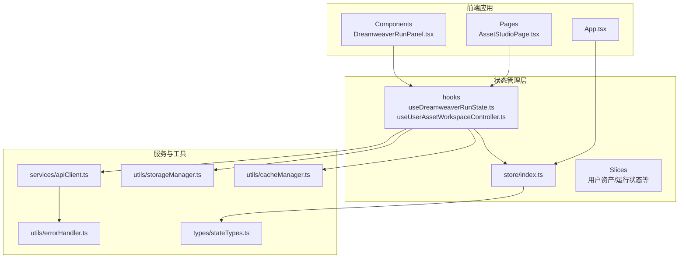
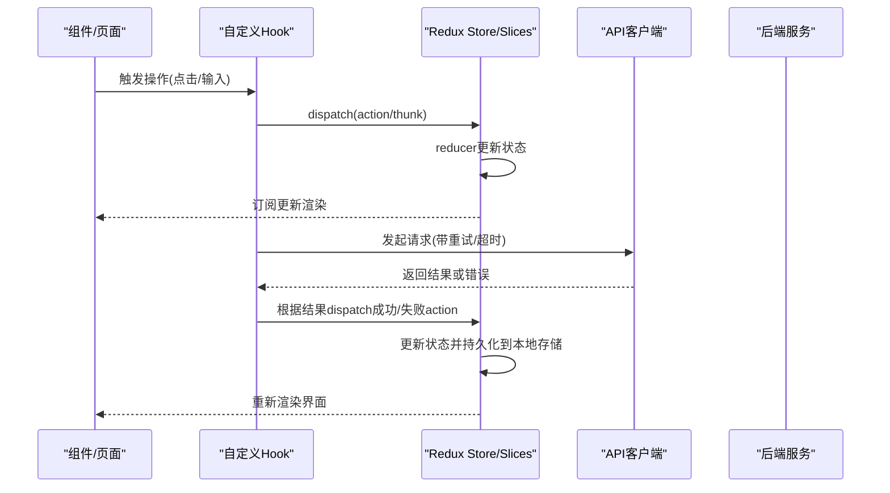
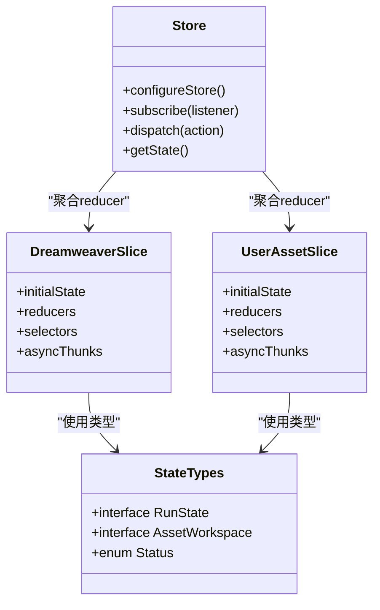
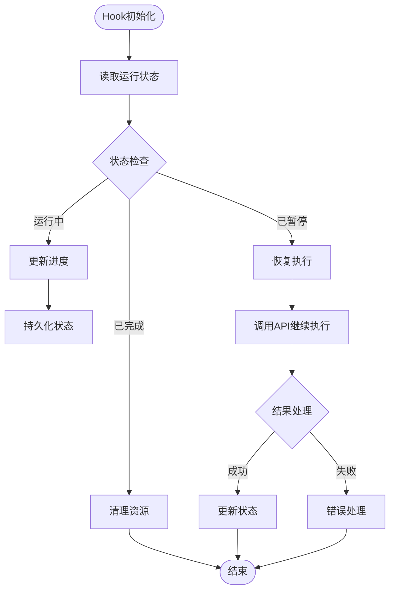
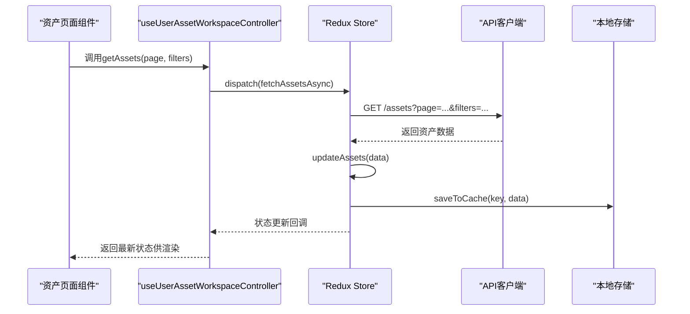
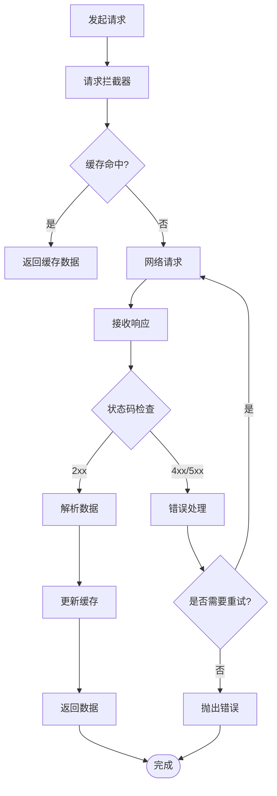
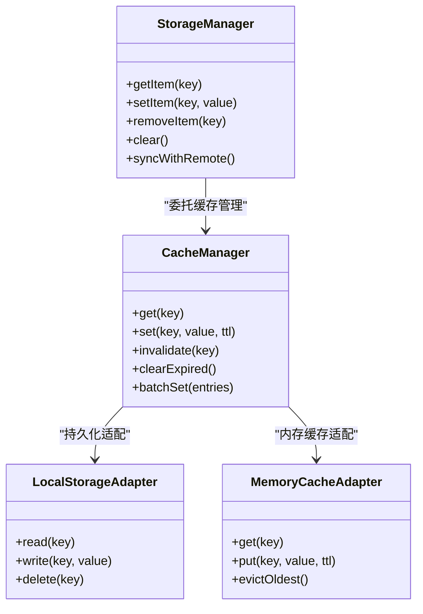
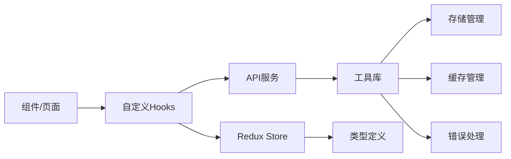

# 状态管理

<cite>
**本文引用的文件**   
- [frontend/src/store/index.ts](file://frontend/src/store/index.ts)
- [frontend/src/hooks/useDreamweaverRunState.ts](file://frontend/src/hooks/useDreamweaverRunState.ts)
- [frontend/src/hooks/useUserAssetWorkspaceController.ts](file://frontend/src/hooks/useUserAssetWorkspaceController.ts)
- [frontend/src/services/apiClient.ts](file://frontend/src/services/apiClient.ts)
- [frontend/src/utils/storageManager.ts](file://frontend/src/utils/storageManager.ts)
- [frontend/src/utils/cacheManager.ts](file://frontend/src/utils/cacheManager.ts)
- [frontend/src/utils/errorHandler.ts](file://frontend/src/utils/errorHandler.ts)
- [frontend/src/types/stateTypes.ts](file://frontend/src/types/stateTypes.ts)
- [frontend/src/components/DreamweaverRunPanel.tsx](file://frontend/src/components/DreamweaverRunPanel.tsx)
- [frontend/src/pages/AssetStudioPage.tsx](file://frontend/src/pages/AssetStudioPage.tsx)
</cite>

## 目录
1. [简介](#简介)
2. [项目结构](#项目结构)
3. [核心组件](#核心组件)
4. [架构总览](#架构总览)
5. [详细组件分析](#详细组件分析)
6. [依赖关系分析](#依赖关系分析)
7. [性能考量](#性能考量)
8. [故障排查指南](#故障排查指南)
9. [结论](#结论)
10. [附录](#附录)

## 简介
本技术文档聚焦小说创作代理系统的前端状态管理，围绕 Redux 状态管理架构展开，涵盖 store 配置、slices 定义与 action creators、自定义 hooks（如 useDreamweaverRunState、useUserAssetWorkspaceController）、异步数据处理、API 调用封装与错误处理机制、本地存储策略、缓存管理与数据同步、状态持久化、热重载开发与调试工具使用。同时提供状态设计最佳实践、性能优化技巧与常见问题解决方案，帮助开发者快速理解并高效扩展前端状态体系。

## 项目结构
前端状态管理相关代码主要分布在以下目录：
- store：Redux store 配置与 slices 组织
- hooks：业务相关的自定义 hooks，封装状态读取与更新逻辑
- services：API 客户端与服务层封装
- utils：通用工具，包括存储、缓存、错误处理等
- types：类型定义，统一状态结构与 API 契约
- components/pages：页面与组件消费状态，触发 actions

图表来源
- [frontend/src/store/index.ts](file://frontend/src/store/index.ts)
- [frontend/src/hooks/useDreamweaverRunState.ts](file://frontend/src/hooks/useDreamweaverRunState.ts)
- [frontend/src/hooks/useUserAssetWorkspaceController.ts](file://frontend/src/hooks/useUserAssetWorkspaceController.ts)
- [frontend/src/services/apiClient.ts](file://frontend/src/services/apiClient.ts)
- [frontend/src/utils/storageManager.ts](file://frontend/src/utils/storageManager.ts)
- [frontend/src/utils/cacheManager.ts](file://frontend/src/utils/cacheManager.ts)
- [frontend/src/utils/errorHandler.ts](file://frontend/src/utils/errorHandler.ts)
- [frontend/src/types/stateTypes.ts](file://frontend/src/types/stateTypes.ts)
- [frontend/src/components/DreamweaverRunPanel.tsx](file://frontend/src/components/DreamweaverRunPanel.tsx)
- [frontend/src/pages/AssetStudioPage.tsx](file://frontend/src/pages/AssetStudioPage.tsx)

章节来源
- [frontend/src/store/index.ts](file://frontend/src/store/index.ts)
- [frontend/src/types/stateTypes.ts](file://frontend/src/types/stateTypes.ts)

## 核心组件
- Redux Store 配置：集中式 store 初始化、中间件组合（如 thunk、persist、logger）、根 reducer 聚合
- Slices 定义：按领域划分状态切片，包含初始状态、reducers、selectors、async thunks
- Action Creators：同步与异步 action 的工厂函数，封装业务操作
- 自定义 Hooks：将状态读取与更新逻辑封装为可复用 hook，降低组件复杂度
- API 客户端：统一的请求封装、拦截器、重试与超时控制
- 存储与缓存：localStorage/sessionStorage 与内存缓存的管理与同步
- 错误处理：统一错误捕获、提示与降级策略

章节来源
- [frontend/src/store/index.ts](file://frontend/src/store/index.ts)
- [frontend/src/services/apiClient.ts](file://frontend/src/services/apiClient.ts)
- [frontend/src/utils/storageManager.ts](file://frontend/src/utils/storageManager.ts)
- [frontend/src/utils/cacheManager.ts](file://frontend/src/utils/cacheManager.ts)
- [frontend/src/utils/errorHandler.ts](file://frontend/src/utils/errorHandler.ts)
- [frontend/src/types/stateTypes.ts](file://frontend/src/types/stateTypes.ts)

## 架构总览
整体采用“组件 → hooks → store/slices → apiClient → 后端”的分层架构。hooks 作为状态消费与更新的入口，内部通过 dispatch 触发 reducers 或 async thunks；apiClient 负责网络请求与错误处理；storageManager 与 cacheManager 负责本地持久化与缓存一致性。

图表来源
- [frontend/src/hooks/useDreamweaverRunState.ts](file://frontend/src/hooks/useDreamweaverRunState.ts)
- [frontend/src/hooks/useUserAssetWorkspaceController.ts](file://frontend/src/hooks/useUserAssetWorkspaceController.ts)
- [frontend/src/store/index.ts](file://frontend/src/store/index.ts)
- [frontend/src/services/apiClient.ts](file://frontend/src/services/apiClient.ts)

## 详细组件分析

### Redux Store 配置与 Slices
- Store 初始化：创建 store，注册根 reducer，启用 thunk、persist、logger 等中间件
- Slices 组织：按功能域拆分状态（如 dreamweaverRun、userAssetWorkspace），每个 slice 包含 initialState、reducers、selectors、async thunks
- Action Creators：同步 action 直接修改状态，异步 action 封装 API 调用与错误处理
- 类型安全：通过 stateTypes.ts 定义状态结构与 API 响应类型

图表来源
- [frontend/src/store/index.ts](file://frontend/src/store/index.ts)
- [frontend/src/types/stateTypes.ts](file://frontend/src/types/stateTypes.ts)

章节来源
- [frontend/src/store/index.ts](file://frontend/src/store/index.ts)
- [frontend/src/types/stateTypes.ts](file://frontend/src/types/stateTypes.ts)

### 自定义 Hooks：useDreamweaverRunState
- 职责：封装 Dreamweaver 运行状态读取与更新，包括启动、暂停、停止、进度监听
- 实现模式：
  - 读取状态：通过 useSelector 订阅 store 中的运行状态
  - 更新状态：通过 useDispatch 触发 reducers 或 async thunks
  - 副作用处理：在 useEffect 中监听状态变化，触发相应逻辑（如自动保存）
  - 错误处理：捕获异常并通过 errorHandler 统一处理

图表来源
- [frontend/src/hooks/useDreamweaverRunState.ts](file://frontend/src/hooks/useDreamweaverRunState.ts)
- [frontend/src/utils/errorHandler.ts](file://frontend/src/utils/errorHandler.ts)

章节来源
- [frontend/src/hooks/useDreamweaverRunState.ts](file://frontend/src/hooks/useDreamweaverRunState.ts)
- [frontend/src/components/DreamweaverRunPanel.tsx](file://frontend/src/components/DreamweaverRunPanel.tsx)

### 自定义 Hooks：useUserAssetWorkspaceController
- 职责：管理用户资产工作区状态，包括资产列表、筛选、搜索、批量操作
- 实现模式：
  - 状态管理：通过 slices 管理资产数据、加载状态、错误信息
  - 数据获取：封装异步 thunks，支持分页、排序、过滤
  - 本地同步：与 storageManager 同步本地缓存，确保离线可用性
  - 事件驱动：监听外部事件（如 WebSocket 消息）更新状态

图表来源
- [frontend/src/hooks/useUserAssetWorkspaceController.ts](file://frontend/src/hooks/useUserAssetWorkspaceController.ts)
- [frontend/src/services/apiClient.ts](file://frontend/src/services/apiClient.ts)
- [frontend/src/utils/storageManager.ts](file://frontend/src/utils/storageManager.ts)

章节来源
- [frontend/src/hooks/useUserAssetWorkspaceController.ts](file://frontend/src/hooks/useUserAssetWorkspaceController.ts)
- [frontend/src/pages/AssetStudioPage.tsx](file://frontend/src/pages/AssetStudioPage.tsx)

### API 调用封装与错误处理
- API 客户端：统一封装 fetch/axios，支持请求拦截、响应拦截、重试机制、超时控制
- 错误处理：统一错误分类（网络错误、业务错误、权限错误），提供用户友好提示
- 缓存策略：GET 请求支持内存缓存，POST/PUT/DELETE 后清除相关缓存
- 日志记录：请求/响应日志、错误堆栈追踪，便于问题定位

图表来源
- [frontend/src/services/apiClient.ts](file://frontend/src/services/apiClient.ts)
- [frontend/src/utils/errorHandler.ts](file://frontend/src/utils/errorHandler.ts)

章节来源
- [frontend/src/services/apiClient.ts](file://frontend/src/services/apiClient.ts)
- [frontend/src/utils/errorHandler.ts](file://frontend/src/utils/errorHandler.ts)

### 本地存储策略与缓存管理
- 存储分层：内存缓存（短期）、localStorage（中期）、sessionStorage（会话级）
- 缓存策略：LRU 淘汰、过期时间、版本兼容
- 数据同步：双向同步机制，确保本地与远程数据一致性
- 性能优化：批量写入、防抖节流、增量更新

图表来源
- [frontend/src/utils/storageManager.ts](file://frontend/src/utils/storageManager.ts)
- [frontend/src/utils/cacheManager.ts](file://frontend/src/utils/cacheManager.ts)

章节来源
- [frontend/src/utils/storageManager.ts](file://frontend/src/utils/storageManager.ts)
- [frontend/src/utils/cacheManager.ts](file://frontend/src/utils/cacheManager.ts)

## 依赖关系分析
状态管理模块间的依赖关系清晰，遵循单向数据流原则：
- 组件依赖 hooks，hooks 依赖 store 和 services
- services 依赖 utils（存储、缓存、错误处理）
- store 依赖 types 定义状态结构

图表来源
- [frontend/src/store/index.ts](file://frontend/src/store/index.ts)
- [frontend/src/hooks/useDreamweaverRunState.ts](file://frontend/src/hooks/useDreamweaverRunState.ts)
- [frontend/src/hooks/useUserAssetWorkspaceController.ts](file://frontend/src/hooks/useUserAssetWorkspaceController.ts)
- [frontend/src/services/apiClient.ts](file://frontend/src/services/apiClient.ts)
- [frontend/src/utils/storageManager.ts](file://frontend/src/utils/storageManager.ts)
- [frontend/src/utils/cacheManager.ts](file://frontend/src/utils/cacheManager.ts)
- [frontend/src/utils/errorHandler.ts](file://frontend/src/utils/errorHandler.ts)
- [frontend/src/types/stateTypes.ts](file://frontend/src/types/stateTypes.ts)

章节来源
- [frontend/src/store/index.ts](file://frontend/src/store/index.ts)
- [frontend/src/types/stateTypes.ts](file://frontend/src/types/stateTypes.ts)

## 性能考量
- 状态分割：按功能域拆分 slices，减少不必要的重渲染
- 选择器优化：使用 createSelector 进行记忆化计算，避免重复计算
- 懒加载：按需加载大型模块和数据，减少初始包体积
- 虚拟滚动：大数据列表使用虚拟滚动提升渲染性能
- 请求去重：相同请求合并，避免重复网络调用
- 缓存策略：合理设置缓存过期时间和淘汰策略

## 故障排查指南
- 状态不一致：检查 reducer 是否纯函数，确保不可变更新
- 异步错误：查看 errorHandler 日志，确认错误分类和处理逻辑
- 缓存失效：检查缓存键生成规则和过期时间设置
- 性能问题：使用 React DevTools 分析组件渲染次数
- 网络请求：检查 apiClient 拦截器和重试逻辑

章节来源
- [frontend/src/utils/errorHandler.ts](file://frontend/src/utils/errorHandler.ts)
- [frontend/src/services/apiClient.ts](file://frontend/src/services/apiClient.ts)

## 结论
本小说创作代理系统的前端状态管理采用 Redux + 自定义 hooks 的架构模式，实现了清晰的状态流转、良好的可维护性和优秀的性能表现。通过统一的 API 封装、完善的错误处理和灵活的缓存策略，为复杂业务场景提供了可靠的状态管理能力。建议持续优化选择器性能、完善监控告警机制，并加强单元测试覆盖。

## 附录
- 开发工具推荐：Redux DevTools、React DevTools、浏览器网络面板
- 调试技巧：断点调试、日志输出、状态快照对比
- 最佳实践：单一数据源、不可变更新、明确的状态边界
- 常见陷阱：循环依赖、过度分割状态、忘记清理副作用