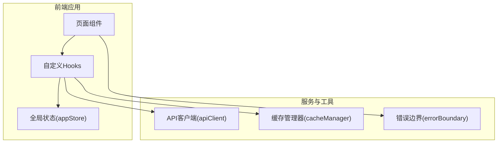
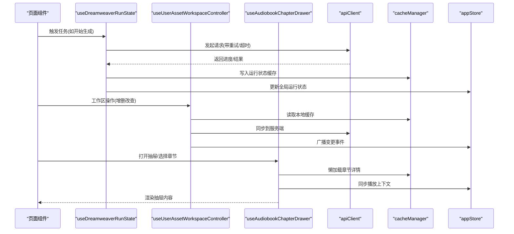
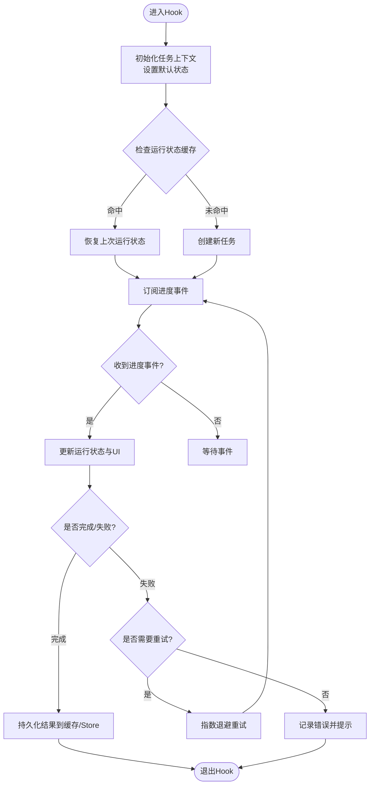
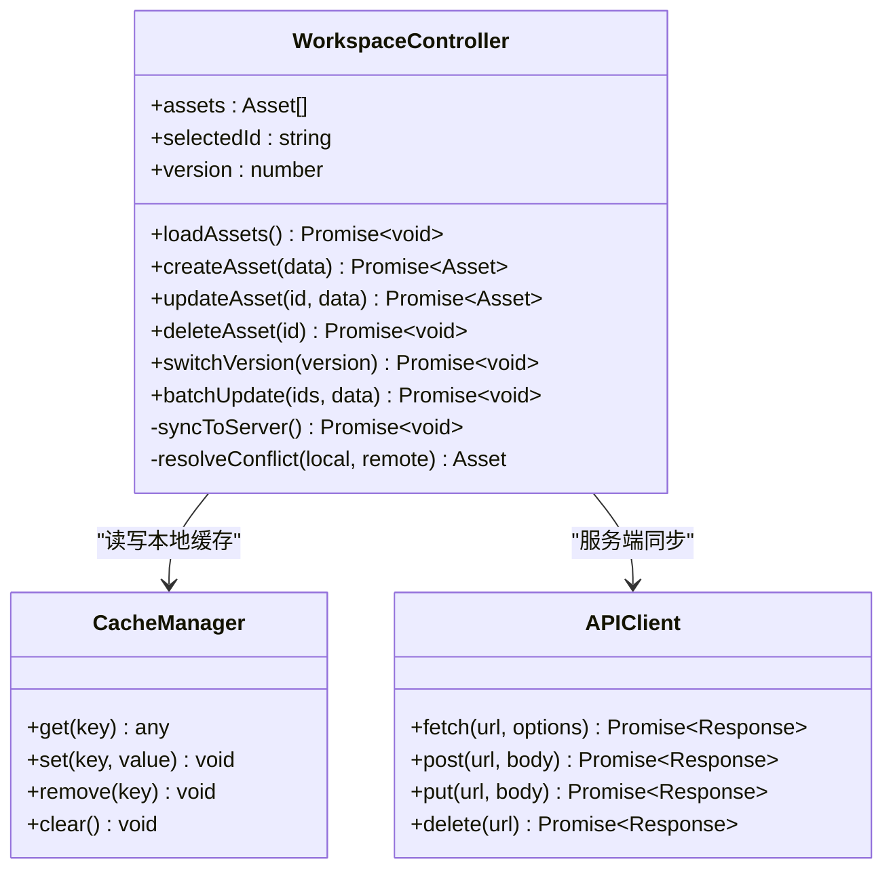
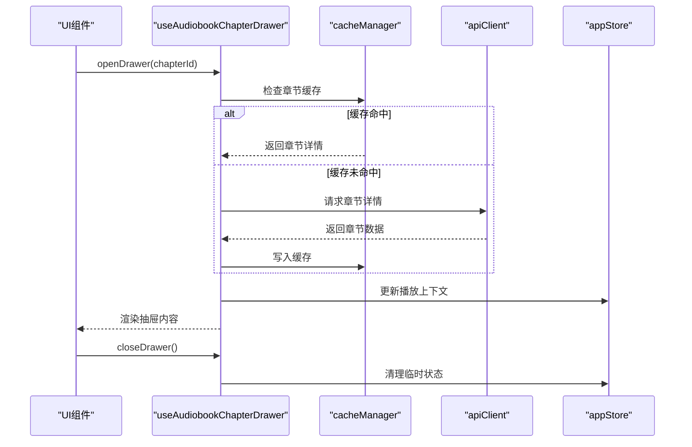
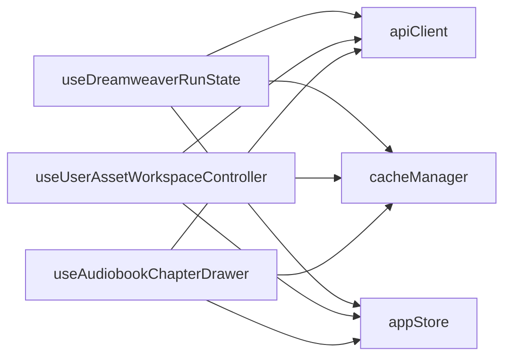

# 自定义Hooks模式

<cite>
**本文引用的文件**   
- [frontend/src/hooks/useDreamweaverRunState.ts](file://frontend/src/hooks/useDreamweaverRunState.ts)
- [frontend/src/hooks/useUserAssetWorkspaceController.ts](file://frontend/src/hooks/useUserAssetWorkspaceController.ts)
- [frontend/src/hooks/useAudiobookChapterDrawer.ts](file://frontend/src/hooks/useAudiobookChapterDrawer.ts)
- [frontend/src/services/apiClient.ts](file://frontend/src/services/apiClient.ts)
- [frontend/src/utils/cacheManager.ts](file://frontend/src/utils/cacheManager.ts)
- [frontend/src/utils/errorBoundary.tsx](file://frontend/src/utils/errorBoundary.tsx)
- [frontend/src/store/appStore.ts](file://frontend/src/store/appStore.ts)
</cite>

## 目录
1. [简介](#简介)
2. [项目结构](#项目结构)
3. [核心组件](#核心组件)
4. [架构总览](#架构总览)
5. [详细组件分析](#详细组件分析)
6. [依赖分析](#依赖分析)
7. [性能考虑](#性能考虑)
8. [故障排查指南](#故障排查指南)
9. [结论](#结论)
10. [附录](#附录)

## 简介
本技术文档聚焦于小说创作代理系统前端中的自定义React Hooks模式，围绕以下三个核心Hook展开：
- useDreamweaverRunState（梦境编织者运行状态管理）
- useUserAssetWorkspaceController（用户资产工作区控制器）
- useAudiobookChapterDrawer（有声书章节抽屉控制）

文档将系统性阐述这些Hook在异步数据获取、状态同步、事件监听与副作用处理方面的实现原理，并总结组合模式、依赖管理与性能优化策略。同时覆盖错误边界、重试机制与缓存策略，提供开发规范、测试方法与调试技巧，帮助读者快速掌握高质量Hooks的编写与演进方法。

## 项目结构
前端采用模块化组织，核心Hooks位于src/hooks，服务层位于src/services，工具与缓存位于src/utils，全局状态位于src/store。下图展示了与本文相关的模块关系与职责划分。

图表来源
- [frontend/src/hooks/useDreamweaverRunState.ts](file://frontend/src/hooks/useDreamweaverRunState.ts)
- [frontend/src/hooks/useUserAssetWorkspaceController.ts](file://frontend/src/hooks/useUserAssetWorkspaceController.ts)
- [frontend/src/hooks/useAudiobookChapterDrawer.ts](file://frontend/src/hooks/useAudiobookChapterDrawer.ts)
- [frontend/src/services/apiClient.ts](file://frontend/src/services/apiClient.ts)
- [frontend/src/utils/cacheManager.ts](file://frontend/src/utils/cacheManager.ts)
- [frontend/src/utils/errorBoundary.tsx](file://frontend/src/utils/errorBoundary.tsx)
- [frontend/src/store/appStore.ts](file://frontend/src/store/appStore.ts)

章节来源
- [frontend/src/hooks/useDreamweaverRunState.ts](file://frontend/src/hooks/useDreamweaverRunState.ts)
- [frontend/src/hooks/useUserAssetWorkspaceController.ts](file://frontend/src/hooks/useUserAssetWorkspaceController.ts)
- [frontend/src/hooks/useAudiobookChapterDrawer.ts](file://frontend/src/hooks/useAudiobookChapterDrawer.ts)
- [frontend/src/services/apiClient.ts](file://frontend/src/services/apiClient.ts)
- [frontend/src/utils/cacheManager.ts](file://frontend/src/utils/cacheManager.ts)
- [frontend/src/utils/errorBoundary.tsx](file://frontend/src/utils/errorBoundary.tsx)
- [frontend/src/store/appStore.ts](file://frontend/src/store/appStore.ts)

## 核心组件
本节对三个核心Hook进行概览性说明，重点解释其职责边界、输入输出契约以及与其他模块的交互方式。

- useDreamweaverRunState
  - 职责：封装“梦境编织者”任务的运行生命周期状态，包括任务创建、执行进度、结果聚合与失败恢复。
  - 关键能力：异步任务调度、进度事件订阅、状态持久化、错误重试与降级。
  - 典型用法：在页面中驱动生成流程的状态展示与操作按钮启用/禁用。

- useUserAssetWorkspaceController
  - 职责：管理用户资产工作区的增删改查、版本切换、批量操作与权限校验。
  - 关键能力：本地缓存优先、服务端同步、冲突解决、变更审计。
  - 典型用法：在资产库或工作区页面中统一协调数据的读写与UI反馈。

- useAudiobookChapterDrawer
  - 职责：控制有声书章节抽屉的显示/隐藏、章节列表加载、选中项管理与播放上下文同步。
  - 关键能力：路由参数联动、抽屉状态持久化、懒加载章节详情、播放状态共享。
  - 典型用法：在播放器或章节列表中通过抽屉快速查看与编辑章节信息。

章节来源
- [frontend/src/hooks/useDreamweaverRunState.ts](file://frontend/src/hooks/useDreamweaverRunState.ts)
- [frontend/src/hooks/useUserAssetWorkspaceController.ts](file://frontend/src/hooks/useUserAssetWorkspaceController.ts)
- [frontend/src/hooks/useAudiobookChapterDrawer.ts](file://frontend/src/hooks/useAudiobookChapterDrawer.ts)

## 架构总览
下图展示了三个核心Hook与服务层、缓存与全局状态的协作关系，体现数据流与控制流。

图表来源
- [frontend/src/hooks/useDreamweaverRunState.ts](file://frontend/src/hooks/useDreamweaverRunState.ts)
- [frontend/src/hooks/useUserAssetWorkspaceController.ts](file://frontend/src/hooks/useUserAssetWorkspaceController.ts)
- [frontend/src/hooks/useAudiobookChapterDrawer.ts](file://frontend/src/hooks/useAudiobookChapterDrawer.ts)
- [frontend/src/services/apiClient.ts](file://frontend/src/services/apiClient.ts)
- [frontend/src/utils/cacheManager.ts](file://frontend/src/utils/cacheManager.ts)
- [frontend/src/store/appStore.ts](file://frontend/src/store/appStore.ts)

## 详细组件分析

### useDreamweaverRunState（梦境编织者运行状态管理）
该Hook负责编排“梦境编织者”任务的完整生命周期，包括任务初始化、执行监控、结果收集与异常恢复。它通过事件订阅与状态机模式确保UI与后端任务状态一致。

图表来源
- [frontend/src/hooks/useDreamweaverRunState.ts](file://frontend/src/hooks/useDreamweaverRunState.ts)
- [frontend/src/utils/cacheManager.ts](file://frontend/src/utils/cacheManager.ts)
- [frontend/src/store/appStore.ts](file://frontend/src/store/appStore.ts)

章节来源
- [frontend/src/hooks/useDreamweaverRunState.ts](file://frontend/src/hooks/useDreamweaverRunState.ts)
- [frontend/src/utils/cacheManager.ts](file://frontend/src/utils/cacheManager.ts)
- [frontend/src/store/appStore.ts](file://frontend/src/store/appStore.ts)

### useUserAssetWorkspaceController（用户资产工作区控制器）
该Hook统一管理用户资产工作区的CRUD、版本切换、批量操作与权限校验。它采用“本地优先”的数据策略，结合服务端同步与冲突检测，保证数据一致性与用户体验。

图表来源
- [frontend/src/hooks/useUserAssetWorkspaceController.ts](file://frontend/src/hooks/useUserAssetWorkspaceController.ts)
- [frontend/src/utils/cacheManager.ts](file://frontend/src/utils/cacheManager.ts)
- [frontend/src/services/apiClient.ts](file://frontend/src/services/apiClient.ts)

章节来源
- [frontend/src/hooks/useUserAssetWorkspaceController.ts](file://frontend/src/hooks/useUserAssetWorkspaceController.ts)
- [frontend/src/utils/cacheManager.ts](file://frontend/src/utils/cacheManager.ts)
- [frontend/src/services/apiClient.ts](file://frontend/src/services/apiClient.ts)

### useAudiobookChapterDrawer（有声书章节抽屉控制）
该Hook负责抽屉的显示/隐藏、章节列表加载、选中项管理与播放上下文同步。它支持路由参数联动、懒加载与播放状态共享，提升交互流畅度。

图表来源
- [frontend/src/hooks/useAudiobookChapterDrawer.ts](file://frontend/src/hooks/useAudiobookChapterDrawer.ts)
- [frontend/src/utils/cacheManager.ts](file://frontend/src/utils/cacheManager.ts)
- [frontend/src/services/apiClient.ts](file://frontend/src/services/apiClient.ts)
- [frontend/src/store/appStore.ts](file://frontend/src/store/appStore.ts)

章节来源
- [frontend/src/hooks/useAudiobookChapterDrawer.ts](file://frontend/src/hooks/useAudiobookChapterDrawer.ts)
- [frontend/src/utils/cacheManager.ts](file://frontend/src/utils/cacheManager.ts)
- [frontend/src/services/apiClient.ts](file://frontend/src/services/apiClient.ts)
- [frontend/src/store/appStore.ts](file://frontend/src/store/appStore.ts)

## 依赖分析
三个核心Hook之间的耦合度较低，主要通过服务层与缓存层进行解耦。下图展示了它们对外部模块的依赖关系。

图表来源
- [frontend/src/hooks/useDreamweaverRunState.ts](file://frontend/src/hooks/useDreamweaverRunState.ts)
- [frontend/src/hooks/useUserAssetWorkspaceController.ts](file://frontend/src/hooks/useUserAssetWorkspaceController.ts)
- [frontend/src/hooks/useAudiobookChapterDrawer.ts](file://frontend/src/hooks/useAudiobookChapterDrawer.ts)
- [frontend/src/services/apiClient.ts](file://frontend/src/services/apiClient.ts)
- [frontend/src/utils/cacheManager.ts](file://frontend/src/utils/cacheManager.ts)
- [frontend/src/store/appStore.ts](file://frontend/src/store/appStore.ts)

章节来源
- [frontend/src/hooks/useDreamweaverRunState.ts](file://frontend/src/hooks/useDreamweaverRunState.ts)
- [frontend/src/hooks/useUserAssetWorkspaceController.ts](file://frontend/src/hooks/useUserAssetWorkspaceController.ts)
- [frontend/src/hooks/useAudiobookChapterDrawer.ts](file://frontend/src/hooks/useAudiobookChapterDrawer.ts)
- [frontend/src/services/apiClient.ts](file://frontend/src/services/apiClient.ts)
- [frontend/src/utils/cacheManager.ts](file://frontend/src/utils/cacheManager.ts)
- [frontend/src/store/appStore.ts](file://frontend/src/store/appStore.ts)

## 性能考虑
- 状态最小化与惰性计算：仅在必要时更新状态，使用派生状态减少重渲染。
- 缓存策略：本地缓存优先，合理设置过期时间与失效策略，避免重复请求。
- 事件去抖与节流：对高频事件（如滚动、输入）进行节流，降低计算压力。
- 并发控制：限制并行请求数量，避免资源争用与网络拥塞。
- 内存管理：及时清理事件监听器与定时器，防止内存泄漏。

[本节为通用指导，不直接分析具体文件]

## 故障排查指南
- 错误边界：使用errorBoundary捕获组件树中的渲染错误，提供降级UI与日志上报。
- 重试机制：对网络请求与异步任务实施指数退避重试，避免瞬时失败导致的中断。
- 缓存一致性：当服务端数据变更时，主动失效相关缓存键，确保UI与后端一致。
- 调试技巧：利用浏览器开发者工具的Network与Performance面板定位瓶颈；在Hook内部添加结构化日志便于追踪。

章节来源
- [frontend/src/utils/errorBoundary.tsx](file://frontend/src/utils/errorBoundary.tsx)
- [frontend/src/services/apiClient.ts](file://frontend/src/services/apiClient.ts)
- [frontend/src/utils/cacheManager.ts](file://frontend/src/utils/cacheManager.ts)

## 结论
通过统一的自定义Hooks模式，小说创作代理系统在前端实现了清晰的状态管理、可靠的异步处理与高效的缓存策略。三个核心Hook分别覆盖了任务运行、资产控制与章节交互的关键场景，配合服务层与缓存层形成高内聚、低耦合的架构。遵循本文的开发规范、测试方法与调试技巧，可进一步提升代码质量与可维护性。

[本节为总结性内容，不直接分析具体文件]

## 附录
- Hooks开发规范
  - 单一职责：每个Hook只关注一个领域逻辑。
  - 明确契约：定义清晰的输入参数与返回值类型。
  - 副作用隔离：将副作用集中在Hook内部，避免污染外部状态。
  - 可测试性：提供纯函数接口以便单元测试。
- 测试方法
  - 单元测试：针对Hook的纯逻辑部分进行断言。
  - 集成测试：模拟API响应与缓存行为，验证端到端流程。
  - 快照测试：确保UI渲染结果稳定，避免意外变更。
- 调试技巧
  - 使用React DevTools观察状态变化与组件重渲染。
  - 在网络面板中检查请求与响应，定位延迟与错误。
  - 在控制台输出结构化日志，便于问题复现与分析。

[本节为通用指导，不直接分析具体文件]