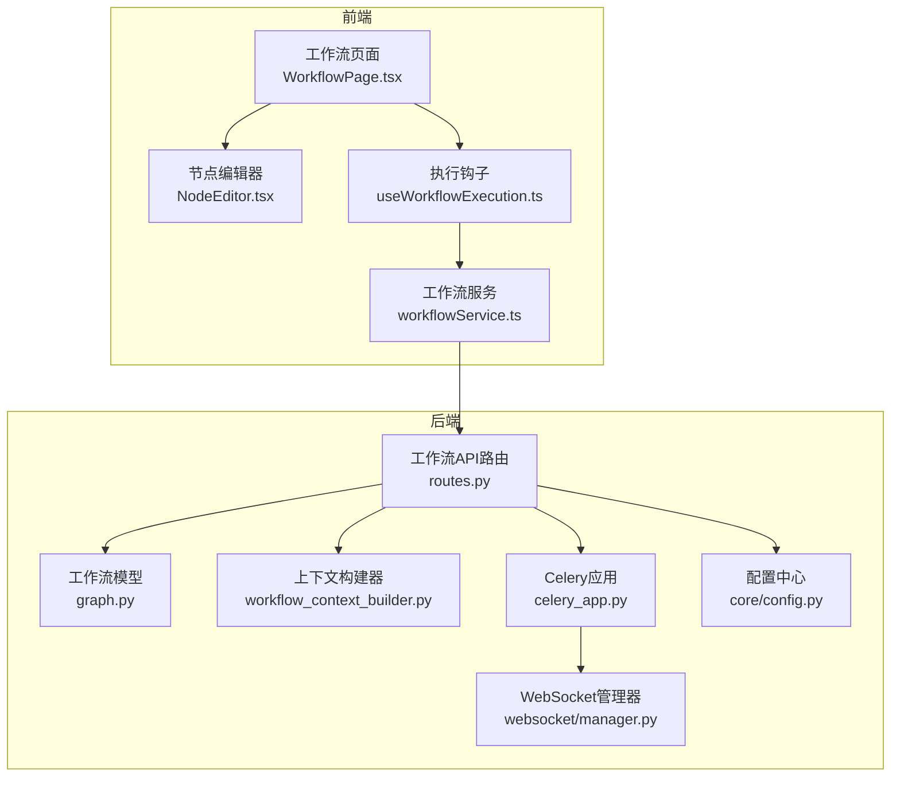
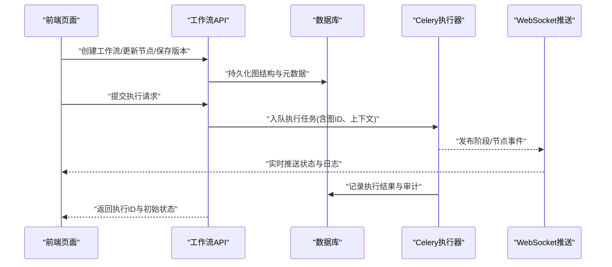
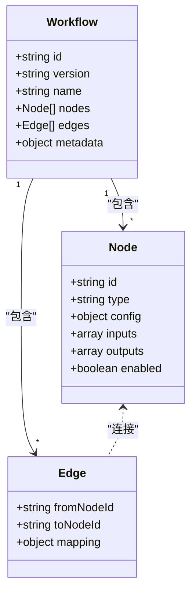
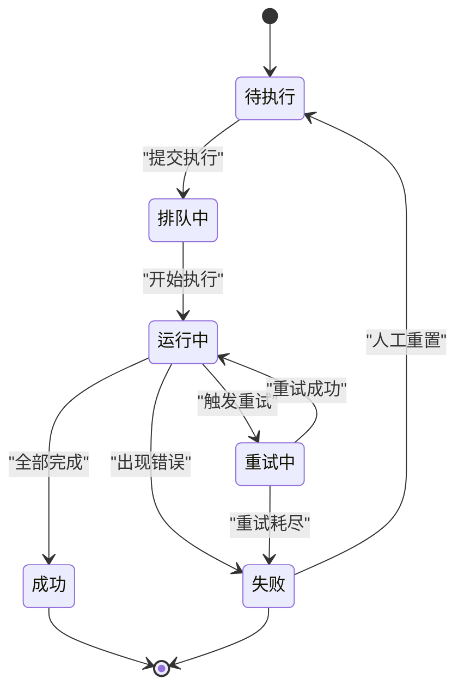
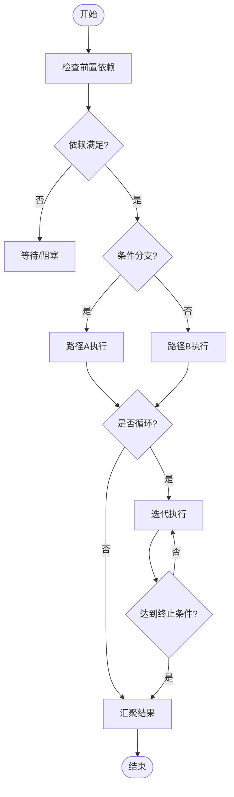
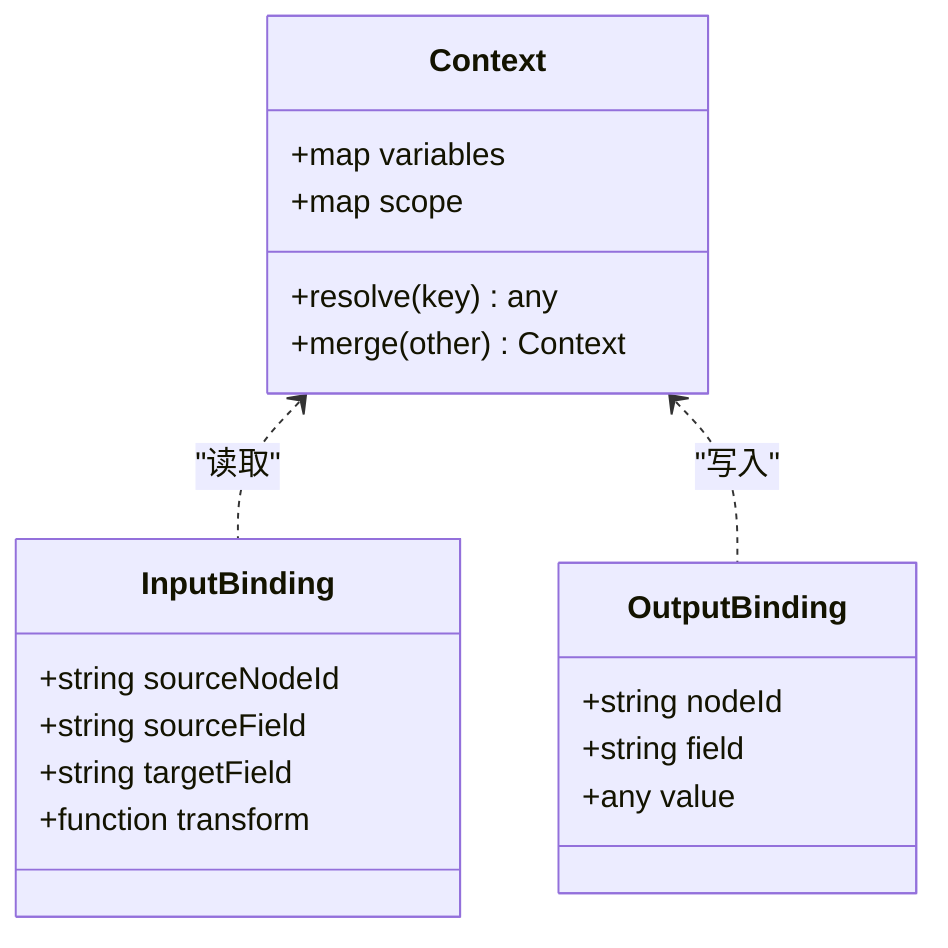
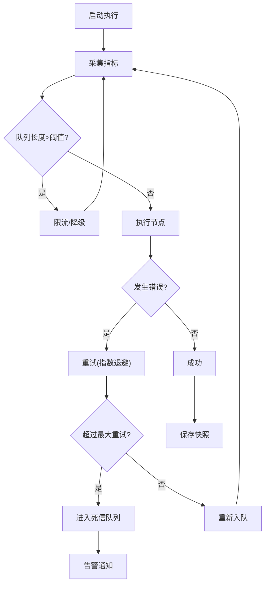
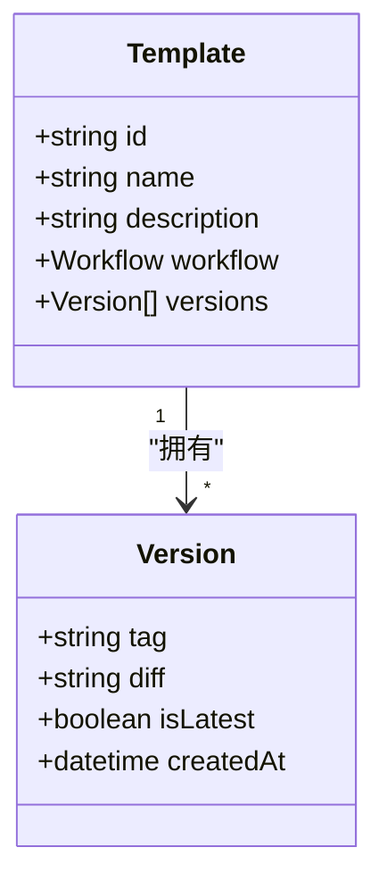
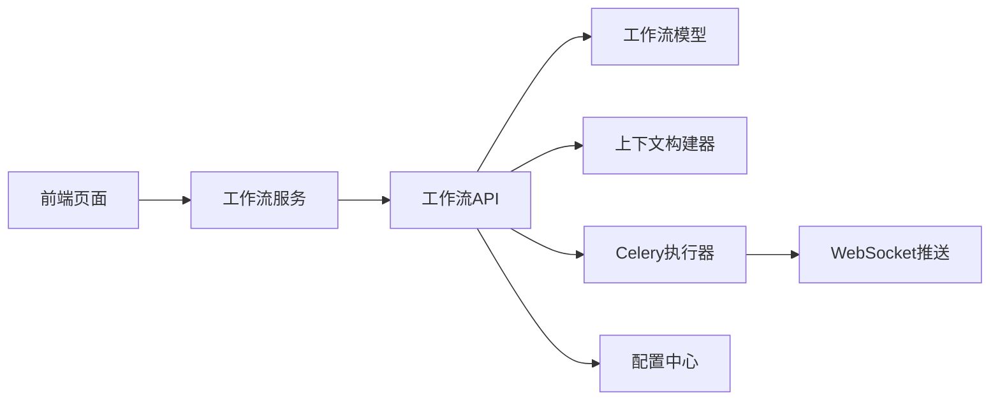

# 工作流控制页面

<cite>
**本文引用的文件**   
- [backend/app/api/v1/workflow/__init__.py](file://backend/app/api/v1/workflow/__init__.py)
- [backend/app/api/v1/workflow/routes.py](file://backend/app/api/v1/workflow/routes.py)
- [backend/app/services/workflow_context_builder.py](file://backend/app/services/workflow_context_builder.py)
- [backend/app/models/graph.py](file://backend/app/models/graph.py)
- [backend/app/celery_app.py](file://backend/app/celery_app.py)
- [backend/app/websocket/manager.py](file://backend/app/websocket/manager.py)
- [backend/app/core/config.py](file://backend/app/core/config.py)
- [frontend/src/pages/WorkflowPage.tsx](file://frontend/src/pages/WorkflowPage.tsx)
- [frontend/src/components/workflow/NodeEditor.tsx](file://frontend/src/components/workflow/NodeEditor.tsx)
- [frontend/src/hooks/useWorkflowExecution.ts](file://frontend/src/hooks/useWorkflowExecution.ts)
- [frontend/src/services/workflowService.ts](file://frontend/src/services/workflowService.ts)
</cite>

## 目录
1. [简介](#简介)
2. [项目结构](#项目结构)
3. [核心组件](#核心组件)
4. [架构总览](#架构总览)
5. [详细组件分析](#详细组件分析)
6. [依赖关系分析](#依赖关系分析)
7. [性能考虑](#性能考虑)
8. [故障排查指南](#故障排查指南)
9. [结论](#结论)
10. [附录](#附录)

## 简介
本文件面向“工作流控制页面”的功能与实现，覆盖以下关键能力：
- 工作流编排界面：可视化节点编辑、连线定义依赖关系。
- 执行状态监控：实时进度、阶段状态、事件推送。
- 日志查看与错误诊断：运行日志、错误堆栈、定位建议。
- 并行执行、条件分支与循环控制：调度策略与执行语义。
- 输入输出数据绑定、变量传递与上下文共享：运行时上下文构建与传播。
- 性能监控、资源调度与故障恢复：队列、重试、幂等与回滚。
- 工作流模板、版本管理与分享协作：模板库、版本化与权限协作。

## 项目结构
工作流控制页面由前端页面与后端服务共同组成：
- 前端
  - 页面入口与路由：用于渲染工作流画布与详情面板。
  - 节点编辑器：拖拽节点、配置参数、设置输入输出映射。
  - 执行钩子：发起执行、订阅进度、处理错误。
  - 服务层：封装 API 调用（创建、执行、查询、日志）。
- 后端
  - API 路由：工作流 CRUD、执行、状态、日志、模板管理。
  - 模型与图：工作流图结构、节点定义、依赖边。
  - 上下文构建：变量解析、输入输出绑定、共享上下文。
  - 任务调度：Celery 异步执行、重试、幂等。
  - WebSocket：实时推送执行事件与日志片段。
  - 配置：并发度、超时、重试策略、资源配额。

**图表来源** 
- [frontend/src/pages/WorkflowPage.tsx](file://frontend/src/pages/WorkflowPage.tsx)
- [frontend/src/components/workflow/NodeEditor.tsx](file://frontend/src/components/workflow/NodeEditor.tsx)
- [frontend/src/hooks/useWorkflowExecution.ts](file://frontend/src/hooks/useWorkflowExecution.ts)
- [frontend/src/services/workflowService.ts](file://frontend/src/services/workflowService.ts)
- [backend/app/api/v1/workflow/routes.py](file://backend/app/api/v1/workflow/routes.py)
- [backend/app/models/graph.py](file://backend/app/models/graph.py)
- [backend/app/services/workflow_context_builder.py](file://backend/app/services/workflow_context_builder.py)
- [backend/app/celery_app.py](file://backend/app/celery_app.py)
- [backend/app/websocket/manager.py](file://backend/app/websocket/manager.py)
- [backend/app/core/config.py](file://backend/app/core/config.py)

**章节来源**
- [backend/app/api/v1/workflow/routes.py](file://backend/app/api/v1/workflow/routes.py)
- [backend/app/models/graph.py](file://backend/app/models/graph.py)
- [backend/app/services/workflow_context_builder.py](file://backend/app/services/workflow_context_builder.py)
- [backend/app/celery_app.py](file://backend/app/celery_app.py)
- [backend/app/websocket/manager.py](file://backend/app/websocket/manager.py)
- [backend/app/core/config.py](file://backend/app/core/config.py)
- [frontend/src/pages/WorkflowPage.tsx](file://frontend/src/pages/WorkflowPage.tsx)
- [frontend/src/components/workflow/NodeEditor.tsx](file://frontend/src/components/workflow/NodeEditor.tsx)
- [frontend/src/hooks/useWorkflowExecution.ts](file://frontend/src/hooks/useWorkflowExecution.ts)
- [frontend/src/services/workflowService.ts](file://frontend/src/services/workflowService.ts)

## 核心组件
- 工作流图模型：定义节点类型、属性、输入输出端口、依赖边、版本信息。
- 上下文构建器：将用户输入、历史结果、系统变量注入到每个节点的执行上下文中。
- 执行引擎（Celery）：按拓扑排序执行节点，支持并行、条件分支与循环。
- WebSocket 推送：将阶段开始/结束、节点状态、日志片段实时推送到前端。
- 模板与版本：工作流模板库、版本快照、变更对比与回滚。
- 权限与协作：基于角色的访问控制、评论与审批流程。

**章节来源**
- [backend/app/models/graph.py](file://backend/app/models/graph.py)
- [backend/app/services/workflow_context_builder.py](file://backend/app/services/workflow_context_builder.py)
- [backend/app/celery_app.py](file://backend/app/celery_app.py)
- [backend/app/websocket/manager.py](file://backend/app/websocket/manager.py)

## 架构总览
工作流控制页面采用前后端分离架构，前端通过 REST 与 WebSocket 与后端交互；后端以 Celery 为执行引擎，结合数据库持久化与消息通道进行状态同步。

**图表来源** 
- [backend/app/api/v1/workflow/routes.py](file://backend/app/api/v1/workflow/routes.py)
- [backend/app/celery_app.py](file://backend/app/celery_app.py)
- [backend/app/websocket/manager.py](file://backend/app/websocket/manager.py)
- [backend/app/models/graph.py](file://backend/app/models/graph.py)

## 详细组件分析

### 工作流编排界面（前端）
- 画布与节点：支持拖拽、缩放、选择、批量操作；节点类型包括数据处理、LLM 调用、媒体生成、校验、回调等。
- 依赖关系设置：通过连线定义上游输出到下游输入的映射，支持多对一、一对多。
- 节点配置：参数表单、默认值、必填校验、动态字段、环境变量注入。
- 版本管理：保存为模板、打标签、对比差异、一键回滚。

**图表来源** 
- [backend/app/models/graph.py](file://backend/app/models/graph.py)
- [frontend/src/components/workflow/NodeEditor.tsx](file://frontend/src/components/workflow/NodeEditor.tsx)

**章节来源**
- [frontend/src/components/workflow/NodeEditor.tsx](file://frontend/src/components/workflow/NodeEditor.tsx)
- [backend/app/models/graph.py](file://backend/app/models/graph.py)

### 执行状态监控与日志
- 状态机：待执行、排队中、运行中、成功、失败、取消、重试中。
- 实时监控：阶段级与节点级状态、耗时、资源使用。
- 日志查看：结构化日志、关键字过滤、下载导出、错误高亮。
- 错误诊断：异常堆栈、上下文快照、依赖失败根因分析。

**图表来源** 
- [backend/app/websocket/manager.py](file://backend/app/websocket/manager.py)
- [backend/app/celery_app.py](file://backend/app/celery_app.py)

**章节来源**
- [backend/app/websocket/manager.py](file://backend/app/websocket/manager.py)
- [backend/app/celery_app.py](file://backend/app/celery_app.py)

### 并行执行、条件分支与循环控制
- 并行执行：无依赖的节点可并发执行，受全局并发度与节点级别限制。
- 条件分支：基于表达式或上游结果决定路径，支持短路逻辑。
- 循环控制：迭代器节点、终止条件、最大迭代次数、中间结果聚合。

**图表来源** 
- [backend/app/celery_app.py](file://backend/app/celery_app.py)
- [backend/app/services/workflow_context_builder.py](file://backend/app/services/workflow_context_builder.py)

**章节来源**
- [backend/app/celery_app.py](file://backend/app/celery_app.py)
- [backend/app/services/workflow_context_builder.py](file://backend/app/services/workflow_context_builder.py)

### 输入输出数据绑定、变量传递与上下文共享
- 数据绑定：节点输入端口与上游输出端口映射，支持字段级映射与转换。
- 变量传递：系统变量（时间戳、用户ID）、用户输入、中间结果。
- 上下文共享：跨节点共享只读上下文，支持作用域隔离与合并策略。

**图表来源** 
- [backend/app/services/workflow_context_builder.py](file://backend/app/services/workflow_context_builder.py)
- [backend/app/models/graph.py](file://backend/app/models/graph.py)

**章节来源**
- [backend/app/services/workflow_context_builder.py](file://backend/app/services/workflow_context_builder.py)
- [backend/app/models/graph.py](file://backend/app/models/graph.py)

### 性能监控、资源调度与故障恢复
- 性能监控：CPU/内存/IO 指标、队列长度、延迟分布、吞吐统计。
- 资源调度：节点级别资源配额、优先级队列、限流与熔断。
- 故障恢复：自动重试、指数退避、死信队列、补偿事务、快照恢复。

**图表来源** 
- [backend/app/celery_app.py](file://backend/app/celery_app.py)
- [backend/app/core/config.py](file://backend/app/core/config.py)

**章节来源**
- [backend/app/celery_app.py](file://backend/app/celery_app.py)
- [backend/app/core/config.py](file://backend/app/core/config.py)

### 工作流模板、版本管理与分享协作
- 模板库：内置模板、社区模板、自定义模板分类与搜索。
- 版本管理：语义化版本、变更日志、对比与回滚。
- 分享协作：权限控制、评论与审批、引用与依赖声明。

**图表来源** 
- [backend/app/models/graph.py](file://backend/app/models/graph.py)
- [backend/app/api/v1/workflow/routes.py](file://backend/app/api/v1/workflow/routes.py)

**章节来源**
- [backend/app/models/graph.py](file://backend/app/models/graph.py)
- [backend/app/api/v1/workflow/routes.py](file://backend/app/api/v1/workflow/routes.py)

## 依赖关系分析
- 前端依赖：页面组件依赖服务层，服务层依赖 API 路由。
- 后端依赖：路由依赖模型、上下文构建器、Celery、WebSocket、配置。
- 外部依赖：数据库、消息队列、对象存储（大文件）、第三方服务（LLM/媒体）。

**图表来源** 
- [frontend/src/services/workflowService.ts](file://frontend/src/services/workflowService.ts)
- [backend/app/api/v1/workflow/routes.py](file://backend/app/api/v1/workflow/routes.py)
- [backend/app/models/graph.py](file://backend/app/models/graph.py)
- [backend/app/services/workflow_context_builder.py](file://backend/app/services/workflow_context_builder.py)
- [backend/app/celery_app.py](file://backend/app/celery_app.py)
- [backend/app/websocket/manager.py](file://backend/app/websocket/manager.py)
- [backend/app/core/config.py](file://backend/app/core/config.py)

**章节来源**
- [backend/app/api/v1/workflow/routes.py](file://backend/app/api/v1/workflow/routes.py)
- [backend/app/models/graph.py](file://backend/app/models/graph.py)
- [backend/app/services/workflow_context_builder.py](file://backend/app/services/workflow_context_builder.py)
- [backend/app/celery_app.py](file://backend/app/celery_app.py)
- [backend/app/websocket/manager.py](file://backend/app/websocket/manager.py)
- [backend/app/core/config.py](file://backend/app/core/config.py)
- [frontend/src/services/workflowService.ts](file://frontend/src/services/workflowService.ts)

## 性能考虑
- 执行优化：拓扑排序、惰性求值、缓存中间结果、批处理。
- 并发控制：全局与节点级并发度、背压与限流、资源隔离。
- 存储优化：分片与归档、冷热分层、压缩与去重。
- 网络优化：分页与增量拉取、SSE/WebSocket 优先、断点续传。

[本节为通用指导，不直接分析具体文件]

## 故障排查指南
- 常见问题
  - 节点执行超时：检查超时配置、上游依赖、资源配额。
  - 上下文缺失：确认输入绑定、变量作用域、默认值。
  - 并发冲突：锁机制、幂等键、重试策略。
  - 日志缺失：日志级别、收集链路、磁盘空间。
- 诊断步骤
  - 查看执行状态与阶段事件。
  - 检索节点日志与异常堆栈。
  - 检查上下文快照与输入输出映射。
  - 验证依赖拓扑与条件表达式。
- 恢复策略
  - 重试与回滚、快照恢复、补偿任务。

**章节来源**
- [backend/app/websocket/manager.py](file://backend/app/websocket/manager.py)
- [backend/app/celery_app.py](file://backend/app/celery_app.py)
- [backend/app/services/workflow_context_builder.py](file://backend/app/services/workflow_context_builder.py)

## 结论
工作流控制页面提供从编排到执行的完整闭环，具备可视化编辑、强上下文管理、可靠执行与实时观测能力。通过模板与版本管理提升复用性，借助并发与限流保障稳定性，配合日志与诊断工具提高可维护性。

[本节为总结，不直接分析具体文件]

## 附录
- 术语表：工作流、节点、边、上下文、拓扑排序、幂等、死信队列。
- 最佳实践：最小化副作用、明确输入输出、合理拆分节点、设置超时与重试、保留审计日志。
- 扩展点：自定义节点类型、插件式适配器、指标上报、审批集成。

[本节为补充说明，不直接分析具体文件]