# 时间轴编辑器

<cite>
**本文引用的文件**   
- [frontend/src/pages/AudiobookTimeline.tsx](file://frontend/src/pages/AudiobookTimeline.tsx)
- [frontend/src/components/timeline/TimelineCanvas.tsx](file://frontend/src/components/timeline/TimelineCanvas.tsx)
- [frontend/src/components/timeline/TrackManager.tsx](file://frontend/src/components/timeline/TrackManager.tsx)
- [frontend/src/hooks/useTimelineState.ts](file://frontend/src/hooks/useTimelineState.ts)
- [frontend/src/services/timelineService.ts](file://frontend/src/services/timelineService.ts)
- [backend/app/api/v1/audiobook.py](file://backend/app/api/v1/audiobook.py)
- [backend/app/services/audiobook/timeline_edit_service.py](file://backend/app/services/audiobook/timeline_edit_service.py)
- [backend/app/models/audiobook_task.py](file://backend/app/models/audiobook_task.py)
- [backend/app/schemas/audiobook.py](file://backend/app/schemas/audiobook.py)
- [backend/tests/test_audiobook_timeline_edits.py](file://backend/tests/test_audiobook_timeline_edits.py)
</cite>

## 目录
1. [简介](#简介)
2. [项目结构](#项目结构)
3. [核心组件](#核心组件)
4. [架构总览](#架构总览)
5. [详细组件分析](#详细组件分析)
6. [依赖关系分析](#依赖关系分析)
7. [性能考量](#性能考量)
8. [故障排查指南](#故障排查指南)
9. [结论](#结论)
10. [附录](#附录)

## 简介
本文件面向“时间轴编辑器”的功能与实现，覆盖可视化编辑界面、轨道管理、图层叠加、时间标尺显示；音频片段的拖拽操作（移动、缩放、分割、合并）；关键帧编辑（音量包络、淡入淡出、动态参数）；多轨混音（声道平衡、相位检查、频率分析）；自动化脚本、批量处理与模板应用；以及导出、版本比较与协作编辑支持。文档同时提供架构图、数据流图与流程图，帮助读者快速理解前端交互到后端处理的完整链路。

## 项目结构
时间轴编辑器由前后端协同实现：
- 前端负责可视化渲染、用户交互、状态管理与本地缓存，包含时间轴画布、轨道管理、片段与关键帧编辑等模块。
- 后端提供时间轴编辑的API、持久化、任务编排与导出能力，并配合测试保障稳定性。

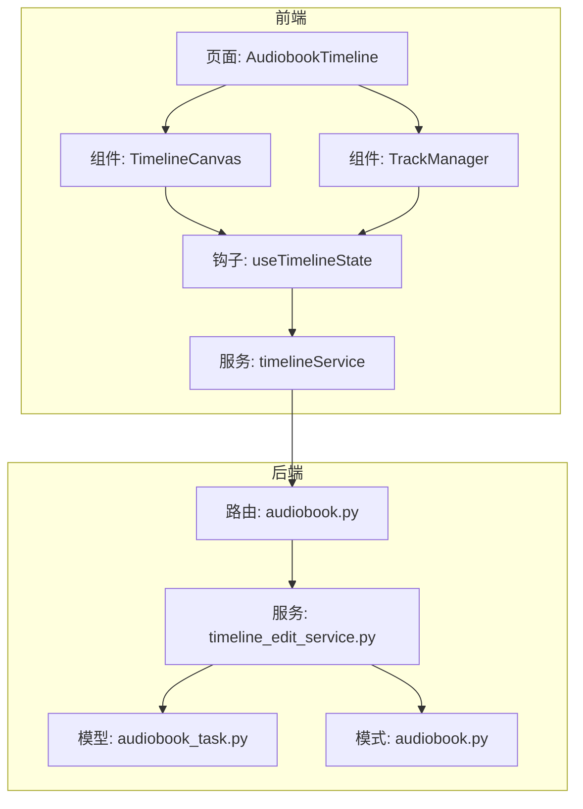

**图表来源** 
- [frontend/src/pages/AudiobookTimeline.tsx](file://frontend/src/pages/AudiobookTimeline.tsx)
- [frontend/src/components/timeline/TimelineCanvas.tsx](file://frontend/src/components/timeline/TimelineCanvas.tsx)
- [frontend/src/components/timeline/TrackManager.tsx](file://frontend/src/components/timeline/TrackManager.tsx)
- [frontend/src/hooks/useTimelineState.ts](file://frontend/src/hooks/useTimelineState.ts)
- [frontend/src/services/timelineService.ts](file://frontend/src/services/timelineService.ts)
- [backend/app/api/v1/audiobook.py](file://backend/app/api/v1/audiobook.py)
- [backend/app/services/audiobook/timeline_edit_service.py](file://backend/app/services/audiobook/timeline_edit_service.py)
- [backend/app/models/audiobook_task.py](file://backend/app/models/audiobook_task.py)
- [backend/app/schemas/audiobook.py](file://backend/app/schemas/audiobook.py)

**章节来源**
- [frontend/src/pages/AudiobookTimeline.tsx](file://frontend/src/pages/AudiobookTimeline.tsx)
- [frontend/src/components/timeline/TimelineCanvas.tsx](file://frontend/src/components/timeline/TimelineCanvas.tsx)
- [frontend/src/components/timeline/TrackManager.tsx](file://frontend/src/components/timeline/TrackManager.tsx)
- [frontend/src/hooks/useTimelineState.ts](file://frontend/src/hooks/useTimelineState.ts)
- [frontend/src/services/timelineService.ts](file://frontend/src/services/timelineService.ts)
- [backend/app/api/v1/audiobook.py](file://backend/app/api/v1/audiobook.py)
- [backend/app/services/audiobook/timeline_edit_service.py](file://backend/app/services/audiobook/timeline_edit_service.py)
- [backend/app/models/audiobook_task.py](file://backend/app/models/audiobook_task.py)
- [backend/app/schemas/audiobook.py](file://backend/app/schemas/audiobook.py)

## 核心组件
- 时间轴画布（TimelineCanvas）：负责时间标尺绘制、网格与播放头、片段与关键帧的渲染与交互事件分发。
- 轨道管理器（TrackManager）：维护轨道列表、层级顺序、可见性、锁定状态与选中态。
- 时间轴状态（useTimelineState）：集中管理当前视图范围、缩放级别、选区、撤销/重做栈、片段与关键帧集合。
- 时间轴服务（timelineService）：封装与后端的通信，提交编辑指令、拉取元数据、触发导出与批量任务。
- 后端时间轴编辑服务（timeline_edit_service.py）：校验编辑请求、生成变更集、落库与任务编排。
- API路由（audiobook.py）：暴露时间轴编辑、导出、版本比较与协作相关接口。

**章节来源**
- [frontend/src/components/timeline/TimelineCanvas.tsx](file://frontend/src/components/timeline/TimelineCanvas.tsx)
- [frontend/src/components/timeline/TrackManager.tsx](file://frontend/src/components/timeline/TrackManager.tsx)
- [frontend/src/hooks/useTimelineState.ts](file://frontend/src/hooks/useTimelineState.ts)
- [frontend/src/services/timelineService.ts](file://frontend/src/services/timelineService.ts)
- [backend/app/services/audiobook/timeline_edit_service.py](file://backend/app/services/audiobook/timeline_edit_service.py)
- [backend/app/api/v1/audiobook.py](file://backend/app/api/v1/audiobook.py)

## 架构总览
时间轴编辑器的整体流程从前端交互开始，经过状态更新与服务调用，最终由后端完成持久化与任务调度。

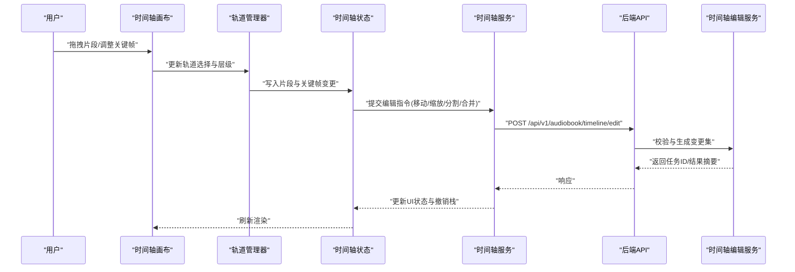

**图表来源** 
- [frontend/src/components/timeline/TimelineCanvas.tsx](file://frontend/src/components/timeline/TimelineCanvas.tsx)
- [frontend/src/components/timeline/TrackManager.tsx](file://frontend/src/components/timeline/TrackManager.tsx)
- [frontend/src/hooks/useTimelineState.ts](file://frontend/src/hooks/useTimelineState.ts)
- [frontend/src/services/timelineService.ts](file://frontend/src/services/timelineService.ts)
- [backend/app/api/v1/audiobook.py](file://backend/app/api/v1/audiobook.py)
- [backend/app/services/audiobook/timeline_edit_service.py](file://backend/app/services/audiobook/timeline_edit_service.py)

## 详细组件分析

### 时间轴画布（TimelineCanvas）
- 功能要点
  - 时间标尺：支持秒/帧切换、缩放、滚动同步播放头。
  - 图层叠加：按轨道层级渲染片段与关键帧曲线，支持透明度与混合模式。
  - 交互事件：捕获鼠标/触摸事件，区分点击、拖拽、滚轮缩放与双击分割。
  - 性能优化：视口裁剪、增量重绘、离屏缓冲减少闪烁。
- 数据结构
  - 片段对象：包含起止时间、轨道索引、类型（音频/字幕/特效）、锚点与变换矩阵。
  - 关键帧对象：时间戳、参数值（如音量、淡入淡出系数、均衡器频段增益）。
- 错误处理
  - 边界检测：防止片段越界或重叠冲突。
  - 回退策略：当渲染失败时降级为线框模式。

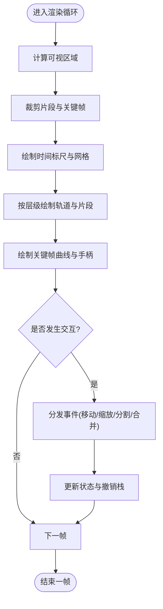

**图表来源** 
- [frontend/src/components/timeline/TimelineCanvas.tsx](file://frontend/src/components/timeline/TimelineCanvas.tsx)

**章节来源**
- [frontend/src/components/timeline/TimelineCanvas.tsx](file://frontend/src/components/timeline/TimelineCanvas.tsx)

### 轨道管理器（TrackManager）
- 功能要点
  - 轨道CRUD：新增、删除、排序、锁定/解锁、可见性控制。
  - 层级管理：支持图层叠加顺序与混合模式配置。
  - 选中态：单选/多选、跨轨道选择、快捷键操作。
- 数据结构
  - 轨道对象：包含名称、类型（音频/视频/字幕/效果）、颜色、锁定标志、混合模式。
- 错误处理
  - 冲突检测：避免重复ID与非法层级。
  - 恢复机制：撤销/重做对轨道结构的原子性操作。

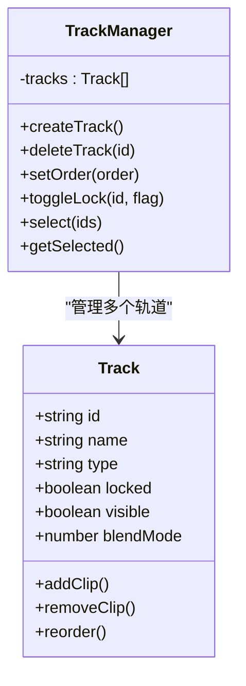

**图表来源** 
- [frontend/src/components/timeline/TrackManager.tsx](file://frontend/src/components/timeline/TrackManager.tsx)

**章节来源**
- [frontend/src/components/timeline/TrackManager.tsx](file://frontend/src/components/timeline/TrackManager.tsx)

### 时间轴状态（useTimelineState）
- 功能要点
  - 视图状态：时间窗口、缩放级别、播放头位置。
  - 数据状态：片段集合、关键帧集合、选中项、撤销/重做栈。
  - 一致性：保证前后端同步与本地缓存的一致性。
- 复杂度分析
  - 片段插入/删除：O(n) 数组操作，可通过索引映射优化至 O(log n)。
  - 关键帧插值：线性/样条插值，复杂度与关键帧数量成正比。
- 错误处理
  - 事务性更新：批量变更失败时回滚。
  - 并发冲突：基于版本号或时间戳的乐观锁。

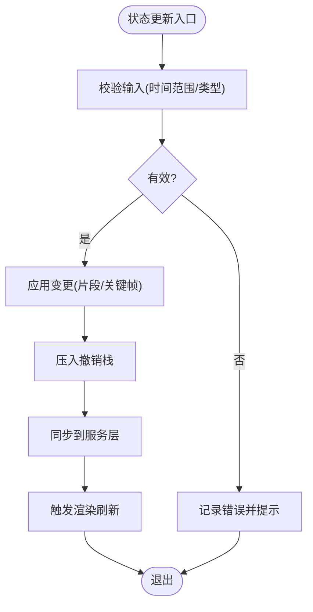

**图表来源** 
- [frontend/src/hooks/useTimelineState.ts](file://frontend/src/hooks/useTimelineState.ts)

**章节来源**
- [frontend/src/hooks/useTimelineState.ts](file://frontend/src/hooks/useTimelineState.ts)

### 时间轴服务（timelineService）
- 功能要点
  - 编辑提交：将前端变更序列化为标准载荷，调用后端API。
  - 任务查询：轮询或订阅任务进度（导出、批量处理、模板应用）。
  - 错误重试：网络异常与服务器限流的指数退避。
- 数据结构
  - 编辑请求：包含操作类型、目标片段/关键帧、参数变化。
  - 任务响应：任务ID、状态、进度百分比、错误信息。

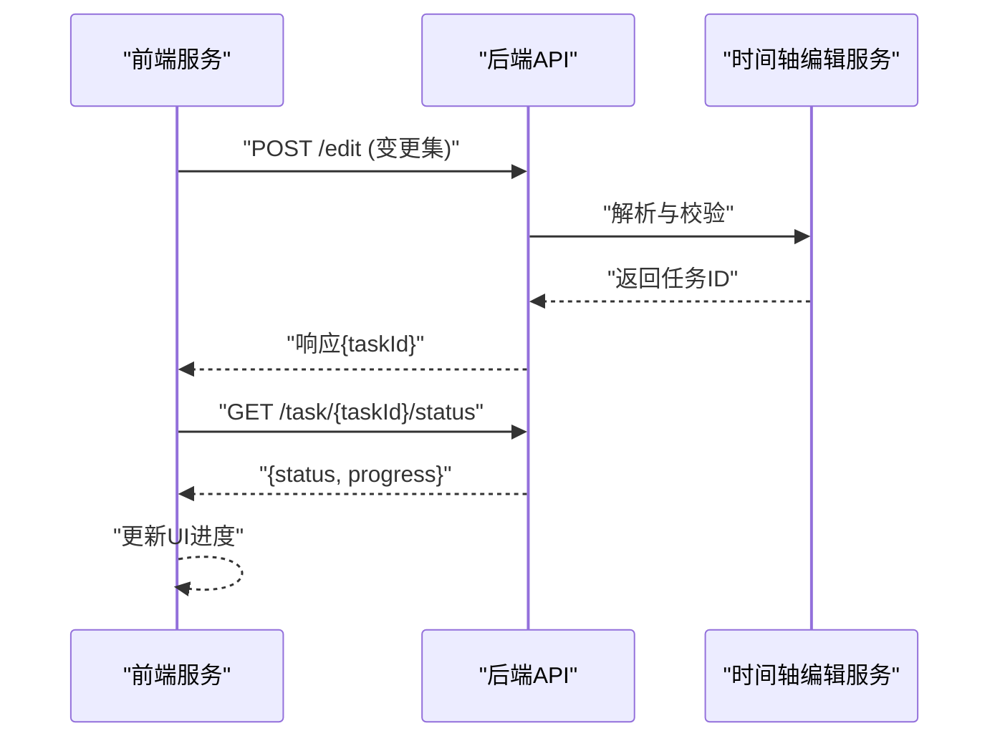

**图表来源** 
- [frontend/src/services/timelineService.ts](file://frontend/src/services/timelineService.ts)
- [backend/app/api/v1/audiobook.py](file://backend/app/api/v1/audiobook.py)
- [backend/app/services/audiobook/timeline_edit_service.py](file://backend/app/services/audiobook/timeline_edit_service.py)

**章节来源**
- [frontend/src/services/timelineService.ts](file://frontend/src/services/timelineService.ts)
- [backend/app/api/v1/audiobook.py](file://backend/app/api/v1/audiobook.py)
- [backend/app/services/audiobook/timeline_edit_service.py](file://backend/app/services/audiobook/timeline_edit_service.py)

### 后端时间轴编辑服务（timeline_edit_service.py）
- 功能要点
  - 请求校验：验证片段ID、时间范围、关键帧合法性。
  - 变更集生成：对比旧版本与新版本，生成最小差异。
  - 持久化：写入数据库与版本表，支持回溯。
  - 任务编排：异步执行导出、批量处理、模板应用。
- 错误处理
  - 约束冲突：时间重叠、轨道不可写、权限不足。
  - 幂等性：相同请求多次提交不产生副作用。

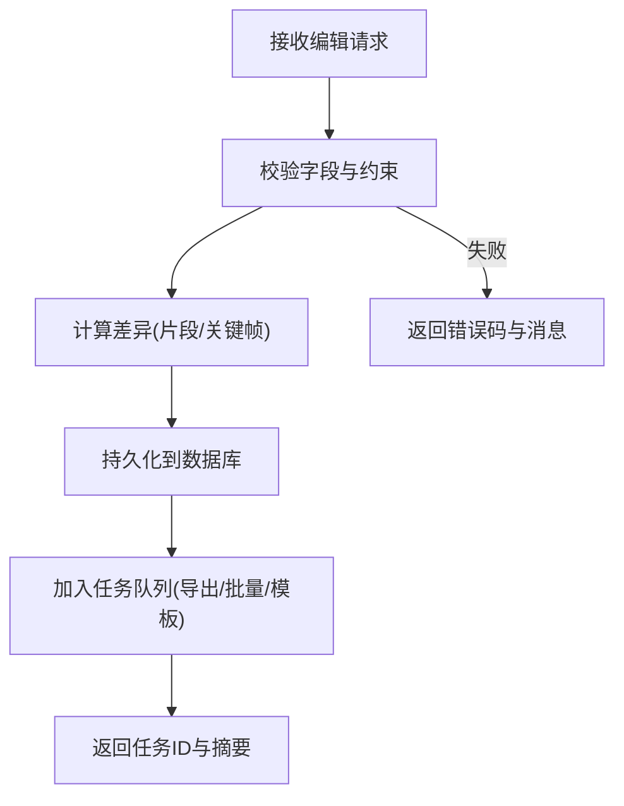

**图表来源** 
- [backend/app/services/audiobook/timeline_edit_service.py](file://backend/app/services/audiobook/timeline_edit_service.py)
- [backend/app/models/audiobook_task.py](file://backend/app/models/audiobook_task.py)
- [backend/app/schemas/audiobook.py](file://backend/app/schemas/audiobook.py)

**章节来源**
- [backend/app/services/audiobook/timeline_edit_service.py](file://backend/app/services/audiobook/timeline_edit_service.py)
- [backend/app/models/audiobook_task.py](file://backend/app/models/audiobook_task.py)
- [backend/app/schemas/audiobook.py](file://backend/app/schemas/audiobook.py)

### 音频片段拖拽操作（移动、缩放、分割、合并）
- 移动：在轨道内拖动改变起止时间，保持时长不变。
- 缩放：边缘拖拽调整时长，自动对齐采样边界。
- 分割：双击或快捷键在播放头处切分片段为两段。
- 合并：选中相邻片段进行合并，保留各自关键帧并平滑过渡。

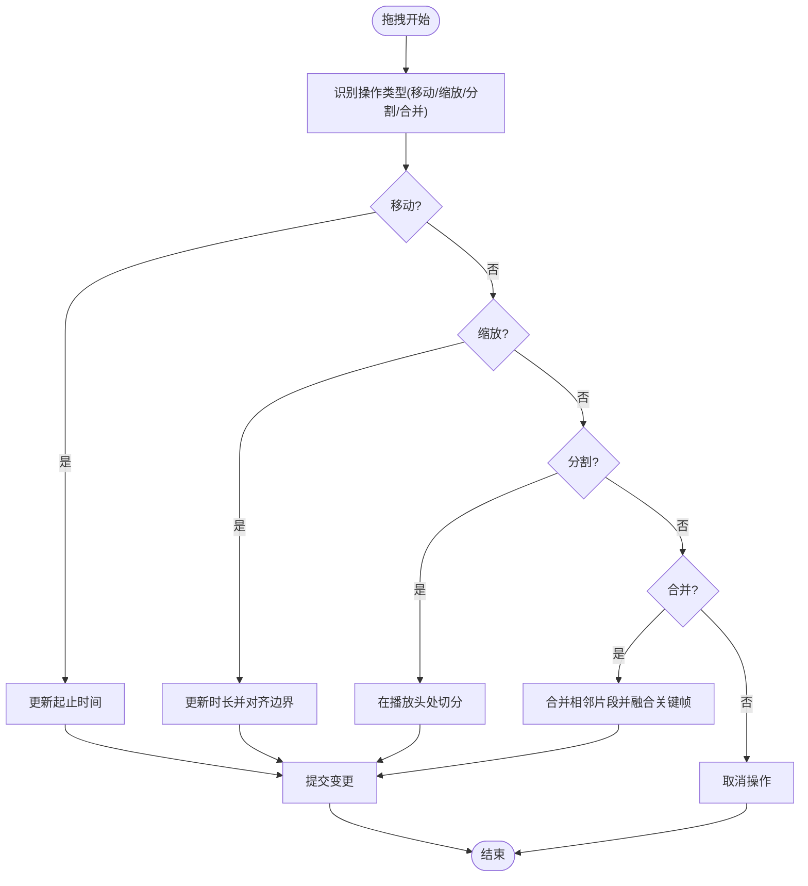

**图表来源** 
- [frontend/src/components/timeline/TimelineCanvas.tsx](file://frontend/src/components/timeline/TimelineCanvas.tsx)
- [frontend/src/hooks/useTimelineState.ts](file://frontend/src/hooks/useTimelineState.ts)

**章节来源**
- [frontend/src/components/timeline/TimelineCanvas.tsx](file://frontend/src/components/timeline/TimelineCanvas.tsx)
- [frontend/src/hooks/useTimelineState.ts](file://frontend/src/hooks/useTimelineState.ts)

### 关键帧编辑（音量包络、淡入淡出、动态参数）
- 音量包络：在片段上添加关键帧形成音量曲线，支持线性与贝塞尔插值。
- 淡入淡出：通过关键帧设置起始/结束包络，自动生成平滑过渡。
- 动态参数：可绑定均衡器、压缩器、声像等参数随时间变化。

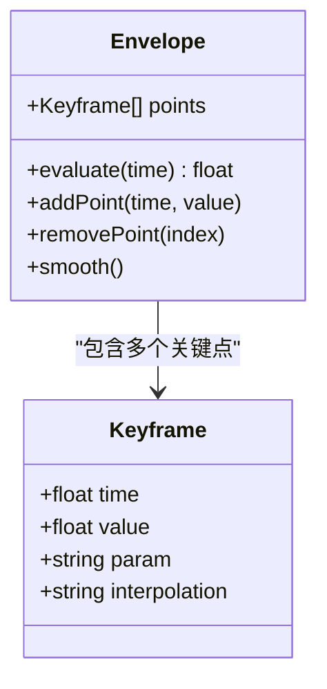

**图表来源** 
- [frontend/src/components/timeline/TimelineCanvas.tsx](file://frontend/src/components/timeline/TimelineCanvas.tsx)
- [frontend/src/hooks/useTimelineState.ts](file://frontend/src/hooks/useTimelineState.ts)

**章节来源**
- [frontend/src/components/timeline/TimelineCanvas.tsx](file://frontend/src/components/timeline/TimelineCanvas.tsx)
- [frontend/src/hooks/useTimelineState.ts](file://frontend/src/hooks/useTimelineState.ts)

### 多轨混音（声道平衡、相位检查、频率分析）
- 声道平衡：左右声道独立调节音量与声像。
- 相位检查：检测多轨相位抵消，提供反相开关与对齐工具。
- 频率分析：实时频谱显示，辅助均衡与降噪决策。

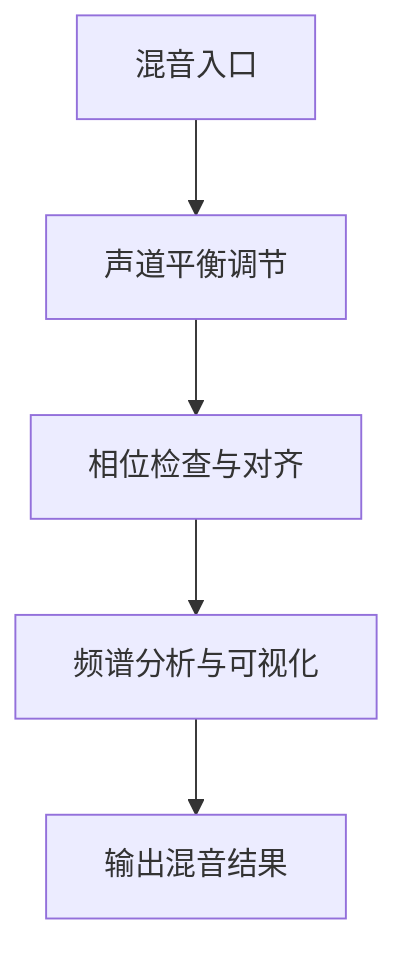

**图表来源** 
- [frontend/src/components/timeline/TimelineCanvas.tsx](file://frontend/src/components/timeline/TimelineCanvas.tsx)
- [backend/app/services/audiobook/timeline_edit_service.py](file://backend/app/services/audiobook/timeline_edit_service.py)

**章节来源**
- [frontend/src/components/timeline/TimelineCanvas.tsx](file://frontend/src/components/timeline/TimelineCanvas.tsx)
- [backend/app/services/audiobook/timeline_edit_service.py](file://backend/app/services/audiobook/timeline_edit_service.py)

### 自动化脚本、批量处理与模板应用
- 自动化脚本：通过API提交脚本任务，支持Python/JS脚本引擎执行。
- 批量处理：对多个片段或轨道执行统一操作（归一化、转码、去噪）。
- 模板应用：加载预设轨道布局、效果链与关键帧模板，快速搭建工程。

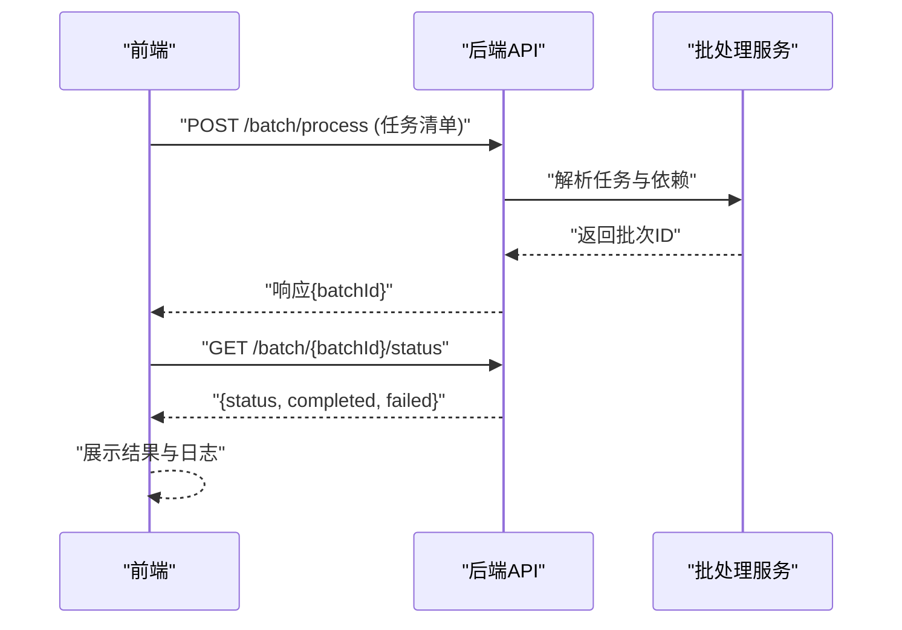

**图表来源** 
- [backend/app/api/v1/audiobook.py](file://backend/app/api/v1/audiobook.py)
- [backend/app/services/audiobook/timeline_edit_service.py](file://backend/app/services/audiobook/timeline_edit_service.py)

**章节来源**
- [backend/app/api/v1/audiobook.py](file://backend/app/api/v1/audiobook.py)
- [backend/app/services/audiobook/timeline_edit_service.py](file://backend/app/services/audiobook/timeline_edit_service.py)

### 导出、版本比较与协作编辑
- 导出：支持WAV/MP3/FLAC等多格式，可选择轨道与时间段。
- 版本比较：对比两个时间轴版本的差异，生成补丁或合并报告。
- 协作编辑：多人在线编辑，冲突检测与合并策略（以时间戳为准）。

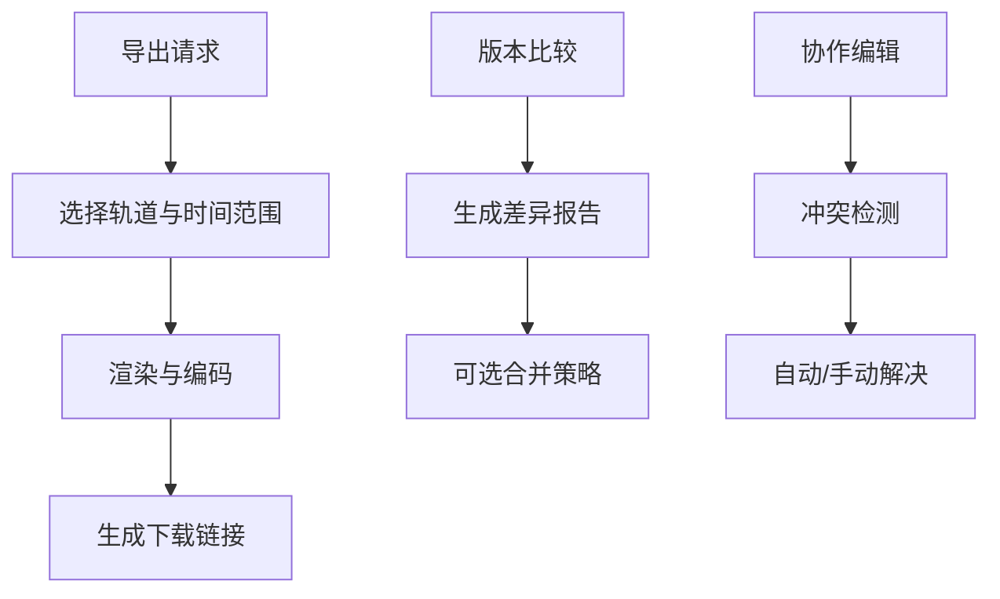

**图表来源** 
- [backend/app/api/v1/audiobook.py](file://backend/app/api/v1/audiobook.py)
- [backend/app/services/audiobook/timeline_edit_service.py](file://backend/app/services/audiobook/timeline_edit_service.py)

**章节来源**
- [backend/app/api/v1/audiobook.py](file://backend/app/api/v1/audiobook.py)
- [backend/app/services/audiobook/timeline_edit_service.py](file://backend/app/services/audiobook/timeline_edit_service.py)

## 依赖关系分析
时间轴编辑器的前后端依赖清晰，模块间耦合度低，便于扩展与维护。

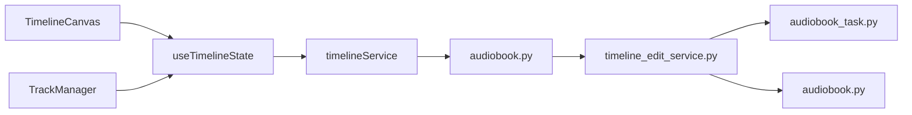

**图表来源** 
- [frontend/src/components/timeline/TimelineCanvas.tsx](file://frontend/src/components/timeline/TimelineCanvas.tsx)
- [frontend/src/components/timeline/TrackManager.tsx](file://frontend/src/components/timeline/TrackManager.tsx)
- [frontend/src/hooks/useTimelineState.ts](file://frontend/src/hooks/useTimelineState.ts)
- [frontend/src/services/timelineService.ts](file://frontend/src/services/timelineService.ts)
- [backend/app/api/v1/audiobook.py](file://backend/app/api/v1/audiobook.py)
- [backend/app/services/audiobook/timeline_edit_service.py](file://backend/app/services/audiobook/timeline_edit_service.py)
- [backend/app/models/audiobook_task.py](file://backend/app/models/audiobook_task.py)
- [backend/app/schemas/audiobook.py](file://backend/app/schemas/audiobook.py)

**章节来源**
- [frontend/src/components/timeline/TimelineCanvas.tsx](file://frontend/src/components/timeline/TimelineCanvas.tsx)
- [frontend/src/components/timeline/TrackManager.tsx](file://frontend/src/components/timeline/TrackManager.tsx)
- [frontend/src/hooks/useTimelineState.ts](file://frontend/src/hooks/useTimelineState.ts)
- [frontend/src/services/timelineService.ts](file://frontend/src/services/timelineService.ts)
- [backend/app/api/v1/audiobook.py](file://backend/app/api/v1/audiobook.py)
- [backend/app/services/audiobook/timeline_edit_service.py](file://backend/app/services/audiobook/timeline_edit_service.py)
- [backend/app/models/audiobook_task.py](file://backend/app/models/audiobook_task.py)
- [backend/app/schemas/audiobook.py](file://backend/app/schemas/audiobook.py)

## 性能考量
- 前端渲染
  - 使用离屏缓冲与视口裁剪减少重绘开销。
  - 关键帧插值采用增量计算，避免全量重算。
  - 大工程下启用虚拟滚动与懒加载。
- 后端处理
  - 任务队列异步化，避免阻塞主线程。
  - 数据库读写分离与索引优化，提升查询效率。
  - 导出任务分片并行处理，提高吞吐。

[本节为通用指导，无需特定文件引用]

## 故障排查指南
- 常见问题
  - 拖拽无响应：检查事件监听与命中测试逻辑。
  - 关键帧不生效：确认插值算法与参数范围。
  - 导出失败：查看任务日志与编码器配置。
  - 协作冲突：核对版本号与时间戳，必要时手动合并。
- 调试建议
  - 前端：打开控制台日志，观察状态变更与事件流。
  - 后端：查看任务队列与数据库变更记录，定位异常点。

**章节来源**
- [backend/tests/test_audiobook_timeline_edits.py](file://backend/tests/test_audiobook_timeline_edits.py)

## 结论
时间轴编辑器通过清晰的前后端分层与模块化设计，实现了高效的可视化编辑体验。其核心能力涵盖轨道管理、片段拖拽、关键帧编辑、多轨混音、自动化与协作编辑，能够满足专业音频编辑需求。建议在后续迭代中进一步优化性能与用户体验，增强插件生态与第三方集成能力。

[本节为总结性内容，无需特定文件引用]

## 附录
- 术语表
  - 片段：时间轴上的基本编辑单元，包含音频、字幕或效果。
  - 关键帧：描述参数随时间变化的时间点与值。
  - 轨道：承载片段与关键帧的逻辑容器。
  - 导出：将时间轴内容转换为媒体文件或工程文件。
- 参考文件
  - 前端页面与组件：AudiobookTimeline、TimelineCanvas、TrackManager
  - 状态与服务：useTimelineState、timelineService
  - 后端API与服务：audiobook.py、timeline_edit_service.py
  - 模型与模式：audiobook_task.py、audiobook.py
  - 测试用例：test_audiobook_timeline_edits.py

[本节为补充信息，无需特定文件引用]