# 有声书编辑页面

<cite>
**本文引用的文件**   
- [frontend/src/pages/AudiobookEditor.tsx](file://frontend/src/pages/AudiobookEditor.tsx)
- [frontend/src/components/Audiobook/ChapterEditor.tsx](file://frontend/src/components/Audiobook/ChapterEditor.tsx)
- [frontend/src/components/Audiobook/CharacterAssignment.tsx](file://frontend/src/components/Audiobook/CharacterAssignment.tsx)
- [frontend/src/components/Audiobook/VoiceConfigPanel.tsx](file://frontend/src/components/Audiobook/VoiceConfigPanel.tsx)
- [frontend/src/components/Audiobook/ScriptEditor.tsx](file://frontend/src/components/Audiobook/ScriptEditor.tsx)
- [frontend/src/components/Audiobook/AudioPlayer.tsx](file://frontend/src/components/Audiobook/AudioPlayer.tsx)
- [frontend/src/components/Audiobook/TimelineEditor.tsx](file://frontend/src/components/Audiobook/TimelineEditor.tsx)
- [frontend/src/components/Audiobook/SubtitleManager.tsx](file://frontend/src/components/Audiobook/SubtitleManager.tsx)
- [frontend/src/components/Audiobook/SoundEffectLibrary.tsx](file://frontend/src/components/Audiobook/SoundEffectLibrary.tsx)
- [frontend/src/components/Audiobook/BackgroundMusic.tsx](file://frontend/src/components/Audiobook/BackgroundMusic.tsx)
- [frontend/src/components/Audiobook/MixingControl.tsx](file://frontend/src/components/Audiobook/MixingControl.tsx)
- [frontend/src/hooks/useAudiobookState.ts](file://frontend/src/hooks/useAudiobookState.ts)
- [backend/app/api/v1/audiobook_api/chapters.py](file://backend/app/api/v1/audiobook_api/chapters.py)
- [backend/app/api/v1/audiobook_api/script.py](file://backend/app/api/v1/audiobook_api/script.py)
- [backend/app/api/v1/audiobook_api/audio.py](file://backend/app/api/v1/audiobook_api/audio.py)
- [backend/app/services/audiobook/chapter_service.py](file://backend/app/services/audiobook/chapter_service.py)
- [backend/app/services/audiobook/script_service.py](file://backend/app/services/audiobook/script_service.py)
- [backend/app/services/audiobook/audio_service.py](file://backend/app/services/audiobook/audio_service.py)
- [backend/app/models/audiobook.py](file://backend/app/models/audiobook.py)
- [backend/app/schemas/audiobook.py](file://backend/app/schemas/audiobook.py)
</cite>

## 目录
1. [简介](#简介)
2. [项目结构](#项目结构)
3. [核心组件](#核心组件)
4. [架构总览](#架构总览)
5. [详细组件分析](#详细组件分析)
6. [依赖关系分析](#依赖关系分析)
7. [性能考量](#性能考量)
8. [故障排查指南](#故障排查指南)
9. [结论](#结论)
10. [附录](#附录)

## 简介
本文件为“有声书编辑页面”的全面功能文档，覆盖章节编辑器、角色分配界面、语音配置面板、脚本编辑器（富文本、语法高亮、实时预览）、角色声音选择与音色调整、对话分配、音频播放控制、时间轴编辑、字幕管理、音效库浏览、背景音乐添加与混音控制、章节导航、进度跟踪与质量检查等。文档面向技术与非技术读者，提供从系统架构到具体组件的逐层说明，并辅以流程图与时序图帮助理解数据流与控制流。

## 项目结构
前端采用 React + TypeScript 组织，按功能域拆分组件与 Hook；后端基于 FastAPI，路由位于 api/v1/audiobook_api，服务逻辑在 services/audiobook，模型与模式定义分别在 models 与 schemas。数据库迁移与任务队列支撑异步生成与处理。

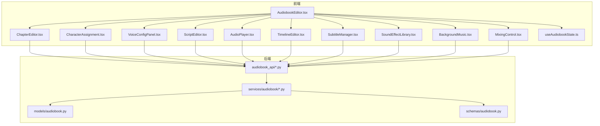

图表来源
- [frontend/src/pages/AudiobookEditor.tsx](file://frontend/src/pages/AudiobookEditor.tsx)
- [backend/app/api/v1/audiobook_api/chapters.py](file://backend/app/api/v1/audiobook_api/chapters.py)
- [backend/app/services/audiobook/chapter_service.py](file://backend/app/services/audiobook/chapter_service.py)
- [backend/app/models/audiobook.py](file://backend/app/models/audiobook.py)
- [backend/app/schemas/audiobook.py](file://backend/app/schemas/audiobook.py)

章节来源
- [frontend/src/pages/AudiobookEditor.tsx](file://frontend/src/pages/AudiobookEditor.tsx)
- [backend/app/api/v1/audiobook_api/chapters.py](file://backend/app/api/v1/audiobook_api/chapters.py)
- [backend/app/services/audiobook/chapter_service.py](file://backend/app/services/audiobook/chapter_service.py)
- [backend/app/models/audiobook.py](file://backend/app/models/audiobook.py)
- [backend/app/schemas/audiobook.py](file://backend/app/schemas/audiobook.py)

## 核心组件
- 章节编辑器：负责章节内容增删改查、段落级操作、版本快照与同步保存。
- 角色分配界面：将文本片段或对话行绑定到角色，支持批量分配与冲突检测。
- 语音配置面板：为每个角色选择 TTS 音色、调节语速/语调/音量、设置停顿与强调标记。
- 脚本编辑器：富文本编辑、语法高亮、实时预览（含对话标注与角色标签）。
- 音频播放器：播放/暂停、跳转、循环、音量控制、声道切换。
- 时间轴编辑器：可视化剪辑、切分、对齐、关键帧插入与拖拽重排。
- 字幕管理器：SRT/VTT/ASS 导入导出、时间码校对、多语言切换。
- 音效库：分类浏览、搜索、试听、一键插入到时间轴指定位置。
- 背景音乐：轨道添加、淡入淡出、循环、与对白/音效的相对音量平衡。
- 混音控制：总线音量、各轨推子、均衡器、压缩器、限幅器。
- 章节导航与进度跟踪：侧边栏目录、阅读进度、自动保存、断点续编。
- 质量检查：一致性校验、静音检测、爆音检测、ASR 回读对比、评分与建议。

章节来源
- [frontend/src/components/Audiobook/ChapterEditor.tsx](file://frontend/src/components/Audiobook/ChapterEditor.tsx)
- [frontend/src/components/Audiobook/CharacterAssignment.tsx](file://frontend/src/components/Audiobook/CharacterAssignment.tsx)
- [frontend/src/components/Audiobook/VoiceConfigPanel.tsx](file://frontend/src/components/Audiobook/VoiceConfigPanel.tsx)
- [frontend/src/components/Audiobook/ScriptEditor.tsx](file://frontend/src/components/Audiobook/ScriptEditor.tsx)
- [frontend/src/components/Audiobook/AudioPlayer.tsx](file://frontend/src/components/Audiobook/AudioPlayer.tsx)
- [frontend/src/components/Audiobook/TimelineEditor.tsx](file://frontend/src/components/Audiobook/TimelineEditor.tsx)
- [frontend/src/components/Audiobook/SubtitleManager.tsx](file://frontend/src/components/Audiobook/SubtitleManager.tsx)
- [frontend/src/components/Audiobook/SoundEffectLibrary.tsx](file://frontend/src/components/Audiobook/SoundEffectLibrary.tsx)
- [frontend/src/components/Audiobook/BackgroundMusic.tsx](file://frontend/src/components/Audiobook/BackgroundMusic.tsx)
- [frontend/src/components/Audiobook/MixingControl.tsx](file://frontend/src/components/Audiobook/MixingControl.tsx)
- [frontend/src/hooks/useAudiobookState.ts](file://frontend/src/hooks/useAudiobookState.ts)

## 架构总览
前端通过状态 Hook 集中管理章节、角色、语音、时间轴、字幕、音效与混音参数，调用后端 REST API 完成持久化与异步任务。后端路由接收请求，交由服务层编排业务逻辑，读写数据库模型与模式定义，必要时触发任务队列进行长耗时处理（如 TTS 合成、混音、质检）。

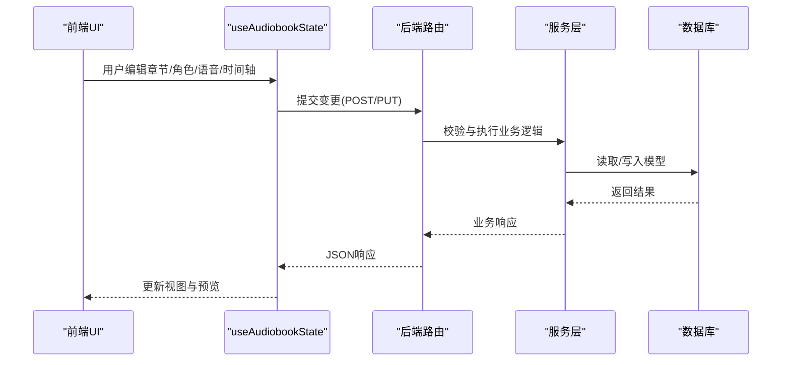

图表来源
- [frontend/src/hooks/useAudiobookState.ts](file://frontend/src/hooks/useAudiobookState.ts)
- [backend/app/api/v1/audiobook_api/chapters.py](file://backend/app/api/v1/audiobook_api/chapters.py)
- [backend/app/services/audiobook/chapter_service.py](file://backend/app/services/audiobook/chapter_service.py)
- [backend/app/models/audiobook.py](file://backend/app/models/audiobook.py)
- [backend/app/schemas/audiobook.py](file://backend/app/schemas/audiobook.py)

## 详细组件分析

### 章节编辑器
- 功能要点：章节创建/删除/排序、段落级编辑、草稿与发布状态、自动保存、撤销/重做、版本对比。
- 交互流程：用户在编辑器中修改内容，Hook 收集变更并通过 API 同步至后端；后端服务层校验并落库，返回最新状态供前端刷新。
- 错误处理：网络异常重试、字段校验失败提示、并发冲突乐观锁提示。

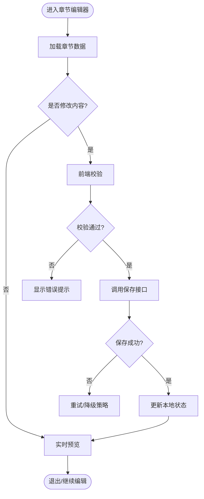

图表来源
- [frontend/src/components/Audiobook/ChapterEditor.tsx](file://frontend/src/components/Audiobook/ChapterEditor.tsx)
- [backend/app/api/v1/audiobook_api/chapters.py](file://backend/app/api/v1/audiobook_api/chapters.py)
- [backend/app/services/audiobook/chapter_service.py](file://backend/app/services/audiobook/chapter_service.py)

章节来源
- [frontend/src/components/Audiobook/ChapterEditor.tsx](file://frontend/src/components/Audiobook/ChapterEditor.tsx)
- [backend/app/api/v1/audiobook_api/chapters.py](file://backend/app/api/v1/audiobook_api/chapters.py)
- [backend/app/services/audiobook/chapter_service.py](file://backend/app/services/audiobook/chapter_service.py)

### 角色分配界面
- 功能要点：识别对话行与旁白，批量分配角色，冲突检测（同一行多角色），分配历史与回滚。
- 数据流：解析脚本中的对话标记，映射到角色实体，支持按章节范围限定分配范围。
- 质量控制：分配合理性建议、角色出场统计、台词长度分布。

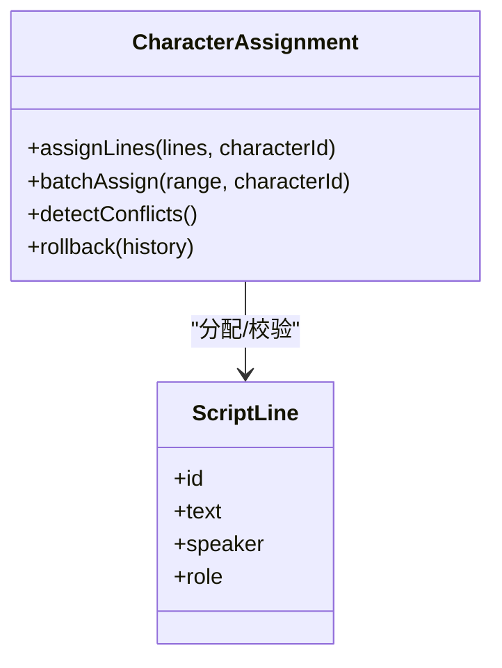

图表来源
- [frontend/src/components/Audiobook/CharacterAssignment.tsx](file://frontend/src/components/Audiobook/CharacterAssignment.tsx)
- [backend/app/schemas/audiobook.py](file://backend/app/schemas/audiobook.py)

章节来源
- [frontend/src/components/Audiobook/CharacterAssignment.tsx](file://frontend/src/components/Audiobook/CharacterAssignment.tsx)
- [backend/app/schemas/audiobook.py](file://backend/app/schemas/audiobook.py)

### 语音配置面板
- 功能要点：为角色选择 TTS 音色、调节语速/语调/音量、设置停顿与强调、预览与对比。
- 集成点：调用后端 TTS 预览接口，缓存音色样本，支持 A/B 对比与默认音色设定。
- 扩展性：多提供商适配、音色描述策略、音色一致性管理。

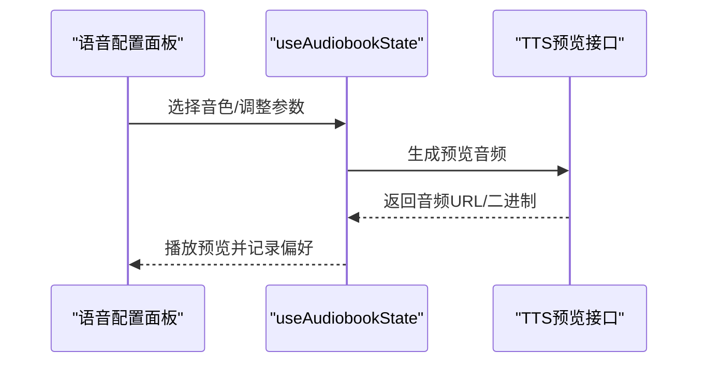

图表来源
- [frontend/src/components/Audiobook/VoiceConfigPanel.tsx](file://frontend/src/components/Audiobook/VoiceConfigPanel.tsx)
- [backend/app/api/v1/audiobook_api/audio.py](file://backend/app/api/v1/audiobook_api/audio.py)
- [backend/app/services/audiobook/audio_service.py](file://backend/app/services/audiobook/audio_service.py)

章节来源
- [frontend/src/components/Audiobook/VoiceConfigPanel.tsx](file://frontend/src/components/Audiobook/VoiceConfigPanel.tsx)
- [backend/app/api/v1/audiobook_api/audio.py](file://backend/app/api/v1/audiobook_api/audio.py)
- [backend/app/services/audiobook/audio_service.py](file://backend/app/services/audiobook/audio_service.py)

### 脚本编辑器（富文本、语法高亮、实时预览）
- 功能要点：Markdown/自定义语法高亮、对话标签识别、实时渲染预览、插入占位符与快捷模板。
- 交互细节：光标定位、自动补全、拼写检查、版本差异对比。
- 数据模型：脚本结构与元数据分离，便于后续分析与自动化处理。

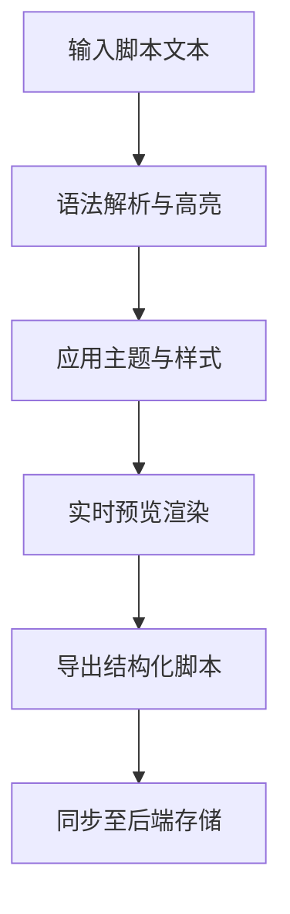

图表来源
- [frontend/src/components/Audiobook/ScriptEditor.tsx](file://frontend/src/components/Audiobook/ScriptEditor.tsx)
- [backend/app/api/v1/audiobook_api/script.py](file://backend/app/api/v1/audiobook_api/script.py)
- [backend/app/services/audiobook/script_service.py](file://backend/app/services/audiobook/script_service.py)

章节来源
- [frontend/src/components/Audiobook/ScriptEditor.tsx](file://frontend/src/components/Audiobook/ScriptEditor.tsx)
- [backend/app/api/v1/audiobook_api/script.py](file://backend/app/api/v1/audiobook_api/script.py)
- [backend/app/services/audiobook/script_service.py](file://backend/app/services/audiobook/script_service.py)

### 音频播放控制
- 功能要点：播放/暂停、快进快退、循环、音量、声道、播放列表、进度书签。
- 集成点：与时间轴联动，点击时间轴刻度跳转；与字幕同步滚动。
- 性能优化：预加载、分段缓冲、低延迟播放。

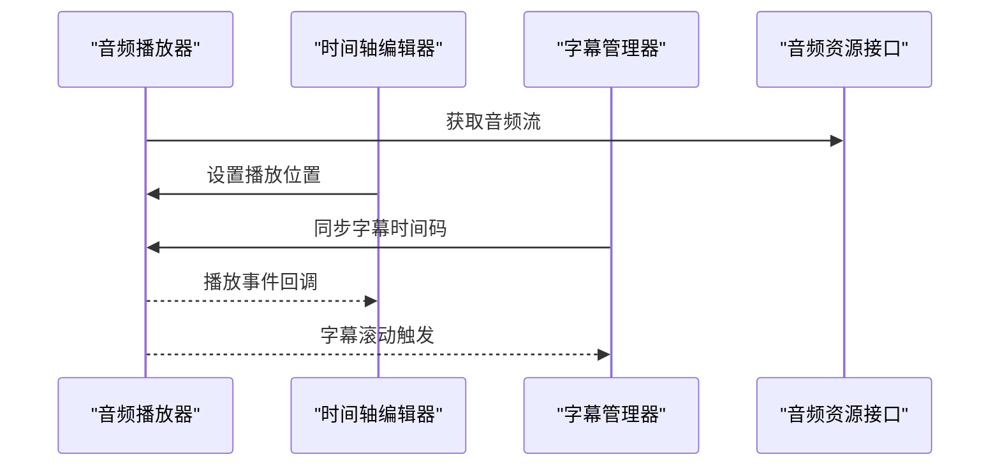

图表来源
- [frontend/src/components/Audiobook/AudioPlayer.tsx](file://frontend/src/components/Audiobook/AudioPlayer.tsx)
- [frontend/src/components/Audiobook/TimelineEditor.tsx](file://frontend/src/components/Audiobook/TimelineEditor.tsx)
- [frontend/src/components/Audiobook/SubtitleManager.tsx](file://frontend/src/components/Audiobook/SubtitleManager.tsx)
- [backend/app/api/v1/audiobook_api/audio.py](file://backend/app/api/v1/audiobook_api/audio.py)

章节来源
- [frontend/src/components/Audiobook/AudioPlayer.tsx](file://frontend/src/components/Audiobook/AudioPlayer.tsx)
- [frontend/src/components/Audiobook/TimelineEditor.tsx](file://frontend/src/components/Audiobook/TimelineEditor.tsx)
- [frontend/src/components/Audiobook/SubtitleManager.tsx](file://frontend/src/components/Audiobook/SubtitleManager.tsx)
- [backend/app/api/v1/audiobook_api/audio.py](file://backend/app/api/v1/audiobook_api/audio.py)

### 时间轴编辑
- 功能要点：可视化剪辑、切分、拼接、关键帧插入、拖拽重排、对齐网格、缩放与平移。
- 数据模型：片段对象包含起止时间、类型（对白/音效/BGM）、关联资源ID。
- 协作：多人编辑冲突合并、操作日志与回滚。

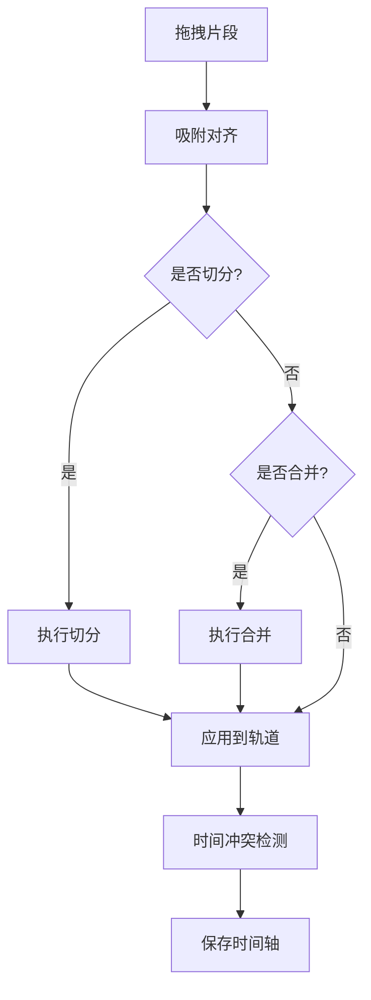

图表来源
- [frontend/src/components/Audiobook/TimelineEditor.tsx](file://frontend/src/components/Audiobook/TimelineEditor.tsx)
- [backend/app/api/v1/audiobook_api/audio.py](file://backend/app/api/v1/audiobook_api/audio.py)

章节来源
- [frontend/src/components/Audiobook/TimelineEditor.tsx](file://frontend/src/components/Audiobook/TimelineEditor.tsx)
- [backend/app/api/v1/audiobook_api/audio.py](file://backend/app/api/v1/audiobook_api/audio.py)

### 字幕管理
- 功能要点：SRT/VTT/ASS 导入导出、时间码校对、多语言切换、关键词高亮、审校批注。
- 自动化：ASR 自动生成初稿、人工校对、版本对比与合并。
- 同步：与时间轴和播放位置联动，滚动跟随。

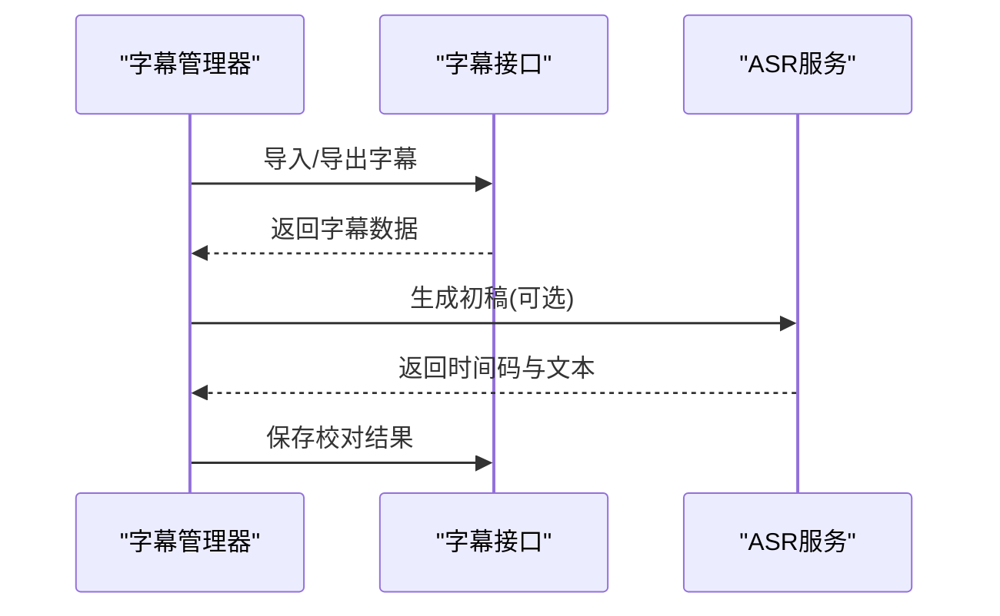

图表来源
- [frontend/src/components/Audiobook/SubtitleManager.tsx](file://frontend/src/components/Audiobook/SubtitleManager.tsx)
- [backend/app/api/v1/audiobook_api/audio.py](file://backend/app/api/v1/audiobook_api/audio.py)

章节来源
- [frontend/src/components/Audiobook/SubtitleManager.tsx](file://frontend/src/components/Audiobook/SubtitleManager.tsx)
- [backend/app/api/v1/audiobook_api/audio.py](file://backend/app/api/v1/audiobook_api/audio.py)

### 音效库浏览与插入
- 功能要点：分类检索、关键词搜索、试听、一键插入到时间轴指定位置、重复使用与收藏。
- 数据源：本地库与云端库聚合，元数据丰富（时长、风格、版权信息）。
- 质量控制：响度标准化、去噪、版权合规检查。

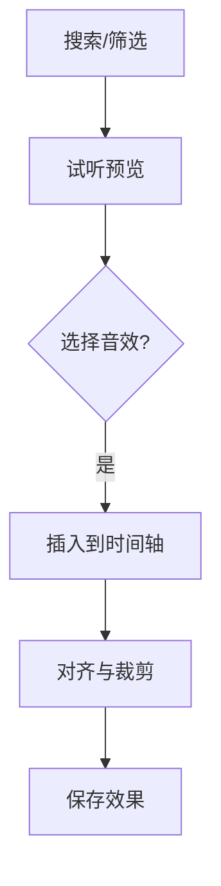

图表来源
- [frontend/src/components/Audiobook/SoundEffectLibrary.tsx](file://frontend/src/components/Audiobook/SoundEffectLibrary.tsx)
- [backend/app/api/v1/audiobook_api/audio.py](file://backend/app/api/v1/audiobook_api/audio.py)

章节来源
- [frontend/src/components/Audiobook/SoundEffectLibrary.tsx](file://frontend/src/components/Audiobook/SoundEffectLibrary.tsx)
- [backend/app/api/v1/audiobook_api/audio.py](file://backend/app/api/v1/audiobook_api/audio.py)

### 背景音乐添加与混音控制
- 功能要点：BGM 轨道添加、淡入淡出、循环、与对白/音效的相对音量平衡、场景化预设。
- 混音控制：总线音量、各轨推子、均衡器、压缩器、限幅器、声像定位。
- 输出：多轨导出、立体声/环绕声、响度规范（如 LUFS）。

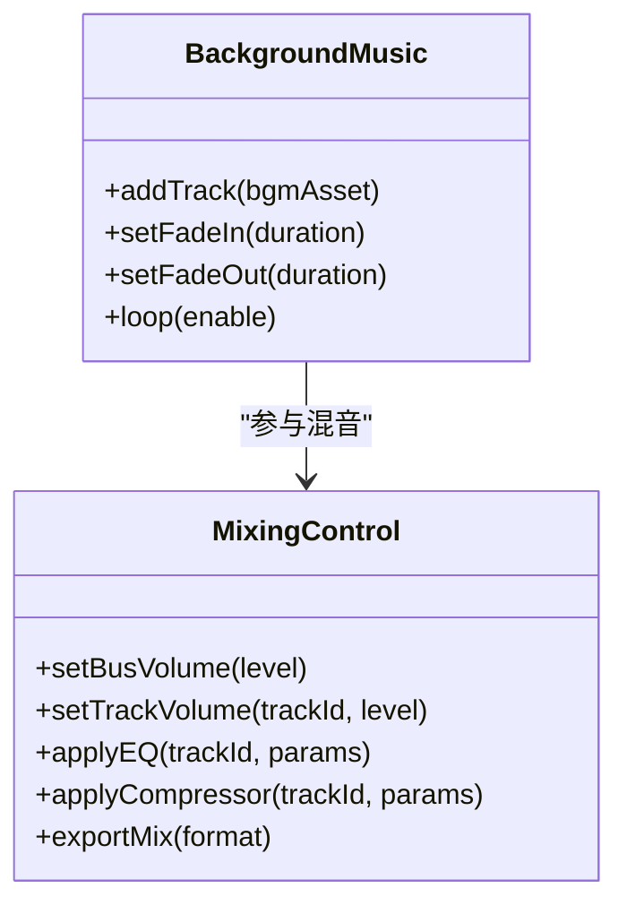

图表来源
- [frontend/src/components/Audiobook/BackgroundMusic.tsx](file://frontend/src/components/Audiobook/BackgroundMusic.tsx)
- [frontend/src/components/Audiobook/MixingControl.tsx](file://frontend/src/components/Audiobook/MixingControl.tsx)
- [backend/app/api/v1/audiobook_api/audio.py](file://backend/app/api/v1/audiobook_api/audio.py)

章节来源
- [frontend/src/components/Audiobook/BackgroundMusic.tsx](file://frontend/src/components/Audiobook/BackgroundMusic.tsx)
- [frontend/src/components/Audiobook/MixingControl.tsx](file://frontend/src/components/Audiobook/MixingControl.tsx)
- [backend/app/api/v1/audiobook_api/audio.py](file://backend/app/api/v1/audiobook_api/audio.py)

### 章节导航与进度跟踪
- 功能要点：侧边栏目录、快速跳转、阅读进度、自动保存、断点续编、章节摘要。
- 数据流：前端维护当前章节与位置，定期同步至后端；支持离线缓存与增量更新。
- 体验优化：懒加载章节内容、骨架屏、错误边界与恢复。

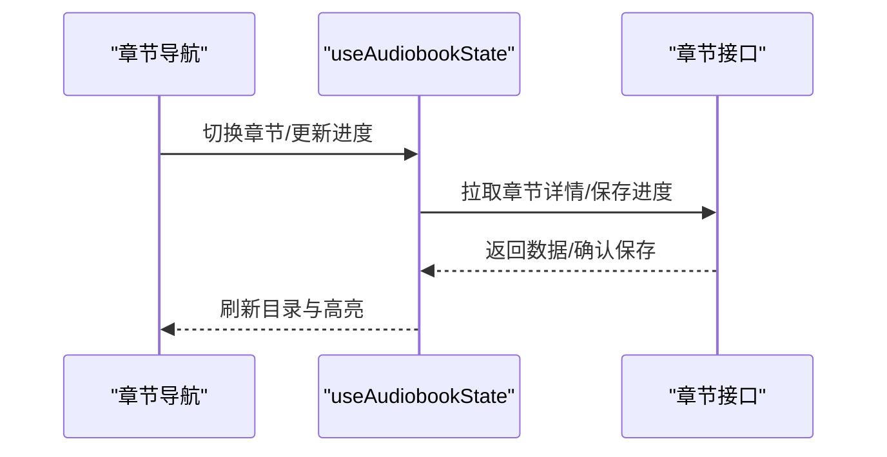

图表来源
- [frontend/src/hooks/useAudiobookState.ts](file://frontend/src/hooks/useAudiobookState.ts)
- [backend/app/api/v1/audiobook_api/chapters.py](file://backend/app/api/v1/audiobook_api/chapters.py)

章节来源
- [frontend/src/hooks/useAudiobookState.ts](file://frontend/src/hooks/useAudiobookState.ts)
- [backend/app/api/v1/audiobook_api/chapters.py](file://backend/app/api/v1/audiobook_api/chapters.py)

### 质量检查
- 功能要点：一致性校验（角色语气、术语）、静音检测、爆音检测、ASR 回读对比、评分与建议。
- 流程：触发质检任务，后台异步处理，结果以报告形式展示，支持一键修复建议。
- 指标：信噪比、动态范围、响度、语义一致性得分。

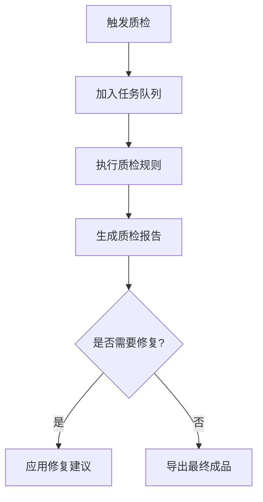

图表来源
- [backend/app/api/v1/audiobook_api/audio.py](file://backend/app/api/v1/audiobook_api/audio.py)
- [backend/app/services/audiobook/audio_service.py](file://backend/app/services/audiobook/audio_service.py)

章节来源
- [backend/app/api/v1/audiobook_api/audio.py](file://backend/app/api/v1/audiobook_api/audio.py)
- [backend/app/services/audiobook/audio_service.py](file://backend/app/services/audiobook/audio_service.py)

## 依赖关系分析
- 前端组件依赖 Hook 管理状态，Hook 依赖后端 API；组件之间通过事件与上下文通信。
- 后端路由依赖服务层，服务层依赖模型与模式定义；异步任务由队列驱动。
- 外部依赖：TTS 提供商、ASR 服务、媒体处理工具（FFmpeg）、云存储。

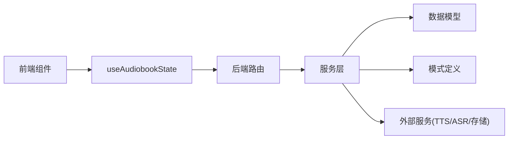

图表来源
- [frontend/src/hooks/useAudiobookState.ts](file://frontend/src/hooks/useAudiobookState.ts)
- [backend/app/api/v1/audiobook_api/chapters.py](file://backend/app/api/v1/audiobook_api/chapters.py)
- [backend/app/services/audiobook/chapter_service.py](file://backend/app/services/audiobook/chapter_service.py)
- [backend/app/models/audiobook.py](file://backend/app/models/audiobook.py)
- [backend/app/schemas/audiobook.py](file://backend/app/schemas/audiobook.py)

章节来源
- [frontend/src/hooks/useAudiobookState.ts](file://frontend/src/hooks/useAudiobookState.ts)
- [backend/app/api/v1/audiobook_api/chapters.py](file://backend/app/api/v1/audiobook_api/chapters.py)
- [backend/app/services/audiobook/chapter_service.py](file://backend/app/services/audiobook/chapter_service.py)
- [backend/app/models/audiobook.py](file://backend/app/models/audiobook.py)
- [backend/app/schemas/audiobook.py](file://backend/app/schemas/audiobook.py)

## 性能考量
- 前端：虚拟滚动、懒加载、增量更新、防抖节流、Web Worker 处理大文本。
- 后端：分页查询、缓存热点数据、异步任务队列、连接池、限流与熔断。
- 媒体处理：分段下载、并行转码、GPU 加速（如可用）、流式传输。

## 故障排查指南
- 常见问题：API 超时、权限不足、资源未找到、格式不支持、并发冲突。
- 诊断步骤：查看浏览器控制台与网络请求、后端日志、任务队列状态、数据库锁与索引。
- 恢复策略：重试机制、降级路径、回滚版本、清理临时文件。

章节来源
- [backend/app/api/v1/audiobook_api/chapters.py](file://backend/app/api/v1/audiobook_api/chapters.py)
- [backend/app/api/v1/audiobook_api/script.py](file://backend/app/api/v1/audiobook_api/script.py)
- [backend/app/api/v1/audiobook_api/audio.py](file://backend/app/api/v1/audiobook_api/audio.py)

## 结论
本有声书编辑页面以模块化前端组件与分层后端架构为基础，覆盖从脚本编辑、角色与语音配置、时间轴剪辑、字幕管理到混音与质检的全链路能力。通过清晰的数据流与错误处理机制，保障编辑体验与产出质量。建议持续优化性能与可观测性，完善自动化质检与修复闭环，提升整体效率与稳定性。

## 附录
- 术语表：章节、角色、TTS 音色、时间轴、字幕、音效、背景音乐、混音、质量检查。
- 最佳实践：命名规范、版本管理、备份与恢复、安全与隐私。
- 扩展方向：多模态素材（图像/视频）、协作编辑、AI 辅助创作、跨平台发布。